# 3. 用于分类的支持向量机

科学是对经验的系统分类。 ——乔治·亨利·刘易斯

本章详细介绍`支持向量机`（SVM）技术，这是一种稀疏核决策机器，在构建其学习模型时避免计算后验概率。SVM 为机器学习问题提供了一种原则性的方法，因为它具有`统计学习理论`的数学基础。SVM 根据训练输入的一个子集来构建其解决方案。SVM 已广泛用于分类、回归、新颖性检测任务和特征降维。本章仅关注用于监督分类任务的 SVM，提供了当输入空间线性可分、线性不可分以及数据不平衡时的 SVM 公式，并附有示例。本章还介绍了对原始 SVM 公式的最新改进和扩展。最后以一个案例研究结束本章。

## 从几何视角看 SVM

在分类任务中，判别式机器学习技术旨在基于独立同分布（iid）的训练数据集，寻找一个能够正确预测新实例标签的判别函数。与需要计算条件概率分布的生成式机器学习方法不同，判别式分类函数接收数据点 `x` 并将其分配到分类任务中的不同类别之一。生成式方法主要用于涉及异常值检测的预测，虽然其能力更强，但判别式方法所需的计算资源和训练数据更少，尤其是在处理多维特征空间或仅需后验概率时。从几何角度来看，学习一个分类器等价于寻找一个多维曲面的方程，该曲面能在特征空间中最优地分隔不同类别。

SVM 是一种判别式技术，由于它能解析地求解凸优化问题，因此总能返回相同的`最优超平面参数`——这与遗传算法（GA）或感知机形成对比，后两者在机器学习分类中也被广泛使用。对于感知机而言，其解高度依赖于初始化和终止条件。

对于将数据从输入空间转换到特征空间的特定核函数，训练过程会为给定的训练集返回唯一确定的 SVM 模型参数，而感知机和 GA 分类器模型在每次训练初始化时都会得到不同的结果。GA 和感知机的目标仅是在训练期间最小化误差，这会导致多个超平面满足这一要求。如果在训练阶段可以学习到多个超平面，那么只有最优的那个会被保留，因为训练实际上是在总体的样本上进行的，尽管测试数据可能不呈现与训练集相同的分布。当使用不能代表整体数据总体的数据进行训练时，超平面容易产生较差的泛化能力。

图 3-1 展示了在二维、二类数据上，使用 SVM、感知机和 GA 分类器得到的不同超平面。被圆圈包围的点代表支持向量，而对应于不同分类器的超平面根据图例以不同颜色显示。

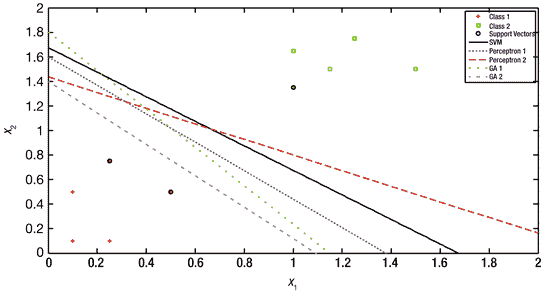

图 3-1. SVM、感知机和 GA 超平面的二维二类图

注：SVM 与 ANN 对比

总的来说，SVM 源于一套稳健的实现理论，而人工神经网络（ANN）则是启发式地从应用走向理论。

SVM 与 ANN 的区别在于，它不受经典的多局部极小值问题——即维数灾难和过拟合的双重诅咒——的影响。当机器学习模型力求在所有训练数据上实现零误差时，就会发生过拟合。对于训练指标依赖于平方误差和变体的机器学习方法，过拟合更可能发生。与 ANN 通过最小化经验风险不同，SVM 通过最小化结构风险来避免过拟合。

SVM 不像 ANN 那样通过限制特征集来控制模型复杂度；相反，它通过选择支持向量的数量来自动确定模型复杂度。

## SVM 的主要特性

SVM 深深植根于统计学、优化和机器学习的原理，由 Boser、Guyon 和 Vapnik（1992）在第五届年度计算机协会计算学习理论研讨会上正式提出。[Bartlett（1998）正式揭示了硬间隔 SVM 泛化能力的统计界限。] SVM 依赖于假设空间的复杂度和经验误差（衡量模型拟合训练数据程度的指标）。`Vapnik-Chervonenkis`（`VC`）理论证明了风险存在 `VC` 界限。`VC` 是假设空间复杂度的一种度量。假设 `H` 的 `VC` 维度与 `H` 能够打散的最大点数相关。如果 `H` 能正确地将所有正实例与负实例分开，则 `H` 打散了 `N` 个点。换句话说，`VC` 容量等于模型能够将其分离成 `2^N` 种不同标签的训练点数 `N`。该容量与可用的训练数据量有关。`VC` 维度 `h` 影响泛化误差，其界限由下式给出：``，其中 `w` 是分离超平面的权重向量，`R` 是包含所有训练点的最小球体的半径。机器学习模型的总误差由 `ε = ε[emp] + ε[g]` 组成，其中 `ε[emp]` 是训练误差，`ε[g]` 是泛化误差。模型 `f` 的经验风险为 ``。

风险的下界为 ``，其中 `` 是该界限对于 `VC` 维度为 `h` 的函数类中任何函数成立的概率，且与数据分布无关。

注：可以定义 `2^N` 个不同的学习问题，因为 `N` 个点可以以 `2^N` 种方式被标记为正或负。例如，对于三个点，有 `24` 种不同的标签和 `8` 种不同的可学习分类边界。因此，在 `R²` 中的 `VC` 维度是 `3`。

SVM 优雅地将 20 世纪 60 年代研究中已经提出的多个特征组合在一起，形成了所谓的最大间隔分类器。SVM 借鉴了大间隔超平面（Duda 1973；Cover 1995；Vapnik 和 Lerner 1963；Vapnik 和 Chervonenkis 1964）、作为特征空间内积的核函数（Aizermann、Braverman 和 Rozonoer 1964）、核函数的使用（Aizermann、Braverman 和 Rozonoer 1964；Wahba 1990；Poggio 1990）以及稀疏性（Cover 1995）等概念。Mangasarian（1965）也提出了一种类似于 SVM 所采用的优化方法。用于处理数据中的噪声和不可分性的松弛变量概念最初由 Smith（1968）引入，并由 Bennett 和 Mangasarian（1992）进一步改进。Cortes（1995）将其纳入 SVM 公式，软间隔 SVM 通过采用松弛变量的概念来处理分离边界处的噪声数据，从而成为硬间隔 SVM 的一种改进。（对于有兴趣深入探究 SVM 基础的读者，可参阅 Vapnik 1998、1999 年对 SVM 理论的详尽论述。）

SVM 以其稳健性、良好的泛化能力和唯一的全局最优解而闻名，可能是监督学习中最流行的机器学习方法，但其原理却非常简单。Meyer、Leisch 和 Hornik（2003）在 21 个数据集上将 SVM 与 16 种分类器进行比较，结果表明 SVM 是机器学习中最强大的分类器之一。自 1992 年问世以来，SVM 已广泛应用于众多领域，例如天气预报、功率估算、股票预测、缺陷分类、说话人识别、笔迹识别、图像和音频处理、视频分析以及医学诊断。

SVM 之所以成为一个有吸引力的机器学习框架，可归纳为以下特性：

- SVM 是一种稀疏技术。与非参数方法类似，SVM 要求在训练阶段（即学习 SVM 模型参数时）所有训练数据都可用，并存储在内存中。然而，一旦模型参数确定，SVM 仅依赖这些训练实例的一个子集（称为`支持向量`）来进行未来预测。支持向量定义了超平面的边界。支持向量是在一个优化步骤之后找到的，该步骤涉及一个由误差项和约束条件通过拉格朗日松弛法正则化的目标函数。¹ 使用 SVM 进行分类任务的复杂度取决于支持向量的数量，而非输入空间的维度。最终从原始数据集中保留的支持向量数量取决于数据本身，并会根据数据复杂度（由数据维度和类别可分性决定）而变化。支持向量数量的上限是训练数据集大小的一半，但在实践中很少达到这个上限。本章中数学描述的 SVM 模型被表示为支持向量的加权和，这使得 SVM 框架在测试计算时间和存储需求方面具有与参数化技术相同的优势。

- SVM 是一种核技术。SVM 使用核技巧将数据映射到更高维的空间，然后将机器学习任务作为一个凸优化问题来解决，在该问题中，最优解是通过解析方式而非启发式方式找到的，这与其它机器学习技术不同。通常，现实生活中的数据在原始输入空间中并非线性可分。换句话说，具有不同标签的实例以某种方式共享输入空间，从而阻止线性超平面正确分离分类任务中涉及的不同类别。尝试在输入空间中学习非线性分离边界会增加优化阶段的计算需求，因为分离曲面至少是二阶的。相反，SVM 使用预定义的核函数将数据映射到一个新的、更高维的空间，在该空间中，线性分类器将能够区分不同的类别。因此，SVM 的优化阶段将仅涉及在映射空间中学习一个线性判别曲面。当然，核函数的选择和设置对于 SVM 的最优性至关重要。

# 概述
SVM是一种最大间隔分类器。除了基于训练数据集最小化误差或代价函数（类似于其他判别式机器学习技术）之外，SVM还对优化问题施加了一个额外的约束：超平面需要被定位在距离不同类别最大距离的位置。这样的项迫使优化步骤找到最终能更好泛化的超平面，因为它位于与各类别等距且距离最大的位置。这一点至关重要，因为训练是在总体的一个样本上进行的，而预测则要在尚未见过的实例上进行，这些实例的分布可能与训练子集的分布略有不同。

SVM使用结构风险最小化（SRM），并满足对偶性和凸性要求。SRM（Vapnik 1964）是一种归纳原则，用于从有限的训练数据集中选择模型进行学习。作为容量控制的指标，SRM提出了VC维度（即假设空间复杂度）与经验误差之间的权衡。SRM的公式是一个凸优化问题，其代价函数中有n个变量需要最大化，并带有m个约束条件，可在多项式时间内求解。SRM使用一组按复杂度递增顺序排列的模型。图3-2展示了整体模型误差如何随机器学习模型的复杂度指标变化。对于非复杂模型，误差很高，因为简单模型无法捕捉数据的所有复杂性，导致欠拟合情况。随着复杂度指标的增加，误差在最优模型（索引为`h*`）处达到最小值，之后又开始增加。对于高模型指标，结构开始使其学习模型适应训练数据，这会导致过拟合，从而降低训练误差值并增加模型的VC维度，但代价是测试误差的恶化。

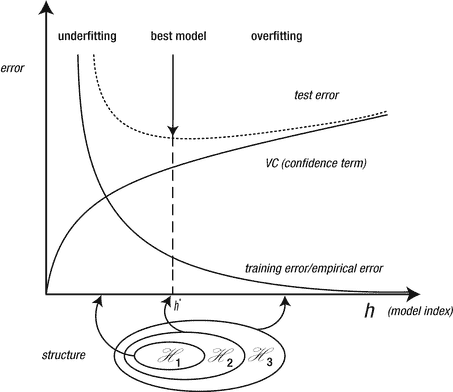

**图 3-2.**

误差趋势与模型指标之间的关系

## 硬间隔支持向量机
SVM技术是一种分类器，它寻找一个超平面或函数`g(x)`，以最大间隔正确分离两个类别。图3-3展示了一个对应于硬间隔SVM（也称为线性SVM）的分离超平面。

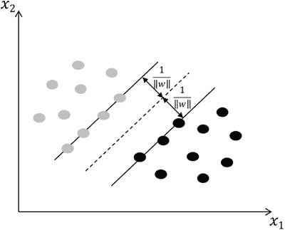

**图 3-3.**

硬最大间隔分离超平面

从数学上讲，给定一组属于两个线性可分类别`ω[1]`、`ω[2]`的点`x [i]`，任何实例到超平面的距离等于`1/||w||`。SVM的目标是找到`w`、`b`，使得对于属于类别`ω[1]`的最近数据点，`g(x)`的值等于1，而对于`ω[2]`的最近数据点，其值等于-1。

这可以看作具有一个间隔：

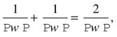

其中`g(x) = wx + b`且`||w|| = 1`。

这导致了一个优化问题，即最小化目标函数：

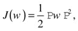

并满足约束条件：

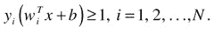

当一个优化问题（无论是最小化还是最大化）在待优化的变量中存在约束时，代价函数或误差函数会通过添加乘以拉格朗日乘子的约束条件来进行增广。

换句话说，SVM的拉格朗日函数是通过用约束条件的加权和来增广目标函数而形成的：

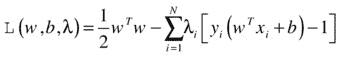

其中`w`和`b`被称为原始变量，`λ [i]`是拉格朗日乘子。

因此，这些乘子将解的搜索空间限制在给定约束条件下的可行值集合内。在存在不等式约束的情况下，卡罗需-库恩-塔克（KKT）条件推广了拉格朗日乘子法。

KKT条件如下：

原始约束

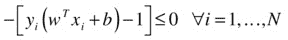

对偶约束

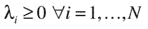

互补松弛性

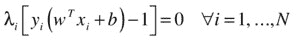

拉格朗日函数的梯度（相对于原始变量为零）

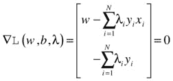

基于KKT条件：

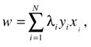

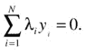

> **注意**
> 这些条件出现在Kuhn和Tucker（1951）的一项研究中，也见于Karush（1939）未发表的硕士论文。

由于大多数线性规划问题成对出现，一个具有n个变量和m个约束的原始问题可以重写为具有m个变量和n个约束的Wolfe对偶形式，而原始和对偶形式适用相同的解。对偶定理对此进行了形式化，指出一种形式的变量数量等于互补形式的约束数量。互补松弛性是原始形式和对偶形式之间的关系：当将其添加到不等式中时，松弛变量会将它们转化为等式。

SVM优化的对偶问题是寻找：

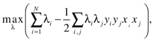

并满足：

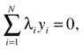

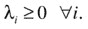

> **注意**
> 最后一个约束对于解的最优性至关重要。在最优解处，对偶变量必须非负，因为对偶变量乘以一个正数。由于负的拉格朗日乘子会降低函数值，因此最优解不能有负的拉格朗日乘子。有效或起作用的约束具有相应的非零乘子，而不起作用的约束乘子为零，并且不影响问题的解。因此，SVM超平面参数由有效、起作用的约束定义，这些约束对应于非零的拉格朗日乘子，即支持向量。

求解上述问题的对偶形式有若干好处。首先，即使原始问题不是凸的，对偶问题也总是具有唯一的最优解。其次，目标函数的值是原始问题最优函数值的下界。最后，对偶变量的数量可能远少于原始变量的数量；因此，以对偶形式表述的优化问题可以更快、更高效地求解。

## 软间隔支持向量机
当数据不完全可分时，如图3-4中用X标记的点所示，松弛变量`ξ[i]`被引入SVM目标函数，以允许分类错误。在这种情况下，SVM不再寻找能够完美分类所有数据的硬间隔。相反，SVM现在是一个软间隔分类器；也就是说，SVM正确分类了大部分数据，同时允许模型在分离边界附近错误分类少数点。

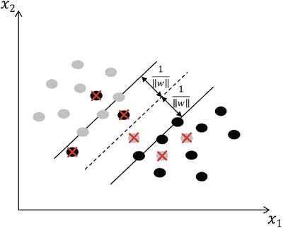

**图 3-4.**

作为软间隔SVM一部分的少量错误分类

现在，原始形式的问题是最小化目标函数：

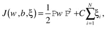

并满足以下两个约束条件：

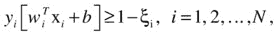

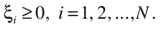

## 正则化项或盒约束 C

正则化项或盒约束 `C` 是一个参数，其值根据优化目标而变化。随着 `C` 的增加，会得到更紧的间隔，并且更侧重于最小化错误分类的数量。随着 `C` 的减小，允许更多的违规，因为最大化两个类别之间的间隔成为 SVM 的目标。图 3-5 展示了正则化参数对间隔宽度和错误分类的影响。对于 `C[2]`，`C[2]` 的间隔内训练点少于 `C[1]`，但后者具有更宽的间隔。

```
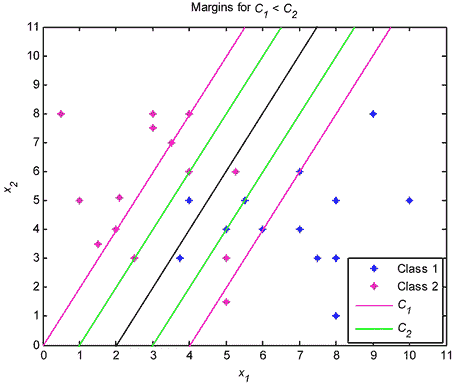
```

图 3-5. 盒约束对 SVM 性能的影响

在对偶形式中，软间隔 SVM 的公式为：

```
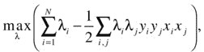
```

并满足：

```
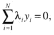
```

```
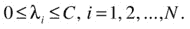
```

软间隔对偶问题与硬间隔对偶问题等价，只是对偶变量受正则化参数 `C` 的上界约束。

## 核 SVM

当问题在输入空间中线性不可分时，软间隔 SVM 无法找到一个既能最小化误分类数据点数量，又能具备良好泛化能力的鲁棒分离超平面。为此，可以使用核函数将数据转换到更高维的空间（称为核空间），在该空间中数据将变得线性可分。因此，可以在核空间中获取一个线性超平面来分离分类任务中涉及的不同类别，而无需在输入空间中求解高阶的分离超曲面。这是一种有吸引力的方法，因为与学习非线性曲面相比，进入核空间的开销微不足道。

核函数应是一个厄米且半正定的矩阵，并且需要满足 Mercer 定理，这转化为在所有数据点对上评估核矩阵或 Gram 矩阵，使其为正且半正定，形成

```
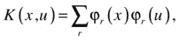
```

其中 `ϕ(x)` 属于希尔伯特空间。换句话说，

```
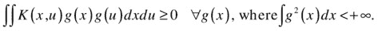
```

一些常用的核函数包括：

*   线性核：
    ```
    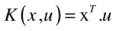
    ```
*   多项式函数：
    ```
    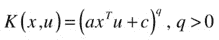
    ```
*   双曲正切（Sigmoid）：
    ```
    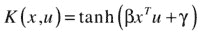
    ```
*   高斯径向基函数（RBF）：
    ```
    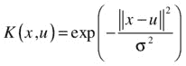
    ```
*   拉普拉斯径向基函数：
    ```
    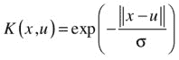
    ```
*   随机区组方差分析（`ANOVA RB`）核：
    ```
    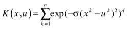
    ```
*   一维线性样条核：
    ```
    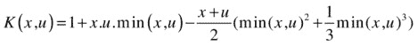
    ```

核函数的选择在很大程度上取决于数据的具体情况。例如，线性核（所有核中最简单的一种）适用于大型稀疏数据向量。然而，它的性能不如多项式核，后者可以避免 Hessian 矩阵归零。多项式核广泛应用于图像处理，而 `ANOVA RB` 核通常保留用于回归任务。高斯和拉普拉斯 `RBF` 是通用核，主要在没有先验知识的情况下使用。如果最终得到的核矩阵是对角矩阵，则表明特征空间是冗余的，应在特征降维后尝试其他核函数。

请注意，当使用核函数将特征向量从输入空间转换到核空间以处理线性不可分数据集时，对于大数据而言，核矩阵的计算需要大量的内存和计算资源。

图 3-6 展示了二维异或（`XOR`）数据，这是一种在输入空间（左上）以及特征空间中均线性不可分的分布。在特征空间中，应用核函数后，为四个输入创建了 16 个点（针对不同的集合）。高斯 `RBF` 核平滑参数 `σ²` 的选择会影响数据在核空间中的分布。由于参数值的选择对于将数据从线性不可分空间转换为线性可分空间至关重要，因此会执行网格搜索来寻找最合适的值。

```
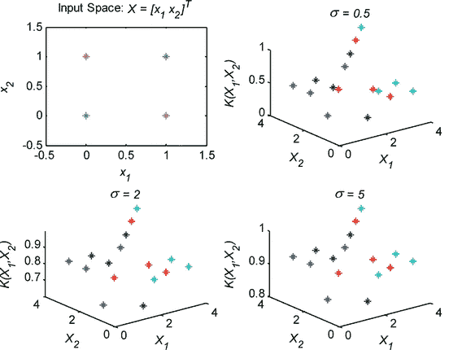
```

图 3-6. 二维 `XOR` 数据，从输入空间到核空间

核 SVM 的原始形式为

```
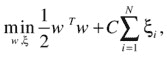
```

约束条件为

```
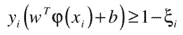
```

和

```
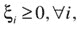
```

其中 `ϕ(x[i])` 满足

```
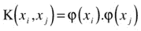
```

同样，SVM 的解应满足 KKT 条件，如下所示：

```
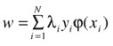  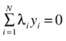  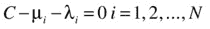  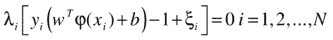  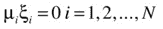  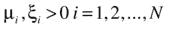
```

如前所述，该问题的对偶形式求解效率更高，并被用于大多数 SVM 实现中：

```
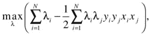
```

约束条件为

```
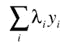
```

> **注意：** 对于大小为 `N` 的数据集，核矩阵有 `N²` 个条目。因此，随着 `N` 的增加，计算核矩阵变得低效甚至不可行，使得 SVM 难以求解。然而，一些算法通过将优化问题分解为多个较小的子问题，缓解了这一问题。

## 多类支持向量机

将 SVM 二分类扩展到多类情况的早期工作由 Weston 和 Watkins（1999 年）以及 Platt（2000 年）完成。研究人员设计了多种策略来解决多分类问题，包括一对多、成对分类以及多分类公式化方法，下文将逐一讨论。

# 支持向量机的多类分类与不平衡数据集处理

## 一对多（One-Against-All, OAA）方法

一对多（也称为一对其余[`OAA`]）可能是最早的 SVM 多类实现方法，也是最常用的多类 SVM 之一。它构建了 `c` 个二值 SVM 分类器，其中 `c` 是类别数。每个分类器将一个类别与所有其他类别区分开来，从而将问题简化为二分类问题。存在 `c` 个决策函数：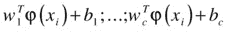。OAA 方法的初始公式规定，当且仅当一个类别接受了某个数据点，而所有其他类别都未接受时，才将该数据点分配给该类别。当多个类别接受它或所有类别都拒绝它时，特征空间中会留下未决策区域。Vapnik（1998）建议将数据点分配给输出值最高的类别，无论其符号如何。最终的标签输出被赋予具有最高输出值的类别：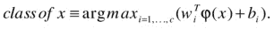

## 一对一（One-Against-One, OAO）方法

由 Knerr、Personnaz 和 Dreyfus（1990 年）提出，并由 Friedman（1996 年）和 Kressel（1999 年）首次在 SVM 中采用，成对分类（也称为一对一[`OAO`]）构建了 `c(c – 1)/2` 个二值 SVM，每个 SVM 仅用于区分 `c` 个类别中的两个，并且需要评估 `(c – 1)` 个 SVM 分类器。对于来自第 `k` 类和第 `j` 类的训练数据，(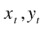) 的约束条件为 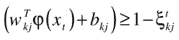，对于   对于  

## 多分类目标函数

多分类目标函数可能具有最紧凑的形式，因为它在一个步骤中优化了问题。其决策函数与 OAA 技术相同。多分类目标函数构建了 `c` 个二类规则，并且 `c` 个决策函数求解以下约束条件： 。

## 方法比较与层次化SVM

对于合理大小的数据集，不同多分类技术的准确性是可比的。对于任何特定问题，最优方法的选择部分取决于所需的准确性，部分取决于开发和训练时间目标。例如，从计算成本的角度来看，`OAA` 和 `OAO` 差异很大。假设有 `c` 个不同的类别，共 `N` 个实例，并且 `T(N [1])` 表示学习一个二值分类器所需的时间。使用 `N [1]` 个样本，`OAA` 的学习时间为 `cN ^( 3)`，而 `OAO` 则需要 `4(c – 1)N ^( 3)/ c ²`。

尽管 SVM 参数模型允许在构建判别函数时进行调整，但对于多类问题，这些参数并不总是适用于整个数据集。因此，有时更可取的做法是将数据划分为具有相似特征的子组，并分别推导分类器参数。这个过程产生了多级 SVM（`MSVM`）或层次化 SVM，如 Stockman（2010 年）所示，它可以产生更高的泛化准确性并降低过拟合的可能性。图 3-7 展示了单个 SVM 和 `MSVM` 的图形表示。


图 3-7. 单个多类 SVM 与 `MSVM` 流程

采用多级方法，可以为每个阶段分别优化不同的核函数和调优参数。第一阶段的 SVM 可以训练用于区分单个类别和其余类别。在下一阶段，SVM 可以调整不同的核函数以进一步区分剩余类别。因此，将存在一个二值分类器，每个阶段实现一个决策函数。

作为多类 SVM 的替代方案，层次化 SVM 在整体模型误差方面具有优势。通过选择合适的核函数和平滑元参数值，SVM 的准确性接近贝叶斯最优规则。此外，根据定义，对于一个具有 `M c[i]` 个类别的多类问题，以及一个输入向量 `x`，，因为类别应覆盖整个搜索空间。当所考虑的类别不是等概率时，最大值  必须大于 `1/M`；否则，总和将小于 1。例如，假设正确分类的概率为

其中 `R [i]` 是特征空间中决策支持 `c [ i]` 的区域。根据区域 `R [i]` 的定义，

➩;
因此，多分类错误的概率为

随着类别数 `M` 的增加，对于扁平化的多分类公式，`P [e]` 会增加。对于层次化分类，多分类任务在每个阶段被简化为二分类任务，其中 。因此，与扁平化的多分类任务相比，层次化任务的累积误差预计会渐近收敛到一个更低的值。

## 支持向量机与不平衡数据集

在许多实际应用和非合成数据集中，数据往往是不平衡的；也就是说，重要类别（通常称为少数类）的样本数量远少于另一类别（通常称为多数类）。当少数类的风险损失高于多数类时，类别不平衡对分类算法构成了重大挑战。当少数类数据点比多数类数据点更重要，且主要目标是正确分类这些少数类数据点时，以优化整体准确率为导向的标准机器学习方法并不理想；它会产生偏向多数类的超平面，从而导致泛化能力差。

在处理不平衡数据集时，整体准确率是衡量分类器性能的一个有偏指标。相反，混淆矩阵及其包含的真阳性（`TP`）和假阳性（`FP`）信息，能更好地指示分类器的性能。混淆矩阵在无监督学习中称为匹配矩阵，在机器学习以外的领域称为误差矩阵或列联矩阵，它直观地展示了实际类别与预测类别的准确率。

### 准确率指标

混淆矩阵如下所示：

| 预测/实际类别 | 正类 | 负类 |
| --- | --- | --- |
| 正类 | `TP` | `FP` |
| 负类 | `FN` | `TN` |

准确率是指被分类算法正确分类的数据点数量：


正类是对设计者而言最重要的类别，通常也是少数类。

真阳性（`TP`）（在某些领域也称为召回率）是指从正类中正确分类的数据点数量。

假阳性（`FP`）是指被预测为正类但实际上属于负类的数据点数量。

真阴性（`TN`）是指从负类中正确分类的数据点数量。

假阴性（`FN`）是指被预测为负类但实际上属于正类的数据点数量。

灵敏度（也称为真阳性率 [`TPR`] 或召回率 [`RR`]）是衡量分类算法对正类数据点分类效果的一个指标：


特异度（也称为真阴性率 [`TNR`]）是衡量分类算法对负类数据点分类效果的一个指标：


# ROC 与 SVM 处理不平衡数据分类

受试者工作特征（`ROC`）曲线为在不平衡数据集上运行的分类器提供了另一种有用的图形表示。`ROC` 最初由雷达和电气工程师在第二次世界大战期间为通信和目标预测而开发，后来也被诊断决策领域所采用。Fawcett（2006）对 `ROC` 分析进行了全面介绍，并强调了常见的误解。

最初的 `SVM` 公式在其监督学习阶段并未考虑类别不平衡问题。但是，后续研究提出了针对不平衡数据集分类的 `SVM` 公式修改方案。

先前关于 `SVM` 的工作要么通过预处理数据，要么通过对 `SVM` 公式提出算法修改来解决类别不平衡问题。Kubat（1997）建议通过随机欠采样多数类（而非过采样少数类）来平衡数据集。然而，这会导致多数类的信息丢失。Veropoulos、Campbell 和 Cristianini（1999）为正类和负类引入了不同的损失函数，以惩罚少数类数据点的错误分类。Tax 和 Ruin（1999）通过使用支持向量数据描述（`SVDD`）解决了类别不平衡问题，其目标是找到一个能够包含少数类并尽可能将其与异常值分离的球体。Feng 和 Williams（1999）提出了广义缩放 `SVM`（`GS-SVM`），这是 `SVM` 的另一种变体，它在训练 `SVM` 后引入了一个超平面平移。平移距离被添加到 `SVM` 公式中；平移距离是通过将数据点投影到训练后超平面的法向量上，并找到整个数据集的分布尺度来计算的（Das 2012）。Chang 和 Lin（2011）提出了加权散度 `SVM`（`WSD-SVM`），它通过使用数据点的散度及其基于位置的权重，将全局信息嵌入到 `GS-SVM` 中。

在数据和算法层面，人们已经做出了许多努力来学习不平衡数据。在学习分类器之前对数据进行预处理，可以通过复制少数类进行过采样以平衡类别分布，或者对多数类进行欠采样，通过从该类中随机消除样本来平衡数据（Kotsiantis, Kanellopoulos, and Pintelas 2006）。Tang 等人（2009）推荐了粒度 `SVM` 重复欠采样（`GSVM-RU`）算法，该算法并非使用随机欠采样多数类来获得平衡数据集，而是使用 `SVM` 本身——其思想是形成多个多数信息粒度，从中提取局部多数支持向量，然后与少数类聚合。Ou、Hung 和 Oyang（2006）以及 Napierała、Stefanowski 和 Wilk（2010）提出了另一种从不平衡数据中学习分类器的重采样方法。这些作者得出结论，只有当数据严重受到噪声或边界样本影响时，他们提出的重采样方法才能优于已知的过采样方法。合成少数类过采样技术（`SMOTE`）算法（Chawla 等人，2002）通过在给定的少数类数据点与其最近的少数类邻居之间引入人工少数类样本来对少数类进行过采样。`SMOTE` 算法的扩展版本已被开发出来，包括一种在距离空间中工作的版本（Koknar-Tezel and Latecki 2010）。成本敏感方法也已用于不平衡数据学习。这些方法为错误分类任何数据样本定义了一个成本矩阵，并将该矩阵拟合到分类算法中（He and Garcia 2009）。

Tax 和 Duin（2004）提出了单类 `SVM`，它倾向于仅从少数类中学习。单类 `SVM` 旨在估计概率密度函数，该函数对少数类中的元素给出正值，对其他所有元素给出负值。

通过向少数类的支持向量引入一个乘法因子 `z`，Imam、Ting 和 Kamruzzaman（2006）认为，学习到的 `SVM` 的偏差将自动减少，而无需提供任何额外参数，也无需调用多次 `SVM` 训练。

Akbani、Kwek 和 Japkowicz（2004）提出了一种基于 `SMOTE` 算法与正类和负类不同错误成本相结合的算法。Wang 和 Japkowicz（2010）也聚合了不同的惩罚因子，并使用 `SVM` 分类器集成来改善单个分类器的错误，并处理学习到的 `SVM` 偏斜问题。为了尝试使用 `SVM` 标准公式改进不平衡数据集的分类，Ajeeb、Nayal 和 Awad（2013）提出了一种新颖的少数类 `SVM`（`MinSVM`），该算法通过在 `SVM` 目标函数中添加一个约束，将边界分离得更靠近多数类。因此，少数类数据点得到优先考虑，被错误分类的概率也更小。

## 改进 SVM 的计算需求

尽管原始 `SVM` 公式具有鲁棒性和最优性，但 `SVM` 在计算上扩展性不佳。由于在大型数据集上训练收敛缓慢，`SVM` 的在线测试时间可能并非最优；`SVM` 将分类器超平面模型写为支持向量的总和，其数量无法提前估计，且可能多达数据集的一半。因此，正是对于较大的数据集，`SVM` 无法高效地提供结果，尤其是在非线性分类的情况下。大型数据集在训练期间带来了沉重的计算时间和存储需求，有时甚至使 `SVM` 比以收敛缓慢著称的 `ANN` 还要慢。因此，当在线预测需要在计算能力和电源供应有限的平台（如移动设备）上实现实时性能时，支持向量集的基数可能成为一个问题。

## 加速 SVM 的方法

人们已进行了许多尝试来加速 `SVM`。一项关于 `SVM` 及其变体的综述揭示了加速策略之间的二分法。第一类技术应用于 `SVM` 算法的训练阶段，该阶段在寻找最优分隔面时会产生更高的计算成本。这些算法的目的是减少数据集的基数并加速优化求解器。第二类技术旨在加速测试周期。随着注重功耗的移动设备的普及，以及计算从云端推向这些终端的普遍趋势，在计算资源有限且需要实时预测的应用中，减少 `SVM` 测试周期可能非常有用。例如，移动设备上的在线预测将极大地受益于减少执行预测所需的计算量。

为了降低 `SVM` 优化问题的计算复杂度，Platt (1998) 开发了序列最小优化 (`SMO`) 方法，该方法将优化问题分解为两个二次规划 (`QP`) 问题。这种分解减轻了算法对大量内存的需求，使得在大型数据集上训练 `SVM` 成为可能。因此，该算法的增长在线性和二次之间交替，具体取决于数据集大小。`SMO` 仅加速了训练阶段，无法控制支持向量的数量或测试时间。为了实现进一步的加速，在各种并行编程平台上开发了许多 `SMO` 的并行实现 (Zeng 等人 2008; Peng, Ma, 和 Hong 2009; Catanzaro 等人 2008; Alham 等人 2010; Cao 等人 2006)，包括图形处理单元 (`GPU`) (Catanzaro 等人 2008)、`Hadoop MapReduce` (Alham 等人 2010) 和消息传递接口 (`MPI`) (Cao 等人 2006)。

使用 `Cholesky` 分解 (Gill 和 Murray 1974)，Fine (2002) 通过采用一个需要随训练集大小线性扩展的更新的低秩矩阵来近似核矩阵。然后将该矩阵输入 `QP` 求解器，以获得 `SVM` 分类问题的近似解。这种方法被称为 `Cholesky` 乘积形式 `QP`，显示出显著的训练时间减少，其近似解由 `SMO` 提供。然而，如果训练集包含冗余特征，或者支持向量被一个较大的值缩放，则此方法可能无法收敛 (Fine 和 Scheinberg 2002)。

Lee (2001a) 没有分解优化问题，而是将约束优化重新表述为一个无约束的平滑问题，该问题可以在二次时间内使用 `Newton-Armijo` 算法求解。这种重新表述在多个数据库上提高了标准 `SVM` 公式 (Vapnik 1999) 的测试精度 (Lee 2001)。此外，Lee (2001) 认为，这种重新表述允许随机选择向量子集，并强制创建更多的支持向量，而不会严重影响模型的预测精度。

Kong 和 Wang (2010) 通过计算特征空间中的自中心和互中心距离，并根据这些点的比率和中心距离消除统计上不显著的点，来识别边界向量。训练集被强制平衡，并将结果与在 `加州大学欧文分校机器学习库` (Frank 和 Asuncion 2010) 的三个数据集上使用简化 `SVM` (`RSVM`) 得到的结果进行了比较。作者发现，该模型比 `RSVM` 具有更好的泛化性能，但由于计算比率和中心距离的开销，它需要稍长的训练时间。

Zhang (2008) 使用 `k-近邻` (`k-NN`) 算法识别边界向量。使用此方法，计算每个向量与所有其他向量之间的距离，并保留那些在其 `k` 个近邻中具有相反类别向量的向量。对于线性不可分问题，`k-NN` 应用于核空间，在该空间中数据集是线性可分的。预提取的边界向量用于训练 `SVM`。由于这个子集比原始数据集小得多，训练会更快，并且支持向量集也会更小。

Downs, Gates, 和 Masters (2002) 试图通过从 `SMO` 求解器产生的支持向量集中消除那些线性依赖于其他支持向量的向量，来减少预测阶段使用的支持向量数量。因此，最终的支持向量集由在核空间中通过使用行简化阶梯形获得的所有线性无关的支持向量组成。尽管这种方法对多项式核和具有大 sigma 值的 `RBF` 核产生了缩减，但减少的支持向量数量无法提前预测，并且取决于核函数和具体问题。

Nguyen (2006) 通过使用一个不属于原始训练集的构造支持向量，迭代地替换属于同一类别的两个最近的支持向量，来减少支持向量集。该算法在训练集上训练 `SVM` 并获得支持向量集后应用。该算法在美国邮政服务数据库 (Le Cun 1990) 上进行了测试，并在预测精度几乎没有降低的情况下，显著减少了支持向量集的基数。

# 支持向量机在手写识别中的案例研究

Rizk, Mitri, 和 Awad (2013) 提出了一种局部混合 SVM (`LMSVM`)，该方法利用核技巧提供的增强可分离性，同时引入一次性的计算成本。`LMSVM` 在核空间中对数据应用核 `k-均值`聚类，然后基于标签异质性的混合度量修剪不需要的聚类。扩展这一概念，Rizk, Mitri, 和 Awad (2014) 提出了膝点切割 SVM (`KCSVM`) 和受膝点切割序优化启发的 SVM (`KCOOSVM`)，采用有序核值的软技巧和均匀子采样来降低 SVM 的计算复杂度，同时保持对其泛化能力的可接受影响。

自动手写识别（`HWR`）在多种离线与在线传感任务中日益流行。鉴于人们对节能计算的意识不断增强，开发既稳健又计算高效的算法仍然是一个挑战。离线识别通过光学扫描单词，然后将这些图像转换为计算机软件环境中可用的字母代码。在线识别则自动将图形输入板或笔触式电脑屏幕上的书写内容转换为字母代码。`HWR` 系统也可分为依赖书写者与独立于书写者两类，由于提供的数据方差较小，依赖书写者的系统识别率更高。

由于孤立字母的 `HWR` 是在线 `HWR` 的关键步骤，我们在此展示一个案例研究，旨在开发一个高效的、独立于书写者的孤立字母 `HWR` 系统，该系统使用笔迹轨迹建模进行特征提取，并使用多类支持向量机（`MSVM`）进行分类（`Hajj and Awad 2012`）。除了强调该应用的重要性外，本案例研究还说明了如何从序列数据中创建静态特征，以及如何将多类任务转换为分层任务。通常，隐马尔可夫模型（`HMM`）更擅长建模和识别序列数据，但通过适当的特征生成方案，`SVM` 模型可用于对中等规模手写词汇量的可变序列长度进行建模。

所提出的 `HWR` 工作流程包括：预处理、特征提取以及一个分三阶段的分层分类阶段。

### 预处理

`UJIpenchars` 数据库可以转换为适合特征提取的点序列，其方式类似于许多 `HWR` 系统中常见的预处理步骤。预处理包括：校正倾斜度；归一化字母的尺寸；以及相对于质心平移坐标。

为了校正倾斜度，首先将输入的采集点序列以极坐标向量的形式表示，然后只考虑与垂直方向夹角小于或等于 50 度的向量。倾斜度通过计算这些显著向量的平均角度得出。接着，将字母旋转该倾斜角度，并对数据进行归一化，使所有字母具有相同的尺寸。最后，相对于质心平移坐标，将字母拟合到一个单位尺寸的正方形内，其质心坐标为 `(0, 0)`。

图 3-8 显示了预处理阶段之前（左）和之后（右）的两个字母示例。

```

```

图 3-8.

预处理前（左）后（右）的字母示例

### 特征提取

为了获得字母的不同表示形式，应计算一组固定长度的特征向量。预处理后的数据由坐标对 `[x(t), y(t)]` 的笔画组成，可以使用笔迹轨迹技术（`Jaeger 2008`）进行建模，并对以下函数进行平均后得到特征集：

*   **书写方向**：定义为

```

```

*   其中 `Δx`、`Δy` 和 `Δs` 定义为

```

```

```

```

```

```

*   **曲率**：由点 `(x(t - 2), y(t - 2))`、`(x(t), y(t))` 和 `(x(t + 2), y(t + 2))` 所定义角度的正弦和余弦值确定。曲率可根据书写方向，使用以下公式计算：

```

```

```

```

*   **轨迹纵横比**：根据以下公式计算

```

```

*   **卷曲度**：描述点偏离由序列中前后点形成的直线的程度，公式如下

```

```

*   其中 `L(t)` 表示从点 `(x(t - 1), y(t - 1))` 到点 `(x(t + 1), y(t + 1))` 的轨迹长度。

除了上述函数外，还计算以下全局特征：

*   **线性度**：通过序列中每个点到连接序列首尾点的直线的平均距离来衡量：

```

```

*   **序列斜率**：通过连接序列首尾点的直线与水平线所成角度的余弦和正弦值来衡量。

*   **上伸和下伸部分**：描述序列中位于基线（书写字母的水平直线）下方（下伸）或上方（上伸）的点的数量，每个点按其到基线的距离加权。

*   **坐标方差（两个维度）**：衡量点围绕质心的分散程度。

*   **方差比**：表示字母宽度与高度的比例。

*   **累积距离**：连接序列中连续点的线段长度之和。

*   **到中心的平均距离**：序列中每个点到字母质心的距离的平均值。

### 分层三阶段支持向量机

在预处理和特征提取阶段之后，一个三阶段分类器识别出 52 个类别（26 个小写字母和 26 个大写字母）中的一个。

*   第一阶段使用二元 SVM 分类器，将实例分为两类之一：大写字母或小写字母。

*   第二阶段使用一对多（`OAA`）SVM，将实例分类为表 3-1 中所示的手动确定的簇之一。

    `表 3-1.`

    小写和大写字母簇

    | 小写字母簇 | 大写字母簇 |

    | --- | --- |

    | 簇 1: a c e o 簇 2: b d l t 簇 3: f h k 簇 4: g z j 簇 5: p q 簇 6: i r s 簇 7: u v w x 簇 8: m n | 簇 9: A B P R 簇 10: C D G O Q 簇 11: E F I L 簇 12: J K T 簇 13: M N H 簇 14: S Y Z X 簇 15: U V W |

*   第三阶段使用一对多（`OAA`）SVM，通过简单多数投票，将字母识别为 52 个类别（或子簇）之一。图 3-9 展示了该三阶段系统的层次结构。

```

```

图 3-9.

分层三阶段支持向量机

### 实验结果

使用 `MATLAB R2011a SVM` 工具箱实现的实验结果表明（采用四折交叉验证），平均准确率达到 91.7%，即错误率为 8.3%，而使用 `3NN` 算法（`Prat` 等人，2009）的错误率为 10.85%。分类器的三个阶段分别达到了 99.3%、95.7% 和 96.5% 的准确率。三个阶段使用的核函数均为 `RBF`，其参数通过网格搜索算法进行调整。我们提出的预处理方法帮助将识别器的整体准确率提高了约 1.5% 到 2%。

图 3-10 展示了一个混淆直方图，显示了预测分类标签及其真实标签的出现情况。例如，在第一列中，六个字母 a 中有五个被正确识别，一个被误认为 c。总体而言，该混淆矩阵中未观察到特定趋势，可以认为误差在所有类别中是随机分布的。

```

```

图 3-10.

分类标签与真实标签的混淆图

由于扁平 SVM 架构在计算上可能成本较低，因此将其与提出的三阶段 SVM 进行了比较，并使用了 `OAO` 和 `OAA` SVM 技术。表 3-2 显示了使用所提出架构获得的识别率，并与扁平 SVM 技术以及 `3NN` 算法进行了比较。准确率范围从使用 `OAA` 时的 65% 到使用 `OAO` 时的 82%，而层次化 SVM 结构达到了 91.7%。这是因为，对于三阶段 SVM，SVM 的元参数（即松弛变量与超平面参数之间的正则化参数）以及核函数的细节，在每个训练阶段都可以比扁平 SVM 模型针对整个数据集更好地独立调整，从而更好地适应生成的数据子集。

`表 3-2.`

识别率比较

| 架构 | 识别率 (%) |

### 复杂度分析

表 3-3 和 3-4 分别提供了三阶段 SVM 预处理和特征提取阶段所需的操作，其中字母由长度为 N 的笔画序列表示，M 为显著向量的数量，K 为数据大小。

表 3-4.

特征提取阶段所需操作

| 特征 | 总操作数 |
| --- | --- |
| 书写方向 | 7N |
| 曲率 | 6N |
| 纵横比 | 2N |
| 卷曲度 | 14N |
| 线性度 | 6N + 1 |
| 斜率 | 7 |
| 上伸和下伸部分 | 6N |
| 方差 | 8N + 4 |
| 方差比 | 1 |
| 累积距离 | 5N - 5 |
| 平均距离 | 4N |

表 3-3.

预处理阶段所需操作

| 步骤 | 总操作数 |
| --- | --- |
| 将字母表示为向量序列 | 8N |
| 计算倾斜度 | M + 1 |
| 旋转字母 | N |
| 归一化尺寸 | 2N |
| 平移至质心 | 4N + 2 |

表 3-5 比较了使用三阶段 SVM 和 3NN 算法进行分类过程所需的操作。SVM 的最优超平面系数和支持向量均在训练过程中计算得出。给定一个由多维（11 维）向量 x 表示的输入模式，以及一个表示决策边界（超平面）的向量 w，分类阶段的决策函数简化为一个符号函数。

表 3-5.

三阶段 SVM 与 3NN 分类器比较

| 分类器 | 决策函数 | 总操作数 |
| --- | --- | --- |
| 三阶段 SVM |  | 每个分类器 12 次操作；总共 168 次操作（所需分类器最多的类别） |
| 3NN (Prat 等人，2009) |  | 每个距离度量 150 次操作；总共 3 * 50 * K = 150 * K |

与层次化 SVM 相比，使用 3NN 分类器进行在线分类任务的成本要高得多。事实上，每个分类任务都需要计算到数据集中所有点的欧几里得距离，这在数据集较大时会产生高昂的成本。此外，由于缺乏分类模型，k-NN 技术是一种非参数方法，每次识别一个实例时都需要访问所有数据。相比之下，使用 SVM 时，类别边界的分离是在训练阶段离线学习的，运行时不存在 SVM 训练的计算成本。在线测试过程仅涉及预处理、特征提取以及与超平面参数的简单乘法运算。然而，3NN 的一个优点是无需训练，这与复杂的 SVM 分类步骤形成对比。