# 4. 支持向量回归

人工智能的关键始终在于表示。 — 杰夫·霍金斯

基于统计学习或 Vapnik-Chervonenkis (VC) 理论，支持向量机 (SVM) 能够很好地泛化到未见过的数据。第 3 章中介绍的 SVM 概念可以推广到适用于回归问题。与分类一样，支持向量回归 (SVR) 的特点在于使用核函数、稀疏解以及对间隔和支持向量数量的 VC 控制。虽然不如 SVM 流行，但 SVR 已被证明是实值函数估计的有效工具。作为一种监督学习方法，SVR 使用对称损失函数进行训练，该函数对高估和低估错误给予同等惩罚。采用 Vapnik 的 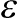-不敏感方法，在估计函数周围对称地形成一个最小半径的柔性管，使得绝对值小于某个阈值  的误差在估计值上下均被忽略。这样，管外的点会受到惩罚，而管内的点，无论位于函数上方还是下方，都不会受到惩罚。SVR 的主要优势之一是其计算复杂度不依赖于输入空间的维度。此外，它具有出色的泛化能力和高预测精度。

本章旨在概述 SVR 和贝叶斯回归。它还介绍了一个改进型 SVR 的案例研究，该改进适用于必须消除或严格限制低估函数的关键场景。

## SVR 概述

回归问题是分类问题的一种泛化形式，其模型返回的是连续值输出，而非有限集合中的输出。换句话说，回归模型估计的是一个连续值的多元函数。

支持向量机（SVM）通过将二分类问题表述为凸优化问题来求解（Vapnik 1998）。该优化问题旨在找到最大间隔分离超平面，同时尽可能正确地对训练点进行分类。SVM 用支持向量来表示这个最优超平面。SVM 的稀疏解和良好的泛化能力使其适用于回归问题。SVM 向 SVR 的推广是通过在函数周围引入一个 ε 不敏感区域（称为 ε 管）来实现的。这个管道将优化问题重新表述为：找到最能逼近连续值函数的管道，同时平衡模型复杂度和预测误差。更具体地说，SVR 的优化问题表述首先定义了一个需要最小化的凸 ε 不敏感损失函数，然后找到包含大多数训练实例的最平坦管道。因此，根据损失函数和管道的几何特性构建了一个多目标函数。接着，使用适当的数值优化算法求解具有唯一解的凸优化问题。超平面用支持向量来表示，这些支持向量是位于管道边界之外的训练样本。与 SVM 类似，SVR 中的支持向量是影响管道形状的最具影响力的实例，并且假设训练数据和测试数据是独立同分布（iid）的，均来自监督学习背景下同一个固定但未知的概率分布函数。

## SVR：概念、数学模型与图形表示

SVR 的问题表述通常最好从几何角度推导，使用图 4-1 中的一维示例来说明。被逼近的连续值函数可以写成公式 4-1 的形式。对于多维数据，将 x 增加一维，并将 b 包含在 w 向量中以简化数学符号，从而得到公式 4-2 中的多元回归形式。

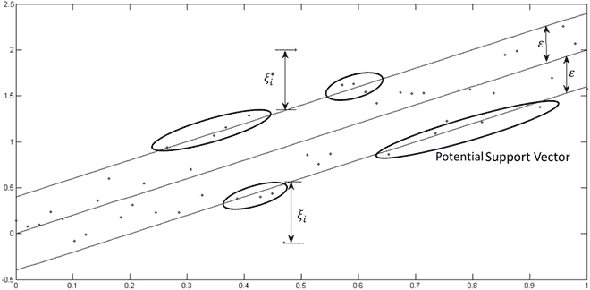

图 4-1.

一维线性 SVR

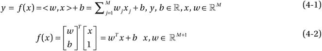

SVR 将这个函数逼近问题表述为一个优化问题，该问题试图找到以曲面为中心的最窄管道，同时最小化预测误差，即预测输出与期望输出之间的距离。前一个条件产生了公式 4-3 中的目标函数，其中 ||w|| 是被逼近曲面法向量的模长：

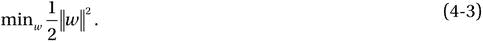

为了直观理解权重的模长如何被解释为平坦度的度量，请考虑以下示例：

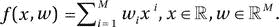

这里，M 是用于逼近函数的多项式的阶数。随着向量 w 模长的增加，更多的 w[i] 变为非零，从而产生更高阶的解，如图 4-2 所示。水平线是一个 0 阶多项式解，与期望输出偏差非常大，因此误差很大。线性函数（一阶多项式）对部分数据产生了更好的逼近，但仍然欠拟合训练数据。六阶解在函数平坦度和预测误差之间产生了最佳权衡。最高阶解误差为零，但复杂度很高，并且很可能会对未见过的数据产生过拟合。w 的模长充当正则化项，为优化问题提供了对解平坦度的控制。

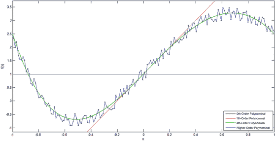

图 4-2.

不同阶数的解

约束条件是最小化给定输入下函数的预测值与实际输出之间的误差。SVR 采用 ε 不敏感损失函数，对距离期望输出超过 ε 的预测进行惩罚。ε 的值决定了管道的宽度；较小的值表示对误差的容忍度较低，同时也会影响支持向量的数量，进而影响解的稀疏性。直观上，后者可以通过图 4-1 来理解。如果 ε 减小，管道的边界会向内移动。因此，更多的数据点位于边界附近，这意味着更多的支持向量。类似地，增加 ε 将导致边界附近的点减少。

由于对噪声输入不敏感，ε-不敏感区域使模型更具鲁棒性。可以采用多种损失函数，包括线性、二次和 Huber ε损失函数，分别如公式 4-4、4-5 和 4-6 所示。如图 4-3 所示，Huber 损失函数比线性函数和二次函数更平滑，但它会惩罚所有与期望输出的偏差，且误差越大惩罚越大。损失函数的选择受到以下因素的影响：关于影响数据样本的噪声分布的先验信息（Huber 1964）、所追求的模型稀疏性以及训练计算复杂度。这里介绍的损失函数是对称且凸的。虽然可以采用非对称损失函数来限制低估或高估，但损失函数应为凸函数，以确保优化问题具有唯一解，并且可以在有限步数内找到该解。在本章中，推导将基于公式 4-4 的线性损失函数。

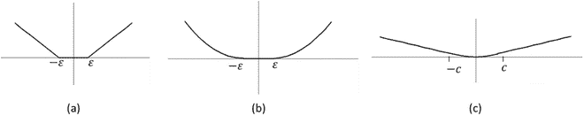

图 4-3.

损失函数类型：(a) 线性，(b) 二次，(c) Huber

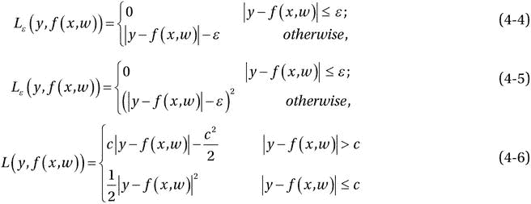

非对称损失函数

一些研究人员提出了对损失函数的修改，使其成为非对称的。Shim、Yong 和 Hwang（2011）在支持向量分位数回归（SVQR）中使用了非对称的ε-不敏感损失函数，试图减少支持向量的数量。作者根据分位数改变了不敏感性，并获得了更稀疏的模型。Schabe（1991）为贝叶斯参数估计提出了双边二次损失函数和准二次 s-损失函数，而 Norstrom（1996）用非对称损失函数替换了二次损失函数，为贝叶斯风险分析推导出一类在原点附近趋近无穷大的通用函数。Nath 和 Bhattacharyya（2007）提出了一种最大间隔分类器，该分类器对每个类别的误分类进行不同约束，从而允许不同的容忍度水平。Lee、Hsieh 和 Wang（2005）将典型的 SVR 方法重新表述为一个无约束问题，从而只需解一个线性方程组，而不是一个凸二次方程组。Pan 和 Pan（2006）比较了经济公差设计中的三种不同损失函数：田口二次损失函数、倒正态损失函数和修正倒正态损失函数。

采用类似于 SVM 中使用的软间隔方法，可以添加松弛变量ξ、ξ*来防止异常值的影响。这些变量决定了在图 4-1 所示的管道外可以容忍多少个点。

基于公式 4-3 和 4-4，得到了公式 4-7 中的优化问题；C 是一个正则化参数——因此是一个可调参数，在这个多目标优化问题中，它赋予最小化平坦度或误差更大的权重。例如，较大的 C 赋予最小化误差更大的权重。这个带约束的二次优化问题可以通过求解拉格朗日函数（见公式 4-8）来解决。拉格朗日乘子，或对偶变量，是λ、λ*、α、α*，并且是非负实数。

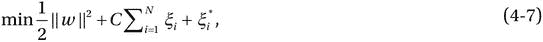

约束条件为

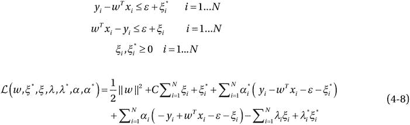

公式 4-8 的最小值是通过对其变量求偏导数，并根据 Karush-Kuhn-Tucker（KKT）条件将其设为零来找到的。对拉格朗日乘子求偏导数会返回约束条件，这些约束条件必须小于或等于零，如公式 4-9 所示。最终的 KKT 条件指出，拉格朗日乘子与约束条件的乘积等于零（见公式 4-10）。等于零的拉格朗日乘子对应于管道内的数据，而支持向量则具有非零的拉格朗日乘子。解仅用支持向量表示——因此解具有稀疏性。函数逼近如公式 4-12 所示。通过将公式 4-9 代入公式 4-8，优化问题的对偶形式可以写成公式 4-13 所示。

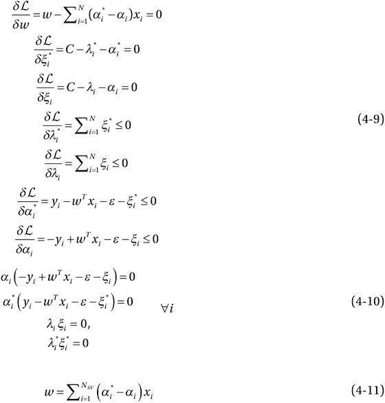

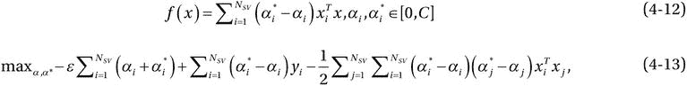

约束条件为

在本节开始时，权重向量 w 与标量 b 进行了增广，并进行了 SVR 数学公式的推导，忽略了 b 的显式计算（见公式 4-2）。然而，b 也可以从 KKT 条件中计算出来，如下所示。

属于管道边界外部的训练数据将具有非零的α [i] 或α ^* [i]；它们不能同时为零，因为那将意味着实例(x [i] ,y [i] )同时属于下边界和上边界，这是不可能的。因此，相应的约束条件将以等式形式满足，如公式 4-14 所示。此外，由于该点不在管道外部，，当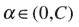时，得到公式 4-15 的结果。公式 4-16 计算 b。对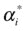进行同样的分析，得到公式 4-17 和 4-18。

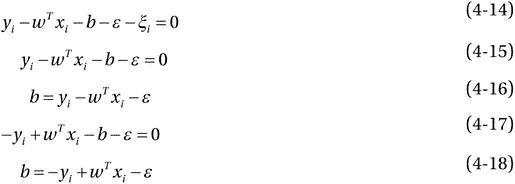

除了使用 KKT 条件，还可以在求解优化问题时，使用内点法计算 b，该方法通过沿着可行域的中心路径导航，可以在对数时间内收敛到最优解。中心路径是通过同时求解原始和对偶优化问题来确定的。

## 核 SVR 与不同损失函数：数学模型与图形表示

上一节处理的是特征空间中的数据，假设 f(x)是线性的。对于非线性函数，可以将数据映射到更高维的空间，称为核空间，使用满足 Mercer 条件的核（见图 4-4），以获得更高的精度，正如之前在分类中讨论的那样。因此，将公式 4-1 至 4-18 中所有 x 的实例替换为 k(x [i] ,x [j] )，得到公式 4-19 所示的原始形式，其中φ(.)是从特征空间到核空间的变换。公式 4-20 描述了基于变换后输入的新权重向量。对偶问题如公式 4-21 所示，函数逼近 f(x)如公式 4-22 所示，其中 k(.,.)，即核函数，如公式 4-23 所示。

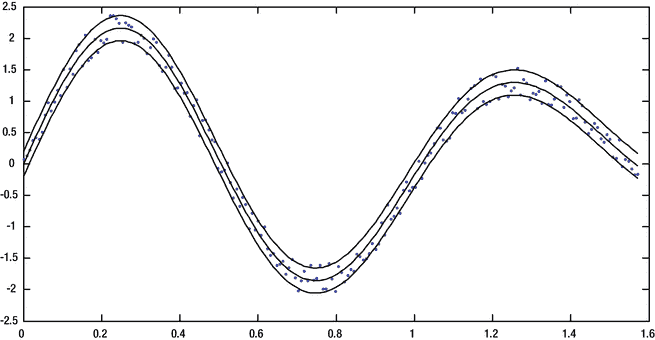

图 4-4.

非线性回归

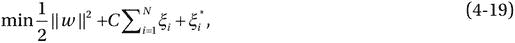

约束条件为

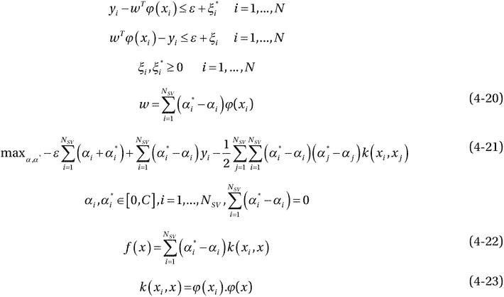

## 贝叶斯线性回归

与支持向量回归（SVR）不同，贝叶斯线性回归是一种**生成式**（而非判别式）方法，它基于贝叶斯推断构建线性回归模型。在指定模型后，该方法会计算参数的后验分布和模型预测值。这种统计分析使得该方法能够在训练过程中确定模型复杂度，从而得到一个更不易过拟合的模型。

为简单起见，假设使用从大小为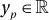的预测变量集 X 和大小为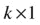的观测值 Y 中学习到的模型参数 w 来预测单个输出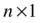。假设观测值 Y 服从公式 4-24 中的分布，其中 σ² 是观测值不确定性的方差：

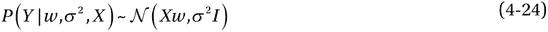

一旦模型被指定，就可以估计模型参数的后验分布。这首先需要假设模型参数的先验分布（见公式 4-25）。给定模型方差和观测值，模型参数的后验分布（高斯分布）如公式 4-26 所示，其均值由公式 4-27 计算，标准差尺度因子由公式 4-28 计算。该均值本质上是预测变量的 Moore-Penrose 伪逆乘以观测值。给定一些观测值后，计算模型方差的后验概率，并得到一个逆卡方分布（见公式 4-29），其自由度为 n – k，尺度因子为 s²（见公式 4-30）。该尺度因子是模型预测输出与观测值之间的误差。

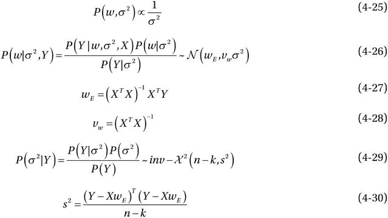

给定观测值，模型参数的边缘后验分布是一个多元学生 t 分布，如公式 4-31 所示，并由公式 4-32 计算，其自由度为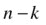，均值为 w[E]，尺度因子为 s²，因为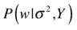服从正态分布，而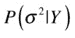服从逆卡方分布。

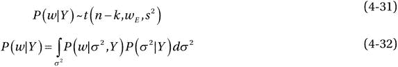

给定模型参数的概率分布和一组预测变量 X[p]，可以确定边缘后验预测分布 Y[p]，它是一个多元学生 t 分布（见公式 4-33）。其均值由公式 4-34 计算，方差由公式 4-35 计算。预测分布的方差取决于观测数据和模型参数的不确定性。

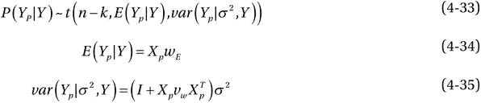

贝叶斯回归的概念如图 4-5 所示，其中训练期间可用的样本输入数据被认为是由一个高斯分布生成的。如果这些实例能够很好地代表其总体，那么该回归模型有望具有良好的泛化能力。

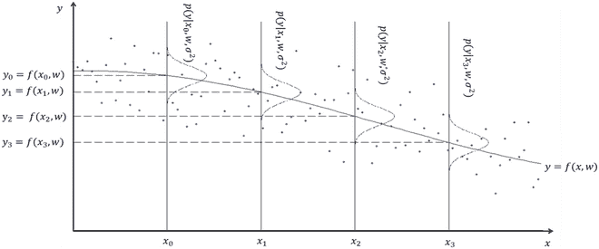

图 4-5.

一维回归示例，展示了输出相对于输入和模型参数的高斯条件概率分布

### 判别模型 vs. 生成模型

生成式方法基于类标签的先验概率分布 p(C[k]) 和似然概率分布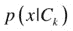，对数据与类标签的联合概率分布 p(x, C[k]) 进行建模。该联合分布用于计算后验概率分布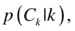，后者将用于将数据点映射到类标签。

判别式方法直接计算后验概率分布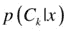，而无需计算联合概率分布 p(x, C[k])。判别式方法在不计算概率分布的情况下，直接从数据点映射到类标签。因此，该方法将推理和决策阶段合二为一。

|   | 优点 | 缺点 |
| --- | --- | --- |
| 生成式 | • 对异常值鲁棒 • 易于更新决策模型 • 允许通过应用概率规则组合在不同类型数据上训练的分类器 • 可以通过基于后验分布衡量分类置信度，并在置信度低时不进行预测来提高预测精度 | • 计算量大 • 需要大量训练数据 • 受维度灾难影响 |
| 判别式 | • 计算量较小 • 易于实现 | • 对噪声数据和异常值敏感 • 决策模型的任何更改都需要重新训练 |

## 用于功率预测的非对称 SVR：案例研究

理由：在许多近似场景中，误预测的后果是不均衡的，这取决于误差是高于还是低于目标值（Stockman 等人，2012a，2012b）。例如，在功率预测中，错误的低估可能比高估更令人担忧。低估可能导致数据中心冷却不足、不间断电源（UPS）供电不足、处理器资源不可用、芯片组件不必要的断电等等。在森林火灾行为预测的情况下，对威胁的低估可能导致更大的财产损失和人员伤亡，原因是人员和设备供应不足。

在这些情况下，关键是要最小化边界某一侧的误估计，即使这会以降低整体估计精度为代价。有必要限制损失函数，以便尽可能少地出现低估或高估。这导致了用于训练的非对称损失函数，其中当误估计发生在边界的错误一侧时，会施加更大的惩罚。

方法：Stockman、Awad 和 Khanna（2012a）提出了非对称且下界受限的 SVR（ALB-SVR）。该方法修改了 SVR 的损失函数和相应的误差函数，使得 ε-管仅位于函数上方，如图 4-6 所示。惩罚参数 C 被拆分为 C+ 和 C-，以便可以对上侧和下侧的误预测施加不同的惩罚。

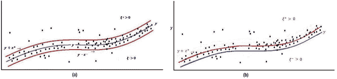

图 4-6.

(a) SVR 和 (b) ALB-SVR（来源：英特尔，2012）

ALB-SVR 使用 Huber 不敏感损失函数（Popov 和 Sautin，2008）。该函数类似于 ε-不敏感损失函数；然而，对于 ε 边界之外但低于某个阈值 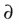 > ε 的小误差，它以二次方式增加，然后超过  后线性增加。这使得它对异常值具有鲁棒性。Huber 不敏感损失函数表示为：

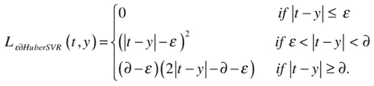

ALB-SVR 修改了 Huber 不敏感损失函数如下：

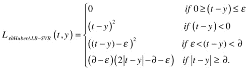

因此，解为：

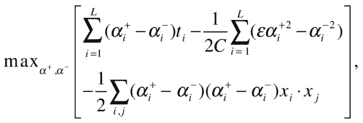

以及由此产生的优化问题：

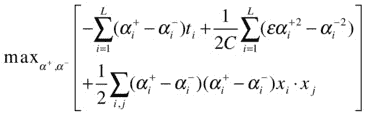

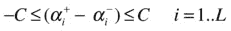

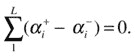

通过代入新的损失函数，ALB-SVR 的经验风险变为

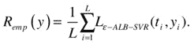

ALB-SVR 的最大额外经验风险可以计算为

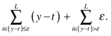

验证：ALB-SVR 在 David 等人（2010）和 Stockman 等人（2010）使用的数据集上进行了测试，该数据集包含 17,765 个样本，涉及五个内存活动计数器属性，以及通过内存功率提升器直接测量的实际对应功耗（瓦特）。内存功率模型属性包括活动、读取、写入、CKE = 高和 CKE = 低。ALB-SVR 使用针对 ALB-SVR 修改过的 LIBSVM 版本（Chang 和 Lin，2011）实现。仿真结果（见图 4-7 – 4-9）取径向基函数（RBF）核的三折交叉验证十次运行的平均值，并结合网格搜索和启发式实验来找到最佳元参数 ε、g、C ^+ 和 C ^–。

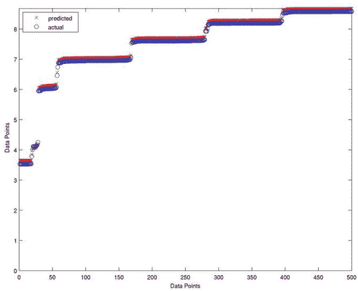

图 4-9.

使用 Huber 不敏感 ALB-SVR 对 RAPL 数据的功率估计（来源：英特尔，2012）

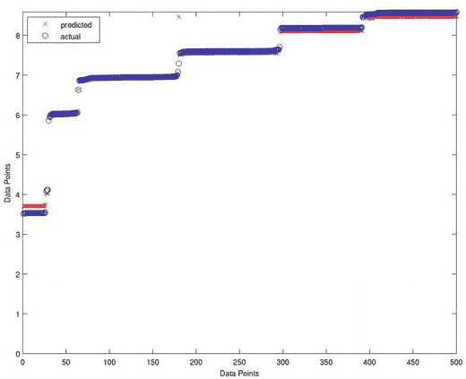

图 4-8.

使用 Huber 不敏感 SVR 对运行平均功率限制（RAPL）数据的功率估计（来源：英特尔，2012）

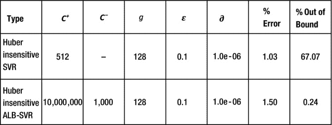

图 4-7.

SVR 与 ALB-SVR 的比较结果（来源：英特尔，2012）

在 SVR 中，支持向量是那些位于 ε-管之外的点。ε 值越小，位于管外的点就越多，因此支持向量的数量就越多。使用 ALB-SVR 时，ε-管被一分为二，并且下界被移除。因此，对于相同的 g 和参数，更多的点位于管外，并且有更多的支持向量。这意味着 ALB-SVR 的支持向量数量大于 SVR。支持向量数量的增加表明使用 ALB-SVR 对估计函数的复杂性有一些负面影响。尽管百分比相对误差数据集更高（5.06%），但这是可以接受的，因为主要目的是减少低估的次数，并且这一目标已经实现。

