# 5. 隐马尔可夫模型

未来的最好之处在于它一天天到来。 ——亚伯拉罕·林肯

实时过程产生的观测值可以是离散的、连续的、平稳的、时变的或带有噪声的。基本挑战是将观测值表征为一个参数化的随机过程，其参数应使用定义明确的方法进行估计。这使我们能够构建一个底层过程的理论模型，从而能够预测过程输出，并区分观测值本身的统计特性。隐马尔可夫模型（HMM）就是这样一种统计模型。HMM 通过分析观测符号序列的模式来解释（不可观测的）过程。HMM 由一个双重随机过程组成，其中底层（或隐藏的）随机过程可以通过分析另一组随机过程的观测符号序列来间接推断。HMM 包含（隐藏的）状态，这些状态代表了被建模过程中不可观测或潜在的属性。基于 HMM 的方法被广泛用于分析特征或观测值，例如使用情况和活动概况以及过程不同状态之间的转换，以预测最可能的状态序列。HMM 可以表示为离散事件的随机模型和马尔可夫链的一种变体，马尔可夫链是一个由链接状态或事件组成的链，其中下一个状态仅取决于系统的当前状态。HMM 的状态是隐藏的（或者只能从观测符号中推断出来）。对于给定的模型和观测序列，HMM 用于分析与模型选择、状态序列确定和模型训练相关的问题的解决方案（更多细节，请参见“HMM 的三个基本问题”一节）。

*   HMM 的基本理论是在 Baum 及其同事的开创性工作基础上发展起来的（Baum 和 Petrie，1966；Baum 和 Eagon，1967；Baum 和 Sell，1968；Baum 等人，1970；Baum，1972）。该领域的早期工作归功于 Stratonovich（1960），他基于条件马尔可夫过程理论提出了一种最优非线性滤波模型。Rabiner（1989）在表述语音表示的统计方法方面，对 HMM 的应用做出了近期贡献。作者基于离散或连续密度参数分布，成功实现了一个 HMM 系统。
*   本章将介绍 HMM 技术及其在入侵检测、工作负载优化和故障预测等管理解决方案中的实际应用。

## 离散马尔可夫过程

一个系统在任何时刻都可以被描述为处于状态 S[1]、S[2]、……、S[n] 中的某一个（见图 5-1）。当系统以固定的时间间隔，以特定概率 p[ij] 从状态 S[i] 转变为 S[j] 时，这可以通过一个简单的随机过程来描述。在该过程中，未来状态的分布仅取决于当前状态，而与系统如何到达当前状态无关。由元素 p[ij] 构成的矩阵 P 被称为马尔可夫链的**转移概率矩阵**。换句话说，我们可以将离散马尔可夫过程描述为一种在等间隔时间点上演化的现象，对于给定的当前状态，过去和未来在统计上是独立的。通常，这种仅由当前状态影响未来状态的时间演化现象被称为**动态系统**。未来状态对当前状态的唯一依赖性使我们能够使用随机变量而非确定性对象来对解进行建模。随机变量定义了一组可能的结果（样本空间 Ω）以及一个将每个结果与概率相关联的概率分布。

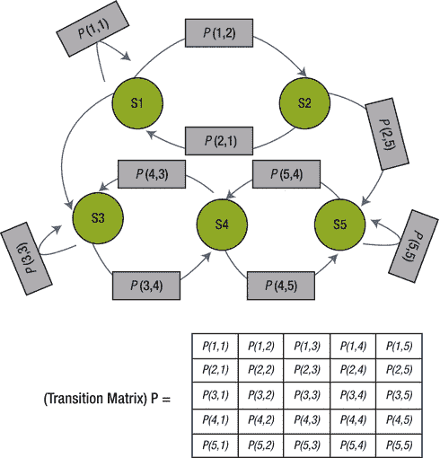

图 5-1.
具有五个状态（S1–S5）的马尔可夫链，并标出了选定的状态转移 P(i, j)

离散马尔可夫过程（即马尔可夫链）的一个简单例子是一维随机游走。在这种情况下，个体可以以特定概率向前或向后移动。形式上，你可以定义独立的随机变量 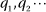，其中每个变量要么是 +1（向前移动），要么是 −1（向后移动），每个值的概率均为 50%。从统计上讲，你可以将随机游走定义为随机变量序列 Q[t]，该序列通过独立同分布（iid）的随机变量 S 进行增量更新，使得：

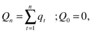

其中期望 E(Q[n]) = 0，方差 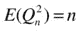。如果 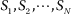 是整数序列，那么：

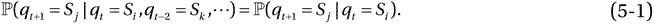

这个等式告诉我们，随机游走在时间 t+1 时处于状态 S[j] 的概率仅取决于其当前值，而与它如何到达那里无关。形式上，离散马尔可夫过程有三种定义，将在以下小节中描述。

### 定义 1

Ω 上的马尔可夫链是一个随机过程 {q0, q1, ..., qt}，其中每个 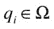，满足：

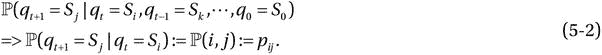

你构建 Ω × Ω 的转移矩阵 P，其第 (i, j) 个条目表示 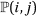，并具有以下性质：

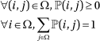

具有这些性质的矩阵 P 被称为**随机矩阵**。

### 定义 2

矩阵 P^n 的第 (ij) 个条目 P^n(i, j) 给出了从状态 i 出发的马尔可夫链在 n 步之后处于状态 j 的概率。

### 定义 3

令 u^((0)) 为表示初始分布的概率向量。那么，链在 n 步之后处于状态 j 的概率是向量中的第 j 个条目：

u^((n)) = u^((0))P^((n))

如果你想在假设链从某个特定状态 i 开始的情况下检验其行为，只需选择 u 为概率向量，其中第 i 个条目等于 1，所有其他条目等于 0。以下小节中定义的随机过程也可以被描述为**可观测马尔可夫模型**，因为每个状态都可以表示为一个物理事件。

## 隐马尔可夫模型简介

前面的章节讨论了一种以马尔可夫模型为特征的随机过程，其中状态对应于可观测的物理现象。在状态不能直接对应于物理事件的实际问题中，这种模型可能限制性太强，难以实际应用。为了提高其灵活性，你将模型扩展为一种观测输出是状态的概率函数的模型。每个状态可以根据一个独特的概率分布产生多个输出，并且每个不同的输出都可能在任何状态生成。由此产生的模型是双重嵌入的随机模型，称为**隐马尔可夫模型（HMM）**。HMM 中的底层随机过程产生一个状态序列，该序列不能直接观测，只能通过另一组产生观测序列的随机过程来近似。

图 5-2 展示了从离散马尔可夫过程扩展到双重随机的 HMM。新的 HMM 允许从每个状态以有限概率分布发射观测符号。这使得模型比简单的马尔可夫链更具表现力和灵活性。此外，如图 5-3 所示，你可以通过观测符号序列来对物理过程进行建模，这在大多数实际情况下是成立的。与传统马尔可夫链的关键区别在于，在分析观测状态序列时，你无法确切地说出是哪个状态序列产生了这些观测；然而，你可以计算某个特定状态序列产生这些观测的可能性。这表明状态序列是隐藏的，只能通过观测状态或符号的序列来间接观察。

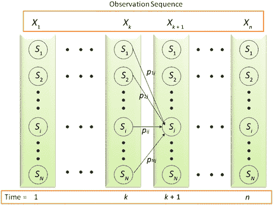

图 5-3.
隐马尔可夫模型：网格表示

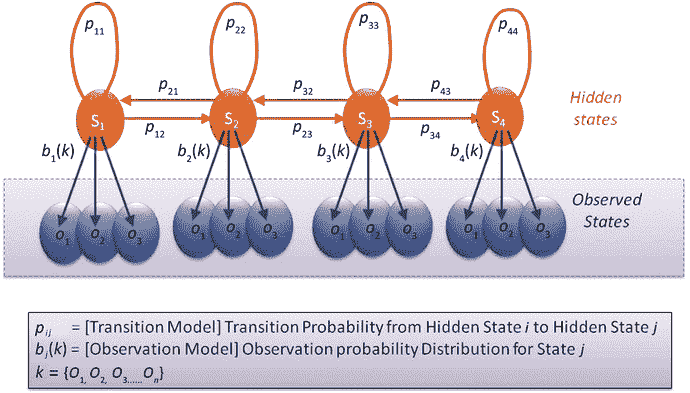

图 5-2.
具有四个隐藏状态和三个观测状态的隐马尔可夫模型

### 隐马尔可夫模型的基本要素

一个完整的 HMM（Rabiner 1989）规范需要正式定义以下要素：

*   隐藏状态数量：模型中的 (N)。各个状态表示为 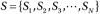；时间 t 的状态表示为 q [t]。
*   状态转移概率分布：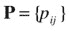，用于表示从状态 i 到状态 j 的转移，其中 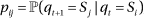，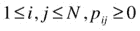。此性质类似于马尔可夫链的定义 5-1。
*   观测符号概率分布：状态 j 的 (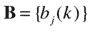)，其中 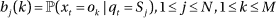。
*   初始状态分布：(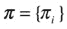)，其中 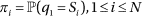。

一旦通过 N、M、P、B、p 的适当值为某个物理过程定义了 HMM 参数，你就可以分析观测序列（输出）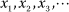，其中每个 x [t] 是时间 t 时来自观测矩阵 O 的符号之一。

形式上，一个 HMM 可以通过指定模型参数 N 和 M、观测符号 O 以及三个概率矩阵 P、B 和 p 来定义。为简单起见，你可以使用紧凑形式，

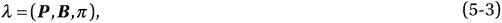

来表示模型的完整参数集。这里描述的 HMM 做出了两个假设：

*   **马尔可夫假设**：当前状态仅依赖于前一个状态；这代表了模型的记忆性。
*   **独立性假设**：时间 t 的输出观测 o [t] 仅依赖于当前状态；它独立于之前的观测和状态。

### HMM 的三个基本问题

上一节描述了 HMM 的模型。本节将确定将模型应用于实际问题时需要解决的基本问题。

这些基本问题分为三类：

*   **问题 1. 评估**：给定观测序列 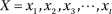 和一个 HMM 模型 ，我们如何计算 X 的概率？该问题的解决方案使我们能够选择与观测序列最匹配的竞争模型。
*   **问题 2. 解码**：给定观测序列 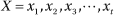 和一个 HMM 模型 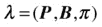，我们如何找到最能解释观测结果的状态序列 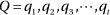？该问题的解决方案试图揭示随机模型中隐藏的部分。
*   **问题 3. 学习**：我们如何调整模型参数  以最大化 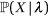？该问题的解决方案试图优化模型参数，以最佳地描述观测序列。此外，该解决方案允许我们根据观测到的训练数据序列来调整模型参数。

考虑故障预测问题，该问题评估未来时间发生故障的风险。在典型系统中，组件之间存在潜在的依赖关系，使得错误能够从一个组件传播到另一个组件。此外，还存在无法测量但能在可靠组件中引发错误的健康状态。这些健康状态会经历正常性能状态、次性能状态、需要注意状态，并最终进入故障状态。因此，准确识别运行状态对于避免系统被动停机至关重要。在此场景中，健康状态对应于隐藏状态，观测结果对应于一系列错误条件。这使得系统管理员能够在系统完全故障之前安排预防性维护。由于故障是隐藏的（因此无法测量）并产生对应于错误的符号，你可以将故障预测问题建模为 HMM。为简单起见，你可以假设通过使用系统计数器识别可测量的唯一错误模式来预测故障。

尽管可以使用正常状态和故障状态对整个系统进行建模，但此类模型无法提供组件级别的粒度来跟踪故障通过依赖组件的进展。因此，系统架构师将故障分类到多个领域，以便将故障的预测归因于特定组件，从而避免系统级的灾难性停机。

第一个任务是通过使用问题 3 的解决方案来执行的，其中通过训练过程为每个故障领域 (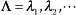) 构建单独的模型。此过程将 HMM 参数分配给描述性模型，使系统能够在错误模式与相应故障状态转移之间实现最佳匹配。在计算机系统中，这种训练可以通过系统事件日志信息来支持，该信息包含错误信息以及故障描述。

为了理解模型状态的物理含义，你需要确定问题 2 的解决方案。在这种情况下，错误计数器的统计属性会转化为每个模型健康状态中发生的观测序列。状态的定义和数量取决于应用的目标和特性。此过程使我们能够微调模型，以提高其表示表征系统健康的各种状态的能力。正常状态和故障状态是 HMM 的两个终端状态；根据需要添加中间状态，以帮助预测故障行为的进展。添加中间状态可以对预测性和关键性场景进行建模，从而有助于在实际故障发生前纳入修复机制。

一旦你设计并优化了一组 HMM（Λ），就可以通过使用问题 1 的解决方案来识别组件健康状态。

### HMM 三个基本问题的解决方案

以下各节将介绍 HMM 三个基本问题的解决方案。这些问题的解决方案对于构建概率框架至关重要。

#### 问题 1 的解法

问题 1 的解法涉及评估在给定模型λ下观测序列的概率，即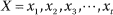；也就是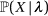。考虑一个状态序列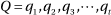，其中 q[1]和 q[t]分别是初始状态和最终状态。对于状态序列 Q 和模型λ，观测序列 X 的概率可以表示为

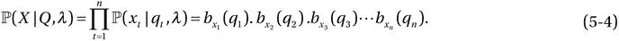

根据马尔可夫链的性质，状态序列的概率可以表示为

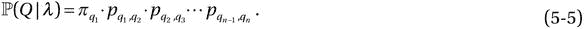

对所有可能的状态序列求和如下：

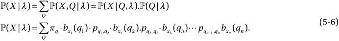

不幸的是，直接计算并不实用，因为它需要 2nN^n 次乘法。在每一步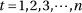，都可以到达 N 个可能的状态，这导致计算量巨大。例如，当 n=100（观测序列数量）且 N=5（状态数）时，可能存在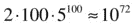种可能的计算。幸运的是，有一种称为前向算法的高效方法可以达到相同的结果。

##### 前向算法

考虑一个前向变量αt，它表示在给定 HMM 模型λ的条件下，截至时间 t 的部分观测序列的概率，且底层马尔可夫过程在时间 t 处于状态 S[i]：

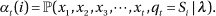

你可以通过以下步骤递归计算αt：

将前向概率初始化为状态 S[i]与初始观测 x[1]的联合概率。令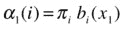，其中 1 ≤ i ≤ N。  
使用归纳过程，代入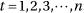，计算所有状态 j 且 t=n 时的αn：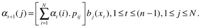  
利用上一步的结果，计算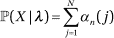

评估前向概率所涉及的总计算量为 N²n，而非直接计算所需的 2nN^n。对于 n=100 且 N=5，总计算量为 2,500，其数量级比直接计算小 10⁶⁹倍。

##### 后向算法

对于前向算法，你还可以定义一个后向变量βt，它表示从时间 t+1 到结束的部分观测序列的概率（与前向算法中截至时间 t 不同），其中在给定模型λ的条件下，马尔可夫过程在时间 t 处于状态 S[i]。数学上，后向变量可以表示为

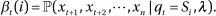

你可以通过以下步骤递归计算βt：

定义βn = 1，其中 1 ≤ i ≤ N。  
计算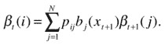

##### 缩放

在建模长序列 HMM 时，一个实际障碍是条件概率的数值缩放。高效计算条件概率有助于估计给定模型下最可能的状态序列。对于足够长的序列，观测到长序列的概率往往极小，以至于出现数值不稳定。在大多数情况下，计算结果会超出任何机器（包括双精度）的精度范围。缓解这种情况的最常见方法是使用高效的缩放机制对条件概率进行重新缩放。

例如，让我们重新审视前向变量方程：

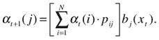

对于前向变量αt，你通过乘以 p[ij]和 bj 得到新值αt+1。这些概率往往很小，可能发生下溢。对数可能没有帮助，因为你处理的是乘积之和。此外，对数需要对每次加法计算对数和指数。基本的缩放过程将αt 乘以缩放系数，目的是使缩放后的αt 保持在机器的动态精度范围内。计算结束时，缩放系数会被抵消。缩放系数不必在每个 t 步都应用，可以在必要时使用。

#### 问题 2 的解决方案

与问题 1 的解决方案不同，确定最优状态序列是一个复杂的问题，因为可能存在多种评判标准。其复杂性部分源于最优性度量的定义，其中可能涉及几种独特的评判标准。一种解决方案是识别在时间 t 最可能单独出现的状态 q[t]。该方案旨在最大化正确单个状态的期望数量。为了实现问题 2 的解决方案，你需要定义变量γt，它表示在给定观测序列 X 和模型λ的条件下，在时间 t 处于状态 S[i]的概率，如下所示：

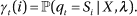

利用条件概率的定义，你可以将该等式表示为：

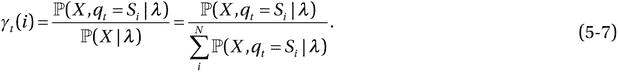

你可以使用前向-后向变量将公式 5-7 重写为：

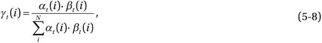

其中，αt 定义了在时间 t 的部分观测序列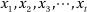和状态 S[i]的概率，而βt 定义了在时间 t 的剩余观测序列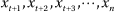和状态 S[i]的概率。利用γt，你可以通过计算在时间 t 处于状态 S[i]的最高概率，来求解每个时间 t 上单独最可能的状态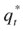，如下式所示：

尽管该公式通过在每个时间间隔选择最可能的状态来最大化正确状态的期望数量，但由此得到的状态序列本身可能无效。例如，在序列 q[t] = S[i]和 q[t+1] = S[j]中，如果单独最可能的状态分别是 S[i]和 S[j]，那么转移概率 p[ij]可能为 0，因此该序列无效。这种解决方案在识别任何时间 t 上单独最可能的状态时，完全没有考虑该状态序列出现的概率。

解决此问题的一种方法是最大化包含多个状态的状态序列的出现概率。这允许在评估最可能序列的同时，自动评估有效状态的出现。一种广泛使用的方案是找到最终能最大化的单个最可能状态序列。这种基于动态规划的技术被称为维特比算法。为了找到单个最佳状态序列，你需要定义一个变量δt，它表示在一条状态序列（路径）上，能够解释前 t 个观测值并以状态 S[i]结束的最高概率，如下所示：

你可以通过归纳法计算δt+1，如下所示：

由此可以清楚地看出，为了检索状态序列，你需要在每个时间 t 追踪使δi 最大化的状态。这可以通过构建一个数组ψt+1 来实现，该数组定义了在时间 t，从哪个状态转移到状态 S[j]能够最大化概率δt+1。数学上，这可以表示为：

寻找最佳状态序列的完整过程包括以下步骤：

##### 初始化

##### 递归

##### 终止

##### 状态序列回溯

维特比算法与前向过程类似，区别在于它使用对先前状态的最大化而非求和。

#### 问题 3 的解决方案

问题 3 的解决方案涉及一种调整模型参数（P, B, π）的方法，以最大化给定模型下观测序列的概率。在实践中，没有已知的方法可以直接最大化观测序列的概率。然而，你可以选择λ = (P, B, p)，通过使用迭代方法（如鲍姆-韦尔奇算法）使得 P(X|λ)达到局部最大化。

为了指定 HMM 参数的重估，你需要定义变量γt，它表示在给定模型λ和观测序列 X 的条件下，在时间 t 处于状态 S[i]且在时间 t+1 处于状态 S[j]的概率，如下所示：

利用前向-后向算法的定义，你可以将公式 5-10 重写为：

如公式 5-8 所定义，γt 是在给定观测序列和模型的条件下，在时间 t 处于状态 S[i]的概率。利用这个公式，你可以通过对 j 求和来关联γt 和γt，如下所示：

通过对时间 t 上的γt 求和，你可以量化状态 S[i]被访问的次数，或者等价地，从状态 S[i]出发的转移的期望次数。类似地，对时间 t 上的γt 求和，可以揭示从状态 S[i]到状态 S[j]的转移的期望次数。给定γt、γt 和当前模型λ，你可以构建重估 HMM 模型参数（）的方法。该方法可以分解如下：

在时间 t = 1 时，状态 S[i]的期望频率由给出。   从状态 S[i]转移到状态 S[j]的概率，即的期望值，由给出。分子是从状态 S[i]到状态 S[j]的期望转移次数的重估值；分母是从 S[i]到任何状态的期望转移次数。   给定模型处于状态 S[j]时，观测到符号 k 的概率由给出。重估后的的分子是模型处于状态 S[j]且观测到符号 k 的期望次数；分母是模型处于状态 S[j]的期望次数。

使用此方法，你利用当前模型λ(P, B, π)来重估新模型，如前三个步骤所述。重估过程是一个迭代方法，包含以下步骤：

使用最佳猜测或随机值初始化λ(P, B, p)，或使用现有模型。   计算αt, βt, γt, γt。   重估模型。   如果，则重复步骤 2。

此重估过程的最终结果被称为 HMM 参数的极大似然估计（MLE）。前向-后向算法仅能得到局部最大值。

## 连续观测隐马尔可夫模型

前几节考虑的场景中，观测值是来自有限字母表的离散符号，从而可以对系统中的每个状态使用离散概率密度。然而，在许多实际应用中，观测值是连续向量。虽然可以通过码本等方式对连续向量进行量化，但量化可能会导致性能下降。因此，采用具有连续观测值的隐马尔可夫模型是有利的，其概率密度函数被评估为其他分布函数的凸组合——即一个混合分布，并带有相应的混合权重。分量的数量被限制为有限个。对于给定的观测池，使用混合分布来对子总体的属性进行统计推断，而无需知道标识观测值所属子总体的标签。分量数量 M（子总体）取决于对观测池进行分组的观测聚类数量（通过无监督算法学习，例如 k-means）。通常，每个混合分量代表一个 m 维分类分布，其中 M 个可能的结果中的每一个都指定了每个结果的概率。每个混合分量遵循相似的分布（正态分布、对数正态分布等），并代表一种独特的资格，用于将任意时刻的连续观测值集合分类为一个唯一的符号（类似于离散观测值）。使用 EM 算法训练的混合分量能够自组织以适应数据集。连续观测模型根据状态到聚类发射概率分布，在 HMM 状态转移的每个时间步生成隐藏聚类（或混合符号）序列。聚类（或混合符号）可以被视为嵌入在隐藏状态中的隐藏符号。例如，一个隐藏状态可能代表一个特定的工作负载，而一个符号可能代表该工作负载的某个特定属性，例如基于资源利用率。

首先从概率密度函数的表示开始，该表示允许其参数以一致的方式被重新估计。可用于重估过程的最通用的概率密度函数形式由多元正态分布或高斯混合分布给出：

其中

X = 观测向量 ()

M = 混合密度数量

c [jm] = 第 j 个状态中第 m 个混合的权重

 = 任意椭圆对称密度函数（例如，高斯函数）

μ [jm] = 第 j 个状态中第 m 个混合的均值向量

U [jm] = 第 j 个状态中第 m 个混合的协方差矩阵

在统计学中，混合模型是一种概率模型，其中底层数据属于混合分布。在混合分布中，密度函数是其他概率密度函数的凸组合（即，所有系数或权重之和为 1 的线性组合）。可以证明（Liporace 2006; Hwang 1986），混合密度系数 (c [jm] ,μ [jm] ,U [jm] ) 的重估可以表示为：

其中 (X [t] –μ [jk] ) ^T 表示向量转置，而 ε [t] (j, k) 表示在时间 t 处于状态 j 且第 k 个混合分量解释了 X [t] 的概率：

p [ij] 的重估公式与为离散观测密度定义的公式类似。c [jk] 的重估公式是系统处于状态 j 且使用第 k 个混合分量的期望次数与系统处于状态 j 的期望次数之比。

为了降低计算复杂度，另一种方法是半连续隐马尔可夫模型，它是连续观测隐马尔可夫模型的一种特殊形式。半连续隐马尔可夫模型使用与一组通用混合密度绑定的状态混合密度。所有状态共享相同的混合，只有混合密度分量权重 c [jk] 保持为状态特定。

### 多元高斯混合模型

在连续观测隐马尔可夫模型中，b [j] (X) 是一个连续概率密度函数，通常是 L 维观测值的多元高斯分布的混合。高斯混合模型密度被定义为高斯密度的加权和。在处理自然现象时，选择高斯分布是自然而然的，并且非常普遍。对于高斯混合，公式 5-13 中的  可以用高斯分布替代，从而得到发射密度的数学形式：

每个高斯混合由其参数集定义，包括混合分布 c [jk] 、均值向量 μ [jk] 和协方差矩阵 U [jk] 。注意，一个以有限高斯概率密度函数混合作为条件密度的连续观测隐马尔可夫模型，等价于一个以简单高斯概率密度函数作为条件密度的模型。使用高斯混合概率密度函数，您可以将一个具有混合密度的状态转换为一个由多个单密度状态组成的网络。图 5-4 描绘了一个场景，其中对应于双分量混合概率密度函数的状态 S2 被扩展为两个状态 S2 [a] 和 S2 [b] ，它们具有单分量概率密度函数和调整后的转移概率。

图 5-4.

状态 S2 的双分量高斯混合模型扩展为具有两个新状态 (S2[a], S2[b]) 的单分量高斯模型

### 示例：工作负载阶段识别

近期计算机体系结构研究表明，程序执行会表现出可在最大尺度上进行表征的阶段行为（Perelman 等人，2002 年）。在大多数情况下，工作负载行为既非完全同质，也非完全随机；它结构良好，包含一系列阶段。当你在不同阶段之间转换时，可以通过重用重复出现阶段的配置信息来启动重新配置。

数据中心和云计算的发展趋势给服务器系统的功耗优化与功率控制带来了有趣的挑战。一个系统可以表示为一组组件的集合，这些组件通过协同交互产生有用功。这些组件在本质上可能是异构的，并且其功耗和功率控制机制也可能各不相同。一个包含多个中央处理器（CPU）、内存和输入/输出（I/O）组件的服务器系统，可以使用嵌入式控制器或专用硬件来协调功率控制操作。在主动性能调优中，控制操作的准确性和敏捷性至关重要。观察工作负载变化如何影响不同服务器组件的功耗，为分析以及构建将服务质量（QoS）预期与功耗关联起来的模型提供了关键数据。因此，你需要一个能够提取工作负载特征并根据运行阶段主动调优系统的自主系统。以下章节将介绍一种利用服务器平台性能数据来建模系统运行时行为的方法。我们将描述一个经过训练的模型，该模型分析工作负载的行为属性，识别当前阶段，并使用 CHMM 以合理的准确度预测工作负载特征的未来阶段。

预测系统旨在识别工作负载模式并及早检测阶段以进行特征描述。知识库（模型）会推荐相应的操作。这些系统具有自我修正能力，并且需要持续训练，以适应已知行为以及随时间推移的演化行为。阶段检测模型有助于预测性能状态，并通过调整其参数来主动适应，以满足系统约束。

### 监控与观察

监控和测量系统活动中的事件是表征系统阶段和预测未来的基础。现代处理器内置了性能监控计数器，用于测量处理器和内存事件的实时访问模式，并有助于为各种动态决策设计分析智能。可以对内存访问模式、指令执行速率和流水线停顿等趋势进行统计分析，以发现模式、隐藏相关性以及时间相关行为。测量到的事件（资源利用率、温度、能耗、性能）可以被视为观测输出的多个维度。基于最大化观测序列概率的动态模型，提取出的阶段可以被视为可预测的系统特征。一旦你识别出当前的工作负载运行阶段以及最可能的未来阶段，你就可以用充足的资源调优和配置系统，避免被动的资源分配。基于 CHMM 的阶段表征过程使用了内置的性能计数器和传感器。此外，还使用合成计数器来抽象工作负载随时间变化的行为。

### 工作负载与阶段

工作负载是具有特定目标（查询、搜索、分析等）的应用程序，它们在多种约束下运行时会经历不同的执行阶段。这些约束与功耗、热量产生和 QoS 要求相关。由于功耗和性能参数调优具有多种自由度，最佳系统运行涉及复杂的选择。该过程包括建模方法、实现选择和动态调优。工作负载中的阶段检测是一个关键要素，它捕获动态自适应系统随时间变化的行为。这种能力有助于在需求变化之前重新配置硬件和软件，并能够为重复出现的阶段重用训练好的模型。阶段识别还有助于在工作负载执行期间预测未来阶段，从而避免对工作负载行为变化做出被动响应。在此上下文中，阶段是指工作负载表现出相似功耗、温度和性能特征的一个执行阶段。

CHMM 辅助方法能够识别阶段的边界，这些边界由系统传感器和性能计数器存在下的高斯密度混合函数的潜在分量表示。状态变量可用作过程控制参数，并反馈到过程控制回路中。例如，你可以将工作负载阶段（或行为属性）反馈回来主动控制热行为，因为温度的物理动态可以表示为各种系统组件利用率的函数。通常，HMM 特别有用，因为它可以利用事件序列中的潜在模式并执行状态空间分析。你可以使用高斯观测值作为在时变工作负载行为中正确识别阶段边界的指标。这些阶段边界可以进一步用于提取与物理现象各种状态（例如服务器需求预测和热变化预测）的关系。例如，图 5-5 展示了 CPU 利用率与按固定时间间隔统计估计的工作负载阶段之间的测试关系。通过使用多个变量可以扩展此功能。

图 5-5.

CPU 利用率与阶段模型。该工作负载由八个阶段组成，每个阶段具有特定的功耗、热和性能特征。红线（底部图表）标识了与每个工作负载实例的运行平均功率限制（RAPL）（蓝线）相对应的阶段编号。例如，平均利用率为 65–70% 会导致阶段 1

与聚合工作负载分析相比，CHMM 辅助分析更加准确且信息量更大。通常，对系统硬件和软件进行有效调优有助于构建高效系统，从而在给定性能约束下最小化功耗和热耗散。系统的各种属性都可以从阶段识别中受益：

*   在给定的性能约束下，您可以调整系统组件（CPU、内存、I/O）以实现最低功耗。当识别到新的阶段时，会以最小化性能下降的方式分配（或解除分配）功率。
*   对预期性能变化进行主动补偿有助于避免被动状态变化及由此产生的被动延迟，从而提升性能。
*   可用功率以最大化整体性能的方式分配给系统组件。一种策略可能涉及根据每个组件在性能提升中的份额进行单独分配（或解除分配）。
*   采用活动向量来执行热平衡计算，从而防止热点。活动数据也可用于以无争用且节能的方式协同调度任务。
*   您可以分析以下任务特征：(1) 任务优先级，(2) 能耗与热特性，以及 (3) 与任务优先级成比例的延迟目标的优化方法。

工作负载阶段可用于自适应架构，通过预测性状态反馈来指导性能和功耗优化。由于 HMM 使用观测值并将其与面向目标的状态（如平均温度或利用率）相关联，因此在系统设计中很值得考虑。观测点可以通过使用一组合理的系统级性能计数器和传感器来表征。通过使用特征提取技术提取工作负载阶段，可以测量预测控制目标（如服务器温度）的隐藏状态。此外，状态与这些观测值之间存在概率关系。这些概率关系（也称为配置文件）会随着工作负载在其生命周期内的持续使用而强化和演变。如果您将正常的工作负载行为视为观测序列的一种模式，那么 HMM 应该适合将这些模式映射到多个状态之一。此外，基于嵌入大量由上下文和环境输入通知的策略，构建自适应策略至关重要。这些策略管理各种行为属性，增强灵活性，以便在高度环境变化的情况下最大化效率和性能。基于 HMM 的方法关联系统观测值（使用情况、活动配置文件）以预测最可能的系统状态。HMM 训练使用初始数据和连续重估，创建一个由组件模型、转移概率和观测符号概率组成的配置文件。CHMM 通过聚类多个组件的同质行为来帮助估计工作负载阶段。工作负载阶段可以通过最大化观测序列概率的 k 个混合的 d 维高斯（观测向量）模型来解释。

### 用于阶段检测的混合模型

基于 HMM 的方法的首要目标是通过在存在时变行为的情况下建立各种阶段执行边界来预测过程的状态。与传统研究聚合行为的方法不同，基于 HMM 的方法可以使用高斯混合模型（GMM）提取代表性阶段并进行工作负载分类。例如，HMM 可以通过针对工作负载及其对应的、由固有行为模式表征的阶段进行自我训练来建模。这些阶段可以被视为嵌入在隐藏状态中的潜在符号（因为它们无法直接观察），而隐藏状态在这种情况下就是工作负载。在训练好的模型中，这些潜在阶段模式可以通过一组观测现象来识别，这些观测现象通过单个混合分量概率密度的组合以及隐藏状态（使用状态转移矩阵评估）的存在来建模。观测值以合成计数器和传感器的形式存在，用于测量系统以及系统组件的性能和功耗特性。以下各节将依次描述有助于工作负载阶段检测的各种功能模块。

#### 传感器模块

在自主系统仪表化中，端点（传感器/控制器）遍布整个平台（见图 5-6），这些端点的特性可能因平台而异。在典型的服务器管理架构中，传感器模块包含性能计数器以及温度、气流和功率传感器的组合。这些传感器通过多种接口访问，例如 PCI Express、SMBus、PECI 总线和 CPU 型号特定寄存器（MSR）。传感器的输出经过统计处理并用作反馈。仪表化的相对重要性可能因用户需求而异。在某些情况下，由于成本限制，通过将传感器数据与一组不同的变量相关联，使用合成仪表化来代替物理传感器。在其他情况下，物理传感器的仪表化精度可能随工作区域而变化，超出该区域则可能非常不准确。在这种情况下，灵敏度在传感器的整个工作范围内不是恒定的，从而导致非线性。非线性取决于传感器输出在整个传感器范围内与理想行为的偏差。可能需要在线性工作范围内校准传感器，然后在校准后的非线性工作区域使用校准后的参数和函数。由于传感器特性在长时间内老化，传感器数据也可能观察到长期漂移。对于数字传感器，由于测量数据是实际数据的近似值，因此还可能存在数字化误差。此外，采样频率的限制可能导致测量数据出现动态误差。应用程序测量或控制平台某方面的能力在很大程度上取决于其托管位置及其与仪表化端点的连接性。

图 5-6.

典型 Intel Xeon 服务器平台中的仪表化遥测

系统中的功率、热和性能变化可能导致次优行为，可能需要纠正以符合平台策略。必须提前很好地预测这种行为，以便在机会窗口内采取纠正措施。可以使用一组传感器来预测此类情况，这些传感器共同充当组件高斯模型来模拟整体特征密度。在平台中，这些传感器以活动计数器、温度、功率和性能监视器等形式提供。传感器数据的类别如下：

*   **CPU 性能计数器**：这些是内置于现代微处理器中的专用硬件计数器，用于在 CPU 上下文中存储与硬件相关活动的计数。这些计数器的输出用于预测常见工作负载的行为，涉及 CPU 利用率（缓存、流水线、空闲时间、停顿、热效应）。
*   **内存性能计数器**：内存性能计数器用于识别内存访问模式、带宽利用率、动态随机存取存储器（DRAM）功耗以及 DRAM 命令活动（读取、写入）的比例，这对于描述工作负载的内存密集型行为非常有用。通过观察读/写周期的比例以及处于预充电、激活和空闲状态的时间，可以描述工作负载模式。
*   **I/O 性能计数器**：I/O 功耗的三个主要指标是：(1) 直接内存访问（DMA），(2) 不可缓存访问，以及 (3) 中断活动。其中，每周期中断次数是 I/O 功耗的主要指标。由于 I/O 芯片中存在各种性能增强技术（如写入合并），DMA 指标的表现并非最优。I/O 中断通常由 I/O 设备触发，以指示大数据传输的完成。因此，可以将 I/O 功耗与相应的设备关联起来。由于无法通过 CPU 计数器获取此信息，操作系统会通过性能监视器提供该数据。
*   **热数据**：除了上述性能计数器外，您还可以考虑使用热数据。这些数据在所有现代组件（CPU、内存等）中均可获取，并可通过 PECI 总线访问。
*   **工作负载性能反馈**：基于控制理论的动作会基于迟滞效应启动防御性响应，以减少资源需求变化的影响。如果该响应干扰了有用工作的性能要求，则需要进行修正。过度的响应会降低系统速度，并对控制动作的有效性产生负面影响。状态反馈在给定时间传达性能需求（或服务级别目标）的最优满足情况。这种反馈需要通过预测与所执行工作行为及其动态需求相关的适应度函数的属性来估算。连续的状态反馈会训练特定于系统的控制动作，并通过将其与未来可能重复出现的独特状态阶段指纹相关联，来保存这些动作的“配方”。

#### 模型降阶模块

模型降阶模块（MRB）负责通过保留关键的不相关且非共线的数据集来降低数据集的维度。这使我们能够保留最重要的数据集——那些足以识别表现出时变行为的工作负载操作阶段的数据集。MRB 模型的输入是与微架构性能计数器、工作负载性能计数器以及模拟传感器（测量功耗、温度等）相关的时间序列数据。这些数据可以通过图 5-6 中所示的多种接口（PCI Express、SMBus、PECI 总线等）之一进行收集。

您可以使用主成分分析（PCA）来降低数据维度，同时不丢失信息（参见第 2 章）。得到的输出变量是主成分，它们是不相关的。例如，PCA 将 N 个输入  转换为 M 个主成分 ，信息重叠非常少 。此外，每个主成分的方差按降序排列 ，使得 x [1] 包含最多信息，而 x [M] 包含最少信息。每个主成分定义了一个观测的维度。

#### 发射模块

发射模块（EB）负责以时间序列数据的形式收集不相关的发射数据。从传感器收集的原始数据包含噪声，必须经过滤波才能提取可量化的信息。降噪过程会识别出一个能够良好表示数据的简单动态系统。在训练周期中，降噪方案由一个代表性分布组成，该分布适用于时间窗口 δt 内的输入数据。流向接收模块（见图 5-7）的传感器数据流会延迟一个可配置的时间段 δt。δt 时间段内数据的行为由底层方程控制，该方程经过训练以拒绝（或重建）数据点。

图 5-7.

使用 GMM 的阶段检测模型

传感器模块的输出被处理成 EB，EB 处理轮询到的传感器数据序列，以生成连续的观测序列。此外，MRB 通过综合那些重要的传感器输入并提供独立特征，来缩减传感器输入的数量。您可以使用一组离散的加权高斯概率密度函数（PDF），每个函数都有自己的均值和协方差矩阵，通过连续发射来更好地建模阶段检测特征。高斯混合模型构成了参数模型，其参数通过使用公式 5-14 和 5-15 从训练数据中迭代估计得出。在工作负载阶段检测中，一个由 k 个混合分量组成的 d 维高斯分布（独立发射）被建模为高斯密度的加权和（见公式 5-16）。

#### 训练模块

动态系统的特征在于其时序特征，这些特征的时变属性在运行期间会发生变化。这些系统会产生一个时间序列的观测值，可以对其进行分析以获取动态特性。训练模块（TB）通过向预测模型输入度量向量以及对应的工作负载（如系统功耗）的预测变量，来促进预测模型的构建。TB 执行无监督分类，并通过将数据划分为同质聚类来构建数据结构，使得相似的对象被分组到同一类中。在最简单的情况下，您可以使用 k-means 聚类算法，该算法将 d 维发射数据划分为 k 个聚类，使得每个发射数据属于具有最近均值的聚类。对于给定的发射数据集 ，k-means 聚类算法通过找到所有 k 个聚类到观测值的最小距离，将发射数据划分为 k 个集合 ：

每个 G 元素充当 k 个单密度状态（每个状态代表一个独特的工作负载阶段）的单分量高斯密度函数；μ [i] 表示聚类 i 的均值。

#### 参数估计模块

你可以使用 GMM 来表示工作负载阶段预测系统中的特征分布，其中各个分量密度对一组潜在的潜在类别进行建模。参数估计模块（PEB）负责估计模型 λ [k] 的参数，该模型用于拟合该模型的数据。最初，模型的输入数据是来自 TB 的输出传感器数据，该数据将观测值分类（标记）为聚类编号？分类器使用最小失真或最近邻方法对输入向量进行分类，从混合模型中选择最佳的高斯分量。一旦每个模型的训练数据在时间间隔 δt 内被缓冲，它们就会被用来估计该模型的高斯混合参数。在没有先验模型的情况下，PEB 会初始化混合数量并估计模型参数（c [k] ,μ [k] ,U [k] ）。你可以使用期望最大化（EM）方法，该方法最大化聚类标记数据的似然函数 （参见第 1 章）。EM 算法的基本思想是引入一个变量（高斯混合分量），以简化似然函数的最大化。EM 算法是一个两步法：

E 步：估计给定发射值 (X) 和模型 (λ) 下每个高斯混合分量的概率分布。  
M 步：估计数据和潜在变量（高斯混合分量）的联合概率分布。此步骤修改高斯混合分量的模型参数，以最大化发射值和该高斯分量本身的似然函数。

从初始模型 λ 开始，EM 算法估计一个新模型 ，使得 。然后，新模型成为下一次迭代的起始模型，重复此过程直到达到收敛阈值。对于给定的 d 维发射向量序列 ，第 k 个混合分量的后验概率由下式给出：

用于重新估计模型参数的公式为：

该模块有助于将观测序列归类到第 k 个高斯分量。你可以将单状态 GCHMM 扩展为单密度、多状态 GCHMM。

#### 阶段预测模型

可表示为应用阶段的工作负载模式会表现出某些重复性行为。你需要一些方法来识别和预测重复阶段，以便主动应用可行的动态管理响应。通过阶段预测模块（PPB），你可以通过可配置的时间周期 δt 提前估计观测序列（参见图 5-8）。

图 5-8.

使用指数平滑函数对十二个阶段的观测向量进行预测

当工作负载在阶段边界运行时，PPB 分析尤其重要，此时必须针对预期阶段优化控制动作。为了构建一个简单的预测模型，你可以使用观测向量指数平滑模型来估计未来的 d 维观测向量。指数平滑通常可以表示为：

 其中 ，

其中 y [t] 表示在时刻 t –1 时平滑函数的预测输出，而 x [t]（我们的标准符号）表示来自各种传感器的原始发射值。 表示时刻 t 的预测误差。指数平滑会考虑所有过去的数据，但较旧样本的比例贡献会以几何级数递减。这允许我们针对两种不同的模型调整 α 的值。在图 5-7 中，这由“预测 T + t”模块说明。图 5-9 展示了预测过程，其中控制进程消耗估计的阶段特征并与控制动作相关联。如果该阶段在未来再次出现，则重复相同的动作。

图 5-9.

阶段预测模块；控制进程使用预测模型和传感器观测值来主动调整过程变量

#### 状态预测模块

在工作负载表征的背景下，状态表示反馈函数的一个有趣属性，当该属性被预测时，会主动触发纠正性响应以避免被动反应。被动响应滞后于控制动作，在此期间函数执行内务处理并识别行为变化的原因。为了防止性能下降，你需要识别一个关键的过程变量，如果该变量被预测，则可以生成主动响应。阶段表示工作负载随时间变化的独特行为特征，需要对其进行预测以避免被动调优。

#### 系统自适应

前文探讨了一种系统性的方法，用于检测具有时变特性的动态系统中的工作负载阶段。现在，问题依然存在：我们为何需要检测系统阶段？

通常，工作负载会承受任意的性能和环境压力，而自适应系统则用于补偿这些压力。自适应可能需要服务于相互冲突、方向各异的功能。这导致需要在各种解决方案之间做出权衡，以最大化整体解决方案的适应性。一个自适应函数将以能够提供应用程序所期望性能的方式来优化功耗。期望的性能未必是最高性能。在真实系统中，不可能同时将目标策略的所有方面都提升到同等程度。因此，系统会开发出各种在硬件、软件或软件辅助硬件场景中运行的反馈控制方案。控制目标包括：

*   持续监控资源状况
*   通过建模反馈控制行为，确定应如何以及何时执行自适应
*   识别给定工作负载行为的实时约束和资源需求
*   为给定的自主元素识别可用执行路径的选择
*   基于当前资源使用情况和工作行为，预置服务器的未来资源需求
*   发现组件功耗与性能调优之间固有的阶段依赖性

QoS 配置文件通过动态指示输出质量级别，来管理适当的资源预留级别。通常，QoS 最大化过程始于一个初始资源分配，然后根据不断变化的应用程序需求和满意度水平对其进行修正。在我们此处描述的场景中，值得注意的是，智能控制动作需要理解工作负载行为；由于工作负载行为以离散阶段为特征，你可以将此信息用作任何控制环路动作的反馈。系统内的各种过程控制应用可以通过构建自定义学习函数（将阶段活动与控制动作关联起来）来优化其工作函数。由此产生的决策会引导每个控制环路模型，基于历史趋势，针对可量化的阶段行为进行动态自我训练。

