# 6. 仿生计算：群体智能

大脑之所以存在，是因为生存所必需的资源分布以及威胁生存的危险在空间和时间上都是变化的。——约翰·M·奥尔曼，《进化的大脑》

自然系统使用简单的规则解决多方面的问题，并展现出有组织、复杂且智能的行为。自然过程控制系统具有自适应性、进化性、分布式（去中心化）、反应性，并能感知其环境。仿生计算（或称生物启发式计算）是一个研究领域，其灵感来源于自然界通过自我管理、自组织和自学习来适应环境变化的精妙之处。仿生计算方法产生信息学工具，这些工具基于对自然系统中所见自适应分布式架构的深刻概念。模仿这些自然过程的启发式算法可以表示为约束优化的理论方法。此类启发式算法以适应度函数的形式定义了一种表示。该函数描述问题，评估其解决方案的质量，并使用其算子（如交叉、变异和剪接）来生成一组新的解决方案。

阿什比（1952 年）的著作《为大脑设计》讨论了塑造生物体所展现的自适应行为概念以及大脑自适应行为的机制。作者将自适应定义为一种促进稳定性并将关键变量维持在生理限度内的行为形式。此外，稳定性被表达为多个具有动态变化场的组合函数。因此，稳定性被认为与各个场之间的协调功能相关联。随着系统和反馈变得更加复杂，实现稳定性变得更加困难，不稳定的可能性也更大。

从生物学角度看，生物体生存的一个重要因素是其将关键变量维持在可行范围内的能力。否则，生物体将面临解体或丧失同一性（解体、死亡），或两者兼而有之的风险。自适应提供了一种生物体稳定性标准，有助于将关键变量维持在可行限度内；自适应系统是一个稳定系统（Harvey 等人，2005 年，稳定区域是状态空间中所有关键变量都在生理限度内的那部分）。

在自然界中，大脑展现出一种高效信息学工具的特性，它收集数据（传感器功能），推断并存储数据中的有用模式（知识库、记忆），利用这些数据进行规划和预测未来行动（决策），执行这些行动（控制功能），并从这些行动的后果中学习（学习）。大脑作为一个信息处理机器，通过过滤干扰触发因素，能够对环境扰动做出快速且充分的反应。

Jacob、Lanyon-Hogg、Nadgir 和 Yassin（2004 年）将自主计算概念化为类似于自主神经系统（ANS），后者是周围神经系统的重要组成部分。自主计算类似于 ANS，因为后者由众多自治组件的层级结构组成，这些组件赋予监控功能在潜意识层面将信息传递给各种器官的能力。当 ANS 监控“运行环境”时，它也会通过在潜意识层面实施最优变化来维持所需的平衡。通常，ANS 负责控制与消化、出汗、心率、呼吸、唾液分泌、瞳孔扩张以及其他类似功能相关的各种动作。ANS 通过感觉通道主动监控、整合和分析输入刺激，并通过运动通道分配电化学脉冲以产生针对各种环境条件的控制响应，从而促进此类控制系统。

大脑和 ANS 启发我们抽象出设计原则，并将其应用于信息学工具，例如人工神经网络（ANN）和自主计算。但是，自然界还为我们提供了更多自然发生且高效的计算现象，当这些现象被有效建模时，可以改进计算机在解决复杂优化问题方面的应用。这些现象以社会互动、进化、自然选择、生物降解、群体行为、免疫系统、跨膜分子相互作用等形式存在。基于软件或现场可编程门阵列（FPGA）的智能体可以将这些自然形式的计算和集体智能建模为进化算法、群体智能（SI）、人工免疫系统、人工生命、膜计算、DNA 计算、量子计算等。从自然过程中衍生出的抽象概念形式化了分布式计算范式，在该范式中，独立实体通过使用定义明确的协议与其他实体交互，并微调其控制动作，从而改进其反应行为。

## 应用

仿生计算系统通过利用自然过程中遇到的设计原理和计算技术来应对复杂问题。这些系统深刻理解自然界中存在的分布式过程，并运用理论生物学的概念来生成健壮、可扩展且灵活的 informatics 工具。

### 可进化硬件

可进化硬件（EHW）是一个新兴领域，它利用进化算法来合成表现出理想行为的实用电路。在其基本配置中，此类算法（例如遗传算法 `GA`）会影响现有电路群体，以合成一组旨在满足设计规范的新候选电路。电路的质量通过适应度函数进行评估，该函数用于确定是否满足所有设计要求。当设计规范仅指定期望行为，或者硬件需要动态且自主地适应不断变化的工作条件时，此类技术非常有用。在这两种情况下，设计规范都缺乏足够的信息来保证使用传统方法。可以使用仿真工具（如 `SPICE`）、物理设备（如 `FPGA`）或可配置逻辑来合成可进化电路。

在进化设计方法中，无需具备问题领域的先验知识。在许多情况下，获取此类信息可能过于复杂或成本过高。随着电路复杂性的增长，理解电路各组件之间的动态关系变得越来越具有挑战性。EHW 设想了一种进化设计技术，该技术有助于开发能够根据环境变化或扰动调整其架构的在线硬件。

这种技术的一个例子是缓存服务质量（`CQoS`）逻辑（Iyer 2004），它在选定核心之间执行缓存的动态分区，以提高系统性能。该自动化方法在遗传算法中使用中央处理器（`CPU`）性能计数器反馈来演化出最优的缓存分配方案。`GA` 染色体包含解决当前问题所需的所有构建块，其形式适合遗传算子和适应度函数。每个 `CPU` 核心节点由一个称为基因的 n 位二进制数表示。这些 n 位基因定义了表示形式，其中每一位及其位置对应于总最后一级缓存（`LLC`）中的一个单独缓存切片槽。基于 `GA` 的进化算法在没有工作负载配置文件先验知识的情况下，将缓存动态划分为私有区域和共享区域，并允许核心之间共享。进化方法在缓存分区方面的优势在于，它很实用，并且以较小的评估（训练）时间开销为代价，显著降低了缓存的总体未命中率。该方法确保了最优的缓存分区，旨在提高每周期指令数（`IPC`）并降低缓存未命中率，从而最终提升整体性能。假设每个槽容纳相同大小的缓存分区。图 6-1 描绘了一个染色体结构，其包含一个 80 位字符串（每个核心 20 位），表示每个核心与一个 1MB 缓存槽的关联。

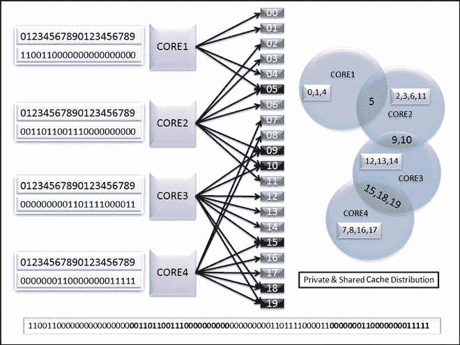

图 6-1.

基于工作负载行为的缓存聚类的染色体结构，使用四个核心和 20 个大小为 1MB 的缓存槽。例如，对于核心 1，缓存槽 0、1 和 4 是私有的，而缓存槽 5 与核心 2 共享。完整的字符串描述了每个核心与一个缓存槽的缓存关联。

缓存聚类的适应度函数是一个加权函数，能够衡量解决方案的质量或性能——在本例中，是一个能够改善 `CPU` 核心间工作负载性能的缓存分区方案。该函数由 `GA` 系统在进化优化过程中最大化。适应度函数必须包含并正确表示影响系统性能的所有或至少是最重要的因素。您可能需要表示工作负载无关特性和工作负载相关特性的函数。公式 6-1 中的工作负载无关函数执行缓存的全局公平分配，而不偏向任何工作负载的特征行为。该函数中，`N` 是工作负载的数量，`ϕ [k]` 是每个工作负载的未命中率（见公式 6-2），它试图最大化所有工作负载的平均性能（`F [avg]`）。每个工作负载 k 的贡献可以根据单个工作负载对吞吐量的影响进行加权（`λ [k]`）。

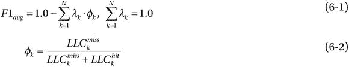

工作负载相关函数（见公式 6-3）偏向于工作负载的特征行为，并试图基于该特征来提升性能。该函数中，`ϕ [k]` 是每个工作负载的未命中率占核心总未命中率的比例，`ψ [k]` 是分配给每个核心的缓存大小占总缓存大小的比例，它允许我们识别某些可能有助于提升给定环境服务水平目标的特征。如公式 6-3 所示，可以生成一定的偏差，为每个核心 k 分配与其 `LLC` 未命中率比率成比例的缓存大小（`S [k]`）施加压力（见公式 6-4）。

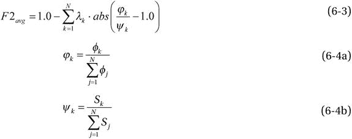

最后，总体适应度（见公式 6-5）可以定义为公式 6-1 和 6-3 中给出的每个个体适应度的加权比例：

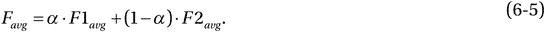

### 仿生网络

近年来，由于基于云的网络（`CBN`）、网络化嵌入式系统、无线传感器网络（`WSN`）、物联网（`IoT`）、软件定义网络（`SDN`）等技术的进步，通信与网络技术获得了极大的关注。此外，企业级网络解决方案正在被开发出来，旨在通过容量规划、流量工程、吞吐量管理以及利用现有互联网基础设施对多租户应用进行叠加，来提供高弹性、高可用性和高可靠性。随着网络规模的扩大，最优路由的搜索空间急剧增加。路由表的数量和流量开销压垮了网络带宽。理想情况下，我们希望拥有高效、自组织的网络，具有低路由发现延迟（或开销）和高成功传输概率。

然而，重大的挑战阻碍了我们实现新网络范式的实际部署。除了对可扩展性、可用性和可生存性的需求之外，这些挑战还源于资源限制、缺乏集中式架构以及网络的动态特性。然而，类似的现像也存在于自然过程中，并且通过生物系统中的适应性得到了成功处理。生物通信范式是进化的、对故障具有弹性、能适应环境条件，并且基于一套简单的规则进行协作。仿生网络通过理解产生复杂模式的组件之间的相互交互来实现自组织。这些交互通过交互组件之间的信息传递以及组件与环境的交互来促进行为响应。

Gianni、Ducatelle 和 Gambardella（2005）提出了 `AntHocNet` 设计，用于基于蚁群中体现的自组织行为进行由信息素驱动的（stigmergy-driven）最短路径发现。类似的路由算法也存在于分组交换网络（如 `AntNet`，Di Caro 和 Dorigo 1998）和电路交换网络（如人工蜂群算法（`ABC`），Schoonderwoerd 等人 1997）中。`AntHocNet` 算法在“Hello”消息中插入有限的路由信息，以便关于现有路径的信息能够通过节点间的信息交换在整个网络中传播。这个过程等同于集体的蚂蚁学习行为，即蚂蚁群聚在一起收集和维护更新后的信息。人工蚂蚁作为自主代理，更新并遵循信息素表（路径），从而引发信息素通信（stigmergic communication）过程。与路由蚂蚁类似，信息素表探索可用于路由数据包的高概率路径。此外，蚂蚁将其有限的资源用于优化全局行为，以经济高效的方式识别食物源。这种行为启发了资源高效的网络技术。

鉴于其动态特性和缺乏基础设施，网络也容易发生故障和延迟。因此，网络应具备实时自组织和自愈的能力。动态网络（尤其是移动自组网）可以使用流行病模型的生物等效模型来描述和调整信息传播。Papadopouli 和 Schulzrinne（2000）描述了一个简单的随机流行病模型，用于估计数据扩散到所有移动设备之前的延迟。Carreras 等人（2006）提出了一种流行病传播机制，用于在集群网络中进行高效的信息传播，以及在延迟容忍网络中进行机会路由。作者使用特征向量中心性（`EVC`）作为节点在网络内传播流行病（信息）能力的客观适应度度量。使用 `EVC` 构建的最终拓扑定义了流行病传播极快的区域。感染前沿（信息）向高度连接的邻域（`EVC`）传播，因为那里的传播速度最快。

资源受限的传感器，例如无线传感器，在能量、带宽、存储和处理能力方面都受到限制。大量此类传感器会产生传感器管理问题。在网络层，解决方案包括建立一条节能路由，将非冗余数据从源节点传输到汇聚节点，以最大限度地延长电池和传感器的寿命。这是在适应因某些节点故障和新节点启动而导致的连接性变化的同时完成的。Khanna、Liu 和 Chen（2009）证明，基于遗传算法（`GA`）的方法可以优化传感器网络，以最大化能源利用率、电池续航以及路由优化。每个传感器都用一个基因进行编码，该基因标识了它自身以及它可能包含的任何其他特定信息。这些信息可能与传感器目标、下一跳、集群域等有关。`GA` 的适应过程通过添加、删除或修改传感器目标，演化出最优的集群边界。该过程还发现了从集群头到汇聚节点的最优路由。

### 数据中心优化

现代分布式数据中心系统的规模和复杂性与日俱增。过去几年中，需要实时处理的信息量呈几何级数增长，要求峰值处理能力同步提升。尽管新平台每瓦性能更优，但处理峰值负载仍要求企业信息技术（`IT`）和数据中心设施每立方米具备更高的电力输送和散热能力，其中总拥有成本的 63%用于供电、冷却和电力输送基础设施。与传统上不受功耗限制、专注于实现最高吞吐量或最低响应时间不同，这些现实情况使得在满足响应目标的同时，相对于执行的计算工作而言，最小化能耗成为一个更具说服力的命题。特别是，当某些机器无需满负荷运行时，动态节能可直接转化为成本节约，并为其他更受功耗限制的服务器创造更大的余量。

在数据中心优化功耗的一种方法是通过管理作业准入、分发和持续平衡，自主调节或重新分配机架级服务器单元的负载。Barbagallo 等人（2010）提出了用于动态工作负载分布的自组织架构，采用基于 `SelfLet` 架构构建的去中心化方法。`SelfLet` 架构（Devescovi 等人，2007）是一种受生物启发的系统，能够根据环境变化动态改变和调整其内部行为。`SelfLet` 使用自主推理来促进自我管理能力。`SelfLet` 本身代表一个服务框架，由一段自给自足的代码构建，该代码与一组其他 `SelfLet` 个体交互，并通过高级功能进行协作。每个 `SelfLet` 要么提供服务，要么消费服务，并通过通信框架进行交互。作者使用了基于动物群体集体决策原理的自组织算法。这些群体中的自组织以侦察、评估、审议和决策功能为特征。数据中心中的自组织可以使用类似的实体进行总结，如下所示：

*   **群体**：驻留在同一服务器上的虚拟机集合。

*   **侦察者**：探索多个物理服务器，并将其与原始服务器进行比较。侦察者可以通过其当前位置、生命周期以及存储的与所检查的每个服务器类别相关的信息来表征。

*   **服务器管理器**：与侦察者通信，并做出与虚拟机迁移相关的决策。

基于来自多个侦察者的集体数据，做出允许或禁止迁移的决策。与生物系统一样，是否迁移的决策不是确定性的，而是遵循概率分布。这避免了可能导致不稳定和振荡行为的反应性迁移。此外，与生物系统类似，单个服务器可以传播一个抑制标志，以防止在关键操作中途进行迁移。

Li 和 Parashar（2003）开发了 `AutoMate` 架构，以研究用于开发和执行自管理（即配置、修复、优化和保护）网格应用的受生物启发的概念模型和实现设计，同时应对复杂性、动态性和异构性带来的挑战。`AutoMate` 架构建立在三个操作原则之上：

*   将策略与驱动这些策略的算法、通信协议等相关的机制分离

*   将基于上下文、约束和方面的组合技术应用于应用，以综合计算资源、性能保证和服务质量的动态需求

*   开发主动和被动组件管理，以优化动态环境中的资源利用和应用性能

## 受生物启发的计算算法

受生物启发的计算方法是元启发式算法，它们模仿自然过程中解决优化问题的方法。这些启发式算法提供了一个鲁棒且去中心化的计算引擎，能够在嘈杂的环境中运行，同时在时间、能量和功耗限制内实现期望的行为。此类计算方法已几乎应用于优化、知识发现和大数据分析的所有领域，包括计算机网络、图像处理、无线传感器网络、安全、控制系统、生物医学系统和机器人技术。以下各节简要概述了受生物启发的优化算法，这些算法是传统确定性方法（一种扩展性差且需要大量计算工作的方法）的计算高效替代方案。设计受生物启发的算法涉及识别问题的合适表示、开发适应度函数以评估解决方案的质量，以及定义算子以产生一组新的解决方案。广义上讲，受生物启发的算法可分为三大类：进化算法、群体智能算法和生态算法。这些类别根据其灵感来源（涉及蚂蚁、萤火虫、细菌、蜜蜂、鸟类等特定自然过程案例）进一步细分为子类。

## 群体智能

群体智能是一种基于去中心化、自组织系统的集体行为的人工智能。该术语由 Beni 和 Wang（1989）在细胞机器人系统的背景下提出。群体智能通常包含一组称为“人工生命体”的简单个体，它们使用极其基本的规则与其他个体以及环境进行局部交互。没有集中控制基础设施来支配单个个体的行为或交互。相反，参与个体之间的局部和随机交互导致了无法归因于单个个体的智能全局行为。换句话说，对等层面的集体交互在全局层面产生了一种复杂的现象。群体智能的自然实例包括蚁群、鸟群、兽群、细菌生长和鱼群。受群体智能启发的系统包括正反馈、负反馈、波动的放大以及多智能体之间的多重交互。

自主计算与群体智能密切相关。例如，通过调整系统参数，可以自主地而非手动地实现自配置方面。在自然界中，局部过程指标可以改变、增强或达到阈值，反映了实际的动态群体状况。显然，系统性能可以通过多个局部智能体之间的交互得到优化。同时，通过这种并行的多智能体交互可以保证系统的鲁棒性。最后，通过仔细的参数和规则设计可以实现安全性和负载均衡。必须在传统“信息素”机制所促进的纯粹反应性行为与人工智能方法所促进的纯粹认知行为之间确定适当的权衡。信息素是许多社会性动物群体中存在的一种机制，它试图在自组织系统中使用去中心化的方法来解决复杂问题。该系统奖励正反馈，同时惩罚负反馈。因此，该系统实现了一个复杂、智能的基础设施，无需规划、控制或智能体之间的复杂交互。这种社会性方面支持了缺乏记忆、智力甚至彼此意识的基本智能体之间的高效协作。

### 蚁群优化算法

在自然界中，蚂蚁会随机游走，直到找到一条通往食物的路径。这种行为启发了一种名为蚁群优化（`ACO`）算法的群体智能变体。在 `ACO` 场景中（Dorigo, Di Caro, and Gambardella 1999），蚂蚁通过沉积信息素来改变环境介质，从而与其他蚂蚁交流关于食物来源的状态信息。状态信息在局部范围内交换，并且上下文仅传递给信息素沉积位置处的蚂蚁。找到食物后，这些蚂蚁返回蚁群，同时沿途留下信息素供其他蚂蚁跟随。一旦发现食物踪迹，其他蚂蚁就会放弃随机的食物搜索，转而跟随信息素踪迹，从而强化了原始路径。

然而，随着时间的推移，信息素踪迹会逐渐蒸发并失去其吸引力。如果蚁群与食物源之间的往返时间很长，信息素的蒸发速度可能快于其被强化的速度。相比之下，较短的信息素踪迹具有更高的信息素密度，并且其强化速度快于蒸发速度。信息素蒸发过程类似于避免收敛到局部最优解；该过程有助于无约束地探索解空间，同时避免强化非最优解。通常，边上信息素量的变化允许选择特定的边。一个稳定的系统是由强边组成的网络，这些边能够适应活跃的变化和环境变化。由于交互环境中的动态变化，某些边通过正反馈得到强化，而其他边则因负反馈而被削弱。边上的微小变化可能导致一条替代路径，该路径在其他边表现出更强特性之前一直有效。例如，如果通往单一食物源的信息素踪迹被强化，那么发现其他可能更适合蚁群（就距离或丰富度而言）的替代源所需的时间就会长得多。ACO 试图找到一条可能被其他智能体跟随的通往解的路径，从而建立正反馈，最终形成一条通往解的唯一路径。

## 蚁群优化

ACO 方法与进化算法在一个主要方面有所不同。在进化算法（如遗传算法）中，关于问题的所有知识都包含在当前种群中；而在 ACO 算法中，过去性能的记忆以信息素踪迹的形式得以保留。Dorigo, Di Caro, and Gambardella (1999) 将蚂蚁视为环境信号的角色，而信息素更新规则则扮演了自动机学习规则的角色。在 ACO 中，环境信号/蚂蚁通过其概率转移规则被随机地偏向，从而将学习过程引导至搜索空间中最有趣的区域。也就是说，整个环境在学习良好的状态-动作对中起着关键的、积极的作用。

基本的 ACO 规则可以通过以下过程来定义（Engelbrecht 2006; Wang et al. 2007）：

创建 `nr` 个全局蚂蚁；每只蚂蚁恰好访问每个食物源一次。

评估每个食物源的适应度；距离较远的食物源被选择的概率较小。

更新蚂蚁的信息素以及弱区域的年龄。

基于信息素强度，将局部蚂蚁移动到更好的区域以提高其适应度；否则，选择新的随机搜索方向。

更新蚂蚁在其所经过的所有区域的信息素。

每次迭代后，蒸发蚂蚁的信息素。

基于时间 `t` 时信息素的强度，蚂蚁会被吸引到各个区域。随着信息素蒸发，该区域对蚂蚁的吸引力降低，并最终被放弃。在时间 `t`，蚂蚁 `k` 从区域 `i` 转移到区域 `j` 的概率为：

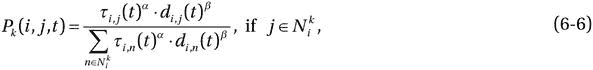

其中

* `τ[i,j](t)` = 信息素踪迹区域，由时间 `t` 时的边 `i` 和 `j` 表示。
* `d[i,j](t)` = 源位置 (`i`) 与目标位置 (`j`) 之间的距离。
*  = 蚂蚁 `k` 在源 `i` 处的可行邻域。
* `α` = 信息素踪迹的相对重要性。
* `β` = 源与目标之间距离的相对重要性。

正参数 `α` 和 `β` 定义了信息素与启发式信息之间的关系。因此，蚂蚁 `k` 选择某条踪迹的概率是距离和该踪迹在时间 `t` 时已存在信息素密度的函数。强度和距离对成本函数的重要性分别由 `α` 和 `β` 决定。因此，区域越好，对后续蚂蚁的吸引力就越大。该区域的信息素浓度根据恒定蒸发率 (`p`) 和被吸引到该区域的蚂蚁的新沉积物 (`Δτ[k]`) 进行更新，如下所示：

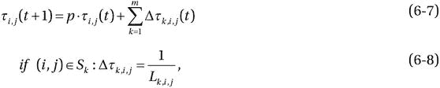

其中

* `p` = 蒸发常数，其值可设置在 0 到 1 之间，表示信息素蒸发的速率。
* `L[k,i,j]` = 蚂蚁 `k` 的行程长度，较短的行程导致更高的信息素密度。
* `Δτ[k,i,j]` = 蚂蚁 `k` 在区域 `(i, j)` 中沉积的信息素量。

局部蚂蚁选择某个区域的概率与其信息素踪迹成正比。信息素受蒸发率、蚂蚁年龄和适应度增长的影响。因此，这种基于信息素的选择机制能够促进候选解的更新，适用于处理优化中不断变化的环境。

ACO 技术可用于知识发现，对应于学习变量之间的函数关系、数据模式的变化以及数据分类。蚂蚁的社会行为暗示了构建一种基础设施的概念，该基础设施利用自然交互和局部信息来促进自组织的理念，从而解决复杂的计算问题。

Dorigo, Di Caro, and Gambardella (1999) 描述了旅行商问题（TSP）的一个解决方案，其中 `m` 只人工蚂蚁同时构建一条 TSP 的旅行路线。最初，`k` 只蚂蚁被放置在随机选择的城市上。在每一步，第 `k` 只蚂蚁应用一个概率动作选择规则来决定下一步要访问哪个城市。蚂蚁选择从城市 `i` 到城市 `j` 旅行的概率 (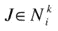) 由公式 6-6 给出，其中 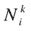 定义了当蚂蚁在城市 `j` 时 `k` 个城市的潜在邻域。如果 `α = 0`，则更有可能选择最近的城市；如果 `β = 0`，则仅使用信息素放大，没有任何启发式偏差。每只蚂蚁 `k` 都保留一个记忆区域，在其中生成旅行路线，计算旅行路线的长度，并回溯路径以将信息素沉积到旅行路线的弧上。在所有蚂蚁构建完它们的旅行路线后，信息素踪迹会得到更新。这是通过将所有弧上的信息素减少一个常数因子（蒸发），然后依次将信息素添加到蚂蚁在其旅行路线中穿过的弧上来完成的。信息素蒸发和更新在公式 6-7 中实现。属于短路径且被许多蚂蚁访问的弧会获得更多信息素，因此在算法的后续迭代中更有可能被蚂蚁选择。

## 粒子群优化

粒子群优化（PSO）是一种随机计算技术，它通过迭代优化问题的候选解，直到达到目标适应度（或质量）（Kennedy 和 Eberhart，1995）。该技术的生物学灵感来源于鸟群和鱼群的社会行为。由于其简单性和计算效率，PSO 已成功应用于许多工程研究和优化应用中。PSO 中的粒子表示种群中的单个成员，该成员在大型搜索空间中受到速度和加速度作用时，会搜索最优行为。群中的每个粒子都会探索解空间的坐标，并记录与在该过程中达到的最佳解（适应度）相关的以下四个向量：

* 粒子的当前坐标。
* 粒子的速度（包括大小和方向）。
* 与粒子迄今为止达到的局部最佳解（`pbest`）相关的坐标（位置）。
* 与粒子邻域迄今为止达到的最佳解（`gbest`）相关的坐标（位置）。

PSO 可以搜索大型解空间，同时不对被优化的问题做出任何假设。PSO 通过以一定速度、在适应度函数的引导下，相对于其当前位置在解空间中移动粒子来寻找最优解：粒子的运动通过改变其速度（加速）来控制，并由其当前最佳位置（`pbest`）和其邻域中迄今为止找到的最佳位置（`gbest`）引导。随着找到更好的位置，`gbest` 解会迭代更新。所有粒子的联合（集体）探索将群推向最佳解。在寻求全局最优的过程中，群中的粒子会重新排列，聚集在次优解周围。一旦某个粒子接近全局最优解，其他粒子就会被吸引过来，从而有很大概率找到最佳解。在每次迭代 `k` 中，粒子 `i` 根据以下方程更新其位置和速度：

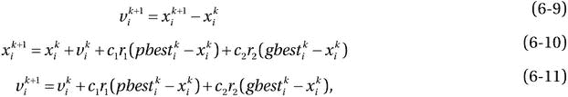

其中

*  = 第 `k` 次迭代时粒子 `i` 的位置。
* 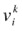 = 第 `k` 次迭代时粒子 `i` 的速度。
* `c[1], c[2]` = 权重系数。
* `r[1], r[2]` = 0 到 1 之间的随机数。

对于第 `k` 次迭代，PSO 算法由以下步骤组成：

# 粒子群优化算法

通过在问题空间边界内为群中的每个粒子 `i` 分配一个随机位置 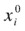 来初始化群。

评估每个粒子 `i` 相对于其当前位置 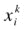 的适应度。

将粒子 `i` 的适应度与其 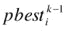 进行比较；如果当前适应度大于 `pbest`，则将 `pbest` 值 (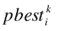) 设置为当前适应度值。

选择具有最佳适应度 (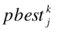) 的粒子 `j`；标记此适应度 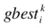。

使用方程 6-10 评估粒子 (`i`) 的新位置 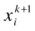。

使用方程 6-11 评估粒子 (`i`) 的新速度 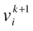。

该过程重复进行，直到满足停止条件或找到最佳解。与遗传算法等进化算法不同，粒子利用当前全局最优值来提高 PSO 算法的适应度，而无需进化算子。

由于其分布式特性和在噪声条件下运行的能力，PSO 可以证明是一种有用的工作负载平衡技术，特别是在云计算中考虑功耗、热量产生和服务质量要求方面。工作负载必须以最小化功耗、消除热热点并满足性能目标的方式进行分配。系统中（或计算集群中）工作负载的动态放置会触发计算、内存、网络、输入/输出 (`I/O`) 和存储资源可用性的动态变化。由于在动态变化的资源池中分配负载具有许多自由度，因此最佳系统运行会导致复杂的工作负载分配选择。PSO 解决方案持续搜索动态变化的全局最优解，以识别新负载或即将到来的负载的放置目标。

Yassa 等人（2013）提出了用于分布式环境中工作负载调度的 DVFS 多目标离散粒子群优化 (`DVFS-MODPSO`)。`DVFS-MODPSO` 实现了多个冲突目标的多目标优化——最小化执行时间、执行成本和能耗——并生成一组非支配解，为选择满足 `QoS` 目标的调度方案提供了灵活性。`DVFS-MODPSO` 定义了一个三元组 `<T [i] , P [j] , V [k] >`，该三元组表征了粒子的位置，并代表了工作负载调度问题的一个合理解。每个三元组将任务 `T [i]` 分配给具有电压缩放 `V [k]` 的处理器 `P [j]`。结果表明，`DVFS-MODPSO` 为执行时间、执行成本和功耗生成了一组帕累托最优解。

使用传统方法求解全局优化问题需要精确的函数描述和梯度评估，这可能代价高昂、耗时、难以实现或根本不可能。更复杂的是，许多复杂的优化问题表现出噪声行为，这使得隐式滤波和进化梯度搜索等方法几乎无效。相比之下，PSO 算法即使在存在噪声的情况下也能稳定高效地运行。在许多情况下，噪声可能是有益的，因为它有助于避免局部最小解，并更快地收敛到全局最优解。由于其简单性，PSO 算法也被提议作为基于梯度技术的替代方案，用于检测多目标优化问题的帕累托最优解。

## 人工蜂群算法

人工蜂群（ABC）算法是一种受蜜蜂觅食行为启发的群体元启发式算法，由 Karaboga、Dervis 和 Basturk（2007）提出。该模型包含三组蜜蜂，它们共同促进对食物来源的最优搜索。`雇佣蜂`依附于特定的食物源，并通过摇摆舞分享关于该食物源收益性的信息，以招募新蜜蜂。`观察蜂`是一种失业蜂，它通过观察蜂巢地板上的摇摆舞来评估食物源的质量，并朝着收益最高的食物源移动。`侦察蜂`随机搜索新的食物源，并通过摇摆舞呈现与其质量相关的信息。当食物源耗尽时，雇佣蜂会转变为侦察蜂，并搜索新的食物源。ABC 算法的主要组成部分如下：

-   **`食物源`**：食物源代表优化问题的候选解。为了选择最优食物源，雇佣蜂会评估食物源的整体质量，衡量标准包括其与蜂巢的距离、食物（花蜜）的数量和质量，以及提取食物的难度。
-   **`雇佣蜂`**：雇佣蜂受雇于特定的食物源，并利用该食物源采集花蜜。蜜蜂收集与食物源距离、方向和质量相关的信息，并与在舞蹈区等待的其他蜜蜂分享。雇佣蜂会尝试通过多次试验，重新评估其记忆坐标邻域内的坐标，来改进其解决方案（食物源）。
-   **`失业蜂`**：侦察蜂和观察蜂都属于这一类。它们通过随机侦察或雇佣蜂分享的信息，来评估潜在食物源的收益性。这种评估有助于通过促进选择收益最高的食物源，将失业蜂转变为雇佣蜂。
-   **`质量度量（适应度）`**：食物源的质量——以其与蜂巢的距离、花蜜的数量和质量以及提取花蜜的相对难度为特征——可以用一个单一量来概括：适应度。
-   **`知识交换`**：知识交换是 ABC 算法的关键要素。知识在称为舞蹈区的集结区域内共享；在这里，蜜蜂通过摇摆舞交换与食物源适应度和坐标（角度、距离）相关的信息。

ABC 算法可用作数据中心负载均衡的技术。负载均衡旨在优化资源利用率、响应时间、吞吐量和热热点。负载均衡可以通过重新分配现有任务或将新任务分配给现有计算节点来实现。这些计算节点作为承载工作负载的潜在候选者，当负载被有效分配时，可以提高数据中心的效率。每个计算节点会公布其与利用率、运行阶段、在该阶段花费的时间、缓存行为、温度和功耗相关的主要特征（或指纹）。适应度函数定义了计算节点在未来时间承载新工作的能力。例如，一个能够补偿其邻域内预测热变化的候选节点，与具有相似特征但存在于完全平衡集群中的其他节点相比，将具有更高的适应度。每个服务器包含充当 `空闲蜂`、`雇佣蜂`、`观察蜂` 或 `侦察蜂` 的管理微控制器。侦察蜂以随机方式指定，而雇佣蜂和观察蜂则遵循受适应度结果影响的群体行为。当雇佣蜂（管理节点）记录在现有节点上承载负载的益处时，观察蜂（在工作队列中等待）为了成为雇佣蜂，会分析通过侦察蜂和雇佣蜂传递的集体信息。一旦选择了计算目标，观察蜂就会尝试在该目标上承载排队的任务。使用 ABC 的负载均衡技术部署了以下代理：

-   **`侦察蜂`**：充当随机代理，约占数据中心总计算节点的 2%。这些代理使用与被标记为侦察蜂的计算节点相对应的管理代理来执行侦察功能。侦察代理收集与热点、平均功耗和计算资源可用性相关的邻域特定信息。
-   **`雇佣蜂`**：充当代理，协助加载和收集在被标记为雇佣蜂的计算节点上执行的负载的运行统计数据。这些统计数据包括使用率、内存带宽、缓存噪声行为和 `I/O` 争用。
-   **`观察蜂`**：充当队列中等待的潜在工作负载的代理。每个代理识别承载此工作负载的最佳目标。

在此示例中，吸引蜜蜂到特定节点或邻域的两个主要因素是热变化和计算资源的可用性。随着热变化或计算资源的减少，该节点的吸引力下降，并最终被放弃。当一个节点仍然具有吸引力时，雇佣蜂会反复访问该位置，并鼓励观察蜂在其邻域内承载工作。侦察蜂会识别出具有高适应度的其他目标或邻域，这些目标或邻域可供失业蜂利用。

ABC 算法的主要步骤如下：

1.  将随机食物源分配给每个雇佣蜂。
2.  重复：
    -   每个雇佣蜂根据其记忆中存储的信息访问食物源。
    -   蜜蜂评估食物（花蜜）的数量和质量，并在蜂巢中执行摇摆舞。
    -   每个观察蜂观察雇佣蜂的摇摆舞，其中一些观察蜂根据通过舞蹈传达的信息选择食物源。
    -   一旦食物源被放弃，侦察蜂就会识别新的食物源。
    -   侦察蜂识别出新的食物源，并根据花蜜的质量吸引蜂群。
3.  满足要求。
4.  重复。

## 细菌觅食优化算法

细菌觅食优化（BFO）算法（Passino，2002）模拟了细菌菌落中有组织行为的微生物学现象。用于模拟大肠杆菌社会觅食行为的 BFO 算法，可用来解决现实世界中的数值优化问题。BFO 主要由三个过程组成：趋化、繁殖和消除-扩散。

趋化被定义为细胞响应化学刺激而产生的运动。许多单细胞和多细胞生物都使用这种方法来发现食物。细菌趋化代表了信号转导系统，它刺激了细菌的运动行为。繁殖体现了自然选择，它倾向于使适应度最佳的细菌比适应度较差的细菌具有更高的生存可能性。自然选择允许每一代中被选中的种群将遗传物质传递给后续世代。消除-扩散促进了随机选中的部分细菌种群被消除和扩散的低概率事件。这增强了细菌种群的多样性，并防止全局最优解陷入局部最小值。

## 细菌觅食优化算法

大肠杆菌在其整个生命周期中，会在两种运动模式（称为“游动”和“翻滚”）之间交替。游动动作使细菌能够沿着当前营养梯度增加的方向移动；当营养梯度不再具有吸引力时，翻滚动作则允许细菌改变方向。细菌运动的交替模式使细菌能够定位到最佳营养源的位置。在完成一定次数的完整游动后，细菌种群会根据适应度标准进行繁殖和消除。每个细菌的位置都关联着一个成本，并代表一个可能的解。`BFO` 模拟会跟踪当前位置和先前位置的成本，以评估梯度改善或恶化的质量。在每一代中，细菌的健康状况会影响其被保留用于繁殖（制造副本）或被消除的可能性。

如果 `θ^i` 表示第 `i` 个细菌的位置，则该细菌的连续运动为：

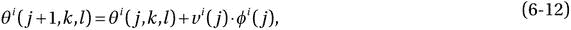

其中

*   `θ^i(j,k,l)` = 第 `i` 个细菌在第 `j` 次趋化步骤、第 `k` 次繁殖步骤和第 `l` 次消除-扩散步骤中的位置
*   `v^i(j)` = 翻滚过程中随机方向上的步长
*   `ϕ^i(j)` = 翻滚后的随机运动方向

对于第 `i` 个细菌的给定位置 `θ^i(j,k,l)`，`J^i(j,k,l)` 表示该位置处细菌的适应度。如果第 `i` 个细菌在位置 `θ^i(j+1,k,l)` 的适应度优于其在 `θ^i(j,k,l)` 的适应度，即 `J^i(j+1,k,l)` 优于 `J^i(j,k,l)`，则 `v^i(j+1) = v^i(j)`，且 `ϕ^i(j+1) = ϕ^i(j)`。如果情况相反，则 `v^i(j+1)` 会以一个随机方向采取不同的步长。

`Munoz`、`Lopez` 和 `Caicedo`（2007）提出了一种 `BFO` 算法，用于在每个采样时间搜索最佳执行器，以在温度网格平台上获得均匀的温度。其思想是通过分配或取消分配额外的资源来补偿冷点。类似的技术可以应用于计算服务器集群（如数据中心）中的负载均衡。服务器负载均衡技术利用细菌搜索来定位热行为不均匀（温度方差高）的区域。可以通过建模因增加或减少单位负载量而导致的温度网格中的热方差，来评估新识别位置的适应度。

## 人工免疫系统

人工免疫系统（`AIS`）是一种基于脊椎动物免疫系统原理的仿生优化算法（`Dasgupta`，1999）。该算法模拟了人体免疫系统的几个特征：高度分布式、并行性，以及使用自适应学习和记忆来解决与模式识别和分类相关的问题。`AIS` 算法通过一个模式检测器来学习对相关模式进行分类，该检测器将先前见过的模式与现有模式关联起来。该算法针对每种模式的影响，制定不同的响应机制。

人体中的适应性免疫系统使用许多智能体，这些智能体在不同位置执行多种功能，主要采用负选择和克隆选择机制。负选择机制利用了免疫系统检测未知抗原的能力，同时不对自身产生反应。克隆选择机制促进了那些能够识别抗原的细胞的增殖，而不是那些不能识别抗原的细胞。因此，自身反应性细胞被消除，而成熟细胞得以增殖。学习机制涉及通过克隆过程来增强给定种群中那些有助于识别抗原的淋巴细胞。新细胞是其亲本的副本（克隆），但克隆过程伴随着高突变率（体细胞超突变）。这种突变过程模拟了重新分配资源以识别新抗原与先前已识别抗原的机制。强化学习机制重新平衡了不同淋巴细胞的种群，以促进病原体的最佳检测和介导。

免疫系统的特性具有以下属性（`Castro`、`Nunes` 和 `Von Zuben`，1999）：

*   **独特性**：免疫系统对每个个体都是独一无二的，具有其自身的脆弱性和能力。
*   **识别异物**：对个体身体而言是外来的有毒元素或分子会被识别、分类并标记，以便将来检测。
*   **异常检测**：免疫系统学会将未识别的外来元素分类为病原体，并尝试采取补救措施。
*   **分布式检测**：细胞遍布全身，不受集中控制。
*   **不完美检测（噪声容忍度）**：病原体首先被归类为未识别的外来元素，对其绝对识别并非必需。
*   **强化学习与记忆**：免疫系统不断学习病原体的结构，以制定越来越有效的响应。

与遗传算法类似，`AIS` 架构包含以下四个步骤（`Aickelin`、`Dasgupta` 和 `Gu`，2014）：

**编码**：编码是抗原或抗体的二进制、数值或名义表示。抗原代表需要检测入侵的问题域解决方案。抗体代表先前识别出的模式，可在后续使用。
**相似度度量**：相似度度量量化了抗原与其候选抗体之间的亲和力。匹配算法衡量候选抗体与其目标抗原之间的一致、不一致或相关程度。具有强一致或不一致的候选抗体可能被选中进行进一步处理（克隆或突变）。
**选择**：选择过程遵循迭代程序，其中每一步根据抗体-抗原亲和力度量，通过克隆或移除来调节抗体浓度。添加新抗体后，迭代过程会改变该抗体的浓度，持续进行直到人工免疫系统（`AIS`）达到稳定。`AIS` 迭代可由以下方程表示（`Farmer`, `Packard`, and `Perelson` 1986）：

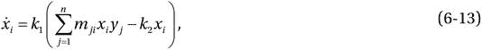

其中 `n` = 抗原数量，`x[i]` = 抗体 `i` 的浓度，`y[j]` = 抗原 `j` 的浓度，`m[ji]` = 表示抗体 `i` 与抗原 `j` 相关性的亲和力函数，`k[1]` = 抗体生成速率，`k[2]` = 死亡速率。方程 `6-13` 表示抗体浓度的迭代变化，取决于因抗原识别导致的克隆与因缺乏相关性导致的死亡之间的净结果。
**突变**：抗原-抗体相互作用，结合体细胞超突变，构成了 `AIS` 的基础。突变在群体中引入多样性，并促进对抗原的有效响应。

`AIS` 利用自适应的抗体群体，通过为给定问题域合成多样化的子集解决方案，来实现智能行为。`AIS` 已应用于与网络安全和异常检测相关的领域。

## 数据中心中的分布式管理

数据中心是复杂的环境，需要应对与电力供应、能耗、热量管理、安全、存储性能、服务保障以及动态资源分配相关的关键挑战。这些挑战涉及提供有效的协调，以提高数据中心的稳定性和效率。大型数据中心中波动的需求和多样化的负载特性，使得维持工作负载性能、冷却效率和能源目标（将在后续章节讨论）的任务变得复杂。在如此庞大的系统集群中，多个目标相互竞争，通过避免执行器重叠并耗尽约束、时间粒度、方法类型和控制序列的复杂组合，来实现服务级目标。然而，组合解空间可能极其庞大，且可能无法在有限时间内收敛到全局最优。因此，集中式数据中心管理系统在时间受限的情况下可能难以扩展，从而无法提供最优的管理解决方案。

群体智能（`SI`）已成为一个有前景的领域，可用于构建分布式管理方法，从而在无需集中控制的情况下实现可扩展的解决方案。以下各节介绍一个控制系统，该系统能够识别工作负载放置的合适目标，并包含以下基本控制要素：

*   **受控过程**：受控过程实现反馈控制回路，该回路在给定策略下约束计算集群（如服务器机架）的温度和功率。最优过程在策略约束内运行，并提供足够的能量，使工作负载以最高性能效率和最低冷却成本运行。
*   **适应度函数**：适应度函数基于现有知识库的预期需求和资源可用性，评估工作负载最有利的放置位置。
*   **知识库**：知识库作为一个有限数据库，由传感器代理进行的调查数据组成。这些知识有助于识别工作负载最可能的放置位置。随着系统动态变化，新数据会根据自定义的数据保留策略替换旧数据。知识库增加对可能提升解决方案适应度的数据的保留，并弃用不太可能改进现有解决方案的数据。
*   **控制参数**：控制参数定义了最优决策边界，从而将工作负载放置在选定的计算节点上。
*   **群体代理**：群体代理通过在一个去中心化且自组织的系统中执行特定角色，参与系统优化过程。这些代理相互之间以及与周围环境进行协调，最终涌现出智能的全局行为。

### 工作负载特征化

由于工作负载会经历不同的执行阶段，阶段边界是预测工作负载行为以进行调度或在服务器集群间迁移的基本属性。此外，阶段识别能够重用重复出现阶段的过往配置，以提升性能。这些配置强制执行调度新工作负载、迁移现有工作负载以及消除计算节点或计算节点集群之间热负载不平衡的策略。

### 热优化

鉴于数据中心高度动态的环境，热点会因时间事件（例如一组服务器上的工作负载增加）或空间事件（例如机房空调（`CRAC`）单元无法向数据中心特定区域提供所需冷却）而产生。图 `6-2` 描绘了数据中心的热快照，显示了热点和冷点。热点可能引发过度冷却，从而降低数据中心运营的电源使用效率（`PUE`）。传统的冷却控制解决方案采用反应式方案，依赖于机架或刀片的瞬时温度。这些方案存在一个根本性缺陷，即纠正措施在组件热阈值或性能阈值被突破很久之后才完成。在拥有大量节点的数据中心中，使用反应式方法几乎不可能在不引起滞后效应的情况下实时实现最优工作负载平衡。在可配置硬件和软件集群存在动态变化的情况下，能够及时响应以减少集群间的温度差异（热点）至关重要。

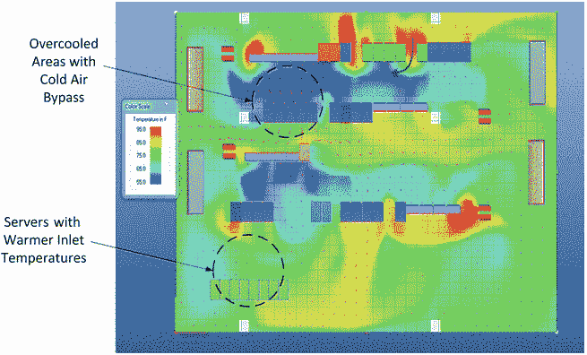

图 `6-2`.

数据中心的热快照

### 负载均衡

# 负载均衡

负载均衡是一种在计算节点集群中分配工作负载的方法，以便能够满足给定策略。负载均衡优化资源使用、最大化吞吐量并最小化响应时间。负载均衡通过计算节点之间的主动负载迁移来实现，这也通过工作负载权衡和功率分配来控制热点缓解方案。热点可归因于不均匀的负载分布，导致计算利用率不平衡。热点会导致冷却效率低下和数据中心运营成本增加。在基于群体的优化方案中，热方差可等同于寻找营养源。热方差高的区域充当负载迁移的源（或目标），吸引群体代理的更多监视。

### 算法模型

该算法模型由服务器管理器、侦察智能体、工作智能体、自由智能体和负载控制器组成。服务器管理器管理每个服务器节点，并提供编程接口，用于解释传感器数据并合成有用的度量指标。服务器管理器在多个时间粒度级别上实施控制，这最终可能导致针对其中每个元素产生特定的异构采样需求。例如，服务器管理器通过调用内置传感器来记录性能数据并对其进行处理，以合成工作负载阶段分布。在分层方案中，服务器管理器管理一组计算资源，并识别能够承载候选工作负载的计算资源。在外部，每个集群代表一组本地管理的计算单元，而不暴露其本地层级结构。

侦察智能体是随机生成的探测工具，用于评估其周围环境及对等集群，以识别可能的热点和冷点来源。由于系统利用率的动态特性，新的来源会被识别出来，而过去的来源则会被逐渐遗忘。侦察智能体采用适应度标准来确定该区域是否适合承载工作分配。

工作智能体是浮动实体，它们使用反馈函数来量化计算区域的重要性，并依附于它们选择进行任务搜寻的节点。在每个调度时刻，反馈函数会根据最近的调度决策和先前的结果，通过提升或降低节点的可信度来衡量历史影响。如果计算区域持续成功承载工作负载，其可信度就会提升；然而，如果计算区域在承载竞争中失败或承载频率很低，其可信度就会下降。工作智能体的数量是有限的，只有当某个工作智能体因其影响分数低或迁移到新区域而被释放时，才能被重新利用。反馈函数为

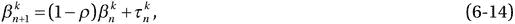

其中

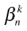 = 集群（或节点）`k` 在实例 `n` 时的影响分数

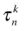 = 集群（或节点）`k` 在实例 `n` 时获得的增量信用提升

`ρ` = 影响衰减系数

如函数 `6-14` 所述，每当一个计算集群或节点成功承载工作负载时，它会通过获得增量信用来提升其影响分数。同时，反馈函数会以由影响衰减系数 `ρ` 定义的速率，削减其分数的一定百分比。衰减系数允许调整适应速率。在任何时候，只允许有限数量的工作智能体运行。当一个工作智能体的适应度分数低于某个阈值时，它会转变为自由智能体。一旦发生这种情况，该工作智能体可以根据来自侦察智能体和工作智能体的反馈，依附到一个新的集群。

侦察智能体负责识别新的、有前景的区域以供探索，而工作智能体则有助于描述其当前工作区域附近理想邻域的特征。这些智能体始终评估集群的适应度，即其承载新工作负载能力的度量。这个适应度分数允许相应的智能体参与竞标过程，以在其所代表的区域承载工作负载。适应度评估会评估以下特征：

*   与其他区域相比，所依附区域的热不平衡严重程度
*   成功执行工作负载所需资源的可用性
*   关于计算节点间共享资源（例如，共享缓存）的争用程度

图 `6-3` 描述了一个计算节点的架构接口，这些接口有助于实现最佳的工作负载分布。工作智能体和侦察智能体使用服务器管理器提供的仪表化 API，收集节点特定的性能和环境数据。这些智能体通过测量节点的影响分数（参见公式 `6-14`）、评估其资源需求、预测共享资源争用以及预测可能导致热不平衡的温度行为，来探索使用该节点承载工作负载的可行性。一旦确定该节点是潜在的主机，其影响分数就会被更新，以供未来分析。资源充足且处于“冷”状态的区域会自我标识为首选的探索地点。工作智能体分析每个区域与工作负载的兼容性；由于缺乏独占资源，或者在与其它工作负载共享资源方面存在历史噪音行为的证据，可能会产生不兼容性。工作智能体对其所依附的主机进行排名，并决定是否参与在该节点上承载工作负载的竞标过程。如果它参与并中标，智能体就会更新反馈函数；如果它未中标，智能体就会削减其影响分数的一定百分比 `β`。一旦影响分数低于某个阈值，该工作智能体就会转变为自由智能体。自由智能体根据从侦察智能体和工作智能体收到的评估分数，通过依附到一个新的集群（或节点），将其角色转变回工作智能体。

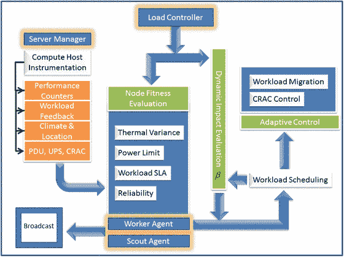

**图 `6-3`. 计算节点：用于解释传感器数据以评估反馈函数和适应度函数的架构接口**