# 7. 深度神经网络

我认为大脑本质上是一台计算机，而意识就像一个计算机程序。当计算机关闭时，它就会停止运行。理论上，它可以在神经网络上被重新创建，但这将非常困难，因为它需要一个人所有的记忆。——斯蒂芬·霍金，《时代》杂志

人工神经网络（ANNs）于 20 世纪 40 年代被提出，作为人类大脑皮层中基本计算单元的简化模型，此后一直是一个活跃的研究领域。在人工神经网络的众多演进中，深度神经网络（DNNs）（Hinton, Osindero, and Teh 2006）作为浅层人工神经网络结构的一种有前景的扩展而脱颖而出。迄今为止，基于深度神经网络的分层学习，以及其他贝叶斯推理和演绎推理技术的最佳展示，是 2011 年 IBM 超级计算机沃森在传奇性的电视问答节目《危险边缘！》中的表现。

本章首先介绍一些关于人工神经网络的基础入门知识，然后概述深度神经网络的结构和学习方案。

## 人工神经网络简介

人工神经网络已在许多实际应用中取得成功，尤其是在监督学习模式下。然而，人工神经网络也一直受到一些显著挑战和缺陷的困扰。监督学习面临的众多挑战之一是维度灾难（Arnold 等人，2011），当特征数量和训练点数量变得非常大时就会出现这种情况。因此，大数据使得人工神经网络的学习更加困难，因为需要处理的数据量巨大，随之而来的是内存和计算需求。分类中的另一个挑战是数据非线性，它表征了不同类别特征的重叠，使得分离类别的任务更加困难。主要由于这些原因，以及选择合适网络架构的启发式方法，人工神经网络在 1990 年代和 2000 年代落后于被广泛采用的支持向量机，后者在许多方面被证明优于人工神经网络。

注意
支持向量机为机器学习问题提供了一种有原则的方法，因为它具有统计学习理论的数学基础。支持向量机将解构建为支持向量的加权和，而支持向量只是训练输入的一个子集。与人工神经网络类似，支持向量机基于训练数据集最小化特定的误差代价函数，并依赖于经验风险模型。此外，支持向量机使用结构风险最小化，并对优化问题施加额外的约束，迫使优化步骤找到一个最终能更好泛化的模型，因为它位于类别之间的等距最大距离处。

随着硬件和计算能力的进步，深度神经网络被提出作为人工神经网络浅层架构的扩展。一些批评者认为深度学习只是“神经网络的另一个流行词”（Collobert，2011）。尽管深度神经网络借用了生物大脑中神经元的概念，但它并不像皮层算法或其他受生物启发的机器学习方法那样试图对其进行建模。深度神经网络的概念源于福岛邦彦（1980）提出的新认知机模型。广义上，深度神经网络被定义为一组旨在以分层方式学习并涉及多个知识表示抽象层次的机器学习算法，其架构旨在实现强人工智能模型。这些架构随着信息在更高层次传播而积累知识，其方式是更高层次的学习由较低层次发生的统计学习定义并建立在其基础之上。

考虑到深度学习的这种广泛定义，我们可以将反向传播算法（自 1974 年可用）与循环神经网络和卷积神经网络（于 1980 年代引入）的结合解释为深度架构的前身。然而，直到 Hinton、Osindero 和 Teh（2006）对深度学习训练的贡献出现，深度架构的研究才获得了动力。以下各节将简要概述人工神经网络，并更详细地介绍深度信念网络和受限玻尔兹曼机。

### 早期人工神经网络结构

最早的人工神经网络尝试之一可以追溯到 1940 年代末，当时心理学家唐纳德·赫布（Hebb，1949）基于神经元的可塑性特征引入了今天所知的赫布学习：当位于突触两侧的神经元同步且反复受到刺激时，突触的强度会以与放电神经元各自输出成比例的方式增加（Brown 等人，1990），如下所示：

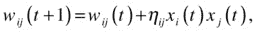

其中 `t` 代表训练周期，`w [ij]` 是第 `i` 个和第 `j` 个神经元之间连接的权重，`x [i]` 是第 `i` 个神经元的输出，`η [ij]` 是特定于该突触的学习率。

赫布规则是一种无监督学习方案，它局部地更新网络的权重；也就是说，每个突触的训练仅取决于与其相连的神经元的权重。由于其实现简单，赫布规则被认为是第一个人工神经网络学习规则，并由此衍生出多种变体。该算法的首次实现是在 1954 年，于麻省理工学院使用计算机进行（Farley 和 Clark，1954）。

1950 年代还引入了感知机，这是一种用于模式识别的两层神经网络模型，使用加法和减法运算（Rosenblatt，1958）。如图 7-1 所示，该模型由四个组件组成。视网膜或输入区域通过感觉单元接收刺激。这些连接被称为局部连接，因为它们的起点倾向于聚集在某个点或某个区域周围。尽管投影区域中的单元与关联区域中的单元相同，但投影区域通过局部连接接收输入，而关联区域的输入则通过随机连接来自投影区域；仿佛输入是从分散的区域生成的。A 单元接收一组可能具有兴奋性或抑制性的传递脉冲。如果刺激超过某个阈值，这些单元就会通过放电做出响应。关联区域和响应单元之间的随机连接是双向的。前馈连接将突触从关联区域传递到响应，而反馈连接则将兴奋性突触传递到关联区域中产生该连接的源点。抑制性突触补充了关联区域中未向相关响应传递的源点。

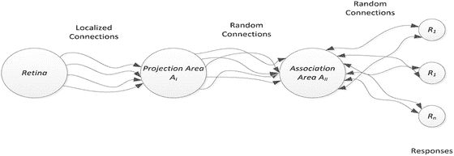

图 7-1. 罗森布拉特感知机结构

### 经典人工神经网络

人工神经网络的基本结构是人工神经元，如图 7-2 所示，其形态和功能与生物神经元相似（Haykin 1994）。

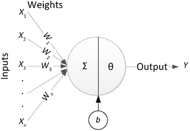

图 7-2. 一个人工神经元

在人体神经系统中，神经元产生、传递并接收称为动作电位的电信号。一个典型的生物神经元具有以下三个基本组成部分：
* `细胞体`：大小和形状各异
* `树突`：从细胞体延伸出的众多树状结构，构成神经元的接收部分（即输入部位）
* `轴突`：一种细长、分支相对较少的结构，负责将电信号传递到相连区域

输入（`X`）通过模拟树突结构的加权连接与神经元相连，而求和、偏置（`b`）和激活函数（`θ`）则扮演细胞体的角色，输出的传播类似于生物神经元中的轴突。

从数学上讲，一个神经元等价于以下函数：

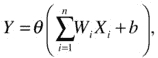

这可以方便地使用矩阵形式进行建模：

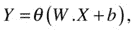

其中 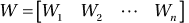，且 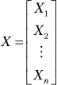。

激活函数塑造了神经元的输出或状态。可以使用多种激活函数，其中最常见的有以下几种：
* `硬限幅函数`：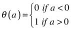
* `饱和线性函数`：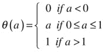
* `对数-S 型函数`：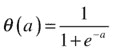
* `双曲正切 S 型函数`：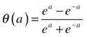

偏置会根据学习需要将激活函数向左或向右平移，在某些情况下可以省略。

神经网络仅仅是级联的神经元层的组合，每一层都有自己的权重矩阵、偏置向量和输出向量。一层神经元是一“列”并行工作的神经元，如图 7-3 所示。该列的每个元素都是一个单独的神经元，该层的输出是由各个神经元的输出组成的向量输出。如果一个输入向量由 `N` 个输入构成，且有一层包含 `M` 个神经元，那么 `W [ij]` 表示第 `j` 个输入到该层第 `i` 个神经元的连接权重；`Y [i]` 和 `b [i]` 分别表示第 `j` 个神经元的输出和与之关联的偏置。

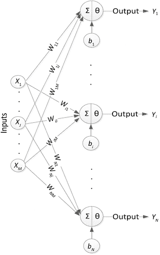

图 7-3. 一层神经元

一层神经元可以方便地使用矩阵表示法表示如下：

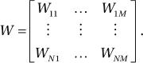

该矩阵中每个元素的行索引代表相应连接的目标神经元，而列索引则指代该连接的输入来源。

## 神经网络结构

用`Y`表示该层的输出，可以写成：

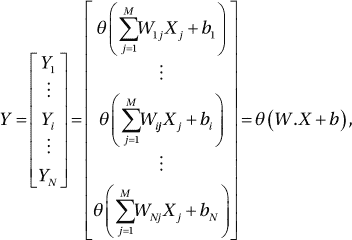

其中 = 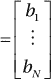。

为了帮助识别特定矩阵对应的层，使用了上标索引。因此，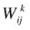 表示第`k-1`层第`j`个神经元与第`k`层第`i`个神经元之间的连接权重，而 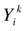 是第`k`层第`i`个神经元的输出。网络的输出是最后一层（也称为输出层）的输出，其他层称为隐藏层。一个具有两个隐藏层的网络如图 7-4 所示。为了泛化，用`N^{[k]}`表示第`k`层中隐藏神经元的数量。

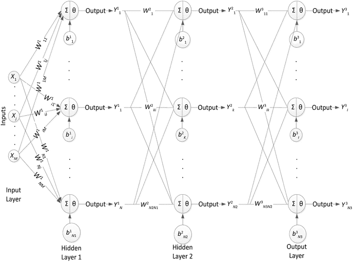

图 7-4. 一个三层人工神经网络

该网络实现的函数为：

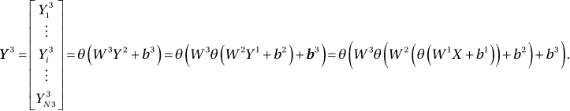

注：为简单起见，所有层都采用了相同的激活函数`θ`。然而，网络中的不同层可以使用多种激活函数。此外，整个网络中每层的神经元数量也可能不恒定。

获得最佳性能所需的层数和神经元数量的最优值尚无定论，因为这个数量取决于具体应用。一层隐藏神经元将输入空间划分为多个区域，这些区域的边界由与每个神经元相关联的超平面定义。

隐藏神经元数量越少，创建的子区域就越少，网络就越倾向于将点聚类并映射到相同的输出。每个神经元的输出是超平面的非线性变换。在分类的情况下，这种由来自前一层的加权输入形成的分离曲线，与该层中的其他神经元一起，共同定义了最终的分类边界。当神经元数量很大时，由于过度训练，过拟合的风险会增加，泛化性能会下降。必须用足够的数据点来训练网络，以确保在每个隐藏层获得的分区能够正确分离数据。

### ANN 训练与反向传播算法

为了使人工神经网络能够识别属于不同类别的模式，基于现有数据集的训练旨在通过迭代方式获取能使网络性能达到最优的权重和偏置集合（Jain, Mao, and Mohiuddin 1996）。

在一个具有`M`个输入、`N`个输出神经元和`L`个隐藏层的网络中，给定一组带标签的数据——即`P`对`(X, T)`，其中`X`是`M`维向量，`T`是`N`维向量——学习问题简化为寻找最优权重，以优化代价函数。网络的输出应与目标`T^{[i]}`匹配，并最小化均方误差：

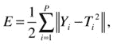

其中`Y^{[i]}`是通过将输入`X^{[i]}`传播经过网络而获得的输出。

ANN也可以使用熵作为代价函数。训练至少需要几个周期，根据权重更新规则来更新权重。值得注意的是，反向传播算法被广泛采用。它包含以下步骤：

- **初始化**：此步骤以随机、微弱的方式初始化网络的权重；即为连接权重分配接近 0 的随机值。
- **前馈**：将输入`X^{[i]}`馈入网络，并传播到输出层。计算由此产生的误差。
- **反馈**：使用以下公式更新权重和偏置：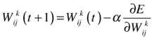 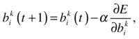 其中`α`是一个正的可调学习率。`α`的选择会影响反向传播算法是否收敛以及收敛速度。较大的学习率可能导致算法振荡，而较小的学习率可能导致收敛非常缓慢。

由于权重的更新需要计算误差（代价函数）的梯度，因此代价函数必须是可微的。不满足此条件将无法使用反向传播算法。

反向传播算法中梯度的计算可以使用链式法则进行简化，这需要以下步骤：

- 对于每个输出单元`y_k^{(i)}`（位于图 7-4 的输出层`L`中），使用以下公式计算反向传播误差：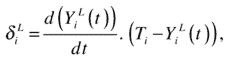 其中`T^{[i]}`是期望输出；对于S型函数，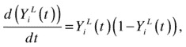 得到以下表达式：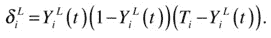
- 对于每个隐藏单元`y_j^{(i)}`（位于具有`N^{[k]}`个隐藏单元的隐藏层`k`中），从层`L–1`向后移动到第一层，反向传播误差可以如下计算：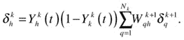
- 权重和偏置根据以下梯度下降法进行更新：
  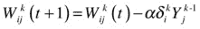
  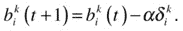

网络误差最终通过这种梯度下降方法得以减小。例如，考虑一个属于类别 1 (+1) 但被错误分类为类别 2 (–1) 的一维训练点，超平面应远离类别 1。因为，如果 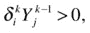，超平面将向左移动（`w`减小）；如果 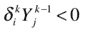，超平面将向右移动（`w`增大）。

## DBN 概述

DBN是一种深度架构，自快速贪婪训练算法（Hinton, Osindero, and Teh 2006）提出以来，在文献中广泛出现。它是由随机神经元按层分组构成的网络，层内无神经元连接。网络的前两层包含具有无向连接的神经元，形成类似于生物神经元的联想记忆，而其余隐藏层则构成一个有向无环图，如图 7-5 所示。

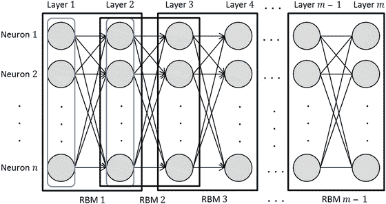

图 7-5. DBN 架构

尽管 DBN 可以被视为具有更多隐藏层的 ANN，但使用反向传播训练 DBN 并不能产生良好的机器学习模型，因为“解释消除”现象使得深度模型中的推理更加困难。在训练网络时，通常会做出各层独立的简化假设。而解释消除（也称为伯克森悖论或选择偏差）使这一假设无效；隐藏节点变得反相关。例如，如果一个输出节点可以被两个同样罕见且独立的事件激活，且这两个事件同时发生的概率更小（因为两个独立事件同时发生的概率是两者概率的乘积），那么一个事件的发生会否定（“解释消除”）另一个事件的发生，从而在两个事件之间产生负相关。由于训练深度架构的困难，DBN一度失去 popularity，直到 Hinton 和 Salakhutdinov（2006）提出了一种贪婪训练算法来高效地训练它们。该算法将 DBN 分解为顺序堆叠的 RBM，RBM 是一种两层网络，其约束是只包含层间神经元连接，即不属于同一层的神经元之间的连接。

# DBN的背景与结构

如图 7-6 所示，层 1 内的神经元之间不允许有连接，层 2 也是如此；连接必须仅将层 1 的神经元连接到层 2 的神经元。在 DBN 中，前两层允许有双向连接，而其余层只有有向连接。因此，对深度架构的兴趣重新燃起，因为训练它们变得可行且快速，包括在调整权重之前独立训练 RBM 单元，并使用上下算法以避免欠拟合（Hinton, Osindero, and Teh 2006）。

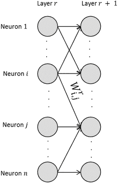

图 7-6.

## 权重标记

以下是本文采用的 DBN 术语列表：

| DNN 术语表 |
| --- |
| 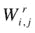：连接第 `r` 层神经元 `i` 与第 `s` 层神经元 `j` 的边的权重；当网络中仅有两层时，`r` 被省略 |
| 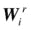：从第 `r` 层神经元 `i` 出发的所有连接的权重向量 |
| `W [r]`：连接第 `r` 层与第 `s` 层的权重向量 |
| `μ`：学习率 |
| `k`：在对比散度中执行的吉布斯采样步数 |
| `n`：隐藏层神经元总数 |
| `m`：输入层神经元总数 |
| 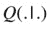：条件概率分布 |
| `h ^r`：第 `r` 层的二进制配置 |
| `p(h ^r )`：在当前权重值下 `h ^r` 的先验概率 |
| `v ⁰`：输入层数据点 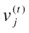：在采样步骤 `t` 时输入层神经元 `j` 的二进制配置 |
| `H [i]`：在采样步骤 `t` 时隐藏层神经元 `i` 的二进制配置变量 |
| 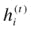：在采样步骤 `t` 时隐藏层神经元 `i` 的二进制配置值 |
| `b [j]`：输入层神经元 `j` 的偏置项 |
| `c [i]`：隐藏层神经元 `i` 的偏置项 |

## 受限玻尔兹曼机

玻尔兹曼机（BM）是一种两层神经网络架构，其神经元以层间和层内方式连接。受限玻尔兹曼机（RBM）最初由 Smolensky（1986）以 Harmonium 之名提出，其结构被约束为二分图。二分图是一种两层图，其中两层的节点构成两个不相交的神经元集合。这是通过限制层内连接实现的，即不允许同一层内的节点之间存在连接。这一限制正是 BM 与 RBM 的区别所在，也使 RBM 更易于训练。具有不同层神经元之间无向连接的 RBM 形成了一种自联想记忆，类似于人脑中的神经元。自联想记忆的特点是存在反馈连接，允许信息在神经元之间双向交换（Hawkins 2007）。

RBM 可以通过监督学习和无监督学习两种方式进行训练。权重向量使用 Hinton 的对比散度（CD）算法进行更新（Hinton 2002）。CD 是一种近似对数似然梯度的算法，所需的采样步数少于马尔可夫链蒙特卡洛（MCMC）算法（Hinton 2002）。CD 执行 `k` 步吉布斯采样和梯度下降，以找到使目标函数（即概率的乘积）最大化的权重向量（Hinton 2010）。随着 `k` 的增加，学习模型的性能会提升，但代价是训练时间更长。该参数的典型值为 `k = 1`（Hinton 2010）。训练算法的工作流程如表 7-1 所示。

表 7-1. 使用 CD 的 RBM 训练算法工作流程（Fischer 和 Igel，2012）

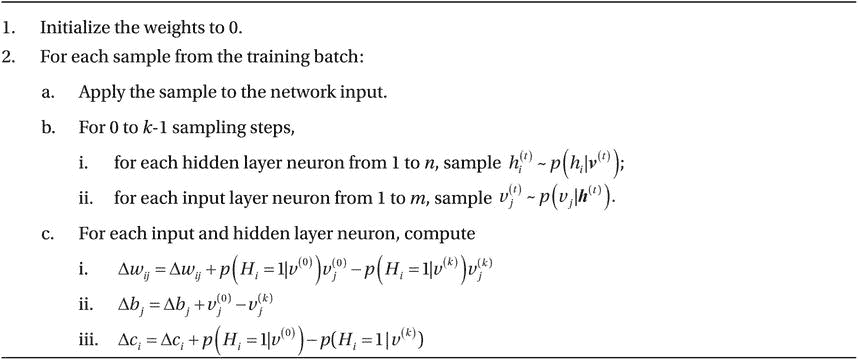

基于吉布斯分布，用于描述联合概率分布的能量函数或损失函数如公式 7-1 所示，其中 `w [ij]`、`b [j]` 和 `c [i]` 是实值权重，`h [i]` 和 `v [j]` 可以取集合中的值（Aleksandrovsky 等人，1996）：

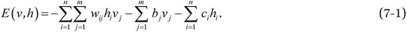

因此，联合概率分布使用公式 7-2 计算：

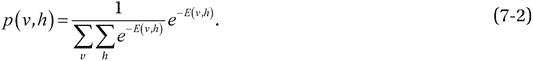

## DNN 训练算法

反向传播是用于训练人工神经网络（ANN）最流行的算法之一（Werbos 1974）。公式 7-3 展示了反向传播中使用的权重更新规则的简单形式：

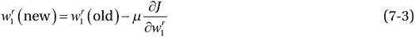

然而，随着网络深度的增加，反向传播的性能退化也会加剧，使其不适合训练通用的深度架构。这是由于梯度消失问题（Horchreiter 1991；Horchreiter 等人，2001；Hinton 2007；Bengio 2009），这是一个训练问题，其中在网络中反向传播的误差会随着逐层传递而缩小，在深度架构中变得可以忽略不计，使得早期层的权重几乎无法更新。因此，训练深度神经网络（DNN）并从中获得有意义的结果将过于缓慢。

由于反向传播的缺点，人们进行了许多尝试来开发用于深度网络的快速训练算法。Schmidhuber 的算法（Schmidhuber 1992）通过对每一层进行无监督预训练，然后通过反向传播微调所得权重，来训练递归神经网络的多级层次结构。

对 DNN 的兴趣在 2006 年重新燃起，当时 Hinton 和 Salakhutdinov（2006）为深度信念网络（DBN）提出了一种贪婪的逐层训练算法，该算法试图顺序学习更简单的模型，然后为整体模型微调结果。该算法利用互补先验来消除解释消除效应，包含两个主要步骤：

一种贪婪的逐层训练，通过绑定未学习层的权重来学习权重。

应用 CD 来学习当前层的权重。

一种用于微调权重的上下算法。

这种训练方案不是一次性学习跨越多个隐藏层的数百万个连接的权重，而是每次为单层寻找最优解，这使其成为一种贪婪算法。这是通过绑定所有后续层的权重，并仅学习当前层的权重来实现的。权重绑定还有助于消除解释消除现象，如果采用其他训练算法，该现象会导致深度网络训练效果不佳。如图 7-7 所示，学习第 1 层和第 2 层之间的权重 `W [0]`。所有后续层之间的权重都绑定到 `W [0]`。一旦 CD 学习收敛，通过将所有后续层的权重绑定到 `W [1]`，并固定在前一阶段学习到的第 1 层和第 2 层之间的权重为 `W [0]`，来学习第 2 层和第 3 层之间的权重 `W [1]`。类似地，当 CD 收敛到 `W [1]` 的最优值时，第三个 RBM 块的权重与第二个 RBM 块解绑，并使用 CD 来学习最终的权重集 `W [2]`。

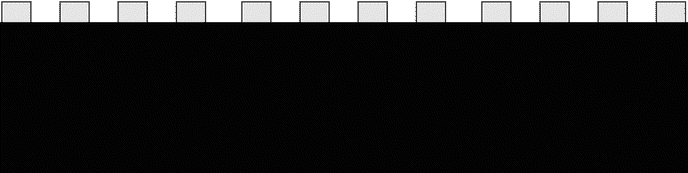

图 7-7. 顺序训练

这种绑定、学习和解绑权重的过程会重复进行，直到所有层都被处理完毕。具有绑定权重的 DBN 类似于 RBM。因此，如前所述，每个 RBM 都使用 CD 学习进行学习。然而，该算法仅在前两层形成无向图，且其余隐藏层形成有向无环图时才能应用。

有向模型的能量使用公式 7-4 计算，该公式受公式 7-5 约束。绑定权重使得公式 7-5 中的等式成立，并使 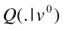 和 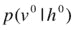 成为常数。公式 7-5 的导数被简化为等于公式 7-6。因此，绑定权重导致需要最大化的目标函数更简单。递归应用此规则可以训练 DBN（Hinton、Osindero 和 Teh，2006）。

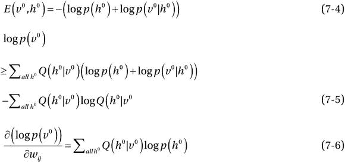

一旦为每一层学习到权重，就会使用带有 CD 权重更新规则的唤醒-睡眠算法变体来微调已学习的参数。上下算法用于反向拟合所得到的解，以避免欠拟合——这是以无监督和贪婪方式训练时需要关注的一个重要问题。上下算法使较低层（其权重在训练早期学习）受到较高层（其权重在训练末期学习）的影响。在自下而上的传递中，通过计算正相概率、对状态进行采样、使用 CD 权重更新规则以及运行有限次数的吉布斯采样，来调整有向连接上的生成权重。自上而下的传递将利用自上而下的连接，随机激活每一个较低层。这是通过计算负相概率、对状态进行采样以及计算网络的预测来完成的。对生成参数和推理参数以及顶层权重的适当调整，是在唤醒-睡眠算法的对比形式中进行的，因为它解决了算法睡眠阶段的问题。该算法的工作流程如表 7-2 所示。

表 7-2.

上下算法工作流程（Hinton 和 Salakhutdinov 2006）

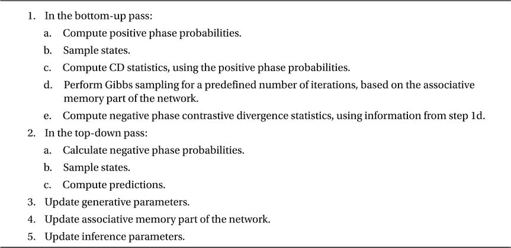

尽管反向传播算法在应用于深度神经网络时存在局限性，但由于图形处理单元（GPU）计算能力的激增，人们对它的兴趣重新燃起。Ciresan 等人（2010）研究了反向传播算法在深度网络上的性能。他们观察到，即使存在梯度消失问题，只要给予足够的训练轮次，反向传播也能取得与其他更复杂的训练算法相当的结果。

值得注意的是，有报告指出，使用深度架构进行监督学习在许多分类任务上表现良好。然而，当网络以无监督方式进行预训练时，其表现几乎总是优于省略预训练阶段的情况（Erhan 等人，2010）。人们提出了几种理论来解释这一现象，例如预训练阶段充当了正则化器（Bengio，2009；Erhan 等人，2009），并且对监督优化问题起到了辅助作用（Bengio 等人，2007）。

## 深度神经网络相关研究

自 Hinton 提出快速、贪婪的训练算法以来，深度信念网络在各种机器学习应用中的使用蓬勃发展。此外，人们还进行了许多尝试来加速深度信念网络并解决其弱点。以下各节简要概述了深度信念网络最新且最相关的应用，介绍了旨在加速训练的研究，并讨论了几种深度信念网络变体和深度神经网络架构。

### 深度神经网络应用

深度神经网络已被应用于许多机器学习应用，包括特征提取、特征降维和分类问题等。

特征提取涉及将原始输入数据转换为代表输入的特征向量；原始数据可以是音频、图像或文本。例如，深度信念网络已被应用于音乐音频的离散傅里叶变换（DFT）表示（Hamel 和 Eck，2010），并且发现其性能优于梅尔频率倒谱系数（MFCC）——一种广泛使用的音乐音频特征提取方法。

从原始数据中提取特征后，可能需要降低高维数据表示，以减轻分类任务的内存和计算需求，同时更好地实现数据可视化，并减少为将来使用而存储数据所需的内存。Hinton 和 Salakhutdinov（Hinton 和 Salakhutdinov，2006；Salakhutdinov 和 Hinton，2007）使用一组受限玻尔兹曼机来预训练网络，然后采用自编码器网络来学习低维特征。

使用深度信念网络提取富有表现力的低维特征，被证明可以用于快速检索文档和图像，这一点已在一些不断增长的数据库上得到测试。Ranzato 和 Szummer（2008）能够生成文档的紧凑表示以加速搜索引擎，同时性能优于浅层机器学习算法。应用于大型数据库的图像检索时，深度信念网络取得了与最先进算法（包括潜在狄利克雷分配和概率潜在语义分析）相当的结果（Hörster 和 Lienhart，2008）。

将学习到的模型从一个领域迁移到另一个领域一直是机器学习算法的一个问题。然而，深度神经网络能够提取与领域无关的特征（Bengio 和 Delalleau，2011），使得迁移学习在许多应用中成为可能（Collobert 和 Weston，2008；Glorot、Bordes 和 Bengio，2011；Bengio，2012；Ciresan、Meier 和 Schmidhuber，2012；Mesnil 等人，2012）。深度神经网络也被用于课程学习，其中数据按特定顺序进行学习（Bengio 等人，2009）。

深度信念网络已被应用于许多分类任务，涉及视觉、语音、医疗疾病和自然语言处理（NLP）等领域。图像中的物体识别已被广泛研究，深度信念网络的性能超过了最先进的算法（Desjardins 和 Bengio，2008；Uetz 和 Behnke，2009；Ciresan 等人，2010；Ciresan、Meier 和 Schmidhuber，2012）。例如，Ciresan 等人（2010）在混合国家标准与技术研究院（MNIST）数据库上实现了 0.35%的错误率。Nair 和 Hinton（2009）在三维物体识别方面优于包括支持向量机在内的浅层架构，在纽约大学物体识别基准（NORB）数据集上实现了 6.5%的错误率，而支持向量机的错误率为 11.6%。在语音识别任务方面，深度架构改进了声学建模（Mohamed 等人，2011；Hinton 等人，2012）、语音到文本转录（Seide、Li 和 Yu，2011）以及大词汇量语音识别（Dahl 等人，2012；Jaitly 等人，2012；Sainath 等人，2011）。在音素识别任务中，深度信念网络在 TIMIT 数据库上实现了 23%的错误率——优于使用其他机器学习算法报告的 24.4%至 36%的错误率范围（Mohamed、Yu 和 Deng，2010）。

在使用脑电图（EEG）信号进行癫痫发作预测时，深度信念网络取得了与其他机器学习算法相当的分类结果，但达到这些结果的速度显著更快——快 1.7 到 103.7 倍（Wulsin 等人，2011）。McAfee（2008）采用深度信念网络进行文档分类，并显示出在此类数据库上取得成功的潜力。

从人类情感的高级描述生成合成图像——特别是面部表情——是深度信念网络（DBN）成功应用的另一个领域，能够生成各种逼真的面部表情（Susskind 等人，2008 年）。

总体而言，自然语言处理（NLP）也已借助深度架构进行研究，以改进现有最佳成果。此类应用包括机器音译（Deselaers 等人，2009 年）、情感分析（Zhou, Chen, and Wang，2010 年；Glorot, Bordes, and Bengio，2011 年）以及语言建模（Collobert and Weston，2008 年；Weston 等人，2012 年）——涵盖词性标注、相似词识别和组块分析。这些问题的复杂性要求机器学习算法具备更深层次（Bengio and Delalleau，2011 年）才能产生有意义的结果。例如，机器音译对机器学习算法构成了挑战，因为单词之间不存在统一的映射关系，这导致了字典中不存在的多对多映射。此外，大量的源语言到目标语言字符符号对以及导致音素缺失的不同语音结构，只是使机器难以做好音译工作的几个特性。

### 加速深度神经网络训练的并行实现

随着层数和网络规模的增加，逐层顺序训练深度信念网络（DBN）变得更加耗时。将各层堆叠形成网络（称为深度堆叠网络），并在 CPU 集群上训练该网络（而非使用一台超级计算机）（Deng, Hutchinson, and Yu，2012 年），利用了贪婪训练算法中固有的并行性，从而显著节省训练时间。

然而，这种方法并不能加快每层的训练速度。这可以通过使用 GPU 并行化单个受限玻尔兹曼机（RBM）层的训练算法来实现（Cai 等人，2012 年）。

然而，训练 RBM 时常用的庞大且稀疏的数据给该算法的并行化带来了挑战。将计算修改为基于矩阵的操作，并优化稀疏矩阵的矩阵-矩阵乘法代码，使得 GPU 实现比 CPU 实现快得多。

与通过软件加速训练不同，也有人尝试通过硬件（使用现场可编程门阵列，FPGA）来加速训练。Ly 和 Chow（2010 年）将 RBM 映射到 FPGA 上，并实现了对优化后软件代码的显著加速。Lo（2010 年）扩展了这项工作，研究了该方法的可扩展性。

### 与深度信念网络相似的深度网络

深度信念网络（DBN）的一种变体，称为模块化深度信念网络（M-DBN），它分别训练网络的不同部分，同时随着训练的进行调整学习率（Pape 等人，2011 年），而不是为整个网络使用一个训练集。这使得 M-DBN 能够避免遗忘训练早期学到的特征，而这是 DBN 的一个弱点，可能会阻碍其在数据分布随时间动态变化的在线学习应用中的性能。

稀疏深度信念网络（Sparse DBN）学习稀疏特征——这与 Hinton 的 DBN 不同，后者学习非稀疏的数据表示——通过在目标函数中对偏离 RBM 公式中隐藏单元预期激活值的情况添加惩罚项来实现（Lee, Ekanadham, and Ng，2007 年）。

卷积深度信念网络（Convolutional DBN）通过共享图像中不同位置之间的权重，将平移不变性整合到图像表示中，从而允许在通过卷积放大图像时进行推理（Lee 等人，2009 年）。因此，卷积 DBN 能更好地扩展到真实世界大小的图像，而不会因这些图像的高维度而陷入计算难题。

## 深度信念网络（DBN）的替代架构

深度信念网络（`DBN`）并非唯一可用的深度架构。

### 求和-乘积网络（SPN）

求和-乘积网络（`SPN`）是一种深度架构，表示为具有有向加权边的图。`SPN` 是无环的（不包含循环），变量位于图的叶节点上，其内部节点由 `求和` 与 `乘积` 运算组成（Poon and Domingo，2011 年）。`SPN` 使用 `反向传播` 和 `期望最大化`（`EM`）算法进行训练。这些简单的运算使得该网络比 `DBN` 更准确、训练更快且更易于处理。

### 深度玻尔兹曼机（DBM）

深度玻尔兹曼机（`DBM`）与深度信念网络（`DBN`）相似，但具有更通用的深度架构。它们由堆叠在一起的玻尔兹曼机（`BM`）组成（Salakhutdinov and Hinton，2009 年）。尽管由于 `BM` 网络中所有神经元之间的对称连接，`DBM` 比 `DBN` 更复杂且训练更慢，但双向边使得 `DBM` 能比 `DBN` 更好地传播输入不确定性，从而使其生成模型更加鲁棒。更复杂的架构需要高效的训练算法才能使训练可行。通过使用 `近似推理算法`，对 `DBN` 的 `贪婪训练算法` 进行了修改，为 `DBM` 实现了更高效的训练算法。然而，这使得 `DBM` 的训练速度比 `DBN` 慢大约三倍（Salakhutdinov and Larochelle，2010 年）。