# 8. 皮层算法

如果你只有一个问题要解决，那没问题，尽管使用神经网络。但如果你想做科学研究，理解如何选择架构，或者如何应对一个新问题，你就必须理解不同架构能做什么和不能做什么。

——马文·明斯基¹

自 20 世纪 80 年代中期以来，受人类大脑结构和功能特性启发的计算模型，由于神经科学的重大发现和计算技术的进步，取得了令人瞩目的进展。在这些模型中，皮层算法（`CA`）作为一种受生物启发的方法脱颖而出，它模仿人类视觉皮层，以不变形式存储模式序列，并能自动联想地回忆这些模式。本章详细介绍了 `CA` 的结构和数学公式，然后通过一个案例研究，展示了 `CA` 在使用基于熵的权重更新识别孤立阿拉伯语音时的泛化准确性。

## 皮层算法入门

皮层算法（`CA`）最初由 `Edelman` 和 `Mountcastle`（1978 年）开发，受人类视觉皮层启发，其定位优于早期几代人工神经网络（`ANN`），后者在构建机器学习模型时不使用数据中的时间和空间关系。

`CA` 模型由一个多层网络组成，其基本结构是皮层柱。该网络以两阶段方式进行训练：第一阶段学习是无监督的，训练皮层柱从出现的模式中识别独立特征；第二阶段依赖于有监督的反馈学习来创建不变表示。

### 皮层算法结构

人脑是一个六层结构，由大量通过前馈和反馈连接紧密相连的神经元组成。新皮层的一个重要特性是其结构和功能的统一性：网络中的所有单元看起来相似，并且执行相同的基本操作。与这种大脑结构类似，皮层算法（`CA`）架构具有不同厚度的微柱（`Edelman` 和 `Mountcastle`，1978）。微柱是一组共享相同感受野的神经元：属于同一微柱的神经元与相同的感官输入区域相关联。与经典人工神经网络中的神经元不同，微柱是皮层网络中的基本结构。微柱的联合体被称为超柱或层（在下文中，术语“柱”和“微柱”可互换使用）。皮层算法网络中的连接发生在两个方向：水平方向，即同一层内的柱之间；以及垂直方向，即连续层之间的柱之间。尽管人脑皮层中存在非连续层之间的连接，但为了简化，皮层算法中省略了这些连接。

图 8-1 展示了一个皮层网络的表示。图中未明确显示侧向抑制连接，因为其功能并非物理性的；也就是说，这些连接并不代表在神经元之间传播的数据，而是作为柱之间的一种通信手段。

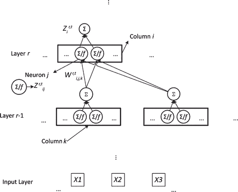

图 8-1. 皮层网络连接示意图

下文采用的符号在图 8-2 中给出，其中 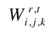 表示在训练周期 `t` 期间，第 `r` 层第 `i` 列的第 `j` 个神经元与前一（`r-1`）层第 `k` 列之间连接的权重。粗体变量代表向量实体，带下划线的变量代表矩阵，斜体变量代表标量实体。

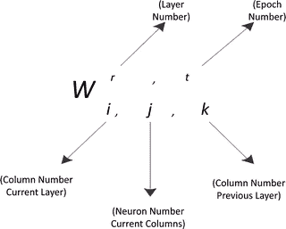

图 8-2. 权重 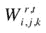 的命名约定

在学习过程中，通过将连接权重设为零来禁用它。如果网络是全连接的，则列中的每个神经元 `j` 都连接到前一层的所有列。所有连接都是弹性的；也就是说，如果在前馈过程中禁用了某个连接，它可以在反馈学习过程中恢复，反之亦然。

表示由 `M` 个节点组成的列在训练周期 `t` 时的状态的权重矩阵定义如下：

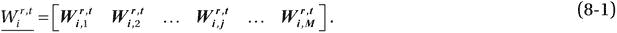

进入第 `r` 层第 `i` 列中神经元 `j` 的连接权重向量 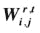，该层由 `L[r]` 个列组成，由下式给出：

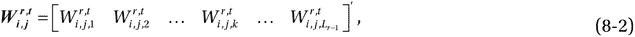

其中 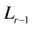 是第 `(r-1)` 层的列数，`L[r]` 表示第 `r` 层的列数，上标 `'` 表示转置运算符。

展开 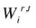 得到：

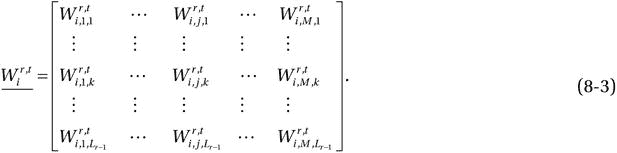

第 `r` 层在周期 `t` 的输出向量 `Z^(r,t)` 由下式给出：

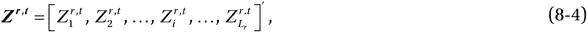

其中 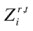 是该层中第 `i` 列在同一训练周期的输出。

考虑到神经元的输出是非线性激活函数 `f(.)` 对进入该神经元的加权和进行响应的结果，该列的输出被定义为构成该列的神经元输出的总和。

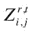 是第 `r` 层第 `i` 列的第 `j` 个神经元在训练周期 `t` 的输出，由下式给出：

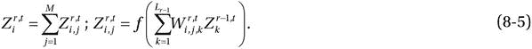

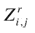 是构成第 `r` 层第 `i` 列的第 `j` 个神经元的输出，而 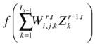 定义为：

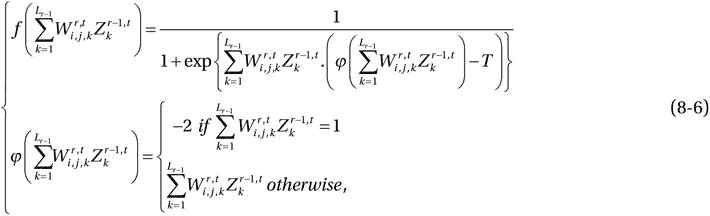

其中 `T` 是一个经验选择的容差参数，对所有周期和列都是常数。假设所有权重都已归一化，并限定在 –1 和 1 之间。

非线性激活函数类似于神经系统中动作电位通过轴突的传播。

### 皮层算法的训练

列内的连接性通过突触权重的值来建模。最初，皮层列之间没有特定的连接性。假设网络在训练前是全连接的。此外，所有突触权重都初始化为非常接近 0 的随机值，以避免对任何特定模式产生偏好。

由 `Edelman` 和 `Mountcastle`（1978）提出并由 `Hashmi`（2010）进一步发展的训练过程，根据其主要阶段描述如下：无监督前馈、有监督反馈和权重更新。

#### 无监督前馈

前馈学习通过随机激发和重复暴露来训练列识别特征。当呈现一个模式时，输入通过网络传播。每个列都有很小的激发概率，这意味着特定层中的大多数列保持不活跃。当某个特定列的随机激发与某个特定输入模式同时发生时，这种激活会被强化。换句话说，当激活被强化时，根据强化权重更新规则，该列的激发会增强其权重。同时，根据抑制更新规则，该列的激发会通过削弱权重来抑制同一层中相邻列的激发。

权重更新规则如下：

*   抑制：

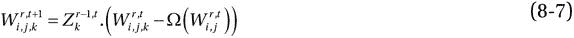

*   强化：

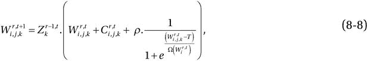

其中 `Ω()` 由下式给出：

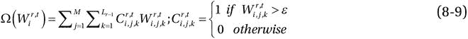

其中 `ρ` 是一个调优参数，`ε` 是经验选择的激发阈值，对所有周期和列都是常数。

通过重复暴露，网络学会提取输入数据的某些特征，并且列学会针对特定模式激发。网络中的层以递增的复杂度提取输入的各个方面。因此，较低层检测简单的特征，而较高阶段则学习概念和更复杂的数据抽象。

#### 监督式反馈

# 反馈学习

前馈学习训练柱状结构以识别数据特征，从而使层级网络开始识别模式。当网络遇到与先前模式差异较大的变体时，本应对该模式激活的顶层柱状结构未能激活，层级中可能仅有部分柱状结构激活，从而导致分类错误。通过`CA`反馈机制，顶层发生的错误会产生一个反馈信号，强制原本模式对应的柱状结构激活，同时抑制对变体模式激活的柱状结构。经过多次暴露后，顶层应达到预期的激活方案（也称为稳定激活）。更具体地说，顶层中指定的柱状结构学会针对特定模式激活。一旦柱状结构开始对模式变体产生稳定激活，反馈信号就会传播到前一层。随后每一层都会被训练，直到达到一个收敛标准，该标准表示为实际输出与期望输出（激活方案）之间函数的误差项。只有当相关层的误差收敛到低于某个预定义容差阈值时，反馈信号才会发送到前一层。兴奋和抑制信号遵循与前馈学习相同的更新规则。

当用于网络的反馈学习时，`CA`可以总结为以下步骤：

在前馈无监督批量学习之后（即，在训练数据完全通过网络传播之后），通过平均柱状结构的输出来形成每层的期望输出方案。如果 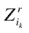 是网络第 `r` 层中第 `i` 个柱状结构对于某个训练实例 `k` 的输出，并且总共有 `N` 个实例；那么该特定柱状结构 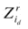 的期望输出由下式给出：

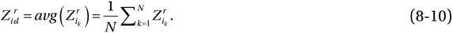

从最后一层开始，将每个柱状结构对每个实例 `k` 的测量输出  与期望值 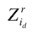 进行比较。如果柱状结构的期望输出是激活状态，而实际输出不同，则加强该柱状结构（参见公式 8-8）；如果发生相反情况（即实际输出是激活状态，而期望输出是非激活状态），则抑制该柱状结构（参见公式 8-7）。重复步骤 2，直到达到误差阈值。对前一层遵循相同的过程，一次处理一层。

## 权重更新

在 `CA` 中，高精度是以计算量大且训练耗时为代价的。这种代价主要源于在学习网络权重时，为每个神经元在权重更新过程中计算指数函数。

对于特定节点 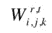，公式 8-8 可以写成：

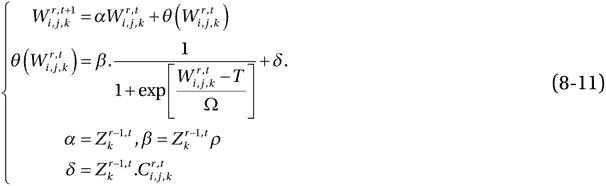

这里，`α`、`β`和`δ`是依赖于训练周期以及所考虑的柱状结构的变量；因此，合适的命名法应该是 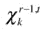 的形式。为简单起见，可以省略这些变量的下标和上标，将`Ω`(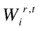) 称为`Ω`。

如公式 8-11 所示，指数权重更新规则的参数——`α`、`β`、`δ`、`Ω`和`T`——取决于所考虑的柱状结构的状态。因此，可以推断出加强规则是一系列指数函数，每个柱状结构的参数都不同。更新一个柱状结构需要为每个节点计算指数函数——因此训练耗时。

图 8-3 显示了`θ`相对于随机节点神经元权重值的曲线图。

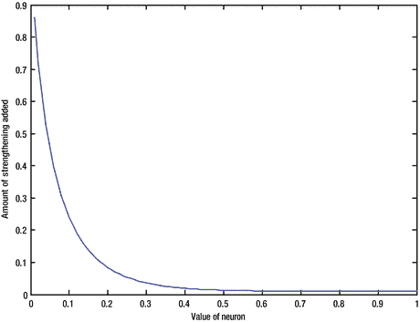

图 8-3.

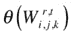 与 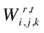 的关系图

加强规则中的计算成本也来自于指数函数的计算。例如，`MATLAB` 软件使用二项式定理（参见公式 8-12）来计算指数的近似值，并且这种近似计算到 5 到 10 阶（Mohler 2011）：

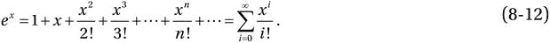

计算指数函数所需的操作次数总结在表 8-1 中。

表 8-1. 指数函数所需的操作

| `表达式` | 操作 | 总操作次数 |
| --- | --- | --- |
| `i!` | `2*3*…*i` | `i` 减两次乘法 |
| `x ^i` | `x*x*x*…` | `i` 次乘法 |
| 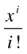 | 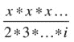 | `2i` 减一次操作 |
| `e ^x` | 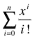 | 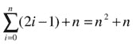 |

### CA训练的工作流程

`CA`训练的工作流程如图 8-4 所示。

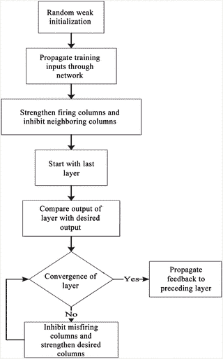

图 8-4. 皮层网络的训练

## 实验结果

从加州大学欧文分校机器学习库（Bache 和 Lichman，2013）获取的多个模式识别数据库的实验结果表明，`CA`（皮层算法）具有优越的性能，具体数据集详情如下：

*   **字母识别数据集**：该数据集包含 20,000 张黑白图像，需将其分类为英文字母表中的 26 个大写字母之一（Slate，1991）。每个实例由一组 16 个整数型特征表示，这些特征被归一化到 0-15 的范围内，代表图像的各个方面，例如水平和垂直位置、宽度和长度。该数据集报告的最佳准确率为 97.58%（Bagirov 和 Ugon，2011）。

*   **图像分割数据集**：该数据集由大小为 3 `×` 3 的图像组成，每个图像由 19 个属性描述，这些属性描述了图像的特征，例如平均强度、饱和度和色调（Vision Group，1990）。该数据集被划分为包含 210 个实例的训练集和包含 2,100 个实例的测试集；每个图像属于 7 个类别之一。Dash 等人（2003）实现了 98.6% 的准确率。

*   **ISOLET（孤立字母语音识别）数据集**：本实验的任务是将一组孤立的英语口语字母分类为 26 个类别（A-Z）之一。该数据集由 150 位发音者说出的 2,800 个实例组成，每个实例由一组 617 个特征表示，包括频谱系数、轮廓特征、响音特征、前响音特征和后响音特征（Cole 和 Fanty，1994）。该数据库报告的准确率为 96.73%（Dietterich，1994）。

*   **PENDIGITS（基于笔迹的手写数字识别）数据集**：本实验涉及基于笔迹的手写数字识别。该数据库收集了来自 44 位书写者的 10,992 个样本，每个样本是一个 `(x, y)` 坐标序列，代表书写过程中笔的轨迹。这些序列经过重采样，以获得固定长度的属性向量（等于 16，即八对 `(x, y)` 坐标），并进行归一化以消除不同书写习惯带来的伪影影响。10,992 个样本被划分为包含 7,494 个实例的训练集和 3,498 个实例的测试集。该数据集的准确率达到 98.6%（Alpaydin 和 Alimoglu，1998）。

*   **多特征数据集**：该数据集包含 649 个特征，总共 2,000 个手写数字模式（`0'`--`9'`），这些模式从一组荷兰公用事业地图中提取（Duin，2013）。这些数字通过六个特征集表示：字符形状的 76 个傅里叶系数；216 个轮廓相关性；64 个 `Karhunen-Loève` 系数；240 个像素平均值（在 2 `×` 3 窗口中）；47 个 `Zernike` 矩；以及六个形态学特征。达到的最佳准确率为 98%（Perkins 和 Theiler，2003）。

# 应用于阿拉伯语口语数字的改进皮层算法：案例研究

*   **鲍鱼数据集**：该数据集的任务是根据总共八项物理测量值（如高度、重量、直径和长度）对 4,177 个鲍鱼的年龄进行分类。该数据集的特点是类别分布极不平衡，已达到 79.0% 的准确率（Tan 和 Dowe，2003）。

表 8-2 汇总了基于四折交叉验证，在输出层使用均方误差（`MSE`）和良好形式的交叉熵（`CE`）代价函数时的识别率、训练时间以及收敛所需的总迭代次数。

表 8-2. 实验结果

| 数据集     | 度量指标       | 实验 1         | 实验 2         |
| :--------- | :------------- | :------------- | :------------- |
| 字母识别   | 准确率 (%)     | 98.3           | 98.8           |
|            | 训练时间 (分钟)| 223            | 235            |
|            | 迭代次数       | 237            | 225            |
|            | 运算次数       | 8.9 * 10¹²     | 1.1 * 10¹³     |
| 图像分割   | 准确率 (%)     | 99.3           | 99.7           |
|            | 训练时间 (分钟)| 45             | 52             |
|            | 迭代次数       | 77             | 69             |
|            | 运算次数       | 22 * 10¹²      | 2.5 * 10¹²     |
| ISOLET     | 准确率 (%)     | 98.1           | 98.7           |
|            | 训练时间 (分钟)| 54             | 67             |
|            | 迭代次数       | 147            | 131            |
|            | 运算次数       | 2.6 * 10¹²     | 3.2 * 10¹²     |
| PENDIGITS  | 准确率 (%)     | 99.8           | 100            |
|            | 训练时间 (分钟)| 135            | 154            |
|            | 迭代次数       | 94             | 82             |
|            | 运算次数       | 6.5 * 10¹²     | 7.4 * 10¹²     |
| 多特征     | 准确率 (%)     | 98.7           | 99.1           |
|            | 训练时间 (分钟)| 35             | 42             |
|            | 迭代次数       | 66             | 53             |
|            | 运算次数       | 1.4 * 10¹²     | 2.0 * 10¹²     |
| 鲍鱼       | 准确率 (%)     | 91.8           | 92.2           |
|            | 训练时间 (分钟)| 56             | 68             |
|            | 迭代次数       | 70             | 62             |

进行了两个实验：

*   实验 1：采用指数权重更新规则和 `MSE` 作为代价函数的 `CA`
*   实验 2：采用指数权重更新规则和 `CE` 作为代价函数的 `CA`

平均而言，`CE` 代价函数能带来更好的分类准确率。然而，这是以增加计算复杂度和训练时间为代价的。

> **注意**
> 尽管 `CA` 在假设上具有优越的性能，但由于其训练和计算要求更耗时、成本更高，其应用仍不如人工神经网络（`ANN`）广泛。这使得它们对于在线学习、能量感知计算节点以及训练时长有严格限制的大型数据集缺乏吸引力。

## 基于熵的权重更新规则

由于 `CA` 尚未在自动语音识别（特别是阿拉伯语）中得到广泛应用，以下章节展示了如何将最初在反馈过程中使用的 `CA` 增强和抑制规则，与添加到 `CA` 代价函数和权重更新规则中的加权熵概念相结合进行改进。

在 `CA` 的反馈学习阶段，每一层的输出会与期望的激发状态进行比较，并不断更新权重，直到误差项降低到最小阈值。使用最小二乘准则时，较大的误差值对学习过程的影响远大于较小的误差值。对于一类问题，以 `MSE` 作为权重更新准则的梯度下降算法可能会陷入局部最小值，从而无法找到最优解。相比之下，采用梯度下降算法的良好形式 `CE` 准则，能保证在学习过程中收敛到最优解（Wittner and Denker 1988）。

形式良好的误差函数 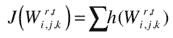 的三个性质如下：

*   对于所有 ，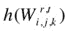 的导数（定义为 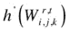）必须为负。
*   必须存在一个 ϵ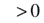，使得对于所有 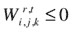，都有 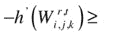。
*   函数 h 必须是可微且有界的。

将 `CE` 作为代价函数准则可以表示为：

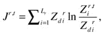

其中 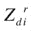 是第 r 层第 i 列在时刻 t 的期望输出。

如果采用相同的反馈学习过程，并假设当熵度量低于预设阈值时，每一层的训练收敛，则权重更新规则变为：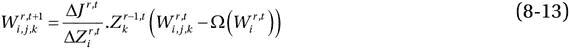 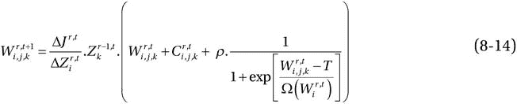

*   增强：
*   抑制：

使用所提出的梯度下降加权规则的一个优点是，如果某个输出收敛到错误的极端值，`CE` 代价函数会发散；因此，梯度下降会迅速做出反应。相比之下，`MSE` 代价函数会趋近于一个常数，即使误差可能并不小，基于最小二乘的梯度下降也会在平台上徘徊。

## 实验验证

使用一个包含六个隐藏层的 `CA`，第一个隐藏层从 2000 列、每列 20 个节点开始，并在连续层之间将列数减半，基于五折交叉验证，采用加权熵权重更新规则进行了四个实验：

*   实验 1：使用 `MSE` 代价函数和原始权重更新规则训练的 `CA`
*   实验 2：使用 `MSE` 代价函数和所提出的权重更新规则训练的 `CA`
*   实验 3：使用 `CE` 代价函数和原始权重更新规则训练的 `CA`
*   实验 4：使用 `CE` 代价函数和所提出的权重更新规则训练的 `CA`

模拟实验在 Windows 7 家庭高级版操作系统上，使用 Intel i7 2GHz 处理器和 6GB 内存，通过 `MATLAB` R2011a 软件，并采用修改过的中枢神经系统（`CNS`）库进行。该 `CNS` 库由麻省理工学院的 Mutch、Knoblich 和 Poggio（2010）开发，是一个用于模拟皮层组织网络的框架。

数据库来自 `UCI` 机器学习库，包含一组 13 帧梅尔频率倒谱系数（`MFCC`），代表了 8800 个阿拉伯语口语数字——属于十个类别（0-9）之一，由 88 位不同的发音人说出，这些数字是在使用移动汉明窗对口语数字进行滤波后获得的。多种技术在该数据库上得到了验证；使用多类 `SVM` 分类器（Ji and Sun 2011），基于三折交叉验证取得的最佳结果显示识别率达到 97.03%。

### 阿拉伯语音素的树状表示

作为 22 个国家的第一语言，阿拉伯语在全球使用最广泛的语言中排名第五（Mosa and Ali 2009）。尽管处理语音识别的应用显著增加（例如，iPhone 4S 的 `Siri` 界面），但阿拉伯语的实现仍然有限，这主要是由于其形态复杂性。对于阿拉伯语自动语音识别，音素识别是连续语音分析中的一个重要步骤。大多数研究通过提取孤立的音素或小的语音片段（El-Obaid, Al-Nassiri, and Maaly 2006; Awais 2003; Gevaert, Tsenov, and Mladenov 2010; Al-Manie, Alkanhal, and Al-Ghamdi 2009）来分析更长的语音信号（Abushariah et al. 2010）和广播新闻（Al-Manie, Alkanhal, and Al-Ghamdi 2009），使用了多种技术，例如人工神经网络（Essa, Tolba, and Elmougy 2008）、模糊隐马尔可夫模型（Shenouda, Zaki, and Goneid 2006）、模糊逻辑、并发自组织映射（Sehgal, Gondal, and Dooley 2004）和隐马尔可夫模型（Satori, Harti, and Chenfour 2007; Bourouba et al. 2010; Biadsy, Moreno, and Jansche 2012）。

# 阿拉伯语音素与语音识别实验分析

## 阿拉伯语音系特征

阿拉伯语在中东和北非地区使用，有不同的方言。然而，文学阿拉伯语（也称为现代标准阿拉伯语）是所有阿拉伯语国家在文件和正式场合使用的官方形式。口语和书面阿拉伯语之间的一个区别是后者中存在变音符号（用于指示字母发音方式的标记）。阿拉伯语的复杂性源于其不寻常的形态：单词使用词根-模式方案构成，其中词根由 3 个辅音组成，从一个词根可以衍生出多种可能性。从语音学角度看，阿拉伯语有 28 个辅音音段和 6 个元音（Newman 1984）。音素可以根据说话时嘴唇和舌头的发音部位进行分组，如阿拉伯语音素分类所示。

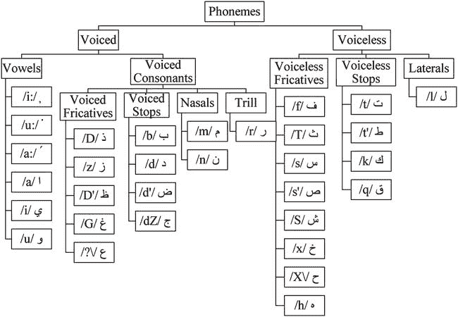

**注意**
MFCC 可以独立于声源（说话人）对语音的声学内容进行建模。MFCC 的计算方法是将频谱的对数映射到梅尔刻度，然后使用离散余弦变换将获得的信号转换回时域（Klatau 2005）。

## 实验结果与分析

为保持一致性，首次实验使用了提供的 13 个 MFCC 系数，随后加入了 MFCC 的一阶和二阶导数，即特征向量大小为 39 的系数。表 8-3 和 8-4 展示了所有实验在平均识别率、训练时间以及收敛所需迭代次数方面的结果对比。

### 表 8-4：使用 39 个 MFCC 系数的阿拉伯语口语数字数据集结果

|   | 实验 1 | 实验 2 | 实验 3 | 实验 4 |
| --- | --- | --- | --- | --- |
| 识别率 (%) | 98.2 | 99.1 | 98.6 | 99.7 |
| 训练时间 (分钟) | 125 | 142 | 137 | 156 |
| 收敛所需迭代次数 | 335 | 298 | 322 | 280 |

### 表 8-3：使用 13 个 MFCC 系数的阿拉伯语口语数字数据集结果

|   | 实验 1 | 实验 2 | 实验 3 | 实验 4 |
| --- | --- | --- | --- | --- |
| 识别率 (%) | 97.4 | 98.4 | 97.9 | 99.0 |
| 训练时间 (分钟) | 90 | 110 | 100 | 115 |
| 收敛所需迭代次数 | 240 | 232 | 235 | 220 |

表 8-3 和 8-4 表明，使用熵代价函数和所提出的权重更新规则训练皮层网络，其性能优于原始训练参数。这一改进是以训练时间略有增加为代价的。然而，尽管训练时间较长，但与原始权重更新规则相比，所提出的权重更新规则收敛所需的训练迭代次数更少。这是因为使用所提出的规则增加的强化量与代价函数的梯度成正比，这意味着达到收敛所需的训练迭代次数更少。与原始权重更新规则相比，所提出的权重更新规则涉及计算熵梯度，这在计算上更为昂贵。

### 图表分析

图 8-5 中的混淆矩阵（针对图像分割数据集，使用两种代价函数获得）表明，尽管在经典距离度量下，类别 1、7 和 8 之间存在明显的混淆趋势，但所提出的基于熵的更新规则能够部分纠正这一趋势。

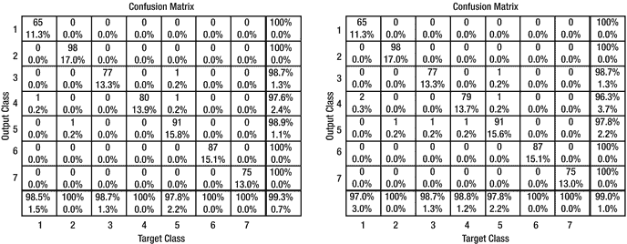
**图 8-5.** 图像分割数据集的混淆矩阵：左图为指数规则；右图为线性规则

图 8-6 比较了在使用熵代价函数训练皮层网络时，所提出的权重更新规则与常规权重更新规则下的 CE 代价函数与训练迭代次数。请注意，与常规更新相比，所提出的权重更新收敛到更小的 MSE 值，这与之前获得的识别率结果一致。

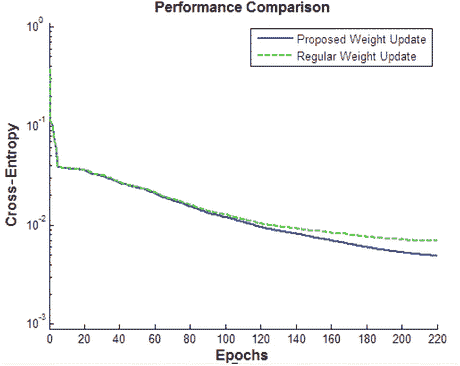
**图 8-6.** 常规与所提出的权重更新规则的熵代价函数比较