# 9. 深度学习

任何人都可以知道。关键在于理解。——阿尔伯特·爱因斯坦

人工神经网络自诞生以来，其历史便充满了起伏。在节点层面，人工神经网络始于高度简化的神经模型，如`McCulloch-Pitts`神经元（McCulloch and Pitts 1943），随后演变为`Rosenblatt`的感知机（Rosenblatt 1957）以及各种更复杂、更精密的计算单元。从单层和多层网络，到自递归的`Hopfield`网络（Tank and Hopfield 1986），再到自组织映射（也称为`Kohonen`网络）（Kohonen 1982）、自适应共振理论和时延神经网络等其他推荐结构，人工神经网络经历了多次结构迭代。这些迭代带来了渐进式的改进，旨在解决前代网络的局限性并实现更高水平的智能。尽管如此，这些“智能”网络的复合效应仍未能捕捉到真正的人类智能（Guerriere and Detsky 1991; Becker and Hinton 1992）。因此，深度学习在机器学习领域正在兴起，因为传统的浅层学习架构已被证明无法胜任更具挑战性的机器学习任务和强人工智能。计算能力的激增和广泛可用性（Misra and Saha 2010），加上高效训练算法的创建和神经科学的进步，使得此前不可能实现的深度学习原理得以实施。这些发展促成了深度架构算法的形成，这些算法借鉴认知神经科学，提出受生物学启发的学习解决方案。本章介绍脉冲神经网络和层级时间记忆的概念，其相关技术是本书涵盖的技术中成熟度最低的。

## 层级时间记忆概述

`HTM` 旨在复制新皮层的功能和结构特性。它融合了霍金斯在《论智能》（2007）一书中的诸多洞见，该书提出智能的关键在于预测能力。其框架被设计为新皮层的一种仿生模型，试图以简化且面向功能的方式，复制大脑的结构和算法特性。因此，`HTM` 采用层级化组织，如图 `9-1` 所示。层级结构中的所有层级及其子组件都执行一种通用的计算算法。

```
图 9-1.
HTM 网络的层级结构
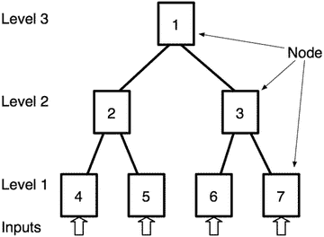
```

深度架构采用了人类新皮层的层级结构，因为大脑中显然存在一种普遍的计算算法，该算法遍布新皮层区域，使大脑能够以非常相似的方式处理感觉信息——视觉、听觉、嗅觉等。大脑的不同区域以层级方式连接，使得向上流动的信息不断聚合，在每一层级构建出对感官刺激更高、更复杂的抽象和表征。大脑的结构，特别是新皮层，进化出了对其所感知的世界结构进行建模的能力。在最简单的抽象层面，大脑可以被视为一个生物数据处理黑箱，它在一个向其输入（感官）施加海量数据的环境中，发现外部原因。这些持续信息流的原因在空间和时间上本质上是层级化的。这些原因构成了一组更小的构建块，它们组合起来形成对世界的更大图景。例如，语音可以分解为句子，句子分解为词语发音，词语发音分解为音素，依此类推。对于数字图像，像素组合成边缘，边缘组合成轮廓，轮廓组合成形状，最后形状组合成物体。世界上的每一个被感知的物体都展现出一种在不同粒度级别上被感知的类似结构。正是这种层级化组织的世界，是新皮层（以及通过模仿而建立的 `HTM`）旨在建模的对象。这种建模在 `HTM` 的每一层级中都会发生。

在 `HTM` 中，网络最底层的节点接收感官信息。这些信息可以是原始数据，也可以是预处理后的数据，具体取决于网络正在执行的任务。节点通过识别可重复的模式以及这些模式出现的序列，来学习数据流中最基本的特征，并通过本地记忆结构或连接配置将其存储起来。这些基本的模式和序列随后被用作更高层级的构建块，以形成对感官原因更复杂的表征。随着信息在层级结构中向上传递，当输入模式形成越来越高的抽象时，会使用相同的学习机制。信息也可以向下流动。这使得网络能够充当一个生成模型，其中较高层级通过将其内部状态传达给较低层级来影响它们，以填补缺失的输入数据或解决歧义，或两者兼而有之（Hawkins 2007）。

## 层级时间记忆的世代

`HTM` 在其发展过程中迄今已历经两代。第一代计算算法（称为 `Zeta 1`）的底层实现深深植根于贝叶斯信念传播（`BBP`），并从该理论中借鉴了许多计算和收敛规则。在这个现已停用的早期版本中，`HTM` 使用了 `BBP` 的一种变体。`BBP` 用于贝叶斯网络，在特定的拓扑约束下，可以确保网络在消息沿最大路径长度遍历网络所需的时间内达到最优状态。因此，`BBP` 迫使网络中的所有节点达成相互一致的信念。这些节点的状态以概率术语进行编码，并使用贝叶斯理论来处理和融合信息。`HTM` 可以被视为一个贝叶斯网络，并增加了一些用于处理时间、自我训练和发现原因的功能。

第二代算法的创建是为了使框架在生物学上更可行。在功能上，不变性表征以及空间和时间池化的许多概念，通过参考稀疏分布式表征（`SDR`）和结构变化的原理得以延续。节点被替换为更接近皮层柱的类似物，并采用了生物学上真实的神经元模型，连接方式也进行了更改，以允许强烈的侧向抑制（Edelman and Mountcastle 1978）。皮层柱是一组细胞，其特征是共同的前馈连接和强烈的抑制性互连（Edelman and Mountcastle, 1978）。

第二代算法——最初称为固定密度分布式表征（`FDR`），现在简称为 `HTM` 皮层学习算法（`CLA`）——取代了 `Zeta 1`。在更新后的框架中，每一级不再是具有清晰感受野的“桶状”层级结构，而是一个连续的细胞区域，这些细胞堆叠成柱状，充当 `Edelman` 和 `Mountcastle`（1978）皮层柱的简化模型。图 `9-2` 描绘了 `HTM` 的结构，其中细胞组织成柱，柱组织成层级，层级组织成皮层区域的层级结构。

```
图 9-2.
HTM 结构
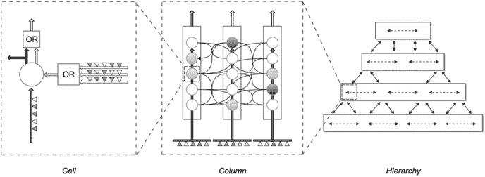
```

`Zeta 1` 深深植根于贝叶斯理论——特别是信念传播，而 `CLA` 则建立在 `SDR` 的原理之上。要理解 `CLA` 的底层实现，有必要讨论 `SDR` 及其对 `HTM` 理论的基础性作用。

为第一代 `HTM` 模型提出的架构深受其所实现的贝叶斯规则的影响。它受益于新皮层的结构特征，即其层级化组织；然而，节点与其生物学对应物存在差异。简而言之，重点在于功能建模。在 `CLA` 中，`HTM` 放弃了这些根源，并更严格地遵循新皮层的结构准则。其结果是一个神经元模型，在此上下文中称为 `HTM` 细胞。图 `9-3` 描绘了 `Hawkins`、`Ahmad` 和 `Dubinsky`（2011）提出的模型。这些细胞比传统人工神经网络中使用的细胞更真实，在生物学上更忠实。

```
图 9-3.
HTM 细胞/神经元模型
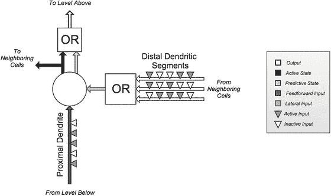
```

`HTM` 细胞拥有两种类型的传入连接结构：近端树突和远端树突。这两种类型的树突节段上分布着突触，将它们与其他邻近细胞连接起来。由于真实神经元的随机性，这些突触连接是二元的。因为 `Hawkins`、`Ahmad` 和 `Dubinsky`（2011）认为，任何旨在模拟大脑的算法都不能依赖单个神经元的精度或保真度，所以 `HTM` 细胞被建模为具有二元、无权重的突触；也就是说，它们要么连接，要么不连接。为了模拟真实神经元回缩和伸展以形成连接的能力，`HTM` 细胞的突触被赋予一个称为“持久性”的参数。持久性是一个介于 0 和 1 之间的标量值，根据突触对活动的贡献而递增或递减。当持久性高于预定义阈值时，突触就会变为连接状态。因此，`CLA` 中的所有突触都是潜在突触。它们是连接性的动态元素。

近端树突负责区域间的前馈连接。这些树突上分布着一组潜在突触，这些突触与 `HTM` 区域输入的一个子集相关联。这些树突由同一列的所有细胞共享（共享前馈连接），并充当线性求和单元。远端树突负责单个区域内的横向连接。一个远端树突关联着多个节段。这些节段充当一组阈值重合检测器，这意味着，当有足够多的连接同时被激活时，它们会在接收细胞中触发响应。只要有一个节段被激活，就足以在细胞中触发响应（或门）。每个节段将一个 `HTM` 细胞连接到一组不同的邻近细胞子集。这些细胞的活动被监测，并允许接收细胞进入预测状态。这本质上是 `HTM` 网络中预测的根源：每个细胞持续监测周围细胞的活动，以预测自身状态。

最后，`HTM` 细胞有两个二进制输出。第一个输出，由于近端连接，如果存在足够的激活，则迫使细胞进入活动状态。第二个输出，由于远端连接，如果存在足够的邻近活动，则迫使细胞进入预测状态；该细胞预计很快会被激活。这使得 `HTM` 能够以预测的方式运行，并对输入序列做出反应。最终，`HTM` 细胞的输出是这两个输出的或运算。这就是层级结构中更高层区域接收到的输入。图 `9-4` 展示了一组 `HTM` 列中细胞激活的示例：在任何时刻，一些细胞会因前馈输入而处于活动状态（深灰色），而另一些接收来自活动细胞横向输入的细胞则会处于预测状态（浅灰色）。

```
图 9-4.
HTM 列
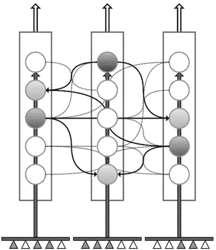
```

### 稀疏分布式表示

CLA 从其生物类似物中借鉴了许多操作原理。新皮层由超过 `10¹¹` 个高度互联的神经元组成。然而，它仍然能够以相对稀疏的激活水平对刺激做出反应。这得益于大量的抑制性连接。抑制保证了在任何时刻只有少数神经元被激活。此外，CLA 实现了与 `SDR` 相同的编码策略。通过使用横向突触连接，受到强烈刺激的神经列会抑制邻近的活动，从而减少活动列的数量，并产生输入模式或刺激的稀疏内部表示。这种内部表示也是分布式的，即分散在整个区域中。

由于活动位是稀疏的，与 ASCII 码等其他表示形式相比，了解其子集仍然能携带关于输入模式的信息。对于 ASCII 码，单个位是没有意义的；因此，`SDR` 为单个激活注入了表示质量。因为可能大量神经元中只有极小一部分是活动的，单个神经元获得的任何语义含义都变得特定于有限数量的相似模式。因此，即使是一个模式的活跃神经元的子集，也可以成为该模式的一个良好指示器。强制实施这种稀疏性所导致的理论上的信息丢失，实际上并没有实际影响（Hawkins, Ahmad, and Dubinsky 2011）。

### 算法实现

与第一代算法不同，将学习阶段与推理阶段分离并不能为理解 `HTM` 的操作规则提供太多洞见。在 CLA 中，学习、推理以及最重要的预测是和谐地发生的。层级结构的每一层都在持续进行预测。当较低层节点稳定后，其学习可以关闭；当被激活时，学习会与预测同步在线进行。

因此，最好从池化功能的角度来考虑 CLA 的操作。接下来的两节将讨论第二代算法中空间池化和时间池化背后的理论，并展示它们如何按照 Hawkins、Ahmad 和 Dubinsky（2011）的建议在皮层网络中实现。

### 空间池化器

空间池化器在 CLA 和 Zeta 1 中的作用相同。空间上相似的输入模式应具有共同的内部表示。这种表示不仅要对噪声具有鲁棒性，还要遵循 SDR 原则保持稀疏性。这些目标通过强制皮层柱之间的竞争来实现。当输入数据呈现时，HTM 区域中的所有柱都会计算其前馈激活值。被激活的柱会抑制相邻的柱。通过这种方式，只有一小部分强激活的柱能够代表一组相似的输入。为了让其他柱有公平的激活机会并确保所有柱都被使用，系统会添加一个增强因子。这使得弱柱能够更好地参与竞争。

对于每个激活的柱，所有潜在突触的持久值都会根据赫布学习规则进行调整。与激活输入位对齐的突触的持久值会增加，而与未激活输入位对齐的突触的持久值会减少。图 9-5 展示了所涉及阶段的流程图。

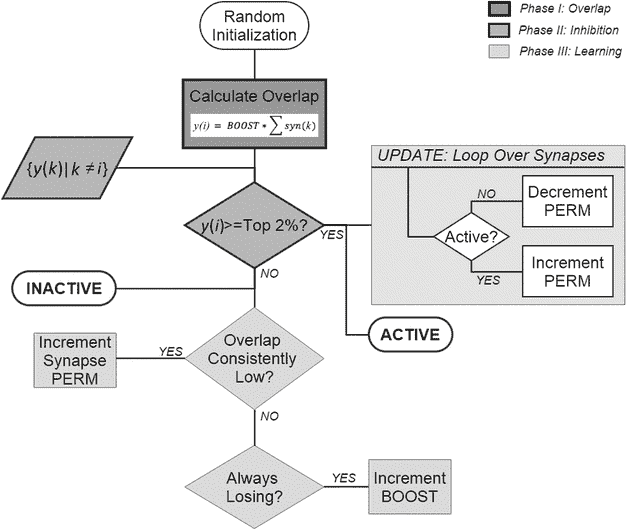

图 9-5.

空间池化器流程图

空间池化操作如下：

*   阶段 0（对应初始化）：每个柱被随机分配一组随机输入（输入向量的 50%），这被称为该柱的潜在池。此池中的每个输入由一个潜在突触表示，并被分配一个随机的持久值。持久值的选择根据以下标准决定：

    *   值从持久阈值附近的一个小范围内选取。这使得潜在突触在经过少量训练迭代后能够连接（或断开）。

    *   每个柱在输入区域上都有一个自然中心，持久值偏向于这个中心，中心附近的值更高。

*   阶段 1（对应重叠）：每个柱的重叠度计算为具有激活输入的连接突触数量乘以其增强值。如果该值低于预定义阈值（“`minOverlap`”），则重叠分数设为 0。

*   阶段 2（对应抑制）：局部抑制区域（柱的邻域）内的获胜柱数量被设为预定义值 N。如果一个柱的重叠分数大于其抑制半径内第 N 高柱的分数，则该柱为获胜者。一种计算量显著降低的抑制策略变体是，为层级中的每一层选取重叠分数最高的柱。

*   阶段 3（对应学习）：在此阶段，根据需要更新所有突触的持久值以及参数，如增强值和抑制半径。对于获胜柱，如果突触处于激活状态，其持久值增加；如果处于未激活状态，则减少。存在两种独立的增强机制来帮助柱学习连接。如果一个柱获胜不够频繁，其整体增强值会增加；或者，如果一个柱的连接突触与任何输入的重叠不够频繁，其持久值会被增强。此阶段以更新抑制半径结束。

### 时间池化器

通过空间池化器计算出的获胜柱，HTM 网络能够洞察其输入可能正在看到的模式。但它缺乏的是上下文。任何一个模式都可能作为大量序列的一部分出现，也就是说，出现在多个上下文中。HTM 理论的核心在于通过学习序列进行预测的能力。在 CLA 中，序列学习是通过每列使用多个细胞来实现的。一列中的所有细胞共享前馈激活，但只允许一个子集（通常是一个细胞）被激活。这意味着，由同一组柱表示的相同模式，可以根据模式出现的上下文，由每列中的不同细胞来表示。在细胞层面上，每个细胞的树突远端片段都与同一区域内的其他细胞有一组连接，用于在某个时间点识别网络的状态。细胞可以通过观察其连接来预测它们何时会被激活。一个特定的细胞可能参与数十或数百个时间转换。因此，每个细胞都有多个树突片段，而不仅仅是一个。

时间池化涉及三个阶段。第一阶段计算每个细胞的激活状态。第二阶段计算每个细胞的预测状态。第三阶段，通过增加或减少突触的持久值来更新突触。以下是同时进行推理和学习的通用情况，需要注意的是，CLA 中的学习阶段可以关闭。

*   阶段 1：对于每个获胜柱，计算其每个细胞的激活状态。同时，指定一个细胞为学习细胞。如果任何细胞由于其侧向连接而处于预测状态，则将其置于激活状态。如果一个学习细胞对其侧向激活有贡献，该细胞也被选为学习细胞。相反，如果该列中没有细胞处于预测状态，则所有细胞都被激活，以表明上下文不明确——这一过程称为爆发。此外，最佳匹配细胞成为学习细胞，并且为该细胞添加一个新的远端片段。

*   阶段 2：一旦获胜列中的所有细胞更新完毕，它们的状态可用于其他列中细胞的预测。区域中的每个细胞计算其侧向/远端连接。如果细胞的任何片段因其他细胞的前馈激活而被激活，则该细胞被置于预测状态。然后，该细胞将以下更改加入队列：

    *   通过增加激活突触的持久值并减少未激活突触的值来强化当前激活的片段

    *   强化可能预测到此次激活的片段，即与上一时间步的活动有（可能较弱）匹配的片段

*   阶段 3：这是发生学习的阶段，通过决定哪些排队的更新将被提交。一旦你有了前馈输入并且一个细胞被选为学习细胞，临时片段更新就会被实施。因此，只有当突触正确预测了细胞的前馈激活时，你才更新其持久值；否则，如果细胞因任何原因停止预测，这些片段将受到负强化。

## 相关工作

Zhituo、Ruan 和 Wang (2012) 在一个基于内容的图像检索（`CBIR`）系统中使用了多个 HTM，该系统利用查询图像的类别语义（而非低级图像特征）进行图像索引和检索。通过使用十个独立的 HTM 网络，并采用各含 50 个样本的训练和测试数据集，在所涉及的五个类别中，有四个类别的召回率达到了 95% 以上，第五个类别的召回率也超过了 70%。

Bobier (2007) 在美国邮政服务数据库上重现了 Numenta（霍金斯创立的公司）曾报告过的手写数字识别实验，该实验声称达到了 95% 的准确率。数字图像被二值化后，以不同参数输入网络，最终达到了 96.26% 的最高准确率——但作者指出，与其他分类器（如支持向量机 `SVM`）相比，这一结果并不理想，因为 `SVM` 在更短的计算时间内就能获得更高的准确率。

Kostavelis、Nalpantidis 和 Gasteratos (2012) 提出了一种受生物学启发的物体识别系统。该系统利用显著性图来模拟视觉注视，仅揭示图像中的相关部分，从而减少了输入到分类器的冗余信息量。作者选择用基于相关性的替代方案替换时间池化器，并在顶层节点使用 `ETH-80` 数据集和监督学习。该系统在将 SVM 和 `k-NN` 作为顶层监督器时，均优于其他基于 HTM 的实现方案。

Sinkevicius、Simutis 和 Raudonis (2011) 探索了将 HTM 用于公共空间的人流分析。他们设计了两个 HTM 网络：一个用于行人检测，另一个用于运动方向检测。他们进行了一项实验，使用安装在门框上方的俯视摄像头，并在多种不同难度的场景下评估了检测性能。行人检测的平均准确率达到 80.94%，方向检测的平均准确率为 73.44%。

Boone 等人 (2010) 将 HTM 作为传统计算机视觉技术的替代方案，用于糖尿病视网膜病变的检测。HTM 主要检测视网膜图像上的视神经。图像被分割成视神经大小的片段，并附上标签（0 或 1）输入 HTM。经过监督训练后，HTM 网络能够正确分类 77.44% 的视神经片段，这使得作者得出结论：尽管 HTM 前景广阔，但在该任务上与传统技术相比并无竞争优势。

Zhuo 等人 (2012) 将最新的图像分类技术与局部约束线性编码（`LLC`）、空间金字塔匹配（`SPM`）以及用于特征池化的 HTM 相结合。他们提取图像描述符并使用 `LLC` 进行编码，然后将 LLC 编码输入 HTM 和多尺度 `SPM` 以形成图像向量。该系统使用 `Caltech 101` 数据集和 `UIUC-Sport` 数据集进行评估，并以线性 `SVM` 作为分类器。结果显示，与原始的 LLC 模型相比，两个数据集的准确率均有所提升（分别从 71.2% 提升至 73.5%，以及从 84.2% 提升至 86.7%）。

Gabrielsson、Konig 和 Johansson (2012) 旨在利用`HTM`创建一个用于金融市场的盈利性软件交易代理。他们对`HTM`采用了监督训练方案，训练数据为`E-mini`标准普尔 500 期货市场的日内逐笔数据。调整后的模型被用作市场趋势的预测器，在与人工神经网络（`ANN`）进行对比评估时，至少表现出了相当的结果。

大多数利用`HTM`的工作都是由 Numenta 建立的开发者社区完成的。年度“黑客马拉松”产生了多个演示项目，其中`CLA`被用于交通预测、人体运动预测、井字棋模拟、红外传感器预测等。其中一个更令人印象深刻的演示是关于音乐分析和预测的，展示了如何使用`MIDI`音符序列进行训练；一个旋律在 25 个训练周期后被学会（ [`http://numenta.org/blog/2013/06/25/hackathon-outcome.html#jin-danny-stan`](http://numenta.org/blog/2013/06/25/hackathon-outcome.html#jin-danny-stan) ）。目前，正在研究将`CLA`模型用于自然语言处理（`NLP`）。GitHub 网站上有一个示例（ [`https://github.com/chetan51/linguist`](https://github.com/chetan51/linguist) ）。然而，还需要更多的研究和验证来比较`HTM`的性能与那些该模型声称优于或类似于的最新机器学习方法。鉴于`HTM`所报告的性能，社区尚未看到`HTM`在哪些方面具有明显优势。

## 脉冲神经网络概述

`SNN`是受生物学启发的网络，属于第三代人工神经网络。对于`ANN`而言，性能的任何改进似乎都应基于神经元模型。第二代`ANN`中的神经元模型基于实际神经元的简化模型，该模型忽略了神经元之间信息编码的实际方式以及信息的类型。`SNN`与`ANN`的架构相似，都由一层或多层连接的神经元组成，但在神经元模型和激活函数类型上有所不同。与利用不包含时间信息的连续激活函数的第二代`ANN`相反，`SNN`在其学习和激活阶段依赖于脉冲时序。`SNN`力求模仿人类神经元，利用脉冲来传输和学习时空与频谱时间数据（`SSTD`），这些数据对于空间数据而言通过突触位置编码，对于时间数据而言则通过脉冲时间活动编码。

`SNN`及其变体已被应用于许多领域，例如字符识别（Gupta and Long 2007）、手语识别（Schliebs, Hamed, and Kasabov 2011）、视觉和听觉模式识别（Wysoski, Benuskova, and Kasabov 2006, 2007）、图像聚类（Meftah et al. 2008）、车祸识别（Kasabov et al. 2013）、人类行为识别（Meng, Jin, and Yin 2011）、乳腺癌分类（O’Halloran et al. 2011）、传感器网络中的人类定位（Obo et al. 2011）、入侵检测（Budjade 2014; Demertzis and Illiadis 2014）、脑电图（`EEG`）时空/频谱时间模式识别（Kasabov et al. 2013）以及味觉识别（Soltic and Kasabov 2010）。总的来说，由于计算成本高昂，`SNN`并不像其他机器学习方法那样普及。

要理解`SNN`与`ANN`的区别，有必要考察最常见的人类神经元模型：`Hodgkin-Huxley`模型、`integrate-and-fire`模型、`leaky integrate-and-fire`模型、`Izhikevich`模型和`Thorpe`模型。以下各节将介绍这些模型。

### Hodgkin-Huxley 模型

`Hodgkin-Huxley`模型描述了神经元中动作电位的传播，可被视为其他模型的基础。`Hodgkin`和`Huxley`根据鱿鱼的巨大轴突，对自然神经元的电化学信息进行了建模。该模型由四个微分方程组成，描述了神经元膜电容部分电荷的变化，这些变化是电压（`V [m]`）和电流（`I(t)`）的函数。

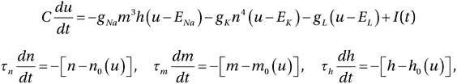

其中

`I(t)` 是由突触前电位引起的输入电流

`g [Na]` 、`g [K]` 、`g [L]` 分别是钠离子通道、钾离子通道和漏电通道的单位面积电导参数

`E [Na]` 、`E [K]` 、`E [L]` 是平衡电位

`m`、`n`、`h` 是无量纲变量，由另外三个微分方程控制

由于这些方程的非线性和四维数据特性导致的复杂性，为了实际应用，人们提出了几种更简单的形式。我们将在以下各节中讨论其中一些方案。

### 积分-放电模型

`积分-放电`模型源自霍奇金-赫胥黎模型，但忽略了动作电位的形状。该模型假设所有动作电位都是统一的，仅在发生时间上有所不同。由于上述简化，所有尖峰都具有相同的特征，如形状、宽度和幅度。膜电容和突触后电位由以下方程给出：

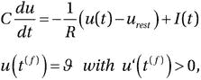

其中

`u [rest]` 是神经元在初始状态下的膜电位

`ϑ` 是神经元放电的阈值

`t ^((f))` 是尖峰放电时间

`I(t)` 是由突触前电位引起的输入电流

### 泄漏积分-放电模型

`泄漏积分-放电`模型与`积分-放电`模型的不同之处在于，如果没有电位到达神经元，神经元的膜电位会随时间衰减。当神经元的膜电位`u(t)`在时间`t`达到特定阈值`ϑ`（称为尖峰放电时间`t ^((f))`），且`u(t)`满足`u'(t ^((f)))>0`条件时，神经元会立即发射一个尖峰。随后，神经元进入绝对不应期`u [abs]`，这意味着在此期间神经元将忽略任何到达尖峰的影响。不应期持续特定时间`d [abs]`；在此期间神经元的膜电位为：

`u(t) = –u [abs]`，

其中`u [abs]`是不应期电位。

当`d [abs]`结束后，膜电位恢复到`u [rest]`值。膜电位由下式给出：

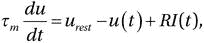

其中

`τ [m]` 是神经元膜的时间常数

`u [rest]` 是神经元在初始状态下的膜电位

`I(t)` 是由突触前电位引起的输入电流

`R` 是神经元模型的等效电阻。

### Izhikevich 模型

`Izhikevich`模型是生物合理性与计算效率之间的权衡。该模型使用以下两个微分方程来表示膜电位的活动：

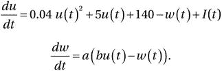

尖峰后的动作由以下项描述，其中膜电位和恢复变量被重置：

如果`u ≥ ϑ`，则`u ← c`，且`w ← w + d`。

这里，`u`代表膜电位，`w`代表一个对`u`提供负反馈的膜恢复变量。`a`、`b`、`c`和`d`是无量纲参数。由于该模型的简单性，可以在计算机上模拟大量神经元。

### Thorpe 模型

`Thorpe`模型是`积分-放电`模型的一个变体，它考虑了尖峰到达神经元的顺序。`Thorpe`模型适用于许多应用，因为它使用了简单的数学表示：

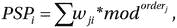

其中

`w [ji]` 是神经元`j`和神经元`i`之间突触的权重或效率

`mod` 是一个调制因子 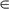[0,1]

`order [j]` 是突触前神经元`j`的放电顺序，其中`j` [1, n–1]，`n`是连接到神经元`i`的突触前神经元数量

该模型中的权重根据下式更新：

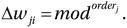

`Thorpe`模型与那些较早放电并到达当前神经元的连接神经元建立更强的连接。每当`PSP [i]`达到阈值`PSP [θi]`时就会发生放电。放电后，`PSP [i]`立即被设置为 0，如下所示：

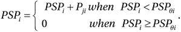

这种方法允许对大型网络进行快速、实时的模拟。

### SNN 中的信息编码

神经元中的信息编码长期以来一直是激烈争论的主题，争论焦点在于神经元中的信息是编码为速率编码还是尖峰编码。最近的研究表明，信息被编码为尖峰编码，因为速率编码不足以代表神经元快速处理信息的能力。

### 排序编码与脉冲神经网络

排序编码非常高效，可以实现最高的信息编码容量。排序编码首先使用高斯感受野将输入值转换为尖峰序列。高斯感受野由 `m` 个感受野组成，用于将输入值 `n` 表示为尖峰。假设 `n` 的取值范围为 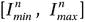，则神经元 `i` 的高斯感受野由其中心 `u[i]` 给出：

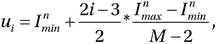

以及宽度 `σ`：

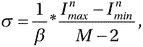

其中 `β` 是一个控制感受野宽度的参数，取值范围为 `1 ≤ β ≤ 2`。

与依赖于放电速率的常见学习方法不同，SNN 使用赫布规则的一种变体来强调尖峰时序的影响。权重更新机制基于突触前和突触后神经元放电时间之间的间隔。权重更新过程涉及两种类型的神经元：当前神经元突触前的神经元（突触前神经元）和突触后的神经元（突触后神经元）。如果突触后神经元在突触前神经元之后立即放电，则这两个神经元之间的连接得到加强，神经元的权重由下式给出：

如果 `Δt ≥ 0`，则 `w[new] ← w[old] + Δw`，

其中 `Δt` 是放电时间差，等于 `t[post] – t[pre]`。

如果突触前神经元在突触后神经元之后立即放电，则这两个神经元之间的连接被削弱，如下所示：

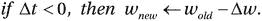

当突触后神经元的放电时间并非紧接在突触前神经元的放电时间之后发生时，权重不会更新。

前面的讨论涉及兴奋性连接。抑制性连接使用一个简单的过程，因为它不考虑突触前和突触后神经元放电时间之间的间隔。

## SNN 中的学习

为 SNN 开发的最流行算法是 SpikeProp 和 Theta 学习规则。SpikeProp 类似于为调整第二代神经网络权重而设计的反向传播算法。Theta 学习规则使用二次整合放电（QIF）神经元模型。这两种算法都对神经元模型的参数非常敏感，有时还会出现脉冲丢失问题。当神经元对任何模式都不放电，因而无法通过梯度方法恢复时，就会发生脉冲丢失。另一种训练 SNN 的方法是使用进化策略，这种方法不受调参敏感性的影响，但计算量大且成本高昂。

假设 `H`、`I` 和 `J` 分别代表输入层、隐藏层和输出层。特定层中的每个神经元分别用小写字母 `i`、`h` 和 `j` 表示。神经元 `i` 的前驱神经元集合用 `Γ[i]` 表示，而神经元 `i` 的后继神经元集合用 `Γ^i` 表示。连续层中两个神经元之间的每个连接由 `m` 个 {1..m} 子连接组成，每个子连接都有一个恒定的增量延迟 `d[k]` 和一个权重 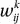，其中 `k` 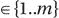。`t[i]`、`t[h]` 和 `t[j]` 表示各层神经元的放电时间，而 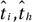 和 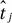 表示各层的实际放电时间。

神经元 `i` 的响应函数由下式给出：

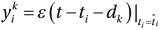

其中：

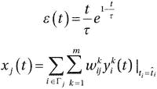

这里 `τ` 是膜常数。

从输出层到隐藏层的权重更新由下式给出：

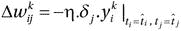

其中：

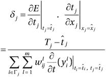

从隐藏层到输入层的权重更新由下式给出：

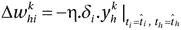

其中：

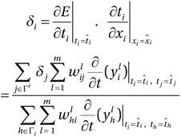

SpikeProp 算法的弱点包括以下几点：

*   神经元的膜电位是在固定的时间步长间隔内计算的。
*   没有选择初始权重和阈值的方法。
*   需要一个在 `t=0` 时放电的参考神经元。
*   由于脉冲响应函数不足，收敛性受到影响。

## SNN 变体与扩展

以下各节将回顾 SNN 的变体和扩展。

### 进化脉冲神经网络

进化脉冲神经网络（eSNN）是一类具有动态架构的 SNN 变体（Schliebs 和 Kasabov 2013）。eSNN 使用 Thorpe 模型和群体排名编码来编码信息。eSNN 结合了进化连接系统（ECoS）（Kasabov 2007）架构和 SNN。与 SNN 相比，eSNN 具有三个优势。首先，eSNN 的计算成本较低，因为它们依赖于一个轻量级的神经元模型，即 Thorpe 模型。其次，eSNN 中的学习算法比 SNN 中的更有效，后者有 20% 的情况无法收敛（Thiruvarudchelvan, Crane, 和 Bossomaier 2013）。第三，eSNN 是在线学习模型，这使其相对于其他技术具有明显优势。

### 基于储层的进化脉冲神经网络

储层计算（RC）是一个随机且稀疏连接的节点（神经元）框架，用于解决复杂的动态系统。RC 分为回声状态机（ESM）（Jaeger 2007）和液体状态机（LSM）（Maass, Natschläger, 和 Markram 2002; Maass 2010）两种类型。

LSM 是一种实时计算模型，它接受连续的数据流，并生成高维的连续输出流。LSM 可以看作是一个动态的 SVM 核函数。LSM 的架构由一个液体和一个读出函数组成。液体可以被视为一个具有训练架构的滤波器，用于解决通用问题，例如从同一视频流中识别不同类型的物体。相比之下，读出函数是特定用途的，例如使用不同的读出函数从同一个液体中识别不同的物体。读出函数应该是一个线性判别且无记忆的函数。

### 动态突触进化脉冲神经网络

动态突触进化脉冲神经网络（deSNN）是一类 eSNN，它在整个学习过程中使用动态权重调整（Kasabov 等人 2013）。权重的动态更新使模型能够更有效地捕捉问题的复杂模式。在 deSNN 中，权重会根据到达连接的脉冲而持续轻微变化，这与 eSNN 中权重只更新一次的情况相反。

### 概率脉冲神经网络

概率脉冲神经网络（pSNN）的神经模型（见图 9-6）使用了三种概率（Kasabov 2010）：

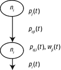

**图 9-6. pSNN 模型**

*   `P[cj,i](t)`，在时间 `t`，从神经元 `nj` 发出的脉冲通过连接 `cj,i` 到达神经元 `ni` 的概率。
*   `P[sj,i](t)`，突触 `sj,i` 在接收到来自神经元 `nj` 的脉冲后，对 `PSP[i](t)` 做出贡献的概率。
*   `P[i](t)`，神经元 `ni` 在其 PSP 达到发射阈值后发出脉冲的概率。

神经元 `ni` 的 PSP 由下式给出：

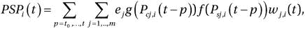

其中：

*   `e[j]` 如果从神经元 `nj` 发出了一个脉冲则为 1，否则为 0。
*   `g(P[cj,i](t – p))` 以概率 `P[cj,i](t)` 为 1，否则为 0。
*   `g(P[sj,i](t – p))` 以概率 `P[sj,i](t)` 为 1，否则为 0。

## 结论

本章及前两章涵盖了与深度学习相关的四种学习算法：深度神经网络（DNN）、皮层算法（CA）、层级时间记忆（HTM）和脉冲神经网络（SNN）。DNN 是一种从传统 AI 视角发展起来的成熟技术，并在许多应用中展现出稳健的结果。CA、SNN 和 HTM 是受生物启发的技术，虽然不太成熟，但被生物启发计算的支持者视为极具前景。然而，传统的 AI 支持者认为，与 DNN 相关的方法将成为学习领域的未来赢家。哪种愿景会占上风是一个激烈争论的问题。

但是，与其问谁对谁错，我们或许更应该根据所寻求学习的背景和目标来提出问题。我们是在寻求创造一种通用的机器智能形式，能够复制人类智能通过从少量实例中进行推理来学习的能力，以应用于各种场景？还是我们追求的是计算高效的学习框架，能够以蛮力处理从物联网（`IOT`）收集的大数据，以开发能够执行预测和描述性任务的模型？

由于研究人员尚未就 AI 的唯一定义或评估学习算法的黄金标准达成一致，本文旨在为读者提供关于深度学习这个快速扩展的子领域的一般背景和当前快照。