# 10. 多目标优化

所有人都在追寻同一个目标：成功或幸福。实现真正成功的唯一途径，是在服务社会的过程中完全展现自我。首先，要有一个明确、清晰、切实的理想——一个目标，一个目的。其次，要拥有实现目标所需的手段：智慧、金钱、材料和方法。最后，调整你所有的手段去服务于那个目标。 ——亚里士多德

多目标优化旨在满足一组约束条件的同时实现多个目标，且这些目标之间很可能相互冲突。多目标优化也可以解释为一个多准则决策过程，在此过程中，多个目标函数需要同时进行优化。在许多情况下，最优决策可能需要在相互冲突的目标之间进行权衡。传统的优化方案使用一个权重向量来指定每个目标的相对重要性，然后将这些目标组合成一个标量成本函数。这种策略通过将多目标问题转化为单目标问题来降低其求解复杂度。多目标优化的求解技术涉及模型复杂度与准确性之间的权衡。多目标优化的例子可见于经济学（制定货币政策）、金融学（风险-收益分析）、工程学（过程控制、设计权衡分析）以及许多其他需要处理相互冲突目标的应用场景中。

多目标优化的先决条件之一是确定一个解是否优于另一个解。然而，并不存在得出此类结论的简单方法。相反，多目标优化方法通常采用一组帕累托最优解（也称为非支配解），这些解是在不同目标之间具有不同权衡的备选方案。在由帕累托最优集定义的解中，如果不降低该集合中至少一个其他目标的性能，就无法改进任何一个目标。由决策者来选择最符合其偏好策略或指导方针的帕累托最优解。帕累托图展示了不同目标之间权衡的属性。解可以表示为一条曲线或一个三维曲面的形状，该曲面在多目标空间中权衡不同的区域。

本章讨论使用进化方法求解基于帕累托的多目标优化问题的机器学习方法论。目标是找到一组非支配解，使其在每一代中与帕累托前沿的距离最小。连续的解作为进化过程的一部分被构建，其中一组选定的个体解会为下一代产生另一组解。具有较高适应度度量的解更有可能被选入交配池，前提是假设它们将在下一代（下一次运行）中产生更适应的解，而适应度度量较弱的解则更有可能被丢弃。这类解具有若干属性，使其适用于涉及以下情况的问题：(1) 庞大且复杂的搜索空间，(2) 相互冲突的目标。

## 正式定义

多目标优化问题处理有限数量的目标函数。在一个具有 n 个同等重要目标（均需最小化或最大化以满足性能标准）的优化问题中，从数学上，该问题可以表示为一个必须通过某种方式进行权衡的目标向量 f [i] (x)，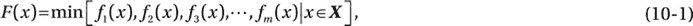

其中 X（见公式 10-2）是一组 n 个决策向量（一个决策空间），代表为满足约束条件和优化向量函数而选定的参数值，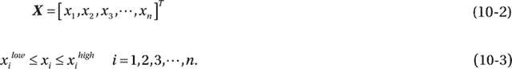

在清晰理解这些目标之间的权衡之前，无法确定它们的相对重要性。由于 F(x) 是一个向量，相互竞争的目标函数会阻止其获得唯一解。你可以将决策空间 X 中的每个解 x 与目标空间 Y 中的一个点关联起来，使得

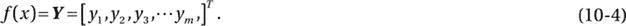

在多目标优化中，集合 X 和 Y 分别被称为决策变量空间和目标函数空间。图 10-1 展示了搜索空间到目标空间的映射。搜索空间的每一次迭代都会产生一组定义目标空间的目标向量，其中多个最优目标向量可能代表了目标之间的不同权衡。

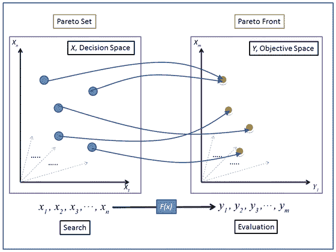

图 10-1.

多目标优化问题：将搜索空间映射到目标空间

### 帕累托最优性

帕累托最优性是一个建立在多目标优化基础上的概念，它通过多个目标组合之间的权衡来促进多目标向量的优化。权衡的制定是为了以牺牲一个或多个其他目标的性能为代价来提高一个目标的性能。如图 10-1 所示，目标空间中的每个点代表一组独特的模型变量，因此帕累托最优性对多个帕累托最优解进行分类。该术语是为了纪念维尔弗雷多·帕累托（1848–1923），一位意大利经济学家，他证明了收入遵循幂律概率分布。

在理想情况下，多目标问题的最优解通常被表示为帕累托集 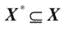。相应的结果或目标向量由帕累托前沿 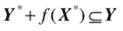 表示。在实践中，理想解是不存在的，求解多目标优化通常不会产生唯一的最优解。相反，我们使用帕累托最优解，在这种解中，如果不降低至少一个其他目标的性能，就无法改进任何一个目标。因此，当使用进化技术时，了解最优帕累托集 (X*, Y*) 有助于找到最佳折衷解。

### 支配关系

如果满足以下条件，则解 x[1] 支配另一个解 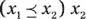：

对于所有目标，解 x[1] 优于或等于 x[2]，即 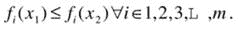  
对于至少一个目标，解 x[1] 严格优于 x[2]，即 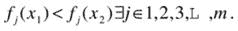  

如果这两个条件中的任何一个被违反，则 x[1] 不（帕累托）支配解 x[2]。支配关系是非对称的。例如，如果解 x[1] 不支配解 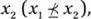，这并不意味着 x[2] 支配 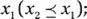；因此，两个解可以是非支配的。然而，支配关系也是传递的。例如，如果 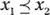 且 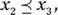，则 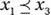。这一性质使我们能够识别出哪些解不被解集 X 中的任何成员支配 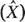 (X̂)。这些在整个可行搜索空间中的非支配集 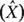 (X̂) 被称为全局帕累托最优集。

生成帕累托集的计算成本可能很高。因此，你需要选择一种计算效率高的方法来确定多目标优化算法的帕累托最优集。尽管你可以采用许多不同的方法来解决多目标优化问题，但在进化多目标优化领域，关于帕累托集近似的研究已经做了大量工作。

### 性能度量

为了评估解的性能，制定一个量化非支配帕累托前沿质量的度量方案至关重要。多目标优化算法的一般性能标准可总结如下：其中，

收敛性 (γ)：估计候选非支配（帕累托）解与已知最佳预测或已知帕累托最优解集之间的接近程度。对于使用算法获得的每个解，你可以使用到帕累托最优前沿的最小欧几里得距离（Deb, Pratap, and Agarwal 2002）。平均距离可用作收敛性度量。γ 值越小，表示收敛性越好。  
多样性 (Δ)：为决策者提供高效的选择。由于你关注的是覆盖整个帕累托最优区域的解，因此需要评估所获得解之间的分布程度。  
位移 (D)：在算法近似或存在不连续帕累托最优前沿的情况下，可能仅反映了真实最优前沿的一部分。位移用于克服这一局限性。位移衡量候选解集与已知帕累托最优解集之间的相对接近程度。数学上，位移可表示为 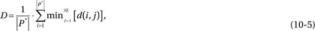  

其中，

P* = 来自真实帕累托最优前沿的均匀分布解

Q = 最终解

d(I, j) = P* 的第 i 个解与 Q 的第 j 个解之间的欧几里得距离

较低的位移值表示更好的收敛性和覆盖度。

每种算法可能会选择一个或多个性能标准来测试解的质量。在许多情况下，性能标准可能取决于已知帕累托最优集集合的可用性（或不可用性）。本章的其余部分将探讨基于进化学习方法的各种多目标优化解决方案。

## 机器学习：进化算法

生成帕累托集的计算成本可能很高，因为多目标优化问题不再只有一个最优解，而是有一整套潜在解。经典优化器（Marler and Arora 2004）包括加权和法、扰动法、切比雪夫法、目标规划法和最小-最大法。尽管这些方法可用于多准则优化，但每次模拟运行只能获得一个解；模拟需要多次执行，并期望其中某个解可能导向帕累托最优解。进化算法非常适合解决多目标优化问题，因为它们模仿了本质上就是多目标的自然过程；一次模拟运行就能捕获多个帕累托最优解。此外，进化算法对帕累托前沿的形状或连续性不太敏感。这些算法已成功应用于广泛的组合问题，在这些问题中，来自多个来源的信息被整合在一起以实现最优解。这类算法在涉及设计和优化的应用中尤其有用，这些应用通常变量众多，且过程算法要么不存在，要么极其复杂。通常，进化方法是基于种群的元启发式优化算法，模仿自然进化的原理。这些方法使用解的初始种群，并在每一代中更新，以收敛到单个最优解。尽管进化算法不能保证找到真正的最优解，但它们试图找到一个良好的近似解，代表一个接近帕累托最优的解。

进化算法通常分为四大类：(1) 遗传算法，(2) 遗传编程，(3) 进化编程，以及 (4) 进化策略。尽管这些算法采用不同的方法，但它们都从自然选择原理中汲取灵感。进化算法涉及的基本过程是选择、变异和交叉。进化算法的第一阶段涉及应用适应度因子来评估目标空间中的种群（代表解的质量）。接下来，通过使用随机选择或基于似然性的选择标准，从前一步骤的种群中选择个体，从而创建一个交配池。交配池组织好后，对其进行重组和变异，产生一个新的种群集。重组过程执行 n 点交叉，具有可配置的概率，允许一个亲本的片段与另一个亲本的片段结合，以创建全新的子代种群。交配选择是进化算法过程中的关键步骤，因为它试图选择有前景的解，其假设是，由于高质量选择而产生的未来交配池往往更优越。变异算子根据给定的变异率，通过对相关向量进行微小改变来修改个体。鉴于交配和变异过程的概率性质，某些种群可能不会发生任何变化，而只是复制到下一代。

类似于自然进化，个体代表可能的解，一组个体（或可能的解）称为一个种群。每个个体都使用特定于问题的编码方案进行编码，该方案可以被解码并由适应度函数评估。交配过程通过重组和变异修改现有种群以进化出新种群，并不断迭代。每次循环迭代称为一代，它代表了进化过程中的一个时间线。

多目标进化算法领域的早期工作归功于大卫·谢弗，他实现了向量评估遗传算法（VEGA）（Schaffer 1985）。Goldberg（1989）提出根据帕累托支配关系计算个体适应度。此后，人们提出了多种多目标进化算法的变体（本章将介绍其中一些较为流行的算法）。

### 遗传算法

遗传算法遵循自然选择原理（见图 10-2），其中每个解被表示为二进制（或实数）编码的字符串（染色体），并附带一个相关的适应度度量。连续的解作为进化过程的一部分被构建，在该过程中，一组选定的个体解会产生另一组用于下一代的解。适应度高的个体更有可能被选入交配池，这是基于它们将在下一代中产生更优解的假设。适应度较弱的解则自然被淘汰。通常，你可以使用轮盘赌选择来模拟自然选择，在这种方法中，功能适应度更高的解被淘汰的可能性虽然存在，但较小。在该方法中，每个可能的选择在轮盘上被分配一个与其适应度值成比例的区域，然后进行随机选择，类似于旋转轮盘赌轮。同时，也存在较小的可能性，即一些较弱的解会在选择过程中幸存下来，因为它们可能包含在交叉过程后被证明有用的组件（基因）。从数学上讲，选择某个潜在解的可能性由下式给出：

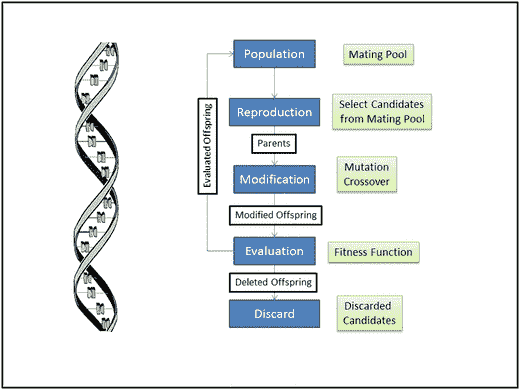

图 10-2.

遗传算法的基本流程

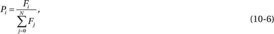

其中 P [i] 表示第 i 个解被选入交配池的可能性，F [i] 表示第 i 个个体解的操作适应度，N 是种群中解元素的总数。遗传算法已被证明在解决具有大型搜索空间且因领域知识匮乏而难以理解的复杂问题方面非常有用。遗传算法的染色体代表了问题解的基本构建块（等位基因），这些构建块适用于遗传算子和适应度函数。候选解通过使用交叉和变异函数进行修改，并产生新的候选解，这些新候选解将接受评估，以确定其是否有资格进入新的交配池。

### 遗传编程

遗传编程是一种进化技术，它将遗传学习范式扩展到计算机程序的自主合成中，这些程序在执行时会产生候选解。与遗传算法不同，在遗传算法中，种群是代表候选解的固定长度编码字符串；而在遗传编程中，种群是由语法树（也称为解析树）表示的程序。遗传编程通过迭代地进化程序种群，运用遗传操作（交叉和变异）将一组程序转换为另一组程序。交叉函数是通过在种群中两个父代个体（根据适应度标准选择）的随机交叉点处交换子树来实现的。交叉通过用第二个父代的子树替换第一个父代在交叉点处的子树来创建后代。在子树变异（最常用的变异形式）中，随机选择的变异点处的子树被随机生成的树的子树所替换。

图 10-3 展示了使用两个变量 x 和 y 以及前缀表示法来表达数学运算符的遗传编程方法的一般流程和交叉操作。父代 1 [+(*(x, y),2)] 与父代 2 [*(+(x,1),/(y,2))] 交叉，产生一个由 [+(/(y,2)),2)] 表示的后代。在遗传编程中，通常使用这种前缀表示法来表示表达式。

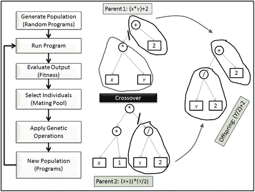

图 10-3.

带有交叉操作的遗传编程基本流程；在两个父代上选择随机交叉点后，父代 1 的一部分与父代 2 的一部分连接，以创建一个后代

## 多目标优化：一种进化方法

在单目标优化中，为了评估解的质量，你只需测量目标函数的值。在多目标优化的情况下，可能无法评估解相对于最优帕累托近似的质量，因为你可能不掌握关于目标空间或覆盖范围的相关信息，因此可能无法根据与最优帕累托集的接近程度和覆盖范围的多样性来定义解的质量。即使一个解支配另一个解，你可能仍然无法量化相对改进，因为仅凭相对距离和多样性不足以量化帕累托集近似。这引出了定义实现多目标进化算法策略的基本要求。这些要求可以总结如下：

*   **适应度**：引导解更接近帕累托集。这需要构建一个满足多个优化标准的标量适应度函数。
*   **多样性改进**：通过选择一组多样化的非支配解来提高覆盖范围。这避免了在目标空间和决策空间中出现相同解的情况。
*   **精英主义**：防止非支配解被淘汰。

大多数进化算法在处理适应度、多样性和精英主义的方式上有所不同。以下列出了一些最流行的多目标进化算法方法：

*   加权求和法
*   向量评估遗传算法（VEGA）（Schaffer 1985）
*   多目标遗传算法（MOGA）（Fonseca and Fleming 1993）
*   小生境帕累托遗传算法（NPGA）（Horn, Nafpliotis, and Goldberg 1994）
*   非支配排序遗传算法（NSGA）（Nidamarthi and Deb 1994）
*   强度帕累托进化算法（SPEA）（Zitzler and Thiele 1999）
*   强度帕累托进化算法 II（SPEA-II）（Zitzler, Laumanns, and Thiele 2001）
*   帕累托存档进化策略（PAES）（Knowles and Corne 1999）
*   基于帕累托包络的选择算法（PESA）（Corne, Knowles, and Oates 2000）
*   基于帕累托包络的选择算法 II（PESA-II）（Corne et al. 2001）
*   精英非支配排序遗传算法（NSGA-II）（Deb, Pratap, and Agarwal 2002）

这些方法将在以下各节中依次介绍。

### 加权求和法

用于多目标优化的加权求和法通过一致地改变权重来提供多个解点。不同的目标被合并为一个单一目标，并使用可配置的权重来最小化复合函数。从数学上讲，加权求和法可以表示为：

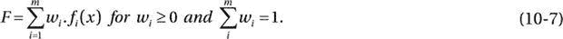

对于正权重，最小化 F 可以得到一个帕累托最优解。尽管这种方法计算效率高，但主要缺点在于，对于一个信息很少或没有信息的问题，它无法确定能够最优缩放目标函数的权重。

### 向量评估遗传算法

VEGA 是一种基于种群的算法，它扩展了简单遗传算法（SGA）的选择算子，使得每一代通过比例选择方案产生若干不相交的子种群，并由不同的目标函数控制。对于一个具有 m 个目标且总种群规模为 N 的问题，会生成 m 个规模为 N / m 的子种群，每个子种群由其各自的适应度函数生成。如图 10-4 所示，这些子种群被混合在一起，生成一个规模为 N 的新种群。该方案高效且易于实现，因为它仅修改了 SGA 的选择方法。

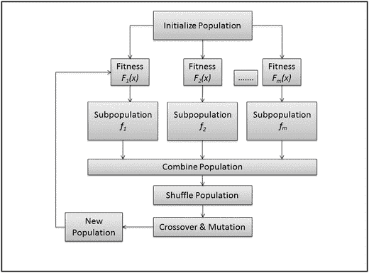

图 10-4.

VEGA 的基本流程

由于比例选择，VEGA 中所有子种群的混合与合并操作导致了一种聚合方法。该方案的缺点是无法在帕累托最优前沿上找到大量点，因为每个解都执行其自身的适应度函数。由于目标空间中沿坐标轴的并行搜索方向或同时执行多个目标函数，VEGA 容易找到极端解。

### 多目标遗传算法

MOGA 是 SGA 的另一种变体，其不同之处在于适应度分配给解的方式。在该方案中，使用以下表达式为每个解分配等级 R：

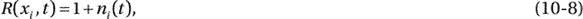

其中 n [i] 是在第 t 代中支配第 i 个解 x [i] 的解的数量。一旦排序过程完成，个体的适应度通过用户定义的函数在最佳等级 (1) 和最差等级 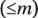 之间插值来分配。相同等级个体的适应度被平均化，允许以相似的速率进行采样，同时保持选择压力。某些个体的适应度可能比其他个体下降得更多，这取决于排序后种群的规模。排序引导搜索仅收敛于全局最优解。在许多目标维度上表现良好的解更有可能参与交配过程。

尽管排序过程为帕累托非支配解分配了正确的适应度，但它并不总能保证在帕累托集合中采样的均匀性。在处理多个目标时，遗传漂变会引发次优行为，即由于不完美的选择过程，大量解倾向于收敛到较少的目标上。为了防止过早收敛并增加种群多样性，在目标空间中采用了一种小生境形成方法，将种群分布在帕累托区域上。如果两个个体的适应度接近到小于某个小生境距离，则它们被视为属于同一个小生境（即共享相同的适应度）。小生境形成通过在小生境之间引入竞争压力，降低此类局部最优解的适应度，从而阻止收敛到适应度函数的单一区域。小生境形成有助于发现适应度景观中的不同区域。在自然界中，小生境被视为生物体在环境中的任务，而物种是具有相同特征的生物体的集合。小生境技术将 GA 种群分割成不相交的集合，使得适应度函数的每个区域中至少有一个成员覆盖多个局部最优解。在一种此类方法中，你需要定义一个参数小生境半径（σ [radius] ）。任何距离小于该半径的两个个体都被视为属于同一个小生境，共享相同的适应度值。小生境技术让 GA 基于新的共享适应度而非个体的原始适应度进行操作。小生境技术减少了种间竞争，并有助于在不同的小生境周围合成稳定的子种群。在多目标优化问题中，小生境通常由搜索空间中每个最优解的位置表示，适应度作为该小生境的资源。

### 小生境帕累托遗传算法

NPGA 是一种基于帕累托支配的锦标赛选择方案，其中一组随机选择的个体组成的比较集参与决定两个候选解之间的胜者。每个候选解都会被测试以确定其支配关系。未被比较集支配的候选解被选入交配池。如果两个候选解都被比较集支配或都未被支配，则它们可能属于同一个等价类。如图 10-5 所示，对于给定的小生境半径（σ [share] ），交配池的选择由小生境类计数决定。在等价类中个体数量最少（小生境计数最少）的候选解具有最佳适应度。在此示例中，由于两个候选解都未被支配，候选解 1 基于较低的小生境类计数被选入交配池。

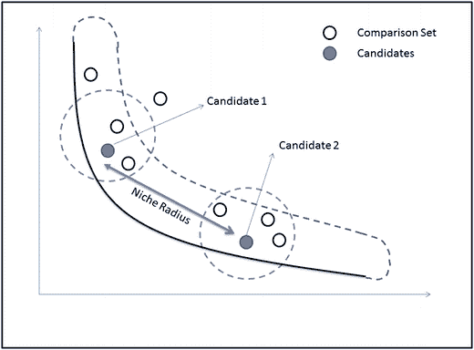

图 10-5.

等价类共享；候选解 1（小生境类计数 = 3）比候选解 2（小生境类计数 = 4）更优

MOGA 和 NPGA 存在类似的缺点：两种方法都对小生境半径（σ [share] ）的选择高度敏感。

### 非支配排序遗传算法

NSGA 是另一种基于帕累托的非精英主义方法，其与 SGA 的不同之处在于选择算子的使用方式。首先选择所有非支配解，并将其归类为种群中的第一非支配前沿。为了确定第二非支配前沿的成员，第一非支配前沿的成员将从评估过程中被剔除，然后对剩余种群继续搜索非支配解。这种在逐渐缩小的种群中进行层级剔除和非支配搜索的过程会持续进行，直到种群中的所有个体都被归类到某个非支配层级。非支配层级范围从 1 到 p。每个子种群类别的适应度根据种群规模按比例分配。属于较低非支配层级的解比属于较高层级的解具有更高的适应度。这种机制维持了选择压力，使得具有更高适应度（较低非支配层级的成员）的个体被选入交配池，从而朝着帕累托最优前沿的方向进化。

第一步，将等于种群规模的初始虚拟适应度分配给第一非支配前沿的个体。基于共享同一前沿和同一层级的相邻解的数量（针对给定小生境半径 σ [share] 的小生境计数），个体的适应度值会按小生境计数的因子进行缩减，并为该层级的每个个体重新计算一个新的共享适应度值。对于第二非支配层级的个体，分配一个小于第一非支配层级最低共享适应度的虚拟适应度。类似地，属于第三层级及所有后续层级的个体，其分配的适应度相对于较低层级的最低适应度呈递减顺序。这保证了属于较高非支配层级的个体的适应度始终低于较低层级的个体。此过程持续进行，直到整个种群中的所有个体都被分配了其共享适应度。一旦所有适应度值分配完毕，就应用与选择、交叉和变异相关的传统遗传算法过程。从数学上讲，该过程可以解释如下：对于具有虚拟适应度 f [p] 和小生境计数 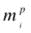 的 k 个个体，作为 p 个非支配层级的一部分，每个个体 i 的共享适应度可计算为

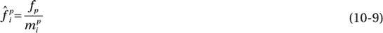

后续非支配层级中个体的虚拟适应度由下式给出

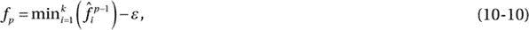

其中 ε 是一个小的正数。

NSGA 与此类别的其他算法存在相同的缺点：对小生境半径 σ [share] 高度敏感。

### 强度帕累托进化算法

SPEA 通过融合先前多目标进化算法实现的几个特征，实现了精英主义和非支配性。精英选择防止了优质解的质量在代际间退化。在其一种变体中，当前代的最佳个体会被不加修改地传递到下一代。

Zitzler 等人（2001 年）通过引用以下属性定义了 SPEA 的特征：

-   通过归档先前发现的非支配解，创建一个外部且持续更新的非支配种群集。在每一代，非支配解都会被复制到外部非支配集中。与其他进化算法不同，在 SPEA 中，种群内一个解相对于其他解的支配关系并不重要。
-   通过评估个体的适应度（基于支配候选解的那些解的强度），将步骤 1 中的外部非支配解应用于选择过程。
-   使用帕累托支配关系保持种群多样性。该进化算法不需要距离参数（例如小生境半径）。
-   结合聚类过程来修剪外部非支配集，同时不破坏其特征。

如前所述，该算法通过维护一个外部非支配种群集  来显式地实现精英主义。算法流程包括以下步骤：

1.  初始化大小为 n 的种群 P。
2.  初始化一个空种群 ，代表外部非支配解集档案。
3.  将 P 中的非支配解复制到 。
4.  移除  中被  的其他成员覆盖（或支配）的解。
5.  如果  中的解数量超过给定阈值，则使用聚类方法修剪 。
6.  计算 P 中每个成员的适应度以及 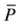 中每个成员的强度。
7.  从 P 和 （）的多重集并集中，执行二元锦标赛选择（有放回）以选择个体进入交配池。锦标赛选择通过在从当前种群（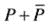）中随机选择的个体之间举行“锦标赛”来产生选择压力。每场锦标赛的胜者（适应度最佳的个体）被选入交配池。与平均种群适应度相比，交配池具有更高的平均适应度，这有助于建立选择压力，从而提高后续世代的平均适应度。
8.  照常应用特定于问题的变异和交叉算子。
9.  转到步骤 3，并重复（除非达到终止条件）。

####  解的强度

每个解被分配一个强度 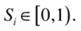 S [i] 与 i 支配的个体数量 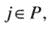 成正比。外部非支配集  中解的适应度由下式给出

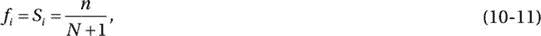

其中 n 是 P 中被 i 支配的个体数量，N 是 P 的总种群规模。

#### P 中解的适应度

解 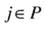 的适应度通过求和所有覆盖（或支配）j 的外部非支配解 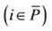 的强度来计算。集合 P 中解的适应度由下式给出

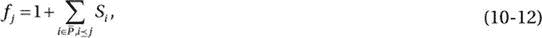

在适应度上加 1 是为了保持外部非支配解具有更好的适应度。由于适应度是求最小值，因此较低的适应度会导致被选入交配池的可能性更高。

#### 聚类

在 SPEA 中，外部非支配解集的大小 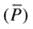 是算法成功的关键。由于它参与了选择过程，一个极其庞大的非支配解集可能会降低选择压力并减缓搜索速度。然而，种群中不均衡的分布可能会使解偏向搜索空间的某些区域。因此，需要一个剪枝过程来剔除外部非支配种群中的个体，同时保持其多样性。Zitzler、Laumanns 和 Thiele (2001) 使用了平均链接法 (Morse 1980) 来剪枝外部非支配解集。聚类步骤如下：

1.  初始化一个聚类 C，使得外部非支配解集中的每个个体  都是一个独立聚类的成员。
2.  计算所有可能聚类对之间的距离。设 d [m,n] 为两个聚类 c [m] 和 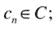 之间的距离，则 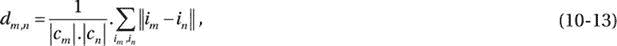，其中 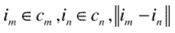 是两个个体在目标空间中的欧几里得距离，而 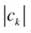 是聚类 c [k] 的种群。
3.  将具有最小距离 d [m,n] 的两个聚类合并成一个更大的聚类。
4.  在每个聚类集中，识别出与该聚类中所有其他个体平均距离最小的个体。
5.  循环步骤 2-4，直到达到允许的最大聚类数阈值 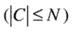。

SPEA 将精英主义引入了进化多目标优化。一个突出的优点是，该算法不像 MOGA 或 NSGA 那样依赖于小生境距离 (σ [radius] )。SPEA 的成功很大程度上取决于基于存档成员强度的适应度分配方法。在最坏的情况下，如果存档只包含一个成员，那么 P 中的每个成员都将具有相同的排名。聚类过程仍然是算法成功的关键考量。尽管该技术对于保持多样性至关重要，但它可能无法保留边界解，这可能导致非支配解分布不均匀。

### 强度帕累托进化算法 II

SPEA-II 是 SPEA 的增强版本。在 SPEA-II 中，主种群和精英存档中的每个个体都被赋予一个强度值 (S [i] )，表示它支配的解的数量，

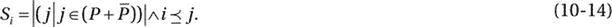

基于强度值 S [i] ，原始适应度值 R [i] 通过累加支配当前个体 i 的那些个体的强度来计算，

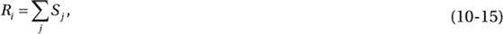

其中 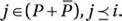

与 SPEA（其中适应度仅由支配存档成员的累积强度决定）不同，在 SPEA-II 中，适应度由存档和种群中支配成员的累积强度共同决定。由于适应度是最小化的，较高的适应度值意味着候选个体被大量个体所支配。

为了区分具有相同原始适应度得分的个体，SPEA 使用 k-最近邻 (k-NN) 方法 (Silverman 1986) 来估计每个个体的额外密度信息。这里，k 被计算为 P 和  合并样本大小的平方根。每个个体 i 测量、存储并排序其在目标空间中相对于存档和种群中所有其他个体 j 的距离。排序列表中的第 k 个元素（距离），按递增顺序排列，由 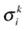 表示。密度 D [i] 由下式给出

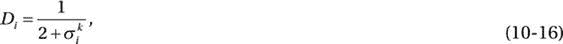

其中 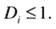

最后，将 R [i] (原始适应度) 和 D [i] 相加得到个体 i 的适应度，表示为

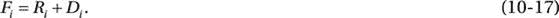

与 SPEA 不同，SPEA-II 在存档中维持恒定数量的个体。适应度评估完成后，下一步是将来自存档  和种群 (P [t] ) 的所有非支配个体复制到下一代存档 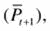 中

如果非支配解的数量小于阈值 N，则从先前存档  和种群 (P [t] ) 的排序列表中，将  个最优被支配解  移动到新存档  中。然而，如果非支配解的数量超过了阈值 N，则通过移除彼此之间距离最小的  个个体来进行截断过程。如果出现平局，则考虑第二小的距离，依此类推。

同样与 SPEA（其中使用二元锦标赛选择（有放回）从 P [t] 和  的多重集种群中选择个体进入交配池）不同，SPEA-II 仅从存档种群  中选择个体。

### 帕累托存档进化策略

PAES 是一种简单的多目标进化算法，能够生成多样化的帕累托最优解。它是一种单亲、单子的进化算法，类似于 (1+1) 进化策略。PAES 使用二进制表示和位变异算子来实现局部搜索并产生子代。位变异算子以固定概率翻转二进制编码解（染色体）的位（基因），从而创建新解。一个参考存档存储并更新在前几代中找到的最佳非支配解。最佳解是指在参数空间中支配其他解或位于较不拥挤区域且保持非支配状态的解。该存档用于对所有结果解进行支配排序。

首先，创建一个子代，并计算其目标函数。接着，将子代与父代进行比较。如果子代支配父代，则子代被接受为下一代的父代，并将其副本添加到存档中。如果父代支配子代，则丢弃子代，并从父代生成一个新的变异解。

如果父代和子代互不支配，则将两者与最佳解存档进行比较，以做出适当的选择。如果存档中的任何成员支配子代，则丢弃子代，并从父代生成一个新的变异解。如果子代支配存档中的任何成员，则子代被接受为下一代的父代，并删除存档中所有被支配的解。如果子代不支配参考存档中的任何解，则检查子代与存档中解的接近程度。如果子代位于参数空间中较不拥挤的区域，则它被接受为下一代的父代。子代的副本也会被添加到存档中。

PAES 算法包含以下步骤：

初始化一个父代，评估其目标函数，并将其添加到存档中。  
变异父代，生成一个子代，并评估其目标函数。  
比较父代和子代。  
如果父代支配子代，则丢弃子代，并转到步骤 2。  
如果子代支配父代，则接受子代为下一代的父代，并将其添加到存档中。  
将子代与存档中的成员进行比较。  
如果存档中的任何成员支配子代，则丢弃子代，并转到步骤 2。  
如果子代支配存档中的任何成员，则接受子代为下一代的父代，将其添加到存档中，并移除存档中所有被支配的解。  
如果子代不支配参考存档中的任何解，则检查子代与存档中解的接近程度；如果子代位于参数空间中较不拥挤的区域，则接受子代为下一代的父代。将子代复制到存档中。  
转到步骤 2，并重复直到达到预定义的代数。

### 基于帕累托包络的选择算法

PESA 是一种多目标进化算法，它结合了 SPEA 和 PAES 的特点。其区别在于算法中 PESA 使用基于超网格的拥挤方案来整合选择和多样性。与 SPEA 类似，PESA 使用较小的内部种群和较大的外部种群。外部种群存档现有的帕累托前沿近似解，而内部种群则包含竞争进入外部存档的新候选解。与 PAES 类似，为了保持多样性，PESA 使用目标空间的超网格划分来衡量外部存档中不同区域的拥挤程度。与 PAES 和 SPEA 一样，PESA 用于外部存档的解替换方案（存档最佳非支配解）基于拥挤度度量；然而，与 PAES（使用父代变异）和 SPEA（使用基于支配解强度的适应度度量）不同，PESA 中的选择方案也基于拥挤度度量。

PESA 算法使用两个种群集合：P [I] 代表内部种群，P [E] 代表外部种群（也称为存档种群）。PESA 的步骤如下：

将外部种群 (P [E]) 初始化为空集。  
初始化内部种群 。  
评估内部种群中的每个个体。  
更新外部种群存档 P [E]。  
将 P [I] 中的非支配解（相对于 P [I] 和 P [E] 中的任何成员）复制到 P [E] 中。  
移除 P [E] 中被新添加的 P [I] 非支配解所支配的解。  
如果 P [I] 的解既不支配也不被 P [E] 支配，则将该解添加到 P [E] 中。  
如果 |P [E]| 超过阈值，则从最拥挤的超网格中随机选择一个解进行移除。  
检查终止条件。  
如果达到终止条件，则停止；返回 P [E]。  
否则，  
删除内部种群 。  
重复（直到生成新的 P [I]）。  
从 P [E] 中较不拥挤的超网格（基于密度信息）中选择两个父代。  
基于交叉和变异创建新的子代。  
转到步骤 3，并重复。

PESA 中的拥挤方法形成一个超网格，将目标空间划分为超立方体。外部存档中的每个个体都与目标空间中的一个特定超立方体相关联。一个定义为挤压因子的属性表示位于同一超立方体中其他个体的总数。挤压因子通过从随机选择的解（来自外部存档）中挑选具有较低挤压因子的解来缩小解的选择范围。挤压因子通过选择代表性不足的种群成员，将搜索导向一个新兴的帕累托前沿。

挤压因子也用于调节外部存档的种群规模。当存档种群 |P [E]| 超过某个阈值时，从具有最大挤压因子的区域中随机选择一个个体进行移除。

### 基于帕累托包络的选择算法 II

PESA-II 是 PESA 的扩展，它采用了一种基于区域的选择方法，其中选择标准使用超立方体而非超立方体中的随机个体来满足。稀疏填充的超立方体比拥挤的超立方体更有可能被选中。一旦选择了单元格，该单元格内的个体将被随机选择参与交配和变异过程。尽管该算法计算效率高，但它需要关于目标空间的先验信息来调整网格大小。

### 精英非支配排序遗传算法

NSGA-II 通过一种使用拥挤距离来促进选择的拥挤锦标赛选择方案，改进了 NSGA 的非精英特性。在 NSGA-II 中，种群初始化后，种群中的个体会像在 NSGA 中一样进行非支配排序和排名。为了找到第一个非支配前沿，种群中的每个个体都会与种群中的其他所有个体进行比较，以确定该个体是否被支配。第一前沿中的非支配个体将从种群中移除，并放入临时（第 1 层）存储中。为了找到下一个前沿，对剩余的种群重复此过程。该过程持续进行，直到种群中的所有成员都被分配到一个前沿。在最坏的情况下，每个前沿只包含一个解。每个前沿中的每个个体都会根据其所属的前沿获得一个适应度值（或排名）；例如，第 n 个前沿中的个体获得的适应度为 n。此外，还会为每个个体测量拥挤距离。拥挤距离表示个体与其邻居的接近程度，这促使种群向更好的多样性发展。父代通过二元锦标赛选择，基于排名和拥挤距离进入交配池。非支配排序完成后，每个个体都会被分配一个拥挤距离值。

如果在锦标赛选择过程中比较两个解，则根据以下标准选择获胜解：

*   如果解属于两个不同的排名，则排名更好的解赢得选择。
*   如果解属于同一排名，则拥挤距离更大（或拥挤区域更小）的解获胜。

交配池填充完毕后，应用交叉和变异算子生成子代种群。为了实现精英主义，将父代和子代种群合并，并将合并种群中的非支配个体传播到下一代。NSGA-II 算法总结如下：

初始化

初始化一个大小为 N 的随机种群 P [0]。   通过创建非支配前沿对种群进行排序和排名。   根据种群的排名分配适应度。   使用交叉和变异算子创建大小为 N 的子代 Q [0]。

选择

每一代开始时都有一个大小为 2N 的合并种群 。   通过创建非支配前沿（F [1] (t), F [2] (t), F [3] (t),…,F [n] (t)）对种群进行排序和排名。   选择前沿 F [1] (t) 到 F [n] (t)，直到所选前沿的合并种群总和超过 N。   将所选前沿 F [1] (t) 到 F [n-1] (t) 的整个种群复制到下一代的交配池中。   按拥挤距离降序对最后一个所选前沿 F [n] (t) 的种群进行排序。   从最后一个前沿 F [n] (t) 中选择填充交配池 N 个位置所需的*最佳*个体。   交配池现在由前沿 F [1] 到 F [n-1] 的整个种群和前沿 Fn 的部分种群（按拥挤距离排序）组成，以创建一个大小为 N 的父代种群（交配池）。   使用交叉和变异算子创建 N 个子代。   转到步骤 5，并重复。

拥挤距离引导选择过程朝向均匀分布的帕累托最优前沿。第 i 个解 D[i] 的拥挤距离计算为对应于每个目标 m 的各个距离值的总和。在计算拥挤距离之前，每个目标函数都会被归一化。以下步骤总结了非支配集 I 中所有解的拥挤距离计算：

 解的数量   I = {0}将所有解初始化为 0 ---------[对于所有目标 k = 1 到 k = m]----------   I = Sort (I,k ) 按第 k 个目标排序    --------[对于 i = 2 到 i £ (l −1) ]-----------------------   

步骤 5 是一个递归操作，其中每个连续的迭代都会根据目标适应度评估已排序解的拥挤距离。步骤 5 会为每个目标适应度调用。这里，I[i].k 表示集合 I 中第 i 个个体的第 k 个目标函数值。拥挤距离是 m 维超空间中每个个体之间的欧几里得距离。边界上的个体总是被选中，因为它们具有无限的距离分配。为了确保精英主义，将当前代的子代和父代种群合并，以选择下一代的交配池。随后，通过非支配对种群进行排序。如图 10-6 所示，新的交配池种群是通过填充每个前沿 F [j]（从低到高）的种群生成的，直到种群大小超过父代种群的阈值大小。如果通过包含前沿 F [j] 中的个体，总种群超过了 N，则按拥挤距离降序选择前沿 F [j] 中的个体，直到达到大小为 N 的种群。至此，下一代的交配池创建完成。在图中，非支配前沿 F [1] (t)[,] F [2] (t) 和 F [3] (t) 被完全包含，而按拥挤距离排序的前沿 F [4] (t) 被部分包含在交配池 P(t + 1) 中。

图 10-6.

NSGA-II 过程：非支配前沿 F1[,] F2 和 F3 被完全包含在交配池 P(t + 1) 中；按拥挤距离排序的前沿 F4 被部分包含在交配池 P(t + 1) 中

## 示例：多目标优化

云计算使我们能够托管具有可变资源需求和服务级别目标或性能保证的工作负载。此外，云使我们能够高效地共享资源，从而降低运营成本。这些共享资源主要涉及计算、内存、输入/输出（I/O）和存储。资源的可变性会导致热失衡、资源过度或不足配置、性能损失以及可靠性问题。如果这些问题不加控制，其累积效应可能会增加数据中心的运行成本，并因计划外的配置和不可预见的需求而降低工作负载性能。高效数据中心管理的解决方案在于满足多维度的约束条件，这些约束条件可能具有动态性且相互冲突。环境压力会随时间变化，并产生资源压力，这些压力可能是全局性的或区域性的，从而形成动态约束，导致需要实现修正后的目标。

如图 10-7 所示，本例中的运行约束可分为四个目标函数：

图 10-7.

具有四个目标函数（与功耗、性能、温度和使用率相关）的数据中心多目标优化

*   降低热应力 (F [T] )：当一个或多个设备接近其节流限制，或相对于其他设备（或系统集群）产生热点或冷点时，就会发生热应力。可以通过调节风扇转速、输入气流或资源利用率来缓解热应力。
*   满足功耗目标 (F [P] )：功耗目标由外部管理代理根据公平使用和最大功率可用性设定。系统功耗目标可以通过资源利用率、风扇转速或托管不超出功耗需求且相对于其他核心上已运行的工作负载而言“无噪声”的工作负载来调节。
*   满足性能保证 (F [S] )：性能保证是由应用程序定义的用于衡量服务级别目标（SLO）的适应度矩阵。例如，查询响应时间是一种衡量标准，可以量化在单个系统或系统集群上托管时的服务质量。性能保证通过调节资源利用率或托管相对于其他核心上运行的工作负载而言“无噪声”的工作负载来实现。
*   满足资源利用率目标 (F [U] )：实施资源利用率目标是为了最大化单位机架空间内的服务器使用率，从而减少空闲时间。在某些情况下，调节资源利用率是为了提供服务保障或减少热热点。资源利用率的实施通常通过在不同核心上适当分配工作负载来实现，最终以最少的相互干扰（缓存、预取）或争用达到最高效的资源利用率。

多目标优化问题可以表示为这四个目标的函数，

其中 x 代表为满足热、功耗、利用率和性能约束而选择的值的参数。这些参数可总结如下：

*   风扇转速 (x [1] )
*   中央处理器（CPU）功耗限制 (x [2] )
*   内存功耗限制 (x [3] )
*   输入气流 (x [4] )
*   工作负载类型 ID (x [5] )
*   CPU 核心数 (x [6] )

这些参数 x = (x [1] , x [2,] x [3,] x [4,] x [5,] x [6] ) 调节资源的运行状态，这会导致环境和系统特定的扰动，这些扰动可能需要作为探索真正帕累托最优前沿或稳定系统的一部分进行修正。

## 目标函数

各个目标函数衡量解决方案的质量。多目标优化方法会在不同目标之间权衡性能。此处，使用进化算法寻求功耗、热、性能和使用率目标之间的适当权衡。公式 10-21 至 10-24 表示了这些目标的目标函数。每个目标都取决于参数（决策向量）的值，这些参数定义了搜索空间，以通过多个目标组合之间的权衡来满足多个目标的向量，

其中 T ^d 和 U ^d 分别是设备 d 的温度和使用率； 和  分别是各自的温度和使用率阈值；P 是整个系统的当前功耗；Q 是系统上运行的工作负载的服务级别协议（SLA）或性能评分。解 x 影响过程输出，由相应的函数  表示，这些函数进而影响目标函数的输出。（注意，在此上下文中，功耗和性能是系统特定的，而非设备特定的。）

解 x 通过操控决策空间的多个维度并预期所有四个目标之间的最优权衡而演化。例如，设置更高的风扇转速 (x [1]) 将改善冷却效果 (F [T] )，但会增加功耗，从而降低 F [P] 。类似地，CPU 功耗限制 (x [1]) 可以调节功耗，但会降低性能 (F [S] )。因此，进化算法的目标是综合出一个接近最优的解，该解试图满足所有目标固有的且常常相互冲突的约束。解决方案应反映在四个目标之间进行权衡时的最优决策。这些决策向量将特定工作负载匹配到特定系统，使得目标之间的冲突最小。额外的控制措施调节风扇转速、CPU 和内存功耗限制、输入气流以及额外 CPU 核心的分配（或取消分配）。

图 10-8 展示了为工作负载托管选择最佳计算节点（从大量节点中）的过程。

图 10-8.

使用多目标进化优化为工作负载托管选择节点

每当有新的工作负载被暂存到某个计算节点上时，都会对其进行指纹识别。此过程涉及将多维特征的独特属性与预先存在的数据库进行匹配。指纹识别关联资源利用模式并估算资源需求。群体智能作为一种机制，从数百个可能的主机节点中选出少数候选主机节点进行进一步评估。一些节点因提供足够无争用资源的可能性较低而被淘汰。一旦入围，候选节点便代表了能够承载传入工作负载的计算资源，尽管其资源处理能力各有不同。所有入围节点都会通过并行运行 MOEA 来评估其承载新工作负载的质量，旨在生成多个帕累托最优前沿，每个节点对应一个。选择对应最佳解决方案的节点来承载该工作负载。MOEA 通过衡量功耗、性能、利用率和温度的综合效率来评估解决方案（见公式 10-20），并迭代寻找代表最佳解决方案的权衡点。每当暂存队列中出现需要由某个计算节点服务的新工作负载时，此过程便会重复。

