# 11. 机器学习实战：示例

机器学习的一项突破将抵得上十个微软。——比尔·盖茨

机器学习是综合和解释数据模式与主动优化任务之间潜在关系的重要手段。机器学习利用了泛化的力量，这是通过人类学习形成概念过程中固有且必不可少的组成部分。学习过程构建了一个知识库，该知识库通过关键反馈得到强化，以提升性能。知识库系统收集一系列事实，并通过一个使用规则和逻辑来推导新事实或不一致之处的推理引擎对其进行处理。

随着越来越多的数据以非结构化形式进行数字化表达，人们正在探索新的计算模型来有意义地处理这些数据。这些计算模型综合了嵌入在非结构化数据中的知识，并学习特定领域的趋势和属性。更复杂的模型可以利用领域层次结构及相应的特定领域模型来支持决策系统。机器学习在自动化、扩展和集中化流程以挖掘知识方面发挥着重要作用，其方式之高效是传统统计方法难以企及的。

本章将介绍机器学习作为反馈控制系统主要组成部分的示例。我们将讨论机器学习在数据中心工作负载指纹识别、数据中心资源分配以及自组织网络入侵检测等相关领域的应用。这些示例展示了一个基于机器学习原理的智能反馈控制系统。此类系统可以在高可用性环境中实现自动检测、优化、修正和调优，同时促进智能决策。此外，这些系统会根据平台需求、新兴用例以及生态系统中可用知识数据的成熟度，进行自我演进和训练。目标是创建充当专家系统的模型，这些模型能够自动执行主动操作，如有必要，后续可对这些操作进行审查或修改。

传统系统使用一组属性来确定当前时间点的属性或行为。专家系统则利用机器学习来发现学习过程所导致变化的本质，并分析流程更好适应的背后原因。此类系统可以是历史决定型或状态决定型。状态决定型系统可以用连续时间间隔内状态之间的转换来描述（例如一阶马尔可夫链）。新状态由前一个状态唯一确定。为了适应环境，有机体在环境信息的引导下，必须管理其关键变量，通过操纵环境（通过有机体对环境的运动控制）迫使这些变量在适当的限度内运行，从而使其随后对变量进行适当的作用。

图 11-1 展示了一个通过使用模块化功能构建的自主系统，以实现智能反馈控制。机器学习在知识功能的建模中扮演着重要角色，该功能用于以结构化方式存储规则、约束和模式。利用现有结构的元素和新的学习成果，综合形成新的知识。集体知识构成了一个反馈控制回路，从而确保系统稳定且可行。支持智能反馈控制系统的辅助功能如下：

*   **感知功能**：感知内部或外部环境的任何变化（例如组件温度、功耗、利用率和异常行为）。
*   **运动功能**：通过改变系统元素来补偿环境干扰的影响，从而维持平衡。
*   **分析功能**：分析感知通道数据，以确定任何关键变量是否在可行的界限或限制内运行。
*   **规划功能**：确定需要对当前系统行为进行哪些更改，以使系统在新环境中恢复到平衡状态。
*   **知识功能**：包含可应用于新环境的一组可能行为。规划工具利用此知识选择适当的行动来消除干扰；运动通道应用所选行为。知识功能通过泛化过程进行综合，该过程可以是一项持续的任务，基于应用于现有模型的新数据，有效地开发更丰富的假设空间。

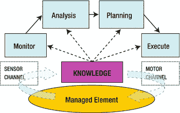

图 11-1.

作为构建自主架构基础元素的模块化功能

这些功能使得关键元素能够通过使用抽象的控制论描述（调节理论）来建模一个实际系统。这种描述抽象了一组能够接收、存储、处理和交换数据的相互关联的对象。控制系统可以通过控制对象和控制系统来表示。控制系统通过一组效应器将控制信息传输到受控对象。受控对象的状态信息通过一组感受器接收，并传输回控制系统，从而形成一个反馈回路。该反馈回路能够开发出一个自主系统，通过自适应调节来运行有效的控制系统。该模型包含以下五个必要且充分的交互子系统，它们共同构成了一个赋予系统生存能力的组织结构：

*   **基础设施**：与由管理流程控制的运营环境进行交互。
*   **协调**：促进策略数据的传播，以实现协作与协调。
*   **控制**：负责干预规则以及策略遵守、资源合规性、可访问性和责任。
*   **智能**：用于提前规划，以应对外部环境和能力的变化。智能有助于全面了解系统环境，并帮助系统制定替代策略，这对于适应不断变化的条件以保持系统生存能力至关重要。
*   **策略**：通过制定导致规划活动的策略功能，引导组织朝着有目的的目标前进。

## 可行系统建模

受控系统在其交互过程中可能表现出高度的动态性，从而导致不可预测的行为。可行系统建模提供了一个框架，该框架利用监控、控制和通信抽象，实现了协调、共同进化与生存能力。这种建模有助于系统在不断变化且不可预测的环境中生存；该建模旨在超越外部压力并适应变化性，同时能对任何意外刺激做出调整。你以这样一种方式抽象框架，使得使用模型中的可变性不会干扰系统在其可行限度内的稳定性。不可预测的行为、间歇性故障以及分散的知识会产生巨大的不确定性，这可能导致反应性或次优的决策，并使基于独立性和静态行为模型原则运行的传统编程范式失效。编程策略需要被构建出来，以利用动态策略来表征和优化运行时模式。这需要自主实例化能够响应动态变化的机制。此外，编程模型必须考虑到策略管理、激活机制、计算和运行时适应性之间的分离。隔离可以通过使用能够隐藏实现选择的抽象来实现。抽象建立了一个组件模型的通用视图，以通过通信语义实现互操作性。

智能反馈控制实现促进了适应性，它允许受控过程通过动态适应特定需求和条件，随时间改变其配置。适应性通常由规则引擎触发，原因是平台中某个资源出现故障或行为发生变化，并通过改变资源、组件或依赖关系的集合来实现。适应性的一个必要条件是保留现有语义，并具备重新配置和适应新环境的能力。这通过动态地添加、插入和拔出组件控制器来支持，从而添加或移除组件的功能方面。适应性的两类如下：

*   **功能适应性**：使组件的架构行为适应新的需求或环境。
*   **非功能适应性**：使容器的非功能架构适应新的需求或环境（例如，安全策略或通信协议的变化）。

适应功能需要具备识别具有以下特性的动态变化模式和行为的能：

*   评估何时以及进行多大程度适应的能力。构建启发式规则来识别需要重新配置的适当条件。反应性的重新配置或调整很容易导致振荡。此外，重新配置的程度取决于特定于应用的优化函数（也称为成本函数），该函数针对给定策略进行最大化。
*   一个加权成本函数，用于在多个目标函数竞争适应性时评估特定目标的重要性。
*   低延迟的成本函数评估与优化，以满足实时处理控制功能的需求。
*   识别并解决由竞争性目标导致的资源冲突和振荡的能力。
*   记录资源属性和行为模式的能力，以帮助为未来的优化和冲突解决建立合理的推理过程。

通过模式识别进行知识综合起着关键作用，它对随时间重复出现的多种行为趋势进行建模。这些模式对于主动分析很有吸引力，通过关注最重要的活动，为监控和分析过程铺平了道路。模式分析通常用于确定工作流行为以及相关动作之间的对应关系。模式分析也用于预测更有可能产生所需策略合规性的选择，从而支持从一组可能的候选方案中选择要激活的最佳行动。框架执行模型负责收集两类信息：工作负载执行期间记录的原始数据，以及从原始数据派生并经过综合以描述行为模式的已处理数据。

图 11-2 概念化了一个服务器系统的适应性框架，其中子功能组件被隔离成离散且独立的模块。监控功能监控性能参数和相应的资源利用率。这些信息被记录到知识库中，该知识库追踪资源利用率与各种性能属性之间的关系。漂移检测器评估测量性能与期望性能之间的偏差。偏差（正向或负向）会触发对成本函数以及资源控制模块的修正。成本函数操纵适应度方程的相对系数，而资源控制机制则基于理性推理和模糊逻辑重新评估资源分配。这个过程持续进行，直到所有目标都得到满足。

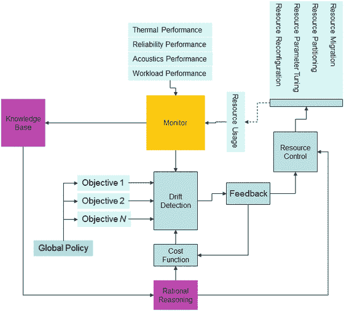

图 11-2.

服务器系统的适应功能；基于反馈，成本函数模块重新评估函数权重，而资源控制模块则重新评估资源分配

## 示例 1：计算节点上的工作负载指纹识别

近年来，数据中心的功耗急剧增加，控制服务器的电力消耗变得至关重要。为了开发高效的服务器，服务器平台需要在线表征，以确定平台参数，从而对各种系统特性进行所需的调优，因为这些特性之间存在复杂的依赖关系。事实证明，通过从工作负载观察中获得的洞察力进行反馈导向的服务器优化，比静态配置更为有效。服务器处理器和芯片组会暴露一些可通过软件配置的裕度和范围限制，这些被称为控制参数，可以通过调整它们来实现功耗与性能之间的平衡。其中一些参数由平台的基本输入/输出系统（BIOS）在启动时一次性设置，并在整个运行期间保持静态。启动时的一次性配置使得系统无法响应负载变化。

这里给出的示例描述了一种使用机器学习算法的动态表征技术，该技术根据运行时程序阶段确定调优值。一个自校正的工作负载指纹码本可加速阶段预测，从而实现持续且主动的调优。诸如内存和处理器电源状态等参数，可以根据观察到的需求变化，由操作系统或硬件模块动态设置。然后，自主系统会根据用例情况，权衡系统裕度以获得功耗或性能优势。主动调优使系统能够提前进行自我调整，并避免了被动响应系统所特有的响应延迟特性。各种机器学习技术，如聚类、分类器和离散阶段预测器，被应用于从处理器子系统收集的数据中。此外，在考虑以最低计算成本实现外推效率的同时，确定合适的算法和操作也至关重要。

性能监控单元通过硬件计数器促进对细粒度事件的测量。这些计数器允许应用程序分析器揭示应用程序随时间变化的阶段行为，这些行为在其生命周期内以定义的模式重复出现。一个程序阶段可以描述为时间上的一个不连续点，在该点，可观察到的特征变化足够显著，以至于引起同样可测量的系统影响变化。已知阶段的阶段特征和概率序列被表示为指纹。指纹有助于在数据中心内的一组服务器中实现负载均衡、热控制和资源分配的主动模型。学习过程中采用的步骤可总结如下：

在服务器系统中执行工作负载。  
识别相关的过程控制参数，并将其与过程目标（工作负载吞吐量、服务器功耗、热变化等）关联起来。  
综合阶段和阶段序列的属性。  
构建阶段预测模型，以预测工作负载的未来行为。  
主动调整系统控制参数。

工作负载指纹识别允许主动自调优，它通过学习操作工作负载阶段与相应应用程序行为之间的潜在关系，避免了反馈与控制（或被动控制）之间的延迟，从而促进了在不断变化的环境中的动态适应。理解应用程序行为也是推动多项新架构特性（如内置内存电源控制、热节流、睿频加速、处理器缓存大小自适应和链路配置）的关键洞察来源。构成决策空间的特性特定控制，通过多目标协调调优过程，被动态调整以适应当前和未来的阶段，从而实现全局最优结果。传统上，过程的决策空间由控制参数定义，这些参数基于对运行知名基准测试收集的数据进行离线经验分析并建立平均情况而获得的洞察进行调优。然后，这些控制参数由系统 BIOS 在启动时静态编程设定。一种更好的方法是，利用一种基于智能反馈的自调优过程的机器学习方法，动态编程由主动模拟综合出的参数值。

### 阶段确定

使用经过充分验证的基准测试工具作为近似真实工作负载行为的模型是相当常见的做法，因为它们具有有限的完成时间，同时展现出独特的资源使用模式。研究人员根据要实现的目标，以多种方式定义和扩展了程序阶段。本示例将程序阶段定义为执行过程中一个可变的时间间隔，在该间隔内，一组可观察的特征表现出空间均匀性和独特性。该示例使用了一种多变量阶段确定技术，该技术由多个既可从外部观察又与平台控制变量相关的主导变量组成。测量变量 m [i] 是在运行一系列引导工作负载时，从硬件计数器中获得的性能事件值。这个初始数据集 M 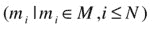 的元素构成了阶段模型的基础。

选择 N 个变量进行测量的动机源于研究目标。特征选择过程通常应用于大型数据集，以过滤掉相关性并大幅降低后续阶段算法的计算复杂度。为了提高分类器的准确性和效率，会应用诸如基于相关性的特征选择（CFS）算法等特殊工具来降低数据集的维度。CFS 是一种最佳优先搜索启发式算法，它对子集而非单个特征进行排序。该算法通过计算特征-类别和特征-特征矩阵，过滤出能有效预测类别的特征，同时考虑子集中特征间的相互关联程度。CFS 选择的特征与参考类别具有高度相关性，但会移除冗余变量。给定一个由 k 个特征组成的子集 S，其启发式得分如下所示：

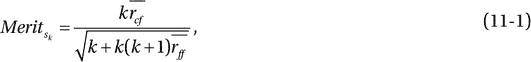

其中 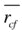 是平均特征-类别相关性，而 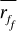 是平均特征-特征相互关联性。

CFS 将测量变量集 M 转换为缩减后的变量集 D，得到 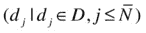，D = CFS(M)，以及 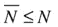。下一步是使用选定的特征构建阶段模型，并应用简单的 k-means 算法对不相关的变量实例进行分组。k-means 算法是一种无监督机器学习算法，它将输入集划分为 k 个簇，使得每个观测值都属于具有最近均值（欧几里得距离）的簇。k-means 算法的目标函数可以表示为：

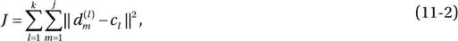

其中 c [l] 是所选簇 l 的质心，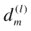 表示第 l 个簇中的第 m 个数据点。您将每个簇视为一个阶段 φ。本示例中，k = 5，生成的模型包含 12 个过滤后变量的均值和标准差（见图 11-3）。

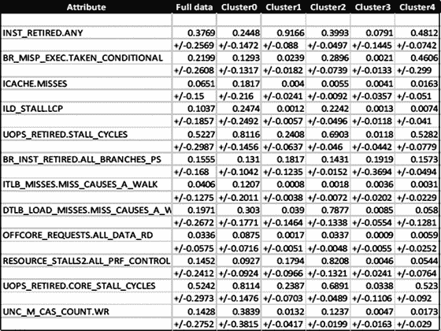

图 11-3.

阶段模型：簇均值和标准差

一旦阶段模型训练完成，就可以针对后续运行的工作负载数据进行测试。来自相关机器学习算法类别的分类器算法可以生成一棵树、一组规则或一个概率模型，以快速识别正确的阶段。一个例子是使用簇数据训练后，从决策树分类器算法获得的树表示，如图 11-4 所示。该分类器在阶段识别中达到了约 99% 的准确率。

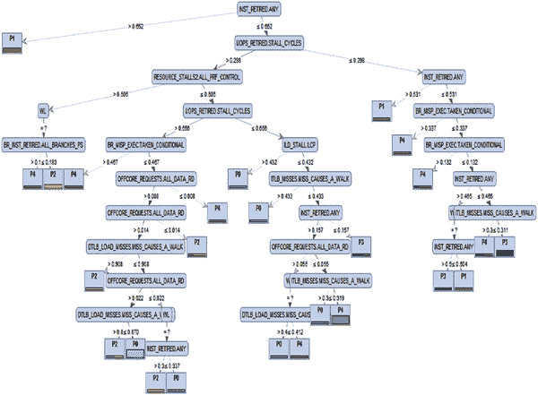

图 11-4.

模型的决策树表示

由 37 个工作负载组成的初始训练数据集产生了五个簇，每个簇代表一个工作负载阶段（见图 11-5）。在每个阶段中，12 个主导特征展现出多样化的变化模式，其中至少有一个特征是主要预测因子。如前所述，分类器树可以使用特定于特征的阈值来识别阶段转换。

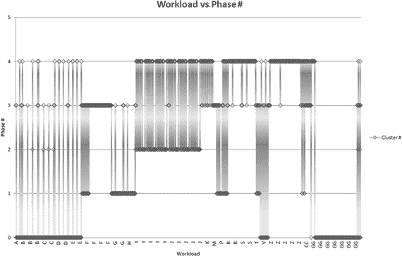

图 11-5.

各种工作负载的阶段转换图

图 11-6 显示了工作负载-阶段边界，在四个工作负载中发现了七个簇。每个工作负载都由其独特的阶段组合来表征。一旦工作负载被识别，就会根据其资源利用率和时间序列模式进行阶段特征化。工作负载 3 主要由阶段 7 组成，而工作负载 1 则是阶段 3、5 和 6 的复杂混合体。这些阶段揭示了在任何给定时间点特定于某个工作负载实例的特征。

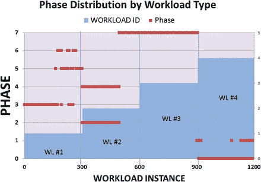

图 11-6.

工作负载与阶段依赖关系图；一个工作负载可能与其他工作负载共享阶段特征，并且可以包含一个或多个阶段

### 指纹识别

工作负载在多种约束条件下运行时，会经历不同的执行阶段。这些约束与功耗、热量产生以及服务质量（QoS）要求相关。由于在功耗和性能参数调优方面存在多种自由度，最佳系统运行涉及复杂的选择。该过程包括建模方法、实现选择以及动态调优。指纹识别作为一种关键特性，能够捕捉动态自适应系统随时间变化的行为。此能力被用作一种统计输出，有助于在需求变化之前重新配置硬件和软件，并使得针对重复出现的阶段能够复用已训练的模型。模式检测还有助于在工作负载执行期间预测未来阶段，从而避免对工作负载行为变化做出被动响应。

作为工作负载指纹识别过程的一部分（见图 11-7），在给定时间间隔内收集、分类并聚合各个性能特征，以建立代表现有工作负载或工作负载集合的模式。系统控制代理，例如 I/O 调度器、电源分配和动态随机存取存储器（DRAM）页面策略设置，可以使用这些信息来实时调整其参数或调度工作负载。指纹识别大致可以通过三个属性来描述：规模、阶段和模式。机器学习过程通过在一段有限时间内测量或数据挖掘性能特征，来促进这些属性的综合。通常，特征选择过程允许将性能矩阵与独特工作负载行为的出现自动关联，从而有助于快速诊断和主动调优。指纹数据可以与简单的统计函数（如优化、可视化或控制理论）相结合，以创建强大的操作员工具。此外，指纹有助于遏制对一个或多个指定服务级别目标（SLO）的持续违反，这涉及执行主动操作以使系统恢复到符合 SLO 的状态。

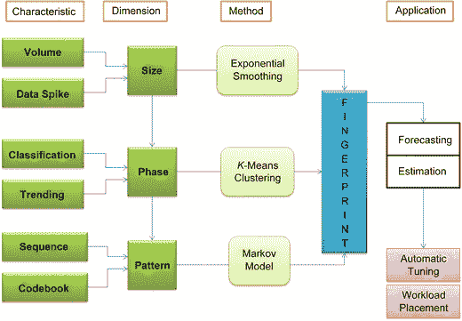

图 11-7.

工作负载指纹：一种可量化的表征形式

#### 规模属性

规模属性在资源的主动预配置中非常有用。利用规模维度可以回答以下问题：

*   分布的形状是怎样的？哪些资源比其他资源更受欢迎？是否存在显著的尾部？
*   在峰值期间，对热门对象组的访问在空间局部性方面表现如何？

#### 阶段属性

阶段代表了一个独特属性，用于表征正在进行的进程的行为。在此示例中，阶段展示了独特的功耗、温度和性能特征。如前所述（参见“阶段确定”一节），此示例采用简单的 k-means 算法，以聚类形式综合出排他性行为，这些聚类被表示为阶段。一旦所有相关的特征向量被识别出来，就会执行此过程。这些向量是以资源使用形式直接或间接反映独特行为的观测值。这些阶段是压缩后的代表性输出，可以与任何其他统计参数结合使用来预测行为。阶段的序列可以被视为模式。模式代表了工作负载独特的时变特性。图 11-8a 展示了一次工作负载执行期间的阶段序列。图 11-8b 显示了该阶段序列的编码表示。

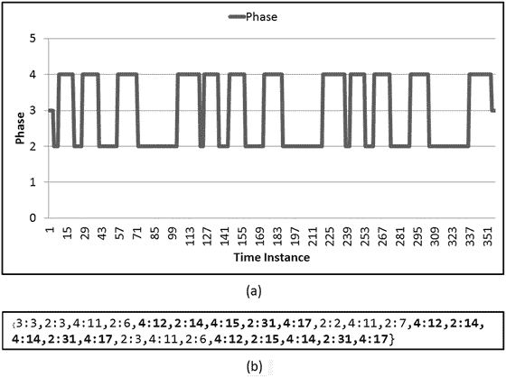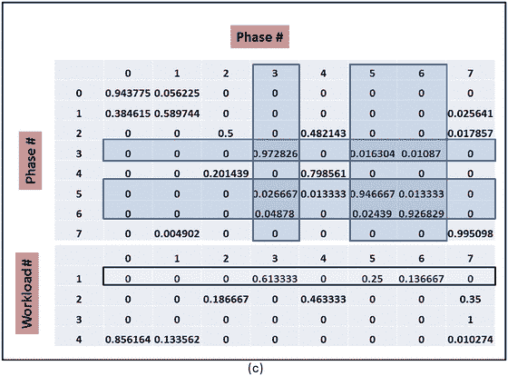

图 11-8.

(a) 测试工作负载阶段，(b) 游程编码阶段序列，以及 (c) 阶段转移似然矩阵和工作负载-阶段依赖矩阵；工作负载 1 的阶段依赖关系已高亮显示

#### 模式属性

模式被定义为重复出现的阶段序列。一旦识别出一个序列，就可以用它来预测未来的阶段以及当前阶段的持续时间。在时间序列操作中，你为时间序列模式数据库构建词汇表。词汇表中的每个字母由工作负载的运行阶段表示。该阶段以固定长度间隔 (T) 进行测量。模式矩阵可以表示为 M [ij] ，其中 i 代表模式，j 代表该模式的频率。随着新模式的识别，它们会被更新到模式矩阵中，而旧的、不频繁的模式则会被弃用。你可以使用离散时间马尔可夫链（DTMC）（见公式 11-3）来识别变化阶段的时间序列序列中的潜在模式，

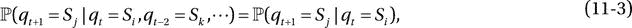

其中 q [t] 代表当前状态，S [i] 代表运行阶段之一。在此模型中，状态转移（阶段变化）遵循马尔可夫性质，然后基于用于预测的学习模型，在状态（阶段）之间创建转移。你可以使用移动窗口来监控实时数据，并为最近观测到的数据生成一个自回归模型，然后将其与学习到的马尔可夫模型的状态进行匹配。如有必要，该模型还会进行修正以适应变化。通过追踪从一个阶段到另一个阶段的时间序列演进，你可以构建马尔可夫模型的转移函数（见图 11-8c）。

### 预测

工作负载预测模块检测工作负载的趋势，并对未来的工作负载量进行预测。如果目标工作负载表现出强烈的周期性行为，则可以将历史预测纳入工作负载预测中。这使得策略决策能够提前主动应对工作负载峰值。这也有助于你利用云计算提供商提供的异构计算和 I/O 资源。此外，基于提取的模式，你可以以创建不同性能模型的方式来分配工作负载。

## 示例 2：动态能量分配

近年来，控制服务器设备所消耗的电量已变得日益重要。在电力治理中，三类行动的准确性与敏捷性至关重要：

*   选择哪些硬件元件必须以何种速率运行，以满足软件的性能需求
*   评估达到这些速率需要消耗多少电力
*   根据计算需求的变化调整电力支出

观察工作负载的变化如何影响不同服务器组件的功耗，能为分析以及构建将服务质量（QoS）预期与功耗关联起来的模型提供关键数据。下一个示例描述了一个在英特尔至强服务器上实现自主功耗控制的过程中，所涉及的观察、建模与纠偏流程，该服务器在执行数据库查询工作负载时需满足不断变化的响应时间与吞吐量需求。该流程始于系统内一组分布式物理与逻辑传感器所允许的细粒度功耗性能观察。这些观察数据用于训练工作负载各个阶段的模型。一旦训练完成，系统功耗、吞吐量和延迟模型便会参与优化启发式算法，该算法重新分配电力，以最大化服务器的整体每瓦性能。

“功耗优化”一词指的是在应用层面瞄准并实现高水平功耗归一化性能的行为。对于软件应用（例如业务交易服务或内容检索服务），重要的性能指标包括已处理请求的数量（吞吐量）以及每个请求的周转延迟（响应时间）。优化功耗涉及多种动态权衡。通常，一个系统可以表示为一组组件，这些组件通过协同交互产生有用功。这些组件可能是异构的，或者面临异构负载，并且它们的功耗和功耗控制机制可能各不相同。在任何组件层面（例如处理单元或存储单元），都需要根据该组件的速度在程序整体执行速度或速率中是否扮演关键角色，持续地增加或减少其功耗。特别是，不同的应用阶段对组件速度的敏感度可能不同。例如，与 CPU 密集型执行阶段相比，内存密集型执行阶段受中央处理器（CPU）频率缩放的影响较小。由于大多数现代处理器都采用了执行重排序技术，程序从乱序执行中获益的程度会因阶段而异。此外，新工作到达系统的速率会发生变化，因此，程序为满足特定服务水平预期而必须达到的整体执行速度也会随时间变化。因此，所需的功耗性能权衡必须持续进行。

可以说，鉴于当今系统中普遍存在的自我纠正和自我调节特性，由软件驱动的功耗性能优化可能并无必要。例如，在功耗控制算法中，CPU 和 DRAM 会在低活动期间转换到较低频率或超低功耗模式。尽管电路级自我调节在将组件转换到低功耗状态方面非常有益，但软件需要掌握策略控制权，以决定应减少哪些活动以及何时减少，从而促进硬件向省电模式转换。

在负载较轻的服务器上实现节能是一项精细的任务，很难委托给基于硬件的固定方案。服务器通常配置为以尽可能低的延迟处理高流入率的工作请求。因此，服务器拥有多个 CPU 和大量物理内存的情况并不少见，在需求高峰期和低谷期，计算任务和数据在这些资源上广泛分布。由于活动的分布式特性，减慢单个 CPU 或 DRAM 的速度可能会产生不可预测的性能影响；将服务器的一部分推入超低功耗运行状态可能会适得其反。在另一个极端，当功耗接近饱和水平时，硬件难以确定或强制执行关于哪些软件活动可以容忍性能下降、哪些必须保持原样的决策。

因此，软件必须与硬件共同承担决定何时以及在哪个组件上可以节省功耗的责任。在此，我们考虑一种用于对服务器配置的功耗性能权衡进行细粒度控制的自主解决方案。该解决方案包含用于观察、分析、规划和控制的要素，旨在根据指定为 SLO（服务水平目标）的应用级性能目标，动态地管理电力支出。该方案使用一个随时间变化的数据库查询工作负载，其中学习机器同时改变对 CPU 和 DRAM 的电力分配，并通过服务器中的一组分布式物理和逻辑传感器收集性能和功耗读数。通过这些观察，为工作负载的各个阶段训练模型。基于这些模型，优化启发式算法重新分配电力，以最大化服务器的整体每瓦性能。实验测量表明，该启发式算法能够根据性能目标的需要或允许，改善性能和功耗。

### 学习过程：特征选择

学习过程的主要作用是识别总功耗（P）与两个性能指标——响应时间（R）和吞吐量（T）之间的关系。这些关系被综合成模型，优化技术则利用这些模型来实现更好的能效。泛化过程需要一个分类器，该分类器输入一个离散特征向量，并输出一个运行阶段，其过程可概括如下：

*   主要组件（CPU 和双列直插式内存模块 [DIMM]）的多个电源轨上，经过精细时间对齐的组件级功耗读数
*   与三个量对应的系统级读数，每个量都在一个短时间间隔内取平均值：(1) P，系统总功耗；(2) T，应用级吞吐量；(3) R，请求所经历的响应时间

组件级功耗读数与 {P, T, R} 元组对齐。然后，整个数据集合被用于将 {P, T, R} 空间划分为多个类别（阶段）。在每个类别或阶段内，一个线性函数可以将 P、T、R 与组件级功耗读数关联起来。这些线性关系用于优化规划，其目标可能是在 R（响应时间）不超过特定阈值的前提下，最小化 P（系统总功耗）或最大化 T（应用级吞吐量）。学习过程在线持续进行。因此，随着工作负载的变化，模型和优化规划也会相应调整。

可以采用支持向量机（SVM）技术将 {P, T, R} 空间划分为不同阶段，并获取在每个阶段内支配 {P, T, R} 变量的线性关系。如前所述，SVM 是一种计算高效且功能强大的技术；由 Boser、Guyon 和 Vapnik（1992 年）发明，广泛应用于各类机器学习问题中的分类和回归。给定一组将训练输入与输出关联起来的数据集合，SVM 是一个能够完成以下任务的数学实体：

SVM 描述了一个（在某个更高维度上的）超平面，该超平面在输入空间中的投影将输入划分为等价类，使得给定类别中的输入具有一个线性函数，该函数将其映射到对该类别而言独特的输出。其投影为 SVM 的超平面，在考虑一个软间隔的前提下，最大化其与每个类别中最近样本之间的距离，从而最大化类别间的距离。SVM 创建了一个软间隔，允许存在有界的分类误差，即本应位于投影一侧的一小部分输入，反而被放置在另一侧的有界距离内（因此被错误分类）；这个间隔允许在类别间高度分离（即更好的区分度）与避免过多异常值之间进行实用的权衡。

公式 11-4 将 {P, T, R} 的每个元素表示为每个处理器内五个功耗读数的线性函数，该函数适用于每个给定的类别或阶段。其中 (V [CPU] ) 表示进入处理器的功率，V [DIMM] 测量连接到处理器并由其控制的内存模块中的功率。变量 J 代表一个给定的类别，{P J,R J,T J} 代表训练集中编号为 t 的样本的一个元组，与该样本相关的各种功耗读数由 V*(t) 表示。阶段 J；常数 K* [P] 、K* [R] 、K* [T] ；以及系数 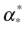 和 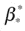 均通过 SVM 回归技术进行估计。

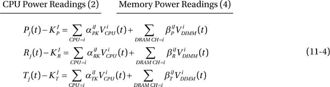

### 学习过程：优化规划

能源和性能模型具有多个自由度以及相互冲突的目标，难以共同优化。例如，考虑以下目标：

*   每瓦最佳性能
*   保持在功耗限制内
*   响应时间 ≤ 服务水平协议（SLA）阈值

这些目标之间可能会出现冲突，需要考虑诸如以下问题：

*   如何在系统功耗预算内获得给定的吞吐量
*   如何在响应时间阈值下获得给定的吞吐量

在通常情况下，P（系统总功耗）受到吞吐量和响应时间这两个性能目标的影响。同样在一般情况下，性能受到处理器和 DIMM 模块两者功耗的影响。因此，优化规划必须努力实现一个复合目标：在这个目标中，为实现一个目标而消耗的功率通常是以牺牲另一个目标为代价的。一旦为功耗、吞吐量和响应时间合成出线性估计模型的系数，这些模型就可以通过一个反馈控制回路，在多目标优化中用作合成反馈。此示例使用自适应加权遗传算法（AWGA）方法，在具有多个目标的场景中搜索全局最优解。在这种机器学习技术中，成功的结果被定义为以这样一种方式重新分配功率，使得功率、响应时间和吞吐量的倒数都满足可行的限制。更一般地，一组适应度函数 {f [n] }（每个目标 n 对应一个）决定了候选设置（即描述组件间功率分布的向量）对于每个目标的最优性。在 AWGA 中，对于候选设置 {x} 的种群 f，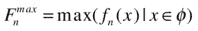 ) 和  = min(fn(x)|x 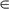 f)，你分别计算一组 n = 1, 2, . . . , N 个目标中每个目标的适应度边界，其中 f 中的每个 x 都是一个向量，其适应度函数代表组件（如 CPU 和 DIMM）之间一种可行的功率分布。然后，你可以选择一个 N 目标适应度函数 F 来评估一个聚合的适应度值。例如，在 AWGA 的情况下，F 可以选择为

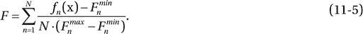

进化算法（EA）从给定代数的 f 中选择父代（通常采用精英策略，允许当前代的最佳解原封不动地传递到下一代），并从中产生功率可行的子代，作为下一代的新候选解。在目标空间中，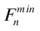 和  代表每一代都会更新的极值点。作为极值点，适应度边界 {(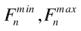)|n = 1, 2, . . . , N} 在每一代都会更新，并且每个目标的贡献（权重）也会相应更新。

### 学习过程：监控

要实现能效性能并遵守功耗与性能约束，需要实时反馈控制。自主系统通过持续基于反馈的纠偏机制来实现，具体包含以下功能：

*   **监控基础设施**：用于采样或量化物理及逻辑指标（如功耗、温度、活动率），并获取指标的统计矩
*   **分析模块**：用于提炼被监控量之间的关系（例如功耗、温度与性能之间的关系），并判断一个或多个运行目标是否面临风险
*   **规划单元**：用于制定行动方案，例如暂停、恢复、加速或减速系统的各个部分，以实施特定的策略选择（例如限制功耗或能耗，或提升性能）
*   **执行能力**：用于执行已制定的计划，从而控制系统的运行

通常，知识库会辅助分析与规划。知识库可以是一个信息存储库，用于编录每个系统状态下允许执行的操作；也可以隐含在分析、规划和控制能力的逻辑中。在专为可扩展性设计的系统中，知识库通常包含一种自适应机制，用于跟踪并从先前的决策和结果中学习。对于智能反馈控制过程而言，细粒度且低侵入性的功耗性能监控是自适应电源管理基础设施的关键要素。理想的监控机制应能实时运行（即报告尽可能新的数据），且不受被监控行为的影响。在此配置下，操作系统和软件层面的逻辑传感器可提供近乎实时的信息流，包含常见系统调用、存储访问和网络传输的速率。这些逻辑传感器通过物理传感器补充了功耗感知能力。

遥测总线用于从物理（硬件）和逻辑（软件）传感器收集数据，并将其发送至监控代理。具体而言，功耗感知是通过感测每个处理器芯片的电压调节器（VR）输出来实现的。接收遥测数据的监控代理会对数据进行处理，将其组织成时间对齐的功耗与性能统计流，并将该流传输至远程机器以进行进一步存储或分析。监控基础设施提供了获取每个处理器独立功耗读数的能力。每个处理器控制着独立的内存通道，每个通道包含多个 DIMM；每对内存通道提供一个 V[DDQ]信号；将这些 V[DDQ]读数相加即可得到每个处理器在内存子系统中的功耗。这些传感器收集的数据会通过一系列转换进行精炼（见图 11-9）：

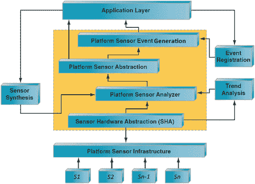

图 11-9.

传感器网络模型：传感器网络分层架构（S1, S2, ..., Sn）代表平台传感器（CPU/DIMM 功耗、温度、性能等）。来源：平台自主性愿景：系统鲁棒框架（英特尔，2011）

*   **传感器硬件抽象（SHA）层**：该层与传感器及通信通道交互。它采用自适应采样，使得测量仅在必要时进行，并消除冗余。
*   **平台传感器分析器**：该层去除噪声并分离趋势，从而更容易将近期和历史数据作为输入纳入后续处理。
*   **平台传感器抽象层**：该层提供编程接口，通过在其上层实现的控制程序，灵活处理已分析的传感器数据。
*   **平台传感器事件生成层**：该层使得生成信号成为可能。信号促进了控制程序之间基于事件的对话，从而允许将进一步的控制托管在分布式容器集（例如本地或远程控制器软件及操作系统模块）中。前述的逐步精炼过程弥合了传感器产生的原始数据与软件模块能够接收并进一步分析的处理后、有序的性能与功耗读数及警报流之间的差距。

虽然可以轻松为机器配备计量电源来感知总功耗，但要实现细粒度功耗分解的仪器化能力则需要付出相当大的努力。此外，在生产机器中添加大量物理功耗传感器，从成本角度而言既无必要也不切实际。现代机器中的事件计数能力提供了一种强大的替代方法，可在直接测量不切实际时估算组件功耗。对于近期 CPU，一种简单而准确的功耗估算方法是基于使用情况和电源状态驻留时间，使用训练好的模型进行预测。通过包含执行配置文件（这些文件捕获指令落入单指令多数据流（SIMD）、加载/存储、算术逻辑单元（ALU）等少数类别中每一类的比例），可以使此类训练更加准确。DRAM 功耗同样可以根据缓存未命中次数，或在内存控制器处计数并通过处理器事件监视器跟踪的 DRAM 操作来估算。DRAM 功耗估算允许以 DIMM 粒度测量 DRAM 能量，其精度足以实现对 DRAM 电源状态的有效控制。对 DRAM 能量的有效控制不仅使我们能够降低硬件基础设施成本，还能通过减少为补偿低估而必需的防护带来提高能效。此外，也可以减少高估，以避免性能下降。

通过进程控制方法可以获得便于在竞争组件间进行最优功耗分配的决策空间，在这些方法中，特权软件可以修改其功耗。第一种方法（常用于基于英特尔的处理器）是更改 P 状态和 C 状态（Siddha 2007）。第二种方法是使用一种称为运行平均功率限制（RAPL）能力的控制机制，更改 CPU 和 DRAM 模块的平均功耗水平。CPU RAPL 提供了接口，用于为特定时间窗口设置功耗预算，并让硬件满足能量目标。将功耗限制指定为时间窗口内的平均值，使我们能够表示物理功耗和热约束。特权软件可以通过向接口寄存器编程设定所需的平均功耗水平来使用 RAPL 能力，硬件则可在可编程控制窗口内通过自身的修正频率调整来引导处理器达到该水平。窗口大小和功耗限制的选择，使得无论是在单机层面还是数据中心层面，对机器功耗的修正都能快速进行。实践中，窗口大小可在毫秒到秒之间变化——前者用于满足供电约束，后者用于管理热约束。RAPL 概念也扩展到了内存系统，这得益于在英特尔平台的几个最新版本中，内存控制器被集成到了每个多核处理器中。尽管 CPU 和内存能量可以单独调节，但可以构建一种协调的自整定方法，其中功耗调节是联合优化函数的一部分，该函数由下一节讨论的机器学习技术支持。

## 模型训练：流程与评估

在模型训练过程中，数据收集模块从电力监控传感器收集时间对齐的读数。此外，它还从数据库性能模块收集响应时间和请求完成率。这些读数提供了输入-输出训练向量 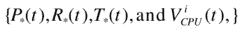（参见公式 11-4）。训练数据通过两组变量的笛卡尔积获得：

*   **需求变化**：此参数控制工作负载驱动器中多个线程在完成上一个请求与发出新请求之间的等待时间。
*   **供给变化**：此控制改变 CPU 和内存的 RAPL 设置，从而改变 CPU 和 DRAM 的供电量。

在此示例中，工作负载使用从 0 到 100 变化的时变思考时间。对于每个思考时间，CPU RAPL 限制在 20W 到 95W 之间变化。然后，基于这些数据的 SVM 模型训练用于将数据分类到不同的阶段 (J)，随后评估每个阶段的 SVM 模型参数 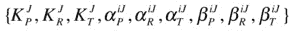。

基于 SVM 的分类将数据分解为三个阶段，如图 11-10 所示。

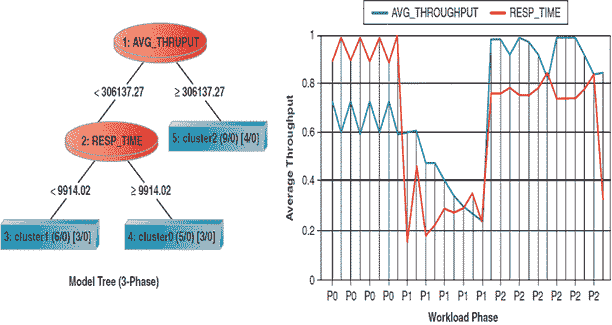

图 11-10.

模型树描绘了以吞吐量和响应时间为特征的工作负载中的三个阶段（P0、P1、P2）

相应地，公式 11-4 中的三组不同的建模参数（即 J = 0、1、2）将 CPU RAPL 参数与总系统功耗、吞吐量和响应时间结果关联起来。图 11-10 展示了基于公式 11-4 中 RAPL 参数估算的总墙功耗与实际测量值的比较情况。图 11-11 和 11-12 说明了训练中估算结果与测量结果之间的高度一致性。

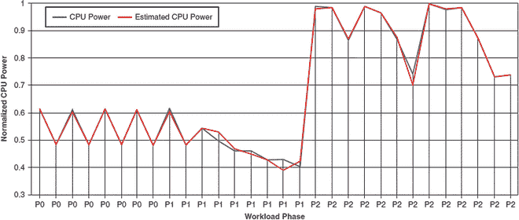

图 11-12.

CPU 功耗：测量值与估算值对比；估算的 CPU 功耗按阶段划分，并基于吞吐量和目标延迟要求

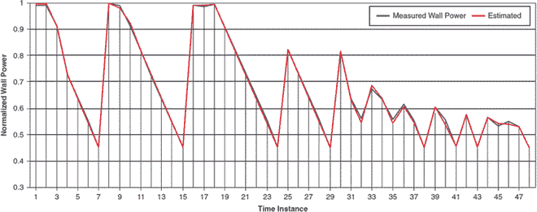

图 11-11.

墙功耗：测量值与估算值对比（作为组件功耗的函数）

平均而言，由 SVM 支持的机器学习回归函数可提供 97% 到 98.5% 的准确率。每个阶段都针对其自身的性能和延迟模型系数进行训练。

图 11-13 展示了一个示例，其中包含服务器上四种可能的工作负载条件。在 x 轴上，tt00、tt10 和 tt20 分别代表 0.0ms、10.0ms 和 20.0ms 的思考时间。y 轴显示响应时间。图中的红色多段线连接了四个工作负载点（W [1]、W [2]、W [3]、W [4]）。这些点是供给和需求中随机选择的扰动；例如，W [1] 由设置思考时间为 20.0ms 和 CPU RAPL 值为 40W 产生；W [2] 由思考时间为 0.0ms（驱动比 W [1] 更高的到达率）和 CPU RAPL 值为 50W 产生，依此类推。

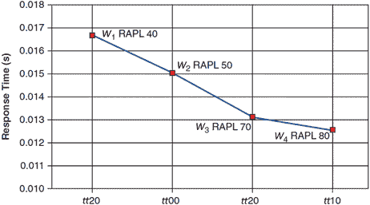

图 11-13.

四个任意选择点的响应时间，反映了四种可能的工作负载和服务器条件

如果 W [1]、W [2]、W [3] 和 W [4] 的响应时间都没有超过期望的性能目标——例如，SLA 目标 R = 20.0ms——那么通过降低性能来节省功耗将是可取的，只要较高的响应时间仍低于 20.0ms 的目标。然而，如果在这些工作负载点中的任何一个，响应时间超过了期望的阈值，那么通过增加功耗来提高性能以满足 SLA 将是更可取的。

通常，SLA 可能会阐明吞吐量和响应时间的期望，并可能包含详细信息，例如在不同吞吐量水平下必须在阈值响应时间内完成的工作负载比例。为便于描述，本示例设置了一个简单的 SLA：在短时间间隔（1s）内平均的响应时间不超过 14.0ms 的静态目标值；这在图 11-14 中以实线 R = 0.014 显示。

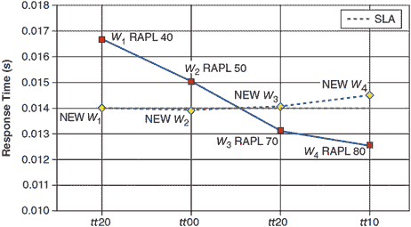

图 11-14.

通过使用 CPU RAPL 进行 CPU 功耗主动控制来改善响应时间的示例

如您所见，新的工作负载点（以菱形显示）是通过使用训练好的 SVM 模型进行主动功耗性能控制而产生的。此外，使用训练好的模型计算出的新 RAPL 设置（更高的 CPU 功耗）将 W [1] 和 W [2] 的响应时间从先前的值（分别降低了 15% 和 7%）降低到更接近 SLA 的新值。类似地，模型训练为 W [3] 和 W [4] 生成了更低的 CPU 功耗设置，这以更高的响应时间为代价节省了功耗，并使能效提高了 11.5%。顺便提一下，W [4] 的新设置与 SLA 目标存在微小但不可忽略的偏差，这可能会迫使在下一次迭代中重新计算 CPU RAPL 设置。请注意，为减少频繁的路线修正，控制策略可能允许在任一方向上略微超出 SLA 目标。在此，由于 W [1] 和 W [2] 的新 RAPL 设置降低了响应时间，与孤立调优相比，基于阶段的 CPU 功耗缩放可在所有性能水平上实现显著的功耗降低。

## 示例 3：入侵检测的系统方法

在协作自组网和普适无线连接的时代，我们更容易受到恶意攻击。这些复杂的攻击在入侵尝试期间会低于阈值边界运行，只能通过分析相对于正常行为的完整系统活动来识别。许多此类攻击本质上是隐蔽的，无法通过传统的入侵检测系统（IDS）方法（如流量监控、端口扫描或协议违规）检测到。入侵检测可以类比于人体免疫系统，它通过理解正常过程的规范来识别并消除异常。标识符应分布在整个系统中，并具有可识别且可适应的关系。因此，我们需要一个模型，该模型在每个状态下都有产生可观测系统输出的概率，以及一个指示下一状态的独立概率。

与有线网络不同，自组网节点在成员节点之间进行协调，以允许独占使用通信信道。恶意节点可以利用协作节点的这种分布式且复杂的决策特性来发起攻击或劫持节点。这种固有的脆弱性可能使整个网络集群瘫痪，并通过冒充、消息污染、被动监听或充当恶意路由器等方式进一步危及安全。IDS 机制应能够通过将系统中的异常活动与用户配置文件及演变趋势进行比较来检测入侵。尽管如果攻击者低于阈值运行，这些机制可能不足以阻止恶意攻击，但可以修改基于阈值的机制来监控相关系统组件的趋势以预测攻击。这类似于 HMM（参见第 5 章），其中隐藏状态（攻击）可以从相关观测值（系统参数变化、故障频率等）中预测出来。观测到的行为充当正常或异常活动的签名或描述，并以统计度量和模型的形式进行表征。度量是一个随机变量，代表在一段时间内累积的定量测量值。从审计记录中获得的观测值，当与统计模型一起使用时，可以分析任何与标准配置文件的偏差，并触发可能的入侵状态。

本示例讨论了一种基于 HMM 的入侵检测策略，使用多元高斯模型处理观测值，这些观测值反过来用于预测以隐藏状态形式存在的攻击。该模型包括一个用于事件聚类的自组织网络、一个观测分类器、一个漂移检测器、一个配置文件估计器（PE）、一个高斯混合模型（GMM）加速器以及一个 HMM 引擎。该方法旨在根据观测到的与正常配置文件的偏差，或通过将这些偏差分类到适当的攻击配置文件中，来预测入侵状态。HMM 是一种离散事件的随机模型，也是马尔可夫链的一种变体。与传统的马尔可夫链一样，HMM 由一组离散状态和一个状态转移概率矩阵 A = {a [ij] } 组成。此外，每个状态都有一个观测符号概率向量 B = b [j] (v)，该向量对应于系统在状态 j 时产生类型 v 的符号的概率。HMM 的状态只能从观测到的符号中推断出来——因此称为“隐藏”。HMM 将观测值与隐藏状态相关联，这些隐藏状态考虑了系统设计，其中观测点通过使用一组可接受的系统级入侵检查点（IC）进行优化；隐藏状态是利用与这些观测值之间的概率关系的显式知识创建的。这些关系（也称为配置文件）会随着多个独立系统的持续使用而强化和演变。如果观测点可以标准化，那么入侵可预测性问题就可以简化为将现有和新的隐藏状态配置到标准观测值中。

### 建模方案

HMM 建模方案的参数包括观测状态、隐藏（入侵）状态和 HMM 配置文件。使用初始数据和连续重估进行 HMM 训练，会创建一个包含转移概率和观测符号概率的配置文件。HMM 建模涉及以下任务：

*   测量观测状态，这些状态是从入侵指标中分析或逻辑推导出来的。这些指标是分布在整个系统中的测试点。
*   估计瞬时观测概率函数，该函数表示在给定隐藏状态的情况下观测值的概率。该密度函数可以使用显式参数模型（多元高斯）进行估计，或者通过非参数方法（多元核密度发射）从数据中隐式估计。
*   通过聚类单个或多个组件的同质行为来估计隐藏状态。这些状态指示了需要向管理员识别的各种入侵活动。
*   使用先验知识或随机数据估计隐藏状态转移概率矩阵。先验知识以及长期时间特征，指示了状态组件从一个入侵状态转移到另一个入侵状态的近似概率。

#### 观测（发射）状态

观测状态代表使用 IC 指标分析或逻辑推导出的竞争风险。机器入侵可以被视为多个组件竞争入侵发生的结果。在该模型中，IC 引擎推导出连续的多元观测值，这类似于均值和标准差模型，不同之处在于前者基于两个或多个度量之间的相关性。这些观测值 b [j] (v) 具有连续概率密度函数（PDF），并且是多元高斯（正态）分布的混合，表示为（Lee, Kawahara, and Shikano 2001）

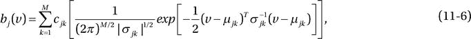

其中 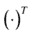 表示转置，且

c [jk] ≥ 0 & 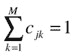

σ [jk] = 第 j 个状态的第 k 个混合分量的协方差矩阵

μ [jk] = 第 j 个状态的第 k 个混合分量的均值向量

v = 观测向量

M = 具有多元高斯分布的观测值的维度数

θ [jk] = (σ [jk] , μ [jk] ) = 高斯分量

η [jk] = 第 j 个状态的第 k 个混合分量的漂移因子

λ [jk] = (θ [jk] , c [jk] , η [jk] ) = 用户配置文件分量

IC 引擎负责为所有矩阵和所有可能的攻击状态动态重估 λ [jk] 参数。表示观测值维度的各种矩阵如下：

*   **资源活动趋势**：在较大采样周期内监控的资源活动的度量，其特性在该采样周期内重复出现。每个活动周期可以被视为活动度量的一个额外维度。
*   **事件间隔**：两个连续活动（例如，登录尝试）之间间隔的度量。
*   **事件趋势**：在较大采样周期内监控的事件的度量，其目标是利用内置的可重复性计算事件行为（例如，一天内的登录尝试次数）。

#### 隐藏状态

隐藏状态 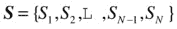 是一组不可见的状态，但每个状态会随机生成 M 个观测值（或可见状态 O）的混合。后续状态的概率仅取决于前一个状态。完整模型由以下概率定义：转移概率矩阵 A = a [ij]，其中 a [ij] = p(S [i] |S [j] )；观测概率矩阵 B = (b [i] (v [m] ))，其中 b [i] (v [m] ) = p(v [m] |S [i] )；以及初始概率向量 π = p(S [i] )。观测概率表示当预期出现特定故障状态时，以一定概率观测到的属性。该模型表示为 M = (A,B,π)。转移概率矩阵是一个方阵，其大小等于状态数量，代表状态转移概率。

观测概率分布是一个非方阵，其维度等于状态数量乘以可观测值数量。该分布表示在给定状态下观测到某个值的概率。图 11-15 中描述的入侵检测系统（IDS）使用了以下状态：

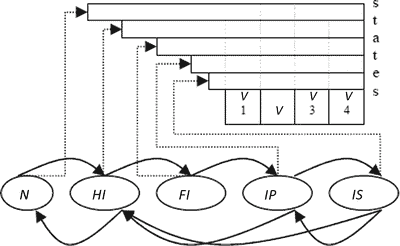

图 11-15.

HMM 模型，包含五个入侵状态，每个状态有四个高斯分布；每个高斯分布可表示为观测值的混合分量。（来源：Khanna 和 Liu，2006）

*   正常（N）状态表示符合用户轮廓。
*   恶意入侵尝试（HI）表示正在进行的恶意入侵尝试。这通常是外部代理试图绕过系统安全性的典型行为。
*   友好入侵尝试（FI）表示正在进行的非恶意入侵尝试。这通常是内部代理试图绕过系统安全性的典型行为。
*   入侵进行中（IP）表示正在建立自身的入侵活动。这包括尝试访问特权资源和资源使用加速。
*   入侵成功（IS）表示入侵成功。成功的入侵将伴随异常的资源使用（CPU、内存、I/O 活动等）。

### 入侵检测系统架构

在自组织网络中，入侵检测系统（IDS）部署在节点上，用于本地且独立于其他节点地检测入侵迹象，而不是使用路由器、网关或防火墙。在本节中，我们定义了 IDS 中相互协作以预测攻击状态的组件。

模型训练完成后，会进入运行时状态，在此状态下，它会检查并对每个有效观测值进行分类。然后，模型决定将该观测值添加到轮廓更新中、拒绝它，或将其标记为“未分类”。此决策至关重要，因为用户正常行为的漂移可能代表攻击情况。未分类的观测值会被监控，以便将来进行分类。根据未分类状态趋向于特定分类的趋势相似性，以及来自其他独立观测的状态机反馈，该观测值随后将被作为噪声拒绝，或分类为有效状态。IDS 的各种组件如下：

*   轮廓估计器（PE）：PE 负责维护/重新估计用户轮廓，将观测值分类为攻击状态，在检测到可疑观测值时触发警报，或根据 HMM 反馈对轮廓进行重新估计。用户轮廓数据由 PDF 参数 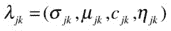 组成，其中 j 代表入侵状态，k 代表高斯混合模型（GMM）的混合分量。新的观测值将根据此轮廓进行评估，从而得出其分类和漂移检测。
*   检测工具：检测工具生成事件数据，这些数据由聚类代理处理并用于估计轮廓。组件识别和测量涉及设置，以判断事件是应以固定间隔采样，还是在记录到模式变化时生成通知（或警报）作为事件向量。传感器数据应能够分析数据（无论是实时收集还是事后分析），并为可疑的入侵行为提供实时警报通知。这需要快速的硅级钩子，能够识别、计数、设置阈值、添加时间戳、生成事件和清除活动。此类钩子的示例包括性能计数器、翻转计数器（也称为事务计数器）、报头嗅探器、故障警报（如页面错误）和带宽使用监控器。同时，还需要软件检测工具来采样与软件相关的测量值，例如会话活动、不同进程和应用程序之间的系统调用使用情况、文件系统使用情况以及换入/换出使用情况。大多数操作系统以进程跟踪（例如，UNIX 中的进程 ID [PID]）的形式支持这些钩子。这些快速钩子与采样能力的组合被聚类以形成观测。
*   数据聚类：观测数据依赖于活跃事件的聚合。例如，由资源使用引擎生成的资源故障事件会进一步分类为故障类型，例如页面错误。在采样间隔内，页面错误计数和无效页面错误代表了测量实例（m [1], m [2]）。一个观测值（发射值）可以是一组相关的测量值，但由单个概率分布函数表示。这些测量值中的每一个都带有不同的权重，如同多元高斯分布。例如，由于网络文件系统（NFS），磁盘 I/O 使用率可能与网络 I/O 使用率相关。这种关系被纳入轮廓中，以保证观测的完整性，并降低维度，以实现有效的运行时处理。
*   分类器：对观测数据进行分析，以便在由不同概率分布参数驱动的轮廓中，将其子分类为适当的攻击状态。一旦识别出适当的攻击状态，就会生成一个关注事件以启动纠正或记录操作。还会分析观测数据是否存在概念漂移，以补偿用户（或攻击）行为的变化。因此，IC 引擎（见图 11-16）的目标之一是为 j（攻击状态）构建一个分类器，对于每个实现，该分类器对于 j 的一个值具有接近 1 的后验概率 p(j|v)，而对于所有其他值则接近 0。这可以通过在给定观测数据 v 的情况下最小化香农熵来实现，对于每个观测值，香农熵可计算为 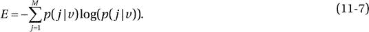

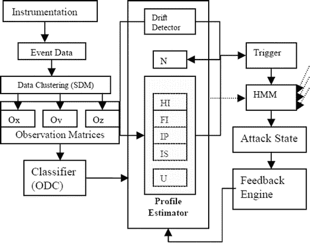

图 11-16.

内燃机引擎。轮廓的重新估计使用观测分类器和 HMM 反馈至轮廓。当观测结果被分类为攻击状态或无法分类（U）时，轮廓管理器会触发一个关注事件。关注事件会基于其他连续观测（虚线箭头）启动 HMM 状态序列预测，这些观测与轮廓和状态转移概率共同提取。（来源：Khanna and Liu 2006）
*   每个内燃机引擎独立于其他观测（或发射）来采样其观测。每当它怀疑有异常活动时，就会触发警报，从而引发对最可能状态的评估。随着系统改变其活跃行为，对应行为的轮廓会被更新，通过实时使用连续估计机制重新评估模型参数，以避免误报评估。新的 HMM 参数会与历史 HMM 参数再次进行评估，通过比较旧模型和重新训练模型的熵。期望最大化（EM）算法（Moon 1996）为统计模型中存在未观测变量的参数的最大似然估计（MLE）问题提供了一种通用方法。评估过程产生一组参数，算法使用这些参数将观测点分配到新的状态。对于 GMM，EM 算法的计算复杂度为 O(i × ND²)，其中 i 是执行的迭代次数，N 是样本数量，D 是状态维度。一种常见的实现选择是 k-means 算法，其中 k 个簇由其质心参数化，复杂度为 O(kND)。还可以使用许多其他算法，包括 x-means 聚类（Pelleg and Moore 2000），它将复杂度降低到 O(D)。
*   概念漂移检测器（CDD）：该模块检测并分析轮廓中的概念漂移（Widmer and Kubat 1996），当仅靠训练数据集不足时，需要持续更新模型（轮廓）。当存在随时间演变的概念漂移时，如果新概念和旧概念仍具有一致性，并且任意选择的旧数据量恰好合适（Fan 2004），那么不加选择地使用旧数据是有帮助的。这需要一种高效的数据挖掘方法，以帮助选择新旧数据（历史数据）的组合，从而实现准确的重新轮廓化和进一步分类。所使用的机制是 Kullback-Leibler（KL）散度（Kullback and Leibler 1951），其中相对熵衡量生成模型的两个概率分布之间的核距离。KL 散度也是从先验到后验过程中香农信息的增益，表示为 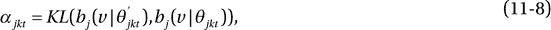
*   其中 α [jkt] 是 KL 散度度量 ，是新的高斯分量，而 θ [jkt] 是时间 t 时第 j 个状态的第 k 个混合的旧高斯分量。你可以通过蒙特卡洛模拟评估散度，使用大数定律（Grimmett and Stirzacker 1992），该方法从估计的高斯分量中抽取一个观测值 v [i] 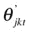，计算对数比率，并在 M 个样本上取平均值，如 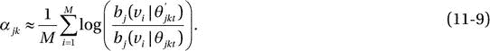
*   在时间域计算的 KL 散度数据用于评估漂移速度（也称为漂移因子）（0 ≤ η ≤ 1）。然后，这些数据用于为历史参数分配权重，这些权重反过来用于重新轮廓化。
*   反馈引擎（FE）：该组件负责将当前状态信息反馈给 PE。当前状态信息使用当前的 PDF 模型参数进行重新评估。然后，这个重新评估的状态信息用于改进寻找 MLE 的下降算法。

## 轮廓与系统考量

在本节中，我们考察构成轮廓结构输入的事件。我们将特征定义为通过处理器函数从一个或多个时间输入事件中导出的处理后的观测。

利用事件的时间序列信息可以提升为单个用户、程序或类别定义的轮廓的性能（Ghosh, Schwartzbard, and Schata 1999）。以下任何形式的异常活动都是入侵或蠕虫活动的指标：

*   CPU 活动通过采样故障、处理器间中断（IPI）调用、上下文切换、线程迁移、锁自旋和使用统计信息进行监控。
*   网络活动通过采样输入错误率、冲突率、远程过程调用（RPC）拒绝率、重复确认（DUPACK）、重传率、超时率、刷新认证、带宽使用、活动连接、连接建立失败、头部错误和校验和失败等进行监控。
*   中断活动通过采样设备中断（非定时器）进行监控。
*   I/O 利用率通过采样 I/O 请求的平均队列长度和繁忙百分比进行监控。
*   内存活动通过采样内存传输速率、页面统计信息（回收率、换入率、换出率）、地址转换错误以及短时间间隔内扫描的页面和分页平均值进行监控。
*   文件访问活动通过采样文件访问频率、文件使用溢出和文件访问错误进行监控。
*   系统进程活动通过采样具有不当进程优先级的进程、进程使用的 CPU 和内存资源、进程长度、阻塞 I/O 的进程、僵尸进程以及生成该进程的命令和终端进行监控。
*   系统故障活动代表非法活动（或硬件错误），通过采样来检测系统使用中的异常。罕见故障是糟糕编程的结果，但活动的突然爆发则表明存在攻击。
*   系统调用活动涉及获取计算机系统权限的强大工具。入侵伴随着意外系统调用的执行。如果可以在程序执行前收集其系统调用执行模式，并将其与运行时系统调用执行行为进行比较，那么就可以检测到意外的系统调用执行。在实时操作期间，会应用模式匹配算法，将所检查进程生成的系统调用与模式表中的条目进行即时匹配。根据匹配的程度，可以判断系统调用序列是代表正常行为还是异常行为（Wespi, Dacier, and Debar 1999）。
*   会话活动通过采样登录频率、不成功的登录尝试、会话持续时间、会话时间和会话资源使用情况进行监控。

## 传感器数据测量

传感器数据经过收集和统计处理，可用于衡量历史趋势、捕捉独特模式以及可视化异常行为。这些数据被分类后进行分析，以预测异常活动。传感器数据测量包含多个组件，分别执行统计处理功能或基础设施功能（例如生成优先级事件），具体如下：

*   传感器数据测量（SDM）钩子降低了系统复杂性，并提高了软件复用的可能性（见图 11-17）。SDM 能够利用系统策略发送警报，从而加速对集群组件的联合测量。硬件和软件充当传感器与控制系统之间的粘合剂，该系统能够测量事件间隔和事件趋势，并在偏离系统策略定义的正常行为时生成警报。SDM 硬件作为一个多实例实体存在，接收来自系统中各处事件的警报向量。一组形成集群的相关事件会注册到同一个 SDM 实例上。该实例代表了一组模式类别之间的贝叶斯最优决策边界，每个类别由一个 SDM 实例表示，并与一个参考向量相关联。每个 SDM 实例都可以进行趋势分析和警报，并将来自事件传感器的测量结果整合到一个统一的视图中。集群趋势分析对微小的信号变化非常敏感，能够通过监督式自组织映射（Kohonen 1995），利用学习向量量化（LVQ）检测嵌入在正常信号中的异常信号。LVQ 背后的策略是有效训练参考向量，以定义注册到某个 SDM 实例的各个 SDM 类别之间的贝叶斯最优决策边界。

    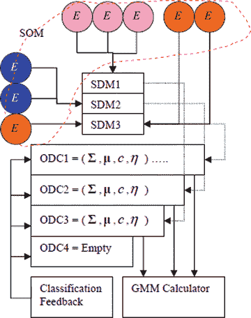

    图 11-17.

    事件（圆圈）、传感器（SDM）和分类器（ODC）之间关系的示意图。事件集群（以相同颜色标记）注册到 SDM。在评估事件属性后，SDM 向 ODC 生成一个事件，ODC 负责分类、趋势分析和漂移计算。分类反馈充当重新估计的机制。（来源：Khanna 和 Liu 2006）
*   观测数据分类器（ODC）钩子加速了对 SDM 生成的观测警报的分类。这是一种多实例硬件，能够并行处理多个观测。ODC 钩子的每个已注册观测实例都包含每个状态的高斯概率分布参数。在收到 SDM 警报后，相应的观测会被分类为特定状态。对观测数据的重新分类可能导致与该状态对应的概率分布参数发生变化。ODC 可以维护历史参数，这些参数用于使用 KL 漂移检测器计算概念漂移属性，例如漂移因子和漂移速度。
*   GMM 计算器利用当前观测值计算每个状态的高斯混合概率。在系统设置期间，事件向量会注册到 SDM 实例。这些事件在其各自的 SDM 中被聚类和处理。处理过程包括触发属性，这些属性会启动一个观测。然后，这些观测作为单维事件注册到其 ODC。收到触发信号后，ODC 对源自该触发的观测进行重新分类，并计算概念漂移。该硬件由其父级触发后激活。

## 总结

随着越来越多的数据以非结构化的数字形式表达，新的计算模型正在被开发出来，以有意义的方式处理这些数据。可以应用机器学习方法，通过系统地应用算法来综合非结构化数据集与信息之间的基本关系。机器学习利用了泛化的力量，这是通过人类学习形成概念过程中固有且必不可少的组成部分。机器学习方法可用于开发自主系统，利用模块化功能来实现智能反馈控制系统。这种方法在建模知识功能方面可以发挥关键作用，该功能用于实现稳定且可行的系统。本章介绍了机器学习中使用的三种技术示例。第一个示例采用了工作负载指纹识别的概念，利用阶段检测来建立具有空间均匀性和独特性的可观测特征。第二个示例基于多个计算单元之间最优动态能量分配的概念。该示例提出将阶段作为压缩的代表性输出，可以与任何其他统计参数结合使用来预测未来行为。最后一个示例建议使用 IDS 机制，通过参考用户画像和演变趋势监控系统中的异常活动来检测入侵。每个示例都使用了特定于应用的机器学习技术组合来实现预期目标。
