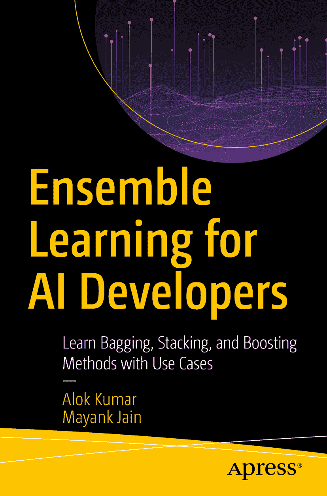

ISBN 978-1-4842-5939-9e-ISBN 978-1-4842-5940-5 [`doi.org/10.1007/978-1-4842-5940-5`](https://doi.org/10.1007/978-1-4842-5940-5) © Alok Kumar and Mayank Jain 2020 Standard Apress 本出版物中使用的通用描述性名称、注册商标、商标、服务标记等，即使未作特别声明，也不意味着这些名称不受相关保护法律和法规的约束，因此可自由使用。出版商、作者和编辑假定本书中的建议和信息在出版之日是真实准确的。出版商、作者或编辑均不对本书所含材料或可能存在的任何错误或遗漏提供明示或暗示的担保。出版商对已出版地图中的管辖权主张和机构归属保持中立。本书通过 Springer Science+Business Media New York 在全球图书贸易中发行，地址：233 Spring Street, 6th Floor, New York, NY 10013。电话：1-800-SPRINGER，传真：(201) 348-4505，电子邮件：orders-ny@springer-sbm.com，或访问 www.springeronline.com。Apress Media, LLC 是加利福尼亚州的有限责任公司，其唯一成员（所有者）是 Springer Science + Business Media Finance Inc (SSBM Finance Inc)。SSBM Finance Inc 是特拉华州的一家公司。

*谨以此书献给我的家人，感谢他们无条件的支持。*

*——Alok Kumar*

*献给我的家人和 Anand 先生，他们解放了我的思想。*

*——Mayank Jain*

引言

集成学习正迅速成为数据科学领域中机器学习模型的热门选择。集成方法以多种有趣的方式组合机器学习模型的输出。即使在从事机器学习项目多年之后，我们仍未意识到集成方法的强大之处，因为这一主题在大多数机器学习课程和书籍中通常被忽视或仅作简要概述。与许多人一样，我们是通过研究竞争性机器学习场景才了解到集成方法的威力。像 Kaggle 这样的竞争性机器学习平台，为机器学习技术提供了公正的评估。在过去几年中，集成学习方法始终在竞争性指标上表现优异。这本身就说明了学习集成技术的好处。本书的目标是帮助你学习集成方法，并将其有效应用于现实场景。

本书首先解释了为什么需要集成学习技术。第 1 章的目标是建立对各种集成技术的基本理解。第 2、3 和 4 章涵盖了各种集成技术，并根据我们如何混合训练数据、模型和组合方式进行分组。在这些章节中，你将学习一些最重要的集成学习技术，如随机森林、装袋、自助聚合、堆叠和交叉验证方法。

第 5 章涵盖了集成学习库。这些库有助于加速你的实验和实现。第 6 章介绍了将集成方法集成到现实世界机器学习工作流中的技术。

本书以简洁易懂的方式呈现，帮助你学习并将集成学习概念应用于实际用例，否则对于初出茅庐的数据科学家来说，这需要大量的反复学习。本书中的代码（Python 脚本）可作为你项目的扩展或参考。

致谢

我们衷心感谢 Apress 团队在我们撰写本书过程中提供的所有帮助和支持。撰写本书是一段愉快的经历，Apress 团队无疑是其中重要的一部分。非常感谢策划编辑 Celestin Suresh John，他在缩小本项目范围并使其更易于理解方面提供了巨大帮助。非常感谢我们的开发协调员和编辑 Aditee Mirashi 和 Laura C. Berendson。他们持续的跟进极大地帮助我们保持进度和专注。我们也感谢 Ashutosh Parida 提供的宝贵技术反馈。

一如既往，我们要感谢家人的所有帮助和支持。没有他们的支持和协助，我们无法完成本书。

最后，我们要感谢开源社区，他们帮助普及了知识。本书中使用的所有库都来自开源项目。

关于作者 关于技术审校者

