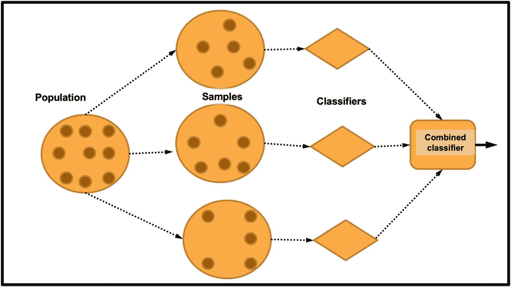
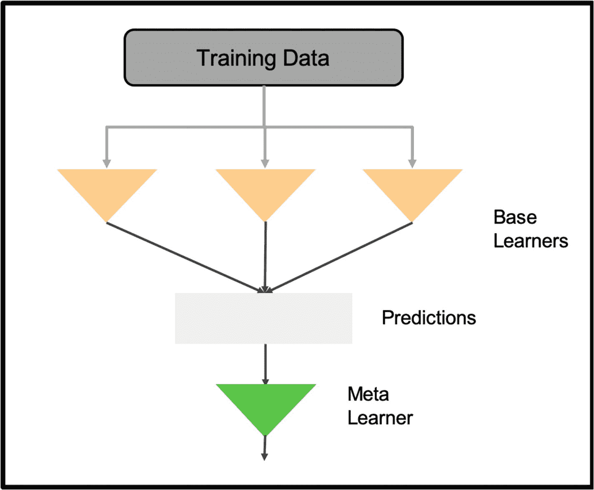
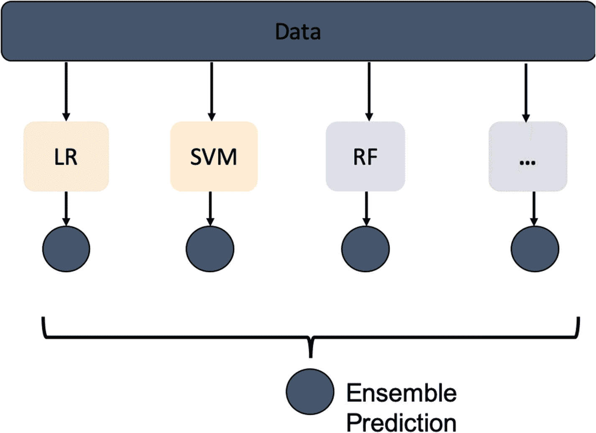

# 1. 为什么需要集成技术

根据剑桥词典的定义，**集成**（ensemble）是指一组**事物**或人作为一个整体共同行动或组合在一起。**集成**一词最初用于描述经常一起演奏的音乐家群体。一个音乐家集成是多个音乐家个人作品的总和。类似地，在机器学习中，**集成学习**是多种机器学习技术的组合，共同执行。

集成学习正迅速成为数据科学中提升机器学习模型准确性的首选标准。集成方法通过以多种有趣的方式组合机器学习模型的输出来实现这一点；就像音乐家集成以多种不同方式组合他们的个人表演，以达到伟大的作品。

你作为数据科学家的角色是成为一位首席演奏家或架构师，能够利用单个机器学习（ML）模型的优势，并以有趣的方式组合它们，以实现相当于伟大作品的机器学习模型（即世界级的机器学习模型）。

让我们再看一个类比，以更好地理解集成方法的好处。假设你想投资股票市场。你对某只特定股票感兴趣，但不确定其未来前景，因此你决定寻求建议。你找到一位预测准确率为 75% 的财务顾问。你决定咨询其他财务顾问，他们给出了类似的建议。如果每位顾问都建议你买入该股票，那么这些集体建议的准确率是多少？

通常情况下，多位专家的集体建议往往胜过任何一位顾问的准确率，尤其是在不同的财务状况下。类似地，在机器学习中，来自多个机器学习模型的集成方法往往比任何单个机器学习模型具有更好的泛化性能，尤其是在不同条件/案例下或长期来看。

在本书中，我们将带你了解如何在集成学习的框架下组合多个机器学习模型的输出。

集成学习技术可以进一步分为三大类：**混合训练数据**、**混合组合方式**和**混合模型**。我们将简要地帮助你建立对每一类的理解。

## 混合训练数据

任何阅读过物种进化相关书籍的人都知道，拥有足够的遗传多样性对任何物种都至关重要。遗传多样性较少的物种即使适应了当前环境，也往往会灭绝。

造成这种现象的原因之一是，尽管一个物种（或当前的训练数据）已经在其环境中成为专家，但每当出现不利的环境条件，比如一种新的致命疾病时，它就无法适应，该物种就容易走向灭绝。

对于任何物种来说，发展足够遗传多样性的方法之一就是将其种群分开，让它们在不同的环境条件下进化。这种方法之所以成功，是因为将种群分成不同的群体并让它们暴露在不同的环境中，会导致它们根据新环境进化，从而增加遗传多样性。这可以防止种群变得同质化，并在逆境中确保至少有一部分物种亚群能够存活下来。

将这一见解应用到机器学习中，就引出了第一种集成学习变体，即**混合训练数据**。我们不在所有训练数据上训练一个单一的大型分类器，而是将训练数据分成多个块，并在每个训练数据子集上训练独立的分类器。最后，所有这些分类器的输出会被组合起来（见图 1-1）。

这种方法确保了分类器在种群子集上训练（进化）时能够捕获足够的多样性。通过组合这些多样化学习器的输出，与在整个种群（训练数据）上训练单个学习器的情况相比，我们能够实现更高的准确性。

这种划分训练数据的方式被称为**装袋**。你将在第 2 章中了解更多关于这种技术的内容。

图 1-1

使用装袋法混合训练数据

## 混合组合

为了更好地理解在集成学习背景下混合或变化组合的含义，让我们来看一个类比：班级中学生的学习过程。

假设你希望一个班级的学生在所有科目上都表现出色，但我们发现有些学生在单元测试中表现不佳。我们可以识别出这些学生，并对他们得分较低的科目给予更多关注，使他们与其他学生水平相当。为了给予更多关注，我们通过增加课程和分配额外时间来调整学习过程，重点关注学生的薄弱环节。这能确保学生在所有科目上表现更好。

让我们在机器学习中使用同样的类比。我们从一组学习器开始，每个机器学习学习器都在特定的训练对象子集上进行训练。如果某个模型学习器表现不佳，我们可以对该学习器给予更多关注，重点加强之前学习器表现不佳的方面。这种学习器的组合被称为**提升**。

让我们看看另一种不同的混合机器学习模型的方法，称为**堆叠**。为了更好地理解这一点，想象一下盘子一个叠一个地堆叠起来，堆叠顶部的每个盘子都建立在底部盘子的基础之上。类似地，在堆叠学习器中，我们将一个机器学习模型放置在另一个模型输出的之上，以构建机器学习模型的堆叠。换句话说，在这种集成技术中，我们共同训练多个模型以获得预测/输出学习器。当我们组合这些预测时，可能会产生误差。

在堆叠中，我们将单个预测的结果视为下一个训练数据。（第一层机器学习模型/学习器被称为**基学习器**。）我们在基学习器层之上再堆叠一层机器学习模型/学习器；第二层被称为**元学习器**（见图 1-2）。你可以将这种技术想象成将一层机器学习学习器堆叠在另一个机器学习学习器之上。

这两种方法——**提升**和**堆叠**——都涉及以各种组合方式混合机器学习模型，这些内容将在第 4 章中更详细地介绍。

图 1-2

堆叠

## 混合模型

第三类集成学习方法涉及**改变模型**。

让我们设想一个场景：两个孩子——拉姆和夏姆——正在学习科学。拉姆的所有知识都来自同一个人，这位老师虽然教得好，但教学方式单一且单调。夏姆则由多位老师以及他的父母教导；每位老师通过变换教学技巧来提升他的科学教育。那么，拉姆和夏姆谁更有可能取得好成绩呢？

在其他条件相同的情况下，夏姆在科学方面表现优异的可能性更大。

在儿童教育中经常观察到，如果一个孩子不依赖于单一的人或单一的教学方式，他或她未来的发展会更好。这是因为向不同的人学习，能够覆盖单一的人或单一教学方式常常忽略的盲点。

再次，将这个类比应用到机器学习中，我们可以用多种不同的方式来训练我们的网络。我们可以使用不同的模型（见图 1-3），即使是在单个机器学习模型的情况下，我们也可以使用在训练轮次之间不同的设置/超参数。我们不必仅仅依赖单一模型或单一超参数设置来完成机器学习任务，而是可以通过训练多个模型，或使用不同超参数设置进行多次训练，将它们结合起来。与使用单一模型或单一设置相比，这使我们能够获得更高的准确率和更低的偏差。结合不同模型的集成技术类型将在第 3 章讨论。

图 1-3

混合模型

到目前为止讨论的所有集成学习技术都将在第 2、3 和 4 章中详细介绍。除非你能将它们应用到现实世界的数据科学问题中，否则它们并无助益。采用许多有前景概念的主要障碍之一是工具和库支持的获取。幸运的是，随着机器学习研究人员认识到集成技术的强大，库支持已经跟上。如今，许多流行的集成技术在 Python 和 R 中都有实现。除了像 scikit-learn 这样的通用机器学习库中的集成支持外，还开发了专门针对特定集成技术的库。如果你想在数据科学竞赛中获得最先进的结果，其中一些库现在已成为标准。

XGBoost 是一个梯度提升框架，可用于多种语言，包括 C/C++、Python、Java 和 R。它也可以在多个操作系统上运行。它可以在单台机器上运行，也可以并行运行以利用多台机器。它为提升（一种集成学习方法）提供了快速的实现。

LightGBM 是另一个非常流行的梯度提升框架（截至撰写本文时，它在 GitHub 上已获得超过 10,000 颗星），由微软开发和维护。它可以在机器集群上运行，并可以利用 GPU 进行加速。

R 语言中的 SuperLearner 是一个非常流行的包；它使得组合多个模型和应用集成技术变得无缝。它支持数十种算法（例如，XGBoost、随机森林、GBM、Lasso、SVM、BART、KNN、决策树和神经网络），你可以同时运行和测试它们。

你将在第 5 章中了解更多关于一些最流行的库，以及 R 和 Python 等语言中对集成方法的支持。

机器学习中出现的不同类型问题具有不同的约束和不同的性能要求，这导致我们需要根据需求选择集成技术。了解在特定问题领域中哪些方法有效、哪些无效，对实践者非常有帮助。在第 6 章（技巧与最佳实践）中，我们将不同的集成技术应用于不同的问题领域（例如，图像分类、自然语言处理等）。

集成学习技术近年来广受欢迎的原因之一是，如果你是一个团队，致力于解决一个具有挑战性的机器学习问题，目标是超越现有最佳水平，那么集成方法能给你的问题带来巨大提升。通过集成方法，你们每个人都可以专注于自己的方法，然后通过简单的集成方法组合结果。这也是最近各种机器学习竞赛中大多数获胜者遵循的模式。

以 2017 年在 Kaggle 上举办的“安全驾驶员预测”竞赛为例，超过 5000 个团队参赛，旨在根据各种参数正确预测驾驶员明年是否会提出保险索赔。获胜方案由 Michael Jahrer 开发；它融合了六种不同的机器学习模型。其中一个模型使用了 LightGBM 库的梯度提升；然后他将该结果与五个具有不同参数的神经网络相结合。通过使用这种结果集成，Jahrer 成功获得了最高排名——以及 25,000 美元的奖金。

几乎所有近期数据科学竞赛的获胜者都依赖集成技术来取得成果。

另一个例子是 2019 年 9 月举办的 Avito 需求预测挑战赛。目标是根据不同的广告参数（例如包含的图片、文本描述等）预测分类广告的需求。超过 1800 个团队参加了这场奖金为 25,000 美元的竞赛。获胜团队将他们的参赛作品命名为“与集成共舞”，并将他们在竞赛中的成功归功于集成方法。这个四人团队独立工作，每个团队成员都使用了许多基于集成的方法，包括 LightGBM 与具有不同参数的传统神经网络方法相结合。之后，每个团队成员利用集成的力量组合了他们的结果。

你可以在许多竞赛编码平台（如 Kaggle）上浏览关于获胜故事的博客文章。几乎所有文章都提到他们使用集成技术提升了结果或组合了不同的算法。这强有力地表明了集成学习在现实世界机器学习问题中的成功。

## 总结

以下是本章内容的快速回顾。

*   对**什么是集成学习以及为何使用它？** 的基本回答。
*   对使用**混合训练数据**进行集成学习的简要介绍。
*   对**混合模型**的集成方法的简要介绍。
*   对集成学习的简要介绍，其中我们**混合模型的组合**，并附有提升和堆叠的示例。
*   对一些机器学习库的简要介绍。
*   人们如何使用先进的集成学习技术在现实世界问题和竞争性数据科学竞赛中取得最先进成果的方式。

在下一章中，你将学习如何开始构建基于集成的方法，从混合训练数据进行集成的方法开始。

