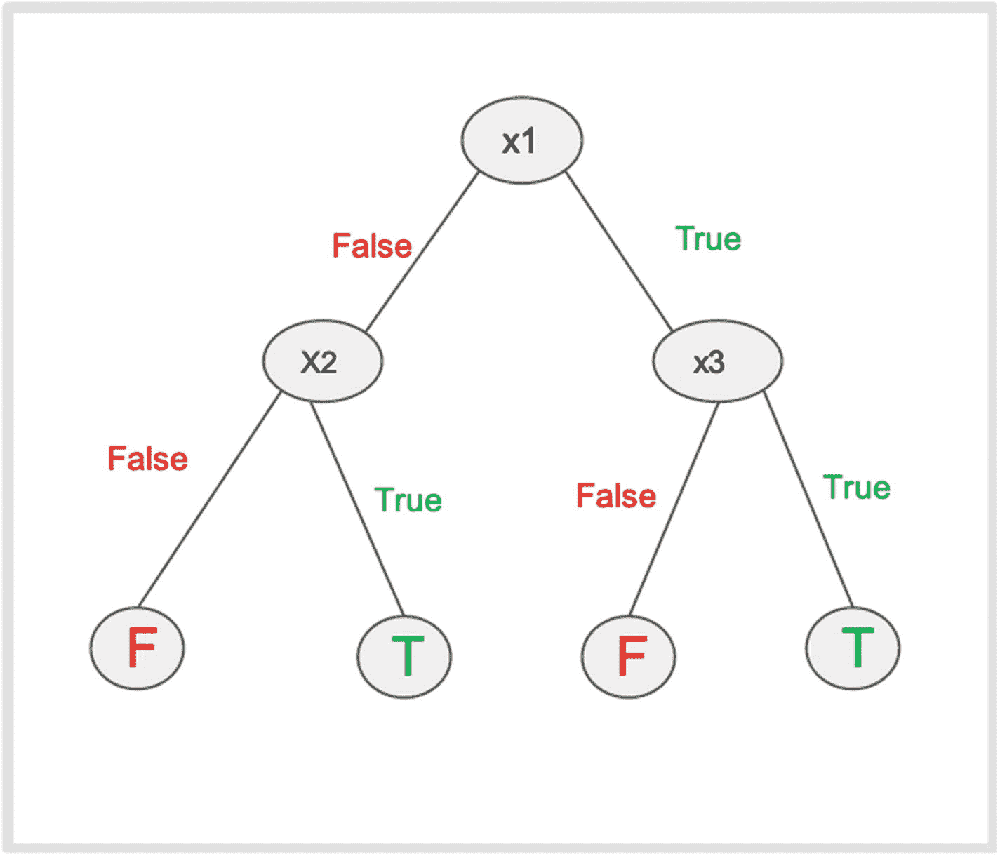
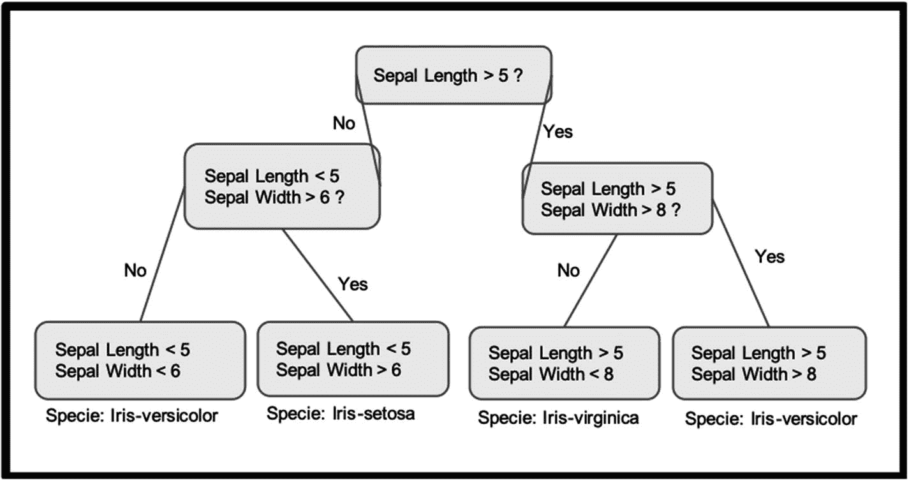
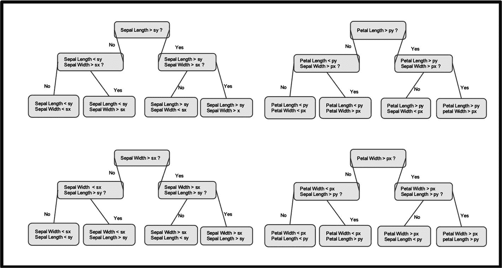
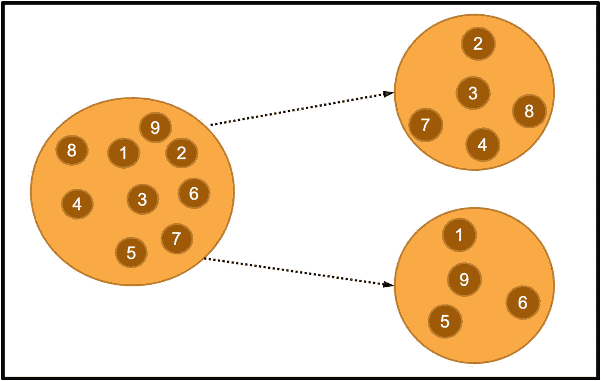
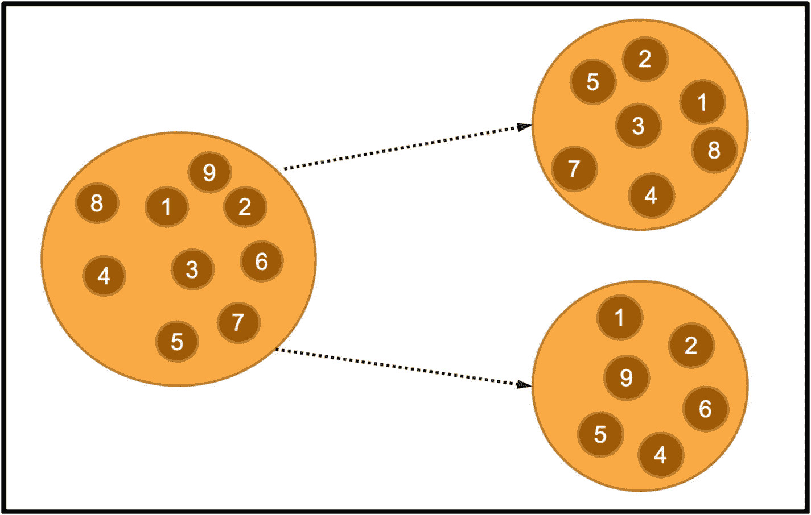
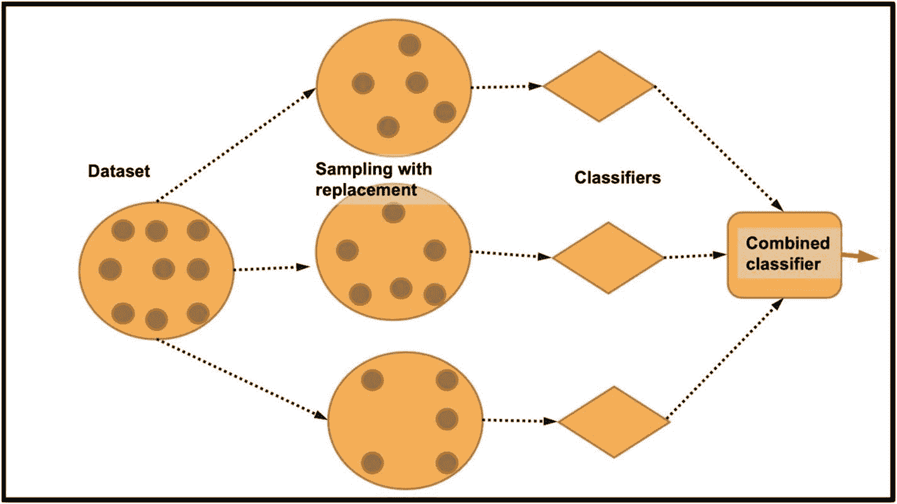
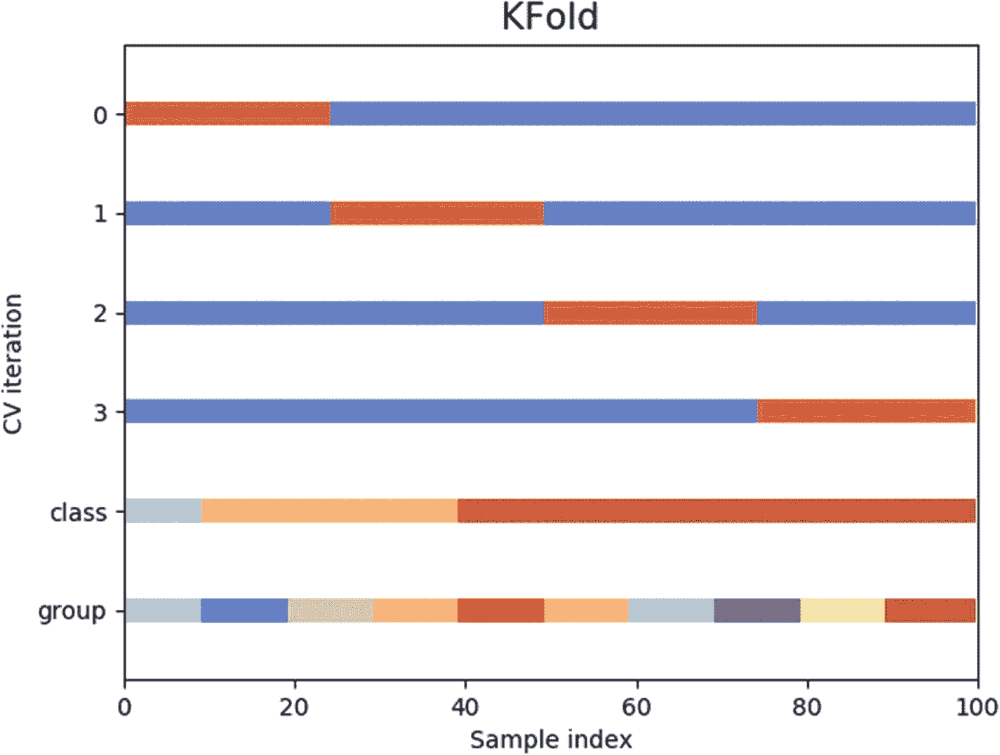
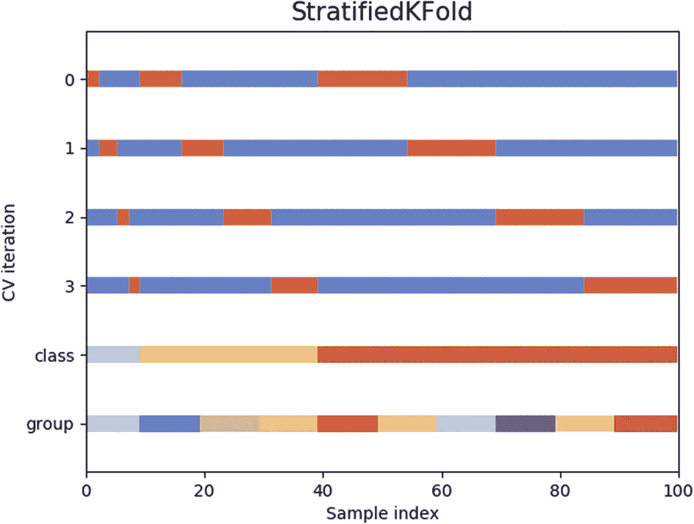

# 2. 混合训练数据

在第 1 章中，你了解到数据科学家的角色类似于一位乐团首席，他利用整个管弦乐团和乐器来谱写优美的乐章。同样地，如果数据科学家想从数据和模型中榨取出世界级的表现，他也可以使用多种集成工具。本章的主要目标是学习混合训练数据的不同方法，以构建集成模型。

以下是本章的学习目标。
*   直观理解混合训练数据如何能在集成学习中带来良好表现
*   介绍决策树
*   查看使用`scikit-learn`实现决策树的示例
*   介绍`RandomForest`作为决策树的集合
*   通过代码示例学习数据集采样及其两种变体：无放回采样和有放回采样
*   通过代码示例学习装袋法（自助聚合）
*   学习交叉验证技术：*k*折交叉验证和分层*k*折交叉验证

让我们从学习为什么混合数据是有用的开始。查尔斯·达尔文发现，如果一个物种没有足够的遗传多样性，它更容易灭绝。为什么会这样？如果所有成员都具有相同的基因，那么该物种在面对意外的自然灾害和疾病时会更加脆弱，因为每个成员对意外事件的抵抗力都相同。

一个物种如何自然地发展出足够的遗传多样性？当种群被分割并在不同的环境条件下进化时，就会自然产生足够的遗传多样性。这确保了如果物种遇到不利且意外的环境，至少有一部分物种具有更强的韧性；因此，从整体上保证了物种的生存。将种群分成不同的群体，并让它们暴露在不同的环境中，会导致种群以略微不同的方式进化，从而增加遗传多样性。

将同样的知识应用于机器学习，如果你使用全部训练数据训练单个模型，那么当现实世界的测试数据分布与训练数据相似时，该机器学习模型可能表现良好。如果你使用的数据分布与训练数据不够相似，就可能遇到问题。为了解决这个问题，一个好方法是将训练数据分成不同的子集，并在不同的数据子集上训练多个模型。由于每个模型拥有不同的训练数据分布，因此每个模型都具有略微不同的推理（现实世界表现）特性。然后，我们可以通过集成这些模型来组合它们，从而获得比单个模型更好的结果。这被称为`混合训练数据`。

## 决策树

让我们通过一个名为`决策树`的机器学习模型示例来学习如何混合数据（见图 2-1）。



图 2-1：简单决策树

决策树是一种自上而下的流程图式方法，从顶部节点开始。每个节点代表一个需要基于一个或多个参数/变量做出的决策。你遍历这些节点，直到达到足够的深度，该深度基于你想要训练的参数量。

让我们从一个示例数据集开始，探索如何将决策树应用于它。

鸢尾花数据集是机器学习社区中广泛使用的标准数据集。图 2-2 展示了鸢尾花数据集的决策树。我们的任务是将鸢尾花分为三种不同的花卉物种。该数据集包含三种鸢尾花各 50 个样本。每个样本包含以下参数：花萼长度、花萼宽度、花瓣长度、花瓣宽度。

示例决策树是通过考虑四个参数中的两个（花萼长度和花萼宽度）创建的；所有叶节点都被分配到一个花卉物种类别。



图 2-2：鸢尾花数据集的决策树

决策树在实践中是通过从数据集中取一个样本来应用的。树遍历从顶部节点开始划分样本，并根据每个节点的条件进入不同的桶。每个节点基于一个答案，然后进入左节点或右节点。它从那里开始，通过持续应用条件测试进行下去。最终到达底部的叶节点，在那里得到最终的分类结果。

要训练决策树，你可以使用`scikit-learn` Python 库。代码清单 2-1 展示了如何使用 Python 的`scikit-learn`库训练决策树。

```
from sklearn.datasets import load_iris
from sklearn.tree import DecisionTreeClassifier
from sklearn.model_selection import train_test_split
X, y = load_iris(return_X_y=True)
train_X, test_X, train_Y, test_Y = train_test_split(X, y, test_size = 0.2, random_state = 123)
tree = DecisionTreeClassifier()
tree.fit(train_X, train_Y)
print(tree.score(test_X, test_Y))
# 输出: 0.9333333333333333
代码清单 2-1
使用 scikit-learn 训练决策树
```

决策树的深度越大，训练数据集的准确率就越高。

但使用决策树存在主要问题。为了在你的数据集上获得足够的准确率，你需要一个更深（更大深度）的树，但随着树深度的增加，你会开始遇到过拟合，这会导致测试数据集的准确率降低。因此，你只能满足于一个准确率较低、较浅的决策树，或者一个过拟合的、深度更大的树。

造成这个问题的原因之一是，用于决策的变量可能不足以从全局角度进行区分。

解决这个问题的一个方法是使用多个决策树而不是一个。每个决策树应该使用不同的变量集或训练数据子集。然后，将这些决策树的输出组合成一个`RandomForest`（见图 2-3）。



图 2-3：鸢尾花数据集的`RandomForest`，决策树数量 = 4

顾名思义，`RandomForest`由一组决策树组成，每棵树都在不同的训练数据集上进行训练。

代码清单 2-2 是 Python`scikit-learn`中`RandomForest`的代码片段。

```
from sklearn.datasets import load_iris
from sklearn.ensemble import RandomForestClassifier
from sklearn.model_selection import train_test_split
X, y = load_iris(return_X_y=True)
train_X, test_X, train_Y, test_Y = train_test_split(X, y, test_size = 0.1, random_state = 123)
forest = RandomForestClassifier(n_estimators=8)
forest = forest.fit(train_X, train_Y)
print(forest.score(test_X, test_Y))
# Output: 1.0
rf_output = forest.predict(test_X)
print(rf_output)
# Output: [1 2 2 1 0 2 1 0 0 1 2 0 1 2 2]
代码清单 2-2
使用 scikit-learn 训练 RandomForest，决策树数量 = 4
```

由一组决策树构成的`RandomForest`兼具两者的优点：使用更浅的决策树获得更高的准确率，同时降低过拟合的风险。

`RandomForest`是决策树集成方法的一个例子。我们采用单个机器学习模型（决策树），并用不同的训练数据和参数混合训练，从而构建一个集成模型。

如何以不同方式组合训练数据来构建集成方法呢？关键在于细节！

我们先学习一些基础知识，如果你已经了解，可以跳过或略读。

首先，我们讨论采样，它可分为两种方式：无放回采样（WOR）和有放回采样（WR）。

## 数据集采样

采样是将数据集进行划分的行为。我们用一个渔夫的类比来说明：他在一个鱼数量有限的小池塘里钓鱼，想把鱼分成不同的组。他有两种方法可以做到：`无放回采样`和`有放回采样`。

### 无放回采样（WOR）

假设渔夫有两个桶。他把从池塘里钓到的鱼扔进其中一个桶里。他的数据集被分成两个互不重叠的桶。使用这种方法，一条鱼永远不会同时属于两个桶。

将数据集划分为两个或多个互不相交的集合的采样方法称为`无放回采样`（见图 2-4）。



图 2-4：`无放回采样`（WOR）。原始数据集中没有共同的样本

代码清单 2-3 展示了如何在 Python 的`scikit-learn`中进行`无放回采样`。

```
from sklearn.utils import resample
import numpy as np
# 固定随机种子，以便读者可以复现结果
np.random.seed(123)
# 待采样的数据
data = [1, 2, 3, 4, 5, 6, 7, 8, 9]
# 需要的划分数量
num_divisions = 2
list_of_data_divisions = []
for x in range(0, num_divisions):
sample = resample(data, replace=False, n_samples=5)
list_of_data_divisions.append(sample)
print('Samples', list_of_data_divisions)
# 输出: Samples [[8, 1, 6, 7, 4], [4, 6, 5, 3, 8]]
代码清单 2-3
scikit-learn 中的无放回采样
```

### 有放回采样（WR）

我们再次使用渔夫的类比。这次，渔夫有两个日记本。每钓到一条鱼，他就给它编号，并将这个编号记入其中一个日记本。但有一个变化：他给鱼编号并记入日记本后，会把鱼放回池塘。他继续钓鱼。如果一条鱼已经有编号，他就将相同的编号记入其中一个日记本。他重复这个过程，直到池塘里所有的鱼都有编号。在这个过程中，可能会出现同一条鱼的记录同时出现在两个日记本中的情况。这种将数据集划分为两个集合，但集合不必互不相交的采样过程称为`有放回采样`。你可以查看代码清单 2-4，了解使用 `scikit-learn` 实现的有放回采样示例代码。



图 2-5

有放回采样（WR）。注意原始数据集中的一些样本在两个样本集中是共同的（项目 1、4、5）

```
from sklearn.utils import resample
import numpy as np
# 固定随机种子，以便读者可以复现结果
np.random.seed(123)
# 待采样的数据
data = [1, 2, 3, 4, 5, 6, 7, 8, 9]
# 需要的划分数量
num_divisions = 3
list_of_data_divisions = []
for x in range(0, num_divisions):
sample = resample(data, replace=True, n_samples=4)
list_of_data_divisions.append(sample)
print("Samples", list_of_data_divisions)
# 输出: Samples [[3, 3, 7, 2], [4, 7, 2, 1], [2, 1, 1, 4]]
代码清单 2-4
scikit-learn 中的有放回采样
```

## Bagging（自助聚合）

你现在已经熟悉了有放回和无放回的数据集采样方法。本节将介绍最重要的集成技术之一：`Bagging`。`Bagging` 是自助聚合（Bootstrap Aggregating）的简称。它是一种集成技术，将数据集划分为 *n* 个有放回采样的样本。然后，这 *n* 个样本分别被训练成 *n* 个独立的机器学习模型。最后，通过投票法（参见图 2-6）将所有独立模型的输出合并为单一输出。



图 2-6

采用有放回采样的 `Bagging`

如你所见，`Bagging` 技术确保每个分类器都能获得随机样本，从而保证训练出的模型具有多样性。这些多样化的模型组合在一起，其性能远优于任何单个模型。

`Bagging` 包含三个步骤：自助采样、训练和聚合。首先，自助采样步骤将数据集划分为 *n* 个样本，每个样本都是全部训练数据的一个子集。每个样本的采样都采用有放回采样技术。正如我们之前讨论的，有放回采样确保了采样的真正随机性；一个样本的组成不依赖于另一个样本。

接下来是训练步骤，在此步骤中，你分别在这些样本上训练独立的模型。这一步确保你能获得大量在各自样本上训练的相对较弱的机器学习模型。

第三步是聚合，你使用诸如投票法（你将在第 3 章学习）之类的方法，将所有弱分类器的结果合并起来。

代码清单 2-5 是使用所有三个 `Bagging` 步骤的示例代码。

```
from sklearn.utils import resample
from sklearn import tree
from sklearn.model_selection import train_test_split
from sklearn.datasets import make_classification
import numpy as np
from sklearn.metrics import accuracy_score
# 待采样的数据
n_samples = 100
X,y = make_classification(n_samples=n_samples, n_features=4, n_informative=2, n_redundant=0, random_state=0, shuffle=False)
# 将数据划分为训练集和测试集
X_train, X_test, y_train, y_test =  train_test_split(X, y, test_size = 0.1, random_state = 123)
# 需要的划分数量
num_divisions = 3
list_of_data_divisions = []
# 将数据划分为多个部分
for x in range(0, num_divisions):
X_train_sample, y_train_sample = resample(X_train, y_train, replace=True, n_samples=7)
sample = [X_train_sample, y_train_sample]
list_of_data_divisions.append(sample)
#print(list_of_data_divisions)
# 为每个数据部分训练一个分类器
learners = []
for data_division in list_of_data_divisions:
data_x = data_division[0]
data_y = data_division[1]
decision_tree = tree.DecisionTreeClassifier()
decision_tree.fit(data_x, data_y)
learners.append(decision_tree)
# 使用投票法合并所有分类器的输出
predictions = []
for i in range(len(y_test)):
counts = [0 for _ in range(num_divisions)]
for j , learner in enumerate(learners):
prediction = learner.predict([X_test[i]])
if prediction == 1:
counts[j] = counts[j] + 1
final_predictions = np.argmax(counts)
predictions.append(final_predictions)
accuracy = accuracy_score(y_test, predictions)
print("Accuracy:", accuracy)
# 输出: Accuracy: 0.9
代码清单 2-5
从零实现 Bagging
```

你可以直接从 `scikit-learn` 库中调用 `BaggingClassifier`。代码清单 2-6 是使用 `scikit-learn` 实现 `Bagging` 分类器的示例代码。
```

# 混合数据与集成学习

## 预测建模示例

```
from sklearn.svm import SVC
from sklearn.ensemble import BaggingClassifier
from sklearn.model_selection import train_test_split
from sklearn.datasets import make_classification
X, y = make_classification(n_samples=100, n_features=4,
    n_informative=2, n_redundant=0,
    random_state=0, shuffle=False)
# 将数据划分为训练集和测试集
X_train, X_test, y_train, y_test = train_test_split(X, y, test_size = 0.2, random_state = 123)
clf = BaggingClassifier(base_estimator=SVC(),
    n_estimators=10, random_state=0).fit(X_train, y_train)
print(clf.score(X_test, y_test))
# 输出: 0.9
```

代码清单 2-6 scikit-learn 中的 Bagging

## `k` 折交叉验证

在我们进一步探索基于重采样的机器学习技术时，最流行的技术之一是交叉验证，尤其是 `k` 折交叉验证。机器学习研究人员经常遇到这样的情况：他们在训练数据集上取得了很好的准确率，甚至在测试数据集上也是如此；但在实际场景中或另一个隐藏的测试数据集上应用同一个模型时，却因为准确率不够理想而失败。

这对于在 Kaggle 等网站上进行机器学习竞赛的人来说尤其成问题。其中一个主要原因是提供的验证集并不包含实际场景中可能出现的所有不同分布。一个非常有效的解决方案是在划分训练集和验证集本身时就应用采样技术。这种方法被称为交叉验证。

最流行的交叉验证技术之一是 `k` 折交叉验证（参见图 2-7）。在这种方法中，你通过迭代地使用无放回采样来划分验证集和训练集。`k` 表示应用于数据集的划分数量。例如，当 `k` = 10 时，我们将数据集分成 10 个不同的部分；其中 9/10 的数据用于训练，1/10 的数据用于测试数据集的准确率。但划分并不止于此。这个过程会重复 10 次，每次都会改变测试和训练的划分，并重新计算总体准确率。你模型的最终准确率是通过计算每个单独准确率的平均值得到的。



图 2-7 k 折交叉验证（来源：[`https://scikit-learn.org/stable/auto_examples/model_selection/plot_cv_indices.html`](https://scikit-learn.org/stable/auto_examples/model_selection/plot_cv_indices.html)）

代码清单 2-7 是使用 scikit-learn 应用此技术的示例代码。

```python
import numpy as np
from sklearn.model_selection import KFold
X = np.array([[1, 2], [3, 4], [1, 2], [3, 4]])
y = np.array([1, 2, 3, 4])
kf = KFold(n_splits=2)
kf.get_n_splits(X)
print(kf)
# 输出:
# KFold(n_splits=2, random_state=None, shuffle=False)
for train_index, test_index in kf.split(X):
    print("TRAIN:", train_index, "TEST:", test_index)
    X_train, X_test = X[train_index], X[test_index]
    y_train, y_test = y[train_index], y[test_index]
# 输出:
# TRAIN: [2 3] TEST: [0 1]
# TRAIN: [0 1] TEST: [2 3]
```

代码清单 2-7 `k` 折交叉验证

## 分层 `k` 折交叉验证

分层 `k` 折交叉验证是 `k` 折交叉验证的另一种子类型。与 `k` 折验证类似，你将数据集划分为不同的样本集，并轮流将各集合作为测试集和训练集进行 `k` 次旋转，以实现统一的交叉验证。但初始采样方式有所不同。在分层 `k` 折交叉验证技术中，你需要确保初始的 `k` 个样本各自的数据分布，使得每个划分出的样本集都具有与整体数据集相似的分布。

图 2-8 展示了 100 个随机生成的输入数据点。三个类别在数据点中分布不均，而 10 个“组”则均匀分布在数据点上。换句话说，假设你的整体数据集中有三个类别：类别 A、类别 B 和类别 C。每个类别的样本比例分别为 30%、50%和 20%。在分层 `k` 折交叉验证技术中，你必须确保：如果将这个数据集划分为 `k` = 5 折，那么这五折中的每一折都分别包含来自类别 A、类别 B 和类别 C 的样本，且比例也分别为 30%、50%和 20%。



图 2-8 分层 k 折交叉验证（来源：[`https://scikit-learn.org/stable/auto_examples/model_selection/plot_cv_indices.html`](https://scikit-learn.org/stable/auto_examples/model_selection/plot_cv_indices.html)）

代码清单 2-8 是使用 scikit-learn 应用分层 `k` 折交叉验证技术的 Python 示例代码。

```python
import numpy as np
from sklearn.model_selection import StratifiedKFold
X = np.array([[1, 2], [3, 4], [1, 2], [3, 4]])
y = np.array([0, 0, 1, 1])
skf = StratifiedKFold(n_splits=2)
skf.get_n_splits(X, y)
print(skf)
# 输出：
# StratifiedKFold(n_splits=2, random_state=None, shuffle=False)
for train_index, test_index in skf.split(X, y):
    print("TRAIN:", train_index, "TEST:", test_index)
    X_train, X_test = X[train_index], X[test_index]
    y_train, y_test = y[train_index], y[test_index]
# 输出：
# TRAIN: [1 3] TEST: [0 2]
# TRAIN: [0 2] TEST: [1 3]
```

代码清单 2-8 分层 `k` 折交叉验证

## 本章小结

让我们快速回顾一下本章所学内容。

*   混合数据以构建性能更优的集成模型
*   通过代码示例学习决策树和随机森林
*   数据采样
*   采样的两种主要变体：无放回采样和有放回采样
*   装袋法，即使用有放回采样的自助聚合技术
*   交叉验证技术，即 `k` 折交叉验证和分层 `k` 折交叉验证
*   通过 scikit-learn 中的代码示例应用这些技术解决问题