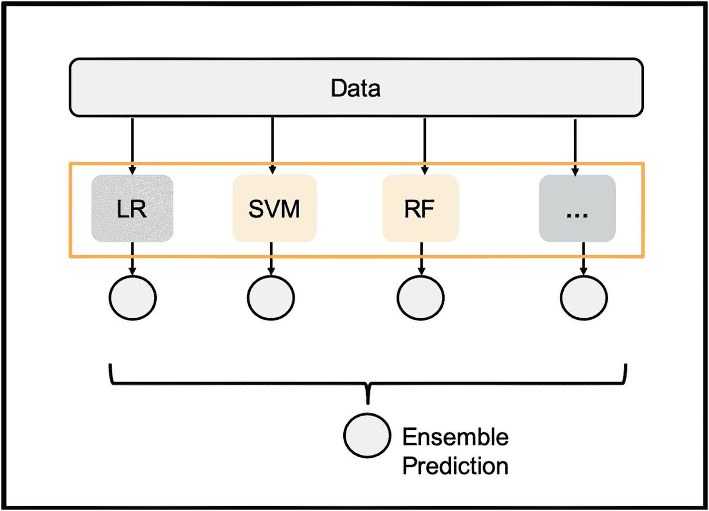
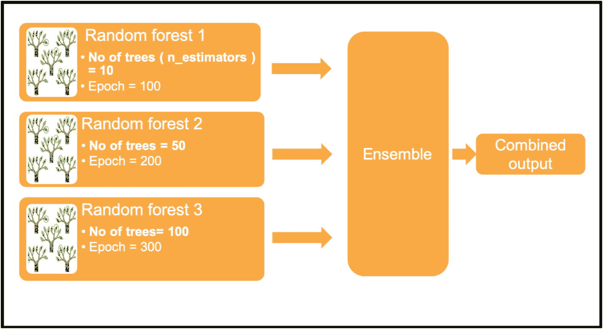
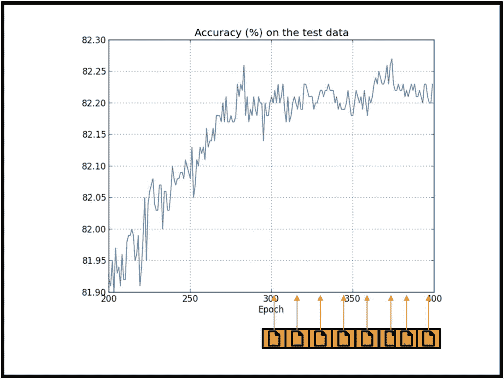
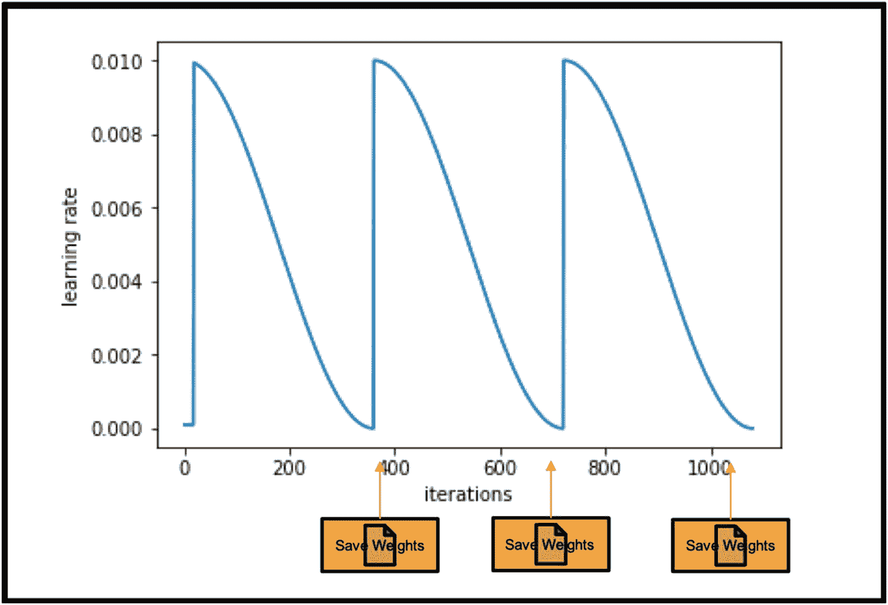

# 3. 混合模型

在第二章中，你学习了如何以不同方式划分和混合训练数据来构建集成模型，这些模型的表现优于在未划分数据集上训练的单个模型。

在本章中，你将学习不同的组装方法。与混合训练数据的方法不同，混合模型方法在多个不同的机器学习模型上使用相同的数据集，然后以不同方式组合其结果，以获得性能更优的模型。

首先，让我们看看本章的目标。

*   介绍并解释基于集成的混合模型
*   介绍投票集成
*   通过代码示例介绍并解释软投票和硬投票集成
*   学习超参数调优集成
*   研究随机森林超参数调优的示例实现
*   学习水平投票集成
*   研究在 CIFAR 数据集上使用 `scikit-learn` 和 `Keras` 实现水平投票集成的示例
*   介绍与循环学习率结合使用的快照集成技术

在本章中，你将不再依赖单一模型，而是将同一个数据集用于多个不同的机器学习模型进行训练（见图 3-1），然后使用不同技术组合这些模型的结果。首先，你将学习如何以投票和平均的形式组合不同训练模型的输出。接着，你将了解超参数调优集成，学习如何使用同一模型但采用不同的超参数设置进行训练，然后组合其结果以获得更好的模型。最后，你将学习相对不太为人所知的水平投票集成和快照集成技术，这些技术因其潜力而在机器学习社区中逐渐站稳脚跟。


图 3-1

组合/混合不同的模型

## 投票集成

### 硬投票

首先，让我们来看一种最流行的集成学习技术：投票集成。投票集成会训练不同的机器学习模型。再看一下图 3-1，其中相同的数据被用于训练三个不同的机器学习模型——逻辑回归、支持向量机（`SVM`）和随机森林。这三个模型的输出被组合起来，得到集成预测结果。从业者首先会问的一个问题是如何实际组合这些模型的结果。最简单的答案之一是从一种最古老且久经考验的技术中汲取灵感：投票。就像我们通过投票选举领导人一样，由一群不同背景的人进行多数投票来选出官员，我们也使用不同的机器学习模型进行选举。如果是分类问题，每个机器学习模型都会为特定类别投票。在多数投票中，获得最多票数的类别就是首选类别。人们普遍观察到，由此产生的类别通常比任何单个模型都具有更高的准确率。

清单 3-1 中的数据集使用三个机器学习模型进行训练：`k` 近邻（`KNN`）、随机森林和逻辑回归，均使用 `scikit-learn` Python 库。然后，它们的输出通过 `scikit-learn` 库中实现的 `VotingClassifier` 进行组合。如果你测量每个单独模型以及组合模型在测试数据集上的最终准确率，你会发现准确率得到了很好的提升。我们鼓励你运行代码作为练习，并检查单个模型和组合模型的准确率。

你可以用于此目的的一个主要辅助函数是来自 `scikit-learn` 库的 `sklearn.ensemble` 包中的 `VotingClassifier` 类。

```
from sklearn.model_selection import train_test_split
from sklearn.model_selection import GridSearchCV
from sklearn.datasets import load_breast_cancer
import numpy as np
X, y = load_breast_cancer(return_X_y=True)
X_train, X_test, y_train, y_test = train_test_split(X, y, test_size=0.3, stratify=y, random_state=123)
### k-Nearest Neighbors (k-NN)
from sklearn.neighbors import KNeighborsClassifier
knn = KNeighborsClassifier()
params_knn = {'n_neighbors': np.arange(1, 25)}
knn_gs = GridSearchCV(knn, params_knn, cv=5)
knn_gs.fit(X_train, y_train)
knn_best = knn_gs.best_estimator_
### Random Forest Classifier
from sklearn.ensemble import RandomForestClassifier
rf = RandomForestClassifier(random_state=0)
params_rf = {'n_estimators': [50, 100, 200]}
rf_gs = GridSearchCV(rf, params_rf, cv=5)
rf_gs.fit(X_train, y_train)
rf_best = rf_gs.best_estimator_
### Logistic Regression
from sklearn.linear_model import LogisticRegression
log_reg = LogisticRegression(random_state=123, solver="liblinear", penalty="l2", max_iter=5000)
C = np.logspace(1, 4, 10)
params_lr = dict(C=C)
lr_gs = GridSearchCV(log_reg, params_lr, cv=5, verbose=0)
lr_gs.fit(X_train, y_train)
lr_best = lr_gs.best_estimator_
# combine all three Voting Ensembles
from sklearn.ensemble import VotingClassifier
estimators=[('knn', knn_best), ('rf', rf_best), ('log_reg', lr_best)]
ensemble = VotingClassifier(estimators, voting="soft")
ensemble.fit(X_train, y_train)
print("knn_gs.score: ", knn_best.score(X_test, y_test))
# Output: knn_gs.score:  0.9239766081871345
print("rf_gs.score: ", rf_best.score(X_test, y_test))
# Output: rf_gs.score:  0.9766081871345029
print("log_reg.score: ", lr_best.score(X_test, y_test))
# Output: log_reg.score:  0.9590643274853801
print("ensemble.score: ", ensemble.score(X_test, y_test))
# Output: ensemble.score:  0.9649122807017544
```

清单 3-1
最大投票集成

### 平均/软投票

平均是组合不同分类器输出的另一种方法。投票和平均的主要区别在于，在平均中，我们分别从模型中获取每个类别的预测概率，然后通过取这些预测的平均值来组合得到的概率。这种组合方法称为软投票。

在清单 3-2 中，训练不同模型的初始步骤是相同的，但不再使用 `VotingClassifier`，而是对我们的模型在测试数据集上进行推理，取出每个类别的预测概率，然后取所有概率的平均值作为测试数据集上的最终类别概率。

请注意，在计算平均输出时，我们为所有模型分配了相等的权重。然而，如果我们认为某个特定模型比其他模型更重要，我们可以增加该特定模型的权重，并降低所有其他模型的权重。这种方法称为加权平均。

```
from sklearn.model_selection import train_test_split
from sklearn.model_selection import GridSearchCV
from sklearn.datasets import load_breast_cancer
import numpy as np

X, y = load_breast_cancer(return_X_y=True)
X_train, X_test, y_train, y_test = train_test_split(X, y, test_size=0.3, stratify=y, random_state=0)

### k-Nearest Neighbors (k-NN)
from sklearn.neighbors import KNeighborsClassifier

knn = KNeighborsClassifier()
params_knn = {'n_neighbors': np.arange(1, 25)}
knn_gs = GridSearchCV(knn, params_knn, cv=5)
knn_gs.fit(X_train, y_train)
knn_best = knn_gs.best_estimator_
knn_gs_predictions = knn_gs.predict(X_test)

### Random Forest Classifier
from sklearn.ensemble import RandomForestClassifier

rf = RandomForestClassifier(random_state=0)
params_rf = {'n_estimators': [50, 100, 200]}
rf_gs = GridSearchCV(rf, params_rf, cv=5)
rf_gs.fit(X_train, y_train)
rf_best = rf_gs.best_estimator_
rf_gs_predictions = rf_gs.predict(X_test)

### Logistic Regression
from sklearn.linear_model import LogisticRegression

log_reg = LogisticRegression(random_state=123, solver="liblinear", penalty="l2", max_iter=5000)
C = np.logspace(1, 4, 10)
params_lr = dict(C=C)
lr_gs = GridSearchCV(log_reg, params_lr, cv=5, verbose=0)
lr_gs.fit(X_train, y_train)
lr_best = lr_gs.best_estimator_
log_reg_predictions = lr_gs.predict(X_test)

# combine all three by averaging the Ensembles results
average_prediction = (log_reg_predictions + knn_gs_predictions + rf_gs_predictions)/3.0

# Alternatively combine all through using VotingClassifier with voting="soft" parameter
# combine all three Voting Ensembles
from sklearn.ensemble import VotingClassifier

estimators=[('knn', knn_best), ('rf', rf_best), ('log_reg', lr_best)]
ensemble = VotingClassifier(estimators, voting="soft")
ensemble.fit(X_train, y_train)

print("knn_gs.score: ", knn_gs.score(X_test, y_test))
# Output: knn_gs.score:  0.9239766081871345
print("rf_gs.score: ", rf_gs.score(X_test, y_test))
# Output: rf_gs.score:  0.9532163742690059
print("log_reg.score: ", lr_gs.score(X_test, y_test))
# Output: log_reg.score:  0.9415204678362573
print("ensemble.score: ", ensemble.score(X_test, y_test))
# Output: ensemble.score:  0.9473684210526315
```

清单 3-2 平均

除了手动计算预测概率外，如果你希望使用平均方法直接获得结果，可以再次使用 `sklearn.ensemble` 包中的 `VotingClassifier` 类。但不要传递 `voting='hard'` 参数，而是使用 `voting='soft'` 参数。

### 超参数调优集成

到目前为止，你已经看到了两个训练不同机器学习模型并组合其输出的示例。超参数调优集成是另一种获取集成输出的方法。它不依赖不同的模型来构建集成模型，而是使用一个优秀的机器学习模型，并通过不同的超参数设置来训练该模型。

图 3-2 使用了相同的机器学习模型——随机森林，但通过不同的超参数设置实例化了该模型的三个实例。在随机森林算法中，最重要的超参数之一是树的数量，在 scikit-learn API 中称为 `n_estimators`。三个不同的随机森林分别使用不同数量的树（分别为 10、50 和 100）进行训练。类似地，这三个实例的训练数据循环次数（即轮次）也各不相同。然后，使用之前的技术（例如投票或平均）组合这些实例的输出，以获得集成输出。



图 3-2 超参数调优集成

清单 3-3 使用三个不同的参数（即树的数量或 `m_estimators`）训练一个随机森林，并通过投票获得组合结果。

```
from sklearn.model_selection import train_test_split
from sklearn.model_selection import GridSearchCV
from sklearn.datasets import load_breast_cancer
import numpy as np
X, y = load_breast_cancer(return_X_y=True)
X_train, X_test, y_train, y_test = train_test_split(X, y, test_size=0.3, stratify=y, random_state=0)
### Random Forest Classifier
from sklearn.ensemble import RandomForestClassifier
rf_1 = RandomForestClassifier(random_state=0, n_estimators=10)
rf_1.fit(X_train, y_train)
rf_2 = RandomForestClassifier(random_state=0, n_estimators=50)
rf_2.fit(X_train, y_train)
rf_3 = RandomForestClassifier(random_state=0, n_estimators=100)
rf_3.fit(X_train, y_train)
# combine all three Voting Ensembles
from sklearn.ensemble import VotingClassifier
estimators = [('rf_1', rf_1), ('rf_2', rf_2), ('rf_3', rf_3)]
ensemble = VotingClassifier(estimators, voting="hard")
ensemble.fit(X_train, y_train)
print("rf_1.score: ", rf_1.score(X_test, y_test))
# Output: rf_1.score: 0.935672514619883
print("rf_2.score: ", rf_2.score(X_test, y_test))
# Output: rf_1.score: 0.9473684210526315
print("rf_3.score: ", rf_3.score(X_test, y_test))
# Output: rf_3.score: 0.9532163742690059
print("ensemble.score: ", ensemble.score(X_test, y_test))
# Output: ensemble.score:  0.9415204678362573
清单 3-3
超参数调优集成
```

### 水平投票集成

前面混合模型的例子——投票、平均和超参数调优——在经典机器学习中非常有效。但有时我们会遇到（尤其是在深度学习中）训练数据规模、训练数据时间和模型规模都非常大的情况。可能存在训练需要大量计算和时间的情况。在这些情况下，在短时间内训练多个模型集成实际上是不可能的。例如，一个深度学习模型如果在像 `ImageNet` 这样的数据集上训练，即使在强大的 `GPU` 机器上也可能需要两三天才能收敛。在这种情况下，训练多个模型以及同一模型的多个不同超参数实例通常是不切实际或成本高昂的。因此，你可以尝试的一种技术是`水平投票`。

每当你运行一个长时间的机器学习任务时，你可能会遇到一个困境：在训练了特定轮次之后，模型准确率是否已经停止提升。在这种情况下，为模型选择一个准确的轮次时间变得困难。在水平投票集成中（见图 3-3），你在达到最小轮次数（此处为 `epoch = 300`）后保存模型。然后使用投票技术重新组合生成的模型，以提高准确率。



图 3-3

水平投票集成

请查看清单 3-4，我们使用 `keras`、`tensorflow` 和 `scikit learn` 库实现了水平投票集成。

# 水平投票集成

```
#!pip install q keras==2.3.1 tensorflow==1.15.2
import keras
from keras.datasets import cifar10
from keras.preprocessing.image import ImageDataGenerator
from keras.models import Sequential
from keras.models import load_model
from keras.layers import Dense, Dropout, Activation, Flatten
from keras.layers import Conv2D, MaxPooling2D
import os
import numpy
from numpy import array
from numpy import argmax
from numpy import mean
from numpy import std
from sklearn.metrics import accuracy_score
from keras.utils import to_categorical
def make_dir(directory):
    if not os.path.exists(directory):
        os.makedirs(directory)
# load models from file
def load_all_models(n_start, n_end):
    all_models = list()
    for epoch in range(n_start, n_end):
        # define filename for this ensemble
        filename = "models/model_" + str(epoch) + ".h5"
        # load model from file
        model = load_model(filename)
        # add to list of members
        all_models.append(model)
        print(">loaded %s" % filename)
    return all_models
# make an ensemble prediction for multi-class classification
def ensemble_predictions(members, testX):
    # make predictions
    yhats = [model.predict(testX) for model in members]
    yhats = array(yhats)
    # sum across ensemble members
    summed = numpy.sum(yhats, axis=0)
    # argmax across classes
    result = argmax(summed, axis=1)
    return result
# evaluate a specific number of members in an ensemble
def evaluate_n_members(members, n_members, testX, testy):
    # select a subset of members
    subset = members[:n_members]
    # make prediction
    yhat = ensemble_predictions(subset, testX)
    # calculate accuracy
    return accuracy_score(testy, yhat)
make_dir("models")
batch_size = 32
num_classes = 10
epochs = 100
num_predictions = 20
model_name = "keras_cifar10_trained_model.h5"
# The data, split between train and test sets:
(x_train, y_train), (x_test, y_test) = cifar10.load_data()
print("x_train shape:", x_train.shape)
print(x_train.shape[0], "train samples")
print(x_test.shape[0], "test samples")
# Convert class vectors to binary class matrices.
y_train = keras.utils.to_categorical(y_train, num_classes)
y_test = keras.utils.to_categorical(y_test, num_classes)
model = Sequential()
model.add(Conv2D(32, (3, 3), padding="same", input_shape=x_train.shape[1:]))
model.add(Activation("relu"))
model.add(Conv2D(32, (3, 3)))
model.add(Activation("relu"))
model.add(MaxPooling2D(pool_size=(2, 2)))
model.add(Dropout(0.25))
model.add(Conv2D(64, (3, 3), padding="same"))
model.add(Activation("relu"))
model.add(Conv2D(64, (3, 3)))
model.add(Activation("relu"))
model.add(MaxPooling2D(pool_size=(2, 2)))
model.add(Dropout(0.25))
model.add(Flatten())
model.add(Dense(512))
model.add(Activation("relu"))
model.add(Dropout(0.5))
model.add(Dense(num_classes))
model.add(Activation("softmax"))
# initiate RMSprop optimizer
opt = keras.optimizers.RMSprop(learning_rate=0.0001, decay=1e-6)
# Let's train the model using RMSprop
model.compile(loss="categorical_crossentropy", optimizer=opt, metrics=["accuracy"])
x_train = x_train.astype("float32")
x_test = x_test.astype("float32")
x_train /= 255
x_test /= 255
# fit model
n_epochs, n_save_after = 15, 10
for i in range(n_epochs):
    # fit model for a single epoch
    print("Epoch: ", i)
    model.fit(
        x_train,
        y_train,
        batch_size=batch_size,
        epochs=1,
        validation_data=(x_test, y_test),
        shuffle=True,
    )
    # check if we should save the model
    if i >= n_save_after:
        model.save("models/model_" + str(i) + ".h5")
# load models in order
members = load_all_models(5, 10)
print("Loaded %d models" % len(members))
# reverse loaded models so we build the ensemble with the last models first
members = list(reversed(members))
# evaluate different numbers of ensembles on hold out set
single_scores, ensemble_scores = list(), list()
for i in range(1, len(members) + 1):
    # evaluate model with i members
    y_test_rounded = numpy.argmax(y_test, axis=1)
    ensemble_score = evaluate_n_members(members, i, x_test, y_test_rounded)
    # evaluate the i'th model standalone
    _, single_score = members[i - 1].evaluate(x_test, y_test, verbose=0)
    # print accuracy of single model vs ensemble output
    print("%d: single=%.3f, ensemble=%.3f" % (i, single_score, ensemble_score))
    ensemble_scores.append(ensemble_score)
    single_scores.append(single_score)
# Output:
# 1: single=0.731, ensemble=0.731
# 2: single=0.710, ensemble=0.728
# 3: single=0.712, ensemble=0.725
# 4: single=0.710, ensemble=0.727
# 5: single=0.696, ensemble=0.724
```

### 快照集成

快照集成是水平投票集成的一种扩展。它不是在达到最低阈值后保存模型，而是修改模型本身的学习率。如果你阅读或实现过深度学习模型，可能已经了解这一现象。在训练机器学习模型时，通常希望从较高的初始学习率开始，然后逐渐降低学习率。

在图 3-4 中，我们随着训练周期改变学习率。但通常，这种方法会留下大量优化空间，因为训练可能会停滞在任何局部最小值。

针对这一局部最小值问题，一个领先的解决方案是`循环学习率`，即我们以循环方式增加和降低学习率。

图 3-4 显示，每经过 400 个周期，我们将学习率重置为最大值，然后从那里开始降低学习率。



图 3-4

快照集成

如果你想了解更多关于快照集成的信息，请参考康奈尔大学 2017 年发表的论文，网址为[`https://arxiv.org/abs/1704.00109`](https://arxiv.org/abs/1704.00109)。在该论文的图 1 中，展示了标准 SGD 优化器下的损失与学习率关系图。其中包含一个简单的学习率调度和一个循环学习率调度。当达到某个最小值时，我们只需以权重和偏置值的形式保存该时刻的模型状态，然后增加学习率（即迈出更大一步）。你可以将这一步视为一个跳跃点，用于在该图中落到不同位置，并开始寻找下一个最小值。最终，我们会得到一组错误率较低的模型。

与水平投票集成类似，所有处于各个局部最小值状态的模型都会被组合起来。与单独使用单个模型相比，这种方法能产生非常好的模型。

## 总结

让我们快速回顾一下本章所学内容。

*   涉及混合模型策略的集成学习技术

*   投票集成及其两种变体：软投票和硬投票

*   超参数调优集成，即组合具有不同超参数的模型

*   `水平投票集成`，在深度学习中尤其有用

*   快照集成技术

在第四章`#489264_1_En_4_Chapter.xhtml` 中，你将学习如何通过调整混合组合策略来构建集成模型。