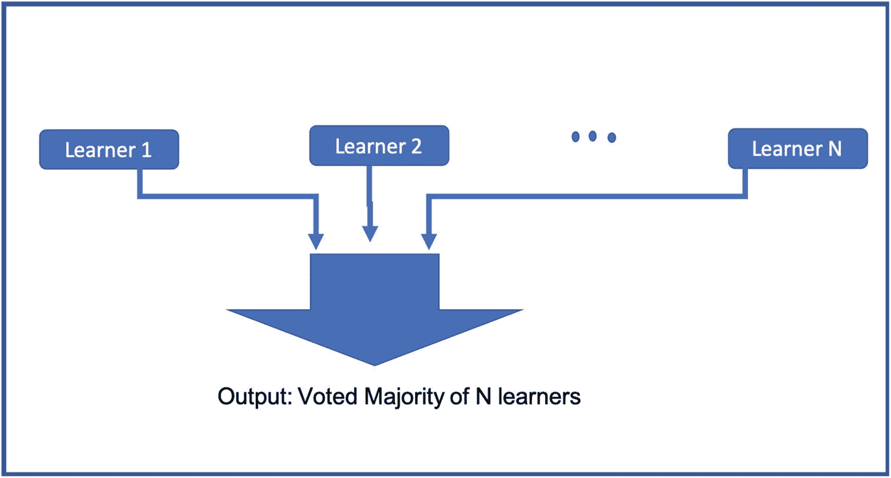
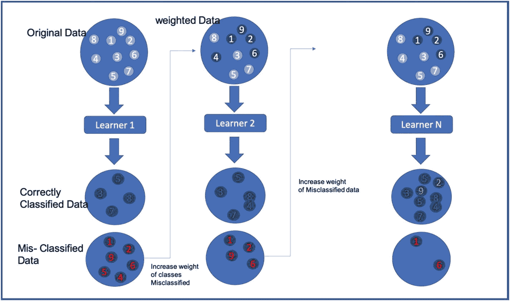
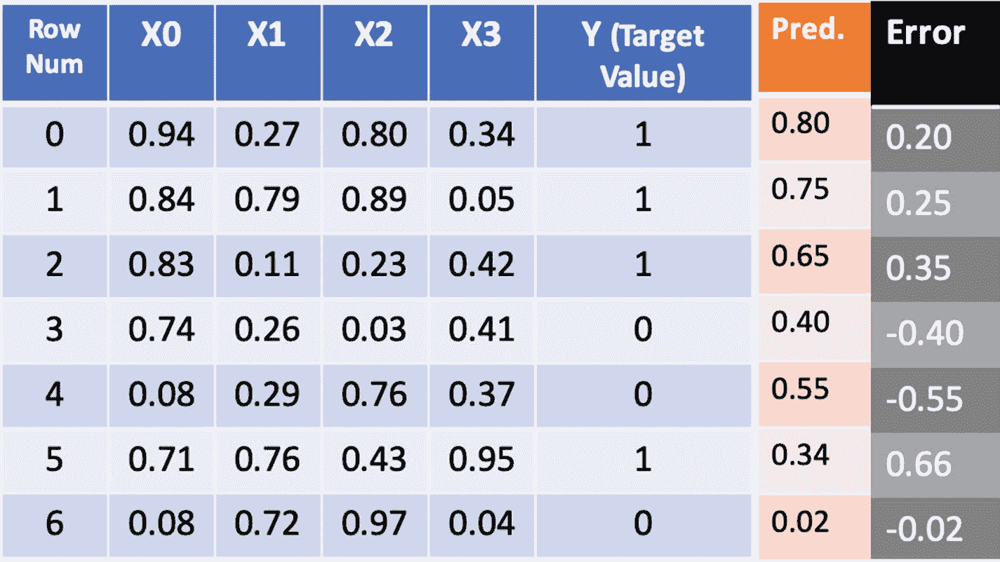
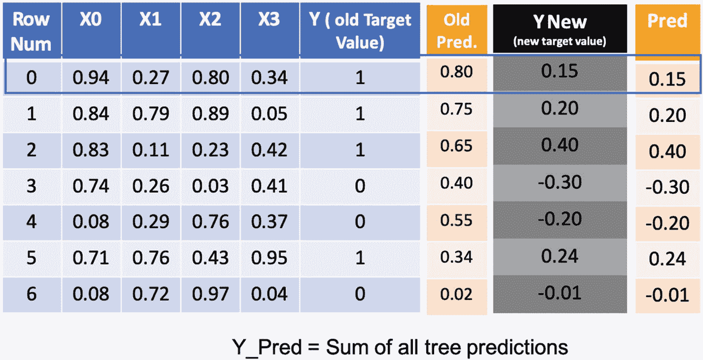
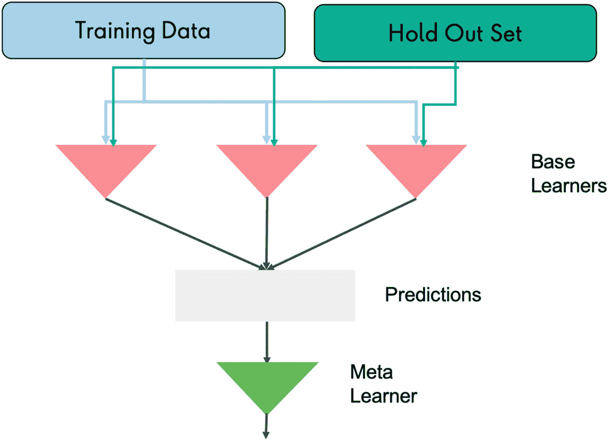

# 4. 混合组合

在前几章中，我们讨论了如何混合训练数据，以及如何混合机器学习模型以创建更强大的模型——利用集成学习的力量。

让我们继续这一学习过程。在本章中，我们将介绍并解释两种强大的集成学习技术，它们利用机器学习模型的混合组合来构建更强大的模型。我们将逐一探讨不同的组合方式。

以下是本章的目标。

*   介绍并解释**提升法**

*   研究如何使用 scikit-learn 实现提升法

*   介绍并解释**堆叠法**

*   研究如何使用 scikit-learn 实现堆叠法

*   查看其他混合组合的示例


## 提升方法

让我们通过一个学习过程的类比来开始讨论提升方法。假设你希望班级里的所有学生在各门科目上都表现良好，但有些学生在单元测试中成绩不佳。我们可以找出这些学生，并针对他们成绩较差的科目给予更多关注，使他们能够跟上其他学生的水平。为了提供更多关注，我们调整学习过程，通过增加课程和分配额外时间来弥补学生的薄弱环节。这确保了学生在所有科目上整体表现更好。

我们将同样的类比应用到机器学习中。我们从一组学习器开始。每个机器学习学习器都在训练对象的特定子集上进行训练。如果某个模型学习器表现不佳，我们可以对该学习器给予更多关注。这被称为**提升方法**。

首先，让我们讨论一种最简单但最重要的提升技术——AdaBoost。

## AdaBoost

为了更好地理解 AdaBoost，请看图 4-1。最初，数据使用模型分类器进行训练。红色框中的数据子集是错误分类的数据；而绿色框代表正确分类的数据。

为了提高模型的性能，我们不再对分类器模型中的所有数据赋予相同的权重，而是增加错误分类数据的权重，并重新运行训练。由于我们增加了错误分类数据点/观测值的权重，在后续迭代中，它们被正确分类的概率更高，因为模型会给予这些数据点更多重视。我们重复这个过程，直到达到 *n* 次迭代，此时我们获得了期望的模型性能。这些弱分类学习器的组合通过投票（见图 4-2）来得到最终模型。请注意，这种方法通常优于非常复杂的技术。

总之，为了提高效率，我们可以更新错误分类观测值的权重。适当增加错误分类观测值的权重有助于在后续迭代中提高正确分类观测值的数量。通过重复这些迭代，我们可以从一个非常弱的分类器得到一个高质量的分类器。即使我们使用性能较弱的机器学习模型，也能提升输出结果。



图 4-2

AdaBoost 提升中 n 个学习器的投票



图 4-1

AdaBoost 提升

代码清单 4-1 展示了如何使用 scikit-learn 库中的 AdaBoost。

默认情况下，scikit-learn 使用最大深度为 1 的决策树分类器作为基础学习器。要创建一个 AdaBoost 分类器，我们传递一个额外的参数 n_estimators（在此示例中，n_estimators = 100）。AdaBoost 会在基础学习器的每个额外提升权重副本上运行，直到数据完美拟合或达到 n_estimators 的限制。最多会创建 100 个基础决策树学习器的副本，每个副本都具有提升后的权重。

你可以在 scikit-learn 的 [`https://scikit-learn.org/stable/modules/generated/sklearn.ensemble.AdaBoostClassifier.html`](https://scikit-learn.org/stable/modules/generated/sklearn.ensemble.AdaBoostClassifier.html) 上阅读更多关于 AdaBoost 分类器不同参数的信息。

```
from sklearn.model_selection import cross_val_score
from sklearn.datasets import load_iris
from sklearn.ensemble import AdaBoostClassifier
X, y = load_iris(return_X_y=True)
clf = AdaBoostClassifier(n_estimators=100)
scores = cross_val_score(clf, X, y, cv=5)
print(scores.mean())
# Output: 0.9466...
代码清单 4-1
使用 scikit-learn 的 AdaBoost
```

## 梯度提升

梯度提升与一般的提升方法类似。你需要迭代地提升或增强弱学习器。与 AdaBoost 不同（AdaBoost 在增加错误分类观测值的权重后添加新的学习器），在梯度提升中，你是在前一个预测器产生的残差上训练一个新模型。如果这听起来不太明白，别担心。让我们看一个例子。

首先，尝试理解残差的概念。图 4-3 是一个示例数据集。X0 到 X3 是特征/变量，Y 是真实值或目标值。



图 4-3

残差

现在假设在这个数据集上训练了一个深度很浅的简单决策树（一个弱学习器）。训练完成后，决策树上的预测/推断结果列在 Pred 列中。

每个观测值的输出与机器学习模型预测输出之间的差异称为**残差**。在图 4-3 中，Error 列代表残差字段。

在基于梯度的提升方法中，你学习一个新的分类器；不是使用特征 X0 到 X3，而是将前一个分类器的残差作为新的目标（YNew）来训练新模型。

让我们总结一下到目前为止讨论的所有步骤。

1.  在训练集上使用决策树回归器。
2.  在第一个回归器的残差上使用第二个决策树回归器。
3.  在第二个回归器的残差上使用第三个决策树回归器。

现在你有了一个包含三棵树的集成模型，可以通过对所有树的预测求和来对新实例进行预测。

该算法的输出如图 4-4 所示。



图 4-4

残差（续）

代码清单 4-2 是在 scikit-learn 库中使用梯度提升的示例代码。默认情况下，scikit-learn 使用最大深度为 1 的决策树分类器作为基础学习器。

你可以在 scikit-learn 的 [`https://scikit-learn.org/stable/modules/generated/sklearn.ensemble.GradientBoostingClassifier.html`](https://scikit-learn.org/stable/modules/generated/sklearn.ensemble.GradientBoostingClassifier.html) 上阅读更多关于梯度提升分类器参数的信息。

```
from sklearn.datasets import make_hastie_10_2
from sklearn.ensemble import GradientBoostingClassifier
from sklearn.model_selection import cross_val_score
X, y = make_hastie_10_2(random_state=0)
clf = GradientBoostingClassifier(
n_estimators=100, learning_rate=1.0, max_depth=1, random_state=0
).fit(X, y)
scores = cross_val_score(clf, X, y, cv=5)
print(scores.mean())
# Output: 0.9225
代码清单 4-2
使用 scikit-learn 的梯度提升
```


## XGBoost

XGBoost 是一种先进的算法和软件系统，专门研究残差梯度提升技术。它通过添加以下参数（我们不会详细展开）来改进普通的梯度提升技术。

*   它动态确定用作弱学习器的决策树的深度，并添加惩罚参数以防止树过深。这可以防止过拟合并提升性能。

*   它对树上的叶节点使用比例收缩。

*   它使用[牛顿树提升](https://en.wikipedia.org/wiki/Newton%2527s_method_in_optimization)来优化学习树结构。

*   它添加随机化参数以实现最优学习。

清单 4-3 是使用 scikit-learn 和 XGBoost 库的示例代码。

XGBoost 库的文档位于 [`https://xgboost.readthedocs.io/en/latest/`](https://xgboost.readthedocs.io/en/latest/)。

XGBoost 的官方 GitHub 页面位于 [`https://github.com/dmlc/xgboost/`](https://github.com/dmlc/xgboost/)。在那里你可以找到分类和回归问题的各种代码示例。

提示

要在 Anaconda Python 3.7 版本中轻松安装 XGBoost 库，请使用以下命令：`conda install -c conda-forge xgboost`

```
import xgboost as xgb
from sklearn.datasets import load_breast_cancer
from sklearn.model_selection import train_test_split
from sklearn.metrics import accuracy_score
import numpy as np
# read in data
iris = load_breast_cancer()
X = iris.data
y = iris.target
X_train, X_test, y_train, y_test = train_test_split(X, y, test_size=0.2, random_state=42)
# use DMatrix for xgbosot
dtrain = xgb.DMatrix(X_train, label=y_train)
dtest = xgb.DMatrix(X_test, label=y_test)
# set xgboost params
param = {
'max_depth': 5,  # the maximum depth of each tree
'eta': 0.3,  # the training step for each iteration
'silent': 1,  # logging mode - quiet
'objective': 'multi:softprob',  # error evaluation for multiclass training
'num_class': 3}  # the number of classes that exist in this datset
num_round = 200  # the number of training iterations
bst = xgb.train(param, dtrain, num_round)
# make prediction
preds = bst.predict(dtest)
preds_rounded = np.argmax(preds, axis=1)
print(accuracy_score(y_test, preds_rounded))
# Output: 0.9649122807017544
清单 4-3
使用 scikit-learn 和 XGBoost 库在乳腺癌数据集上的 XGBoost 示例
```

## Stacking

Stacking 是一种略有不同的混合组合方式。

在这种集成技术中，我们首先一起训练多个模型（**基学习器**）来获得预测结果。在 Stacking 中，各个预测的结果随后被视为下一组训练数据，并以称为**元学习器**的另一层形式添加（见图 4-5）。

你可以将这种技术想象成将一层机器学习学习器堆叠在另一个机器学习学习器之上。

想象一下，你正在参加一个电视游戏节目，必须回答一个历史问题。你向两位朋友求助；一位是历史专业，另一位是计算机科学专业。你更信任谁能给出正确答案？你的知识让你更信任你历史专业朋友的答案（或者从技术上讲，给其中一个基础学习器更高的权重）。

Stacking 基于相同的理念：我们不是使用简单的函数（如硬投票）来聚合集成中所有学习器的预测，而是训练一个模型来执行这种聚合。让我们看一个例子来更好地理解这一点。



图 4-5

Stacking

清单 4-4 是在 scikit-learn 库中使用 Stacking 的示例代码。此外，如果你想将 Stacking 应用于任何回归问题，可以参考清单 4-5，我们在其中使用 scikit-learn 库对回归问题进行了 Stacking。

你可以从参考页面 [`https://scikit-learn.org/stable/modules/generated/sklearn.ensemble.StackingClassifier.html`](https://scikit-learn.org/stable/modules/generated/sklearn.ensemble.StackingClassifier.html) 阅读更多关于 scikit-learn 中 Stacking 分类器不同参数的信息。

```
from sklearn.datasets import load_diabetes
from sklearn.linear_model import RidgeCV
from sklearn.svm import LinearSVR
from sklearn.ensemble import RandomForestRegressor
from sklearn.ensemble import StackingRegressor
X, y = load_diabetes(return_X_y=True)
estimators = [("lr", RidgeCV()), ("svr", LinearSVR(random_state=42))]
reg = StackingRegressor(
estimators=estimators,
final_estimator=RandomForestRegressor(n_estimators=10, random_state=42),
)
from sklearn.model_selection import train_test_split
X_train, X_test, y_train, y_test = train_test_split(X, y, random_state=42)
reg.fit(X_train, y_train).score(X_test, y_test)
# Output: 0.3...
清单 4-5
使用 scikit-learn 进行 Stacking 回归
```

```
from sklearn.datasets import load_iris
from sklearn.ensemble import RandomForestClassifier
from sklearn.svm import LinearSVC
from sklearn.linear_model import LogisticRegression
from sklearn.preprocessing import StandardScaler
from sklearn.pipeline import make_pipeline
from sklearn.ensemble import StackingClassifier
X, y = load_iris(return_X_y=True)
estimators = [
("rf", RandomForestClassifier(n_estimators=10, random_state=42)),
("svr", make_pipeline(StandardScaler(), LinearSVC(random_state=42))),
]
clf = StackingClassifier(estimators=estimators, final_estimator=LogisticRegression())
from sklearn.model_selection import train_test_split
X_train, X_test, y_train, y_test = train_test_split(X, y, stratify=y, random_state=42)
clf.fit(X_train, y_train).score(X_test, y_test)
# Output: 0.9…
清单 4-4
使用 scikit-learn 进行 Stacking 分类
```

## 总结

让我们快速回顾一下本章涵盖的内容。

*   组合集成
*   重要的组合技术：Boosting 和 Stacking
*   各种 Boosting 技术，包括 AdaBoost、梯度提升和 XGBoost
*   Stacking 将一组集成学习器叠加在另一组之上，以形成一个元学习器
*   使用 scikit-learn 代码示例进行 Stacking 分类和回归问题

