# 5. 使用集成学习库

使用高质量的库可以加速初始开发，减少错误，减少重复造轮子的情况，并降低长期维护成本。鉴于机器学习本质上是实验性的，库能够实现快速且可维护的实验。

本章的目标是：

*   介绍 ML-Ensemble，一个基于 Python 的开源库，它封装了 scikit-learn 的集成类，以提供高级 API。
*   通过 Dask 扩展 XGBoost，Dask 是一个用于 Python 并行计算的灵活库。Dask 和 XGBoost 可以协同工作，并行训练梯度提升树。
*   使用微软的 LightGBM 学习 Boosting。
*   介绍 AdaNet，一个基于 TensorFlow 的轻量级框架，用于学习神经网络架构，但也用于学习集成模型。


## ML-Ensemble

ML-Ensemble，也称为 mlens，是一个开源 Python 库，用于构建与 scikit-learn 兼容的集成估计器。

你可以通过 pip 安装它。

```
pip install mlens
```

构建集成的 API 风格与 Keras 等库非常相似。它提供了一种非常简单直接的方式来构建具有复杂交互的深度集成。

但是，为什么我们需要一个单独的库来进行集成呢？嗯，scikit-learn 并不直接支持堆叠。你仍然可以自己编写，但之后你必须自己维护它。ML-Ensemble 提供了一种通用的集成估计器的方法，并且有合理的文档。即使你决定不在生产代码中使用它，它也值得探索。该 API 可以帮助你非常快速地尝试不同的集成。

让我们通过 mlens 构建一个堆叠集成。回想一下，**堆叠**通过一个元学习器组合多个分类或回归估计器。第一层估计器基于完整的训练集进行训练，然后元学习器在第一层估计器预测的输出上进行训练。

让我们先设置数据。我们将使用 `make_moons` 数据集。如果你不知道，`make_moons` 是一个简单的玩具数据集，它生成两个半圆交错的数据集。

```
# ---数据设置----
import numpy as np
from sklearn.metrics import accuracy_score
from sklearn.datasets import make_moons
seed = 42
X, y = make_moons(n_samples=10000,noise=0.4, random_state=seed)
# --- 1. 初始化 ---
from mlens.ensemble import SuperLearner
ensemble = SuperLearner(scorer=accuracy_score, random_state=seed)
# --- 2. 构建第一层 ---
ensemble.add([RandomForestClassifier(random_state=seed), SVC(random_state=seed)])
# --- 3. 附加最终的元学习器
ensemble.add_meta(LogisticRegression())
# --- 训练 ---
ensemble.fit(X_train, y_train)
# --- 预测 ---
preds = ensemble.predict(X_test)
代码清单 5-1
通过 mlens 实现堆叠集成
```

现在，让我们浏览一下代码。集成本质上是一个三步过程。

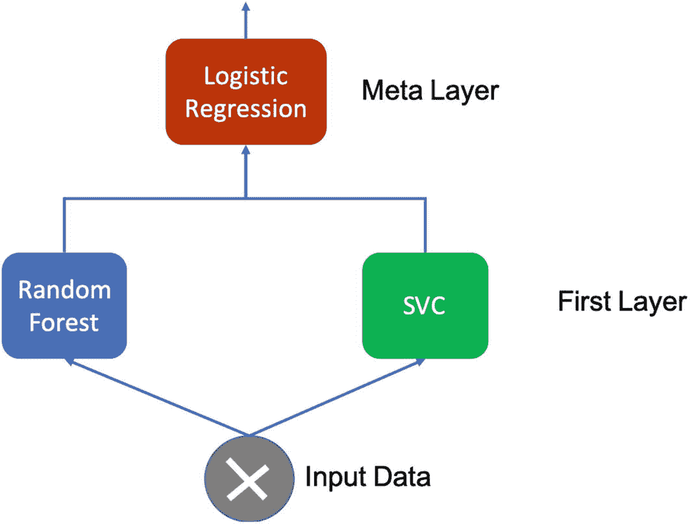

图 5-1

单层堆叠集成

1.  初始化集成，这里是 `SuperLearner`。

2.  添加中间估计器。这里我们添加了两个分类器：`RandomForest` 和 `SVM`。请注意，它们将并行执行。

3.  添加元学习器，这里是 `LogisticRegression`。

4.  调用 `fit` 方法并进行预测。从视觉上看，它可以表示为图 5-1 所示。

这感觉是不是像在设置一个神经网络，我们通过堆叠层来构建网络？

要检查各层中估计器的性能，请调用 `data` 属性。

```
print("拟合数据:\n%r" % ensemble.data)
拟合数据:
score-m score-s ft-m ft-s pt-m  pt-s
layer-1  randomforestclassifier     0.84    0.00 0.06 0.00 0.01 0.00
layer-1  svc                        0.86    0.00 0.14 0.00 0.06 0.00
```

第一列 `score-m` 包含得分。后缀 `-m` 表示平均值，`-s` 表示跨折的标准差（为简洁起见）。`ft` 和 `pt` 分别代表拟合时间和预测时间。我们鼓励你阅读文档以获取更多信息。请注意，我们在 `SuperLearner` 初始化时提供了评分函数。如果我们可以在第一层添加两个估计器，那么你可以在任何层添加更多估计器也就不足为奇了。

### 多层集成

添加多层同样直接。我们只需要调用 `add` 函数来添加一个新层。请注意，各层是按顺序执行的。但是，在一层内部，估计器可以并行运行。

```
ensemble = SuperLearner(scorer=accuracy_score, random_state=seed, verbose=2)
# 构建第一层
ensemble.add([RandomForestClassifier(random_state=seed), LogisticRegression(random_state=seed)])
# 构建第二层
ensemble.add([LogisticRegression(random_state=seed), SVC(random_state=seed)])
# 附加最终的元估计器
ensemble.add_meta(SVC(random_state=seed))
```

图 5-2 是该集成的可视化表示。

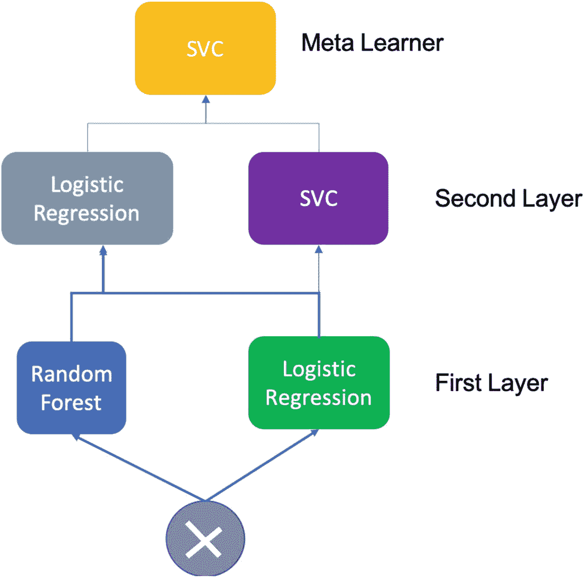

图 5-2

多层堆叠集成

### 集成模型选择

为了充分利用集成中的学习能力，进行超参数调优非常重要，将基学习器的参数视为集成的参数。元学习器是集成的关键部分，但是你如何选择合适的元学习器呢？如果每次都必须评估整个集成，那么选择合适的元学习器的任务将变得计算量巨大。

这个问题的一个可能的解决方法是，将集成的较低层视为预处理管道，然后仅对较高层或元学习器执行模型选择。将预处理管道视为只评估一次的缓存结果。为了将集成用于此目的，在拟合之前将 `model_selection` 参数设置为 `True`。这将修改 `transform` 方法的行为，并确保在测试折上调用 `predict`。

在我们查看模型选择的端到端代码之前，你还需要了解一些其他的库组件。

#### 评分函数

我们需要将评分函数包装在 mlens 的 **make_scorer()** 函数中。

这本质上是从一个性能指标或损失函数创建一个评分器。

```
from mlens.metrics import make_scorer
accuracy_scorer = make_scorer(accuracy_score, greater_is_better=True)
```

`greater_is_better` 参数为 `True` 表示 `准确率`，而为 `False` 表示 `误差/损失`。

但是为什么我们需要这样做？这是为了确保所有学习器的评分方式相同。

`make_scorer` 包装器是 scikit-learn 的 **sklearn.metrics.make_scorer()** 的一个副本。sklearn 的 `make_scorer` 是一个工厂函数，用于包装评分函数，以便在 `GridSearchCV` 和 `cross_val_score` 中使用。它接受一个评分函数，例如 **accuracy_score**、**mean_squared_error**、**adjusted_rand_index** 或 **average_precision**，并返回一个可调用对象，用于对估计器的输出进行评分。所以，为了让你不迷失在这里，请记住我们的目标是找到合适的元学习器。既然你知道如何使评分保持一致，那么让我们讨论一下该库如何管理处理管道。

#### 评估器

mlens 的 `Evaluator` 类允许你跨多个预处理管道并行地对多个模型进行网格搜索。评估器类会预拟合转换器，从而避免在相同数据上重复拟合相同的预处理管道。让我们浏览一下代码以更好地理解它。为简洁起见，我们省略了一些常见且显而易见的代码。

```
from mlens.model_selection import Evaluator
from scipy.stats import randint
from sklearn.naive_bayes import GaussianNB
from sklearn.neighbors import KNeighborsClassifier
```

现在我们需要命名估计器。

```
ests = [('gnb', GaussianNB()), ('knn', KNeighborsClassifier())]
```

然后我们准备参数列表。这与你在网格搜索或随机搜索中所做的没有什么不同。请注意，GNB 没有被包含在内，因为它没有任何参数。

```
pars = {'n_neighbors': randint(2, 20)}
params = {'knn': pars}
```

现在，我们可以通过调用 `evaluate` 方法对这些估计器和参数分布进行评估。

```
evaluator = Evaluator(scorer=accuracy_scorer, cv=10)
evaluator.fit(X, y, ests, params, n_iter=10)
```

你可以通过 `Evaluator` 的 `cv_results` 和 `summary` 属性检查结果和摘要。


#### 预处理

mlens 的预处理功能可帮助您在一组预处理管道中比较模型。它通过一个充当转换器的类来实现这一点，允许您将较低层或传入层用作“预处理”步骤，这样您只需迭代评估元学习器即可。让我们通过代码来更好地理解它。

```
from sklearn.preprocessing import StandardScaler
preprocess_cases = {'none': [],
'sc': [StandardScaler()]
}
```

我们指定了一个要运行的预处理管道字典。字典中的每个条目都是一个要按顺序应用的转换器列表。

现在是时候看一个端到端的示例，来了解所有部分是如何协同工作的了。

```
from mlens.model_selection import Evaluator
from mlens.ensemble import SequentialEnsemble #--1
from mlens.metrics import make_scorer
from scipy.stats import uniform, randint
base_learners = [RandomForestClassifier(random_state=seed),
SVC(probability=True)] #--2
proba_transformer = SequentialEnsemble(
model_selection=True, random_state=seed).add(
'blend', base_learners, proba=True) #--3
class_transformer = SequentialEnsemble(
model_selection=True, random_state=seed).add(
'blend', base_learners, proba=False) #--4
preprocessing = {'proba': [('layer-1', proba_transformer)],
'class': [('layer-1', class_transformer)]} #--5
meta_learners = [SVC(random_state=seed), ('rf', RandomForestClassifier(random_state=seed))] #--6
params = {'svc': {'C': uniform(0, 10)},
'class.rf': {'max_depth': randint(2, 10)},
'proba.rf': {'max_depth': randint(2, 10),
'max_features': uniform(0.5, 0.5)}
} #--7
scorer = make_scorer(accuracy_score) #--8
evaluator = Evaluator(scorer=scorer, random_state=seed, cv=2) #--9
evaluator.fit(X, y, meta_learners, params, preprocessing=preprocessing, n_iter=2)#--10
from pandas import DataFrame
df = DataFrame(evaluator.results) #--11
清单 5-2
通过 mlens 实现的处理管道
```

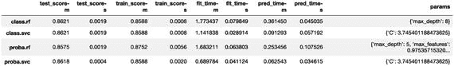

让我们来解析一下这段代码。


1.  导入 **SequentialEnsemble** 类。**SequentialEnsemble** 允许用户构建具有不同层类别的集成模型。这些层类别包括混合层、子集层和堆叠层。这三种类别是将训练集映射到元学习器使用的预测集的不同方式。

2.  使用 `RandomForest` 和 `SVM` 作为基础学习器。

3.  设置两个相互竞争的集成基础作为预处理转换器。这是一个带有概率的混合集成基础。请注意，`proba` 表示该层是否应预测类别概率。这里将调用估计器的 **predict_proba** 方法。

4.  这是一个不带概率的混合集成。请注意，`model_selection` 参数设置为 `True`。这会修改 `transform` 方法的行为，并确保在测试折上调用 `predict`。

5.  设置预处理映射。在评估候选元学习器之前，此映射中的每个管道都会在每个折上拟合一次。

6.  设置候选元学习器。这里的估计器将在所有预处理管道上运行。

7.  设置参数映射。请注意，随机森林在不同情况下的分布是不同的。

8.  包装评分函数。您已经知道原因了。

9.  实例化评估器。

10. 调用评估器的拟合方法。

11. 这不是必需的，但您可以将评估器结果加载到数据框中，以格式化的方式查看结果。同样，`-s` 和 `-m` 后缀分别代表均值和标准差。

#### 总结

让我们快速回顾一下。ML-Ensemble 提供了类似 Keras 风格的 API 来构建集成模型。Superlearner 类有助于构建堆叠集成。mlens 提供了不同类型的堆叠层，例如堆叠层、混合层和子集层。多次运行整个集成以比较不同的元学习器可能代价高昂。ML-Ensemble 实现了一个充当转换器的类，允许您将传入层用作“预处理”步骤，这样您只需迭代评估元学习器即可。您可以在 [`http://ml-ensemble.com/info/index.html`](http://ml-ensemble.com/info/index.html) 找到项目文档。

## 通过 Dask 扩展 XGBoost

如您所知，XGBoost 是梯度提升的一种优化实现，而 Dask 是 Python 中用于并行计算的灵活库。

您可以结合两者来并行训练梯度提升树。

在通过 Dask 扩展 XGBoost 之前，您需要了解 Dask。

要理解并体会 Dask 的价值，您需要了解 Python 科学计算生态系统。图 5-3 让您大致了解如此多有用库和框架的广泛可用性。

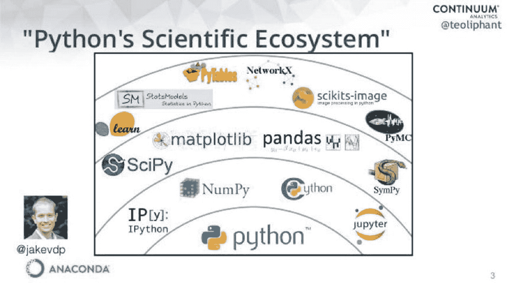

图 5-3

Python 科学计算生态系统

然而，这些包并非为扩展到单机之外而设计。Dask 的开发目的是为了扩展这些包及其周边生态系统。它与现有的 Python 生态系统协同工作，将其扩展到多核机器和分布式集群。这些库中的大多数是不可扩展的。对于无法放入计算机内存的数据集，您将如何使用 NumPy 或 Pandas？Dask 使 NumPy 和 Pandas 能够处理分布式数据。分布式 NumPy 和 Pandas 的想法是不是很酷、很令人兴奋？不过，Dask 并不局限于扩展 NumPy 和 Pandas；其可扩展性优势扩展到了整个生态系统。

从高层次来看，Dask 帮助您解决两个问题。

*   处理大于 RAM 的数据集。（您已经知道 Pandas 和 NumPy 需要将整个数据集加载到内存中。）

*   将任务分配到线程、核心或不同的机器上。

最棒的是，由于 Dask 基于 Python，并且其 API 与大多数 scikit-learn 库接口相匹配，您会感到非常熟悉。

Dask 在两个层面上运行。

*   在高层，Dask 提供了高级的 Array、Bag 和 DataFrame 集合，它们模仿了 NumPy、列表和 Pandas，但可以在无法放入主内存的数据集上并行操作。对于大型数据集，Dask 的高级集合是 NumPy 和 Pandas 的替代方案。

*   在底层，Dask 提供了动态任务调度器，可以并行执行任务图。在复杂情况下，Dask 的调度器是直接使用线程或多处理库，或其他任务调度系统（如 Luigi 或 IPython Parallel）的替代方案。

Dask 的逻辑架构（见图 5-4）可以帮助您更好地理解这些概念。

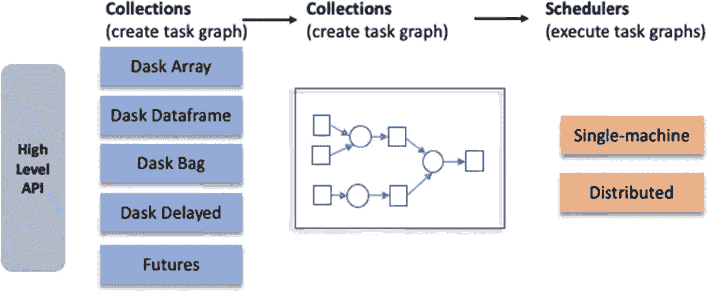

图 5-4

Dask 架构

现在，让我们深入了解一下 Dask 数组和数据框的内部机制。


### Dask 数组与数据框

一图胜千言。Dask 数组的逻辑结构如图 5-5 所示。

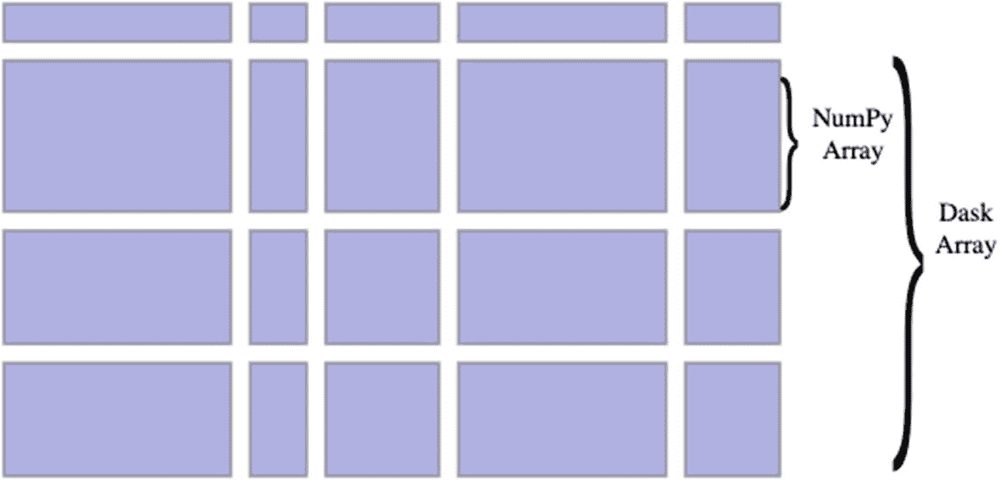

图 5-5

Dask 数组的逻辑结构

从图 5-5 中可以看出，尽管 Dask 数组为用户提供了单一的逻辑视图，但它本质上管理的是 NumPy 数组的集合。这幅图可能会在你脑海中激发一些想法，没错，这些想法都是正确的。你可以将处理不同线程、核心或机器的各个 NumPy 数组分配出去。它们位于何处并不重要。Dask 就像一个出色的秘书，在内部协调管理所有事务。

同样的图示（见图 5-6）也适用于数据框。Dask 数据框协调管理多个 Pandas 数据框，这些数据框沿索引进行分区。

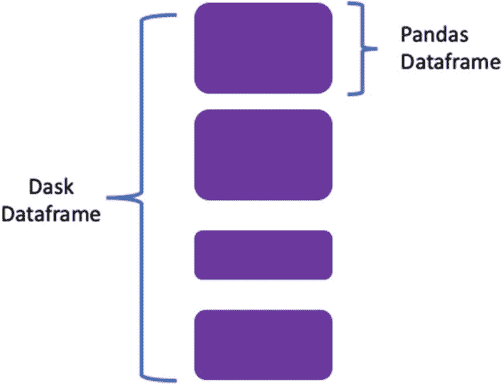

图 5-6

Dask 数据框的逻辑结构

让我们看看如何在 Dask 数据框中读取 CSV 文件的代码。

```
import dask.dataframe as dd
df = pd.read_csv("hdfs://mycsv.csv", parse_dates =['timestamp'])
```

再看看在 Pandas 中是如何实现的。

```
import pandas as pd
df = dd.read_csv("hdfs://mycsv.csv", parse_dates =['timestamp'])
```

两个库的代码完全相同，这并非复制粘贴错误。Dask API 在设计时充分考虑了 Python 风格，以确保学习曲线最小化。Python 数据计算生态系统中的几乎所有包都可以在几乎无需更改的情况下，受益于分布式和并行处理。

除了分布式处理，并行处理是 Dask 扩展数据处理任务的另一项功能。让我们看看 Dask 如何使用更简单的 `dask.delayed` 接口来并行化自定义算法。我们来看一下代码清单 5-3 中的代码。

```
def inc(x):
return x + 1
def double(x):
return x ∗ 2
def add(x, y):
return x + y
data = [1, 2, 3, 4, 5]
output = []
for x in data:
a = inc(x)
b = double(x)
c = add(a, b)
output.append(c)
total = sum(output)
代码清单 5-3
用于并行处理的 Dask delayed 接口
```

尽管代码很简单，但你可以清楚地看到处理过程是可以并行化的。`inc` 和 `double` 可以并行执行。

Dask 的 `delayed` 函数可以装饰上述函数，使它们以*惰性*方式运行。它不是立即执行函数，而是推迟执行，将函数及其参数放入一个任务图中。现在，我们将自定义函数包装在 `delayed` 函数中，如代码清单 5-4 所示。

```
import dask
output = []
for x in data:
a = dask.delayed(inc)(x)
b = dask.delayed(double)(x)
c = dask.delayed(add)(a, b)
output.append(c)
total = dask.delayed(sum)(output)
代码清单 5-4
Dask 惰性执行
```

需要注意的是，`inc`、`double`、`add` 或 `sum` 都尚未被调用。相反，对象 `total` 是一个 `delayed` 结果，其中包含整个计算的任务图。

幸运的是，你可以通过调用 `total.visualize()` 方法来查看任务图，如图 5-7 所示。

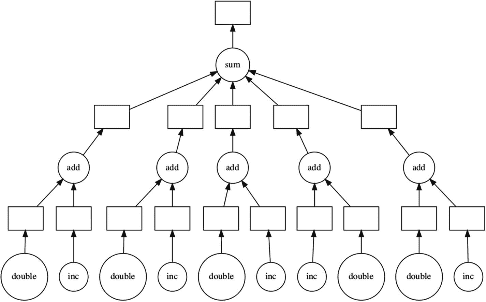

图 5-7

Dask 任务图

图中的每个节点都是可以分配给不同线程、进程池甚至机器的任务。这些节点在操作运行时执行。对于代码清单 5-2 中的代码，它将调用 compute 函数。

```
total.compute()
```

明确这里发生了什么很重要。这不是一个大数据集的问题，而是一个计算挑战。当你听到“杂乱数据”时，大多数情况下，它是大数据集和自定义数据处理逻辑的结合。Dask 在两个层面运作：大数据集和执行中的任务并行化。代码清单 5-5 是 Dask 数组任务的任务图。

```
import dask.array as da
x = da.ones((15, 15), chunks=(5, 5))
y = x + x.T
y.visualize()
代码清单 5-5
Dask 任务图
```

这里我们创建了一个由三个形状为 (5,5) 的块组成的 Dask 二维数组，然后将该数组与其转置相加。图 5-8 是该计算的任务图。

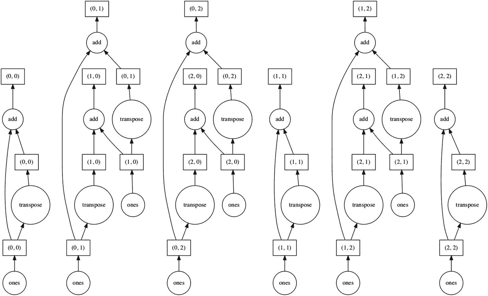

图 5-8

Dask 二维数组任务图


### Dask-ML

如果将 Dask 与 scikit-learn 结合，会得到什么？你将获得一个可扩展的机器学习算法。

但 scikit-learn 不是已经支持并行计算了吗？是的，但 scikit-learn 仅通过 Joblib 在单机上提供并行计算。让我们使用 LogisticRegression 构建一个分类器（见代码清单 5-6）。我们将使用 `make_classification` 数据集，该数据集会生成一个随机的 *n* 分类问题。

```
from dask_glm.datasets import make_classification
from dask_ml.linear_model import LogisticRegression
from dask_ml.model_selection import train_test_split
X, y = make_classification()
X_train, X_test, y_train, y_test = train_test_split(X, y, random_state=42)
lr = LogisticRegression()
lr.fit(X_train, y_train)
lr.predict(X_test)
代码清单 5-6
使用 Dask 在单机上运行 LogisticRegression
```

如果发现这段代码与标准的 scikit-learn 代码毫无区别，请不要惊讶。它使用了 Joblib，后者原生支持基于线程和进程的并行计算。在 scikit-learn 的常规使用中，`n_jobs=` 参数正是由 Joblib 提供支持的。从图形上看，该过程如图 5-9 所示。

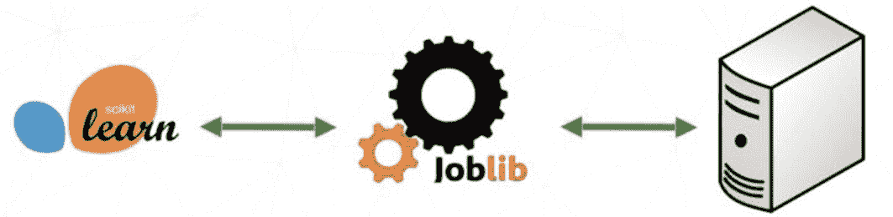

图 5-9

Dask 在单机上使用 Joblib 进行基于线程和进程的处理

注意

请查阅文档以了解如何安装 dask_ml。

Dask 可以将这种并行计算扩展到集群中的多台机器上。这对于中等规模的数据集效果良好，但对于大型计算任务（例如随机森林、超参数优化等）也同样适用。在查看代码之前，图 5-10 展示了分布式计算的样子。

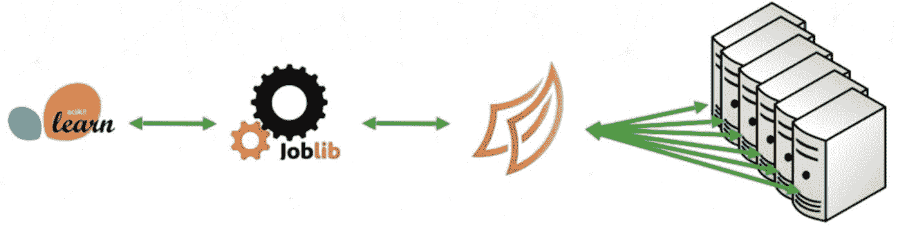

图 5-10

Dask 在集群环境中的并行执行

在这里，Dask 通过 Joblib 与 scikit-learn 通信，从而利用集群来训练模型。让我们通过代码清单 5-7 中的代码来了解实际运行情况。

```
from dask_ml.model_selection import GridSearchCV
parameters = {'penalty': ['l1', 'l2'], 'C': [0.5, 1, 2]}
lr = LogisticRegression()
est = GridSearchCV(lr, param_grid=parameters)
est.fit(X_train,y_train)
代码清单 5-7
通过 Dask 进行网格搜索和 LogisticRegression
```

到目前为止，一切都很熟悉。我们使用网格搜索来寻找 LogisticRegression 参数的最佳值：惩罚项和系数 C。数据集与我们在代码清单 5-6 中使用的相同。现在，我们希望将训练切换到集群上。

```
from dask_ml.model_selection import GridSearchCV
parameters = {'penalty': ['l1', 'l2'], 'C': [0.5, 1, 2]}
lr = LogisticRegression()
est = GridSearchCV(lr, param_grid=parameters)
import joblib #--1
from dask.distributed import Client #--2
client = Client() #--3
with joblib.parallel_backend('dask'): #--4
est.fit(X_train, y_train) #--5
代码清单 5-8
通过 Dask 在集群上进行训练
```

让我们来解析这段代码。请注意，scikit-learn 的网格搜索代码没有变化，并且我们使用的是与代码清单 5-6 中相同的数据。

1.  我们导入 Joblib 库。回想一下，Joblib 在本地机器的不同线程或进程上运行 scikit-learn 函数。我们导入它是为了注册新的后端，这里就是 Dask。这本质上是从图 5-9 切换到图 5-10。

2.  我们从 Dask 的 `dask.distributed` 中导入 **Client**，用于连接到 Dask 集群。

3.  我们初始化客户端以连接到 Dask 集群。但是我们什么时候启动的集群呢？当客户端不带参数初始化时，集群会在本地运行。要在本地运行集群，我们只需初始化不带任何参数的 **Client** 即可。

4.  在 `joblib.parallel_backend` 上下文中，我们指定使用 Dask 后端或集群进行训练。

5.  现在，估计器是在集群上拟合，而不是在线程或进程上。

该集群可以在使用 Docker 或 Kubernetes 的云环境中运行。请查阅有关在云机器上设置集群的文档。

### 扩展 XGBoost

你在之前的章节中已经了解了 XGBoost。在这里，你将学习如何使用 Dask 和 XGBoost 并行训练梯度提升树。回想一下，XGBoost 代表 eXtreme Gradient Boosting（极端梯度提升），顾名思义，它是梯度提升的一种实现。梯度提升方法试图拟合一个新的预测器来修正前一个预测器产生的*残差*。

**dask-xgboost** 项目非常小巧且简单（约 200 行代码）。与拥有调度器和工作节点的 Dask 集群类似，Dask 会在运行 Dask 调度器的同一进程中启动一个 XGBoost 调度器，并在每个 Dask 工作节点中启动一个 XGBoost 工作节点。它们共享相同的物理进程和内存空间。Dask 的设计就是为了支持这种情况，因此它才能如此无缝地工作。在训练期间，Dask 工作节点将所有 Pandas 数据框（构成 Dask 数据框的组成部分）提供给本地的 XGBoost，并让 XGBoost 自行处理。需要重点注意和记住的是，Dask 并不驱动 XGBoost；它只是进行设置、提供数据，然后让 XGBoost 在后台完成其工作。

Dask 和 XGBoost 可以相互共享数据，并且可以相互监控，因为它们可以存在于同一个 Python 进程中。这与 NumPy 和 Pandas 在单个进程内协同工作的方式非常相似。如果你希望轻松使用多个专门服务并避免大型单体框架，那么在多个系统之间共享分布式进程会非常有益。现在，让我们看看如何在代码中使用 XGBoost 与 Dask（见代码清单 5-9）。

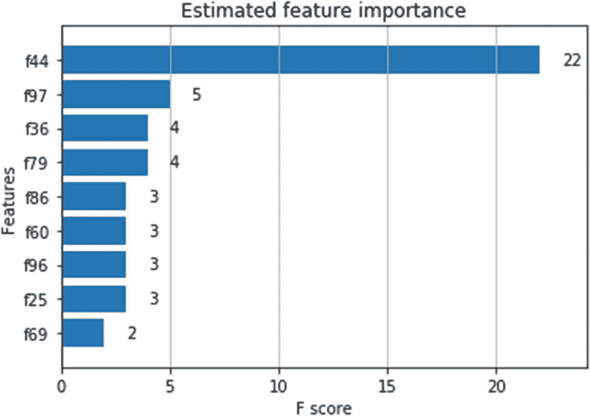

图 5-11

特征重要性得分图

```
from dask.distributed import Client
client = Client() # --1
#准备虚拟数据集
from dask_ml.datasets import make_classification
X, y = make_classification(n_samples=100000, n_features=20,
chunks=1000, n_informative=4,
random_state=0) #--2
#分割训练集和测试集
from dask_ml.model_selection import train_test_split
X_train, X_test, y_train, y_test = train_test_split(X, y, test_size=0.15) #--3
#训练 Dask-XGBoost
import xgboost
import dask_xgboost
params = {'objective': 'binary:logistic',
'max_depth': 4, 'eta': 0.01, 'subsample': 0.5,
'min_child_weight': 0.5} #--4
bst = dask_xgboost.train(client, params, X_train, y_train, num_boost_round=10) #--5
#绘制特征重要性
%matplotlib inline
import matplotlib.pyplot as plt
ax = xgboost.plot_importance(bst, height=0.8, max_num_features=9)
ax.grid(False, axis="y")
ax.set_title('估计的特征重要性')
plt.show()
#结果
代码清单 5-9
通过 Dask 扩展 XGBoost
```

让我们来解析这里的代码。

1.  初始化客户端。你已经知道 Dask 集群将是本地的。你可以检查 `cluster` 的值来查看集群详情。

2.  使用 `make_classification` 函数生成一个随机的玩具数据集。我们之前也使用过这个函数。

3.  将数据集分割为训练数据和测试数据，以便通过确保公平测试来辅助评估。

4.  指定 XGBoost 参数。

5.  调用 `train` 方法来拟合模型。`dask-xgboost` 是 XGBoost 的一个小型封装。Dask 设置好 XGBoost，将数据提供给 XGBoost，然后让 XGBoost 利用所有 Dask 工作节点在后台进行训练。`bst` 对象是一个常规的 `xgboost.Booster` 对象，这意味着 XGBoost 的所有方法在这里都可用。

6.  使用 `xgboost.plot_importance` 方法绘制特征重要性。


### Microsoft LightGBM

LightGBM 是一个基于决策树算法的快速、分布式、高性能梯度提升框架。它可用于排序、分类以及许多其他机器学习任务。

如果你关注 Kaggle 竞赛，那么你一定了解 Boosting 的强大与流行。作为先驱的 XGBoost 已成为赢得 Kaggle 竞赛的标准算法。然而，在处理大规模数据时，XGBoost 的训练时间会急剧增加。LightGBM 解决了可扩展性和速度问题，同时显著降低了内存消耗。值得记住的是，XGBoost 和 LightGBM 都是 GBT（梯度提升）的具体实例，它们都实现了相同的基础算法；然而，它们各自引入了不同的技巧，以使训练更高效或提升性能。它被设计为分布式且高效的，具有以下优势。

*   更快的训练速度和更高的效率
*   更低的内存使用
*   更好的准确性
*   支持并行和 GPU 学习
*   能够处理大规模数据

#### 为什么 LightGBM 架构最佳

XGBoost 和 LightGBM 同属梯度提升决策树（GBDT）家族，因此具有相似的架构。在此，我们重点介绍使 LightGBM 能够训练出精确模型的架构思想。

##### 树的生长

为了分裂和训练每个单独的决策树，可以采用两种策略：按层生长和按叶生长。

按层生长策略维护一棵平衡树。平衡树是指每个叶子节点与根节点的“距离”都不超过其他任何叶子节点。本质上，所有叶子节点到根节点的距离相同。你可以在图 5-12 中看到，分裂确保了树保持平衡。

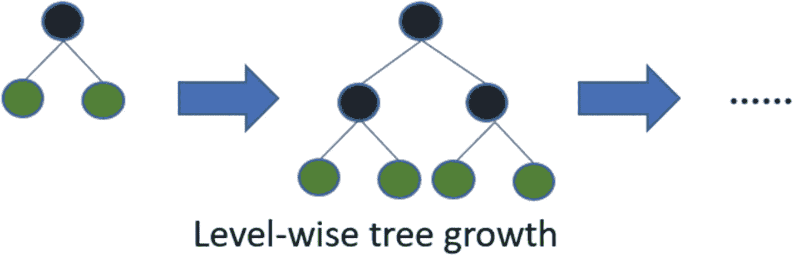

图 5-12

按层树分裂策略（来源：[`https://mlexplained.com`](https://mlexplained.com)）

按叶生长策略会分裂那个使损失减少最多的叶子节点（见图 5-13）。这使得训练更加灵活，尽管容易过拟合。LightGBM 按叶生长树。它选择具有最大 delta 损失的叶子节点进行生长。在保持叶子节点数量固定的情况下，按叶算法往往比按层算法实现更低的损失。有趣的是，按叶生长曾是 LightGBM 的独有特性，但 XGBoost 也已实现了这种生长策略。

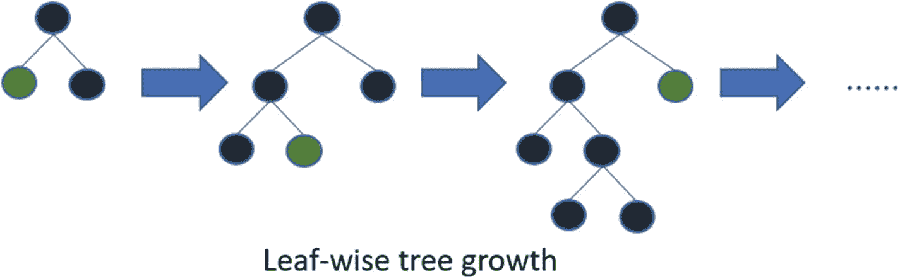

图 5-13

按叶树分裂策略（来源：[`https://mlexplained.com`](https://mlexplained.com)）

##### 寻找最佳分裂点

为每个叶子节点找到最佳分裂点是训练 GBDT 的关键挑战。

你可以使用暴力方法，遍历每个特征来寻找最佳分裂点，但这既不可扩展也不实用。

想象一个包含数百万文档和百万词汇量大小的数据集。GBDT 在 tf-idf 矩阵上进行训练将耗费无尽的时间。唯一可行的方法是以某种方式近似最佳分裂点。让我们看看几种实现此目标的策略。

###### 基于直方图的方法

基于直方图的方法将特征分组到一组箱（bin）中，并在箱上执行分裂，而不是在特征上。这有助于加速训练并降低复杂度，因为可以在构建每棵树之前对特征进行分箱。请注意，要使此方法有效，必须预先对特征进行排序。

###### 处理缺失值

鉴于 LightGBM 经常用于表格或文本数据，其输入往往是稀疏的。一种可能的选项是忽略缺失值，然后将其分配给能够减少损失的分裂的任意一侧。当 `zero_as_missing` 参数设置为 `True` 时，这就是 LightGBM 的做法。它将所有零值视为缺失值。

###### 基于梯度的单边采样

通常观察到，并非所有特征在训练中都扮演重要角色。此类特征的梯度较低。LightGBM 专注于具有高梯度的数据点（即，在寻找最佳分裂点时，它倾向于忽略低梯度特征）。然而，这带来了采样偏差的固有风险。为了缓解这些问题，LightGBM 应用了两个技巧：随机采样梯度较小的数据，以及重要性采样。这实质上是在计算小梯度样本对损失变化的贡献时，增加了它们的权重。

###### 互斥特征捆绑

互斥特征捆绑是一种利用大规模数据集稀疏性的技术。鉴于稀疏性，某些特征永远不会同时非零；例如，Python 和政治在一篇文档中同时出现的几率非常小。它们可以“捆绑”成一个单一特征，而不会丢失任何信息。寻找最佳捆绑是一个 NP 难问题，因此，LightGBM 使用一种近似技术，该技术允许特征捆绑内非零元素之间存在一定程度的重叠。深入探讨该近似的细节在此价值不大，但如果你感兴趣，可以在 [`www.microsoft.com/en-us/research/wp-content/uploads/2017/11/lightgbm.pdf`](http://www.microsoft.com/en-us/research/wp-content/uploads/2017/11/lightgbm.pdf) 阅读完整论文。

现在你已经对 LightGBM 的工作原理有了更多了解，理解其参数应该很容易了。

#### 参数

毫不意外，参数的格式是 `key1=value1 key2=value2 ....`。它可以在配置文件和命令行中设置。使用命令行时，参数在 = 前后不应有空格。使用配置文件时，一行只能包含一个参数。你可以使用 # 来添加注释。

如果某个参数同时出现在命令行和配置文件中，LightGBM 将使用命令行中的参数。此处不再列出参数，请阅读 [`https://lightgbm.readthedocs.io/en/latest/Parameters.html`](https://lightgbm.readthedocs.io/en/latest/Parameters.html) 上的文档。


#### Python 代码中的 LightGBM

让我们使用 LightGBM 构建一个二分类器。我们将针对该用例使用 Python 接口（参见代码清单 5-10）。

```
import lightgbm as lgb # --1
n_features  = 20
data = np.random.rand(5000, 20)  # --2
label = np.random.randint(2, size=5000)
X_trn, X_val, y_trn, y_val = train_test_split(data, label, test_size=0.30)  # --3
feature_name = ['feature_' + str(col) for col in range(n_features)] # --4
train_data = lgb.Dataset(X_trn,label=y_trn,feature_name=feature_name, categorical_feature=[feature_name[-1]] #--5
validation_data = lgb.Dataset(X_val,label=y_val,reference=train_data) # --6
param = {'num_leaves': 31, 'objective': 'binary'} # --7
param['metric'] = ['auc', 'binary_logloss'] # --8
num_round = 10
bst = lgb.train(param, train_data, num_round, valid_sets=[validation_data]) #--9
print('Feature importances:', list(bst.feature_importance())) # --10
data = np.random.rand(7, 20)
ypred = bst.predict(data) # --11
# --12
for i in range(7):
if ypred[i]>=.5:       # setting threshold to .5
ypred[i]=1
else:
ypred[i]=0
代码清单 5-10
使用 lightGBM 的二分类器
```

让我们来解析这段代码。

1.  导入 LightGBM 库。为简洁起见，省略了其他导入。

    LightGBM Python 模块可以从 LibSVM（基于零索引）/TSV/CSV/TXT 格式文件、NumPy 二维数组、Pandas 数据框、H2O DataTable 的数据框以及 SciPy 稀疏矩阵 LightGBM 二进制文件加载数据。数据存储在 `Dataset` 对象中。

2.  将数据拆分为训练集和验证集。

3.  为随机生成的特征分配名称。请注意，我们的数据集中有 20 个特征。

4.  准备训练数据集。我们指定了特征名称和分类值。LightGBM 可以直接将分类特征作为输入。它不需要转换为独热编码，并且比独热编码快得多（大约快 8 倍）。在加载到数据集之前，将分类值转换为整数非常重要。

5.  准备验证数据集。在 LightGBM 中，验证数据应与训练数据对齐。这里的 `Dataset` 对象非常节省内存，它只需要保存离散的箱。

6.  LightGBM 可以使用字典来设置 `Parameters`。由于这是一个二分类问题，我们将目标设置为 `binary`。有关目标的其他可能值，请查看文档。

7.  指定多个评估指标。

8.  通过调用 `train` 方法进行训练。你也可以使用 `fit` 方法，并查看文档了解详情。

9.  使用 `feature_importance` 方法检查特征重要性。

10. 调用 `predict` 方法计算类别概率。

11. 使用阈值将概率转换为类别预测。

还有一个参数调优的领域，为此我们建议查阅 [`https://lightgbm.readthedocs.io/en/latest/Parameters-Tuning.html`](https://lightgbm.readthedocs.io/en/latest/Parameters-Tuning.html) 上的文档。凭借你对架构的新认识，理解起来并不困难。

### AdaNet

AdaNet 是一个轻量级的基于 TensorFlow 的框架，用于以最少的专家干预自动学习高质量模型。它是一种迭代学习神经网络**结构**和**权重**的算法，将其作为**子网络集成**。

该项目基于 AdaNet 算法，该算法在 [ICML 2017](https://icml.cc/Conferences/2017) 上发表的论文“[AdaNet: 人工神经网络的适应性结构学习](http://proceedings.mlr.press/v70/cortes17a.html)”中提出，用于学习作为子网络集成的神经网络结构。

一张图有助于理解（见图 5-14）。

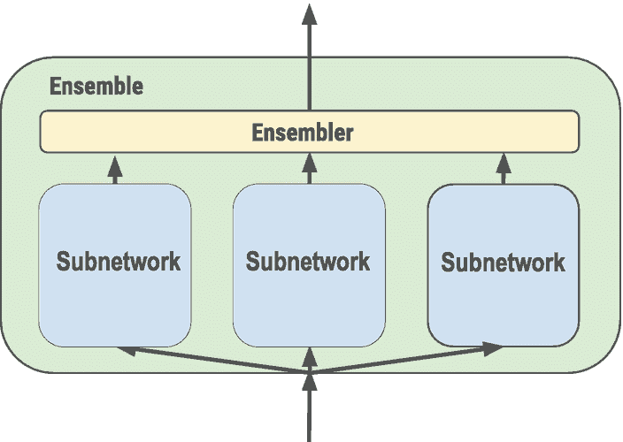

图 5-14

AdaNet 子网络集成神经网络

这里，子网络的输出被组合起来生成一个输出。它本质上使用了集成学习的概念，即最终模型由更简单的模型组成。这使得模型更加复杂，但也能提供更好的准确性。

在每次迭代中，算法会检查一组候选网络，评估哪个网络能提升集成性能（或者从技术上讲，产生更小的损失），然后将其添加到集成中。需要注意的是，每个候选网络架构必须由用户提供。

让我们看几个集成示例，以了解其可能性。

图 5-15 是一个具有不同复杂度的子网络集成。本质上，该集成由复杂度递增的神经网络子网络组成，其输出被简单地平均。

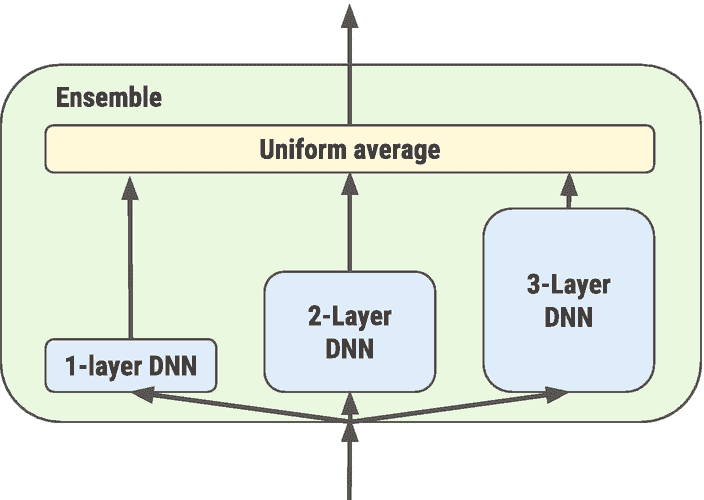

图 5-15

具有不同复杂度的 AdaNet 子网络集成

图 5-16 是在共享嵌入之上学习的集成。当大部分模型参数是特征的嵌入时，这种集成风格非常有用。各个子网络的预测通过学习的线性组合进行合并。

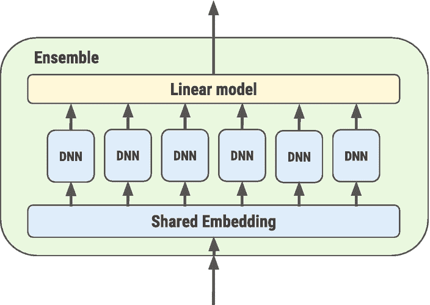

图 5-16

从共享嵌入中学习的 AdaNet 集成

现在，让我们通过 Python 对象的视角来看迭代周期。这有助于我们学习和使用该框架（见图 5-17）。

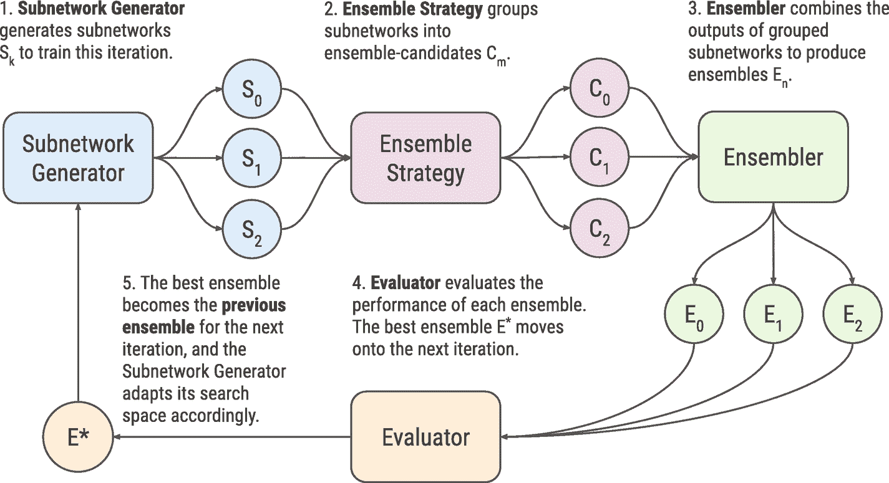

图 5-17

AdaNet 集成生成过程（来源：AdaNet 文档）

*   **子网络生成器**和**子网络**定义在 `adanet.subnetwork` 包中。

*   **集成策略**、**集成器**和**集成**定义在 `adanet.ensemble` 包中。

作为练习，我们鼓励你运行托管在 Google Colab ([`https://github.com/tensorflow/adanet`](https://github.com/tensorflow/adanet)) 上的示例。这些笔记本注释详尽，并提供了可在你的机器学习任务中使用的现成样板代码。

## 总结

让我们快速回顾一下本章涵盖的内容。

*   sklearn 没有内置的模块堆叠功能。ML-Ensemble（也称为 mlens）是一个开源库，简化了集成实验。其 API 风格类似于 Keras，可以通过分层基础学习器和元学习器轻松构建堆叠。

*   我们研究了选择有效学习器及相关超参数的技术。

*   Dask 是一个用于 Python 并行计算的灵活库，包含两部分：动态任务调度和大数据集合。动态任务调度类似于 Airflow，但针对交互式计算工作负载进行了优化。

*   Dask 可以并行训练 XGBoost 树，为其提供了巨大的可扩展性。

*   LightGBM 是一种梯度提升树算法，作为微软的一个库提供。

*   基于直方图的方法、处理缺失值、基于梯度的单边采样和互斥特征捆绑帮助 LightGBM 表现优于 XGBoost。

*   AdaNet 是一个轻量级的基于 TensorFlow 的框架，用于以最少的专家干预自动学习高质量模型。它是一种迭代学习神经网络**结构**和**权重**的算法，将其作为**子网络集成**。

如你所见，这些库为构建集成提供了灵活性、可重用性和速度。在第 6 章中，你将学习将集成有效应用于实际场景的艺术。


