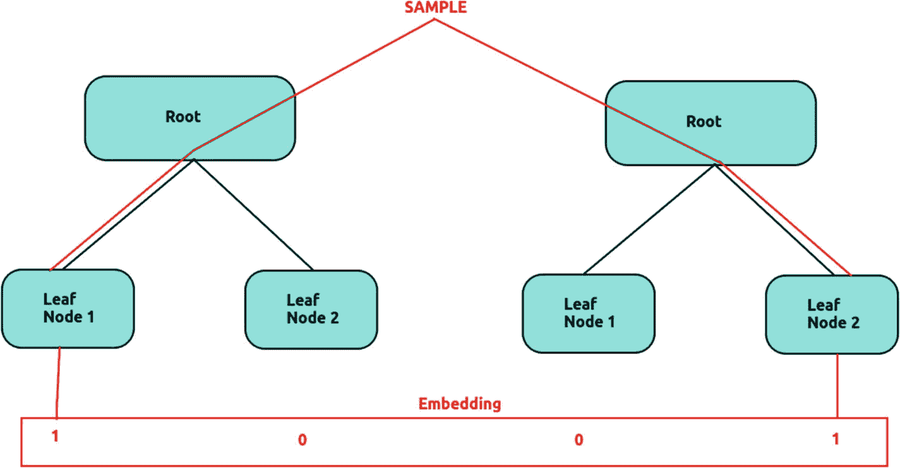
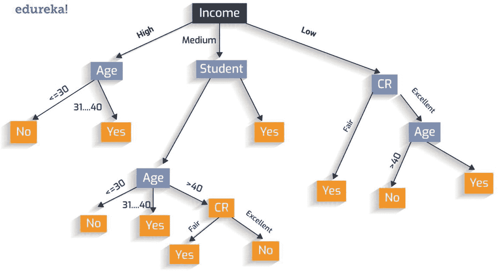
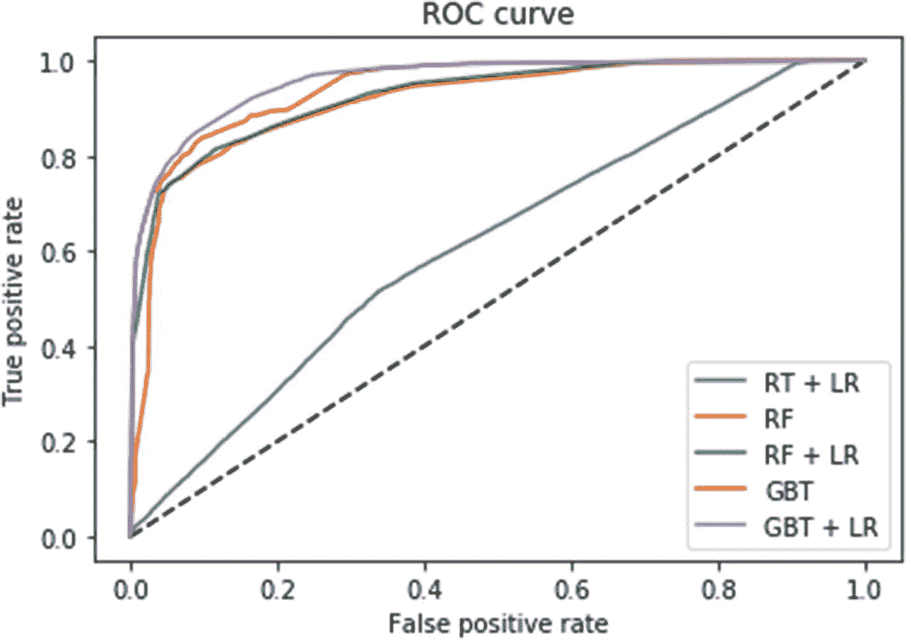
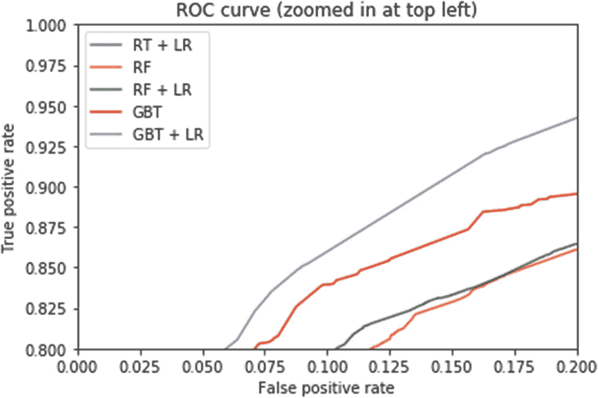
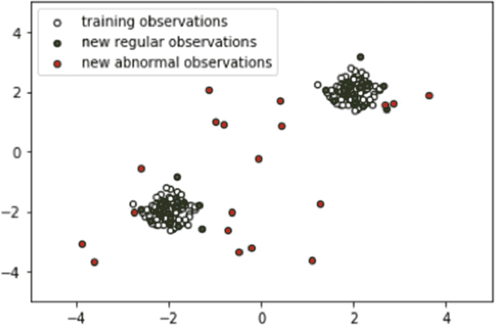
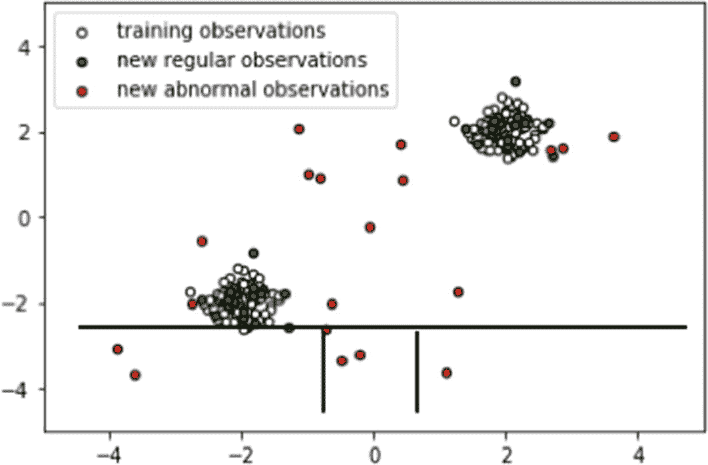
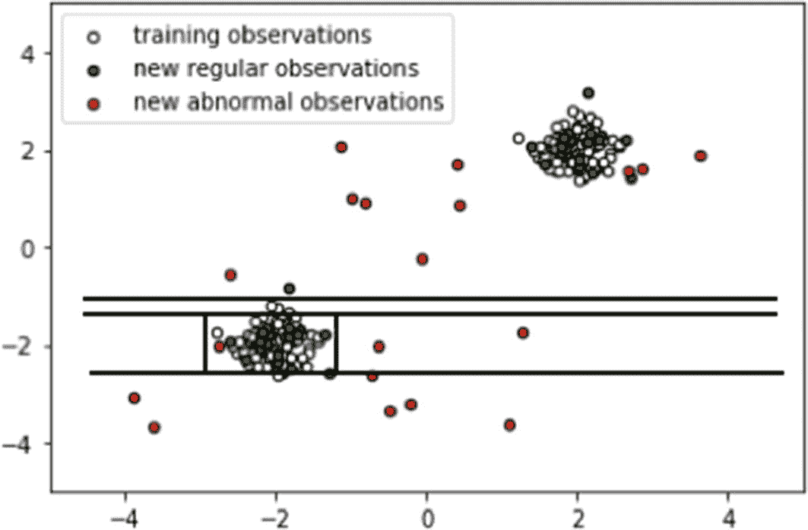
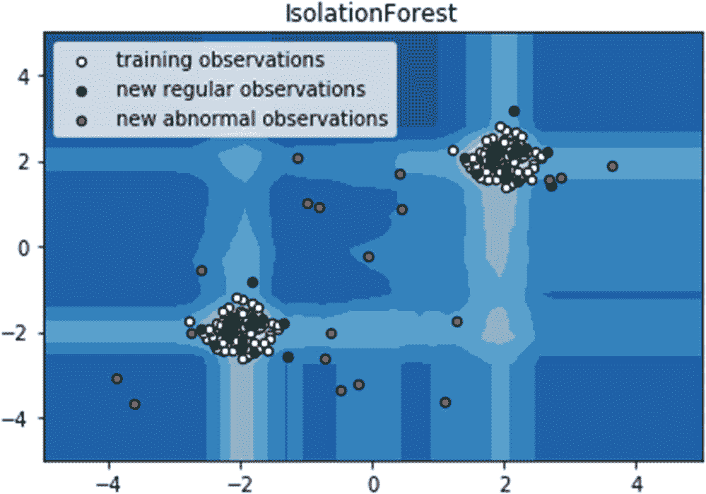
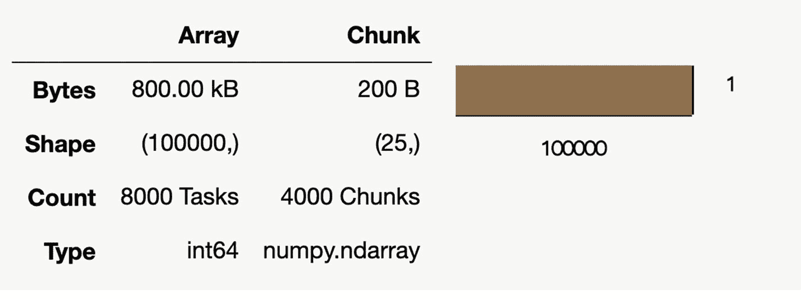

# 6. 技巧与最佳实践

为了充分发挥集成方法的威力，你需要学习将其有效应用于现实场景的艺术。

如果你听说过机器学习中数据整理的 80/20 法则，你就会知道大量时间都花在了搜索和优化模型之外。学完本章后，你将掌握一套可复用的解决方案，将集成方法融入实际的机器学习工作流中。

以下是本章的学习目标。

*   使用随机森林模型进行特征选择。特征选择及其相关性有助于提升机器学习算法的性能和可解释性，这一点不足为奇。

*   使用树集成进行特征变换。

*   为随机森林回归器构建预处理流水线。

*   孤立森林——一种高效的异常检测算法，尤其适用于高维数据集。

*   使用 Dask 扩展集成方法。

## 使用随机森林进行特征选择

在机器学习任务中，拥有数百个特征是很常见的，但它们的重要性可能各不相同，有些甚至毫无作用。重要性极低或无关紧要的特征可以安全地从特征列表中移除。这种特征剪枝（或重要特征的选择）具有三个好处。

*   降低训练模型的计算成本和时间。

*   使训练后的模型更易于解释。

*   通过降低方差来减少过拟合。

随机森林（一种决策树集成）在特征选择中很受欢迎。你可以通过观察使用某个特征的树节点在平均（森林中所有树）上提升纯度的程度，来直观地衡量该特征的重要性。因此，通过剪枝特定节点以下的树，你可以创建最重要特征的子集。

幸运的是，scikit-learn 在训练后会自动计算每个特征的重要性分数，然后对结果进行缩放，使得所有特征重要性的总和等于 1。你可以通过 `feature_importances_` 变量访问该结果。让我们来看一下清单 6-1 中的代码。为简洁起见，我们省略了导入部分。

```
iris = datasets.load_iris() # -1
feature_list = iris.feature_names # -2
print(feature_list)
['sepal length (cm)',
'sepal width (cm)',
'petal length (cm)',
'petal width (cm)']
X = iris.data # -3
y = iris.target # -4
X_train, X_test, y_train, y_test = train_test_split(X, y, test_size=0.33, random_state=42) # -5
rf_clf = RandomForestClassifier(n_estimators=10000, random_state=42, n_jobs=-1) # -6
rf_clf.fit(X_train, y_train) # -7
for name, score in zip(iris["feature_names"], rf_clf.feature_importances_):
print(name, score) # -8
sepal length (cm) 0.09906957842524829
sepal width (cm) 0.03880497890715764
petal length (cm) 0.4152569088750478
petal width (cm) 0.4468685337925464
y_pred = clf.predict(X_test) # -9
accuracy_score(y_test, y_pred) # -10
0.9333333333333333
sfm = SelectFromModel(clf, threshold=0.15) # - 11
sfm.fit(X_train, y_train) # -12
X_important_train = sfm.transform(X_train) # -13
X_important_test = sfm.transform(X_test)
rf_clf_important = RandomForestClassifier(n_estimators=500, random_state=0, n_jobs=-1) # -14
rf_clf_important.fit(X_important_train, y_train)
y_important_pred = rf_clf_important.predict(X_important_test) # - 15
accuracy_score(y_test, y_important_pred)
0.9166666666666666
清单 6-1
在 scikit-learn 中计算特征重要性
```

让我们拆解代码以便更好地理解。

1.  使用鸢尾花数据集。该数据集随 sklearn 库一起提供，因此你无需单独下载数据。

2.  通过使用数据集的 `feature_names` 属性来获取特征列表。

3.  从数据集中提取特征。

4.  从数据集中提取目标变量。

5.  使用 sklearn 中提供的 `train_test_split` 方法将数据拆分为训练集和测试集。

6.  使用 10K 个估计器初始化 `RandomForestClassifier`。

7.  调用 `fit` 方法。

8.  训练完成后，使用 `feature_importances_` 变量检查重要性分数。在鸢尾花数据集中，花瓣长度和宽度似乎更为重要。

9.  预测测试集。

10. 计算准确率分数。我们将在特征选择后重新计算准确率。

11. 创建一个选择器对象，它将使用随机森林分类器来识别重要性超过 0.15 的特征。

12. 训练选择器。

13. 通过转换数据创建一个仅包含重要特征的新数据集。

14. 使用 500 个估计器初始化一个新的 `RandomForestClassifier`。

15. 拟合分类器并预测新创建的 `X_important_test`。

尽管仅使用重要特征进行训练时准确率有所下降，但数据集大小减少了 50%。准确率下降了 2%，而特征数量减少了 50%——这还不错！

即使你使用其他技术进行特征选择，随机森林对于在初始实验中快速了解哪些特征真正重要仍然非常有用。


## 使用树集成进行特征变换

决策树森林因其鲁棒性强、支持高维数据且易于解释，在**分类**和**回归**任务中非常流行。它们还可用于提取嵌入。

**嵌入**是将输入投影到另一个更便捷的表示空间。嵌入使得对大型输入（例如表示单词的稀疏向量）进行机器学习变得更加容易。理想情况下，嵌入通过将语义相似的输入在嵌入空间中放置在一起，来捕获输入的某些语义。嵌入可以被学习并在不同模型间复用。如果这让你联想到 word2Vec 和 gloVec，那么你对嵌入已经有了很好的直觉！

在树集成的语境下，森林嵌入使用随机森林来表示特征空间。

这种编码可以通过监督或无监督的方式进行学习。

*   在**监督**情况下，你使用为分类或回归问题训练的森林树结构来提取嵌入。

*   在**无监督**情况下，没有目标变量；森林中的每棵树都随机进行分裂。

那么嵌入是如何生成的呢？过程出奇地简单。

1.  为你的分类或回归问题训练一个随机树森林。
2.  将样本传递到每棵树中，并记录它最终落在哪个叶节点。
3.  将决策树放置样本的叶节点标记为 1；否则，将其标记为 0。
4.  将所有向量拼接在一起。

从视觉上看，该过程可以想象为图 6-1 所示。



图 6-1

嵌入过程。来源：David Vassallo，2020 年 2 月 26 日。

让我们通过一个例子来更好地理解这一点。在图 6-2 所示的树中，有三个特征：收入、年龄和信用评级（CR）。有 10 个终端节点（是/否）。最终的嵌入看起来像 [0, 0, 0, 0, 0, 0, 0, 0, 0, 1]。考虑到一个森林可能包含数百棵类似的树，你最终会得到一个具有大量维度的嵌入。请记住，我们仅从三维特征构建了这些高维数据。



图 6-2

来源：Upasana Priyadarshiny，[`https://dzone.com/articles/how-to-create-a-perfect-decision-tree`](https://dzone.com/articles/how-to-create-a-perfect-decision-tree)

你可能会好奇高维度的好处。在高维空间中，线性分类器通常能达到极佳的准确率。

幸运的是，我们不需要自己编写逻辑；sklearn 已经通过 **sklearn.ensemble.RandomTreesEmbedding** 提供了该功能。RandomTreesEmbedding 是一种将数据集无监督转换为高维稀疏表示的方法。一个数据点根据其在每棵树中被分到的叶节点进行编码。对叶节点使用独热编码会产生一个二进制编码，其中 1 的个数等于森林中树的数量。让我们通过代码来验证这个概念。

我们将使用 sklearn 中提供的虚拟分类数据集。

```
X, y = make_classification(n_samples=80000)
```

让我们检查数据的形状。这里的第二个维度是特征数量。

```
print(X.shape)
(80000, 20)
```

让我们初始化完全随机树的集成。

```
model = RandomTreesEmbedding(n_estimators=100, min_samples_leaf=10)
```

在数据上拟合模型。

```
model.fit(X, y)
```

将森林中的树应用于 X，以返回叶节点索引。

```
leaves = model.apply(X)
```

如果你现在检查叶节点的形状，你会发现特征维度增加到了 100。你能猜到为什么是 100 吗？

```
print(leaves.shape)
(80000, 100)
```

现在，我们对 `leaves` 应用稀疏独热编码。


```
M = OneHotEncoder().fit_transform(leaves)
```

编码后的数据已准备好用于分类或其他机器学习算法。

让我们再看一个代码示例（见清单 6-2），以比较无监督嵌入与有监督嵌入。为了进行比较，我们将特征转换到更高维的稀疏空间，然后在这些特征上训练一个线性模型。

```
n_estimator = 100
X, y = make_classification(n_samples=80000) # - 1
X_train, X_test, y_train, y_test = train_test_split(X, y, test_size=0.5)  # - 2
X_train, X_train_lr, y_train, y_train_lr = train_test_split(X_train, y_train, test_size=0.5) # -3
rt = RandomTreesEmbedding(max_depth=3, n_estimators=n_estimator,random_state=0) # -4
rt_lm = LogisticRegression(max_iter=1000) # -5
pipeline = make_pipeline(rt, rt_lm) #-6
pipeline.fit(X_train, y_train)
y_pred_rt = pipeline.predict_proba(X_test)[:, 1]
fpr_rt_lm, tpr_rt_lm, _ = roc_curve(y_test, y_pred_rt) #-7
清单 6-2
灵感来源于 scikit-learn 文档
```

我们来解析一下这段代码。

1.  使用 sklearn 中提供的虚拟分类数据集。
2.  将数据拆分为训练集和测试集。我们仅使用 sklearn 中的 `train_test_split`。
3.  在训练数据的不同子集上训练树集成模型和线性回归模型，以避免过拟合。
4.  初始化树集成模型。
5.  初始化逻辑回归模型。
6.  创建一个管道，将随机树集成模型连接到逻辑回归模型。
7.  训练管道，计算测试集上的概率估计值，然后计算 roc_curve 值。

重申一下，上述代码是使用完全随机树进行的无监督转换。接下来，我们将使用随机森林进行有监督转换。

```
rf = RandomForestClassifier(max_depth=3, n_estimators=n_estimator)
rf_enc = OneHotEncoder()
rf_lm = LogisticRegression(max_iter=1000)
rf.fit(X_train, y_train) # -8
rf_enc.fit(rf.apply(X_train)) # -9
rf_lm.fit(rf_enc.transform(rf.apply(X_train_lr)), y_train_lr) # -10
y_pred_rf_lm = rf_lm.predict_proba(rf_enc.transform(rf.apply(X_test)))[:, 1] #-11
fpr_rf_lm, tpr_rf_lm, _ = roc_curve(y_test, y_pred_rf_lm) # -12
```

我们来解析一下这段代码。

1.  在数据上训练一个随机森林分类器。
2.  将森林中的树应用于数据（X_train），然后在返回的叶子索引上拟合独热编码器。
3.  将森林中的树应用于逻辑回归数据子集，使用之前训练好的独热编码器进行转换，然后在其基础上拟合逻辑回归模型。
4.  计算测试集上的概率估计值，然后计算 roc_curve 值。

重申一下，上述代码是使用随机森林进行的有监督转换。接下来，我们将使用梯度提升树进行有监督转换。

代码与我们为随机森林编写的代码几乎相同。

```
grd = GradientBoostingClassifier(n_estimators=n_estimator)
grd_enc = OneHotEncoder()
grd_lm = LogisticRegression(max_iter=1000)
grd.fit(X_train, y_train)
grd_enc.fit(grd.apply(X_train)[:, :, 0])
grd_lm.fit(grd_enc.transform(grd.apply(X_train_lr)[:, :, 0]), y_train_lr)
y_pred_grd_lm = grd_lm.predict_proba(grd_enc.transform(grd.apply(X_test)[:, :, 0]))[:, 1]
fpr_grd_lm, tpr_grd_lm, _ = roc_curve(y_test, y_pred_grd_lm)
```

为了进行比较，让我们计算梯度提升树和随机森林模型的 roc_curve。

```
y_pred_grd = grd.predict_proba(X_test)[:, 1]
fpr_grd, tpr_grd, _ = roc_curve(y_test, y_pred_grd)
y_pred_rf = rf.predict_proba(X_test)[:, 1]
fpr_rf, tpr_rf, _ = roc_curve(y_test, y_pred_rf)
```

让我们绘制所有选项的 roc_curve 图。





显而易见，基于集成的嵌入是线性分类任务中极佳的预处理步骤。

## 为随机森林分类器构建预处理管道

在理想情况下，数据是完美的。不幸的是，我们并非生活在完美世界中。在集成模型之前，数据需要进行预处理。感谢 sklearn，它提供了稳健的构建模块，可以有效地设置预处理管道。

我们将构建一个预处理管道，并结合使用 **sklearn.pipeline.Pipeline** 和随机森林分类模型进行预测。我们将使用泰坦尼克号数据集来构建一个幸存者二元分类器。

该分类器将使用以下数值特征进行训练。

```
# - age: float.
# - fare: float.
```

它还将使用以下分类特征进行训练。

```
# - embarked: 以字符串编码的类别 {'C', 'S', 'Q'}。
# - sex: 以字符串编码的类别 {'female', 'male'}。
# - pclass: 序数整数 {1, 2, 3}。
```

让我们使用 `fetch_openML` 获取数据集，它会从 [openml.​org](http://openml.org) 仓库下载数据。[`openml.org`](https://openml.org) 是一个用于机器学习数据和实验的公共仓库；它允许任何人上传开放数据集。自 sklearn 0.22.2 版本起，你可以指定 `as_frame` 参数，将数据作为数据框返回。这对于探索和实验非常有用。

```
np.random.seed(0)
X, y = fetch_openml("titanic", version=1, as_frame=True, return_X_y=True)
```

让我们探索一下数据集。`info()` 方法有助于快速了解数据概况；特别是总行数、每个属性的类型以及非空值的数量。

```
X.info()

RangeIndex: 1309 entries, 0 to 1308
Data columns (total 13 columns):
pclass       1309 non-null float64
name         1309 non-null object
sex          1309 non-null category
age          1046 non-null float64
sibsp        1309 non-null float64
parch        1309 non-null float64
ticket       1309 non-null object
fare         1308 non-null float64
cabin        295 non-null object
embarked     1307 non-null category
boat         486 non-null object
body         121 non-null float64
home.dest    745 non-null object
```

请注意，虽然有 1309 个实例，但年龄列只有 1046 个值，表明存在缺失值。我们需要在管道中处理这些缺失值。

让我们探索一下分类字段。你可以使用 `value_counts` 方法。该方法会告诉你每个类别的总类别数和条目数。

```
X['pclass'].value_counts()
3.0    709
1.0    323
2.0    277
X['sex'].value_counts()
male      843
female    466
X['embarked'].value_counts()
S    914
C    270
Q    123
```

让我们为数值数据和分类数据创建预处理管道。

所有缺失的年龄值将使用中位数策略（即年龄列的中位数）进行替换。你可以轻松推测出其他可能的策略。

*   如果为 `mean`，则使用每列的均值替换缺失值。这仅适用于数值数据。
*   如果为 `median`，则使用每列的中位数替换缺失值。这仅适用于数值数据。
*   如果为 `most_frequent`，则使用每列的最频繁值替换缺失值。这适用于字符串或数值数据。
*   如果为 `constant`，则使用 fill_value 替换缺失值。这适用于字符串或数值数据。

StandardScaler 通过移除均值并缩放至单位方差来标准化特征。

样本 *x* 的标准分数计算公式为：

```
z = (x - u) / s
```

其中 *u* 是训练样本的均值（若 `with_mean=False` 则为零），*s* 是训练样本的标准差（若 `with_std=False` 则为一）。


数据集的**标准化**是许多机器学习估计器的常见要求。如果各个特征不符合标准正态分布数据（例如均值为 0、方差为 1 的高斯分布），这些估计器的表现可能会很差。请注意，**随机**森林和梯度提升对变量的量级并不敏感。因此，在拟合这类模型之前，**不需要**进行**标准化**。此处添加这些步骤是为了完整性。

```
numeric_features = ['age', 'fare']
numeric_transformer = Pipeline(steps=[
('imputer', SimpleImputer(strategy='median')),
('scaler', StandardScaler())])
```

`OneHotEncoder` 将分类特征编码为独热数值数组。该转换器的输入应为数组形式的整数或字符串，用于表示分类（离散）特征所取的值。

```
categorical_features = ['embarked', 'sex', 'pclass']
categorical_transformer = Pipeline(steps=[
('imputer', SimpleImputer(strategy='constant', fill_value="missing")),
('onehot', OneHotEncoder(handle_unknown='ignore'))])
```

到目前为止，我们分别创建了分类列和数值列的转换器。然而，如果能有一个单一的转换器，它可以处理所有列并自动对每一列应用适当的转换，那将会更加方便。在 0.20 版本中，scikit-learn 引入了 **ColumnTransformer**，它提供了这一功能。该转换器与 Pandas 数据框配合使用效果也很好。

```
from sklearn.compose import ColumnTransformer
preprocessor = ColumnTransformer(
transformers=[
('num', numeric_transformer, numeric_features),
('cat', categorical_transformer, categorical_features)])
```

首先，你需要导入 `ColumnTransformer` 类。接着，用数值列和分类列的名称列表来初始化 ColumnTransformer。构造函数需要一个元组列表，每个元组包含一个名称、一个转换器以及该转换器应应用的列名（或索引）列表。

在我们的例子中，`numeric_features` 应使用 `numeric_transformer` 进行转换，而 `categorical_features` 应使用 `categorical_transformer` 进行转换。

我们的管道已基本准备就绪。最后，我们需要添加分类器，在本例中是一个随机森林。

```
rnd_clf = RandomForestClassifier(n_estimators=255,n_jobs=-1)
pipeline = Pipeline(steps=[('preprocessor', preprocessor),
('classifier', rnd_clf)])
```

如果在将数据输入管道之前，我们先将数据拆分为训练集和测试集，这会不会让人感到意外？

```
X_train, X_test, y_train, y_test = train_test_split(X, y, test_size=0.2)
```

最后，将管道拟合到数据上的时刻到来了。

```
pipeline.fit(X_train, y_train)
print("model score: %.3f" % clf.score(X_test, y_test))
```

你是否注意到我们的随机森林初始化时使用了 255 个估计器？这个数字是从哪里来的？嗯，我们使用了网格搜索来寻找最佳参数。事实上，对于现实世界的问题，使用搜索（网格搜索、随机搜索等）优化的管道是常态。让我们为管道添加网格搜索。

首先，我们需要导入 GridSearchCV。接下来，我们需要定义所有我们感兴趣的参数的搜索空间。

```
from sklearn.model_selection import GridSearchCV
# 随机森林中树的数量
n_estimators = [int(x) for x in np.linspace(start = 100, stop = 300, num = 10)]
# 每次分裂时考虑的特征数量
max_features = ['auto', 'sqrt']
# 树的最大深度
max_depth = [int(x) for x in np.linspace(10, 110, num = 11)]
max_depth.append(None)
# 分裂一个内部节点所需的最小样本数
min_samples_split = [2, 5, 10]
# 每个叶节点所需的最小样本数
min_samples_leaf = [1, 2, 4]
# 为每棵树选择训练样本的方法
bootstrap = [True, False]
```

接下来，我们准备参数网格。请注意，我们使用转换器名称加上双下划线来将参数映射到特定的转换器。

```
grid = {'classifier__n_estimators': n_estimators,
'classifier__max_features': max_features,
'classifier__max_depth': max_depth,
'classifier__min_samples_split': min_samples_split,
'classifier__min_samples_leaf': min_samples_leaf,
'classifier__bootstrap': bootstrap}
```

以下是我们的参数搜索空间的样子。

```
pprint(grid)
{'classifier__bootstrap': [True, False],
'classifier__max_depth': [10, 20, 30, 40, 50, 60, 70, 80, 90, 100, 110, None],
'classifier__max_features': ['auto', 'sqrt'],
'classifier__min_samples_leaf': [1, 2, 4],
'classifier__min_samples_split': [2, 5, 10],
'classifier__n_estimators': [100, 122, 144, 166, 188, 211, 233, 255, 277, 300]}
```

让我们初始化 GridSearchCV。

```
search = GridSearchCV(estimator = pipeline,param_grid = grid, cv = 3, verbose=2, n_jobs = -1)
```

是时候拟合网格搜索模型了。

```
search.fit(X_train, y_train)
```

你可以通过 `best_params_` 属性检查最佳参数值。

```
print(search.best_params_)
{'classifier__bootstrap': True, 'classifier__max_depth': 10, 'classifier__max_features': 'auto', 'classifier__min_samples_leaf': 2, 'classifier__min_samples_split': 10, 'classifier__n_estimators': 255}
```

管道和网格搜索并非集成方法所特有，但了解如何将它们与集成方法有效结合，能够产生非常精确的集成模型。


## 用于异常检测的孤立森林

**孤立森林**是一种高效的异常检测算法，尤其适用于高维数据集。该算法通过随机选取一个特征和一个随机阈值（介于最小值和最大值之间）来分割数据集，从而构建一棵随机森林。数据集的分割过程会持续进行，直到所有实例都与其他实例相互隔离。异常值比正常观测值更少见，并且通常具有不同的数值。平均而言（在所有决策树中），异常值往往比正常实例在更少的步骤中被隔离。让我们通过可视化来理解这一点。

在图 6-3 中，红点表示异常点。



图 6-3

一个包含常规观测值和异常观测值的虚拟数据集

如您所见，正常点聚集在一起，而异常点则远离其他点。因此，在随机划分域空间时，异常点比正常点能在更少的分区中被检测到。更少的分区意味着距离根节点更短（即从根节点到终端节点所经过的边更少）。隔离一个样本所需的分割（或分区）次数，等同于从根节点到终止节点的路径长度。

随机划分会为异常值产生明显更短的路径。因此，当一组随机树对特定样本共同产生较短的路径长度时，这些样本极有可能是异常值。图 6-4 和图 6-5 说明了这一点。



图 6-5

隔离一个异常点



图 6-4

隔离一个正常点

一个点是正常点还是异常点，由路径长度指示。孤立森林算法会返回每个样本的异常得分。

为了将得分解释为概率，最好将得分表示在 0 到 1 之间。例如，如果我们得到异常得分为 0.7，那么我们可以解释为该点有 70% 的概率是异常点。

现在您已经了解了孤立森林的工作原理，让我们在代码中实现它。

首先导入必要的模块。为简洁起见，我们省略了一些导入语句。

```
from sklearn.ensemble import IsolationForest
rng = np.random.RandomState(42)
```

让我们生成数据。用于训练和测试的常规新观测值从标准正态分布中生成，而异常值则从均匀分布中生成。

```
# 训练数据
X = 0.3 ∗ rng.randn(100, 2)
X_train = np.r_[X + 2, X - 2]
# 常规新观测值
X = 0.3 ∗ rng.randn(20, 2)
X_test = np.r_[X + 2, X - 2]
# 异常新观测值
X_outliers = rng.uniform(low=-4, high=4, size=(20, 2))
```

现在是初始化并拟合孤立森林的时候了。

```
clf = IsolationForest(max_samples=100, random_state=rng)
clf.fit(X_train)
```

模型训练完成后，就可以生成预测结果了。

```
y_pred_train = clf.predict(X_train)
y_pred_test = clf.predict(X_test)
y_pred_outliers = clf.predict(X_outliers)
```

让我们绘制并可视化（见图 6-6）孤立森林的预测结果。



图 6-6

孤立森林预测结果

```
xx, yy = np.meshgrid(np.linspace(-5, 5, 50), np.linspace(-5, 5, 50))
Z = clf.decision_function(np.c_[xx.ravel(), yy.ravel()])
Z = Z.reshape(xx.shape)
plt.title("IsolationForest")
plt.contourf(xx, yy, Z, cmap=plt.cm.Blues_r)
b1 = plt.scatter(X_train[:, 0], X_train[:, 1], c="white",
s=20, edgecolor="k")
b2 = plt.scatter(X_test[:, 0], X_test[:, 1], c="green",
s=20, edgecolor="k")
c = plt.scatter(X_outliers[:, 0], X_outliers[:, 1], c="red",
s=20, edgecolor="k")
plt.axis('tight')
plt.xlim((-5, 5))
plt.ylim((-5, 5))
plt.legend([b1, b2, c],
["训练观测值",
"新的常规观测值", "新的异常观测值"],
loc="upper left")
plt.show()
```

与其他异常检测算法相比，孤立森林相当独特。它引入了隔离的概念，作为一种比常用的基本距离和密度度量更有效、更高效的异常检测手段。无论数据集大小如何，它都能使用固定大小的小子样本，通过少量树构建出性能良好的模型。

## 使用 Dask 扩展集成

在集成过程中，您可能会遇到两种不同的扩展问题。扩展策略取决于您面临的具体问题。

*   **大型模型**：虽然数据可以放入内存，但您可能拥有一个包含许多模型的大型集成。

*   **大型数据集**：数据量大于内存容量，并且无法进行采样。

Dask 可以帮助扩展集成。

*   对于大型模型，请使用 `dask_ml.joblib` 和您最喜欢的 scikit-learn 估计器。

*   对于大型数据集，请使用 `dask_ml` 估计器。

要扩展集成管道，您需要考虑的不仅仅是大型模型和数据集。回想一下管道和网格搜索。Dask 提供了用于预处理和参数空间搜索的模块。


### 预处理

`dask_ml.preprocessing` 包含一些 scikit-learn 风格的转换器，它们可以在管道中使用，作为模型拟合过程的一部分来执行各种数据转换。这些转换器在 Dask 集合（`dask.array`、`dask.dataframe`）、NumPy 数组或 Pandas 数据框上都能很好地工作。再次重申，为什么要使用 Dask 进行预处理？因为它可以并行地进行拟合和转换。

表 6-1 列出了一些（大部分）可直接替代 scikit-learn 对应转换器的转换器。

**表 6-1. Dask 对 scikit-learn 对应转换器的直接替代**

| 转换器 | 描述 |
| --- | --- |
| MinMaxScaler([feature_range, copy]) | 通过将每个特征缩放到给定范围来转换特征。 |
| QuantileTransformer([n_quantiles, …]) | 使用分位数信息转换特征。 |
| RobustScaler([with_centering, with_scaling, …]) | 使用对异常值具有鲁棒性的统计量来缩放特征。 |
| StandardScaler([copy, with_mean, with_std]) | 通过移除均值并缩放到单位方差来标准化特征。 |
| LabelEncoder([use_categorical]) | 使用 0 到 n_classes-1 之间的值对标签进行编码。 |

在使用 `dask_ml.preprocessing` 时，有两件重要的事情需要牢记。

*   它们并行地操作 Dask 集合。
*   当输入是 Dask 集合时，`.transform` 返回 `dask.array` 或 `dask.dataframe`。

表 6-2 列出了一些其他有助于将非数值数据转换为数值数据的 Dask 转换器。

**表 6-2. 将非数值数据转换为数值数据的 Dask 转换器**

| 转换器 | 描述 |
| --- | --- |
| Categorizer([categories, columns]) | 将 DataFrame 列转换为分类数据类型。 |
| DummyEncoder([columns, drop_first]) | 对分类列进行虚拟（独热）编码。 |
| OrdinalEncoder([columns]) | 对分类列进行序数（整数）编码。 |

这些转换器在管道中作为预处理步骤非常有用，当你从异构数据（数值和非数值的混合）开始，但估计器需要所有数值数据时。

让我们通过一个玩具管道来在代码中检查转换器。我们的管道将：

*   对文本数据进行分类
*   对分类数据进行虚拟编码
*   拟合一个随机森林分类器

让我们导入必要的库。

```
from dask_ml.preprocessing import Categorizer, DummyEncoder
from sklearn.linear_model import RandomForestClassifier
from sklearn.pipeline import make_pipeline
import pandas as pd
import dask.dataframe as dd
```

从 Pandas 数据框初始化 Dask 数据框。

```
df = pd.DataFrame({"A": [1, 2, 1, 2], "B": ["a", "b", "c", "c"]})
X = dd.from_pandas(df, npartitions=2)
y = dd.from_pandas(pd.Series([0, 1, 1, 0]), npartitions=2)
```

构建并拟合管道。

```
pipe = make_pipeline(Categorizer(),DummyEncoder(),RandomForestClassifier())
pipe.fit(X, y)
```

如果你对管道有一般了解，这段代码是不言自明的，但为了完整起见，下面是一个快速解释。

`Categorizer` 将 X 中的一部分列转换为 `categorical` 数据类型。默认情况下，它会转换所有对象数据类型的列。

`DummyEncoder` 对数据集进行虚拟（或独热）编码。这会将一个分类列替换为多个列，其中的值为 0 或 1。

我们鼓励你阅读 sklearn.preprocessing 文档（[`https://scikit-learn.org/stable/modules/preprocessing.html`](https://scikit-learn.org/stable/modules/preprocessing.html)）以了解更多关于可用转换器的信息。

### 超参数搜索

Dask-ML 中有两种超参数优化估计器。使用哪一种取决于数据集的大小以及底层估计器是否实现了 `partial_fit` 方法。

如果数据集相对较小，或者底层估计器没有实现 partial_fit，可以使用 `dask_ml.model_selection.GridSearchCV` 或 `dask_ml.model_selection.RandomizedSearchCV`。这些是 scikit-learn 对应方法的直接替代；它们应该能提供更好的性能以及对 Dask 数组和数据框的处理能力。

#### scikit-learn 的直接替代

| dask_ml.model_selection.GridSearchCV | 对估计器指定的参数值进行穷举搜索。 |
| --- | --- |
| dask_ml.model_selection.RandomizedSearchCV | 对超参数进行随机搜索。 |

#### 增量式超参数优化

第二类超参数优化使用*增量式*超参数优化。当你的完整数据集无法放入单台机器的内存时，应该使用这些方法。

在 Dask 中，`dask_ml.model_selection.IncrementalSearchCV` 是处理此问题的类。该类在支持 `partial_fit` 的模型上增量式地搜索超参数。

广义上讲，增量式优化从一批模型（底层估计器和超参数组合）开始，并使用数据批次重复调用底层估计器的 partial_fit 方法。

阅读文档以了解更多信息。


### 分布式集成拟合

剩下的部分是关于集成拟合和预测。重申一下，我们正在探索如何使用 Dask 进行集成训练和预测。

让我们考虑一个使用 scikit-learn 估计器的案例，但数据集大于内存。Dask 确保不会一次性加载所有数据。

让我们导入必要的库。

```
from sklearn import datasets
from sklearn.ensemble import GradientBoostingClassifier
import dask_ml.datasets
from dask_ml.wrappers import ParallelPostFit
```

唯一新增的导入是 `dask_ml` 数据集和 `ParallelPostFit`。

`dask_ml.datasets` 相当于 `sklearn.datasets`。我们用它来创建一个大型的玩具数据集。

`ParallelPostFit` 是一个用于并行预测和转换的元估计器。可以把它看作是 sklearn 中的分布式评分函数。需要注意的是，这个类不适用于大型数据集的并行或分布式*训练*。为此，请使用 Dask Incremental；它提供分布式（但顺序执行）的训练。

让我们创建一个包含 1000 个样本的小型训练数据集，并进行常规拟合。

```
X, y = datasets.make_classification(n_samples=1000, random_state=0)
clf = ParallelPostFit(estimator=GradientBoostingClassifier(),
scoring='accuracy')
clf.fit(X, y)
```

让我们构建一个更大的玩具数据集。

```
X_big, y_big = dask_ml.datasets.make_classification(n_samples=100000,
random_state=0)
```

对新的 Dask 输入进行预测与你在 sklearn 中所做的并无不同。这里的亮点在于，分类器可以在大于内存的预测数据集上工作。



```
clf.predict(X_big)
```

现在让我们构建一个投票分类器。回顾一下，投票分类器模型将多个模型（即子估计器）组合成一个单一的模型，这个模型（理想情况下）比任何一个单独的模型都更强大。

但为什么要使用 Dask？Dask 提供了在集群中不同机器上训练各个子估计器的软件。这使得用户能够比在单台机器上并行训练更多的模型。让我们通过代码来探索使用 Dask 的投票分类器。

让我们导入必要的模块。

```
from sklearn.ensemble import VotingClassifier
from sklearn.linear_model import SGDClassifier
from sklearn.ensemble import RandomForestClassifier
from sklearn.svm import SVC
import sklearn.datasets
X, y = sklearn.datasets.make_classification(n_samples=1_000, n_features=20)
classifiers = [
('sgd', SGDClassifier(max_iter=1000)),
('rf', RandomForestClassifier()),
('svc', SVC(gamma='auto')),
]
clf = VotingClassifier(classifiers, n_jobs=-1)
```

你在前面的章节中已经见过所有这些代码。

让我们初始化 dask 分布式集群。同样，我们在第 5 章讨论过这一点。

```
import joblib
from distributed import Client
client = Client()
with joblib.parallel_backend("dask"):
clf.fit(X, y)
```

这段熟悉的代码正是使用 Dask 扩展集成的益处和美妙之处。关键要点是记住在你的集成流水线的预处理、训练和预测任务中可用的可扩展选项。

## 总结

让我们快速回顾一下本章涵盖的内容。

*   随机森林在了解哪些特征重要方面非常有用。你可以使用估计器的 `feature_importances_` 变量。
*   森林嵌入使用随机森林来表示特征空间。嵌入为特征提供了更高的维度，这有助于线性分类器实现出色的准确性。
*   sklearn 为构建集成预处理流水线提供了良好的工具集。`sklearn.pipeline` 可以构建一个转换器流水线。
*   sklearn 的 `ColumnTransformer` 提供了一种连接流水线的统一方式。
*   孤立森林是一种高效的异常值检测算法，尤其适用于高维数据集。它通过随机选择一个特征，然后在该特征的最大值和最小值之间随机选择一个分割值来隔离观测值。
*   `dask_ml.preprocessing` 包含一些 scikit-learn 风格的转换器，可以在流水线中使用，作为模型拟合过程的一部分来执行各种数据转换。
*   Dask-ML 中有两种超参数优化估计器。使用哪一种取决于数据集的大小以及底层估计器是否实现了 `partial_fit` 方法。
*   **Dask ParallelPostFit** 是一个用于并行预测和转换的元估计器。
*   Dask 提供了在集群中不同机器上训练各个子估计器的软件。这使得用户能够比在单台机器上并行训练更多的模型。

## 致谢

好了，我们已经到达了本书的结尾，我们衷心感谢你坚持读到了最后。我们真诚地希望你能在你的项目中有效地应用集成技术。

如果存在任何错误，请随时发送反馈。欢迎通过 Apress 或 Twitter（@aloksaan 和 @mayank10j）联系我们。

从本书中获得最大价值的最佳方法就是做一件事：实践。尝试运行书中的所有代码片段。找一个你可以尝试集成的项目。

我们最大的希望是，这本书能激励你将集成作为机器学习技能工具箱中的常规工具，并不断突破集成的边界。祝你学习愉快。


索引 A AdaBoost 分类数据分类器 正确分类的观测值 scikit-learn n 个学习器的投票 AdaNet 集成生成过程 集成学习，共享嵌入 基于 TensorFlow 的轻量级框架 不同复杂度的子网络集成 子网络 集成神经网络 平均法 B Bagging 聚合 自助采样 分类器集成技术 混合训练数据原语 有放回采样 scikit-learn 训练步骤 平衡树 Boosting AdaBoost 定义 梯度提升 学习过程 XGBoost 自助聚合 参见 Bagging 自助采样 C 分类器 交叉验证 D Dask 架构 并行化 自定义算法，dask.delayed 接口 延迟函数 二维数组 任务图 分布式与并行处理 处理数据集 低层与高层 NumPy 和 Pandas Python 中的并行计算 集群环境中的并行执行 问题求解 Python 科学计算生态系统 可扩展的机器学习算法 单机逻辑回归 任务图 基于线程和进程的处理 转换器 XGBoost Dask 数组 NumPy 数组的集合 compute 函数 延迟函数 逻辑结构 任务图 Dask 数据框 CSV 读取 逻辑结构 Dask 分布式集群 dask_ml.preprocessing dask-xgboost 数据集 决策树 准确率 创建分类器 数据集 鸢尾花数据集 机器学习模型 随机森林 自顶向下的流程图式方法 训练随机森林，scikit-learn 训练，scikit-learn 树遍历 变量 深度学习模型 延迟函数 分布式计算 分布式集成拟合 DummyEncoder E 嵌入 编码 集成 基于嵌入的集成 集成学习 类定义 集成模型选择 评估器类 预处理 评分函数 集成器 集成策略 训练轮次 评估器类 独享特征捆绑 F 特征选择，随机森林 特征变换，树的集成 G 基于梯度的单侧采样 梯度提升决策树（GBDT） 梯度提升树 梯度提升分类器 参数 残差 scikit-learn 库 GridSearchCV H 硬投票 辅助函数 基于直方图的方法 水平投票集成 超参数搜索 scikit-learn 的即插即用替代方案 增量超参数优化 超参数设置 超参数调优集成 I 增量超参数优化 鸢尾花数据集 孤立森林，异常检测 J Joblib 库 joblib.parallel_backend K *k*折交叉验证 k 近邻（KNN） L 按叶生长树分裂策略 按层生长树分裂策略 库 AdaNet dask 参见 Dask LightGBM 参见 LightGBM ML-Ensemble 参见 ML-Ensemble LightGBM 优势 架构 平衡树 二分类器，Python 代码 决策树 梯度提升框架 叶子分裂，寻找 按叶生长树分裂策略 按层生长树分裂策略 参数 zero_as_missing 参数 线性分类器 线性模型 逻辑回归 logisticRegression 参数 M 机器学习（ML）模型 集成方法 学习器 库 make_classification 数据集 最大投票集成 元学习器 混合组合 提升 参见 Boosting 堆叠 参见 Stacking 混合模型 训练数据集 投票集成 参见 Voting ensembles 混合训练数据 bagging，3 棵决策树 参见 Decision trees 定义 变化训练数据 ML-Ensemble 集成估计器 Evaluator 类 make_moons 数据集 模型选择 参见 Ensemble model selection 多层 开源 Python 库 预处理 评分函数 单层 堆叠集成 堆叠集成 模型 分类器 多层堆叠集成 N, O NumPy 数组 P, Q Pandas Pandas 数据框 ParallelPostFit predict_proba 方法 预处理流水线，随机森林分类器 类别和数值列 转换器 ColumnTransformer 类 数据框 GridSearchCV info()方法 缺失值 数值和类别数据 数值特征 OneHotEncoder 参数 搜索空间 潜在策略 实际问题 设置 sklearn.pipeline.Pipeline 标准分数 value_counts 方法 预处理流水线 Python 科学计算生态系统 R 随机森林 RandomTreesEmbedding 真实测试数据 基于重采样的机器学习技术 残差 S 采样 定义 有放回（WR） 无放回（WOR） 使用 dask 扩展集成 dask_ml.preprocessing 分布式集成拟合 转换器 扩展策略 scikit-learn 文档 scikit-learn Python 库 评分函数 SequentialEnsemble 类 单层堆叠集成 单一机器学习模型 sklearn.ensemble.RandomTreesEmbedding sklearn.metrics.make_scorer() 快照集成 软投票 堆叠分类器 在 scikit-learn 中 预测/输出 学习器 使用 scikit-learn 进行回归 简单函数 StandardScaler 分层*k*折交叉验证 子网络 SuperLearner 监督变换 支持向量机（SVM） T 训练数据 周期 转换器 树集成 树遍历 简单函数 U 无监督嵌入 无监督变换 V, W Value_counts 方法 变化模型 变化训练数据 投票分类器 VotingClassifier 类 投票集成 平均法 硬投票 水平投票集成 超参数调优集成 机器学习模型 快照集成 软投票 X, Y, Z XGBoost
