# 第 1 章 为 APEX 构建安全基础设施

OCI 还提供 Oracle 云函数、多种 AI 服务等等。

OCI 一直在发展，并且不断添加新的或改进的功能。在这本书中，我们有机会了解其中一些功能，包括最近添加的功能，但我们希望这本书能分享我们对 OCI 的热情，以便您将继续了解我们尚不知道的所有可能的新功能，并使用它们使 APEX 变得更好。

xvii

`Oracle Application Express` (APEX) 在 Oracle 庞大的技术产品组合中的作用在过去几年中显著增长。它已从其作为随所有 Oracle 数据库版本提供的免费、快速应用程序开发环境的卑微起点，转变为核心组件 Oracle 的旗舰产品 `自治数据库` (ADB)。

ADB 是一种完全托管的数据库服务，由最先进的机器学习功能提供支持。该服务的订阅者无需管理支持数据库的底层硬件、操作系统 (OS) 和软件。Oracle 负责确保数据库配置为具有可用性和可扩展性。这些数据库还会自动修补以增强安全性和功能。基于 ML 的算法允许数据库自动创建表索引和调整执行计划，以确保数据库查询和代码的最佳性能。

ADB 提供四种工作负载类型：

• 自治事务处理

• 自治数据仓库

• 自治 JSON 数据库

• APEX 服务

所有工作负载类型都预装并配置了 APEX，包括一个完全托管的 `Java 企业版` (EE) 应用服务器，用于托管 `Oracle REST 数据服务` (ORDS)。除 APEX 服务外，ADB 还附带 `Oracle 机器学习笔记本` (OML 笔记本) 和 `Oracle Graph Studio`。

© Adrian Png 和 Heli Helskyaho 2022

A. Png 和 H. Helskyaho，《`使用 Oracle 云功能扩展 Oracle Application Express`》，[`doi.org/10.1007/978-1-4842-8170-3_1`](https://doi.org/10.1007/978-1-4842-8170-3_1#DOI)

**注意** `APEX` 服务还缺少对 `Oracle Net Services` (SQL*Net) 的支持。这将开发活动限制在 `APEX App Builder` 和 `Database Actions`。

但是，由于 `APEX` 可以安装在任何数据库版本上，因此可以在没有 ADB 的情况下部署实例。在 Oracle 云基础设施 (`OCI`) 提供的多种数据管理产品中，有可以在虚拟机或裸金属服务器上部署的 Oracle 数据库 (DB) 系统。作为 DB 系统配置的数据库附带使用最佳实践预装和配置的必要软件。分配的虚拟 CPU、内存和存储量可以轻松使用 `OCI 控制台` 进行管理。备份和补丁也可以通过控制台进行管理和应用。但与 ADB 不同，`APEX` 和 `ORDS` 默认情况下不会安装。

**注意** 从 `Oracle Database 19c` 开始，标准版现在允许您创建最多三个可插拔数据库 (PDB)，而无需购买额外的许可证。这为创建多个 `APEX` 环境（用于非生产目的，例如开发和测试）提供了机会。

在本章中，我们将探讨配置 `APEX` 实例的两种方法，以及如何准备和保护该实例以用于生产环境。

### 网络组件

`APEX` 本质上是一个 Web 应用程序，因此，它依赖互联网或内联网来提供对开发人员可以创建的漂亮功能的访问。如今，托管 `APEX` 实例的位置有很多选择。以下是一些示例：

• 在本地托管服务器

• 在共享数据中心托管服务器

• 通过基础设施即服务 (IaaS) 供应商托管虚拟计算资源

• 将 `APEX` 作为平台即服务 (PaaS) 订阅

当然，每种方法都有其优缺点。在本地托管服务器需要对数据中心的物理空间进行大量投资，提供不间断电源和冷却，监控物理服务器访问等等。但是，它确实提供了对硬件和软件的绝对控制，更重要的是，保证了数据主权得以维护。

订阅 PaaS 服务可能是在互联网上托管 `APEX` 应用程序最直接的方法。只需获取一个工作区和专用的数据库模式，然后部署您的应用程序。但是，PaaS 提供商会决定 `APEX` 环境的所有其他方面。例如，供应商将决定安装的 Oracle 数据库版本、启用的版本和功能以及软件补丁级别。他们还负责并决定基础设施问题，例如系统架构和网络安全。

一个很好的折衷方案是将 `APEX` 实例托管在由第三方供应商托管的服务器上。在互联网早期，服务器托管使独立软件提供商 (ISP) 能够托管服务器、安装必要的软件和部署 Web 应用程序。但是，这些成本很高，因为托管提供商承担了托管任何数据中心的全部责任和成本。

随着服务器虚拟化和软件定义网络的出现，IaaS 供应商能够以更低的价格提供计算和网络资源。这些允许 ISP 拥有“两全其美”的优势，即以更可接受的价格管理自己的基础设施。

但是，正如谚语所说，“能力越大，责任越大。”在 `OCI` 上托管 `APEX` 时，云架构师需要考虑使用哪些 `OCI` 资源，它们如何交互，以及更重要的是，如何维护一个对应用程序和数据都健壮且安全的环境。

### 虚拟云网络

`OCI` 提供广泛的网络组件，而 `虚拟云网络` (VCN) 是构建 `APEX` 虚拟基础设施的核心。VCN 由几个子组件组成，例如

• 子网

• 路由

• 安全列表

• DHCP 选项

• 互联网、网络地址转换 (NAT) 和服务网关

设计和构建 VCN 有许多考虑因素和方法。例如，VCN 可以包含一个或多个子网，那么创建的理想数量是多少？像往常一样，答案是：“视情况而定！”幸运的是，Oracle 通过其 `Oracle 架构中心` 网站 ([`docs.oracle.com/solutions/`](https://docs.oracle.com/solutions/)) 提供了一些指导，您可以在其中找到多个参考架构、解决方案手册和客户发布的解决方案。在 `GitHub` 上，Oracle 列出了多个仓库 ([`github.com/oracle-quickstart`](https://github.com/oracle-quickstart))，其中包含用于构建不同类型环境的 `Terraform` ([`https://terraform.io/`](https://terraform.io/)) 脚本，您可以使用这些脚本通过 `Resource Manager` 进行部署。

在本章中，我们将设计并部署一个简单的 VCN（参见图 1-1），位于区间 `ch01` 中。它将包含三个子网。一个子网将是公共的。此子网中的 OCI 资源可以分配可公开访问的 IP 地址。互联网网关提供资源与互联网客户端之间的双向通信。两个子网将是私有的，尽管 OCI 组件可以通过 NAT 网关访问基于互联网的资源，但它们被隔离，无法在 VCN 外部寻址。这种网络拓扑有助于最大限度地减少数据库和应用服务器等关键资产暴露于互联网上的外部威胁，否则用户无法直接访问这些资产。

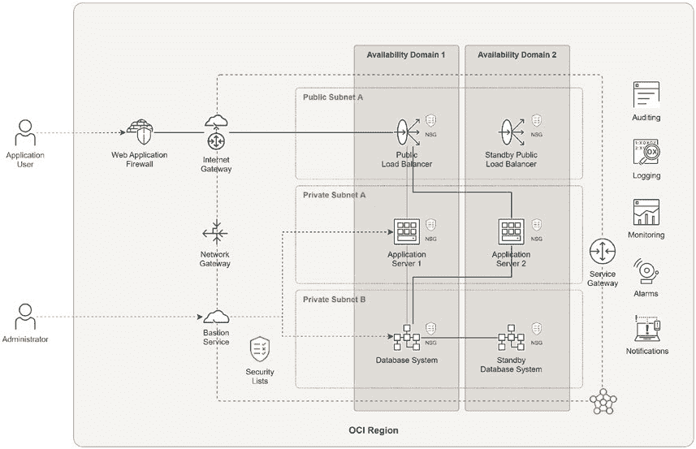

***图 1-1.** DB 系统上 APEX 的简单拓扑*

VCN 可以通过 `OCI 控制台` 创建，并且可以使用向导（图 1-2）。后者只需点击几下鼠标即可让您启动一个可用的 VCN。要访问该向导，请单击 `OCI 控制台` 左上角的导航菜单，单击 `Networking`，然后单击 `Virtual Cloud Networks`。接下来，单击 `Start VCN Wizard`，在第一步中，提供以下详细信息：

• `VCN 名称`: `vcn-ch01`

• `区间`: `ch01`

• `VCN CIDR 块`: `10.0.0.0/16`

• `公共子网 CIDR 块`: `10.0.0.0/24`

• `私有子网 CIDR 块`: `10.0.1.0/24`

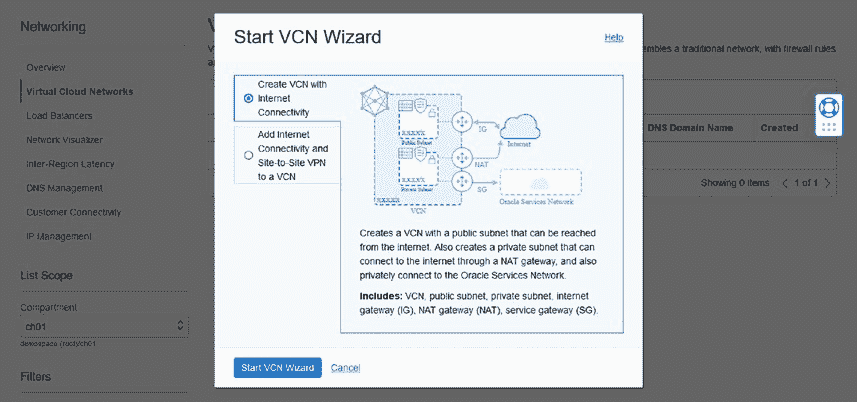

单击 `Next`，然后查看提交的 VCN 信息。最后，单击 `Create`，向导将生成所需的子网、网关、路由和安全列表。

***图 1-2.** 通过两步，使用向导创建 VCN*

不幸的是，向导只创建两个子网，一个公共子网和一个私有子网。必须创建一个额外的子网来构建图 1-1 中的目标网络拓扑。

**注意** 向导不会让您有机会命名子网。创建 VCN 后，转到子网的详细信息页面，并将公共和私有子网分别重命名为 `Public Subnet A` 和 `Private Subnet A`。

1. 从 VCN 的详细信息页面，单击 `Create Subnet`。
2. 提供以下信息（图 1-3）：
    a. **名称**: `Private Subnet B`
    b. **创建于区间**: `ch01`
    c. **子网类型**: `Regional`
    d.

# 第 1 章 为 APEX 构建安全基础设施

**CIDR 块**: `10.0.2.0/24`

e. **路由表**: `Route Table for Private Subnet-vcn-ch01`

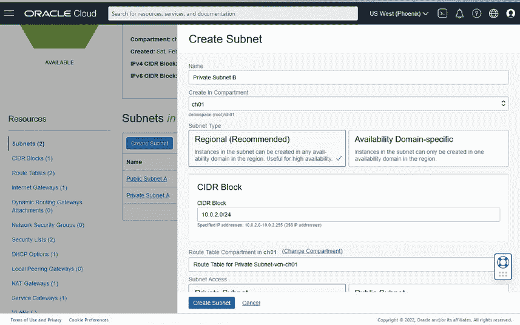

f. **子网访问**: `Private Subnet`

g. **DNS 解析**: 已选中

h. **DNS 标签**: 留空

i. **Dhcp 选项**: `Default DHCP Options for vcn-ch01`

j. **安全列表**: `Security List for Private Subnet-vcn-ch01`

3. 单击 `Create`。

*图 1-3. 创建第二个私有子网*

## 网络安全组

OCI 现在为管理员提供了两种添加安全规则来管理对网络资源访问的方法。所有子网都应该已经定义并关联了一个安全列表。创建安全列表时，它将是空的，因此，无论来源如何，到每个组件的所有流量都将被阻止。

有两种类型的安全规则，一种用于管理入站流量，另一种用于管理出站流量。两者都需要类似类型的信息。

- **源/目标类型**: 这可以是 CIDR、服务或网络服务组。大多数规则依赖于 CIDR。
- **源/目标 CIDR**: 源或目标的 IPv4 地址。
- **IP 协议**: OCI 控制台提供支持的协议列表 (`All`、`TCP`、`UDP` 和 `ICMP`) 和预定义的服务。
- **源端口范围**: 输入要过滤的入站端口号。在大多数情况下，此字段留空，因此规则将接受来自任何端口的流量。
- **目标端口范围**: 允许流量流向目标的端口号。与源端口范围一样，如果留空，则允许所有流量。或者，指定单个端口号、范围或用逗号分隔的多个端口。图 1-4 中的示例显示了一个入站规则，允许传入流量到标准 HTTP/HTTPS 端口。
- **描述**: 此字段是可选的，但我强烈建议对规则的目的留下一些注释。

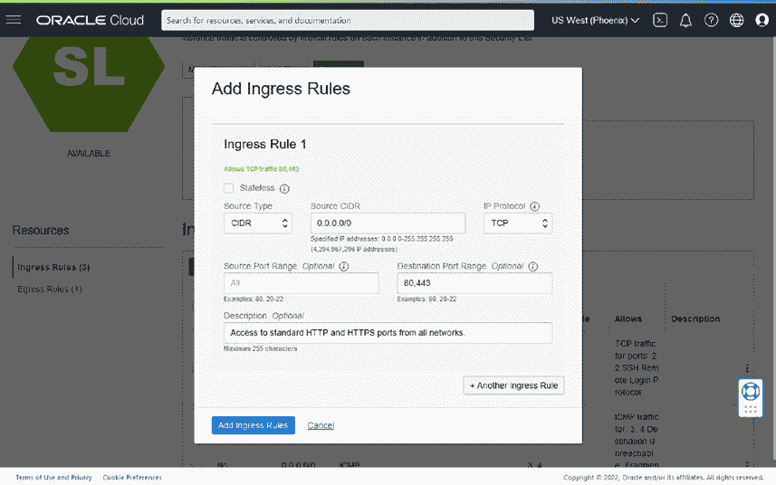

*图 1-4. 允许访问 Web 服务器上使用的标准端口的入站规则*

一旦安全列表与子网关联，其所有规则都适用于连接到该子网的任何资源。*网络安全组* (`NSG`) 是一个较新的功能，允许对每个网络资源应用哪些规则进行更精细的控制。与安全列表相反，`NSG` 与 OCI 组件关联，而不是与它们所属的子网关联。

要创建 `NSG`，请执行以下任务：

1. 转到 `VCN` 的详细信息页面，然后单击 `Network Security Groups`。
2. 单击 `Create Network Security Group`。
3. 为 `NSG` 输入一个名称，例如 `NsgPublicWebAccess`。
4. 使用表 1-1 中的信息添加两个安全规则。如有必要，单击 `Another Rule`。
5. 单击 `Create`。

*表 1-1. NsgPublicWebAccess 的安全规则*

| 方向 | 详细信息 | 描述 |
| :--- | :--- | :--- |
| 入站 | **源类型**: `CiDr`<br>**源 CIDR**: `0.0.0.0/0`<br>**IP 协议**: `TCP`<br>**源端口范围**: 留空<br>**目标端口范围**: `80,443` | 允许从所有网络源访问标准 HTTP 和 HTTPS 端口 |
| 出站 | **目标类型**: `CiDr`<br>**目标 CIDR**: `0.0.0.0/0`<br>**IP 协议**: `All Protocols` | |

使用表 1-2 中的信息创建另外三个 `NSG`。

*表 1-2. 其他三个 NSG 的安全规则*

| NSG 名称 | 方向 | 详细信息 | 描述 |
| :--- | :--- | :--- | :--- |
| `NsgPrivateWebAccess` | 入站 | **源类型**: `CiDr`<br>**源 CIDR**: `0.0.0.0/0`<br>**IP 协议**: `TCP`<br>**源端口范围**: 留空<br>**目标端口范围**: `80,443` | 允许从所有网络源访问标准 HTTP 和 HTTPS 端口 |
| `NsgPrivateWebAccess` | 出站 | **目标类型**: `CiDr`<br>**目标 CIDR**: `0.0.0.0/0`<br>**IP 协议**: `All Protocols` | |
| `NsgPrivateJavaEEAccess` | 入站 | **源类型**: `CiDr`<br>**源 CIDR**: `10.0.0.0/24` (*Public Subnet A*)<br>**IP 协议**: `TCP`<br>**源端口范围**: 留空<br>**目标端口范围**: `80,443` | 允许从所有网络源访问标准 HTTP 和 HTTPS 端口 |
| `NsgPrivateJavaEEAccess` | 出站 | **目标类型**: `CiDr`<br>**目标 CIDR**: `0.0.0.0/0`<br>**IP 协议**: `All Protocols` | |
| `NsgPrivateDatabaseAccess` | 入站 | **源类型**: `CiDr`<br>**源 CIDR**: `10.0.0.0/16`<br>**IP 协议**: `TCP`<br>**源端口范围**: 留空<br>**目标端口范围**: `1521–1522` | 允许从任何 `VCN` 子网访问数据库端口 |
| `NsgPrivateDatabaseAccess` | 出站 | **目标类型**: `CiDr`<br>**目标 CIDR**: `0.0.0.0/0`<br>**IP 协议**: `All Protocols` | |

## 堡垒机

如今，网络攻击的风险极高。无论您的组织的 Web 应用程序规模有多小，限制攻击面并保护对数据和代码的访问都是至关重要的。在提议的架构中，所有应用程序和数据库服务器都放置在无法通过互联网访问的私有子网中。负载均衡器是 OCI 管理的服务，具有非常特定的功能，并且不保留任何代码或数据。它们可以放置在公共子网中，有时也称为非军事区 (DMZ)。

对于大多数组织来说，这些私有子网是通过 `VCN` 和本地网络之间的站点到站点虚拟专用网络 (VPN) 访问的。远程工作的员工然后可以使用单独的 VPN 连接到公司网络，然后通过安全的 `IPsec` 隧道，再连接到服务器。

Oracle 提供了一种替代解决方案，即 `Bastion` 服务，用于安全地隧道进入 `VCN` 并连接到私有子网上的服务器。与负载均衡器一样，这是 OCI 提供的托管服务。堡垒机可以分配给公共子网，其访问可以通过 `身份和访问管理 (IAM)` 组和策略进行管理。

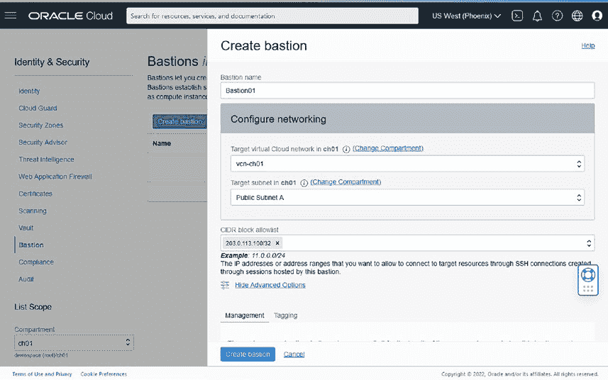

使用以下步骤创建堡垒机：

1. 打开导航菜单，单击 `Identity & Security`，然后单击 `Bastion`（您可能需要向下滚动页面一点）。
2. 单击 `Create bastion`。
3. 输入一个名称（图 1-5）。指定目标 `VCN` 和子网（一个公共子网，因为我们的目标是通过互联网访问服务器），如有必要，更新所选的区间。如果您需要将连接限制到预定义的 `IP` 地址范围，则将它们添加到 `CIDR block allowlist` 字段中。
4. 单击 `Create bastion`。

*图 1-5. 创建堡垒机并将其放置在公共子网上*

通过堡垒机可以使用两种类型的会话，具体取决于您希望连接到私有子网上的什么。如果计算实例是使用 Oracle 提供的 `Linux` 镜像之一创建的，用户可以创建 `managed SSH sessions` 来使用 `SSH` 连接到服务器。此外，这些主机需要安装并运行 `OpenSSH`，必须安装 `Oracle Cloud Agent`，并且启用 `Bastion` 插件（图 1-6）。主机所在的 `VCN` 还必须有一个服务网关和一个规则，允许所有 `OCI` 服务通过它进行路由。

**注意** `SSH` 是一种用于与运行基于 `Unix` 的操作系统的服务器进行通信的安全协议，通常通过传输控制协议 (`TCP`) 端口号 22。客户端与服务器通信的最常见应用程序是 `OpenSSH`。该软件可用于安装当前版本的 Microsoft Windows、Mac 和 `Linux`。用户需要一个操作系统用户帐户，并且可以使用各种方法进行身份验证，例如密码或 `SSH` 密钥对。要执行后者，`OpenSSH` 提供了管理这些密钥的工具，这些密钥默认存储在用户主目录下的 `.ssh` 子目录中。要生成密钥对，请运行命令：

```
ssh-keygen -t rsa
```

密码短语是可选的，因此将其留空以使用不带密码短语的密钥。生成私钥和公钥后，您将分别在文件 `~/.ssh/id_rsa` 和 `~/.ssh/id_rsa.pub` 中找到它们。确保私钥安全，但将公钥的内容提供给需要访问的系统。公钥被添加到用户主目录中的文件 (`~/.ssh/authorized_keys`) 中，然后用于身份验证。

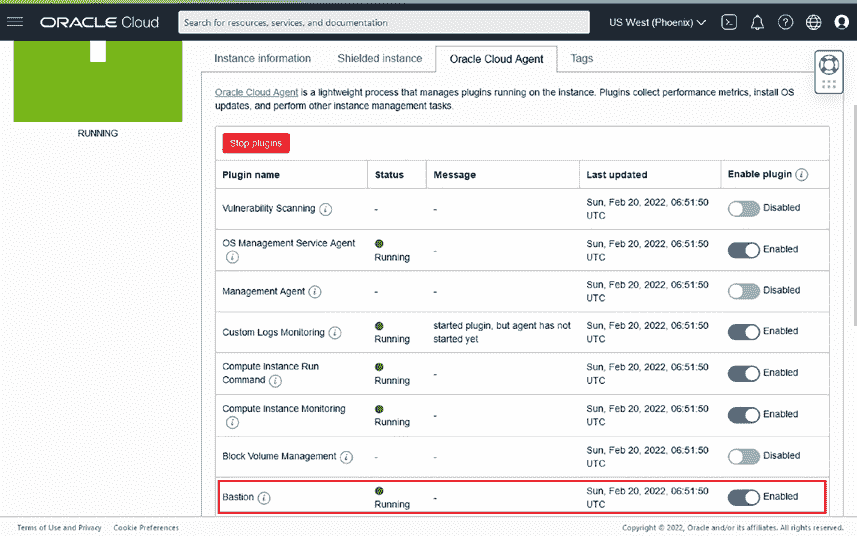

# 第 1 章 为 APEX 构建安全基础设施

**图 1-6.** 确保实例已启用 Bastion 插件

假设有一个名为 `appsrv01` 的计算实例满足这些要求，并且已部署在 *Private Subnet A* 中。使用以下步骤创建托管 SSH 会话以访问服务器：

1.  转到堡垒机的详细信息页面。
2.  单击 *Create session*。
3.  选择或提供以下详细信息（图 1-7）：
    *   **会话类型**: Managed SSH session
    *   **会话名称**: BastionSession_appsrv01
    *   **用户名**: `opc` *(或任何已添加 SSH 公钥的 Linux 用户)*
    *   **计算实例**: `appsrv01`
    *   **添加 SSH 密钥**: *提供您的 SSH 公钥*

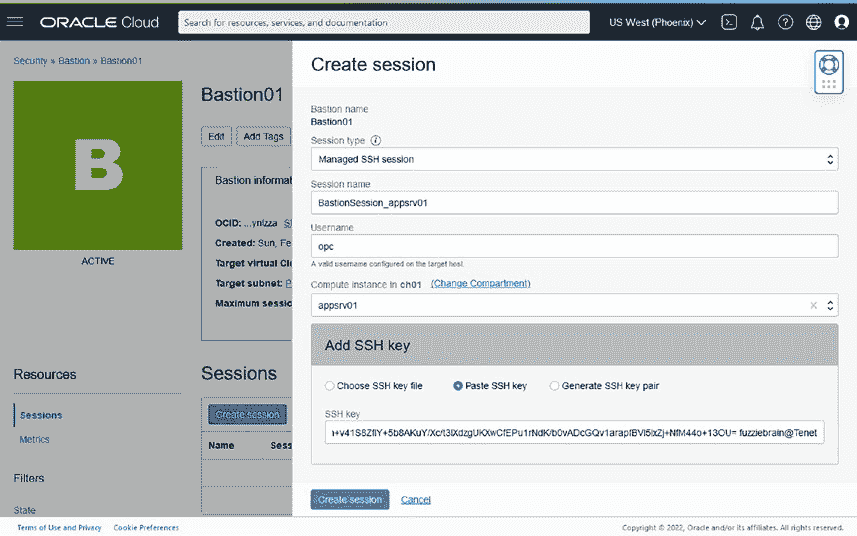

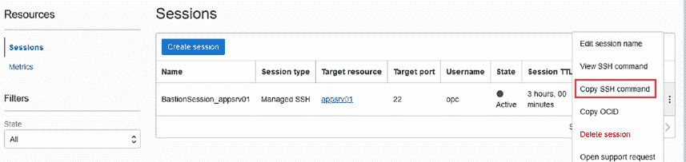

4.  单击 *Create session*。

**图 1-7.** 创建堡垒机托管 SSH 会话以安全访问计算实例

创建会话后，返回堡垒机的详细信息页面，您将在其中找到它。单击三个垂直点以访问其他选项（图 1-8）。单击 *Copy SSH command*。

**图 1-8.** 复制 SSH 命令以连接到服务器

以下是 `ssh` 命令的示例：

```
ssh -i <privateKey> -o ProxyCommand="ssh -i <privateKey> -W
%h:%p -p 22 ocid1.bastionsession.oc1.phx.
amaaaaaafy4s5yqavemdvoezbztyky6djzuyznny2km5egdzozbys2ncftka@host.bastion.
us-phoenix-1.oci.oraclecloud.com" -p 22 opc@10.0.1.246
```

将 `<privateKey>` 占位符替换为 SSH 私钥的路径。

不幸的是，在撰写本文时，DB 系统尚不满足创建托管 SSH 会话的要求。相反，创建第二种会话类型：*SSH port forwarding session*。

1.  从堡垒机的详细信息页面，单击 *Create session*。
2.  与托管 SSH 会话类似，提供以下信息：
    *   **会话类型**: SSH port forwarding session
    *   **会话名称**: BastionSession_Ssh_dbsrv01
    *   **连接到目标主机方式**: IP address
    *   **IP 地址**: *输入数据库节点的 IP 地址*
    *   **端口**: 22
    *   **添加 SSH 密钥**: *提供 SSH 公钥*
3.  单击 *Create session*。

返回堡垒机的详细信息页面，复制 SSH 命令，该命令应类似于以下内容：

```
ssh -i <privateKey> -N -L <localPort>:10.0.2.90:22 -p
22 ocid1.bastionsession.oc1.phx.
amaaaaaafy4s5yqajaqf5gmoiqdly5ttccf3ks4qnmifvkk3dhe3izs5h5ba@host.bastion.
us-phoenix-1.oci.oraclecloud.com
```

将占位符 `<privateKey>` 和 `<localPort>` 替换为 SSH 私钥路径和要映射的本地端口号。例如：

```
ssh -i ~/.ssh/id_rsa -N -L 2222:10.0.2.90:22 -p 22 ocid1.bastionsession.
oc1.phx.amaaaaaafy4s5yqajaqf5gmoiqdly5ttccf3ks4qnmifvkk3dhe3izs5h5ba@host.
bastion.us-phoenix-1.oci.oraclecloud.com
```

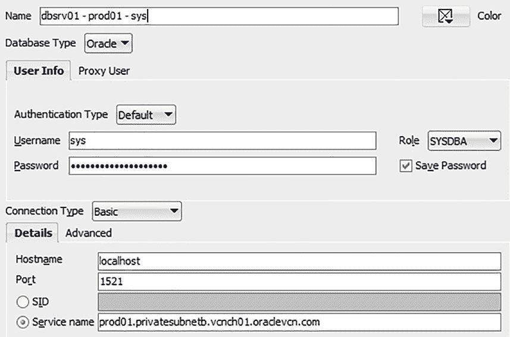

执行命令以创建 SSH 隧道。从同一工作站的另一个终端，通过 SSH 登录到 DB 系统，并使用本地端口号连接到 `localhost`。例如：

```
ssh -p 2222 -i ~/.ssh/id_rsa opc@localhost
```

要从工作站连接到数据库，例如，使用 *SQL Developer* 或 *SQLcl*，使用数据库端口号 1521 创建第二个 SSH 隧道。运行 SSH 命令并指定要映射到的本地端口号，然后设置数据库连接（图 1-9）。

**图 1-9.** SQL Developer 中的示例数据库连接

## 基础设施即代码

在本章前面，我们使用向导创建了基础 VCN，该向导创建了必要的网络子组件和配置。这大大减少了创建基础环境所需的手动步骤数量。但是，模板并不总是满足我们的操作要求。配置 VCN 后，我们必须重命名资源并添加一些新资源。

与任何类型的手动干预相关的常见风险或缺点是**可重复性**。如果由于某些故障或新需求而需要恢复相同的 VCN 配置，则很难保证能够准确地重复设置。有没有办法用代码记录基础设施？

### Terraform 和资源管理器

是的，这个非常常见的挑战的答案是 Terraform。Terraform 允许架构师使用配置文件定义基础设施，然后在云供应商的 Terraform 提供程序的帮助下部署配置更改。OCI 的提供程序由 Oracle 创建和维护。Terraform 脚本可以作为堆栈部署在名为 *Resource Manager* 的 OCI 服务上。该服务可以通过 OCI 控制台在导航菜单项 *Developer Services* ➤ *Resource Manager* 下访问。

使用资源管理器时的第一个任务是创建一个堆栈。这是一组 Terraform 配置文件，可以上传、管理、测试和部署。Terraform 配置是用平台特定的语言编写的，可以使用任何文本编辑器进行编辑。我在处理 Terraform 配置文件时首选的工具是 Microsoft Visual Studio Code ([`code.visualstudio.com/`](https://code.visualstudio.com/))。有一个官方扩展 ([`marketplace.visualstudio.com/items?itemName=HashiCorp.terraform`](https://marketplace.visualstudio.com/items?itemName=HashiCorp.terraform)) 可以使编写这些文件变得轻而易举。

资源管理器还支持使用源代码控制系统，例如 GitLa[b (https://gitlab.com/)。](https://gitlab.com/)

架构师无需从头开始 Terraform 配置项目。Oracle 根据其发布的参考架构提供配置文件，您可以通过资源管理器访问这些文件，或从其 GitHub 仓库下载捆绑包。或者，您可以通过从现有区间提取信息来生成配置文件。

Terraform 配置通常依赖于仅在需要部署时才可用的信息。这些信息作为变量公开，控制台提供了一个用户界面，允许架构师设置和/或修改它们。

堆栈准备就绪后，架构师应使用 *Plan* 操作验证配置文件，然后在仔细检查结果后，使用 *Apply* 操作部署堆栈。与堆栈部署关联的所有资源也可以通过执行 *Destroy* 操作来删除。

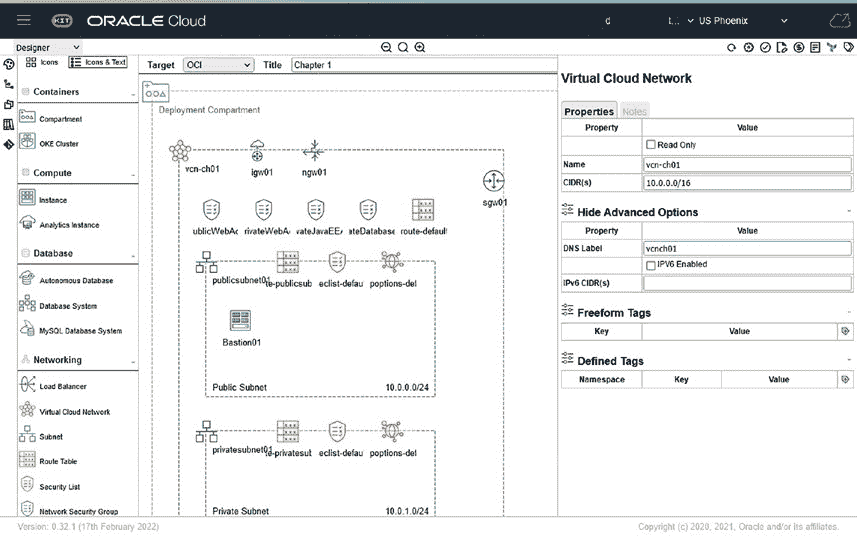

### OCI 设计器工具包

还值得一提的是，Oracle 有一个漂亮的视觉工具（图 1-10），用于设计您的租户架构，即 *OCI Designer Toolkit* (OKIT)。在撰写本文时，OKIT 仍在积极开发中，但它已经支持许多 OCI 服务，足以创建我们之前描述的网络拓扑。

**图 1-10.** 定义本章所述所需网络拓扑的 OKIT

OKIT 是一个在 Docker 容器内运行的 Web 应用程序工具。如果您有兴趣使用该工具，请安装 Docker 或任何其他 `Open Container Initiative` 运行时，然后按照 GitHub 仓库上的说明 ([https://github.com/oracle/oci-designer-toolkit](https://github.com/oracle/oci-designer-toolkit)) 构建并运行容器。

在配置工作站和容器以支持 OCI REST API 访问后，OKIT 可以无缝地与租户一起工作。架构师可以将设计导出为 Terraform 配置文件，甚至可以从工具内部将它们作为堆栈部署到资源管理器上。

# 第 1 章 为 APEX 构建安全基础设施

## 将 APEX 部署到数据库系统

将 APEX 部署到 OCI DB 系统时，管理员全权负责安装 APEX。他们还负责数据库性能调优、安全修补以及规划数据库备份和恢复的所有方面。

类似地，`ORDS` 是一个 Java Web 应用程序，运行在 Java EE 应用服务器内部。`ORDS` 可以作为独立服务器（由嵌入式 Jetty Web 容器提供支持）运行，也可以部署到受支持的容器，例如 Apache Tomcat 或 Oracle WebLogic。管理员全权负责使用一个或多个 OCI 计算实例配置服务器，安装和配置服务器软件，强化操作系统，并确保应用所有安全更新。

## Oracle Autonomous Linux

使操作系统保持最新的安全补丁可能是一项艰巨的任务，尤其是在处理大量服务器时。将服务器与互联网访问隔离只是可以采取的降低网络攻击风险的众多步骤之一。确保为服务器提供动力的软件保持更新也非常重要。

2019 年，Oracle 宣布推出 `Oracle Autonomous Linux` ([www.oracle.com/linux/autonomous-linux/](http://www.oracle.com/linux/autonomous-linux/)) 操作系统，可用于在 OCI 上部署计算实例。这种特殊版本的 `Oracle Enterprise Linux` 提供自动修补、零停机规划、自我调整和已知漏洞利用检测。管理员使用通知服务，还可以设置在操作系统修补时收到通知。这些功能使 `Oracle Autonomous Linux` 成为托管 `ORDS` 的绝佳操作系统。

**注意** 当部署在 OCI 计算实例上时，`ORDS` 可通过 `Oracle Enterprise Linux` 软件包仓库安装。当通过仓库安装 `ORDS` 时，它作为独立服务器运行。在 `Oracle Autonomous Linux` 中，`ORDS` 软件会自动更新，但管理员需要确保 `ords.conf` 配置文件正确，配置目录位置设置在 `ords.war` 文件中，并执行安装过程以确保应用任何 `ORDS` 模式更改。在重新启动 `ORDS` `systemd` 服务之前，请执行这三个步骤。

## 负载均衡器

理想情况下，数据库和应用服务器都应部署在私有子网中。在提议的架构中（图 1-1），在堆栈中扮演不同角色的服务器被进一步隔离在不同的网络中。这允许管理员定义细粒度的安全和访问控制策略。由于这些服务器深埋在私有网络中，我们如何安全地在互联网上公开 APEX 应用程序？

OCI 提供负载均衡器作为托管服务，它们是 Java 应用服务器的绝佳伴侣。作为一种高度专业化的资源，负载均衡器代理浏览器或 REST 客户端与应用服务器之间的 Web 流量，以交付 Web 内容，而不会向公共网络暴露任何额外的攻击面。Oracle 管理、监控和更新负责交付服务的硬件和软件。在拥有多个*可用性域* (AD) 的 OCI *区域*中，负载均衡器服务还在 AD 发生故障时提供自动故障转移。

### 在自治数据库上使用 APEX

Oracle 自治数据库为运行 APEX 提供了一个完整的堆栈。与之前的部署策略不同，APEX 运行时随数据库预装。无需安装任何软件或创建额外的计算实例。ADB 服务包括一个托管且有弹性的环境，用于托管 ORDS。

在下一节中，我们将提出一个架构（图 1-11），该架构将 ADB 隔离在私有网络中，但允许从外部网络访问 APEX 应用程序。

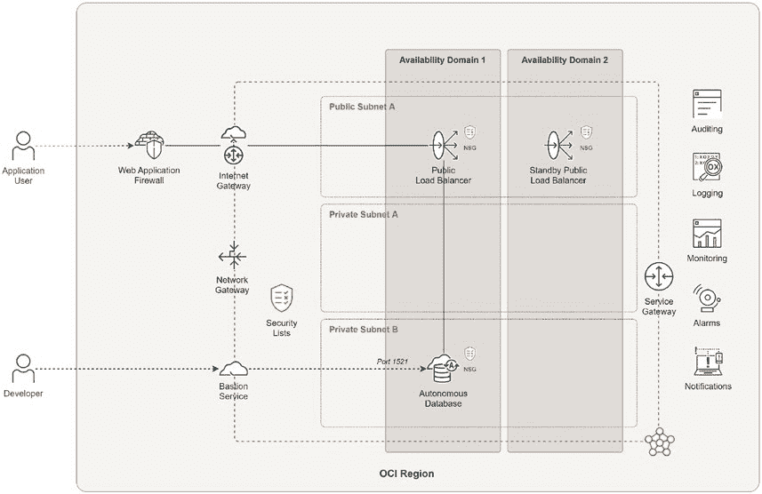

***图 1-11.** 由自治数据库提供支持的安全 APEX 堆栈*

ADB 将配置为仅提供私有网络访问的端点。放置在公共子网中的负载均衡器不仅配置为使 ADB 工具套件在互联网上可用，而且还支持*自定义 URL*，这些 URL 更用户友好，并且更能代表拥有应用程序的组织。

### 私有端点

付费的 ADB 实例，无论工作负载类型如何，都将允许管理员选择以下任何网络访问类型：

1\. 从任何地方安全访问

2\. 仅允许来自允许的 IP 和 VCN 的安全访问

3\. 仅私有端点访问

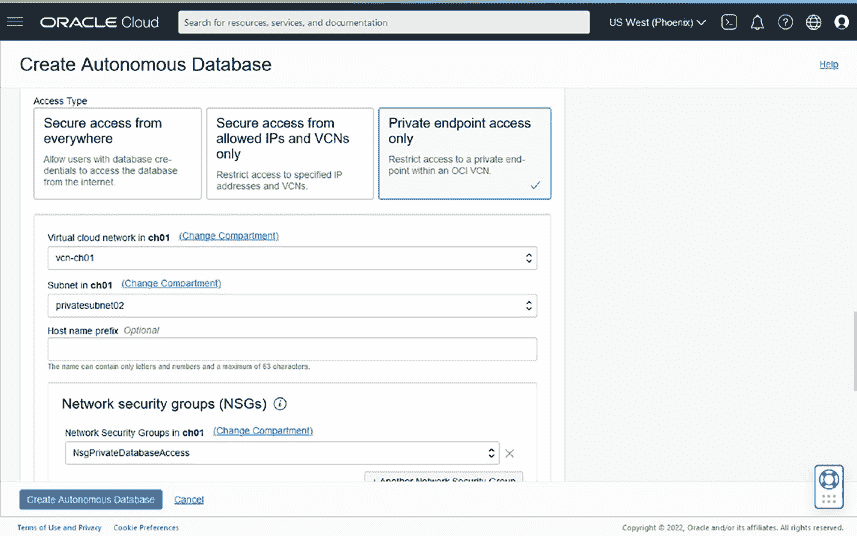

您可以在创建实例时选择访问类型，也可以在创建 ADB 后更改它。图 1-12 说明了通过私有端点限制访问的选择，管理员必须分配目标 VCN、子网和 NSG。

***图 1-12.** 创建 ADB 时选择网络访问类型*

默认情况下，ADB 创建为可从任何地方访问。用户可以从互联网访问 ADB 的所有功能，包括 APEX、Database Actions、Graph Studio，以及使用 `SQL*Net` 和可下载的数据库钱包连接到数据库。在 VCN 中定义的任何安全列表规则都不适用，因为端点存在于租户及其 VCN 之外。如果需要限制访问，则必须在切换到第二种网络访问类型后通过访问控制列表指定。

另一种选择是通过私有端点（选项 3）限制对 ADB 的访问。顺便提一下，此配置是 ADB 支持自定义 URL 而不需要托管客户管理的 `ORDS` 实例的要求。

具有私有端点的 ADB 只能通过 VCN 以及通过站点到站点 VPN 或 *FastConnect* 链接的任何本地网络进行访问。与任何其他与 VCN 关联的 OCI 资源一样，访问受安全列表或 NSG 中定义的规则约束。管理员还可以禁用相互 TLS 身份验证，从而允许无需数据库钱包即可通过 `SQL*Net` 访问数据库。

**重要** APEX 服务不支持 `SQL*Net` 访问。

### 自定义 URL

Oracle 自治数据库创建时带有一个伪随机 URL，供用户访问 APEX、`ORDS` 和 Database Actions。完全限定域名 (FQDN) 通常使用以下模式：

`<RANDOM_STRING>.adb.<REGION_ID>.oraclecloudapps.com`

对于大多数组织来说，这些 URL 可能难以让大多数用户记住。特别是在提供公共服务的情况下，使用组织注册域名的子域可能很重要。这些类型的 URL 通常称为自定义 URL。

以前，自定义 URL 只能通过配置连接到 ADB 的客户管理 `ORDS` 来实现，该 `ORDS` 使用特殊的数据库帐户。这种方法需要一个单独的计算实例，并且客户需要使托管的 `ORDS` 版本与 ADB 中安装的版本保持同步。值得庆幸的是，自 2021 年以来，直接支持自定义 URL 已成为可能。

支持自定义 URL 需要以下条件：

• ADB 的私有端点

• 使用安全列表或 NSG 定义的安全规则

• 由证书颁发机构 (CA) 签名的 SSL/TLS 证书

• 公共子网上的负载均衡器

如果您尚未这样做，请将 ADB 配置为具有分配在私有子网中的私有端点，如前所述。接下来，使用本章前面创建的 NSG，将 `NsgPrivateDatabaseAccess` 和 `NsgPrivateWebAccess` 分配给 ADB。第一个 NSG 定义了允许访问数据库端口的 IP 范围。后者用于负载均衡器将 Web 流量中继到 ADB。

负载均衡器设置需要 SSL/TLS 证书用于两个目的。支持自定义 URL 的负载均衡器有一个需要证书的 HTTPS 侦听器。证书的第二个用途是让侦听器与 ADB 的 Web 端点通信，该端点仅支持 HTTPS。此通道需要证书链，因此不能使用自签名证书。

最后，在公共子网上创建负载均衡器。定义一个后端集，其中包含一个由分配给 ADB 的私有 IP 地址定位的后端服务器。您可以在 ADB 的详细信息页面上找到 IP 地址。

## Web 应用防火墙

## Web 应用防火墙

Web 应用防火墙是您可以放置在公共网络和 APEX 基础设施堆栈之间的额外保护层。它负责检查传入流量，并记录、警告，并在必要时阻止任何恶意活动。这些可以包括 OWASP 十大 Web 应用程序安全风险 ([`owasp.org/www-project-top-ten/`](https://owasp.org/www-project-top-ten/))、分布式拒绝服务 (`DDoS`)，或简单地应用访问控制规则，例如用户可以从哪些地理位置访问 Web 应用程序。

OCI `Web Application Firewall` (WAF) 作为区域服务提供，无需管理任何软件或硬件。它涉及相当多的配置，例如：

1.  设置 WAF 策略，包括源端点、`Access Control` 规则、保护规则、速率限制、操作等。
2.  配置应用于负载均衡器的安全规则，以仅限制对 WAF 端点的访问。
3.  创建和分配 `SSL/TLS` 证书。

对 WAF 策略的任何更改都必须应用，并允许在所有全局边缘服务器之间传播。

在 2021 年底，Oracle 极大地简化了 WAF 的部署方式。如今，WAF 可以附加到具有灵活形状的 OCI 负载均衡器上。接下来，我们将介绍创建 WAF 策略然后在负载均衡器上实施它的步骤。

1.  单击导航菜单，单击 `Identity & Security`，然后单击 `Policies` 下的 `Web Application Firewall`。
2.  单击 `Create WAF Policy`。
    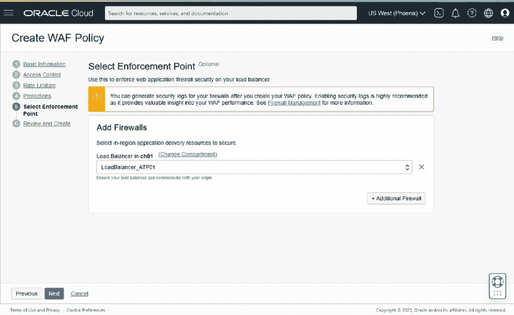
3.  为策略提供一个名称，并选择放置策略的区间。默认情况下，会为您预定义三个操作。您可以使用它们，也可以立即添加自定义操作。单击 `Next` 继续。
4.  接下来的几个步骤要求您启用 WAF 功能。它们是 `Access Control`、`Rate Limiting` 和 `Protections`。这些是可选的，并且像操作一样，可以在创建策略后定义。单击 `Next` 以通过向导前进。
5.  完成所有功能后，选择将实施策略的负载均衡器（图 1-13）。同样，此步骤是可选的，可以稍后执行。单击 `Next`。
6.  最后，查看您定义的策略的详细信息，然后单击 `Create WAF Policy`。

> **图 1-13.** 创建 WAF 策略并在选定的负载均衡器上实施它

为了演示 WAF 的实际应用，尝试创建一个简单的访问控制规则，该规则检查客户端的地理位置，并且仅当源发地位于 `Canada` 时才允许访问：
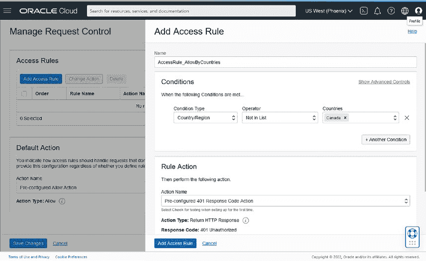

1.  转到 WAF 策略的详细信息页面。
2.  在页面左侧的 `Policy` 下，单击 `Access Control`。
3.  在 `Request Control` 选项卡下，单击 `Manage Request Control`。
4.  在 `Access Rules` 部分下，单击 `Add Access Rule`。
5.  我们将遵循“拒绝所有并允许部分”的安全策略方法。此规则将列出允许访问应用程序的国家/地区（图 1-14）。为访问规则输入一个名称，并使用以下设置设置一个条件：
    *   **条件类型**: `Country/Region`
    *   **运算符**: `Not In List`
    *   **国家/地区**: `Canada` (您可以输入多个国家/地区)
6.  选择规则操作 `Pre-configured 401 Response Code Action`。

> **图 1-14.** 添加一个基于 `IP` 地理位置的访问规则，遵循“拒绝所有并允许部分”的方法
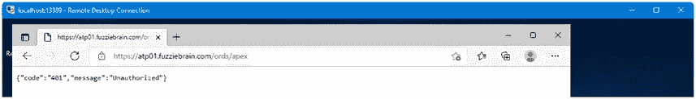

7.  单击 `Add Access Rule`。
8.  单击 `Save Changes`。

为了验证访问规则，我尝试从位于美国地区的远程桌面访问 APEX，并如预期收到了图 1-15 所示的响应。

> **图 1-15.** 远程访问站点时出现 `401` 未授权消息

## 漏洞扫描

漏洞扫描服务 (`VSS`) 是 Oracle 为所有付费帐户提供的免费服务。它支持扫描使用 Oracle 提供的平台镜像（包括 Oracle `Linux`、`CentOS`、`Ubuntu` 和 `Windows`）创建的计算实例。该服务在计算上部署并运行一个代理，该代理搜索在知名数据库（例如国家漏洞数据库 (`NVD`)、开放漏洞和评估语言 (`OVAL`) 和互联网安全中心 (`CIS`)）中报告的漏洞。

**注意** 可以对所有计算实例执行端口扫描，即使它们是使用不受支持的平台镜像创建的。

要允许 `VSS` 扫描计算实例，需要以下策略语句：

```
Allow service vulnerability-scanning-service to manage instances in tenancy
Allow service vulnerability-scanning-service to read compartments in tenancy
Allow service vulnerability-scanning-service to read vnics in tenancy
Allow service vulnerability-scanning-service to read vnic-attachments in tenancy
```

将 `tenancy` 替换为 `compartment`，后跟区间名称，以将 `VSS` 限制为仅扫描指定区间中的计算实例。

接下来，创建一个 `Scan Recipe` 并定义端口扫描的级别以及是否执行基于代理的扫描（图 1-16）。

> **图 1-16.** 创建扫描配方

如果需要基于代理的扫描，还要指明是否执行 `CIS` 基准扫描以及标记关键风险的阈值。最后，指定扫描已分配此配方的目标主机的每日或每周计划。

最后一步涉及创建一个目标，即计算实例的逻辑分组，将使用选定的配方进行扫描（图 1-17）。
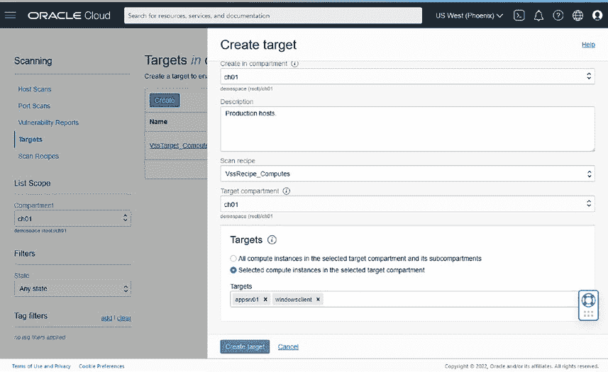

> **图 1-17.** 创建目标并分配要应用的扫描配方

图 1-18 是扫描运行 Oracle `Autonomous Linux` 的计算实例后的示例结果。
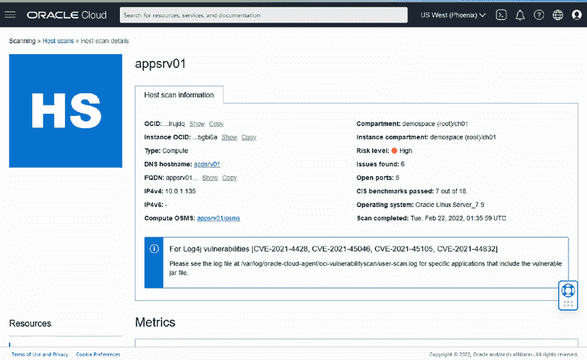

> **图 1-18.** 常规主机扫描后的结果示例

通过结果，管理员可以查看开放端口、漏洞及其风险级别以及 `CIS` 基准。补救措施可能包括关闭不需要的服务、修补软件漏洞以及解决系统配置以提高 `CIS` 基准分数。

## 日志、指标和告警

到目前为止，在本章中，我们已经讨论了加强 APEX 基础设施防御网络攻击的问题和注意事项。我们研究了使用网络边界隔离资源、使用专业化和 Oracle 管理的服务减少攻击面、添加 Web 应用防火墙以及定期漏洞扫描。然而，尽管我们努力挫败攻击者，但仍有可能有人成功渗透我们的安全层。

大多数 OCI 资源都会生成指标和日志，这两者通常用于性能监控和问题故障排除。但是，这些可以用作指示服务器可能已被入侵的绊线。例如，如果过去一个月平均 `CPU` 利用率低于 50% 的计算实例突然持续接近 100% 使用率，则应触发告警（图 1-19），并通知管理员进行进一步调查。

> **图 1-19.** 监控 `CPU` 利用率的告警在用量激增时触发

OCI `Logging`，尤其是与 `Logging Analytics` 一起使用时，可以成为入侵检测的强大工具（图 1-20）。`Logging Analytics` 是一种基于区域的服务，允许管理员聚合来自多个来源的日志，包括报告与租户相关活动的 OCI `Audit` 日志、来自 OCI 资源的日志、`Oracle` 数据库以及来自计算实例的操作系统事件。
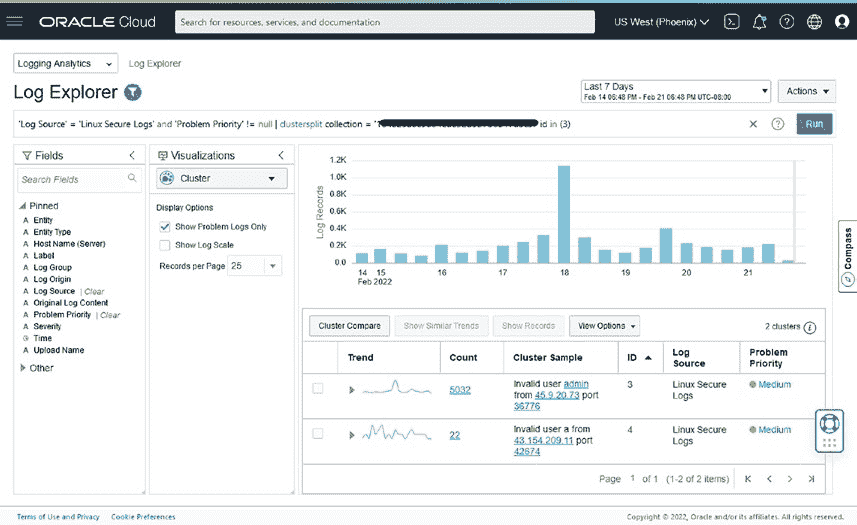

> **图 1-20.** 使用 `Logging Analytics` 中的报表和仪表板来隔离安全关注事件

## 总结

在本章中，我们讨论了在 OCI 上为 APEX 部署基础设施时的问题和注意事项。安全性不是事后才考虑的事情，需要在生产环境部署之前就纳入架构中。这是一个如此庞大的话题，不幸的是，一个章节不足以涵盖。我们已经从高层次的角度审视了这些问题，但是如果您需要有关所讨论的各种 OCI 服务的更多信息，我强烈推荐阅读出版商的其他书籍，这些书籍将提供所需的指导。我推荐的一些书籍是：
*   《Oracle Cloud Free Tier 入门》，作者 Adrian Png 和 Luc Demanche
*   《实用 Oracle 云基础设施》，作者 Michał Tomasz Jakóbczyk
