# 第 3 章 使用 Oracle 云函数

在上一章中，我们创建了一个相册，它使用 `OCI` 对象存储来存储原始图像。这些是大文件，我们不一定希望在用户明确请求查看之前以全分辨率呈现。我们可以通过图像和/或数据处理进一步增强我们的应用程序，以创建更小的预览图像用于呈现，从而提高页面加载性能。

在 PL/SQL 中创建缩略图或预览尺寸图像的一种方法是使用 `Oracle Multimedia` (OMM)。不幸的是，这些包在 Oracle 数据库 19c 版本中已被弃用和取消支持。曾经使用 `OMM` 进行图像处理任务（例如缩略图生成）的开发人员现在被迫寻找替代方案。使用 Functions，我们可以将此类计算密集型任务卸载到无服务器平台，并按需执行。

在本章中，我们将了解 `Oracle 云函数` (Functions)，这是一种无服务器计算技术，以及如何使用它来执行图像处理任务。

**重要** Oracle Function 不包含在 Oracle Cloud `Free Tier` 产品中。使用成本将在本章后面讨论。

## 图像处理

`OMM` 是一个免费的 Oracle 数据库功能，用于在数据库中存储、访问和管理图像、音频、视频和 `医学数字成像和通信` (DICOM) 文件。它提供了 PL/SQL 对象类型和包，允许开发人员执行基本的操作任务，例如调整图像大小、添加水印以及检索音频和视频文件的属性/元数据。

例如，要为上传到我们相册的照片创建缩略图，您可以创建一个简单的过程，该过程检索存储为 `PHOTO` 表中 `BLOB` 的图像，执行转换，然后将输出存储在单独的表列中：

```sql
create or replace package body pkg_image_util as
procedure p_generate_thumbnail(
  p_photo_id photo.photo_id%type
, p_size number
) as
  l_image blob;
  l_thumbnail blob;
begin
  -- 1. 为缩略图创建一个临时 BLOB。
  dbms_lob.createtemporary(
    lob_loc => l_thumbnail
  , cache => true
  );

  -- 2. 从表中检索图像。
  select blob_content
  into l_image
  from photo
  where photo_id = p_photo_id;
  -- ... (后续处理逻辑)
end p_generate_thumbnail;
end pkg_image_util;
/
```

© Adrian Png 和 Heli Helskyaho 2022
A. Png 和 H. Helskyaho，《*使用 Oracle 云功能扩展 Oracle Application Express*》，[`doi.org/10.1007/978-1-4842-8170-3_3`](https://doi.org/10.1007/978-1-4842-8170-3_3#DOI)

# 第 3 章 使用 Oracle 云函数

## 3.1 背景与问题

不幸的是，对我们来说，OMM 在 Oracle 数据库 18c 版本中被弃用，并在 19c 版本中被取消支持。Oracle Multimedia 也不支持任何 Oracle 自治数据库。那么，我们如何在 APEX 应用程序中继续提供此类图像处理功能呢？

有许多方法我们可以考虑，在深入探讨如何使用无服务器技术快速创建 Oracle 函数来处理此任务之前，我们将快速检查每种方法。这些是：

1.  使用 JavaScript 库在浏览器中执行图像处理任务。
2.  使用其他编程语言（例如 `JavaScript`、`Java™` 或 `Python`）的第三方库创建和部署服务器端 REST API。
3.  集成执行图像处理任务的基于云的 REST API。
4.  创建和部署应用程序，并使用 Oracle Functions 托管应用程序，而无需担心管理底层基础设施。图像处理任务可以使用 Oracle Event 触发，或使用 `Oracle API gateway` 包装为 REST API。
5.  如果您的数据库支持 `多语言引擎` (MLE) 功能，则可以使用所选的支持语言创建图像处理任务。但是，在撰写本文时，MLE 仅在 Oracle 数据库 21c 版本中可用且受 APEX 支持。

## 3.2 在客户端浏览器上处理图像

不乏可用于在 Web 浏览器上操作和转换图像的 JavaScript 库，例如 p5.js (`https://p5js.org/`) 和 Fabric.js (`http://fabricjs.com/`)。

在客户端执行操作并不难，特别是对于通常精通 JavaScript 的 APEX 开发人员。但是，存在一些问题，例如浏览器兼容性和性能。

## 3.3 自定义图像处理 REST API

值得庆幸的是，自 4.0 版本以来，APEX 通过包 `APEX_WEB_SERVICE` 提供了对使用 RESTful 服务的支持。这为 APEX 应用程序提供了访问和执行 Oracle 数据库范围之外的专门任务的能力。

在服务器端处理图像的一种选择是使用众所周知的应用程序和编程库，例如 `ImageMagick®` (`https://imagemagick.org/`)、用于 Python 的 Pillow (`https://python-pillow.org/`) 和用于 Node.js/JavaScript 的 sharp (`https://sharp.pixelplumbing.com/`)。`ImageMagick` 是一个流行的跨平台数字图像处理库，支持许多图像格式和转换算法。由于其流行性，许多编程语言都有旨在与其交互的库。

今天，我们可能无法在数据库内部访问这些强大的二进制文件，因此最好的替代方法是使用诸如 Express (`https://expressjs.com/`) 和 Django (`http://www.djangoproject.com/`) 之类的框架将它们包装为 REST API，具体取决于您选择的编程语言。

这种方法的缺点是需要创建和管理支持这些 Web 服务的基础设施。开发人员必须处理性能、安全性和可用性等问题。

## 3.4 使用第三方 REST API

有一些服务，如 `Filestack` (`http://www.filestack.com/`)，提供 100% 基于云的 API，以及 `APEX Media Extension` (`http://www.apexmediaextension.com/`)，提供自托管选项。但是，虽然这些服务提供有限的免费服务，但它们通常是收费的，并且根据使用频率可能会很昂贵。

另一个考虑因素是安全性和数据隐私。源图像被发送到服务提供商的服务器，并且根据其服务条款，可能会保留一段预定义的时间。

如果这些问题对您的组织非常重要，或者您需要对图像处理进行更细粒度的控制，那么请考虑实施涉及 Oracle Functions 的解决方案。

## 3.5 Oracle 云函数

Oracle 云函数是一种云原生、无服务器产品，构建在 `Fn Project` (`https://fnproject.io/`) 之上。无服务器技术允许开发人员编写代码来执行专门的任务，然后将其部署并托管在基于云的提供商上，而无需担心管理托管应用程序代码的基础设施。其他无服务器技术包括 Amazon 的 AWS Lambda 和 Microsoft 的 Azure Functions。大多数（如果不是全部）提供商仅在调用和执行函数时收费，从而降低了基础设施成本。

Functions 支持多种编程语言。目前支持以下语言：

*   Go
*   Java
*   Node.js
*   Python
*   Ruby
*   C#

在本章中，我们将重点介绍使用 `Node.js`，因为 JavaScript 是大多数 APEX 开发人员都会熟悉的语言。

与其他竞争的无服务器平台不同，Functions 将代码封装在 Docker (`https://docker.io`) 镜像中，并作为容器部署在 OCI 上。这为开发人员提供了完全自定义和部署具有任何所需依赖项（例如 `ImageMagick`）的容器的机会。

### 3.5.1 Functions 的开发过程

以下是 Functions 的开发过程概述：

1.  选择编程语言运行时，并使用 Fn Project CLI 初始化项目。
2.  使用所选语言编写代码。
3.  使用 Fn Project CLI 将函数部署到 OCI。
4.  调用函数。

我们稍后将更详细地检查每个步骤，但首先，让我们安装所需的软件和工具，并设置支持 Functions 的 OCI 环境、用户和策略。

### 3.5.2 所需软件和工具

**注意** 以下步骤适用于在 Linux 环境中工作。请参考 Oracle 的官方文档和指南以了解其他操作系统。对于 Windows 10 或 11，我强烈建议您使用 Microsoft 的 `Windows Subsystem for Linux` (WSL) 版本 2。

#### 3.5.2.1 OCI CLI

`OCI CLI` 是一个工具，OCI 管理员和开发人员可以使用它来管理 OCI 组件、自动化任务等，而无需担心调用 OCI REST API 所需的复杂步骤。在底层，它使用 OCI Python SDK，因此需要兼容版本的 Python。在撰写本文时，支持任何 3.6 或更高版本。您还需要在您工作的环境中拥有管理访问权限。

要安装 OCI CLI，只需运行以下 Bash 命令：

```bash
bash -c "$(curl -L https://raw.githubusercontent.com/oracle/oci-cli/master/scripts/install/install.sh)"
```

在安装过程中，系统会提示您指定软件工件将安装到的目录。在 Linux 环境中，这通常是用户主目录下的 `lib/oracle-cli` 子目录。安装脚本还需要知道将二进制文件放在哪里。默认情况下，这是用户主目录下的 `bin` 和 `bin/oci-cli-scripts` 子目录。


对于大多数其他提示，您可以使用默认响应，包括修改 PATH 环境变量的最后步骤。

#### 3.5.2.2 Fn Project CLI


# 第 3 章 使用 Oracle 云函数

要部署 Functions 应用程序，开发人员需要 `Fn Project CLI`，这是一个命令行界面应用程序，允许您运行本地开发 Fn 服务器，并将 Fn 应用程序部署到本地 Fn 服务器或 OCI。

开发人员有三个选项可以选择创建和部署 Functions 应用程序的位置。第一个选项是使用 `OCI Cloud Shell`，它可以从 OCI 控制台的顶部导航栏访问（图 3-1）。

**图 3-1.** 启动 `OCI Cloud Shell`

`Cloud Shell` 是免费使用的，但您需要拥有必要的权限，并且其使用在租户的服务限制内。如果您无法启动会话，请咨询您的 OCI 租户管理员。它预装并配置了 OCI 和 `Fn Project CLI`。

另外两个选项是将 CLI 安装在本地工作站或 OCI 计算实例上。后者涉及设置实例主体以授权访问 OCI REST API。我们将重点介绍在本地工作站上安装和配置 CLI。

首先安装 CLI。执行以下命令：

```
curl -LSs \ https://raw.githubusercontent.com/fnproject/cli/master/ install | sh
```

成功安装后，您将看到一个横幅，显示已安装的版本：

```
fn version 0.6.11
```

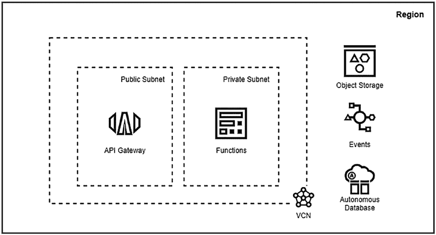

```
 ____              _
/ ___|  ___ _ __ _| | ___  _ __
\___ \ / __| '__| | |/ _ \| '__|
 ___) | (__| |  | | | (_) | |
|____/ \___|_|  |_|\___/|_|
```

我们将在创建必要的 OCI 资源后继续 CLI 配置。

## 虚拟云网络

`Oracle Functions` 和 `API 网关`都需要一个网络子网来部署，我们将在之前创建的 `DEV` 区间中创建这些资源。在本章中，我们将使用 `VCN Wizard` 构建一个简单的网络拓扑（图 3-2）。

**图 3-2.** 高级概述，显示各种 OCI 组件在区域和 VCN 内的位置

1. 首先访问 `Virtual Cloud Networks` 页面。您可以从导航菜单中的 `Networking` 项下找到该链接。
2. 单击 `Start VCN Wizard` 按钮。

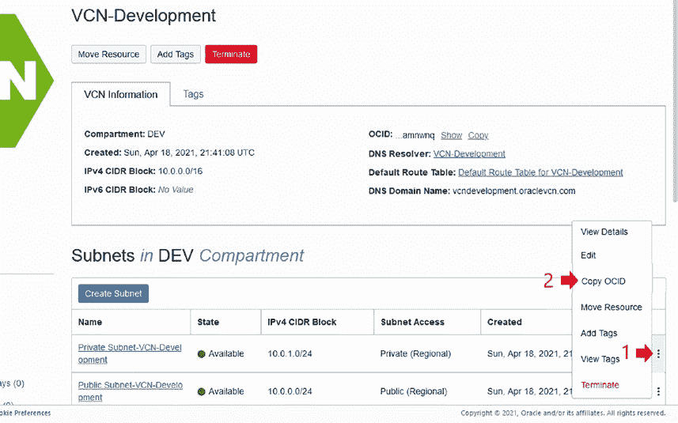

3. 选择选项 `VCN with Internet Connectivity`，然后单击 `Start VCN Wizard` 按钮继续下一步。
4. 输入您将要创建的 VCN 的以下信息：
   a. `VCN 名称`: VCN-Development
   b. `区间`: DEV
   c. `VCN CIDR 块`: 10.0.0.0/16
   d. `公共子网 CIDR 块`: 10.0.0.0/24
   e. `私有子网 CIDR 块`: 10.0.1.0/24
   f. `在此 VCN 中使用 DNS 主机名`: *已选中*
5. 查看将要创建的组件，然后单击 `Create` 按钮生成它们。

创建 VCN 组件后，您应该被重定向到 VCN 详细信息页面，该页面列出了两个子网（图 3-3）。

**图 3-3.** VCN 详细信息页面

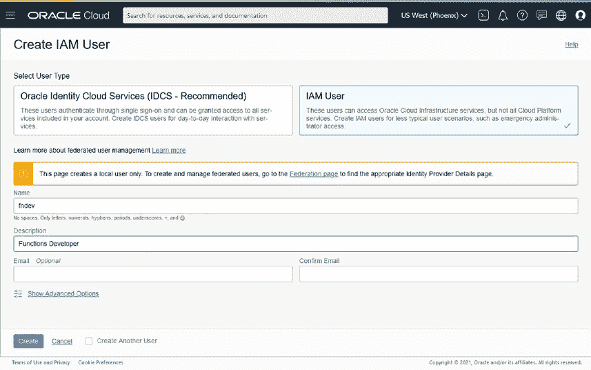

稍后，在部署 Oracle Functions 应用程序时，您需要提供它将部署到的子网的 `OCID`。要获取此信息，请返回 VCN 详细信息页面，单击私有子网（在图 3-3 中标记为“1”）旁边的三个垂直点以打开上下文菜单，然后单击 `Copy OCID`。

## 身份和访问管理

我们将为使用 Oracle Functions 创建额外的 `IAM` 资源。

### 用户

使用 OCI 控制台为我们的开发人员创建一个 IAM 用户。访问 `Users` 管理页面。您可以在 OCI 侧边导航栏中的 `Identity` 项下找到它。创建一个 IAM 用户（图 3-4）。

**图 3-4.** 创建 IAM 用户

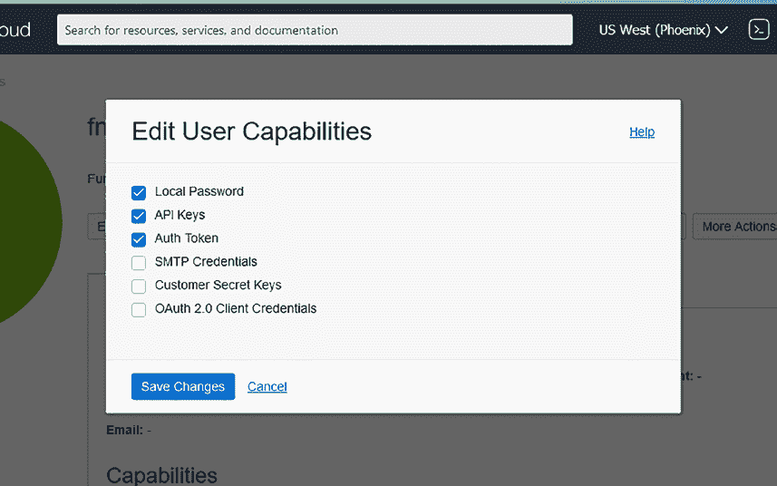

成功创建用户后，确保用户具有以下“功能”：
- `本地密码`: 这允许用户设置密码并访问 OCI 控制台。我们可以将其提供给 OCI 开发人员，以允许他们访问可视化工具来管理 Oracle Functions、Events、Container Registry 和 Object Storage。他们还需要此功能来访问其用户配置文件以添加其 API 密钥。
- `API 密钥`: `API 密钥`是访问 OCI REST API 所必需的，并且在处理 OCI 和 `Fn Project CLI` 工具时需要。
- `身份验证令牌`: `身份验证令牌`是登录 OCI 容器注册表所必需的。

您可以通过编辑用户，然后单击 `Edit User Capabilities` 按钮来启用这些功能。确保选中所需的框（图 3-5），然后单击 `Save Changes`。

**图 3-5.** 设置用户的功能

### API 密钥

`OCI CLI` 提供了一个方便的命令，可以生成使用 OCI 和 `Fn Project CLI` 所需的 `API 密钥`。我们将使用它通过执行以下命令来创建 `API 密钥`：

```
oci setup keys --key-name ociapexbook_fndev_api
```

设置密码短语是可选的。现在，我将将其留空（无密码短语）。

该工具将在 `~/.oci` 目录中生成两个文件：`ociapexbook_fndev_api.pem` 和 `ociapexbook_fndev_api_public.pem`。打开并读取第二个文件的内容，然后复制其内容。您可以使用以下 Linux 命令：

```
cat ~/.oci/ociapexbook_fndev_api_public.pem
```

文件的内容应如下所示：

```
-----BEGIN PUBLIC KEY-----
MIIBIjANBgkqhkiG9w0BAQEFAAOCAQ8AMIIBCgKCAQEA02gzOKGFelJpevEkT+tB
B/U89TzDafv7EyqhEuuMmAf1PeutXoloCYyw0hxN7s2KcAWQrfMBZTXTd+NvLemz
PIz9LI9Yaw6PQunMfKRULh7p3w+tqBmFwXgQV0Wq82GCJ7nzI6NzkWG1H8Z/LHZ2
+eFpEkHGcyFAptILGa5h4+5sUT31kyNMxYcZDyGBDdf+03DIXOD0EWfPsdi5pFd5
ncH7oq/W6BXW9Pkdb55dU2guP5wHUzXwV2uVvjRRsGH5LDpDLO/eKdIEhAa1eVvW
KqohdpeAEJ1XBXWo5iQgm3m5ZM7bKG3jXItQPr1TqwmgWsF+KhvT5rBFLoSo0xo7
UQIDAQCB
-----END PUBLIC KEY-----
```

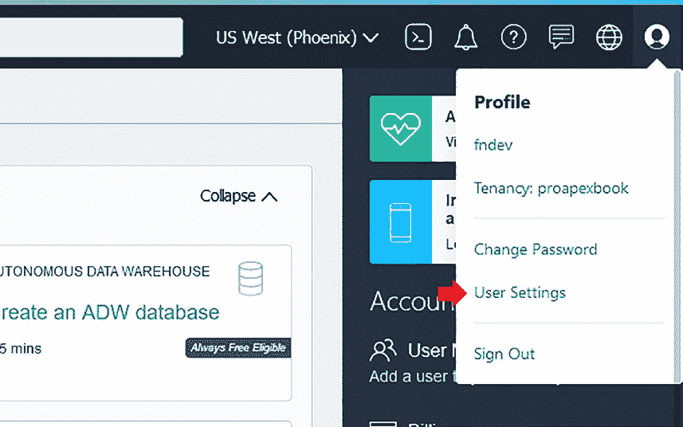

使用您创建的 IAM 用户登录 OCI 控制台。然后，转到 `User Settings` 页面，该页面可通过单击页面右上角访问（图 3-6）。

**图 3-6.** 访问用户详细信息

在页面左侧的 `Resources` 菜单下，单击 `API Keys`，然后单击 `Add API Key` 按钮。将公钥的内容粘贴到提供的文本框中（图 3-7）。

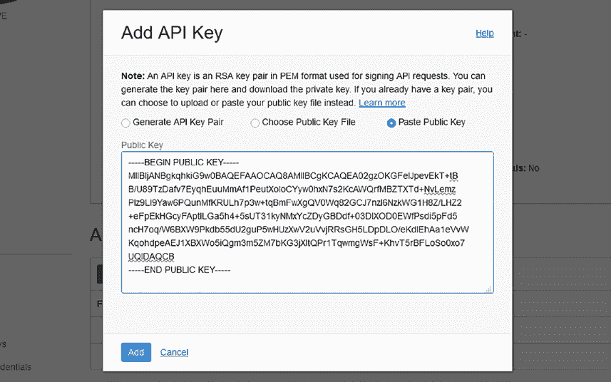

**图 3-7.** 粘贴公钥的内容

单击 `Add` 按钮完成该过程。按照指示，复制生成的配置信息，并将内容输入到文件 `~/.oci/config` 中。

我通常喜欢更改配置文件的名称，因此我会将其从 `DEFAULT` 更改为更具描述性的名称，例如 `OCIAPEXBOOK_FNDEV_PHX`：

```
[OCIAPEXBOOK_FNDEV_PHX]
user=ocid1.user.oc1..aaaaaaaahpjocye5zqg9o6l3kkp17s7kaf4wkg3wqpxx2ghfmtysjt45lxya
fingerprint=ef:82:58:8c:ba:13:29:8a:1c:ae:71:9b:34:19:e5:9b
tenancy=ocid1.tenancy.oc1..aaaaaaabvron7m2kwcxrmdoqmc2cymozr5o2b3ocx63m5qttevk3fhgf32a
region=us-phoenix-1
key_file=~/.oci/ociapexbook_fndev_api.pem
```

要测试您的帐户设置是否正确，请运行以下命令：

```
export OCI_CLI_PROFILE=OCIAPEXBOOK_FNDEV_PHX && oci os ns get
```

该命令应返回一个 `JSON` 输出，其中包含一个属性，即您租户的 OCI 命名空间。例如：

```json
{
  "data": "your-namespace-here"
}
```


"data": "axtobdaknemc"
}

## 身份验证令牌

需要身份验证令牌才能登录 OCI 容器注册表。同样，在用户的详细信息页面上，单击页面左侧的 `Auth Tokens` 链接。然后单击 `Generate Token` 按钮。提供有用的描述，然后在模态页面上单击 `Generate Token` 按钮。复制生成的令牌并将其存储在安全的地方。它只会显示一次！

## 组

通过导航菜单中的 `Identity` 项导航到 `Groups` 页面。创建一个名为 `FunctionsDevelopers` 的新组，并将我们之前创建的 IAM 用户分配给它。

## 策略

从导航菜单中的 `Identity` 菜单项访问租户的策略。您将需要的策略如下：

**OCI 资源**: Oracle Cloud Infrastructure Registry

**被授权者**: Functions Developers

**策略位置**: Root compartment

**语句**:
```
Allow group FunctionsDevelopers to manage repos in tenancy
Allow group FunctionsDevelopers to read objectstorage-namespaces in tenancy
```

**OCI 资源**: Networking

**被授权者**: Function Developers

**策略位置**: DEV compartment

**语句**:
```
Allow group FunctionsDevelopers to use virtual-network-family in compartment DEV
```

**OCI 资源**: Oracle Functions

**被授权者**: Function Developers

**策略位置**: DEV compartment

**语句**:
```
Allow group FunctionsDevelopers to manage functions-family in compartment DEV
Allow group FunctionsDevelopers to read metrics in compartment DEV
```

**OCI 组件**: Application Performance Monitoring

**被授权者**: Function Developers and Functions Service

**策略位置**: DEV or root compartment

**语句**:
```
Allow group FunctionsDevelopers to use apm-domains in compartment DEV
Allow service faas to use apm-domains in compartment DEV

OR

Allow group FunctionsDevelopers to use apm-domains in tenancy
Allow service faas to use apm-domains in tenancy
```

为简单起见，我们将使用 Oracle 的预定义模板在 **根区间** 中创建一个策略 `Fn-Root-Policy`（图 3-8）。

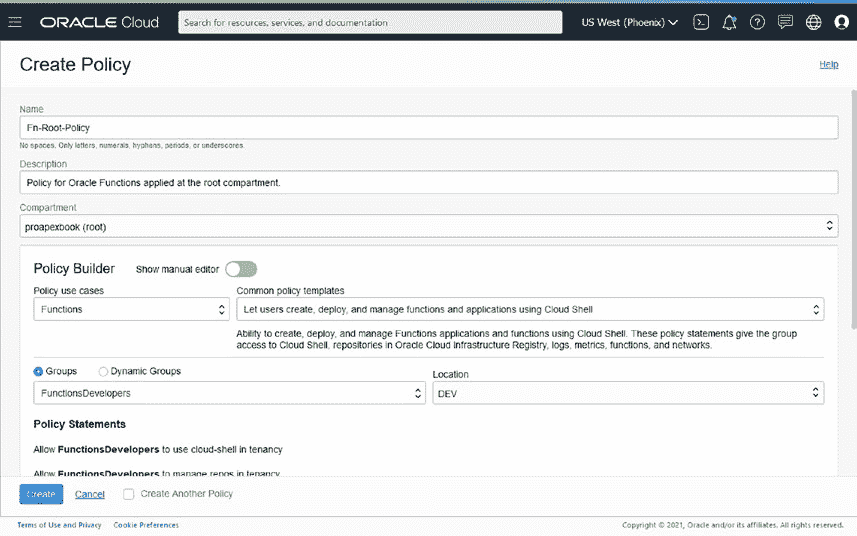

**图 3-8.** 使用预定义模板为 Oracle Functions 创建策略*

1. 在 `Policy Builder` 部分，确保 `Show manual editor` 已关闭。
2. 在 `Policy` 用例下，选择值“Functions”。
3. 对于 `Common policy templates`，选择选项“Let users create, deploy, and manage functions and applications using Cloud Shell。”
4. 选择之前创建的组 `FunctionsDevelopers`，它将是这些策略语句的目标。
5. 在 `Location` 下，选择区间 `DEV`。
6. 查看将要创建的策略语句，然后单击 `Create` 按钮。

在撰写本文时，`Application Performance Monitoring` (APM) 是一个新引入的功能，尚未包含在预定义模板中。创建策略后，编辑该策略，并为 APM 添加策略语句（图 3-9）。

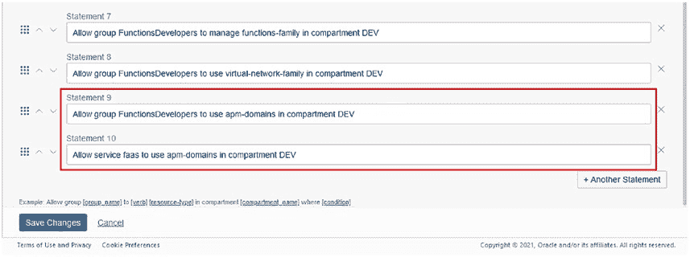

**图 3-9.** 为 APM 添加策略语句*

**注意 (1)** Application Performance Monitoring 服务为 OCI 管理员和开发人员提供对平台上托管的应用程序（包括 Functions 应用程序）的性能洞察。

**注意 (2)** 该模板包含一条策略语句，允许 `FunctionsDevelopers` 组中的用户使用 Cloud Shell 部署和管理 Functions 应用程序。这不是必需的策略，您可以选择删除它。

## 设置 Fn Project CLI

创建了必要的 OCI 资源后，下一步是使用上下文配置 Fn Project CLI。首先使用以下命令创建一个名为 `ociapexbook-functions` 的上下文：
```
fn create context ociapexbook-functions --provider oracle
```

此命令在您的主目录中创建一个 `.fn` 目录，其中包含一个名为 `config.yaml` 的文件和一个名为 `contexts` 的子目录。YAML 文件包含有关 Functions 当前环境的信息，例如 CLI 版本号和使用的上下文。在 `contexts` 目录中，您将找到其他 YAML 文件，每个文件代表创建的上下文，例如 `ociapexbook-functions.yaml`。

设置您将与此上下文一起使用的在 `$HOME/.oci/config` 中声明的配置文件：
```
fn update context oracle.profile OCIAPEXBOOK_FNDEV_PHX
```

接下来，通过执行以下命令更改活动上下文：
```
fn use context ociapexbook-functions
```

下一步需要区间 OCID（Oracle Cloud 分配给所有 OCI 资源的唯一标识符），您可以通过 OCI 控制台或发出 OCI CLI 命令获得：
```
oci iam compartment list
```

**提醒** 在执行 OCI CLI 命令之前，使用 `$HOME/.oci/config` 中的适当名称设置 `OCI_CLI_PROFILE`。

结果输出为 JSON 格式，列出了您租户中的所有区间。例如：
```json
{
    "data": [
        {
            "id": " ocid1.compartment.oc1..aaaaaaaa...5adq",
            "name": "DEV",
            ...
        }
    ]
}
```

接下来，在上下文中设置区间 OCID：
```
fn update context oracle.compartment-id ocid1.compartment.oc1..aaaaaaaa...5adq
```

根据您的 Functions 应用程序将驻留的区域设置 API URL。URL 的模板是 `https://functions.<region-identitfier>.oci.oraclecloud.com`。从该网页 ([`bit.ly/oci-docs-regions`](https://bit.ly/oci-docs-regions)) 查找区域标识符，并替换占位符 `<region-identifier>`。例如：
```
fn update context api-url https://functions.us-phoenix-1.oci.oraclecloud.com
```

最后，设置上下文的 Docker 容器注册表，其格式为：`<region-key>.ocir.io/<tenancy-namespace>/<repo-name>`。将需要三条关键信息。它们是：
1. **区域密钥**: 根据托管 Functions 应用程序的区域获取此值。可以在前面引用的同一网页 ([`bit.ly/oci-docs-regions`](https://bit.ly/oci-docs-regions)) 中查找此值。
2. **租户命名空间**: 租户的命名空间可以通过 OCI 控制台在 `Tenancy Details`、`Object Storage Bucket Details` 或 `Container Registry` 页面中获得。您也可以使用之前用于测试设置的 OCI CLI 命令从 OCI CLI 获取命名空间。


# 第 3 章 使用 Oracle 云函数

## 仓库名称

为 Functions 应用程序镜像将上传到的仓库提供一个有意义的名称。

执行命令：

`fn update context registry phx.ocir.io/axtobdaknemc/photobox`

使用以下命令验证上下文信息：

`fn inspect context`

输出应包含您设置的值：

```
Current context: ociapexbook-functions
api-url: https://functions.us-phoenix-1.oci.oraclecloud.com
oracle.compartment-id: ocid1.compartment.oc1..aaaaaaaa...5adq
oracle.profile: OCIAPEXBOOK_FNDEV_PHX
provider: oracle
registry: phx.ocir.io/axtobdaknemc/photobox
```

## Oracle 云基础设施容器注册表

容器注册表 (`OCIR`) 服务提供给所有付费 `OCI` 帐户。它是一个托管的 Docker 容器注册表，允许租户托管其私有或公共访问的 Docker 镜像。部署到 Oracle Functions 时，`OCI` 使用此注册表来托管应用程序的镜像。

在部署应用程序之前，开发人员需要 (1) 确保 Docker 已安装在他们工作的环境中，以及 (2) 使用本章前面生成的身份验证令牌登录 `OCIR`。

使用以下格式登录 `OCIR`：

`docker login <region-key>.ocir.io`

用户名格式为：

`<tenancy-namespace>/<username>`

例如：

```
$ docker login phx.ocir.io
Username: axtobdaknemc/fndev
Password:
Login Succeeded
```

## 验证设置

创建了所有必需的 `OCI` 资源并配置了 Fn Project CLI 后，测试您现在是否可以访问 Oracle Functions 并准备部署应用程序。通过执行以下命令列出您租户中的 Oracle Functions 应用来执行此操作：

```
$ fn list apps
No apps found
NAME    ID
```

## 缩略图生成器函数

如前所述，Fn Project 支持多种编程语言，包括 Node.js。CLI 提供了一个简单的操作 `init`，用于创建具有所需工件的项目。

```
mkdir -p ociapexbook/photobox && \
cd ociapexbook/photobox && \
fn init --runtime node thumbnail-generator
```

**注意** 在撰写本文时，Node.js 的 Function Development Kit (`FDK`) 当前在版本 11 的 Docker 容器中运行。要运行特定版本的 Node.js，开发人员必须使用自定义 `Dockerfile` 部署应用程序。如果所需的操作系统二进制文件在标准镜像中找不到，您还需要一个自定义 Docker 容器。不幸的是，本书不涉及这种方法。

CLI 生成以下三个文件：

```
$ cd thumbnail-generator && \
tree .
.
├── func.js
├── func.yaml
└── package.json
```

`YAML` ([`yaml.org/`](https://yaml.org/)) 包含项目的必需元数据，包括函数名称、每次部署时递增的版本号、运行时平台以及调用无服务器函数时执行的命令：

```
$ cat func.yaml
schema_version: 20180708
name: thumbnail-generator
version: 0.0.1
runtime: node
entrypoint: node func.js
```

除了这些默认属性之外，开发人员还可以控制执行环境的某些方面，例如

• **内存**: 函数可以消耗的最大内存量默认为 128 MB。在 `OCI` 中，我们可以将其设置为 128、256、512 或 1024。一旦超过阈值，运行时将停止，并记录错误。

• **超时**: 函数可以运行的最大时间（以秒为单位）。默认情况下，阈值设置为 30 秒，最多可以增加到 300 秒。

这些值也可以在创建函数后通过 `OCI` 控制台设置。但是，重要的是要知道，虽然开发人员不必担心配置支持代码执行所需的基础设施，但函数消耗的环境和资源量是有限制的。

**注意** 运行 Oracle 函数的成本是根据其被调用的次数和运行时间（以内存秒为单位）计算的。如果您的函数运行消耗大量时间和内存，和/或它被大量调用，那么重新考虑部署策略可能是明智的。

创建的另一个文件是生成的唯一 JavaScript 文件，其中包含基本的“Helloworld”代码，可用于快速测试设置、部署和执行工作流程：

```
$ cat func.js
const fdk=require('@fnproject/fdk');
fdk.handle(function(input){
    let name = 'World';
    if (input.name) {
        name = input.name;
    }
    console.log('\nInside Node Hello World function')
    return {'message': 'Hello ' + name}
})
```

最后，Node.js `FDK` 包含一个用于包管理的 `package.json` 文件。它已经包含了支持 Oracle Functions 所需的依赖项 `@fnproject/fdk`。

```
{
  "name": "thumbnail-generator",
  "version": "1.0.0",
  "description": "A Fn serverless function for... thumbnails.",
  "main": "func.js",
  "author": "Awesome Developer <awesome.developer@example.com>",
  "license": "Apache-2.0",
  "dependencies": {
    "@fnproject/fdk": ">=0.0.20",
    "file-type": "¹⁶.3.0",
    "image-thumbnail": "¹.0.13",
    "oci-sdk": "¹.19.1"
  }
}
```

库存的 `package.json` 文件将需要一些编辑。此外，在提供的示例代码中，我通过网站 [www.npmjs.com/](http://www.npmjs.com/) 确定了以下包，用于实现此无服务器函数的目标：

• **oci-sdk**: 用于 TypeScript 和 JavaScript 的 Oracle 云基础设施 SDK。这是促进对 `OCI` 资源的访问和操作所必需的，例如从 `OCI` 对象存储桶下载和上传文件。有关更多信息，请参阅 [www.npmjs.com/package/oci-sdk](http://www.npmjs.com/package/oci-sdk)。

• **image-thumbnail**: 这是使用提供的照片生成缩略图的核心模块。它易于使用。只需提供文件路径、`URI`（统一资源标识符）、`Base64` 字符串，以及可选地用于自定义输出的参数，即可创建缩略图。有关详细用法，请参阅 [www.npmjs.com/package/image-thumbnail](http://www.npmjs.com/package/image-thumbnail)。

• **file-type**: 此模块用于确定生成的缩略图的 `MIME`（内容）类型。请参阅 [www.npmjs.com/package/file-type](http://www.npmjs.com/package/file-type) 以获取更多信息。

**重要** 如果您的工作站上安装了`Node.js`，您可以使用`npm`命令搜索、安装依赖项并将其保存在`package.json`中。例如，要安装`oci-sdk`模块，请运行命令`npm install --save oci-sdk`。这将创建`node_modules`目录，其中包含从已安装包下载的代码。如果在项目目录中找不到该目录，Oracle Functions 会在构建过程中运行`npm install`命令。如果存在，它将被复制到部署的 Docker 镜像中。需要注意的是，这可能包含依赖于操作系统 (OS) 的二进制文件，这些二进制文件可能与无服务器函数将运行的目标操作系统不兼容。我建议在部署之前删除整个`node_modules`目录。

Oracle Functions 由一个应用程序组成，该应用程序由一组 Functions 组成。两者都可以使用 OCI 控制台或 Fn Project CLI 创建。我们将继续使用 CLI 进行这些操作。

Oracle Functions 必须创建并分配给一个子网。它们可以在公共和私有子网上创建，但后者通常是首选。您将需要目标子网的 OCID（Oracle 云资源标识符）才能使用 CLI 创建应用程序。您可以通过导航到目标子网的详细信息页面来获取此信息（参见图 3-10）。

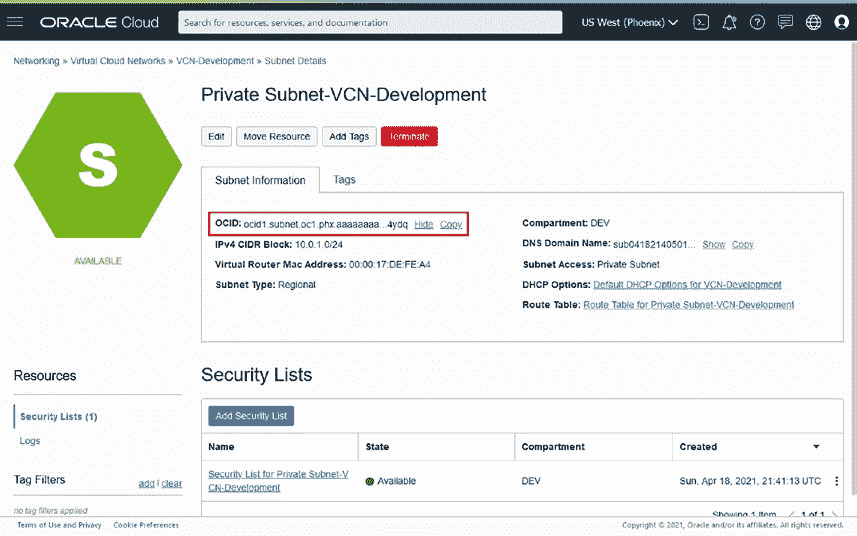

# 第 3 章 使用 Oracle 云函数

***图 3-10.** 获取目标子网的 OCID*

使用`fn create app`命令和操作创建应用程序。您需要提供应用程序的名称，例如`photobox`，并使用`--annotation`参数提供目标子网的 OCID。

```
fn create app photobox --annotation \
oracle.com/oci/subnetIds='["ocid1.subnet.oc1.phx.aaaaaa…4ydq"]'
```

接下来，只需从项目的根目录部署函数即可创建函数：

```
fn deploy --app photobox
```

该过程涉及在开发环境中执行`Docker build`，将其发布到 Docker 注册表（在本例中为`OCIR`），然后将 Oracle Function 与已发布的镜像关联：

```
Deploying thumbnail-generator to app: photobox
Bumped to version 0.0.2
```

## 第 3 章 使用 Oracle 云函数

```
Building image phx.ocir.io/axtobdaknemc/photobox/thumbnail-generator:0.0.2
...........................................................................
...........................................................................
...........................................................................
Parts: [phx.ocir.io axtobdaknemc photobox thumbnail-generator:0.0.2]
Pushing phx.ocir.io/axtobdaknemc/photobox/thumbnail-generator:0.0.2 to
docker registry...The push refers to repository [phx.ocir.io/axtobdaknemc/
photobox/thumbnail-generator]
1250c4163088: Pushed
e40ad43dcc99: Pushed
61e0770c3683: Pushed
a0d7b4199dce: Pushed
8aed3db29123: Pushed
9c85c117f8f6: Pushed
a464c54f93a9: Pushed
0.0.2: digest: sha256:ded9b082ea10189ed732b893634f514c5e74229e75225c34489
6e6445dce9d56 size: 1790
Updating function thumbnail-generator using image phx.ocir.io/axtobdaknemc/
photobox/thumbnail-generator:0.0.2...
Successfully created function: thumbnail-generator with phx.ocir.io/
axtobdaknemc/photobox/thumbnail-generator:0.0.2
```

**注意** 正如您可能注意到的，部署过程依赖于 Docker 进程和命令。在部署函数之前，Docker 引擎必须正在运行！

`func.yaml` 文件中的版本号也会递增；但是，您可以通过添加`--no-bump`参数来阻止此行为。

部署后，可以通过多种方式调用 Oracle Function：

1.  使用 Fn Project CLI。
2.  直接调用 OCI REST API 或使用任何可用的软件开发工具包 (SDK)。

## 第 3 章 使用 Oracle 云函数

3.  使用 OCI Events 触发执行。
4.  通过 OCI API 网关端点。

我们将在本章后面讨论 OCI Events 的使用。至于使用 OCI REST API，这可能具有挑战性，具体取决于您首选编程语言的 SDK 的可用性。最简单的方法是使用 CLI 调用函数：

```
fn invoke photobox thumbnail-generator
```

此命令与 OCI 通信，以启动新的或使用现有的 Docker 容器来执行代码。如果必须创建新容器，则在收到响应之前会有一些延迟。后续调用应该花费更少的时间。调用库存函数应返回以下结果：

```json
{"message":"Hello World"}
```

当执行 Oracle Function 时，将调用处理程序`fdk.handle`。此函数有一个用于回调函数的参数，以及一个可选的`options`参数，该参数将在本章后面讨论。回调函数接受一个输入参数和一个可选的`ctx`参数。

使用生成的代码，我们可以提供一个`name`值，该值可以作为具有所需属性的 JSON 对象通过管道传输到调用命令中。这是一个例子：

```
echo -n '{ "name": "Oracle" }' | \
fn invoke photobox thumbnail-generator \
--content-type application/json | jq .
```

使用应用程序`jq` ([`stedolan.github.io/jq/`](https://stedolan.github.io/jq/)) 处理输出，我们将得到这个美化后的输出：

```json
{
"message": "Hello Oracle"
}
```

创建了函数的骨架部分后，现在是时候实现代码来执行以下操作了：

1.  从指定的对象存储桶中检索照片/图像文件，并将其保存到临时位置。

## 第 3 章 使用 Oracle 云函数

2.  使用`image-thumbnail` Node.js 模块生成缩略图并替换原始文件。
3.  将缩略图文件上传到不同的对象存储桶。

**开发方法**

部署和调用 Oracle Function 可能既昂贵又耗时。首先将问题分解为可以在本地工作站上运行代码来解决的部分。例如，我首先编写了从桶中检索文件然后上传文件的代码。这需要来自 OCI SDK for TypeScript and JavaScript 的几个模块：

```javascript
const common = require('oci-common');
const objectStorage = require('oci-objectstorage');
```

对 OCI REST 服务进行身份验证和签名 HTTP 请求的过程可能令人生畏。幸运的是，SDK 为我们屏蔽了很多复杂性。要开始使用对象存储，我们需要创建一个提供程序，然后使用它为我们希望与之交互的服务创建一个客户端；在这种情况下，是对象存储：

```javascript
// 设置身份验证提供程序。
const provider = new
common.ConfigFileAuthenticationDetailsProvider(
'~/.oci/config', PROFILE_NAME
);

// 创建一个对象存储客户端。
const client = new objectStorage.ObjectStorageClient({
authenticationDetailsProvider: provider
});
```

要检索和上传对象，我们通常需要三条关键信息：

1.  命名空间名称
2.  桶名称
3.  对象名称

## 第 3 章 使用 Oracle 云函数

我们预计桶和对象名称将从函数调用者那里获得。然而，对于命名空间，我们将使用 OCI SDK 检索信息：

# 第 3 章 使用 Oracle 云函数

```javascript
// 创建一个空请求：

const request = {};

// 使用我们之前初始化的客户端检索命名空间名称：

const namespaceName = (await client.getNamespace(request)).value;

// 然后，从对象存储桶下载文件并将其保存到本地文件系统：

let bucketName = PHOTOS_BUCKET_NAME;

let objectName = OBJECT_NAME;

// 准备获取对象的请求。

const getObjectRequest = {

namespaceName: namespaceName,

bucketName: bucketName,

objectName: objectName

}

// 获取对象。

const getObjectResponse = await client.getObject(

getObjectRequest);

// 设置照片和缩略图的临时文件名。

const tempFilepath = path.join(TEMP_DIRNAME, objectName);

// 将文件保存到磁盘。

let fileStream = fs.createWriteStream(tempFilepath);

await new Promise((resolve, reject) => {

getObjectResponse.value.pipe(fileStream);

fileStream.on('finish', resolve);

fileStream.on('error', reject);

});
```

最后，我们将上传相同的文件并将其放置在一个单独的桶中：

```javascript
// 设置桶名称。

bucketName = THUMBNAILS_BUCKET_NAME;

// 检索一些文件统计信息。

const stats = await fs.promises.stat(tempFilepath);

// 准备上传文件。

const nodFsBlob = new objectStorage.NodeFSBlob(

tempFilepath, stats.size);

const objectData = await nodFsBlob.getData();

// 创建 PUT 请求。

const putObjectRequest = {

namespaceName: namespaceName,

bucketName: thumbnailBucketName,

objectName: objectName,

putObjectBody: objectData,

contentLength: stats.size

}

// 执行上传。

const putObjectResponse = await client.putObject(

putObjectRequest);
```

完整的代码可从本书的代码仓库中获得，位于文件 `ch03/photobox/thumbnail-generator/working-with-object-storage.js` 中。要运行代码

1. 将名为 `my-photo.jpg` 的图像文件上传到 `photos` 桶。

2. 如果您尚未这样做，请运行以下命令让 `npm` 安装所需的依赖项：

```bash
npm install
```

3. 运行代码：

```bash
node working-with-object-storage.js
```

**注意** 这些函数中的许多是异步调用，需要顺序执行。该代码严重依赖于 `await` 关键字，因此，在一个立即执行的异步函数内执行：`(async() => { ... })();`

下一步涉及从源图像创建缩略图（完整源代码可以在 `ch03/photobox/thumbnail-generator/generate-thumbnail.js` 中找到）。为此，我们将创建一个函数，该函数接受源和目标文件路径以及一个 `options` 对象来设置缩略图生成的参数。

```javascript
async function generateThumbnail(sourceFilepath, targetFilepath,

options)

{

console.log('Processing', sourceFilepath);

try {

const thumbnail = await imageThumbnail(

sourceFilepath, options);

await fs.promises.writeFile(targetFilepath, thumbnail);

console.log('Thumbnail created successfully.');

} catch(errorMessage) {

console.error(errorMessage);

}

}
```

然后在文件从对象存储下载后调用此函数：

```javascript
// 生成缩略图，覆盖原始文件。

await generateThumbnail(

tempFilepath,

tempFilepath,

{ width: THUMBNAIL_SIZE_PIXEL, height: THUMBNAIL_SIZE_PIXEL }

);
```

请注意，在代码中，我们使用环境变量设置了缩略图像素大小：

```javascript
const THUMBNAIL_SIZE_PIXEL =

parseInt(process.env.THUMBNAIL_SIZE_PIXEL);
```

在执行代码之前，请确保设置环境变量：

```bash
export THUMBAIL_SIZE_PIXEL = 80 && \

node generate-thumbnail.js
```

要理解我们为什么使用环境变量，请继续阅读。

## 配置参数

OCI 为 Oracle Functions 开发人员提供了在部署无服务器函数后设置和管理配置参数的能力。我们可以使用 OCI 控制台或 CLI 来执行此操作，如下所示：

```bash
fn config app photobox THUMBNAIL_BUCKET_NAME thumbnails
```

配置参数可以应用于应用程序或函数。当在应用程序级别设置时，应用程序内的所有函数都可以访问相同的配置。

要设置特定于函数的参数，请改用以下命令：

```bash
fn config function photobox thumbnail-generator \

THUMBNAIL_BUCKET_NAME thumbnails
```

## 使用 Oracle 事件触发函数

在本章前面，我们在对象存储中设置了 `photos` 桶，用于存储通过 APEX 应用程序上传的照片。为了自动处理这些文件并生成它们的缩略图，我们需要启用桶在每次创建、更新或删除对象时发出事件的能力。然后，该事件将用于触发无服务器函数。

为此，请导航到桶的详细信息页面，然后单击字段 `Emit Object Events` 旁边的 `Edit` 链接（图 3-11）。

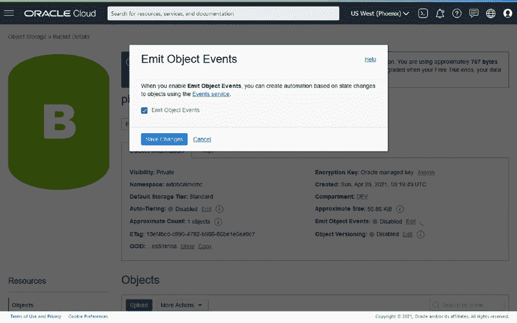

选中模态框中的唯一框，然后单击 `Save Changes`。

接下来，在 OCI Events Services 中创建一个规则。您可以通过使用导航菜单并单击 `Observability & Management` 来找到它。单击 `Events Service` 标题下的 `Rules`。在那里，您会找到一个创建新规则的按钮。

一个规则由一组条件和在满足这些条件时触发的操作组成。条件可以是以下之一：

- 事件类型
- 属性
- 过滤标签

OCI 上的许多服务都可以发出事件。选择对象存储服务，然后在字段 `Event Type` 下，选择以下内容：

- Object: Create
- Object: Delete
- Object: Update

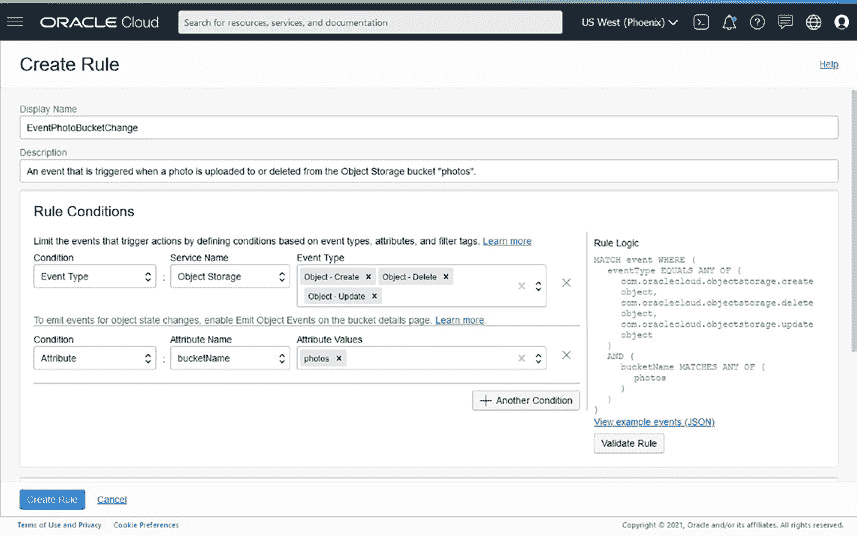

如果我们允许，任何桶都可以发出对象事件。对于此规则，我们希望仅在源是 `photos` 桶时才触发它。添加一个新条件，这次选择 `Attribute`。可用属性名称的列表基于所选服务。选择值 `bucketName`，然后在 `Attribute Values` 字段中输入文本“photos”。图 3-12 显示了最终规则条件的外观。

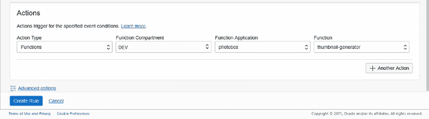

向下滚动到规则的操作列表。以下操作类型可供选择：

- Streaming
- Notifications
- Functions

选择 `Functions` 以显示相关的下拉菜单。这些选择列表是级联的，因此首先选择无服务器函数所在的区间，然后选择目标应用程序和函数（图 3-13）。

单击 `Create Rule` 完成该过程。

**资源主体**

如本章前面所述，通过 REST API 访问 OCI 资源需要开发人员生成必要的 API 密钥对，配置环境，然后对所有 HTTP 请求进行签名。OCI SDK 简化了 HTTP 请求签名。在演示代码中，您可能已经观察到了这个函数调用：
```
const authenticationProvider =
    common.ConfigFileAuthenticationDetailsProvider(
        '~/.oci/config',
        PROFILE_NAME
    );
```
这将创建一个身份验证提供程序，随后用于创建基于资源的客户端以执行所需的操作。`ConfigFileAuthenticationDetailsProvider` 是一个基于文件的身份验证提供程序，它使用本地机器上的 API 密钥对和配置。要使用此身份验证提供程序，必须创建一个自定义 Docker 镜像，其中嵌入了所需的 API 密钥对和配置文件。这并不理想。

幸运的是，OCI 有替代的身份验证方法，这些方法依赖于 `动态组` 和 IAM 策略。开发人员可以使用 `实例主体身份验证` 或 `资源主体身份验证`，具体取决于代码运行的环境。对于无服务器，我们将使用后者。

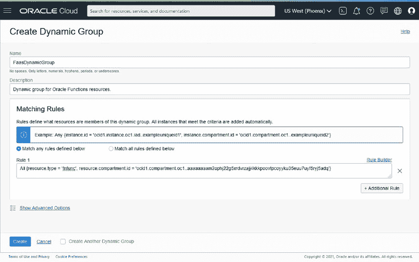

## 使用资源主体身份验证

首先，为 Oracle Functions 创建一个动态组（图 3-14）。您可以在导航菜单中的 `Identity & Security` 下找到动态组。

**图 3-14.** 使用资源类型和区间 OCID 创建动态组*

添加一个规则，该规则包括在区间中使用其 OCID 创建的所有 Oracle Functions (`resource.type = 'fnfunc'`)：
```
All { resource.type = 'fnfunc', resource.compartment.id = 'ocid1.compartment.oc1..aaaaaaaa...' }
```
接下来，创建或更新任何管理对象存储桶访问的现有策略，以包括动态组。例如，在此策略中（图 3-15），添加了以下规则。

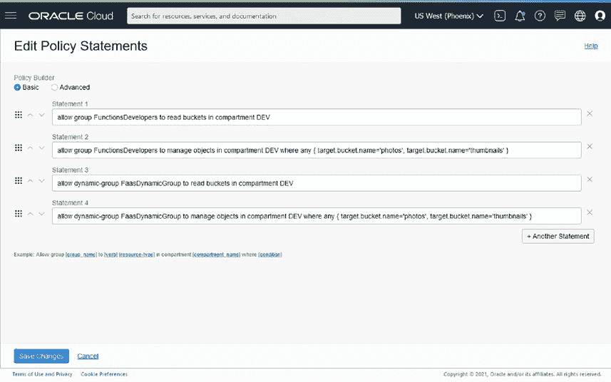

**图 3-15.** 允许资源主体访问对象存储桶和对象的策略语句*

要允许动态组读取特定区间中的所有桶：
```
allow dynamic-group FaasDynamicGroup to read buckets in compartment DEV
```
要允许动态组管理特定桶和区间中的对象：
```
allow dynamic-group FaasDynamicGroup to manage objects in compartment DEV
    where any { target.bucket.name='photos', target.bucket.name='thumbnails' }
```
然后，在 `func.js` 代码中，调整身份验证提供程序代码以改用资源主体：
```javascript
// 使用资源主体设置身份验证提供程序。
const authenticationProvider =
    await common
        .ResourcePrincipalAuthenticationDetailsProvider
        .builder();
```
我们将不再需要在 Docker 镜像中包含 OCI CLI 配置文件和 API 密钥对。

## 完成函数并部署

由于使用的许多操作是异步的，例如处理对象和文件系统，我们需要确保 FDK 的函数句柄调用异步处理程序，否则它将在任务完成之前退出。
```javascript
async function functionHandler(input, ctx) {
    // 1. 创建一个资源主体身份验证提供程序。
    ...

    // 2. 从环境中获取缩略图桶名称和像素大小设置。
    const THUMBNAIL_BUCKET_NAME =
        process.env.THUMBNAIL_BUCKET_NAME
        || DEFAULT_THUMBNAIL_BUCKET_NAME;

    const THUMBNAIL_SIZE_PIXEL =
        parseInt(process.env.THUMBNAIL_SIZE_PIXEL)
        || DEFAULT_THUMBNAIL_SIZE_PIXEL;

    // 3. 读取事件信息。
    const eventType = input.eventType;
    const bucketName = input.data.additionalDetails.bucketName;
    const objectName = input.data.resourceName;

    // 4. 创建一个对象存储客户端。
    const client = new objectStorage.ObjectStorageClient({
        authenticationDetailsProvider: authenticationProvider
    });

    if (eventType === OBJECT_CREATE_EVENT
        || eventType === OBJECT_UPDATE_EVENT)
    {
        /**
         * 5. 下载触发事件的对象的代码。
         * 6. 生成缩略图。
         * 7. 将缩略图上传到缩略图桶。
         */
        ...
    }

    return '{ "status": "success" }';
}

// 指定 FDK 在无服务器函数执行时应调用的回调函数。
fdk.handle(functionHandler);
```
前面的代码片段概述了所涉及的任务：
1. 创建一个资源主体身份验证提供程序。
2. 从正在运行的容器中的环境变量获取配置参数。
3. 检索有关 Oracle Functions 接收的事件和关联对象的信息。
4. 就像我们在本地执行的代码中所做的那样，创建 OCI 对象存储客户端，然后执行下载源照片、生成缩略图和上传输出的其余工作流程。

Oracle Function 的最终代码可以在文件 `ch03/photobox/thumbnail-generator/func.js` 中找到。它包含在源照片从桶中删除时删除缩略图的代码。

要部署函数，请记住首先删除 `node_modules` 目录（如果存在），然后运行 CLI 命令进行部署：
```
rm -rf ./node_modules && \
fn deploy -app photobox
```
下次将文件放入 `photos` 桶时，应触发 `thumbnail-generator` 函数，并将缩略图上传到 `thumbnails` 桶。

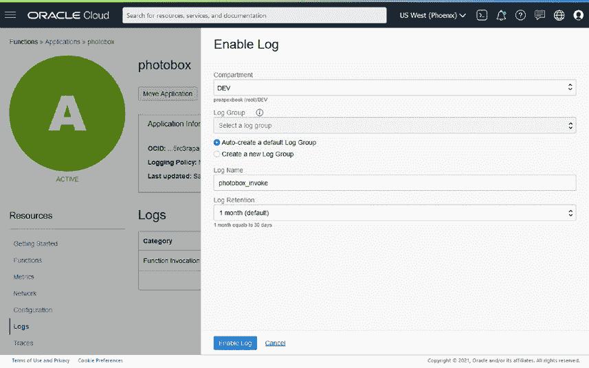

## 故障排除和日志记录

如果您没有看到缩略图图像出现在目标桶中，该怎么办？首先，请记住，如果这是第一次调用无服务器函数，服务可能需要一段时间来创建和启动新容器，因此请稍等片刻。如果仍然没有出现，那么让我们看看如何排除故障和调试问题。

每个开发人员的工具箱中都应包含一个工具，用于记录代码执行时发生的情况。OCI 为其资源（包括 Oracle Functions）提供了广泛的日志记录支持。要启用日志记录，请返回应用程序的详细信息页面。在页面左侧，单击 `Logs` 链接，然后切换开关以启用 `Function Invocation Logs`。将弹出一个模态框（图 3-16），其中包含默认设置。

**图 3-16.** 启用函数调用日志*

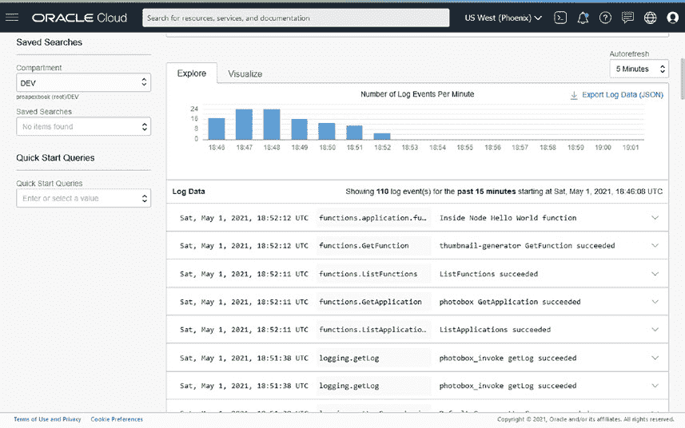

接受默认值，然后单击 `Enable Log` 按钮。创建日志后，单击日志名称以查看日志。或者，使用 `Log Search`（图 3-17），您可以在导航菜单中的 `Observability & Management` 下找到其链接。

**图 3-17.** 使用统一的用户界面搜索 OCI 日志*

该 UI 具有三个有用的功能，可以改进调试过程：
1. 配置日志源和搜索过滤器，并按时间顺序显示它们。例如，同时包含 OCI Events 和 Oracle Functions 日志，以跟踪从对象发出事件到无服务器函数退出的整个过程。
2. 添加自动刷新间隔，以根据搜索过滤器连续显示最新日志。
3. 以 JSON 格式下载日志，用于外部分析。

在 Node.js 运行时中，任何输出到控制台的内容，即 `console.log()`，都将发送到函数调用日志。

## 应用缩略图

回到我们之前在本章中处理的 APEX 应用程序，创建应用程序时，它生成了一个报表页面和一个表单页面，分别是第 2 页和第 3 页。我们的大部分工作都围绕第 3 页以及使用 APEX PL/SQL API 从对象存储上传、检索和删除对象的机制展开。

# 下一个目标是使用 Cards Region 创建一个页面来浏览所有上传的照片。每张卡片将呈现由我们刚刚部署的 Oracle Functions 应用程序自动生成的缩略图。仅加载缩略图而不是原始照片将大大提高此页面的性能和加载时间。

在开始处理 APEX 应用程序之前，我们需要更新 `PhotosBucketAccessPolicy` 策略，以允许在 APEX 中使用其凭据的 IAM 用户也能访问缩略图桶：

```
allow group PhotosBucketManagers to manage objects in compartment DEV where

any { target.bucket.name='photos', target.bucket.name='thumbnails' }
```

在第 2 页上，我们将用 `Cards Region` 替换 `Interactive Report` 以显示我们的照片集（图 3-18）。

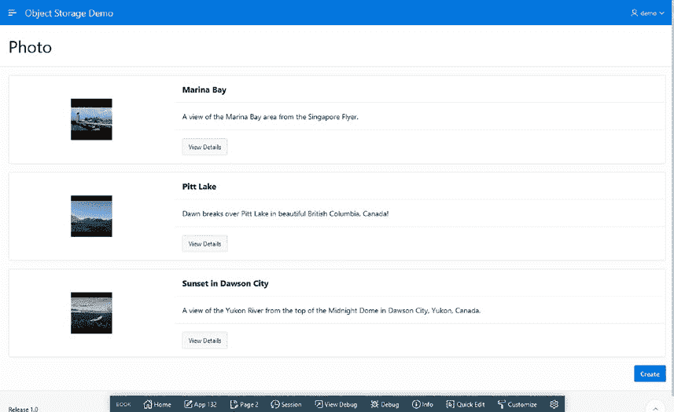

## 第 3 章 使用 Oracle 云函数

*图 3-18.* 使用 `Cards Region` 显示照片集*

对第 2 页进行以下更改：

• 将页面和标题重命名为 `Photo Collection`。

• 将 `Interactive Reports` 更改为 `Cards Region`。

• 卡片将显示每张照片的标题、描述和缩略图预览。图像的 URL 将使用 `apex_page.get_url` 函数，就像我们在照片详细信息页面中呈现上传的图像一样。区别在于将提交给应用程序过程的桶名称。将区域的源更新为以下 SQL 查询：

```sql
select
    photo_id
    , title
    , description
    , apex_page.get_url(
        p_application => :APP_ID
        , p_page => 0
        , p_request => 'APPLICATION_PROCESS=GET_OBJECT'
        , p_items => 'APP_PHOTO_ID,APP_BUCKET_NAME'
                     || ',APP_CONTENT_DISPOSITION'
        , p_values => to_char(photo_id) || ','
                      || :G_THUMBNAILS_BUCKET_NAME || ',inline'
    ) as image_url
from photo
```

• 更改以下 `Cards Region` 属性：

• 将布局设置为 `Horizontal (Row)`。

• 将卡片的 `Primary Key Column 1` 设置为列 `photo_id`。

• 将卡片的标题 `Column` 映射到 SQL 查询返回的 `title` 列。

• 对于卡片的 `Body`，切换 `Advanced Formatting` 并将 `HTML Expression` 设置为 `&DESCRIPTION!RAW`。

• 将卡片的 `Media Source` 设置为 `Image URL`，然后选择使用 SQL 查询返回的 `image_url` 列。将 `Position` 设置为 `Body`，`Appearance` 设置为 `Auto`，`Sizing` 设置为 `Fit`。最后，将 `Image Description` 设置为 SQL 查询返回的 `title` 列。

• 为性能切换 `Lazy Loading`。

• 在 `Cards Region` 的操作下，添加一个按钮，并将标签设置为 `View Details`。将链接设置为打开第 3 页，并将主键页面项 `P3_PHOTO_ID` 设置为源 SQL 查询返回的记录主键（列 `photo_id`）值。它还应该清除第 3 页上的缓存。

• 调整 `CREATE` 按钮，使其呈现在 `Bottom of Region` 位置，然后保存更改。

完成更改后，第 2 页将类似于图 3-19。

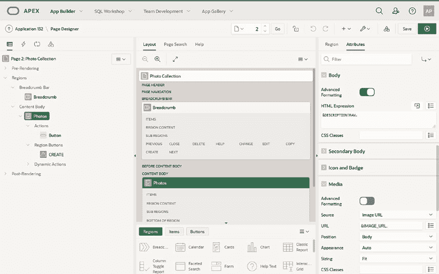

*图 3-19.* 修改后的第 2 页，用于显示照片集*

**注意** 对于卡片的正文，请注意我们正在显示描述列的值，没有任何过滤 (`&DESCRIPTION!RAW.`)。在保存数据之前，请确保对数据输入字段进行适当的清理，因为这是一个潜在的安全风险。为了允许对内容进行 HTML 编辑，`P3_DESCRIPTION` 的页面项类型已从 `Textarea` 更改为 `Rich Text Editor`。

**总结**

Oracle 云基础设施提供了多种托管资源，例如对象存储、事件、函数，以及最近的 `AI 服务`，这些资源可以通过 OCI REST API 轻松地与 APEX 应用程序集成。出于安全考虑，Oracle 要求对这些 API 请求进行数字签名。幸运的是，APEX 封装了使用 OCI Web 凭证执行身份验证过程的复杂性，使得使用 OCI 资源来构建我们原本难以在纯 APEX 和 PL/SQL 中实现的功能变得容易。
