# 第 4 章 使用 API 网关暴露功能

在上一章中，我们了解了 `Oracle Functions`，这是 Oracle 在 `Oracle 云基础设施` (OCI) 上提供的无服务器计算产品，以及如何扩展 `Oracle Application Express` (APEX) 应用程序在 Oracle 数据库之外的功能。使用 `Oracle Functions`，开发人员可以选择多种编程语言来实现函数，而无需管理支持和托管应用程序的基础设施。

**注意** 将来，Oracle 数据库将通过其 `多语言引擎` (MLE) 功能支持其他脚本语言，例如 `JavaScript`。

回顾一下，`Oracle Functions` 可以通过以下方式调用：

• `Fn Project CLI`

• `OCI SDK` 和 `REST API`

• 对函数调用端点的签名 HTTP 请求

• Oracle 云服务，例如 `Events` 和 `API gateway`

在第 [3](https://doi.org/10.1007/978-1-4842-8170-3_3) 章中，我们重点介绍了由 OCI `Events` 服务在文件从 OCI `对象存储` 创建、更新或删除时触发的事件。但是，并非每个用例都涉及文件和对象存储引发的事件。在 APEX 应用程序中集成外部服务时，使用 CLI 调用函数并不实用。虽然 Oracle 提供了一个 PL/SQL SDK 来使用 OCI REST API，但它并非在所有数据库安装中都立即可用。在撰写本文时，使用 Web 服务的包仅适用于 Oracle 自治数据库。

© Adrian Png 和 Heli Helskyaho 2022

A. Png 和 H. Helskyaho，《*使用 Oracle 云功能扩展 Oracle Application Express*》，

[`doi.org/10.1007/978-1-4842-8170-3_4`](https://doi.org/10.1007/978-1-4842-8170-3_4#DOI)

APEX 开发人员的一个可能选项是使用 `APEX_WEB_SERVICE` 包直接调用 OCI REST API 或函数的调用端点。但是，后者涉及对 HTTP 请求进行签名，同样，由于对这些请求进行签名所需的公钥加密算法，这可能无法在所有数据库版本中实现。

幸运的是，有一种方法可以使调用 `Oracle Functions` 相对容易，这涉及一个中间 OCI 服务。使用 `API gateway` 服务，开发人员可以屏蔽 Web 服务消费者免受后端实现的影响，例如使用 `Oracle Functions` 或在 `Oracle Kubernetes Engine` (OKE) 集群上运行 `Node.js®` 应用程序。如果实现发生变化，对客户端应用程序的影响将很小或没有。

`API 网关`是一种虚拟网络设备，部署在 `虚拟云网络` (VCN) 子网内，该子网可以是公共的或私有的。作为一种区域服务，它在可用性域和容错域之间具有容错能力。因此，`API 网关`只能部署在区域子网上。

`API 网关`有一个端点，用于接收 HTTP 请求，并根据路径和 HTTP 方法将它们路由到分配的后端。后端可以是 HTTP 服务、`Oracle Functions` 或静态响应。请求路径和后端之间的这种映射在 `Deployment` 内定义为路由。每个 `API 网关`包含一个或多个部署，每个部署可能有一个或多个路由。

部署还允许开发人员定义处理请求和响应的策略，例如速率限制、跨源资源共享 (CORS) 支持、安全性以及操作 HTTP 头和查询参数。

## 用例定义

在本章中，我们将创建一个简单的 APEX 应用程序来执行从英语到日语或西班牙语的语言翻译（参见图 4-1）。此应用程序将演示如何将 `API 网关`与 `Oracle Functions` 一起使用，以向 APEX 应用程序添加功能。

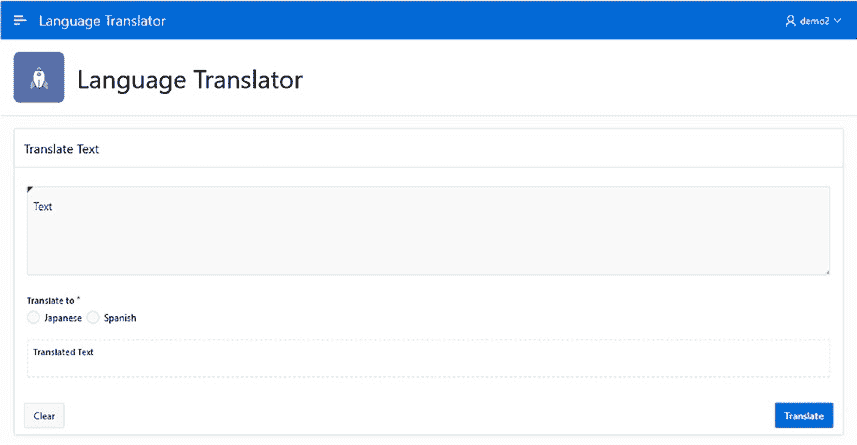

# 第 4 章 使用 API 网关暴露功能

**图 4-1.** 用于语言翻译的 APEX 应用程序

创建执行语言翻译的应用程序可能具有挑战性。它通常涉及创建/收集一个相当大的字典，该字典映射不同语言对的词汇，以及大量用这些语言编写的文本语料库，用于训练执行*自然语言处理* (NLP) 的机器学习模型。

目前有几种现成的解决方案可用，许多是通过 RESTful API 访问的。有些是免费的，但大多数是收费的。几家主要的云供应商也将这些服务作为其服务组合的一部分提供。这些服务提供商的示例列在表 4-1 中。

**表 4-1.** 提供语言翻译服务的供应商示例

| 服务提供商 | 产品链接 |
| :--- | :--- |
| Libretranslate | [`libretranslate.com/`](https://libretranslate.com/) |
| DeepL translator | [www.deepl.com/translator](http://www.deepl.com/translator) |
| yandex translate | [`translate.yandex.com/`](https://translate.yandex.com/) |
| google translation aI | [`cloud.google.com/translate`](https://cloud.google.com/translate) |
| IBM Language translator | [`cloud.ibm.com/catalog/services/language-translator`](https://cloud.ibm.com/catalog/services/language-translator) |
| amazon translate | [`aws.amazon.com/translate/`](https://aws.amazon.com/translate/) |
| azure translator | [`azure.microsoft.com/services/cognitive-services/translator/`](https://azure.microsoft.com/services/cognitive-services/translator/) |
| itranslate | [`itranslate.com/`](https://itranslate.com/) |

`APEX` 提供了一个全面的 API 来使用 REST 服务，订阅和使用任何列出的翻译服务都很容易。但是，我们为其构建概念验证 (PoC) 的客户还有其他一些业务需求，因此无法使用可公开访问的服务。

1.  用户提交的文本可能包含机密和/或个人身份信息。
2.  该公司最终希望开发自己的机器学习模型，并已聘请专家团队实施内部服务，该服务最终将提供给业务合作伙伴并收费。
3.  访问语言翻译服务的 API 必须定义良好，并且能够适应后端实现的变化。

`LibreTranslate` 是一个开源机器翻译软件，提供自托管其 Web 服务的选项，因此是我们 PoC 的合适候选者。还有一个名为 `Translate` ([`https://github.com/franciscop/translate`](https://github.com/franciscop/translate)) 的开源 Node.js 包，它与其 API 一起使用。

在本章中，我们将部署和使用以下 OCI 服务：

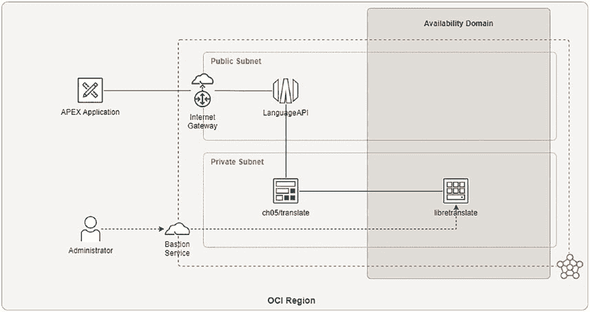

*   API 网关
*   自治数据库上的 `APEX`
*   堡垒机
*   计算
*   网络
*   `Oracle Functions`

图 4-2 中的图表说明了这些 OCI 资源如何在安全环境中相互交互。

**图 4-2.** 所需环境的架构

## 部署语言翻译引擎

为了托管 `LibreTranslate` 服务，我们将在私有子网上部署一个 OCI 计算实例，安装 `Docker` ([www.docker.com](http://www.docker.com))，然后使用预构建的 `Docker` 镜像部署软件。

> **注意** 创建 VCN 的过程在上一章中提供。

在创建新的计算实例之前，在 VCN 中，创建一个网络安全组 (NSG)，分别用于允许端口 `22`（用于 SSH）和 `8080`（用于 `LibreTranslate` Web 服务）上的 TCP 流量。

1.  单击导航菜单，然后单击 *Networking*，接着单击 *Virtual Cloud Networks*。
2.  单击目标 VCN。
3.  向下滚动，然后在左侧单击 *Network Security Groups*。
4.  在第一步中，为 NSG 提供一个名称，例如 `NsgSshAccess`。
5.  在第二页上，创建两个规则：
    *   规则 1：
        *   **方向**: 入站
        *   **源类型**: CIDR
        *   **源 CIDR**: `10.0.0.0/16` *(或目标 VCN 的 CIDR 块)*
        *   **IP 协议**: TCP
        *   **源端口范围**: *空白*
        *   **目标端口范围**: `22`
    *   规则 2：
        *   **方向**: 出站
        *   **源类型**: CIDR
        *   **源 CIDR**: `0.0.0.0/0`
        *   **IP 协议**: All Protocols
6.  单击 *Create*。
7.  从步骤 3 开始重复该过程，以允许访问 `LibreTranslate` Web 服务。创建一个名为 `NsgWebApplications` 的 NSG，并配置第一条规则以允许来自端口 `8080` 的入站 TCP 流量。

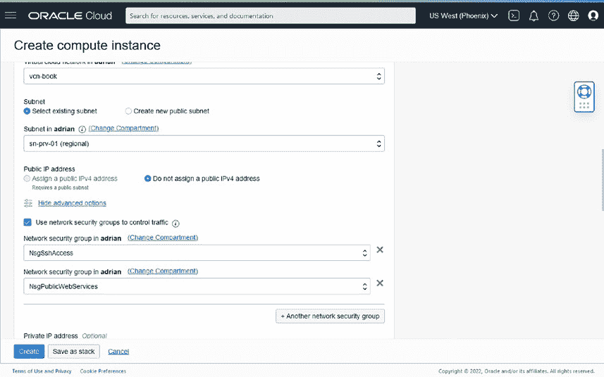

接下来，创建计算实例：

1.  首先导航到 Instances 页面。单击导航菜单，单击 *Compute*，然后单击 *Instances*。
2.  单击 *Create Instance*。
    a. 选择所需的放置和形状，但为其镜像选择 *Oracle Linux 7.9*。
    b. 展开网络设置，确保选择了私有子网。
    c. 选中选项 *Use network security groups to control traffic*，然后分配 NSG `NsgSshAccess` 和 `NsgPublicWebServices`（图 4-3）。
    **图 4-3.** 将所需的网络安全组分配给新的计算实例
    d. 对于引导卷，最小大小就足够了。
    e. 生成 SSH 密钥对并上传公钥。

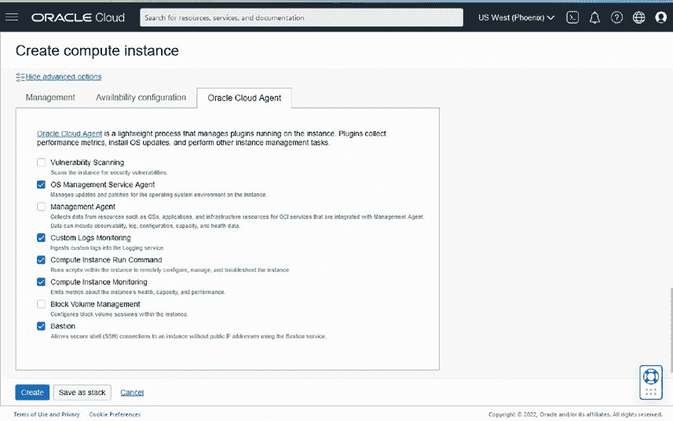

    f. 单击 *Show advanced options*，然后在 *Oracle Cloud Agent* 选项卡下，确保选中 *Bastion* 插件（图 4-4）。
3.  单击 *Create*。

**图 4-4.** 为计算实例启用 Bastion 插件

由于服务器放置在私有子网中，只能使用连接到 VCN 的*虚拟专用网络* (VPN) 或通过 Bastion 会话进行访问。要设置后者，请执行以下步骤：

1.  单击导航菜单，然后单击 *Identity & Security*，接着单击 *Bastion*。
2.  单击 *Create bastion*。
3.  为堡垒机命名，然后选择目标 VCN 和子网。这应该是一个公共子网（图 4-5）。对于 *CIDR block allowlist*，指定一个子网或输入 `0.0.0.0/0` 以允许来自互联网任何地方的连接。

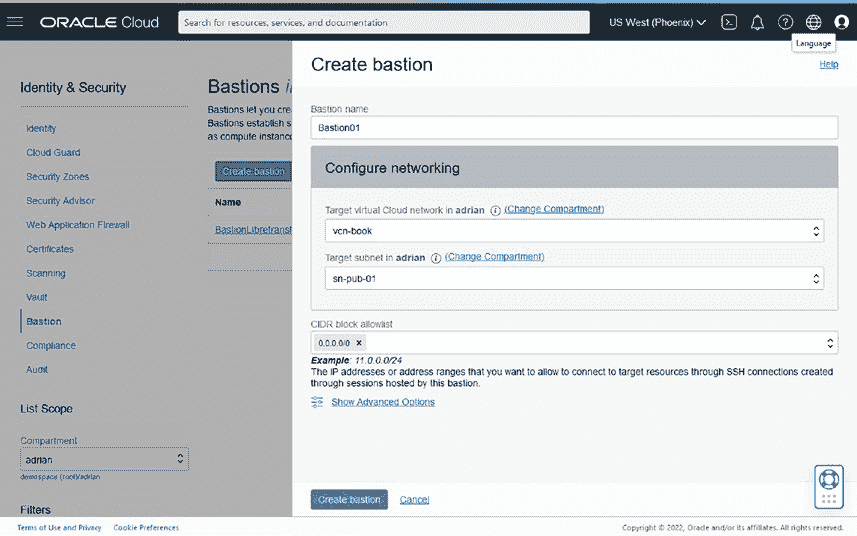

**图 4-5.** 创建堡垒机并将其放置在目标 VCN 内的公共子网中

4.  单击 *Create bastion*。
5.  成功配置堡垒机后，单击堡垒机以转到其详细信息页面。
6.  单击 *Create session*。
7.  输入会话详细信息（图 4-6），使用以下内容：
    a. **会话类型**: Managed SSH session
    b. **会话名称**: 任意名称
    c. **用户名**: `opc`
    d. **区间中的计算实例**: *目标实例*
    e. 上传将用于连接到主机的 SSH 公钥。

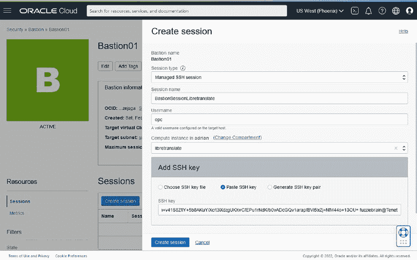

# 第4章 使用API网关暴露功能

## 4.6 创建会话与连接

***图 4-6.** 创建会话来访问计算实例以部署 LibreTranslate*

8\. 创建会话后，单击图 4-7 中红色框指示的带有三个垂直点的按钮，然后单击 `Copy SSH command`。

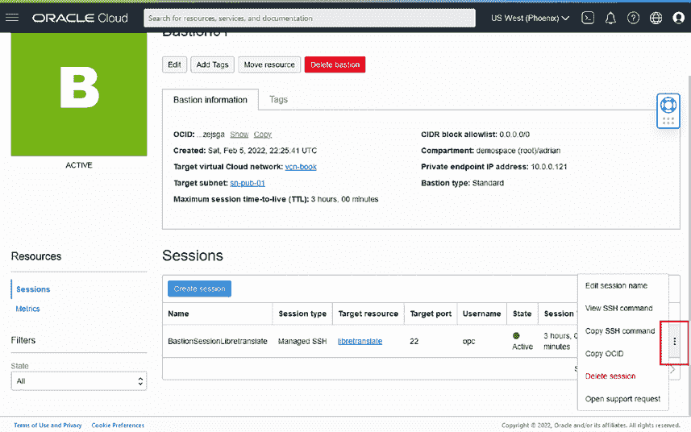

***图 4-7.** 获取连接到计算实例所需的 SSH 命令的访问选项*

提供的 SSH 命令格式如下：

```
ssh -i <privateKey> -o ProxyCommand="ssh -i <privateKey>
-W %h:%p -p 22 ocid1.bastionsession.oc1.phx.
amaaaaaafy4s5yqazggb6krqvlzh2v3atyblc5f4xexwyseqpsqs5uda3bya@host.bastion.
us-phoenix-1.oci.oraclecloud.com" -p 22 opc@10.0.1.133
```

将 `<privateKey>` 替换为 SSH 私钥的路径，例如：

```
ssh -i ~/.ssh/id_rsa -o ProxyCommand="ssh -i ~/.ssh/
id_rsa -W %h:%p -p 22 ocid1.bastionsession.oc1.phx.
amaaaaaafy4s5yqazggb6krqvlzh2v3atyblc5f4xexwyseqpsqs5uda3bya@host.bastion.
us-phoenix-1.oci.oraclecloud.com" -p 22 opc@10.0.1.133
```

## 4.7 安装 Docker

以用户 `opc` 身份登录后，运行以下命令以安装 Docker 并将其作为服务运行：

```
sudo -s <<EOF
yum install -y docker-engine
usermod -aG docker opc
systemctl enable docker
systemctl start docker
mkdir -p /opt/docker
chown opc:docker /opt/docker
chmod 2770 /opt/docker
EOF
```

注销当前会话，然后再次登录以确保 `opc` 用户有权访问 Docker 进程。

## 4.8 创建并运行 LibreTranslate 容器

接下来，运行以下命令以创建 `run.sh` 脚本：

```
mkdir -p /opt/docker/libretranslate && \
cat <<EOF > /opt/docker/libretranslate/run.sh
#!/usr/bin/env bash
docker run -d -p 8080:5000 --name libretranslate \
--restart unless-stopped \
libretranslate/libretranslate
EOF
chmod a+x /opt/docker/libretranslate/run.sh
```

最后，使用创建的脚本运行容器：

```
/opt/docker/libretranslate/run.sh
```

Docker 将拉取镜像，然后创建并运行容器。脚本成功执行后，运行以下命令检查其状态：

```
docker ps
```

Docker 将显示所有正在运行的容器，并且名为 `libretranslate` 的容器应该正在运行，并且存在从 8080 到 5000 的端口映射。

## 4.9 用于语言翻译的 Oracle 函数

设置语言翻译系统的下一步是部署一个无服务器函数，该函数将处理 HTTP 请求负载并返回翻译后的文本。HTTP 请求和响应负载都将是 JSON 格式。

示例请求体：
```json
{ "text": "Good morning" }
```

示例响应体：
```json
{ "translatedText": "おはようございます" }
```

有关为 Oracle Functions 设置 OCI 租户的详细信息已在第 [4](https://doi.org/10.1007/978-1-4842-8170-3_4) 章中讨论。在继续部署 `translate` 函数之前，请确保您的租户和开发人员的工作站已正确配置。以下是一个快速检查清单：

• 在 OCI 租户上：
• 已创建或定义所需的 `身份和访问管理` (IAM) 用户、组和策略
• 已创建 VCN 和目标子网

• 在开发人员的工作站上：
• 已安装 Docker、OCI CLI 和 Fn Project CLI
• 已生成 API 密钥并在 OCI 上注册
• 已配置 OCI 配置文件和 Fn 上下文

无服务器函数将使用以下文件部署：

```
translate
├── func.js
├── func.yaml
├── package.json
└── package-lock.json
```

回顾一下，`func.js` 文件包含实现 `Function Development Kit` (FDK) 处理程序代码的 Node.js 代码，该代码在每次调用函数时执行。`func.yaml` 文件包含有关函数的元数据，而 `package.json` 文件包含 Node.js 应用程序的元数据，包括其依赖项。

使用您可以通过 OCI 控制台获取的目标子网的 OCID 设置环境变量 `SUBNET_OCID`。然后，使用 Fn Project CLI 命令创建 Oracle Functions 应用程序：

```
fn create app ch05 --annotation \
oracle.com/oci/subnetIds=[\"$SUBNET_OCID\"]
```

从项目的根目录部署函数：

```
fn deploy -v --app ch05
```

Fn Project CLI 将构建 Docker 镜像，将其部署到 OCI `容器注册表` (OCIR)，然后注册函数。完成后，运行以下命令以设置 `LIBRE_SERVER_URL` 参数。将占位符 `COMPUTE_INSTANCE_ID` 替换为已部署 LibreTranslate 的计算实例的 IP 地址。

```
fn config function ch05 translate \
LIBRE_SERVER_URL http://<COMPUTE_INSTANCE_IP>:8080/translate
```

## 4.10 用于语言翻译的 API 网关

要创建和配置的最后一个 OCI 资源是 API 网关。回顾一下，API 网关需要分配一个 VCN 子网。如果资源要通过互联网访问，则必须将其附加到公共子网。这必须在创建之前决定，之后无法更改。

在创建资源之前，还需要执行一些与安全相关的任务，接下来将讨论这些任务。

### IAM 策略

为了使 API 网关能够调用 Oracle Functions，必须使用 IAM 策略语句授予服务必要的权限。创建新策略或将所需的语句添加到现有策略。

需要以下语句：
```
Allow any-user to use functions-family in compartment <COMPARTMENT_NAME>
where all {request.principal.type= 'ApiGateway', request.resource.
compartment.id = '<COMPARTMENT_OCID>'}
```

将占位符 `<COMPARTMENT_NAME>` 替换为 Oracle Functions 已部署到的区间的名称。对于 `<COMPARTMENT_OCID>`，将其替换为 API 网关所在区间的 OCID。

### 网络安全组

API 网关始终与 VCN 子网关联，该子网可以是私有的或公共的。无论如何，资源将需要允许端口 443（用于安全 Web 流量的标准端口）上的 TCP 流量的网络安全规则。

创建一个具有以下规则的 NSG：

1\. 规则 1：
a. **方向**: 入站
b. **源类型**: CIDR
c. **源 CIDR**: 0.0.0.0/0
d. **IP 协议**: TCP
e. **源端口范围**: *空白*
f. **目标端口范围**: 443

2\. 规则 2：
a. **方向**: 出站
b. **源类型**: CIDR
c. **源 CIDR**: 0.0.0.0/0
d. **IP 协议**: All Protocols

### 创建与配置 API 网关

创建并配置了依赖的 OCI 资源后，我们现在准备创建一个 API 网关，将 Oracle Functions 暴露为 REST 端点。

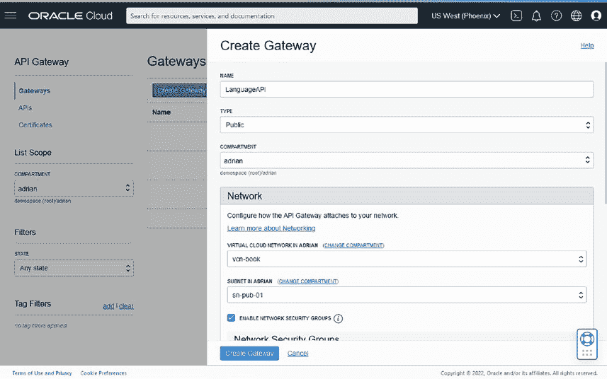

1\. 单击导航菜单，然后单击 `Developer Services`，接着单击 `API Management` 部分下的 `Gateways`。
2\. 在 `Gateways` 页面上，单击 `Create Gateway`。
3\. 为新网关提供以下信息（参见图 4-8）：
a. **名称**: LanguageAPI
b.

# 第 4 章 使用 API 网关暴露功能

**类型**：Public

**区间**：*网关将部署到的区间名称。*

**虚拟云网络**：*选择区间，然后选择网关将属于的 VCN。*

**子网**：*选择区间，然后选择网关将附加到的 VCN 内的子网。*

***图 4-8.** 提供创建网关所需的信息*

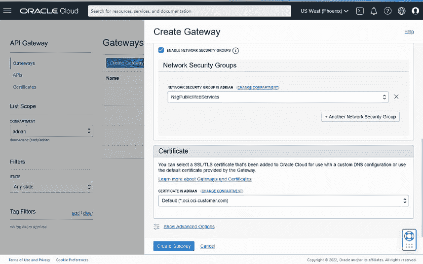

4. 端点将通过某个网络端口暴露，并且需要将必要的安全规则应用于网关，然后它才能与客户端应用程序通信。使用之前创建的网络安全组指定这些规则。选中选项 *Enable Network Security Groups*，然后选择要分配的 NSG（图 4-9）。

***图 4-9.** 分配网络安全组，以便客户端应用程序可以通过网络访问 API 网关端点*

**注意** API 网关可以使用自定义域进行访问。但是，必须将兼容且有效的 SSL/TLS 证书分配给 API 网关。创建资源后，为自定义域添加 DNS “A” 记录，并将其指向已分配给 API 网关的 IP 地址。

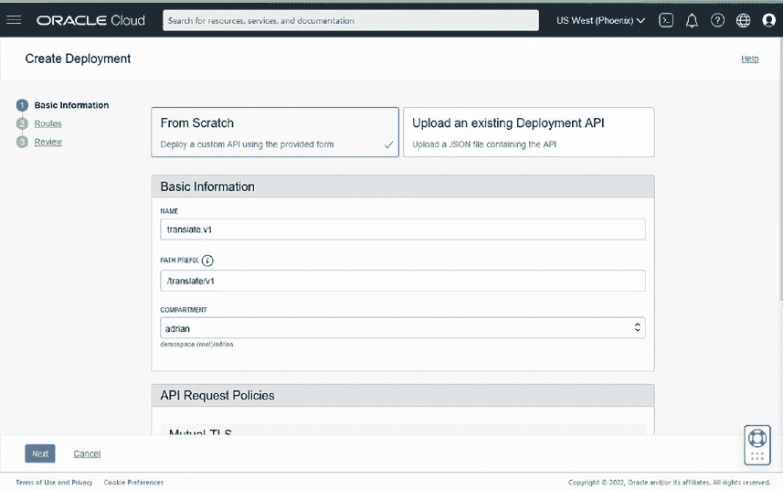

5. 单击 *Create Gateway*。

6. 成功创建 API 网关后，在其详细信息页面上，向下滚动并单击 *Deployments* 链接，您可以在页面左侧的 *Resources* 部分下找到该链接。

7. 单击 *Create Deployment* 以启动多页向导来创建部署。

8. 在第一步中，输入所需信息（图 4-10），包括：
   a. 部署的名称
   b. 路径前缀
   c. 区间

***图 4-10.** 创建部署所需的基本信息*

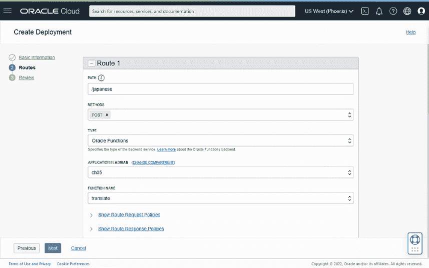

**提示** 对于如何命名部署没有严格的规则。但是，我建议给它一个能清楚描述其意图的名称，甚至考虑包含版本号。我也会对路径前缀做同样的事情。这种方法将允许我们创建和部署新版本/实现，同时继续支持旧版本，直到客户端不再使用它们。

9. 单击 *Next* 进入下一步。

10. 为 *Route 1* 输入以下信息（参见图 4-11）：
    a. **路径**：`/japanese`
    b. **方法**：`POST`
    c. **类型**：`Oracle Functions`
    d. **应用程序**：*选择函数所在的区间，然后选择应用程序。*
    e. **函数名称**：*选择我们之前部署的函数。*

***图 4-11.** 定义部署的路由*

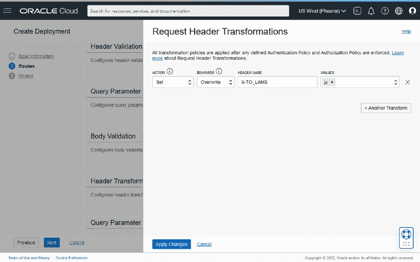

11. 单击链接 *Show Route Request Policies* 以展开用于操作或验证 HTTP 请求属性的选项。这些包括 CORS 策略、头变量、查询参数和请求体。

12. 对于每条路由，指定一个头转换，以设置将传递给无服务器函数的变量 `X-TO_LANG`。单击 *Add* 按钮，然后提供以下详细信息（参见图 4-12）：
    a. **操作**：`Set`
    b. **行为**：`Overwrite`
    c. **头名称**：`X-TO_LANG`
    d. **值**：`ja`

***图 4-12.** 添加 HTTP 请求头转换*

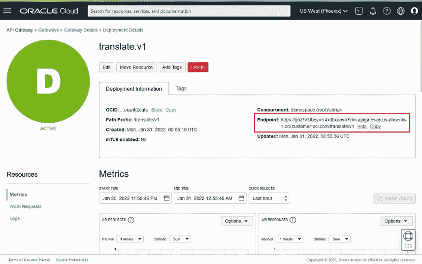

13. 单击 *Apply Changes*。

14. 重复步骤 10 到 13 以创建 *Route 2*。将路由的路径设置为 `/spanish`，并将 `X-TO_LANG` 头值设置为 `es`。

15. 定义所有路由后，单击 *Next* 进入最后一步。

16. 查看所有输入的值，然后单击 *Create*。

部署完成后，返回 API 网关部署的详细信息页面，并单击 *Show* 以显示端点的 URL（图 4-13）。要通过 API 网关调用无服务器函数，请连接相关路由的路径。例如，要将文本从英语翻译成日语，发送 POST 请求的完整 URL 格式如下：

```
https://<API_GATEWAY_HOSTNAME>/<DEPLOYMENT_PATH_PREFIX>/<ROUTE_PATH>
```

***图 4-13.** 从部署的详细信息页面获取端点 URL*

例如，给定以下详细信息：

• `API_GATEWAY_HOSTNAME`: `gnz7v3tbeywrr4xdbxaasa7cim.apigateway.us-phoenix-1.oci.customer-oci.com`
• `DEPLOYMENT_PATH_PREFIX`: `/translate/v1`
• `ROUTE_PATH`: `/japanese`

要调用的 URL 将是：

```
https://gnz7v3tbeywrr4xdbxaasa7cim.apigateway.us-phoenix-1.oci.customer-oci.com/translate/v1/japanese
```

**注意** 如前所述，`API_GATEWAY_HOSTNAME` 可以是一个自定义域；但是，请确保将有效的 SSL/TLS 证书分配给 API 网关，并添加 DNS “A” 记录以将域映射到为 API 网关配置的 IP 地址。

## 从 APEX 调用 API 网关

部署后，API 网关端点只是一个 REST 端点，APEX 开发人员可以使用包 `APEX_WEB_SERVICE` 在 PL/SQL 中调用它。API 网关使 APEX 无需实现代码来验证和调用 `Oracle Functions` 端点。前面介绍的 IAM 策略授权 API 网关代表 REST 客户端调用函数。

我们部署的 `Oracle Functions` 函数期望以下内容：

• 一个请求负载，包含一个 JSON 对象，该对象具有一个属性 `text`，其值包含要翻译的英文文本
• 一个 HTTP 头变量 `X_TO-LANG`，其值为两个字母，定义 LibreTranslate 将文本翻译成的目标语言

API 网关中继 APEX 发送的负载，并注入函数所需的任何 HTTP 头变量和查询参数。然后，默认的 `Oracle Functions` 函数处理程序通过 `input` 和 `ctx` 参数使其可用。

```
async function functionHandler(input, ctx) {
  ...
}
```

尽管文档 ([`github.com/fnproject/docs/tree/master/fdks/fdk-node`](https://github.com/fnproject/docs/tree/master/fdks/fdk-node)) 说明可以通过使用代码 `ctx.protocol.header(key)` 访问 HTTP 头变量，但 API 网关似乎以不同的方式填充 `ctx` 对象。通过为函数启用 OCI 日志记录和一些调试代码，可以识别注入的 HTTP 头变量的位置。在这里，我们发现可以通过访问 `ctx._headers` 数组并使用键 `Fn-Http-H-X-To_Lang` 来引用 `X-TO_LANG`。

```
if (ctx._headers["Fn-Http-H-X-To-Lang"]) {
  toLanguage = ctx._headers["Fn-Http-H-X-To-Lang"].toString();
}
```

了解了 API 网关和 `Oracle Functions` 如何协同工作后，我们现在准备创建 APEX 应用程序和组件来使用其服务：

1. 创建一个页面（图 4-14）并添加三个页面项：
   • `P1_TEXT`：一个文本字段，用于输入需要翻译的英文文本。
   • `P1_TO_LANG`：一个单选按钮组，用于设置目标语言，当选择日语和西班牙语时，分别设置为值“ja”和“es”。
   • `P1_TRANSLATED_TEXT`：一个只读页面项，用于呈现所选语言的翻译文本。

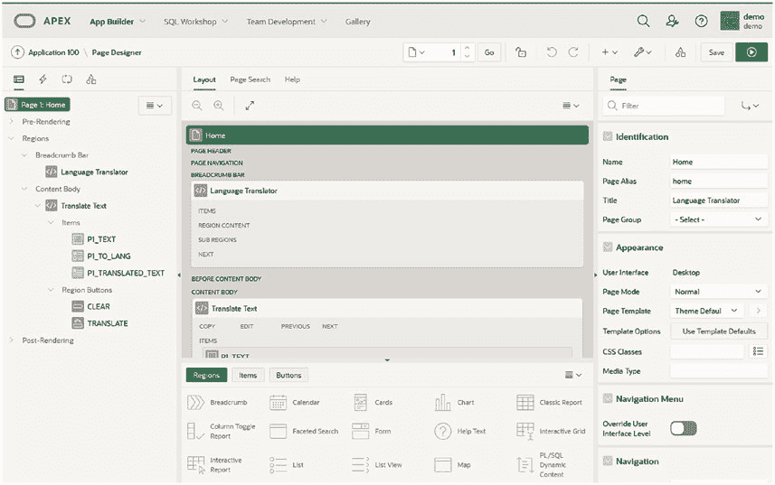

***图 4-14.** 为语言翻译器应用程序创建 APEX 页面*

2. 创建两个按钮，一个用于提交页面，另一个用于重置页面。

3. 创建一个页面过程（图 4-15），该过程仅在单击 *TRANSLATE* 按钮时执行。将其配置为执行以下 PL/SQL 代码：

```sql
declare
```

# 第 4 章 使用 API 网关暴露功能

```sql
c_rest_url constant varchar2(200) :=
'https://**.apigateway.**.oci.customer-oci.com/translate/v1';

l_response clob;

begin

l_response := apex_web_service.make_rest_request(
p_http_method => 'POST'
, p_url => c_rest_url || '/'
|| case :P1_TO_LANG
when 'es' then 'spanish'
else 'japanese'
end
, p_body => json_object('text' value :P1_TEXT)
);

if apex_web_service.g_status_code = 200 then
:P1_TRANSLATED_TEXT := json_value(l_response
,'$.translatedText');
else
raise_application_error(-20001
, 'Error invoking service. HTTP status code: '
|| apex_web_service.g_status_code);
apex_debug.error(l_response);
end if;

end;
```

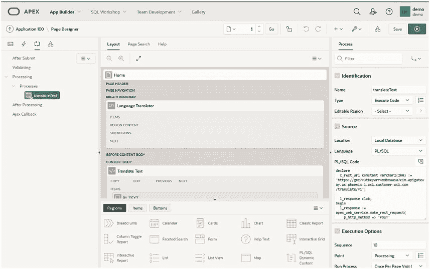

图 4-15. 创建一个页面过程来调用语言翻译 REST 服务并处理其响应

保存页面并运行它。输入一些英文文本，选择要翻译成的目标语言，然后单击 *Translate*。图 4-16 显示了用两种语言翻译的文本。

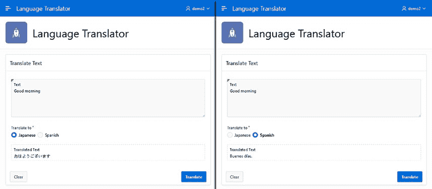

图 4-16. 语言翻译器应用程序显示日语和西班牙语的翻译

## 安全性和日志记录

与许多其他 OCI 资源一样，API 网关服务也支持日志记录。日志记录从部署的详细信息页面启用。有两类日志记录，用于访问和执行，并且可以使用 OCI 控制台轻松启用。

还可以为每个部署设置执行日志级别。执行此操作的选项可以在部署向导的第一页上找到（图 4-17）。日志记录级别可以设置为以下三个值之一：

• Information

• Warning

• Error

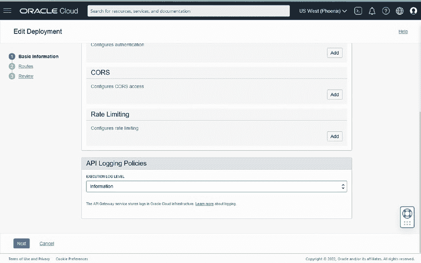

图 4-17. 从部署向导设置执行日志级别

在同一页面上，有以下设置安全功能的选项：

• **Mutual-TLS (mTLS)**: 启用后，REST 客户端必须出示 API 网关将验证的 SSL/TLS 证书。部署可以选择将访问限制到特定的 *主题备用名称* (SAN) 或 *通用名称* (CN)。启用后，必须将包含签署客户端证书的 CA 证书的自定义证书颁发机构 (CA) 捆绑包添加到 API 网关。

• **身份验证**: API 网关服务支持使用单独的 Oracle Functions 函数或 JSON Web 令牌 (JWT) 来管理对端点的访问。

• **CORS**: 跨源资源共享策略通常用于防止来自不同来源的代码发出请求。部署可以指定允许的来源、方法和头。

• **速率限制**: 此功能允许部署指定每秒的最大请求数，基于唯一的客户端 IP 地址或作为聚合。实施速率限制有助于保护端点免受意外请求激增的影响，例如在分布式拒绝服务 (DDoS) 攻击期间，这可能导致服务中断。

## 总结

Oracle Functions 为 APEX 开发人员提供了实现以其他方式难以在 PL/SQL 中实现的功能的能力。这些无服务器函数可以通过多种方法调用，在第 [3](https://doi.org/10.1007/978-1-4842-8170-3_3) 章中，我们使用 Oracle Events 来触发函数，对上传到 OCI 对象存储的文件执行图像转换。

但是，并非所有用例都涉及使用 OCI Events 来调用无服务器函数。API 网关是一种托管服务，它包装这些函数并将其暴露为 REST 端点。它还提供各种安全功能来保护这些服务免受恶意攻击。
