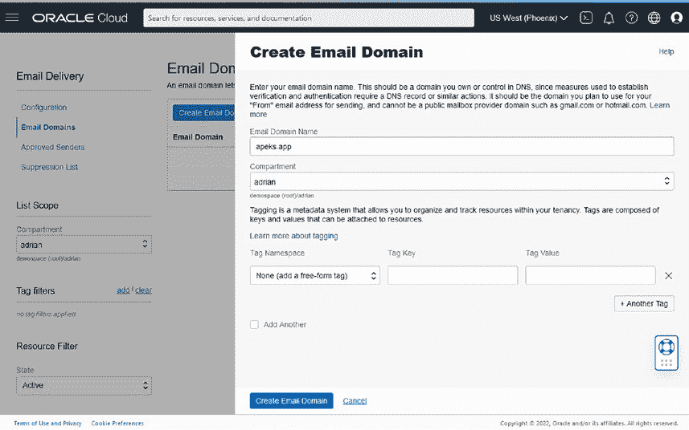

# 第 11 章 电子邮件投递服务

要获取 SMTP 服务器信息，首先选择所需区域。然后，打开导航菜单并点击**开发者服务**。在**应用程序集成**下，点击**电子邮件投递**。您应被重定向到配置页面；如果没有，请点击页面左侧**电子邮件投递**部分下同名的链接。

例如，美国凤凰城区域的信息如图 11-9 所示。

***图 11-9.** 美国凤凰城区域的 SMTP 服务器信息*

通常，这些服务器的*完全限定域名*（FQDN）遵循以下格式：

smtp.email.<区域标识符>.oci.oraclecloud.com

区域标识符可从以下列表获取：[`bit.ly/oci-docs-regions`](https://bit.ly/oci-docs-regions)。

**电子邮件域**

电子邮件域是该服务在 2021 年下半年引入的一项较新功能。其功能之一允许租户创建*域名密钥识别邮件*（DKIM）签名，这是一种电子邮件安全标准，允许接收客户端验证电子邮件是否来自特定域并已获得其所有者授权。DKIM 在确保电子邮件可投递性方面发挥作用，我们将在本章后面讨论。

在此功能发布之前，OCI 租户必须提交 Oracle 支持*技术服务请求*（SR），才能为域生成 DKIM 签名。

在生成 DKIM 签名之前，必须先创建一个电子邮件域（图 11-10）：

