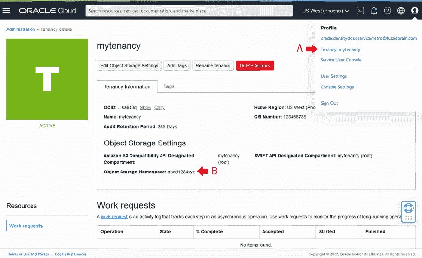
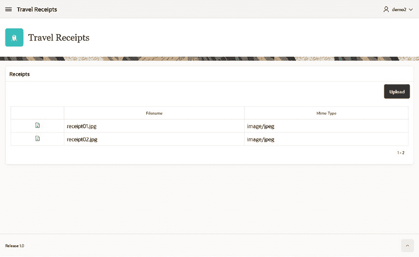
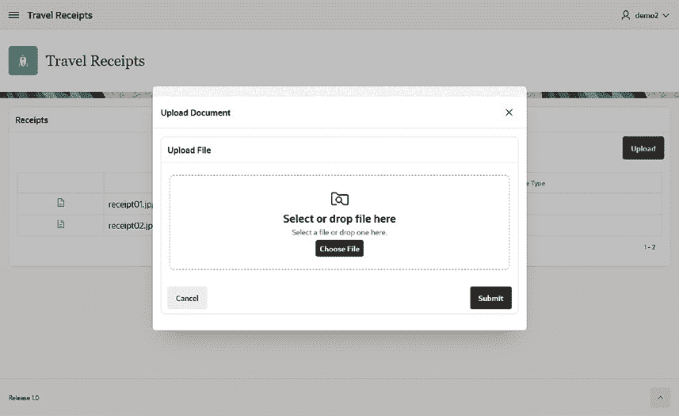
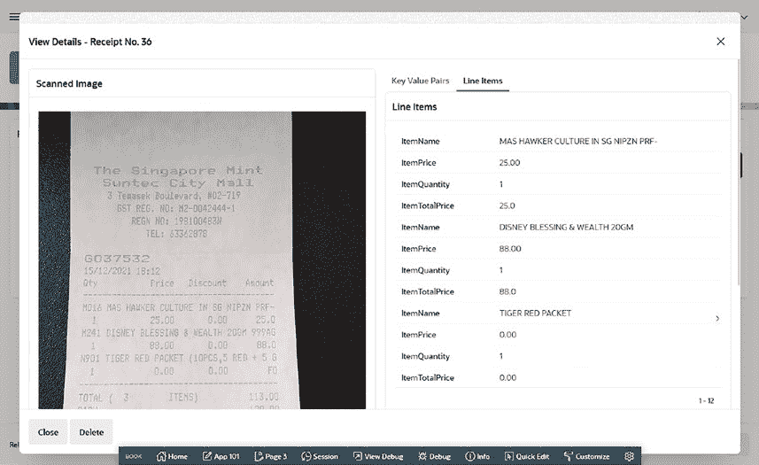

# 第 10 章 视觉

人脑处理视觉和听觉的能力使我们能够与他人和环境互动。几乎每个计算设备——台式机、笔记本电脑和移动设备——都有一个显示器、麦克风和扬声器，用于通过用户的眼睛、嘴巴和耳朵与人类用户进行交互。迄今为止，它们是人类五种感官中仅有的两种在机器中被人工复制的感官。其余三种——嗅觉、味觉和触觉——涉及复杂的生物化学和物理化学过程，鉴于当今科学和技术的进步，这些过程不易复制。存在一些解决方案，但大多仅存在于实验设备中。

如今，日常计算机被设计为接受和产生二进制输入和输出。例如，要执行命令，用户在键盘（一种输入设备）上键入，该设备提供计算机要处理的指令。该过程的结果随后通过显示器或声音设备反馈给用户。

计算机的响应是数字生成的；然而，当它离开设备时，它使用模拟信号传递给用户。人眼和耳朵接收这些模拟输入，然后通过大脑进行处理。后者随后根据这些处理过的信号做出决策。计算机能否像人类一样对视觉和声音做出反应？答案是肯定的。

图像和语音识别任务是*人工智能*（AI）和*机器学习*（ML）最普遍的应用之一。*文本转语音*（TTS）软件已经存在相当长一段时间，常见于像 *Microsoft Windows* 这样的操作系统中，用于提高计算机的可访问性。*计算机视觉*（CV）的早期示例包括用于辅助医学图像诊断的图像分割。

然而，这些技术通常是专有的、昂贵的，并且不容易集成到消费类应用程序中。开发良好的 ML 模型来执行这些任务的一些早期挑战包括提供足够的训练数据和计算能力。然而，*大数据*和*高性能计算*（HPC）的进步极大地提高了我们创建健壮、准确和通用化 ML 模型的能力。

© Adrian Png 和 Heli Helskyaho 2022

A. Png 和 H. Helskyaho，*使用 Oracle 云功能扩展 Oracle Application Express*，

[`doi.org/10.1007/978-1-4842-8170-3_10`](https://doi.org/10.1007/978-1-4842-8170-3_10#DOI)

第 10 章 视觉

例如，*ImageNet* ([`image-net.org/`](https://image-net.org/))，一个大规模收集标记数字图像存储库的努力，以及*图形处理单元*（GPU）的可用性，使得训练*卷积神经网络*（CNN）模型取得了成功。CNN 是*人工神经网络*（ANN）的一个强大变体，通常用于 AI 的一个子领域，称为*深度学习*。CNN 模型具有高度的通用性，但 ML 工程师也可以使用一种称为*迁移学习*的概念来训练它们执行专门的识别任务。这些概念体现在*Oracle 云基础设施*（OCI）*视觉* AI 服务中。

要使工具有效，它还必须易于集成到其他系统中，例如 Web 应用程序。OCI AI 服务包括定义良好的 REST API，允许开发人员将 CV 和 TTS 功能集成到像 *Oracle Application Express*（APEX）这样的 Web 平台中。在本章中，我们将介绍 Vision，它的要求，以及如何在日常 APEX 应用程序中使用此服务。

**使用 OCI REST API**

Oracle 提供了一套全面的 REST API，允许开发人员和管理员使用命令行界面（CLI）或自定义应用程序/脚本创建、管理和使用 OCI 资源。软件开发工具包（SDK）也可用于一些更流行的编程语言，如 JavaTM、Go 和 Node.JSTM。还有 PL/SQL API，但在撰写本文时，仅可在 Oracle 自治数据库（ADB）上直接使用。因此，我们将重点介绍如何直接使用 `APEX_WEB_SERVICE` PL/SQL 包与 REST API 一起工作，无论您的 Oracle 数据库部署在何处，该方法都适用。

回顾一下，OCI REST API 的使用受严格的身份和访问管理（IAM）策略约束。IAM 策略中定义的权限被分配给 IAM 组。为希望使用 API 的实体创建一个 IAM 用户，并将其分配到相关的组中。

创建 IAM 用户后，必须使用 OCI 控制台、OCI CLI 或广泛使用的 OpenSSL 应用程序生成一组私钥和公钥。必须通过 OCI 控制台将公钥添加到用户的账户中。添加后，收集所需信息如下：

• 租户 OCID

• 用户 OCID

• 用户 API 公钥的指纹

第 10 章 视觉

作为额外的安全层，使用 OCI REST API 要求所有请求都使用用户的 API 密钥进行加密签名。这可能是一个复杂的过程，需要客户端编程语言支持 RSA 公钥加密。

幸运的是，对于 APEX 开发人员，我们可以通过使用 APEX *Web 凭据*来避免此过程。创建和使用特殊的 OCI 凭据类型将使开发人员能够调用 API，而无需实现请求签名算法。

关于如何创建必要的 IAM 组、用户和策略，设置用户的 API 密钥，以及创建 OCI Web 凭据的说明，详见第 [2](https://doi.org/10.1007/978-1-4842-8170-3_2) 章。

**OCI 对象存储**

使用 Vision 服务需要借助 OCI *对象存储*来暂存待处理的图像文件。请按照第 [2](https://doi.org/10.1007/978-1-4842-8170-3_2) 章的说明创建以下资源：

• IAM 用户：*demoapex*

• IAM 组：*DemoVisionGroup*

• 对象存储桶：*ai-vision-demo*

# IAM 用户和组用于代表 APEX 应用程序访问 OCI 资源。

组是 OCI 在 IAM 策略中使用的实体，用于通过策略语句定义其可以或不可以执行的操作。将 IAM 用户`demoapex`分配到组`DemoVisionGroup`中。

为了允许 Vision 演示应用程序访问对象存储桶并上传文件，请创建一个名为`Demo-Object-Policy`的策略，并添加以下语句：

允许组 DemoVisionGroup 读取 adrian compartment 中的存储桶
允许组 DemoVisionGroup 管理 adrian compartment 中的对象

为方便使用对象存储，请在 APEX 应用程序的解析模式中创建一个 PL/SQL 包，其中包含两个过程，用于在指定存储桶中上传和删除对象。例如：

```sql
create or replace package pkg_oci_os_util
as
gc_objectstorage_endpoint constant varchar2(500) :=
'https://objectstorage.us-phoenix-1.oraclecloud.com';
gc_namespace constant varchar2(30) := 'abcd1234xyz';
gc_credential_static_id constant varchar2(50) :=
'OCI_CREDENTIALS';

procedure p_upload_object(
    p_bucket_name in varchar2
  , p_file_blob in blob
  , p_filename in varchar2
  , p_mime_type in varchar2
);

procedure p_delete_object(
    p_bucket_name in varchar2
  , p_filename in varchar2
);
end pkg_oci_os_util;
```

请根据您的环境更新以下包常量：

* `gc_objectstorage_endpoint`：使用相应的 OCI 区域更新端点。在示例中，端点是针对 us-phoenix-1（美国菲尼克斯区域）的。
* `gc_namespace`：要获取租户的命名空间字符串，请点击 OCI 控制台右上角的个人资料按钮（参见图 10-1）。点击标记为“A”的租户链接。您应输入的值可以在*对象存储设置*下找到，并标记为“B”。
* `gc_credential_static_id`：替换该值，或创建一个静态 ID 为 OCI_CREDENTIALS 的 APEX Web 凭证。该凭证的类型应为 Oracle Cloud Infrastructure (OCI)。必须正确填写 API 密钥和必要信息。



`pkg_oci_os_util`包规范和包体的完整代码可在本章的源代码目录中找到。

## OCI Vision

我在商务（或个人）旅行中遇到的一个挑战是整理收据，并可能报销旅行期间产生的费用。每张收据都不同，手动将它们输入雇主的报销应用程序可能是一项艰巨的任务。您可以购买带有配套软件的专用扫描仪来扫描这些收据，并将其输入到像 QuickBooks 这样的会计应用程序中，但这些解决方案成本可能很高。如今，软件甚至可能处理移动设备拍摄的收据照片，但如果您的公司有用于管理费用的自定义应用程序，该怎么办？

为了处理收据图像，计算机必须执行光学字符识别（OCR），这涉及处理并识别光栅图像中的文本。机器学习通常用于执行此类任务，并且有几种 OCR 引擎，例如开源的 Tesseract ([`tesseract-ocr.github.io/`](https://tesseract-ocr.github.io/))，开发人员可以将其集成到他们的应用程序中。对于 APEX 开发人员来说，这可以使用我们在第 3 章学过的 Oracle Functions 来完成。

然而，从图像中解读文本只是解决方案的一部分。其他挑战依然存在，例如理解文本的上下文并将其映射到数据库表中进行存储。一些常见场景涉及发票中的表格以及采购收据中的键值对。因此，包括 Oracle 在内的多家云供应商开发了基于 REST 的高级 API 服务，能够使用预训练的 AI 模型来执行此任务，这并不令人意外。

Vision 提供了多个预训练模型，大致可分为两类：**文档 AI** 和**图像分析**。相应地，开发人员可以使用 AnalyzeDocument 和 AnalyzeImage 操作来访问各自的 OCI REST API。

顾名思义，文档 AI 预训练模型允许开发人员处理文档图像，并执行以下一项或多项任务：

* **OCR**：文本检测，可选择创建可搜索文件并保存为*便携式文档格式* (PDF)。
* **文档分类**：分析并分类文档类型，同时提供置信度分数。
* **语言分类**：基于 ISO-639-2 标准（[www.iso.org/standard/4767.html](http://www.iso.org/standard/4767.html)）返回三个字母的语言代码，并提供置信度分数。支持的语言包括英语、法语、简体中文等。
* **表格提取**：识别以表格格式书写的文本，并按相同的行和列提取它们。
* **键值提取**：此预训练模型从收据中提取键值对，例如商户位置和联系信息、购买的商品、数量和价格等字段。

对于图像分析，开发人员可以请求执行以下任务：

* **对象检测**：识别对象、其类别以及对象所在的边界框。
* **图像分类**：分配并列出图像中找到的所有对象的标签。
* **OCR**：检测图像中的文本，并提供其所在的边界框。

**注意**：除了用于图像分析任务的预训练模型外，Vision 还允许用户创建自定义模型。开发人员可以创建 Vision 项目，并借助 OCI Data Labeling 服务，为更具体的计算机视觉任务训练自定义模型。该过程涉及使用一种称为*迁移学习*的概念，这超出了本章的讨论范围。

## Travel Receipts APEX 应用程序

对于我们的下一个应用程序，我们将编写一个 Travel Receipts APEX 应用程序，该应用程序允许用户拍摄并上传图像，然后使用 Vision 的键值提取预训练模型解析收据中的字段并呈现其值。以下是用户通过 APEX 页面上传并提交扫描收据时发生情况的概要。

1. 从`APEX_APPLICATION_TEMP_FILES`表中检索图像 BLOB。
2. 使用`pkg_oci_os_util.p_upload_object`过程将 BLOB 上传到 ai-vision-demo 对象存储桶。
3. 使用`pkg_oci_vision_util.f_analyze_document`函数准备并提交 Vision 文档分析请求，并接收 JSON 格式的结果。
4. 将图像和文档分析结果都保存到表中。

## RECEIPT 表结构

首先创建一个名为`RECEIPT`的简单数据库表，包含以下列：

| 列名 | 数据类型 | 用途 |
| :--- | :--- | :--- |
| reCeipt_iD | nUMBer | 主键 |
| sCanneD_iMaGe | BLoB | 用于存储扫描的图像 |
| FiLenaMe | VarChar2(1000) | 上传图像的文件名 |
| MiMe_tYpe | VarChar2(100) | 上传图像的 MIME 类型 |
| reCeipt_Data | CLoB | 用于存储 Vision 返回的结果。添加 is_json 检查约束 |

接下来，创建一个用于处理 Vision API 的 PL/SQL 包。以下代码封装了准备请求并将其提交到 Vision 的 AnalyzeDocument REST 端点的必要步骤：

```sql
create or replace package body pkg_oci_vision_util
as
function f_analyze_document(
    p_bucket_name in varchar2
  , p_filename    in varchar2
) return blob
as
    c_path constant varchar2(100) :=
        '/20220125/actions/analyzeDocument';
    l_response blob;
begin
apex_web_service.g_request_headers(1).name := 'Content-Type';
apex_web_service.g_request_headers(1).value :=
'application/json';
end f_analyze_document;
end pkg_oci_vision_util;
```

# 第10章 视觉

## AnalyzeDocument 端点

`AnalyzeDocument` 端点通过 POST 方法调用，在请求体中，开发者必须包含一个包含请求详细信息的 JSON 负载。由 `apex_web_service.make_rest_request` 发送的请求负载如下所示：

```json
{
    "document": {
        "source": "OBJECT_STORAGE",
        "namespaceName": "abcd1234xyz",
        "bucketName": "ai-vision-demo",
        "objectName": "receipt01.png"
    },
    "features": [
        {
            "featureType": "KEY_VALUE_DETECTION"
        }
    ]
}
```

它包含以下关键属性：

• **文档**：我们可以以内联方式提交文档，即文档嵌入在请求负载中，或者作为对象存储引用提交。如果文档对象的来源是 `OBJECT_STORAGE`，则它还必须包含共同指定对象位置的属性。这些属性定义了以下内容：
   a. 命名空间名称
   b. 存储桶名称
   c. 对象名称

• **功能**：此属性接受一个功能类型数组，这意味着开发者可以请求在单个 REST 调用中执行多项分析。

在开始处理 APEX 应用程序之前，请确保：
1. 已创建用于让应用程序访问对象存储和视觉服务的 IAM 用户和组。
2. 已在工作区中创建用于 OCI REST API 访问的 APEX Web 凭证。
3. 已定义所需的 IAM 策略和语句，以允许 IAM 用户读取和写入目标对象存储桶，并能够使用视觉服务。

在本章前面，我们创建了 IAM 用户 *demoapex*，并将其分配到组 *DemoVisionGroup*。为了允许 *demoapex* 使用视觉服务，请在根区间中创建一个包含以下语句的策略：
```sql
allow group DemoVisionGroup to use ai-service-vision-family in tenancy
```

## APEX 应用程序设置

创建一个包含三个页面的新 APEX 应用程序：
• **页面 1**：主页
• **页面 2**：上传文档
• **页面 3**：查看收据详情



### 主页

在主页上，显示已上传并分析过的收据列表。使用 RECEIPT 表作为源创建一个经典报表（图 10-2）。它应显示 RECEIPT_ID、FILENAME 和 MIME_TYPE 列。第一个报表列应使用 RECEIPT_ID 的值呈现一个指向页面 3 的链接。同时创建一个用于上传图像的按钮，并将其放置在报表的右上角。该按钮应重定向到页面 2，这是一个我们接下来将创建的模态对话框页面。

***图 10-2.** 主页，显示已上传收据的交互式报表*

### 上传页面

第二个用于上传图像的页面是大部分操作发生的地方。添加以下 APEX 组件：
• **P2_FILE**：一个类型为 *文件浏览* 的页面项。
   • 如果您使用的 APEX 版本支持，请将 *显示为* 值设置为 *块状拖放区*。
   • 将 *存储类型* 设置为 *表 APEX_APPLICATION_TEMP_FILES*。
   • 设置 APEX_APPLICATION_TEMP_FILES 中的文件在请求结束时被清除。
   • 将接受的文件类型设置为 *image/**。
   • 将其设置为必填字段。
   • 对于字段的外观，将模板设置为 *隐藏*，然后通过模板选项，拉伸表单项目，使其占据所有水平空间。最后，将标签列跨度设置为 *0*。
• **取消**：一个用于中止并返回主页的按钮。添加一个动态操作来处理点击事件并执行 *取消* *对话框* 动作。
• **提交**：一个用于提交页面的按钮。此按钮应执行验证并确保已选择文件。
• 处理流程：
   • **processFile**：此流程包含用于执行本章前面所述工作流的 PL/SQL 代码。它应仅在 *提交* 按钮被点击时运行。
   • **closeDialog**：这是一个标准流程，用于在处理完成后关闭模态对话框。

图 10-3 展示了页面完成后的样子。



***图 10-3.** 一个用于处理文件上传和触发文档分析的模态对话框页面*

用户在模态对话框的指定区域选择或拖放一个图像文件，然后点击 *提交* 按钮。随后触发 *processFile* 流程，并执行以下 PL/SQL 代码：
```sql
declare
  l_receipt_id receipt.receipt_id%type;
begin
  for file in (
    select * from apex_application_temp_files
    where name = :P2_FILE
  ) loop
    pkg_receipt.p_create(
      p_scanned_image => file.blob_content
    , p_filename => file.filename
    , p_mime_type => file.mime_type
    , p_receipt_id => l_receipt_id
    );
  end loop;
end;
```

首先从 `APEX_APPLICATION_TEMP_FILES` 表中检索上传的文件。然后，该流程调用过程 `pkg_receipt.p_create`，这是一个外观[模式](https://wikipedia.org/wiki/Facade_pattern)，它依次调用以下内容：
• `pkg_oci_os_util.p_upload_object`，一个将文件上传到指定对象存储桶的过程。
• `pkg_oci_os_vision_util.f_analyze_document`，一个调用 *AnalyzeDocument* OCI REST 操作并返回包含分析结果的 JSON 的函数。
• `pkg_oci_os_util.p_delete_object`，一个执行清理操作以从存储桶中删除已上传文件的过程。

最后一步将上传的文件和由 `pkg_oci_os_vision_util.f_analyze_document` 函数返回的结果一起插入。存储结果使我们能够进行查询。以下 JSON 是 Document AI 结果的精简版本：
```json
{
  "documentMetadata" : {
    "pageCount" : 1,
    "mimeType" : "image/jpeg"
  },
  "pages" : [ {
    "pageNumber" : 1,
    "dimensions" : {
      "width" : 651.0,
      "height" : 868.0,
    }
  } ]
}
```

# 第 10 章 视觉

```json
"unit" : "PIXEL"
},
"detectedDocumentTypes" : null,
"detectedLanguages" : null,
"words" : [ ... ]
"tables" : null,
"documentFields" : [ ... ]
} ],
"detectedDocumentTypes" : null,
"detectedLanguages" : null,
"documentClassificationModelVersion" : null,
"languageClassificationModelVersion" : null,
"textDetectionModelVersion" : "1.2.87",
"keyValueDetectionModelVersion" : "1.2.87",
"tableDetectionModelVersion" : null,
"errors" : null,
"searchablePdf" : null
}
```

结果的内容取决于请求负载中列出的功能。例如，如果添加的功能之一是 `TABLE_DETECTION`，那么页面对象中的 `table` 数组将包含在分析过程中发现的任何表格结构的行和单元格数组。在我们的示例中，我们仅指定检测收据中的键值对，因此，如果找到任何内容，我们将在 `documentFields` 数组中找到对象。

在示例应用程序中，我们期望只上传收据。这些收据通常包含以下类型的信息：
• 商户详情和摘要信息，例如交易中购买商品的总价。
• 购买的商品列表，包括商品名称、价格和数量。

创建第三个页面，用于查看 `RECEIPT` 表中的记录。包含以下区域：
• **扫描图像**：一个包含两个页面项目的 *静态内容* 区域：
  • `P3_RECEIPT_ID`：一个 *隐藏* 页面项，用于存储记录的主键。
  • `P3_SCANNED_IMAGE`：一个 *显示图像* 页面项，用于渲染以 `BLOB` 形式存储在 `RECEIPT` 表中的扫描图像。
• **解析数据**：另一个 *静态内容* 区域，将作为接下来两个子区域的容器。将解析后的数据与扫描图像并排显示，并将其配置为使用 *选项卡容器* 模板。
  • **键值对**：创建此 *经典报表* 区域，作为 *解析数据* 区域的子区域。
  • **行项目**：在 *解析数据* 区域下添加第二个 *经典报表* 区域。
• **按钮容器**：将此包含 *关闭* 和 *删除* 按钮的 *静态内容* 区域放置在 *对话框页脚* 位置。这些按钮将分别执行标准操作：通过动态操作关闭模态对话框，以及通过页面进程删除记录。

如本章前面所述，键值对位于 `documentFields` 数组中。以下代码片段显示了示例收据中找到的第一个文档字段。

```json
"documentFields" : [ {
    "fieldType" : "KEY_VALUE",
    "fieldLabel" : {
        "name" : "MerchantName",
        "confidence" : 0.9999982
    },
    "fieldName" : null,
    "fieldValue" : {
        "valueType" : "STRING",
        "text" : null,
        "confidence" : null,
        "boundingPolygon" : {
            "normalizedVertices" : [ {
                "x" : 0.1674347158218126,
                "y" : 0.12211981566820276
            }, {
                "x" : 0.6851611159364199,
                "y" : 0.12211981566820276
            }, {
                "x" : 0.6851611159364199,
                "y" : 0.1497695852534562
            }, {
                "x" : 0.1674347158218126,
                "y" : 0.1497695852534562
            } ]
        },
        "wordIndexes" : [ 0, 1, 2 ],
        "value" : "The Singapore Mint"
    }
} ]
```

**注意**：Vision 在图像中找到的每个文本值都有一个关联的边界多边形/框和置信度分数。这些为开发者提供了图像中推断出文本的像素坐标，以及一个介于 0 和 1 之间的值，表示预测值正确的概率。例如，边界框坐标可用于显示和突出显示找到术语的位置，而置信度分数可与阈值一起使用，以决定接受或丢弃哪些预测值。

此数组中的对象可能属于 `KEY_VALUE` 或 `LINE_ITEM_GROUP` 字段类型。`KEY_VALUE` 类型的对象可能包含来自预定义字段的值，例如商户名称（`MerchantName`）、电话号码（`MerchantPhoneNumber`）、收据交易日期（`TransactionDate`）和总费用（`Total`）。

要检索收据中找到的键值对，请将 *键值对* 区域的源设置为使用以下 SQL 查询：

```sql
select
    data.field_name
    , data.field_value
from
    receipt r
    , json_table(
        r.receipt_data
        , '$.pages[*].documentFields[*]'
        columns(
            field_name varchar2(30) path '$.fieldLabel.name'
            , field_value varchar2(500) path '$.fieldValue.value'
            , field_type varchar2(30) path '$.fieldType'
        )
    ) data
where 1 = 1
    and receipt_id = :P3_RECEIPT_ID
    and data.field_type = 'KEY_VALUE'
```

然后，自定义报表的呈现方式。选择该区域，然后切换到 *属性* 选项卡。在 *外观* 部分下，为模板选择 *值属性对 - 行*。图 10-4 显示了页面完成后的外观。

***图 10-4.** 显示找到的预定义文档*

在收据中发现的项目列表可以在类型为 `LINE_ITEM_GROUP` 的文档字段中找到。在此对象内部，有一个 `items` 数组，该数组是类似于父对象的对象集合。每个对象代表一个行项目（字段类型为 `LINE_ITEM`）。它本身又包含一个 `items` 数组，其中包含字段类型为 `LINE_ITEM_FIELD` 的对象。此数组的元素可能包含行项目的名称、价格、数量和总价。这些嵌套元素的示例如下所示：

```json
{
    "fieldType" : "LINE_ITEM_GROUP",
    "fieldLabel" : {
        "name" : "line item group",
        "confidence" : null
    },
    "fieldName" : null,
    "fieldValue" : {
        "valueType" : "ARRAY",
        "text" : null,
        "confidence" : null,
        "boundingPolygon" : null,
        "wordIndexes" : null,
        "items" : [ {
            "fieldType" : "LINE_ITEM",
            "fieldLabel" : null,
            "fieldName" : null,
            "fieldValue" : {
                "valueType" : "ARRAY",
                "text" : null,
                "confidence" : null,
                "boundingPolygon" : null,
                "wordIndexes" : null,
                "items" : [ {
                    "fieldType" : "LINE_ITEM_FIELD",
                    "fieldLabel" : {
                        "name" : "ItemTotalPrice",
                        "confidence" : 0.9988584
                    },
                    "fieldName" : null,
                    "fieldValue" : {
```

# 第 10 章 视觉

要显示行项目，请配置`行项目`经典报表区域，使用`值属性对-行`模板来显示结果，然后将其源设置为使用以下 SQL 查询：

```sql
select
    data.field_name
    , data.field_value
from
    receipt r
    , json_table(
        r.receipt_data
        , '$.pages[*].documentFields[*].fieldValue.items[*]'
        columns(
            row_number for ordinality
            , nested path '$.fieldValue.items[*]' columns (
                field_name varchar2(30) path '$.fieldLabel.name'
                , field_value varchar2(500) path '$.fieldValue.value'
                , field_type varchar2(30) path '$.fieldType'
            )
        )
    ) data
where 1 = 1
    and receipt_id = :P3_RECEIPT_ID
    and data.field_type = 'LINE_ITEM_FIELD'
order by data.row_number
    , case data.field_name
        when 'ItemName' then 1
        when 'ItemPrice' then 2
        when 'ItemQuantity' then 3
        when 'ItemTotalPrice' then 4
        else null
    end nulls last
```



点击`行项目`将显示在提交的图像中发现了哪些项目（图 10-5）。

***图 10-5.** 查看收据详情页面，显示从收据中提取的行项目*

**总结**

人工智能和机器学习的目标是创建能够模仿人类行为的计算机系统和机器人。人类大脑作为我们决策过程的核心，高度依赖于包括视觉在内的五种感官。数字捕获设备的普及、更便宜高效的数据存储以及更强大的计算机处理能力，推动了计算机视觉技术的进步。如今，OCI 通过其 AI 服务产品（包括视觉）提供“AI 即服务”。这使得 APEX 开发者能够更轻松地集成涉及图像/物体识别、文本提取和文档分类功能的解决方案。本章介绍的示例应用程序只是 AI 可以应用的一个领域，希望它能激发您创建更智能的 Web 应用程序。
