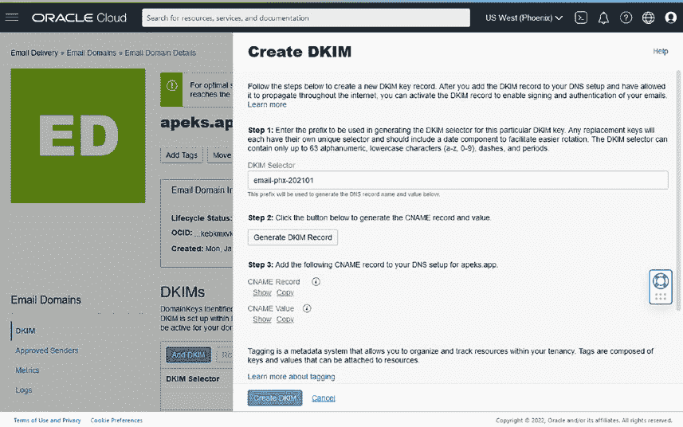

# 第 11 章 电子邮件投递服务

***图 11-11.** 电子邮件域详细信息页面*

要生成 DKIM 签名：

1.  点击**添加 DKIM**。

2.  输入 DKIM 选择器（图 11-12）。这可以是任何值，但与域连接后，必须在全局范围内唯一。其长度不得超过 63 个字符，可以是任何小写字母数字字符或短划线。Oracle 建议使用以下格式：`<前缀>-<区域键>-<日期>`。其中，前缀可以是类似“email”的任意内容，区域键是创建域所在区域的三字母缩写（参见 [`bit.ly/oci-docs-regions`](https://bit.ly/oci-docs-regions)），日期则采用合适的格式，例如 `202201`。

