# 第 11 章 电子邮件投递服务

*电子邮件*可以说是互联网上最古老、使用最广泛的应用程序之一，也是不可或缺的通信工具。它最初由计算机程序员雷·汤姆林森在 20 世纪 70 年代为高级研究计划局网络（ARPANET）实现。电子邮件依赖于客户端应用程序和一组服务器网络，这些服务器使用简单邮件传输协议（SMTP）来接受、转发、投递和存储消息。

虽然电子邮件旨在提供人与人之间的多方对话，但软件应用程序也常使用它来发送通知、信息等。编程语言和框架实现了与电子邮件服务器通信的 API，代表应用程序使用 SMTP。在*Oracle Application Express*（APEX）应用程序中，*APEX\_MAIL* 是一个 *PL/SQL* API，它封装了*Oracle 数据库*中的 *UTL\_SMTP* 包。然而，应用程序依赖于对电子邮件服务器或服务的访问来中继消息。

要从应用程序发送电子邮件，我们可以使用托管服务或配置自管理的 SMTP 服务器。如今，公司依赖在第三方云服务（如 *Microsoft 365*）上处理电子邮件。*Oracle Cloud Infrastructure* (OCI) 也提供了一项名为 *Email Delivery* 的托管服务。该服务不包含在 *Oracle Cloud Free Tier* 免费套餐中，用户需要升级到付费账户才能使用。

在本章中，我们将逐步介绍为使用 Email Delivery 服务准备 OCI 租户所需的步骤。完成这些资源的配置后，我们将配置一个 APEX 实例，使其能够使用 OCI 的 SMTP 端点，通过 `APEX_MAIL` 包发送电子邮件。我们还将探讨可能影响电子邮件送达率的各种问题、可以采取哪些措施来确保邮件成功发送，以及在遇到困难时可以使用哪些工具。

## 设置 OCI 资源

Email Delivery 服务在大多数（如果不是全部）OCI 区域都提供了一个 SMTP 服务器，用于发送电子邮件。虽然该服务需要用户身份验证才能访问，但对客户端连接没有网络限制。不过，还有额外的保护层以防止滥用。创建并配置所需的 OCI 资源，这些资源共同有助于保护服务安全并提高电子邮件的送达率。

### 身份与访问管理

安全是所有 OCI 操作的核心，因此，与所有其他 OCI 服务一样，Email Delivery 要求创建并配置必要的 *Identity and Access Management* (IAM) 资源和策略。建议为应用程序创建一个单独的 IAM 用户，以便*通过*该服务发送电子邮件。首先创建一个 IAM 组，IAM 策略将使用该组来分配必要的权限。

1.  通过点击导航菜单，然后点击 *Identity & Security*，接着点击 *Groups*，导航到“组”概览页面。
2.  点击 *Create Group*。
3.  输入一个合适的名称，例如 *EmailDeliveryAgents*，并提供其用途的简短描述（图 11-1）。
4.  点击 *Create* 创建所需的组。

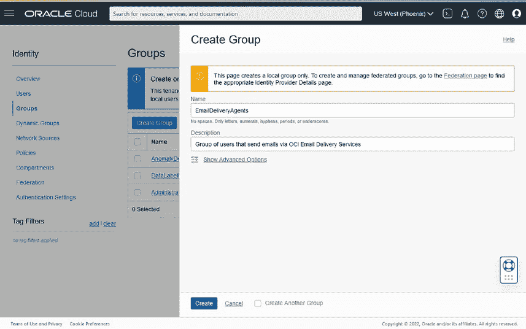

***图 11-1.** 创建一个 IAM 组*

下一个任务是创建一个 IAM 策略，并为该组添加使用 Email Delivery 服务资源所需的语句。

1.  通过点击导航菜单，然后点击 *Identity & Security*，接着点击 *Policies*，导航到“策略”概览页面。或者，如果您在“组”概览页面上，只需点击页面左侧菜单中的 *Policies* 链接即可。
2.  进入“策略”概览页面后，选择要创建此策略的 compartment。我们将在租户中创建它，因此请选择页面左侧 *List Scope* 部分下的根 compartment。
3.  点击 *Create Policy*。

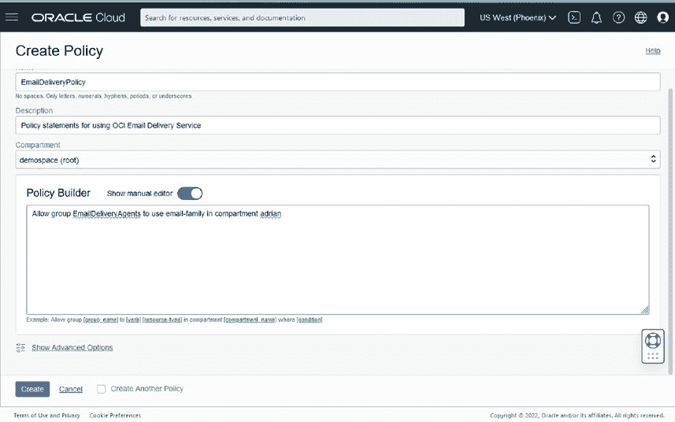

4.  输入所需的策略名称和描述。确保该策略是在租户中创建的，然后切换 *Policy Builder* 以显示手动编辑器（图 11-2）。

***图 11-2.** 创建策略并使用手动编辑器添加所需语句*

**注意**：策略构建器只有用于创建语句的模板，以允许一个组管理相关的 OCI 资源（图 11-3），而对于仅通过该服务发送电子邮件来说，通常不需要这些模板。

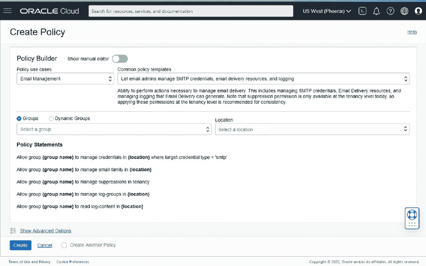

使用以下语法输入策略语句：

```
Allow group <组名> to use email-family in compartment <compartment 名称>
```

例如：

```
Allow group EmailDeliveryAgents to use email-family in compartment adrian
```

***图 11-3.** 用于生成管理相关 OCI 资源语句的策略模板*

接下来，我们将创建 IAM 用户 *emailagent*，然后将其分配到组

# 第 11 章 电子邮件投递服务

*EmailDeliveryAgents*，从而授予其使用该服务所需的权限：
1.  通过点击导航菜单导航至`策略概览页面`，然后依次点击`身份与安全`和`用户`。
2.  或者，如果你仍在组或策略概览页面，只需点击页面左侧菜单中的`用户`链接。
3.  点击`创建用户`。

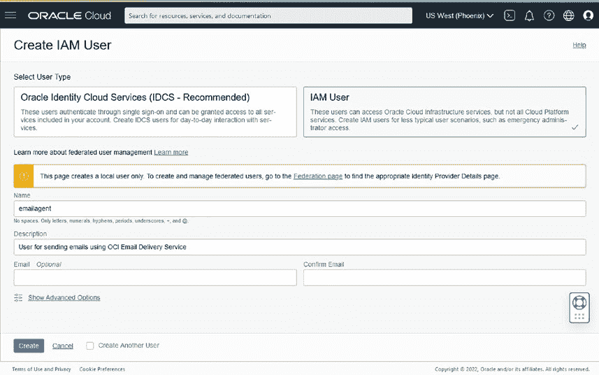

4.  选择用户类型`IAM 用户`。
5.  输入合适的用户名和描述，但将电子邮件字段留空，因为该用户不需要这些信息（图 11-4）。
6.  点击`创建`以创建用户。

**图 11-4.** 使用所需信息创建 IAM 用户

用户创建完成后，你将返回用户的详细信息页面。在那里，你可以找到多个可对该用户执行的管理操作。根据最小权限原则，我们应限制此`IAM`用户在`OCI`租户中的操作范围。

1.  点击`编辑用户能力`。
2.  默认情况下，新创建的用户会启用所有能力。通过取消选中所有其他选项，将其限制为仅`SMTP 凭证`（图 11-5）。
3.  点击`保存更改`。

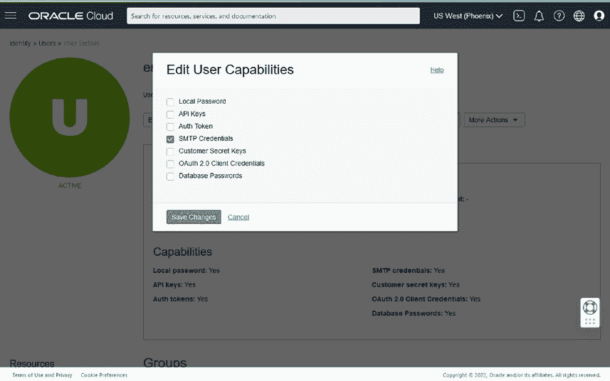

**图 11-5.** 遵循最小权限原则，移除使用电子邮件投递服务所不需要的用户能力

此时，`IAM`用户只能创建`SMTP 凭证`。但是，由于该用户没有`本地密码`能力，你无法以该用户身份登录`OCI`控制台来生成用户名和密码对。请改用你的管理用户来执行此操作。

1.  在用户的详细信息页面上，向下滚动，在`资源`下，点击链接`SMTP 凭证`。
2.  点击`生成 SMTP 凭证`。
3.  输入一个有助于你回忆凭证用途和/或使用位置的描述（图 11-6）。
4.  点击`生成 SMTP 凭证`以生成凭证。

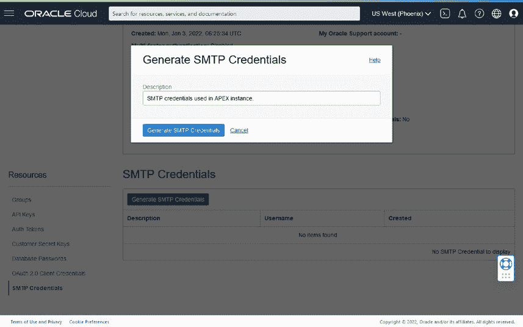

**图 11-6.** 生成 SMTP 凭证并提供有用的描述

> **注意** 创建 SMTP 凭证后，会弹出一个模态框，显示用户名和密码（图 11-7）。这些是你将用于连接`OCI`电子邮件投递服务`SMTP`服务器的凭据。密码**仅显示一次**，请立即安全保存。如果丢失密码，请生成一组新的凭证。

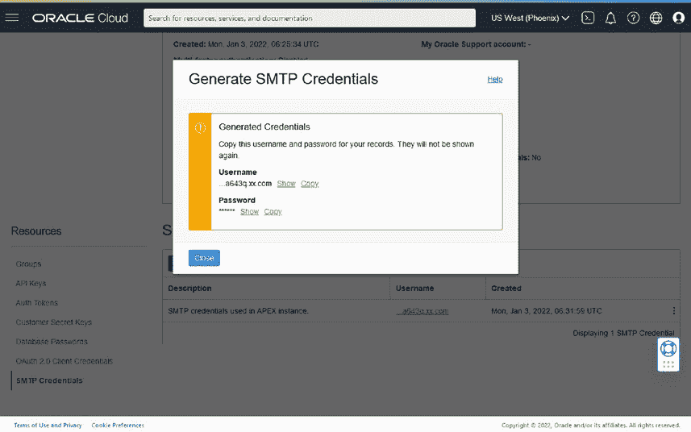

**图 11-7.** SMTP 凭证的密码仅显示一次。请安全存储！

最后一步是将用户分配到相关组（图 11-8）：
1.  在用户的详细信息页面上，向下滚动，在`资源`下，点击链接`组`。
2.  点击`将用户添加到组`。
3.  选择`IAM`组`EmailDeliveryAgents`。
4.  点击`添加`以将用户分配到该组。

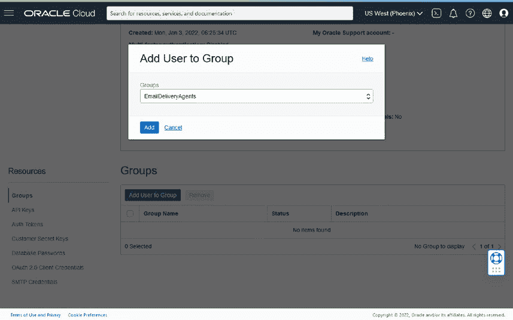

**图 11-8.** 将 IAM 用户分配到适当的组

至此，为使用电子邮件投递服务而进行的`IAM`资源配置已完成。

## 区域、可用性和服务器信息

虽然`OCI IAM`资源是全局性的，但与电子邮件投递服务相关的资源则不是。这些资源包括：

* SMTP 服务器
* 电子邮件域
* 已批准的发送者
* 抑制列表

在选择托管`OCI`资源的区域时，请务必验证该区域是否拥有所有必需的服务。使用此网站上的矩阵（[www.oracle.com/cloud/data-regions/](http://www.oracle.com/cloud/data-regions/)）来指导你的区域选择。在撰写本文时，所有`OCI`数据区域似乎都支持电子邮件投递服务。

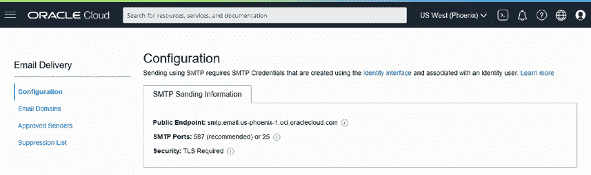

# 第 11 章 电子邮件投递服务
要获取 SMTP 服务器信息，首先选择所需区域。然后，打开导航菜单并点击**开发者服务**。在**应用程序集成**下，点击**电子邮件投递**。您应被重定向到配置页面；如果没有，请点击页面左侧**电子邮件投递**部分下同名的链接。
例如，美国凤凰城区域的信息如图 `11-9` 所示。
`图 11-9. 美国凤凰城区域的 SMTP 服务器信息`
通常，这些服务器的*完全限定域名*（FQDN）遵循以下格式：
`smtp.email.<区域标识符>.oci.oraclecloud.com`
区域标识符可从以下列表获取：[`bit.ly/oci-docs-regions`](https://bit.ly/oci-docs-regions)。
**电子邮件域**
电子邮件域是该服务在 2021 年下半年引入的一项较新功能。其功能之一允许租户创建*域名密钥识别邮件*（DKIM）签名，这是一种电子邮件安全标准，允许接收客户端验证电子邮件是否来自特定域并已获得其所有者授权。DKIM 在确保电子邮件可投递性方面发挥作用，我们将在本章后面讨论。
在此功能发布之前，OCI 租户必须提交 Oracle 支持*技术服务请求*（SR），才能为域生成 DKIM 签名。
在生成 DKIM 签名之前，必须先创建一个电子邮件域（图 `11-10`）：
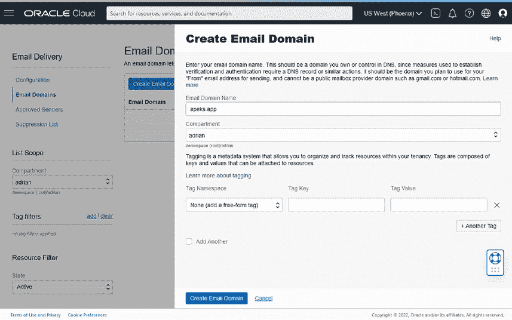

# 第 11 章 电子邮件投递服务

1.  打开`OCI`控制台左上角的导航菜单，然后点击`开发者服务`。

2.  在`应用程序集成`下，点击`电子邮件投递`进入概览/配置页面。

3.  在页面左侧的`电子邮件投递`下，点击`电子邮件域`。

4.  点击`创建电子邮件域`。

5.  输入您希望添加的域名，并选择资源所在的所需区间。

*`图 11-10`.* 将您喜欢的域添加到电子邮件投递服务*

创建电子邮件域后，您将立即被重定向到该域的详细信息页面（`图 11-11`）。请注意，`DKIM 签名`和`SPF 已配置`属性旁边都有一个警告图标。在本节结束时，这些图标将变为绿色对勾。


# 第 11 章 电子邮件投递服务

***图 11-11.** 电子邮件域详细信息页面*

要生成 DKIM 签名：

1.  点击**添加 DKIM**。

2.  输入 DKIM 选择器（图 11-12）。这可以是任何值，但与域连接后，必须在全局范围内唯一。其长度不得超过 63 个字符，可以是任何小写字母数字字符或短划线。Oracle 建议使用以下格式：`<前缀>-<区域键>-<日期>`。其中，前缀可以是类似“email”的任意内容，区域键是创建域所在区域的三字母缩写（参见 [`bit.ly/oci-docs-regions`](https://bit.ly/oci-docs-regions)），日期则采用合适的格式，例如 `202201`。

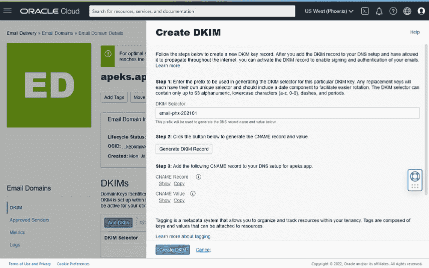

# 第 11 章 电子邮件投递服务


*图 11-12. 输入有效的 DKIM 选择器*

3. 点击 `生成 DKIM 记录`。

4. 这将生成两个值：`CNAME 记录` 和 `CNAME 值`（图 11-13）。这些值将用于创建所需的 `DNS` 记录。

5. 点击 `创建 DKIM` 以完成该过程。


# 第 11 章 电子邮件投递服务

要激活 DKIM 签名，您必须使用提供的值创建相应的 DNS 记录。这通过您组织域名的 DNS 服务完成。DNS 服务提供商可能有不同的用户界面和添加方法。以下步骤基于 `Cloudflare`（[www.cloudflare.com/](http://www.cloudflare.com/)）提供的服务，但通常流程包括：

1. 添加一条类型为 `CNAME` 的新 DNS 记录。
2. 输入 OCI 控制台提供的 `名称` 和 `目标` 值。
3. 设置合适的生存时间（`TTL`）值。

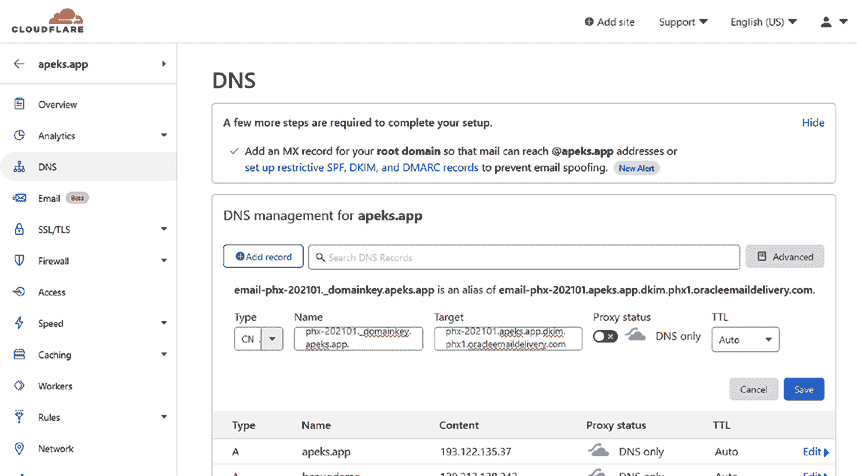

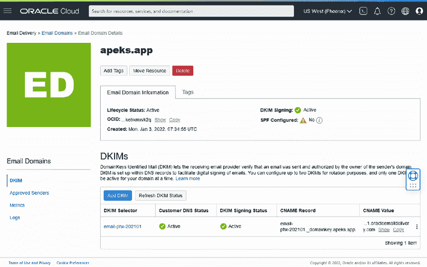

等待几分钟，然后返回 OCI 控制台，点击 `刷新` `DKIM 状态`，直到 `DKIM 签名` 状态显示为 `活动`。


电子邮件身份验证中涉及的另一个（或许更为人熟知的）DNS 记录是 *发件人策略框架*（`SPF`），定义于 `RFC 7208`（参见 [tools.ietf.org/html/rfc7208](https://tools.ietf.org/html/rfc7208)）。它涉及一条单一的 DNS `TXT` 记录，该记录列出了允许代表某个域发送电子邮件的邮件服务器。它与域名相关联，并且是一个始终以 `v=spf1` 开头、以“`all`”机制及其修饰符结尾的文本字符串。中间是一系列列出授权服务器的机制。这些机制可以是以下任意组合：

• **`include`**：搜索指定域的 `SPF` 记录以寻找匹配项。通常由电子邮件服务提供商（如 OCI 电子邮件投递服务）使用。
• **`a`**：一条 DNS `A` 记录。
• **`mx`**：域 `MX` 记录的所有 `A` 记录。
• **`ptr`**：使用 `PTR` 查询查找客户端的 `IP`。
• **`ip4`**：单个 `IPv4` 地址或一个 `IPv4` 网络范围。
• **`ip6`**：单个 `IPv6` 地址或一个 `IPv6` 网络范围。
• **`exists`**：使用提供的域执行 `A` 记录查找。如果查找产生结果，则视为匹配。

**注意** 每个域只允许一条 `SPF` `TXT` 记录，且内容的最大长度为 255 个字符。

Oracle 提供了您需要包含在文档中的 `SPF` 机制，文档地址在[此：https://bit.ly/oci-email-spf-config](https://bit.ly/oci-email-spf-config)。根据发送电子邮件的区域包含相应的机制。图 11-16 显示了如何将条目添加到由 `Cloudflare` 管理的 DNS 中。

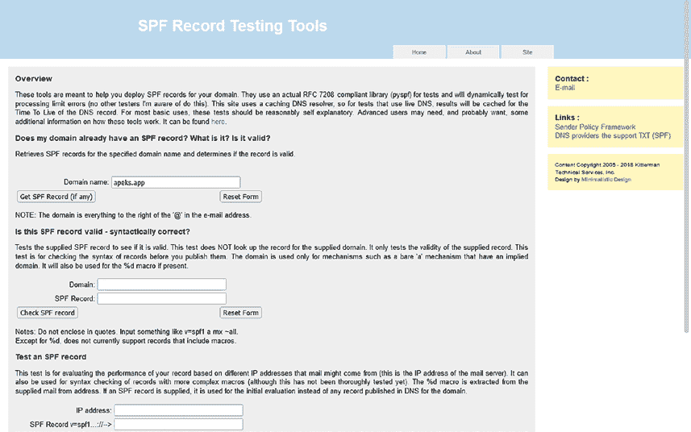

DNS 更改在全球范围内传播需要一些时间。您可以使用 Kitterman Technical Services, Inc. 提供的工具来验证 `SPF` 记录是否存在（图 11-17）。可以通过链接访问该网站：[www.kitterman.com/spf/validate.html](http://www.kitterman.com/spf/validate.html)。

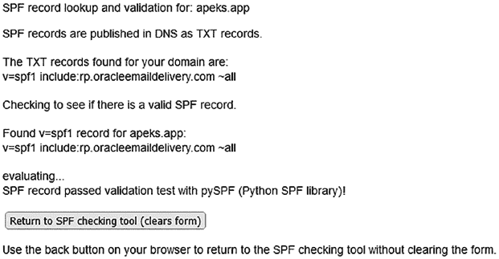

在第一个表单中输入您的域，然后点击 *获取 SPF 记录（如果有）*。如果找到该记录，您将看到如图 11-18 所示的结果。

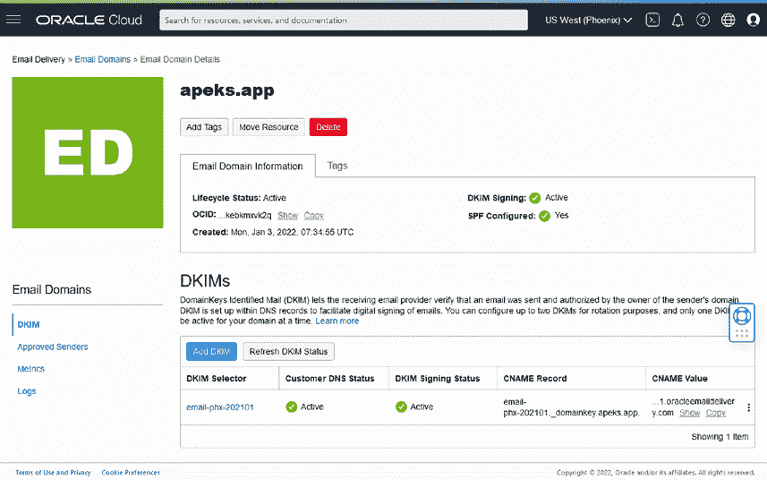

返回“电子邮件域详细信息”页面，`SPF 已配置` 状态应变为绿色并显示值 `是`。如果没有，请等待几分钟后尝试刷新页面。


**提示** 一旦您添加了 DKIM 和 SPF 记录，还建议添加一条 `DMARC` 记录。此记录帮助电子邮件接收者决定如何处理不合规的电子邮件。

## 已批准的发送者

OCI 电子邮件投递服务器仅接受并发送“发件人”字段地址已被添加为已批准的发送者。这些地址无需先创建电子邮件域即可添加。所有在“发件人”标头中的电子邮件地址都必须是已批准的发送者。

已批准的发送者与 OCI `compartment` 关联，并且必须添加到目标 `SMTP` 端点所在的每个区域。例如，如果端点是 `smtp.email.ca-toronto-1.oci.oraclecloud.com`，则在多伦多数据区域创建已批准的发送者。将其添加到任何其他区域（例如蒙特利尔）将导致电子邮件被拒绝。此外，只添加您拥有和/或管理的电子邮件地址，因为您至少需要添加一条 `SPF` 记录，以避免电子邮件被归类为垃圾邮件。请勿添加或使用公共邮箱服务提供商（例如 Gmail、Hotmail 或 Yahoo）提供的电子邮件地址发送邮件。这些服务具有严格的 DNS 规则，禁止任何非其管理的服务器代其发送电子邮件。

可以通过 OCI 控制台和 `REST API` 添加已批准的发送者。管理已批准的发送者的用户必须拥有执行这些任务所需的权限。如果该用户不在 OCI 管理员组中，请确保该用户所属的组（例如 `EmailManagers`）已应用以下策略：

```sql
允许组 EmailManagers 管理租户中的 email-family
```

或

```sql
允许组 EmailManagers 管理 compartment adrian 中的 approved-senders
允许组 EmailManagers 检查 compartment adrian 中的 compartments
```

要创建已批准的发送者，请执行以下步骤：

1. 打开 OCI 控制台左上角的导航菜单，然后单击 `开发者服务`。
2. 在 `应用程序集成` 下，单击 `电子邮件投递` 进入概览/配置页面。
3. 在页面左侧的 `电子邮件投递` 下，单击 `已批准的发送者`。
4. 确保为新的已批准的发送者选择所需的区域和 `compartment`。
5. 单击 `创建已批准的发送者`。
6. 输入要批准的电子邮件地址（图 11-20），然后单击 `创建已批准的发送者`。

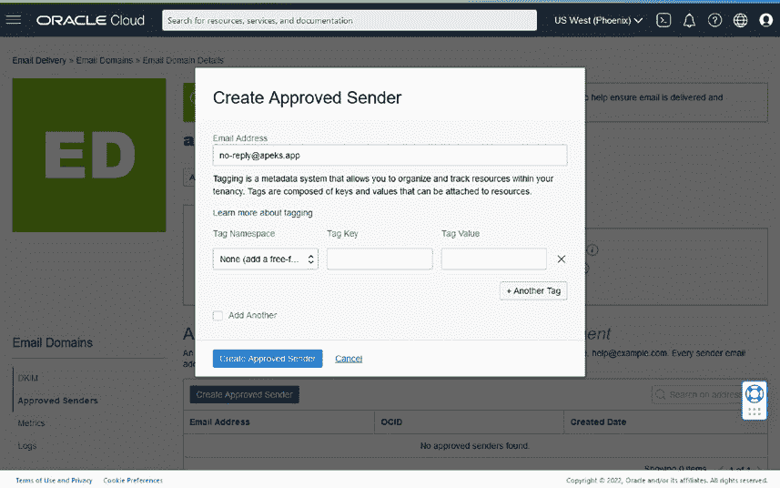

## 抑制列表

*抑制列表* 的作用与已批准的发送者有些相反。电子邮件投递服务不会向添加到该列表中的任何地址投递电子邮件。这些电子邮件地址在租户级别分配，而不是像已批准的发送者那样在 `compartment` 内分配。当服务收到表示电子邮件投递永久失败或存在投诉的退信代码时，服务会自动添加这些地址。拒绝电子邮件的示例原因包括硬退信、过多软退信或收到取消订阅请求。

要手动管理抑制列表，首先确保用户拥有管理相关 OCI 资源的适当权限。例如：

```sql
允许组 EmailManagers 管理租户中的 suppressions
```

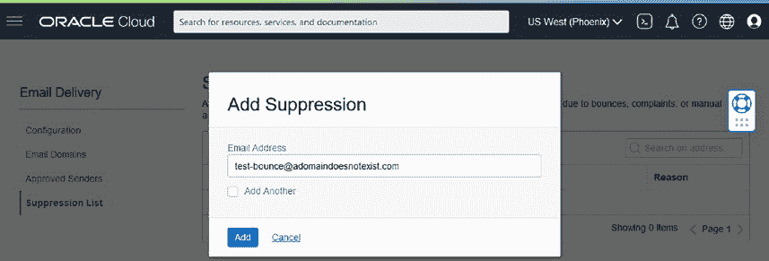

与已批准的发送者类似，可以使用 OCI 控制台或 `REST API` 管理条目。要使用 OCI 控制台进行管理，请执行以下步骤：

1. 打开 OCI 控制台左上角的导航菜单，然后单击 `开发者服务`。
2. 在 `应用程序集成` 下，单击 `电子邮件投递` 进入概览/配置页面。
3. 在页面左侧的 `电子邮件投递` 下，单击 `抑制列表`。
4. 确保选择根 `compartment`（租户）。
5. 单击 `添加抑制`。
6. 输入要添加到列表的电子邮件地址（图 11-21），然后单击 `添加`。


## 为 OCI 电子邮件投递服务配置 APEX 实例

`APEX` 是一个*快速应用开发*（`RAD`）平台，它使开发者无需实现诸如发送电子邮件之类的“基础设施型”功能。一旦实例配置完成，开发者只需使用 `APEX_MAIL` `PL/SQL` `API` 即可发送电子邮件。

通常，数据库和/或实例管理员将执行以下任务：

• 添加适当的网络*访问控制列表*（`ACL`），使数据库能够成功与远程网络资源通信。以下是一个示例，允许连接到美国凤凰城区域的 OCI 电子邮件投递 `SMTP` 端点。

```sql
declare
  c_smtp_host_address constant varchar2(4000) :=
```

# 第 11 章 电子邮件投递服务

以下是用于配置网络访问控制列表（ACL）的 PL/SQL 代码示例：

```sql
'smtp.email.us-phoenix-1.oci.oraclecloud.com';

c_smtp_host_port constant number := 587;

begin

for s in (

select schema from sys.dba_registry where comp_id = 'APEX'

) loop

sys.dbms_network_acl_admin.append_host_ace(

host => c_smtp_host_address

, lower_port => c_smtp_host_port

, upper_port => c_smtp_host_port

, ace => xs$ace_type(

privilege_list => xs$name_list('connect')

, principal_name => s.schema

, principal_type => xs_acl.ptype_db)

);

commit;

end loop;

end;

/
```

- 创建或添加到现有的 Oracle 钱包中，将端点的根`证书颁发机构`（CA）证书作为受信任的证书。

或者，如果您有权使用 `orapki`（Oracle 用于管理钱包的命令行工具），您可以使用一个脚本（[`gist.`](https://gist.github.com/fuzziebrain/202f902d8fc6d8de586da5097a501047) [github.com/fuzziebrain/202f902d8fc6d8de586da5097a501047)](https://gist.github.com/fuzziebrain/202f902d8fc6d8de586da5097a501047)）来生成一个包含所有当前有效根 CA 证书的 Oracle 钱包。有关此操作与 APEX 和 Oracle 钱包配合使用的更多详细信息，请参考以下博客文章：
    - [`fuzziebrain.com/content/id/1720/`](https://fuzziebrain.com/content/id/1720/)
    - [`fuzziebrain.com/content/id/1725/`](https://fuzziebrain.com/content/id/1725/)

**重要提示**：无论使用的端口是 `25` 还是 `587`，OCI 电子邮件投递服务仅允许通过`传输层安全性`（TLS）进行连接和通信。因此，**必须**设置 Oracle 钱包！

- 配置实例的 Oracle 钱包配置。需要设置的参数包括：
    - 钱包路径
    - 钱包密码

**注意**：如果 APEX 实例托管在`Oracle 自治数据库`（ADB）上，则在数据库配置时，网络 ACL 和 Oracle 钱包已添加并配置完成。

- 配置实例的 SMTP 设置。需要设置的参数包括：
    - 主机地址
    - 主机端口
    - TLS 模式（可选）
    - 用户名（可选）
    - 密码（可选）

APEX 的 SMTP 设置可以使用实例管理应用程序（图 11-22）或使用 `APEX_INSTANCE_ADMIN` API 进行配置。

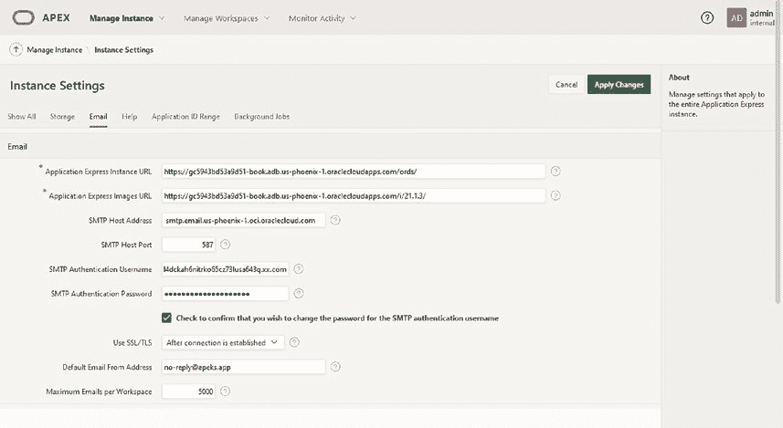

*图 11-22. 使用实例管理应用程序在 Oracle 自治数据库上配置 SMTP 设置*

以下是一个如何使用 PL/SQL API 配置 APEX 实例的示例：

```sql
declare

c_smtp_host_address constant varchar2(4000) :=

'smtp.email.us-phoenix-1.oci.oraclecloud.com';

c_smtp_host_port constant number := 587;

c_oci_smtp_credentials_username constant varchar2(4000) :=

'ocid1.user.oc1..aaaaaaaab...truncated...43q.xx.com';

c_oci_smtp_credentials_password constant varcahr2(4000) :=

'somerandomalphanumericcharacters';

begin

apex_instance_admin.set_parameter(

p_parameter => 'SMTP_HOST_ADDRESS'

, p_value => c_smtp_host_address);

apex_instance_admin.set_parameter(

'SMTP_HOST_PORT', c_smtp_host_port);

apex_instance_admin.set_parameter('SMTP_TLS_MODE', 'STARTTLS');

apex_instance_admin.set_parameter(

'SMTP_USERNAME', c_oci_smtp_credentials_username);

apex_instance_admin.set_parameter(

'SMTP_PASSWORD', c_oci_smtp_credentials_password);

commit;

end;

/
```

要验证值是否已正确设置，请使用以下查询来查询实例参数：

```sql
select name, value
from apex_instance_parameters
where name like 'SMTP_%'
order by name;
```

## 电子邮件送达能力

搭建基础设施并创建应用程序来发送电子邮件并不困难。同时，发现一个可通过互联网访问的不安全 SMTP 服务器也并不罕见。因此，接收垃圾邮件即便不是每分钟都在发生，也至少是每天都会遇到的事情。为了打击未经请求的电子邮件，组织通常会结合使用多种工具来降低这些垃圾邮件进入用户收件箱的可能性。这些工具可能包括：

- 基于服务器的软件，用于在邮件到达邮件服务器之前筛选并标记所有传入邮件，例如 Zerospam 和 Apache SpamAssassin
- 常见网页或桌面电子邮件应用程序的客户端插件或内置功能

如果您的出站电子邮件发送环境配置不正确，那么合法电子邮件被标记为垃圾邮件的可能性会很高。更严重的后果是，您的发送域名可能会被添加到垃圾邮件过滤器常用的公共垃圾邮件数据库中。将您的域名从该数据库中移除通常是一个颇具挑战性的过程。

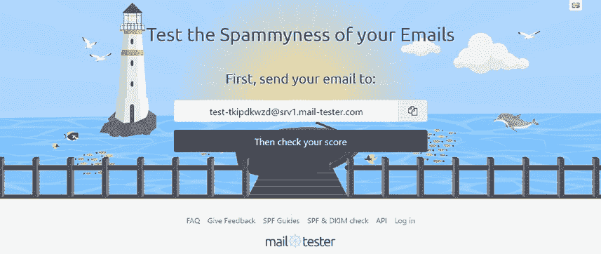

## 测试送达能力

在开始广泛使用 OCI 电子邮件发送服务之前，我建议先使用已批准的发送者地址测试电子邮件的送达能力。有几个基于网页的工具可以执行此分析。其中一个网站是 `mail-tester` ([https://mail-tester.com](https://mail-tester.com))。它易于使用且信息量丰富。

每当加载该网站时，都会生成一个唯一的电子邮件地址（图 11-23）。向提供的地址发送一封电子邮件，然后点击 `Then check your score`。

*图 11-23. `mail-tester` 会生成一个唯一的电子邮件地址，用于发送测试邮件以供评估*

接下来，编写一个简单的 PL/SQL 匿名过程，使用 `APEX_MAIL` API 发送电子邮件。在 `p_from` 参数中指定已批准的发送者电子邮件地址，在 `p_to` 中指定 `mail-tester` 生成的地址。示例如下：

```sql
declare

c_from varchar2(200) := 'no-reply@apeks.app';

c_to varchar2(200) := 'test-tkipdkwzd@srv1.mail-tester.com';

begin

apex_mail.send(

p_to => c_to

, p_from => c_from

, p_body => 'Hello! Message delivered by OCI Email Delivery services.'

);

apex_mail.push_queue;

end;

/
```

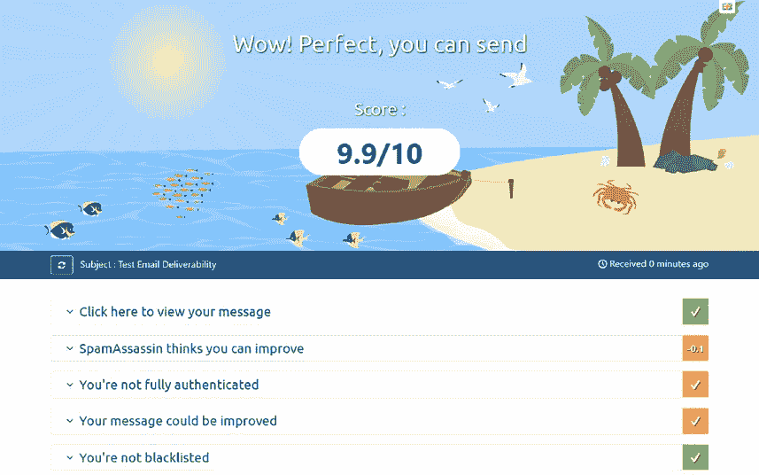

等待几分钟，然后使用提供的 URL 在 `mail-tester` 上检查结果。将显示评分以及影响评分的详细信息（图 11-24）。

*图 11-24. `mail-tester` 对发送的测试邮件进行分析的结果*

如果 DNS 记录添加正确，那么获得的评分应接近满分 10 分。`Mail-tester` 还会提供扣分项的详细信息，以帮助用户解决问题并提高电子邮件的送达能力。

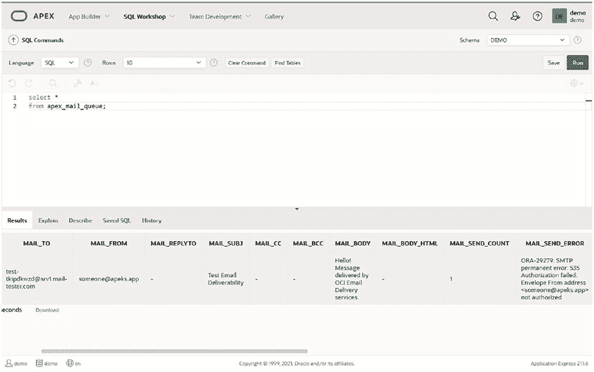

## 送达能力故障排除

# 配置良好的电子邮件发送基础设施并不能保证电子邮件一定能成功发送或接收。当电子邮件未能如期送达时，开发人员通常想知道原因。除了送达能力之外，APEX 和 OCI 还提供了可观测性工具。这些工具包括 APEX 中的 `APEX_MAIL_QUEUE` 和 `APEX_MAIL_LOG` 视图，以及用于电子邮件发送服务的 OCI `日志记录`。

大多数 APEX 开发人员应该都熟悉与 `APEX_MAIL` 相关的这两个视图。可以通过 APEX 实例管理应用程序访问它们，或者使用 SQL 作为与工作区关联的模式来查询这些视图。这通常能提供关于电子邮件为何未被接收的第一条线索。常见问题包括 APEX 实例中 SMTP 设置配置错误、电子邮件不在已批准发件人列表中的地址（图 11-25）、位于抑制列表中的“收件人”电子邮件地址，或超出服务限制的电子邮件负载。

***图 11-25.** 使用 `APEX_MAIL_QUEUE` 识别出站电子邮件的问题*

## 有时，APEX 成功发送了电子邮件，并可通过 `APEX_MAIL_LOG` 进行验证。要调查实例外部是否存在问题，最佳方法是为某个电子邮件域启用日志记录。

要为电子邮件域启用日志，请执行以下步骤：

1.  打开 OCI 控制台左上角的导航菜单，然后点击*开发者服务*。
2.  在*应用程序集成*下，点击*电子邮件投递*进入概览/配置页面。
3.  在页面左侧的*电子邮件投递*下，点击*电子邮件域*。
4.  确保选中电子邮件域所在的区间。
5.  点击要配置的电子邮件域。
6.  在电子邮件域的详细信息页面上，在*电子邮件域*下，点击*日志*。
7.  在日志表中，点击切换开关以启用所需的事件日志。将打开一个模态框，提供完成该过程的更多详细信息（图 11-26）。
8.  点击*启用日志*以完成该过程。

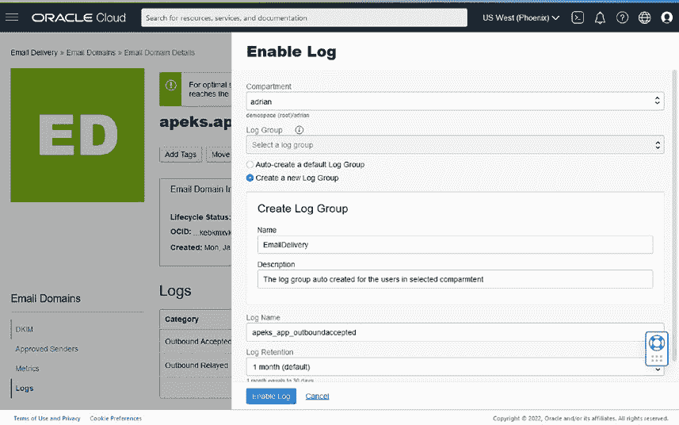

***图 11-26.** 为电子邮件域启用 OCI `日志记录`所需的详细信息*

每个电子邮件域可以启用两个事件：`出站已接受`和`出站已中继`。对于故障排除，我建议同时启用两者。前者记录入站请求，用于验证请求是否成功。后者在服务中继电子邮件时记录成功和失败。

## 可以通过 OCI 控制台查看日志，也可以通过不同的路径和用户界面访问。OCI `日志记录`位于控制台的*可观测性与管理*子菜单下。可以查看单个日志，或利用*搜索*功能同时查看多个日志。后者对于故障排除非常有用，因为可以按时间顺序集中查看事件。

1.  打开 OCI 控制台左上角的导航菜单，然后点击*可观测性与管理*。
2.  在*日志记录*下，点击*搜索*。
3.  在搜索页面上，点击*选择要搜索的日志*字段。这将打开一个模态框。

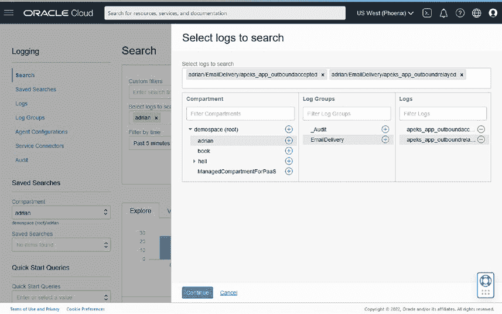

4.  进行操作以选择所有要搜索的日志（图 11-27）。

***图 11-27.** 选择要搜索的日志*

5.  点击*继续*。
6.  根据需要更改时间筛选条件。日志条目表（图 11-28）应自动刷新；如果没有，请点击*搜索*。

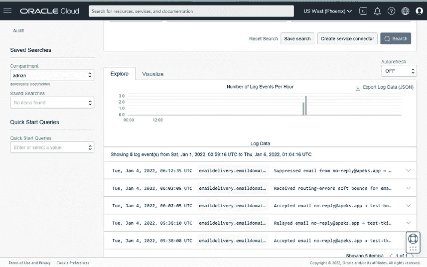

***图 11-28.** 显示电子邮件被接受、中继或抑制的事件和详细信息的日志*

**注意** 与所有 OCI 资源一样，用户需要通过 IAM 策略获得适当的权限。如果您没有所需的访问权限，请联系您的 OCI 管理员。

## 其他要点

到目前为止，我们已经深入了解了使用 APEX 设置和使用 OCI 电子邮件投递服务发送电子邮件所需的条件。接下来我们可能需要考虑的重要问题是成本和是否存在任何限制。

目前，电子邮件投递服务的定价为每个日历月每发送 1,000 封电子邮件 0.085 美元。正如本章前面所述，此服务不包含在 Oracle 云免费套餐中，因此必须将租户升级为付费账户后才能使用。另外，请注意，如果“收件人”地址包含多个电子邮件地址，则每个地址都会发送一封电子邮件，并计入使用量和成本。

对于大多数租户，关键服务限制的默认值为：
- 每天最多 200 封电子邮件或 2 MB 数据块。
- 最大发送速率为每分钟十封电子邮件。
- 最大消息大小为 2 MB。这包括电子邮件负载中包含的任何必需标头。
- 最多 2,000 个已批准的发送者。

OCI 客户可以提交请求以增加其中一些服务限制，例如，允许电子邮件负载大于 2 MB 但不超过 60 MB。但是，Oracle 支持通常要求客户提供有关组织如何使用该服务以及发送实践以符合反垃圾邮件法律的详细信息。您可能还需要设置电子邮件身份验证方法，例如发布 SPF 记录和 DKIM 签名。

## 总结

OCI 提供了一项托管服务，APEX 应用程序可以使用该服务发送电子邮件。它是一个安全的平台，实施了最佳实践，并提供了确保电子邮件可送达性的功能。在本章中，我们学习了执行以下操作所需的任务：

1.  为电子邮件投递服务准备租户。
2.  访问 SMTP 端点。
3.  配置域的 DNS 以实现最大可送达性。
4.  配置 APEX 实例以使用该服务。
5.  测试电子邮件可送达性。
6.  配置 OCI 以排查电子邮件可送达性问题。

最后，我们检查了使用该服务时的成本和服务限制。
