# 第 11 章 电子邮件投递服务

***图 11-13.** 为 DKIM DNS 记录生成所需的值*

要激活 DKIM 签名，您必须使用提供的值创建相应的 DNS 记录。这通过您组织域名的 DNS 服务完成。DNS 服务提供商可能有不同的用户界面和添加方法。

DNS 记录。以下步骤基于 *Cloudflare*（[www.cloudflare.com/](http://www.cloudflare.com/)）提供的服务（图 11-14, b），但通常流程包括：

1. 添加一条类型为 *CNAME* 的新 DNS 记录。
2. 输入 OCI 控制台提供的 *名称* 和 *目标* 值。
3. 设置合适的生存时间（TTL）值。

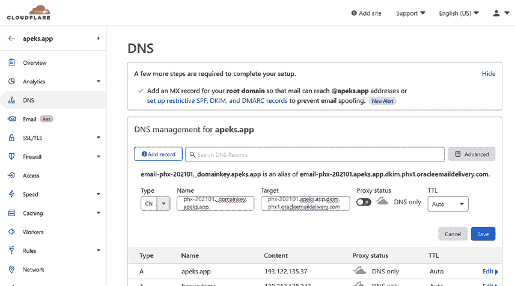

第 11 章 电子邮件投递服务

***图 11-14.** 在 Cloudflare 中添加 DKIM 所需的 DNS 记录*

等待几分钟，然后返回 OCI 控制台，点击 *刷新* *DKIM 状态*，直到 *DKIM 签名* 状态显示为 *活动*（图 11-15）。

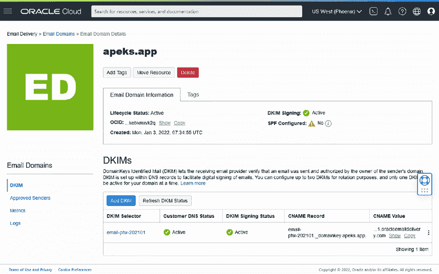

第 11 章 电子邮件投递服务

***图 11-15.** 添加所需的 DNS 记录后，DKIM 签名状态将指示其为活动状态*

电子邮件身份验证中涉及的另一个（或许更为人熟知的）DNS 记录是 *发件人策略框架*（SPF），定义于 RFC 7208（参见 [`tools.ietf.org/html/rfc7208）。I`](https://tools.ietf.org/html/rfc7208)t 涉及一条单一的 DNS *TXT* 记录，该记录列出了允许代表某个域发送电子邮件的邮件服务器。它与域名相关联，并且是一个始终以 v=spf1 开头、以“all”机制及其修饰符结尾的文本字符串。中间是一系列列出授权服务器的机制。这些机制可以是以下任意组合：

• **include**：搜索指定域的 SPF 记录以寻找匹配项。通常由电子邮件服务提供商（如 OCI 电子邮件投递服务）使用。
• **a**：一条 DNS *A* 记录
• **mx**：域 *MX* 记录的所有 A 记录。
• **ptr**：使用 PTR 查询查找客户端的 IP。
• **ip4**：单个 IPv4 地址或一个 IPv4 网络范围。
• **ip6**：单个 IPv6 地址或一个 IPv6 网络范围。
• **exists**：使用提供的域执行 A 记录查找。如果查找产生结果，则视为匹配。

**注意** 每个域只允许一条 SPF TXT 记录，且内容的最大长度为 255 个字符。

Oracle 提供了您需要包含在文档中的 SPF 机制，文档地址在[此：https://bit.ly/oci- email- spf- config](https://bit.ly/oci-email-spf-config)。根据发送电子邮件的区域包含相应的机制。图 11-16 显示了如何将条目添加到由 Cloudflare 管理的 DNS 中。

***图 11-16.** 使用 Cloudflare 的 DNS 管理网站添加 SPF TXT 记录*

DNS 更改在全球范围内传播需要一些时间。您可以使用 Kitterman Technical Services, Inc. 提供的工具来验证 SPF 记录是否存在（图 11-17）。You 可以通过链接访问该网站[: www.kitterman.com/spf/](http://www.kitterman.com/spf/validate.html) [validate.html](http://www.kitterman.com/spf/validate.html)。

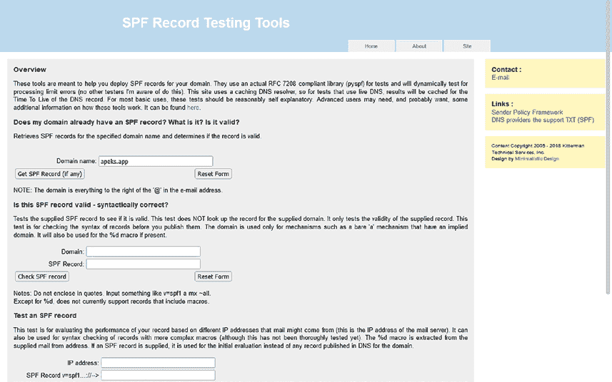

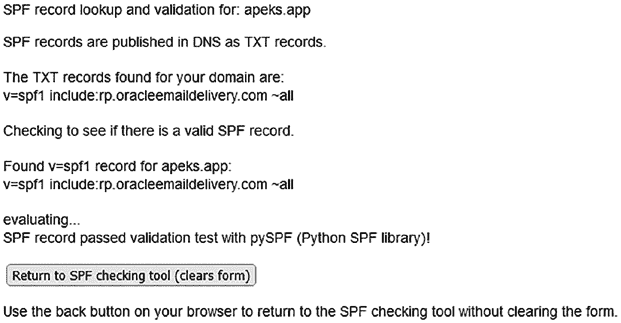

第 11 章 电子邮件投递服务

***图 11-17.** SPF 记录测试工具*

在第一个表单中输入您的域，然后点击 *获取 SPF 记录（如果有）*。如果找到该记录，您将看到如图 11-18 所示的结果。

***图 11-18.** SPF 记录查找结果*

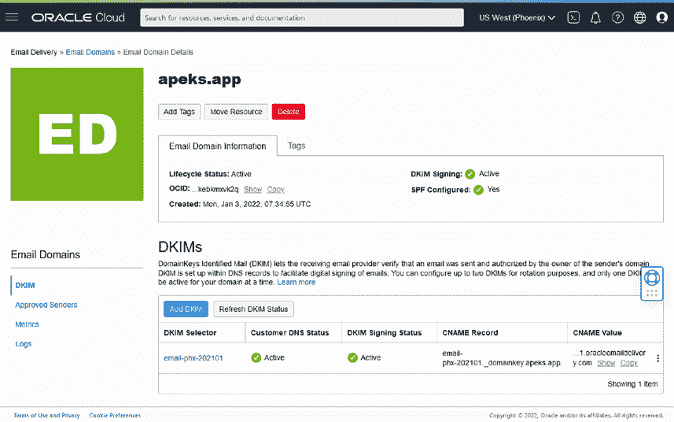

第 11 章 电子邮件投递服务

返回“电子邮件域详细信息”页面，*SPF 已配置* 状态应变为绿色并显示值 *是*（图 11-19）。如果没有，请等待几分钟后尝试刷新页面。

***图 11-19.** 一个完全配置的电子邮件域*

**提示** 一旦您添加了 DKIM 和 SPF 记录，还建议添加一条 *DMARC* 记录。此记录帮助电子邮件接收者决定如何处理不合规的电子邮件。

**已批准的发送者**

OCI 电子邮件投递服务器仅接受并发送“发件人”字段

地址已被添加为已批准的发送者。这些地址无需先创建电子邮件域即可添加。所有在“发件人”标头中的电子邮件地址都必须是已批准的发送者。

第 11 章 电子邮件投递服务

已批准的发送者与 OCI compartment 关联，并且必须添加到目标 SMTP 端点所在的每个区域。例如，如果端点是 *smtp.email.ca-toronto-1.oci.oraclecloud.com*，则在多伦多数据区域创建已批准的发送者。将其添加到任何其他区域（例如蒙特利尔）将导致电子邮件被拒绝。此外，只添加您拥有和/或管理的电子邮件地址，因为您至少需要添加一条 SPF 记录，以避免电子邮件被归类为垃圾邮件。请勿添加或使用公共邮箱服务提供商（例如 Gmail、Hotmail 或 Yahoo）提供的电子邮件地址发送邮件。这些服务具有严格的 DNS 规则，禁止任何非其管理的服务器代其发送电子邮件。

可以通过 OCI 控制台和 REST API 添加已批准的发送者。管理已批准的发送者的用户必须拥有执行这些任务所需的权限。如果该用户不在 OCI 管理员组中，请确保该用户所属的组（例如 *EmailManagers*）已应用以下策略：

允许组 EmailManagers 管理租户中的 email-family

或

允许组 EmailManagers 管理 compartment adrian 中的 approved-senders

允许组 EmailManagers 检查 compartment adrian 中的 compartments

要创建已批准的发送者，请执行以下步骤：

1. 打开 OCI 控制台左上角的导航菜单，然后单击 *开发者服务*。
2. 在 *应用程序集成* 下，单击 *电子邮件投递* 进入概览/配置页面。
3. 在页面左侧的 *电子邮件投递* 下，单击 *已批准的发送者*。
4. 确保为新的已批准的发送者选择所需的区域和 compartment。
5. 单击 *创建已批准的发送者*。
6. 输入要批准的电子邮件地址（图 11-20），然后单击 *创建已批准的发送者*。

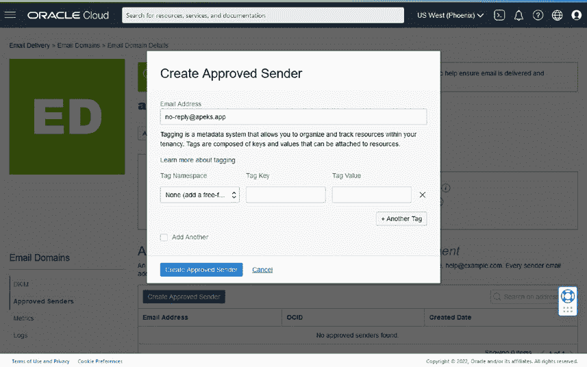

第 11 章 电子邮件投递服务

***图 11-20.** 创建已批准的发送者*

**抑制列表**

*抑制列表* 的作用与已批准的发送者有些相反。电子邮件投递服务不会向添加到该列表中的任何地址投递电子邮件。这些电子邮件地址在租户级别分配，而不是像已批准的发送者那样在 compartment 内分配。当服务收到表示电子邮件投递永久失败或存在投诉的退信代码时，服务会自动添加这些地址。拒绝电子邮件的示例原因包括硬退信、过多软退信或收到取消订阅请求。

要手动管理抑制列表，首先确保用户拥有管理相关 OCI 资源的适当权限。例如：

允许组 EmailManagers 管理租户中的 suppressions

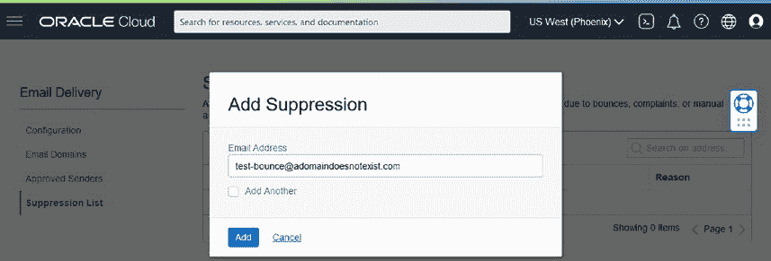

第 11 章 电子邮件投递服务

与已批准的发送者类似，可以使用 OCI 控制台或 REST API 管理条目。要使用 OCI 控制台进行管理，请执行以下步骤：

1. 打开 OCI 控制台左上角的导航菜单，然后单击 *开发者服务*。
2. 在 *应用程序集成* 下，单击 *电子邮件投递* 进入概览/配置页面。
3. 在页面左侧的 *电子邮件投递* 下，单击 *抑制列表*。
4. 确保选择根 compartment（租户）。
5. 单击 *添加抑制*。
6. 输入要添加到列表的电子邮件地址（图 11-21），然后单击 *添加*。

***图 11-21.** 手动向抑制列表添加电子邮件地址*

**为 OCI 电子邮件投递服务配置 APEX 实例**

APEX 是一个*快速应用开发*（RAD）平台，它使开发者无需实现诸如发送电子邮件之类的“基础设施型”功能。一旦

实例配置完成，开发者只需使用 APEX_MAIL PL/SQL API 即可发送电子邮件。

第 11 章 电子邮件投递服务

通常，数据库和/或实例管理员将执行

以下任务：

• 添加适当的网络*访问控制列表*（ACL），使

数据库能够成功与远程网络资源

通信。以下是一个示例，允许连接到

美国凤凰城区域的 OCI 电子邮件投递 SMTP 端点。

declare

c_smtp_host_address constant varchar2(4000) :=

'smtp.email.us-phoenix-1.oci.oraclecloud.com';

c_smtp_host_port constant number := 587;

begin

for s in (

select schema from sys.dba_registry where comp_id = 'APEX'

) loop

sys.dbms_network_acl_admin.append_host_ace(

host => c_smtp_host_address

, lower_port => c_smtp_host_port

, upper_port => c_smtp_host_port

, ace => xs$ace_type(

privilege_list => xs$name_list('connect')

, principal_name => s.schema

, principal_type => xs_acl.ptype_db)

);

commit;

end loop;

end;

/

• 创建或添加到现有的 Oracle 钱包中，将端点的根

*证书颁发机构*（CA）证书作为受信任的证书。

或者，如果您有权使用 *orapki*（Oracle 用于管理钱包的命令行

工具），您可以使用一个脚本（[`gist.`](https://gist.github.com/fuzziebrain/202f902d8fc6d8de586da5097a501047)

[github.com/fuzziebrain/202f902d8fc6d8de586da5097a501047)](https://gist.github.com/fuzziebrain/202f902d8fc6d8de586da5097a501047)

第 11 章 电子邮件投递服务

来生成一个包含所有当前有效根 CA

证书的 Oracle 钱包。有关此操作与 APEX 和

Oracle 钱包配合使用的更多详细信息，请参考以下博客文章：

• [`fuzziebrain.com/content/id/1720/`](https://fuzziebrain.com/content/id/1720/)

• [`fuzziebrain.com/content/id/1725/`](https://fuzziebrain.com/content/id/1725/)

**重要提示**：无论使用的端口是 25 还是 587，OCI 电子邮件投递服务仅允许通过*传输层安全性*（TLS）进行连接和

通信。因此，**必须**设置 Oracle 钱包！

• 配置实例的 Oracle 钱包配置。需要设置的参数

包括：

  • 钱包路径

  • 钱包密码

**注意**：如果 APEX 实例托管在*Oracle 自治数据库*（ADB）上，则在

数据库配置时，网络 ACL 和 Oracle 钱包已添加并配置完成。

• 配置实例的 SMTP 设置。需要设置的参数

包括：

  • 主机地址

  • 主机端口

  • TLS 模式（可选）

  • 用户名（可选）

  • 密码（可选）

APEX 的 SMTP 设置可以使用实例管理

应用程序（图 11-22）或使用 APEX_INSTANCE_ADMIN API 进行配置。

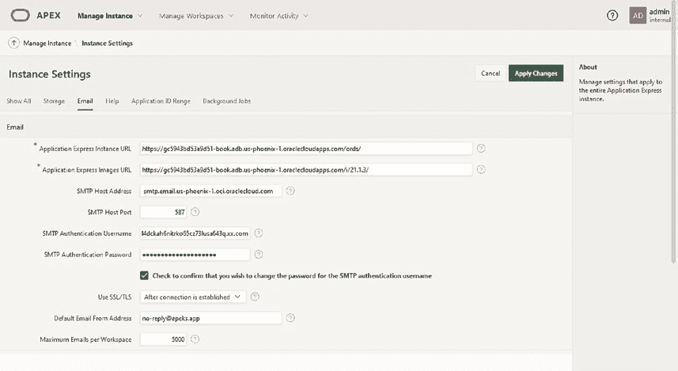

第 11 章 电子邮件投递服务

***图 11-22.** 使用实例管理应用程序在 Oracle 自治数据库上配置 SMTP 设置*

以下是一个如何使用 PL/SQL API 配置 APEX 实例的示例：

declare

c_smtp_host_address constant varchar2(4000) :=

'smtp.email.us-phoenix-1.oci.oraclecloud.com';

c_smtp_host_port constant number := 587;

c_oci_smtp_credentials_username constant varchar2(4000) :=

'ocid1.user.oc1..aaaaaaaab...truncated...43q.xx.com';

c_oci_smtp_credentials_password constant varcahr2(4000) :=

'somerandomalphanumericcharacters';

begin

apex_instance_admin.set_parameter(

p_parameter => 'SMTP_HOST_ADDRESS'

, p_value => c_smtp_host_address);

apex_instance_admin.set_parameter(

'SMTP_HOST_PORT', c_smtp_host_port);

第 11 章 电子邮件投递服务

apex_instance_admin.set_parameter('SMTP_TLS_MODE', 'STARTTLS');

apex_instance_admin.set_parameter(

'SMTP_USERNAME', c_oci_smtp_credentials_username);

apex_instance_admin.set_parameter(

'SMTP_PASSWORD', c_oci_smtp_credentials_password);

commit;

end;

/

要验证值是否已正确设置，请使用以下查询来查询实例参数：

select name, value

from apex_instance_parameters

where name like 'SMTP_%'

order by name;

**电子邮件送达能力**

搭建基础设施并创建应用程序来发送电子邮件并不困难。同时，发现一个可通过互联网访问的不安全 SMTP 服务器也并不罕见。因此，接收垃圾邮件即便不是每分钟都在发生，也至少是每天都会遇到的事情。为了打击未经请求的电子邮件，组织通常会结合使用多种工具来降低这些垃圾邮件进入用户收件箱的可能性。这些工具可能包括：

• 基于服务器的软件，用于在邮件到达邮件服务器之前筛选并标记所有传入邮件，例如 Zerospam 和 Apache SpamAssassin

• 常见网页或桌面电子邮件应用程序的客户端插件或内置功能

如果您的出站电子邮件发送环境配置不正确，那么合法电子邮件被标记为垃圾邮件的可能性会很高。更严重的后果是，您的发送域名可能会被添加到垃圾邮件过滤器常用的公共垃圾邮件数据库中。将您的域名从该数据库中移除通常是一个颇具挑战性的过程。

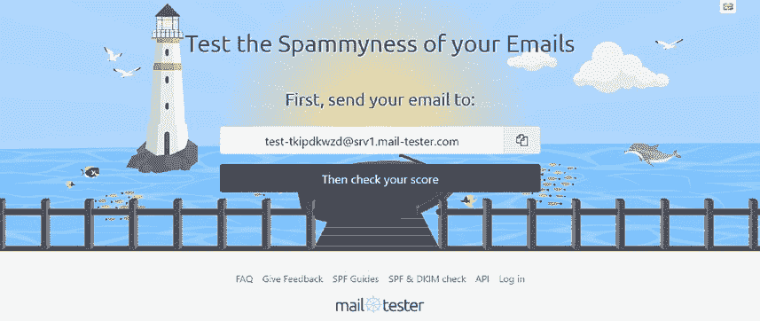

第 11 章 电子邮件发送服务

**测试送达能力**

在开始广泛使用 OCI 电子邮件发送服务之前，我建议先使用已批准的发送者地址测试电子邮件的送达能力。有几个基于网页的工具可以执行此分析。其中一个网站是 *mail-tester* ([https://](https://mail-tester.com)[mail-tester.com](https://mail-tester.com))。它易于使用且信息量丰富。

每当加载该网站时，都会生成一个唯一的电子邮件地址（图 11-23）。向提供的地址发送一封电子邮件，然后点击 *Then check your score*。

***图 11-23.** mail-tester 会生成一个唯一的电子邮件地址，用于发送测试邮件以供评估*

接下来，编写一个简单的 PL/SQL 匿名过程，使用 APEX_MAIL API 发送电子邮件。在 p_from 参数中指定已批准的发送者电子邮件地址，在 p_to 中指定 mail-tester 生成的地址。示例如下：

declare

c_from varchar2(200) := 'no-reply@apeks.app';

c_to varchar2(200) := 'test-tkipdkwzd@srv1.mail-tester.com';

begin

apex_mail.send(

p_to => c_to

, p_from => c_from

, p_body => 'Hello! Message delivered by OCI Email Delivery services.'

);

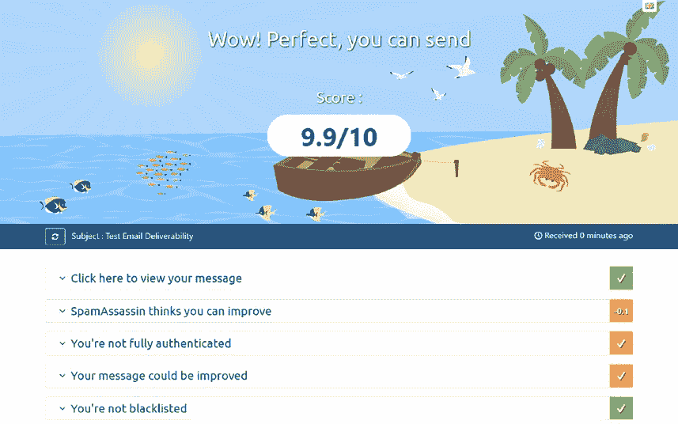

第 11 章 电子邮件发送服务

apex_mail.push_queue;

end;

/

等待几分钟，然后使用提供的 URL 在 mail-tester 上检查结果。将显示评分以及影响评分的详细信息（图 11-24）。

***图 11-24.** mail-tester 对发送的测试邮件进行分析的结果*

如果 DNS 记录添加正确，那么获得的评分应接近满分 10 分。Mail-tester 还会提供扣分项的详细信息，以帮助用户解决问题并提高电子邮件的送达能力。

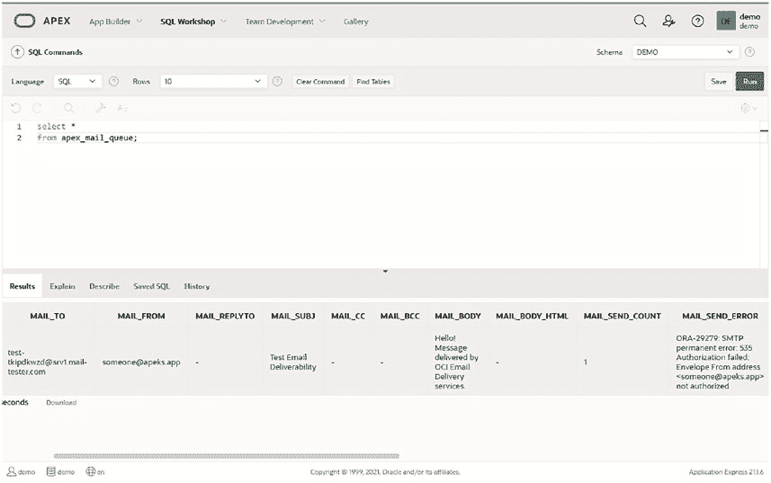

第 11 章 电子邮件发送服务

**送达能力故障排除**

配置良好的电子邮件发送基础设施并不能保证电子邮件一定能成功发送或接收。当电子邮件未能如期送达时，开发人员通常想知道原因。除了送达能力之外，APEX 和 OCI 还提供了可观测性工具。这些工具包括 APEX 中的 APEX_MAIL_QUEUE 和 APEX_MAIL_LOG 视图，以及用于电子邮件发送服务的 OCI *日志记录*。

大多数 APEX 开发人员应该都熟悉与 APEX_MAIL 相关的这两个视图。可以通过 APEX 实例管理应用程序访问它们，或者使用 SQL 作为与工作区关联的模式来查询这些视图。这通常能提供关于电子邮件为何未被接收的第一条线索。常见问题包括 APEX 实例中 SMTP 设置配置错误、电子邮件

不在已批准发件人列表中的地址（图 11-25）、位于抑制列表中的“收件人”电子邮件地址，或超出服务限制的电子邮件负载。

***图 11-25.** 使用 APEX_MAIL_QUEUE 识别出站电子邮件的问题*

*第 11 章 电子邮件投递服务*

有时，APEX 成功发送了电子邮件，并可通过 APEX_MAIL_LOG 进行验证。要调查实例外部是否存在问题，最佳方法是为某个电子邮件域启用日志记录。

要为电子邮件域启用日志，请执行以下步骤：

1. 打开 OCI 控制台左上角的导航菜单，然后点击*开发者服务*。

2. 在*应用程序集成*下，点击*电子邮件投递*进入概览/配置页面。

3. 在页面左侧的*电子邮件投递*下，点击*电子邮件域*。

4. 确保选中电子邮件域所在的区间。

5. 点击要配置的电子邮件域。

6. 在电子邮件域的详细信息页面上，在*电子邮件域*下，点击*日志*。

7. 在日志表中，点击切换开关以启用所需的事件日志。将打开一个模态框，提供完成该过程的更多详细信息（图 11-26）。

8. 点击*启用日志*以完成该过程。

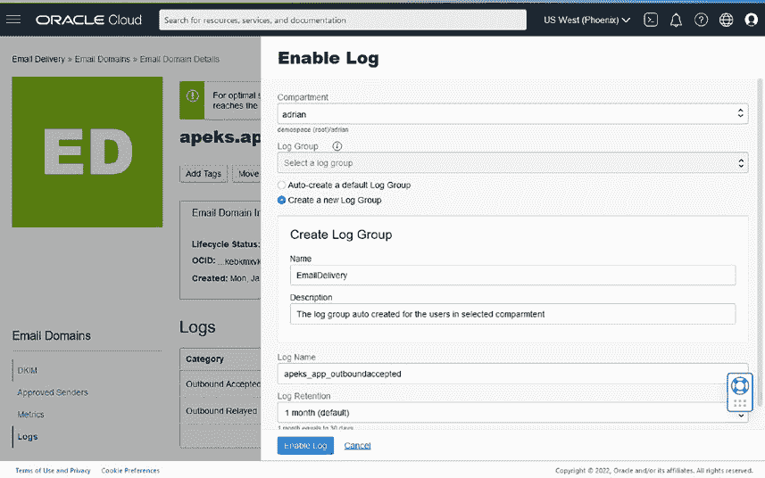

*第 11 章 电子邮件投递服务*

***图 11-26.** 为电子邮件域启用 OCI 日志记录所需的详细信息* 每个电子邮件域可以启用两个事件：*出站已接受*和*出站已中继*。对于故障排除，我建议同时启用两者。前者记录入站请求，用于验证请求是否成功。后者在服务中继电子邮件时记录成功和失败。

可以通过 OCI 控制台查看日志，也可以通过不同的路径和用户界面访问。OCI 日志记录位于控制台的*可观测性与管理*子菜单下。可以查看单个日志，或利用*搜索*功能同时查看多个日志。后者对于故障排除非常有用，因为可以按时间顺序集中查看事件。

1. 打开 OCI 控制台左上角的导航菜单，然后点击*可观测性与管理*。

2. 在*日志记录*下，点击*搜索*。

3. 在搜索页面上，点击*选择要搜索的日志*字段。这将打开一个模态框。

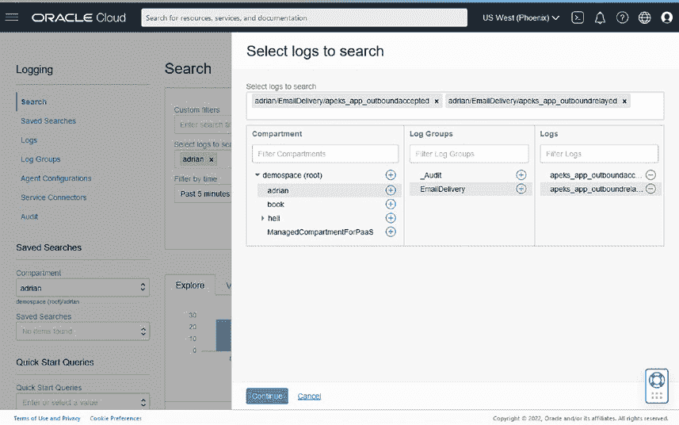

*第 11 章 电子邮件投递服务*

4. 进行操作以选择所有要搜索的日志（图 11-27）。

***图 11-27.** 选择要搜索的日志*

5. 点击*继续*。

6. 根据需要更改时间筛选条件。日志条目表（图 11-28）应自动刷新；如果没有，请点击*搜索*。

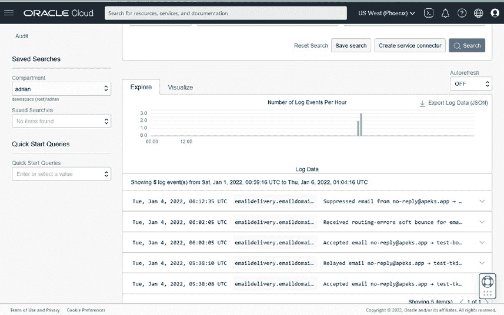

*第 11 章 电子邮件投递服务*

***图 11-28.** 显示电子邮件被接受、中继或抑制的事件和详细信息的日志*

**注意** 与所有 OCI 资源一样，用户需要通过 IAM 策略获得适当的权限。如果您没有所需的访问权限，请联系您的 OCI 管理员。

**其他要点**

到目前为止，我们已经深入了解了使用 APEX 设置和使用 OCI 电子邮件投递服务发送电子邮件所需的条件。接下来我们可能需要考虑的重要问题是成本和是否存在任何限制。

*第 11 章 电子邮件投递服务*

目前，电子邮件投递服务的定价为每个日历月每发送 1,000 封电子邮件 0.085 美元。正如本章前面所述，此服务不包含在 Oracle 云免费套餐中，因此必须将租户升级为付费账户后才能使用。另外，请注意，如果“收件人”地址包含多个电子邮件地址，则每个地址都会发送一封电子邮件，并计入使用量和成本。

对于大多数租户，关键服务限制的默认值为：

• 每天最多 200 封电子邮件或 2 MB 数据块。
• 最大发送速率为每分钟十封电子邮件。

• 最大消息大小为 2 MB。这包括电子邮件负载中包含的任何必需标头。

• 最多 2,000 个已批准的发送者。

OCI 客户可以提交请求以增加其中一些服务限制，例如，允许电子邮件负载大于 2 MB 但不超过 60 MB。但是，Oracle 支持通常要求客户提供有关组织如何使用该服务以及发送实践以符合反垃圾邮件法律的详细信息。您可能还需要设置电子邮件身份验证方法，例如发布 SPF 记录和 DKIM 签名。

**总结**

OCI 提供了一项托管服务，APEX 应用程序可以使用该服务发送电子邮件。它是一个安全的平台，实施了最佳实践，并提供了确保电子邮件可送达性的功能。在本章中，我们学习了执行以下操作所需的任务：

1.  为电子邮件投递服务准备租户。
2.  访问 SMTP 端点。
3.  配置域的 DNS 以实现最大可送达性。
4.  配置 APEX 实例以使用该服务。
5.  测试电子邮件可送达性。
6.  配置 OCI 以排查电子邮件可送达性问题。

最后，我们检查了使用该服务时的成本和服务限制。

**索引**

**A**

托管 AI 服务, 317

指标, 310–313

访问控制列表 (ACL), 390, 391

OCI, 270

高级研究计划局

策略创建, 275, 276

网络 (ARPANET), 367

用户组创建, 273, 274

聚合异常分数, 308

AnalyzeDocument, 350, 353, 358

保险库、密钥和密钥, 280–289

注释类, 245, 251

工作区, 289

异常检测

每个信号的异常分数, 308

仪器错误, 270

APEX 应用程序, 389

MSET, 269

BLOB 对象, 57

正常数据, 269

传统方法, 62

实时检测, 270

数字照片表, 48–51

SPRT, 269

外部存储系统, 62

训练数据, 269

函数, 54

意外事件识别, 269

对象存储, 57–59, 61, 62

异常检测 API

过程, 54

APEX 应用程序, 316

检索租户

数据源, 315, 316

命名空间, 52, 53

文档, 313

替换字符串, 54

REST 数据源, 316

任务, 48

设置 APEX, 313–315

OCI 的 Web 凭据, 51, 52

AnomalyDetectionGroup, 275

APEX_MAIL, 367

异常检测服务

*APEX 媒体扩展*, 68

告警创建, 313

API 网关

区间创建, 270–272

APEX, 132, 133, 135, 136

数据集要求, 289–293

部署, 112

联合用户, 279

日志记录, 136–138

IAM 用户创建, 277–279

OCI 事件, 111

登录选项, 273

OCI 对象存储, 111

机器学习模型, 293, 295

Oracle 函数, 112

( *另请参阅* 机器学习模型,

安全性, 136–138

异常检测)

用例定义

© Adrian Png 和 Heli Helskyaho 2022

A. Png 和 H. Helskyaho, *使用 Oracle 云功能扩展 Oracle Application Express*,

[`doi.org/10.1007/978-1-4842-8170-3`](https://doi.org/10.1007/978-1-4842-8170-3#DOI)

索引

API 网关 ( *续*.)

客户端凭证 OAuth 2.0, 214

APEX 应用程序, 112

云原生服务, 35

架构, 115

命令行界面 (CLI), 334, 346

语言翻译引擎, 115–122

区间 AnomalyDetection, 272

语言翻译服务, 114

计算机视觉 (CV), 345, 346

语言翻译系统, 123, 124

计算设备, 345

OCI 服务, 114

*配置文件预览*, 258, 259, 337

API 密钥, 45, 51, 76, 256, 258, 313–314, 335,

混淆矩阵, 172, 173

336, 347

卷积神经网络

API 管理, 35, 126

(CNN), 346

API 请求, 194, 261, 266, 268

跨源资源共享 (CORS),

应用程序性能监控

112, 130, 137

(APM), 80–82

CSV 格式数据, 291

应用程序编程接口 (API),

客户支持交互, 320

45, 68, 76, 182, 193, 255, 261, 313, 346

人工智能 (AI), 345, 366

人工神经网络 (ANN), 346

**D**

基于方面的情感分析

数据资产, 289, 295–301

(ABSA), 323

数据库服务级别, 169, 176, 199

自动化机器学习 (AutoML),

数据库系统

167–177, 188

负载均衡器, 21

自动数据准备 (ADP),

数据标注 API, 268

182, 188

注释, 255

自治数据库 (ADB), 1, 147, 282

与 APEX 一起使用

自治事务处理

API 请求，261

(ATP)，41

身份验证，263，264

可用性域 (AD)，21

数据集请求，263

参数，264，265

**B**

REST 数据源，266，267

Web 凭据，261

大数据，151，345

APEX 设置，257

API 密钥，256–258

**C**

配置文件预览，258，259

回车换行 (CRLF)，193

IAM 用户创建，255

互联网安全中心 (CIS)，

查看配置文件，260

28，29，31

*数据标签数据集*，240

证书颁发机构 (CA)，24，137，200，

数据标签管理 API，255，268

201，390

DataLabeling-非技术用户策略，243

索引

数据标签服务

电子邮件投递服务

添加新记录，252

OCI，367

管理员组，237

SMTP，367，368

API，255（*另请参阅* 数据标签 API）

电子邮件域，377–384，386，397，398

存储桶创建，236

嵌入式 Python 执行 (EPE)，

区间创建，234，235

188–190，196，198–200，213

数据标签错误，252–254

*乐鑫科技*，35

数据集和记录，243–249

事件服务，35

动态组创建，240，241

标记记录，249–252

**F**

新策略创建，242

OCI，233

误报概率 (FAP)，301–303

资源，233

联合用户，272，274，324

用户组创建，238–240

*文件栈*，68

用户，237

完全限定域名

数据处理错误，269

(FQDN)，24

数据集格式，244

函数开发工具包 (FDK)，86，103，

深度学习，346

104，123

非军事区 (DMZ)，11

*函数开发者*，79

演示对象策略，347

演示视觉组，347

**G**

医学数字成像和通信

一般信息，303

(DICOM)，65

GitHub，4

分布式拒绝服务

图形处理单元 (GPU)，346

(DDoS)，25，138

Dockerfile，86

文档 AI，350，351

**H**

域名密钥识别邮件 (DKIM)，

高性能计算

377，379–383

(HPC)，345

动态组，100

人为错误，269

超文本传输协议 (HTTP)，25，

**E**

51，93，112，123，130，133，

193–195，199

电子邮件，367，388，393，397

电子邮件可送达性，367，377

垃圾邮件，393

**I**

测试，394，395

IAM 用户 *demoapex*，347

故障排除，396–399

IDCS 组，274，275，279

索引

身份和访问管理 (IAM)，

将用户添加到组，326

11，38，42，74，123，346，368，369，

API 操作和资源类型，327

371–373，375，376

创建策略，329

API 密钥，76–79

创建用户组，326

身份验证令牌，79

关键短语提取，321，322

组，79

语言检测，320，321

策略，79–82

NER，322，323

用户，74，75

情感分析，323，324

*ImageNet*，346

设置，324，325，327

图像处理

使用 OCI 控制台进行文本分析，

客户端浏览器，68

329–331，333

自定义图像处理 REST API，68

文本分类，321

无服务器技术，67

用户创建，325

第三方 REST API，68

语言翻译

独立软件供应商 (ISPs)，3

API 网关，125，127–130，132

InfluxDB 版本，289，290，296，299

IAM 策略，124

基础设施即服务 (IaaS)，2，3，36

网络安全组，125

实例主体身份验证，100

大对象 (LOBs)，37

实例钱包，283

间隔方法，311

**J**

换行分隔 JSON (JSONL)，233，268

*Java 企业版 (EE)*，1

**M**

JavaScript，67–69，87，88，93，111

机器学习 (ML)，149，345，349，366

JSON 格式，83，197，211，291，333

内核，290

机器学习模型，异常检测

anomalies.json，309，310

**K**

区间选择，301

关键短语提取，320–322，330–332

配置，299

创建和训练模型，295

创建和训练，301

**L**

数据资产，295，296

语言

数据源，297

AI 服务，319

定义凭据，298

语言 API，334

估计值，306，307

语言检测，319–321

FAP，301

语言服务

图表，308

索引

JSON/CSV 文件，305

自然语言处理 (NLP)，

模型信息，303

113，319

OCI 相关信息，303

网络组件

Oracle 自治事务处理数据库，296

APEX 实例，2

Oracle 对象存储，289，296，

堡垒机，11，13–17

299，300

基础设施问题，3

参数，302

网络安全组，7–11

可能状态，303

PaaS 服务，3

私有端点，299

虚拟云网络 (VCN)，3–7

网络安全组（NSG），9，125

项目创建，293，294

*NsgPrivateDatabaseAccess*，24

标签，304，305

*NsgPrivateWebAccess*，10，24

TFR，302

时间戳，306，309

训练数据集，306

**O**

变量，307

对象存储，245，246

主加密密钥，280

APEX Web 凭证，46，47

指标，310

API 密钥，45，46

指标浏览器，312

自动分层与生命周期

Microsoft Windows，345

管理策略，37

模型误报概率，303

存储桶，40，41

模型信息，302

区间，39，40

模型指标，169

数据库，35

*多语言引擎*（MLE），67，111

组，42

多用途互联网邮件扩展

IAM 用户，44，45

（MIME 类型），194

Oracle Autonomous

多元误报概率，303

数据库，41，42

多元核函数，290

Oracle Cloud Infrastructure，36

多元方法，292

策略，43

多元状态估计技术

服务，37

（MSET），269，290

存储文件，37

双向 TLS（mTLS），137

对象存储演示，48

对象存储设置，348

OCI AI 服务，346

**N**

OCI 异常检测服务，269

命名实体识别（NER），322，

OCI 控制台，320，344

323，332

OCI 容器注册表（OCIR），124

国家漏洞数据库（NVD），28

OCI 设计工具包（OKIT），19

索引

OCID（Oracle Cloud Resource

主页，355

标识符），89

图像分析，350

OCI 电子邮件投递服务

JSON，358

与 APEX 结合，400

键值对，360，361

已批准的发送者，386–388

KEY_VALUE 类型，361

可用性，376，377

行项目，365，366

配置 APEX 实例，389，391–393

LINE_ITEM_GROUP，363

电子邮件可投递性

机器学习，349

垃圾邮件，393

Oracle Functions，350

测试，394，395

*QuickBooks*®，349

故障排除，396–399

RECEIPT，351，359

电子邮件域，377–384，386

Tesseract，350

IAM，368，369，371–373，375，376

旅行收据，351

区域，376，377

上传图像，355–357

服务器信息，376，377

值属性对-行，365

服务限制，401

Vision 的 *AnalyzeDocument*

禁止列表，388，389

端点，353

OCI 语言 API 参考与

OML4Spark，151

端点，334

OML REST 服务

OCI 语言服务，319，344

访问令牌，201–203

OCI 对象存储，35，347–349

APEX 应用程序，232

OCI 公钥指纹，260

APEX 页面，229

OCI REST API，257

应用程序项，219

APEX_WEB_SERVICE PL/SQL

AutoML 实验，210

包，346

认知文本 REST 端点，

CLI，346

205，206

自定义应用程序/脚本，346

数据源，216

IAM 用户，346

快速解决方案，207

Oracle，346

获取行，221

SDK，346

获取令牌流程，226，227

安全层，347

标头参数，222

OCI Vision

HTTP 请求消息，207

*AnalyzeDocument* REST 端点，352

安装与设置，200，201

APEX 应用程序，354

交互式报表，225

挑战，350

OAuth2 令牌，214

文档 AI，350，351

OCI 数据库服务控制台，213

元素，363

OML4Py 数据存储，210，211，213

功能，354，359

Oracle Cloud Infrastructure，204

索引

P15_TOPN 字段，231

资源管理器，18

参数，215

Terraform，18

密码流程，215

Oracle Autonomous Database，21，111

POST 操作，221

Oracle Autonomous Linux，20

Python REST API，208

Oracle Autonomous Transaction

Python 脚本仓库，212

Processing，289，296

区域查询，228

Oracle Cloud Functions

响应消息，223

开发流程，69

REST 数据源操作，

Fn Project，69

219，220，230

Fn Project CLI，71，72，82–84

句子参数，224

ImageMagick，69

摘要 API 端点，220

OCI CLI，70

文本列表，222

OCI 对象存储，65

三层 Web 应用，207

Oracle Cloud Infrastructure 容器

TopN，223

注册表（OCIR），85

权重参数，224

无服务器技术，69

开放神经网络交换

验证设置，85

（ONNX），196

虚拟云网络（VCN），72，73

开放漏洞评估语言

Oracle Cloud Infrastructure 容器

（OVAL），28

注册表（OCIR），85

操作系统（OS），89

Oracle Cloud Infrastructure（OCI），2，35，

光学字符识别

51，111，233，270，317，324，348

（OCR），349

Oracle Database（DB），2，65

Oracle Application Express（APEX），

Oracle Enterprise Linux，20

111，346

Oracle Events，97，99

应用程序，367

Oracle Functions，111

自治数据库

Oracle Identity Cloud Server 用户，277

日志、指标和告警，31–33

*Oracle Kubernetes 引擎* (OKE)，112

私有端点，22–24

Oracle 机器学习 (OML)

安全的 APEX 堆栈，22

管理，154–158

自定义 URL，24, 25

APEX，190

漏洞扫描服务

自动化机器学习

(VSS)，28–31

(AutoML)，167–177

Web 应用防火墙

自治数据库，139–145

(WAF)，25–27

数据库内机器学习，190

数据库服务，1

基于机器学习的算法，1

模型，177, 179–181

OCI 设计工具包 (OKIT)，19

笔记本，158–167

索引

Oracle 机器学习 (OML) ( *续*.)

资源主体身份验证，

OML4SQL，151

100, 103

Oracle 云免费套餐，139

资源主体，100–103, 240

URL，145, 146

REST API

用户

持有者令牌，195

管理，147, 148

嵌入式 Python 执行，

数据库操作，149, 150

198–200

用户界面，151–154

授权类型，196

用于 Python 的 Oracle 机器学习

HTTP 响应状态码，195

(OML4Py)，151, 184–190

Oracle 机器学习

Oracle 机器学习

服务，196–198

服务，196–198

发送者约束令牌，195

用于 SQL 的 Oracle 机器学习

REST 数据源，214, 216, 219, 225, 230,

(OML4SQL)，181–183

261, 262, 265–267, 315,

Oracle 多媒体 (OMM)，65

316, 339–344

Oracle 对象存储，289

**S**

**P**

抽样误差，269

密码，75, 152, 195, 284, 286

密钥，281, 285–287

PhotosBucketManagers，42, 45

发送方策略框架

PL/SQL API，346, 367, 392

(SPF)，383, 385

可插拔数据库 (PDB)，2

句子级情感分析，

POST 方法，353

323, 331

概念验证 (PoC)，114

情感分析，197, 319, 320, 323,

Python 脚本仓库，188, 189, 196,

324, 331, 333

198, 208, 209, 212

序贯概率比检验

(SPRT)，269

简单邮件传输协议 (SMTP)，

**Q**

367, 368, 374, 377, 387, 390, 391,

*查询编辑器*，312

393, 396

*QuickBooks*®，349

单点登录 (SSO)，272

软件开发工具包 (SDK)，

45, 91, 346

**R**

SPF 记录测试工具，385

快速应用开发

统计方法，311

(RAD)，389

监督学习，233

资源管理器，4, 18

抑制列表，388, 389, 396

索引

**T**

JavaScript 文件，87

日志记录，105, 106

目标误报概率，301, 303

多种编程语言，86

Terraform，4, 18, 19, 36, 204

Node.js FDK，88

测试电子邮件送达率，394, 395

对象存储，107

使用 OCI 语言 API 和 APEX 进行文本分析

Oracle 函数，89, 92

APEX 用户凭据，338

库存 package.json 文件，88

创建 REST 数据源，339, 342

照片集合，110

身份验证部分，341

*PhotosBucketAccessPolicy*，107

常规部分，339

资源主体，100–102

参数部分，342

无服务器函数，88

预览数据配置文件部分，343

触发函数，97, 99

预览数据部分，342

故障排除，105, 106

远程服务器部分，340

YAML，86

数据类型，334

时间戳，290–292, 301, 302, 306,

编辑用户能力，335

308, 309

限制，334

训练分数比率 (TFR)，302

OCI 语言 API 参考和端点，334

训练数据信息，302

POST 请求，334

训练分数比率，301, 303

POST REST 数据源，344

迁移学习，346

REST 数据源发现，343

翻译，114

设置，335, 337

传输控制协议

用户详情页面，335, 336

(TCP)，13

Web 凭据，339

文本分类，319–321, 332

**U**

文本转语音 (TTS)

单变量核，290

软件，345, 346

单变量模型，290, 308

缩略图生成器函数

用户自定义函数 (UDF)，184, 189,

开发方法，93–95, 97

190, 198, 200

卡片区域，108

完成函数并部署，

103, 104

**V**

配置参数，97

保险库，280–282, 288, 296

Docker 构建，90

VCN 向导，72

执行环境，87

虚拟云网络 (VCN)，3–7,

func.yaml 文件，91

72, 73, 112

索引

虚拟专用网络

**W, X, Y, Z**

(VPN)，11, 118

钱包，280, 282–286

视觉

Web 应用防火墙 (WAF)，25–27

OCI，349 ( *另请参阅* OCI 视觉)

Web 凭据，46, 51, 214, 216, 259–261,

OCI 对象存储，347–349

314, 315, 337–340

OCI REST API，346, 347

*适用于 Linux 的 Windows 子系统* (WSL)，70

漏洞扫描服务

工作请求，249–254

(VSS)，28–31

