# 基础篇
Python 数据科学

肯尼迪·R·贝尔曼


波士顿 • 哥伦布 • 纽约 • 旧金山 • 阿姆斯特丹 • 开普敦
迪拜 • 伦敦 • 马德里 • 米兰 • 慕尼黑 • 巴黎 • 蒙特利尔 • 多伦多 • 德里 • 墨西哥城
圣保罗 • 悉尼 • 香港 • 首尔 • 新加坡 • 台北 • 东京

制造商和销售商用于区分其产品的许多名称被声明为商标。凡在本书中出现这些名称，且出版商知晓其商标声明之处，这些名称均已以首字母大写或全部大写形式印刷。

作者和出版商在编写本书时已尽心尽力，但不对任何形式的明示或暗示的保证承担责任，并且对任何错误或遗漏不承担责任。对于因使用或依赖本书中包含的信息或程序而导致的附带或间接损害，不承担任何责任。

如需批量购买本书，或寻求特殊销售机会（可能包括电子版本、定制封面设计以及针对您的业务、培训目标、营销重点或品牌兴趣的内容），请联系我们的企业销售部门，邮箱：corpsales@pearsoned.com 或电话：(800) 382-3419。

政府销售咨询，请联系：governmentsales@pearsoned.com。

关于美国境外销售的问题，请联系：intlcs@pearson.com。

访问我们的网站：[informit.com/aw](http://informit.com/aw)。

国会图书馆控制号：2021940284

版权所有 © 2022 Pearson Education, Inc.

保留所有权利。本出版物受版权保护，未经出版商事先许可，禁止任何形式的复制、存储于检索系统，或以任何方式（电子、机械、影印、录制等）进行传播。有关许可、申请表以及 Pearson Education 全球权利与许可部门的适当联系人，请访问 [www.pearson.com/permissions/](http://www.pearson.com/permissions/)。

ISBN-13: 978-0-13-662435-6
ISBN-10: 0-13-662435-9

`ScoutAutomatedPrintCode`

**主编**

马克·陶布

**策划编辑**

马洛比卡·查克拉博蒂

**开发编辑**

马克·伦弗罗

**管理编辑**

桑德拉·施罗德

**高级项目编辑**

洛里·莱昂斯

**文字编辑**

基蒂·威尔逊

**制作经理**

阿什维尼·库马尔/codeMantra

**索引编制者**

蒂莫西·赖特

**校对员**

阿比盖尔·曼海姆

**排版**

codeMantra

❖

*谨以此书献给塔蒂亚娜、伊塔和梅普尔，
她可能还躲在床底下。*

❖

## 内容概览

前言

第一部分：在 Notebook 环境中学习 Python

**第 1 章** Notebook 简介

**第 2 章** Python 基础

**第 3 章** 序列

**第 4 章** 其他数据结构

**第 5 章** 执行控制

**第 6 章** 函数

第二部分：数据科学库

**第 7 章** NumPy

**第 8 章** SciPy

**第 9 章** Pandas

**第 10 章** 可视化库

**第 11 章** 机器学习库

**第 12 章** 自然语言工具包

第三部分：Python 进阶

**第 13 章** 函数式编程

**第 14 章** 面向对象编程

**第 15 章** 其他主题

附录 A 章末问题答案

索引


## 目录

前言

第一部分：在笔记本环境中学习 Python

1   笔记本简介

运行 Python 语句

Jupyter 笔记本

Google Colab

Colab 文本单元格

Colab 代码单元格

Colab 文件

管理 Colab 文档

Colab 代码片段

现有集合

系统别名

魔法函数

总结

问题

2   Python 基础

`Python` 中的基本类型

高级语言与低级语言

语句

执行基本数学运算

使用点符号操作类和对象

总结

问题

3   序列

共享操作

成员测试

索引

切片

查询

数学运算

列表与元组

创建列表与元组

添加和删除列表项

解包

排序列表

字符串

范围

总结

问题

4   其他数据结构

字典

创建字典

使用键访问、添加和更新

从字典中删除项

字典视图

检查字典是否包含某个键

`get` 方法

有效的键类型

`hash` 方法

集合

集合操作

冻结集合

总结

问题

5   执行控制

复合语句

复合语句结构

求值为 `True` 或 `False`

`if` 语句

`while` 循环

`for` 循环

`break` 和 `continue` 语句

总结

问题

6   函数

定义函数

控制语句

文档字符串

参数

返回语句

函数中的作用域

装饰器

匿名函数

总结

问题

第二部分：数据科学库

7   NumPy

安装和导入 NumPy

创建数组

索引与切片

逐元素操作

过滤值

视图与副本

一些数组方法

广播

NumPy 数学

总结

问题

8   SciPy


SciPy 概述

`scipy.misc` 子模块

`scipy.special` 子模块

`scipy.stats` 子模块

离散分布

连续分布

总结

问题

9   Pandas

关于 DataFrame

创建 DataFrame

从字典创建 DataFrame

从列表的列表创建 DataFrame

从文件创建 DataFrame

与 DataFrame 数据交互

头部与尾部

描述性统计

访问数据

方括号语法

按标签优化访问

按索引优化访问

掩码与过滤

Pandas 布尔运算符

操作 DataFrame

操作数据

`replace` 方法

交互式显示

总结

问题

10 可视化库

`matplotlib`

样式化图表

带标签的数据

绘制多组数据

面向对象风格

Seaborn

Seaborn 主题

Plotly

Bokeh

其他可视化库

总结

问题

11 机器学习库

流行的机器学习库

机器学习的工作原理

数据变换

划分测试集与训练集

训练与测试

深入了解 Scikit-learn

总结

问题

12 自然语言工具包

NLTK 示例文本

频率分布

文本对象

文本分类

总结

练习

III: Python 进阶

13 函数式编程

函数式编程简介

作用域与状态

依赖全局状态

改变状态

改变可变数据

函数式编程函数

列表推导式

列表推导式基本语法

替代 `map` 和 `filter`

多个变量

字典推导式

生成器

生成器表达式

生成器函数

总结

问题

14 面向对象编程

状态与函数的组合

类与实例

私有方法与变量

类变量

特殊方法

表示方法

富比较方法

数学运算符方法

继承

总结

问题

15 其他主题

排序

列表

读写文件

上下文管理器

`datetime` 对象

正则表达式

字符集

字符类

分组

命名分组

查找所有

查找迭代器

替换

使用命名分组进行替换

编译正则表达式

总结

问题

A   章末问题答案

索引

## 前言

Python 语言历史悠久，用途广泛。其最初版本由 Guido van Rossum 于 1989 年开发，作为系统管理工具，用以替代 Bash 脚本和 C 程序。^(1) 自 1991 年公开发布以来，它已发展应用于众多行业，涵盖网页开发、电影、政府、科学和商业等领域。^(2)

我最初在电影行业接触 Python，当时我们用它在不同部门和地点之间自动化数据管理。在过去十年中，Python 已成为数据科学领域的主导工具。

这种主导地位源于两个发展：Jupyter notebook 和强大的第三方库。2001 年，Fernando Perez 启动了 IPython 项目，这是一个受 Maple 和 Mathematica notebook 启发的交互式 Python 环境。^(3) 到 2014 年，该项目中与 notebook 相关的部分被分离出来，成为 Jupyter 项目。这些 notebook 在科学和统计工作环境中表现出色。与此发展并行的是，用于科学和统计计算的第三方库也被开发出来。随着应用场景的增多，Python 程序员可用的功能也大幅增长。从打开网络套接字到处理自然语言文本，各种专用包应有尽有，其丰富程度远超初学者的需求。

这个项目是 Noah Gift 的创意。^(4) 在他作为教育工作者的工作中，他发现数据科学的学生缺乏一种资源，来学习他们真正需要的 Python 部分。市面上有很多通用的 Python 书籍和数据科学书籍，但缺少专门学习入门数据科学所需 Python 知识的资源。这正是我们在此尝试提供的。本书不会教授搭建网页或执行系统管理所需的 Python 知识。它也不是为了教你数据科学，而是为了教你学习数据科学所需的 Python 知识。

希望这本指南能成为你增长数据科学知识之路上的良伴。


### 示例代码

本书示例中展示的大部分代码都可以在 GitHub 上找到：

[`github.com/kbehrman/foundational-python-for-data-science`](https://github.com/kbehrman/foundational-python-for-data-science).

* * *

1   [`docs.python.org/3/faq/general.html#why-was-python-created-in-the-first-place`](https://docs.python.org/3/faq/general.html#why-was-python-created-in-the-first-place)

2   [`www.python.org/success-stories/`](https://www.python.org/success-stories/)

3   [`blog.fperez.org/2012/01/ipython-notebook-historical.html`](http://blog.fperez.org/2012/01/ipython-notebook-historical.html)

4   [`noahgift.com`](https://noahgift.com)

## 图片致谢

| **图片** | **版权归属** |
| 封面 | Boris Znaev/Shutterstock |
| 封面 | Mark.G/Shutterstock |
| 图 1-01 | Colab 对话框截图 © 2021 Google |
| 图 1-02 | 重命名笔记本截图 © 2021 Google |
| 图 1-03 | Google Drive 截图 © 2021 Google |
| 图 1-04 | 编辑文本单元格截图 © 2021 Google |
| 图 1-05 | 格式化文本截图 © 2021 Google |
| 图 1-06 | 列表截图 © 2021 Google |
| 图 1-07 | 标题截图 © 2021 Google |
| 图 1-08 | 目录截图 © 2021 Google |
| 图 1-09 | 隐藏单元格截图 © 2021 Google |
| 图 1-10 | LaTeX 示例截图 © 2021 Google |
| 图 1-11 | 文件截图 © 2021 Google |
| 图 1-12 | 上传文件截图 © 2021 Google |
| 图 1-13 | 挂载 Google Drive 截图 © 2021 Google |
| 图 1-14 | 代码片段截图 © 2021 Google |

## 注册您的图书

在 InformIT 网站上注册您购买的《Python 数据科学基础》副本，以便在更新和/或勘误发布时方便地获取。要开始注册流程，请访问 [informit.com/register](http://informit.com/register) 并登录或创建一个账户。输入产品 ISBN **9780136624356** 并点击提交。在“已注册产品”选项卡中，找到该产品旁边的“访问附加内容”链接，点击该链接即可访问任何可用的附加材料。如果您希望收到关于新版本和更新的独家优惠通知，请勾选接收我们邮件的复选框。

## 关于作者

**肯尼迪·贝尔曼**是一位资深软件工程师。他最初在视觉特效行业使用 Python 管理数字资产，此后便广泛使用该语言。他撰写了多本关于 Python 教育的书籍和培训课程。目前，他在 Envestnet 担任高级数据工程师。

## 第一部分

## 在笔记本环境中学习 Python

## 1

## 笔记本简介

所有动物生而平等，但有些动物比其他动物更平等。

乔治·奥威尔

本章内容

*   运行 Python 语句

*   Jupyter 笔记本简介

*   Google Colab 托管笔记本简介

*   文本和代码单元格

*   向 Colab 环境上传文件

*   使用系统别名运行 Shell 命令

*   魔法函数

本章介绍 Google Colab 的 Jupyter 笔记本环境，这是初学者入门科学 Python 开发的绝佳方式。本章首先探讨运行 Python 代码的传统方式。

### 运行 Python 语句

历史上，Python 要么在交互式 Python shell 中调用，要么通过向解释器提供文本文件来调用。如果您的系统上安装了 Python，您可以在命令行输入 `python` 来打开 Python 内置的交互式 shell：

点击此处查看代码图片

```
python

Python 3.9.1 (default, Mar  7 2021, 09:53:19)

[Clang 12.0.0 (clang-1200.0.32.29)] on darwin

Type "help", "copyright", "credits" or "license" for more information.
```

**注意**

对于本书中的代码，我们使用 **`粗体文本`** 表示用户输入（您需要键入的代码），使用 `非粗体文本` 表示任何产生的输出。

然后您可以输入 Python 语句并按 Enter 键运行它们：

```
print("Hello")

Hello
```

如上所示，每条语句的结果会直接显示在该语句行的下方。

当 Python 命令存储在扩展名为 .py 的文本文件中时，您可以在命令行通过键入 **`python`** 后跟文件名来运行它们。例如，如果您有一个名为 hello.py 的文件，其中包含语句 `print("Hello")`，您可以在命令行中按如下方式调用该文件，并在下一行看到其输出：

```
python hello.py

Hello
```

对于传统的 Python 软件项目，交互式 shell 足以作为探索语法或进行简单实验的场所。基于文件的代码才是真正进行开发和编写软件的地方。这些文件可以分发到任何需要运行代码的环境中。对于科学计算而言，这两种解决方案都不理想。科学家们希望既能与数据进行交互式互动，又能以基于文档的格式进行持久化和共享。基于笔记本的开发应运而生，填补了这一空白。

### Jupyter 笔记本

IPython 项目是 Python 交互式 shell 的一个功能更丰富的版本。Jupyter 项目源于 IPython 项目。Jupyter 笔记本将 Python shell 的交互性与基于文档格式的持久性结合在一起。笔记本是一个可执行文档，它将可执行代码与格式化文本相结合。笔记本由*单元格*组成，其中包含代码或文本。当执行一个代码单元格时，任何输出都会直接显示在该单元格下方。一个代码单元格执行的任何状态更改都会被后续执行的任何单元格共享。这意味着您可以逐个单元格地构建代码，而无需在做出更改时重新运行整个文档。这在探索和实验数据时尤其有用。

Jupyter 笔记本已被广泛用于数据科学工作。您可以在本地机器上运行这些笔记本，也可以从托管服务（例如 AWS、Kaggle、Databricks 或 Google 提供的服务）上运行。


### Google Colab

Colab（Colaboratory 的简称）是谷歌的托管笔记本服务。使用 Colab 是开始学习 Python 的绝佳方式，因为你无需安装任何软件，也无需处理库依赖或环境管理问题。本书的所有示例均使用 Colab 笔记本。要使用 Colab，你必须登录谷歌账号并访问 [`colab.research.google.com`](https://colab.research.google.com)（参见图 1.1）。在这里，你可以创建新笔记本或打开现有笔记本。现有笔记本可以包括谷歌提供的示例、你之前创建的笔记本，或者你复制到谷歌云端硬盘中的笔记本。

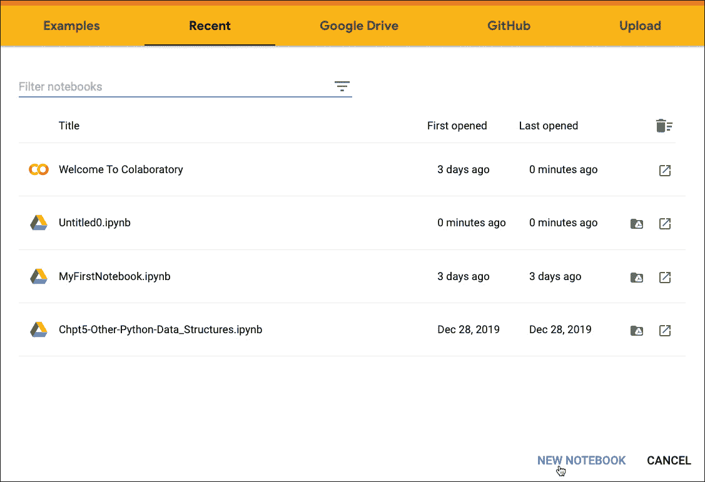

图 1.1 初始的 Google Colab 对话框

当你选择创建新笔记本时，它会在一个新的浏览器标签页中打开。你创建的第一个笔记本的默认标题是 Untitled0.ipynb。要更改其名称，请双击标题并输入新名称（参见图 1.2）。

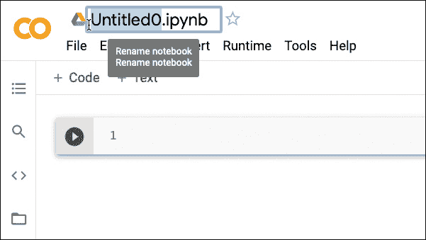

图 1.2 在 Google Colab 中重命名笔记本

Colab 会自动将你的笔记本保存到谷歌云端硬盘，你可以通过访问 [Drive.Google.com](http://Drive.Google.com) 来访问它们。默认位置是一个名为 Colab Notebooks 的目录（参见图 1.3）。

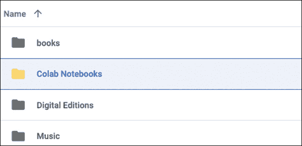

图 1.3 谷歌云端硬盘中的 Colab Notebooks 文件夹

#### Colab 文本单元格

一个新的 Google Colab 笔记本包含一个代码单元格。单元格可以是两种类型之一：文本或代码。你可以通过使用笔记本界面左上角的“+ 代码”和“+ 文本”按钮来添加新单元格。

文本单元格使用一种名为 Markdown 的语言进行格式化。（有关 Markdown 的更多信息，请参见 [`colab.research.google.com/notebooks/markdown_guide.ipynb`](https://colab.research.google.com/notebooks/markdown_guide.ipynb)。）要编辑单元格，请双击它，Markdown 代码将显示在右侧，其输出的预览显示在左侧（参见图 1.4）。

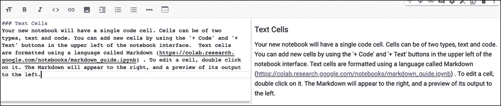

图 1.4 在 Google Colab 笔记本中编辑文本单元格

如图 1.5 所示，你可以修改笔记本中的文本，使其变为粗体、斜体、删除线和等宽字体。

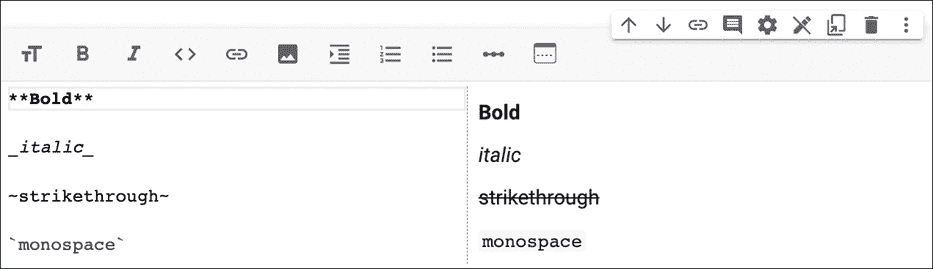

图 1.5 在 Google Colab 笔记本中格式化文本

如图 1.6 所示，你可以通过在项目前加上数字来创建编号列表，也可以通过星号来创建项目符号列表。

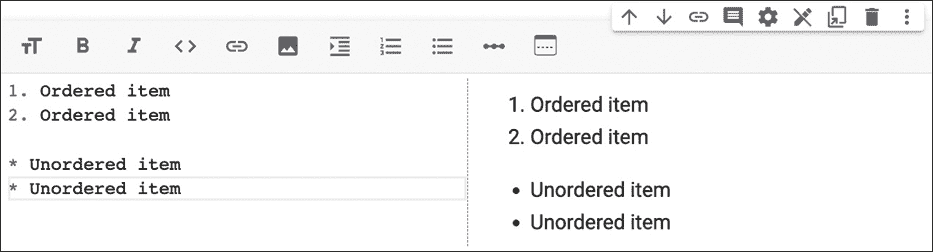

图 1.6 在 Google Colab 笔记本中创建列表

如图 1.7 所示，你可以通过在文本前添加井号来创建标题。一个井号创建一级标题，两个井号创建二级标题，以此类推。

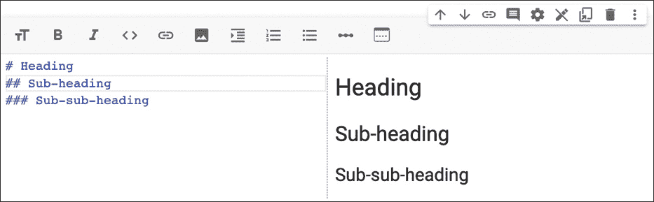

图 1.7 在 Google Colab 笔记本中创建标题

位于单元格顶部的标题决定了该单元格在文档中的层级。你可以通过打开目录来查看此层级，方法是点击笔记本界面左上角的菜单按钮，如图 1.8 所示。

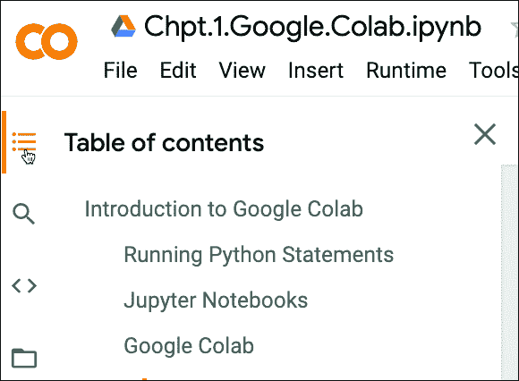

图 1.8 Google Colab 笔记本中的目录

你可以通过点击显示的标题来使用目录导航文档。包含子单元格的标题单元格在其标题文本旁边会有一个三角形。你可以点击此三角形来隐藏或查看子单元格（参见图 1.9）。

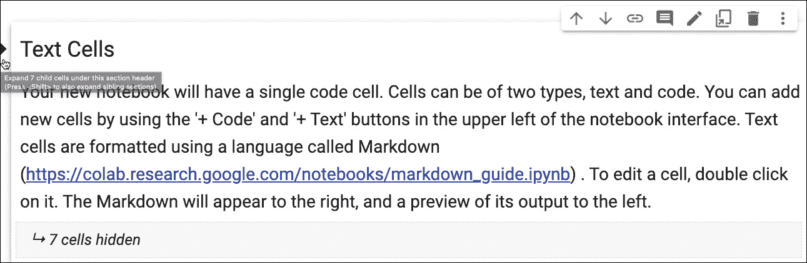

图 1.9 在 Google Colab 笔记本中隐藏单元格

##### LaTeX

LaTeX 语言（参见 [`www.latex-project.org/about/`](https://www.latex-project.org/about/)）专为准备技术文档而设计，在呈现数学文本方面表现出色。LaTeX 采用基于代码的方法，旨在让你专注于内容而非布局。你可以通过将 LaTeX 代码用美元符号括起来，将其插入到 Colab 笔记本的文本单元格中。图 1.10 展示了嵌入在 Colab 笔记本文本单元格中的 LaTeX 文档示例。

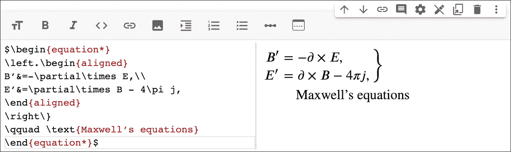

图 1.10 嵌入 Google Colab 笔记本中的 LaTeX

#### Colab 代码单元格

在 Google Colab 笔记本中，你使用代码单元格来编写和执行 Python 代码。要执行一条 Python 语句，请将其输入到代码单元格中，然后点击单元格左侧的“播放”按钮或按 Shift+Enter。按 Shift+Enter 会跳转到下一个单元格，如果后面没有单元格，则会创建一个新单元格。你执行的代码的任何输出都会显示在单元格下方，如下例所示：

```
print("Hello")

hello
```

本书的后续章节仅对 Colab 笔记本使用代码单元格。


#### Colab 文件

要查看 Colab 中可用的文件和文件夹，请点击界面左侧的“文件”按钮（参见图 1.11）。默认情况下，你可以访问 Google 提供的 `sample_data` 文件夹。

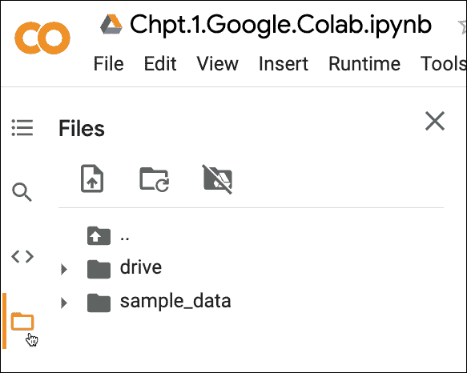

图 1.11 在 Google Colab 中查看文件

你也可以点击“上传”按钮将文件上传到当前会话中（参见图 1.12）。

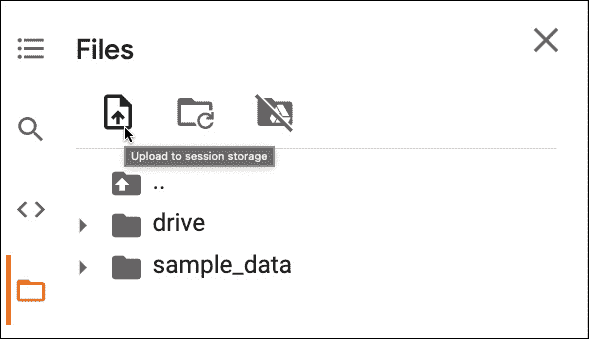

图 1.12 在 Google Colab 中上传文件

你上传的文件仅在你文档的当前会话中可用。如果你稍后再次打开同一个文档，需要重新上传它们。Colab 中所有可用文件的路径根目录都是 `/content/`，因此，如果你上传一个名为 `heights.over.time.csv` 的文件，它的路径就是 `/content/heights.over.time.csv`。

你可以通过点击“挂载云端硬盘”按钮来挂载你的 Google 云端硬盘（参见图 1.13）。你云端硬盘中的内容根路径为 `/content/drive`。

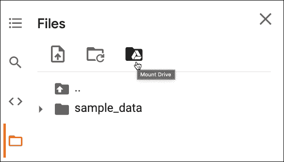

图 1.13 挂载你的 Google 云端硬盘

#### 管理 Colab 文档

默认情况下，笔记本会保存到你的 Google 云端硬盘。在“文件”菜单中，你可以看到其他保存笔记本的选项。你可以将它们保存到 GitHub，既可以作为 gist，也可以作为受追踪的文件。你还可以以 Jupyter 笔记本格式（扩展名为 `.ipynb`）或 Python 文件格式（扩展名为 `.py`）下载它们。你也可以通过点击笔记本界面右上角的“共享”按钮来共享笔记本。

#### Colab 代码片段

Colab 左侧导航栏中的“代码片段”部分允许你搜索和选择代码片段（参见图 1.14）。你可以通过点击“插入”按钮来插入选中的代码片段。使用代码片段是了解 Colab 能做什么的好方法，包括创建交互式表单、下载数据以及使用各种可视化选项。

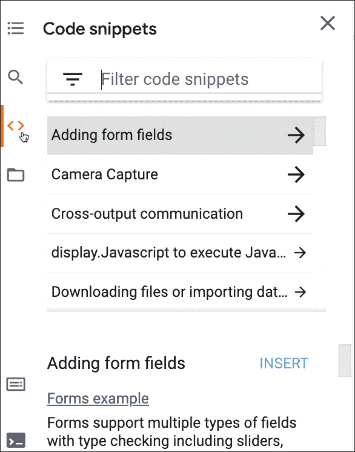

图 1.14 在 Google Colab 中使用代码片段

#### 现有合集

你可以使用 Google Colab 笔记本解释和演示技术、概念和工作流程。数据科学工作在许多遍布网络的笔记本合集中共享。Kaggle（参见 [`www.kaggle.com/code`](https://www.kaggle.com/code)）和 Google Seedbank（参见 [`research.google.com/seedbank/`](https://research.google.com/seedbank/)）都有大量共享的笔记本。

#### 系统别名

你可以通过在命令前加上感叹号，在 Colab 笔记本的代码单元格中运行 shell 命令。例如，以下示例打印当前工作目录：

```
!pwd

/content
```

你可以将 shell 命令的任何输出捕获到 Python 变量中，如下所示，并在后续代码中使用它：

```
var = !ls sample_data

print(var)
```

**注意**

暂时不必担心变量。你将在第 2 章“Python 基础”中学习它们。

#### 魔法函数

魔法函数是改变代码单元格运行方式的函数。例如，你可以使用魔法函数 `%timeit()` 来计算 Python 语句的执行时间，如下所示：

点击此处查看代码图片

```
import time

%timeit(time.sleep(1))
```

另一个例子是，你可以使用魔法函数 `%%html` 让一个单元格运行 HTML 代码：

点击此处查看代码图片

```
%%html

<marquee style='width: 30%; color: blue;'><b>Whee!</b></marquee>
```

**注意**

你可以在 Jupyter 文档中的“Cell Magics”示例笔记本中找到关于魔法函数的更多信息，地址为 [`nbviewer.jupyter.org/github/ipython/ipython/blob/1.x/examples/notebooks/Cell%20Magics.ipynb`](https://nbviewer.jupyter.org/github/ipython/ipython/blob/1.x/examples/notebooks/Cell%20Magics.ipynb)。

### 本章小结

Jupyter 笔记本是将格式化文本与可执行代码结合在一起的文档。它们已成为科学工作中非常流行的格式，网络上有很多示例。Google Colab 提供托管笔记本，并包含许多数据科学中常用的库。笔记本由文本单元格（使用 Markdown 格式化）和代码单元格（可以执行 Python 代码）组成。以下各章将展示许多 Colab 笔记本的示例。

### 问题

1.   Google Colab 托管哪种类型的笔记本？

2.   Google Colab 中有哪些可用的单元格类型？

3.   如何在 Colab 中挂载你的 Google 云端硬盘？

4.   Google Colab 的代码单元格中运行什么语言？

## 2

## Python 基础

所有模型都是错的，但有些是有用的。

——乔治·E·P·博克斯

本章内容

*   Python 内置类型

*   语句简介

*   表达式语句

*   断言语句

*   赋值语句与变量

*   导入语句

*   打印输出

*   基本数学运算

*   点号表示法

本章将介绍一些可用于创建 Python 程序的基本构建块。它介绍了基本的內置数据类型，例如整数和字符串。它还介绍了各种可用于指导计算机操作的简单语句。本章涵盖了为变量赋值的语句以及确保代码按预期执行的语句。它还讨论了如何导入模块以扩展代码中可用的功能。学完本章后，你将掌握足够的知识来编写一个对存储值执行简单数学运算的程序。


### Python 中的基本类型

生物学家发现，将生物按照从域、界到属、种的层级进行分类非常有用。在这个层级中，层级越低，共享同一组的生命形式就越相似。在数据科学中也存在类似的层级结构。

*解析器*（*parser*）是一种程序，它将你的代码作为输入，并将其转换为计算机可以执行的指令。Python 解析器会将你的代码分解成*标记*（tokens），这些标记在 Python 语言中具有特定的含义。将这些标记基于其共享的行为和属性进行分组是很有用的，就像生物学家对自然界中的生物进行分类一样。Python 中的这些分组被称为*集合*（*collections*）和*类型*（*types*）。有些类型是语言本身内置的，而有些类型则由语言核心之外的开发者定义。从高层来看，Python 文档（参见 [`docs.python.org/3/library/stdtypes.html`](https://docs.python.org/3/library/stdtypes.html)）将主要的内置类型定义为：数值类型、序列类型（参见第 3 章，“序列”）、映射类型（参见第 4 章，“其他数据结构”）、类（参见第 14 章，“面向对象编程”）、实例（参见第 14 章）和异常。从底层来看，最基本的内置类型如下：

*   **数值类型：** 布尔值、整数、浮点数和虚数
*   **序列类型：** 字符串和二进制字符串

最简单的，整数（或 int）在代码中表示为普通的数字。浮点数（简称 floats）则表示为包含小数点分隔符的一组数字。你可以使用 `type` 函数来查看整数和浮点数的类型：

```
type(13)

int

type(4.1)

float
```

如果你希望一个数字是浮点数，必须确保它包含一个小数点并且小数点右边有数字，即使那个数字是零：

```
type(1.0)

float
```

布尔值由两个常量 `True` 和 `False` 表示，它们的类型都是 `bool`，而 `bool` 在底层是 `int` 的一种特殊形式：

```
type(True)

bool

type(False)

bool
```

字符串是被引号包围的字符。你可以使用字符串来表示各种文本，用途非常广泛。以下是一个示例：

```
type("Hello")

str
```

**注意**

你将在第 4 章中学习更多关于字符串和二进制字符串的知识。

有一种特殊的类型 `NoneType`，它只有一个值 `None`。它用于表示没有值的事物：

```
type(None)

NoneType
```

#### 高级语言与低级语言

编写软件的本质，就是向计算机下达指令。关键在于将人类可理解的形式转化为计算机能执行的指令。如今的编程语言，从非常接近计算机理解逻辑的方式，到更接近人类语言的方式，不一而足。更接近计算机指令的语言被称为*低级语言*。机器码和汇编语言就是低级语言的例子。使用这些语言，你可以对计算机处理器的行为进行终极控制，但用它们编写代码既繁琐又耗时。

高级语言则将一组组指令抽象成更大的功能块。在这个谱系中，不同的语言各有其独特的优势。例如，C 语言处于高级语言中较低的一端，它允许你直接管理程序的内存使用，并为嵌入式系统编写高度优化的软件。相比之下，Python 则处于高级语言中较高的一端。它不允许你直接指定使用多少内存来保存数据，或者在用完后释放那块内存。Python 的语法更接近人类语言定义的逻辑，通常比低级语言更容易理解和编写。将人类语言的动作转化为 Python 通常是一个快速且直观的过程。

#### 语句

一个 Python 程序由语句构成。每条语句可以被看作是计算机应该执行的一个动作。如果你把软件程序想象成一本食谱，那么一条语句就是一个单独的指令，比如“将蛋黄打至发白”或“烘烤 15 分钟”。

最简单的 Python 语句是一行代码，行尾表示语句的结束。例如，一个简单的语句可以调用一个函数，就像下面这个表达式语句：

```
print("hello")
```

一条语句也可能更复杂，比如下面这条语句，它评估条件并根据评估结果给变量赋值：

点击此处查看代码图片

```
x,y = 5,6

bar = x**2 if (x < y) and (y or z) else x//2
```

Python 允许简单语句和复杂语句。简单的 Python 语句包括表达式语句、断言语句、赋值语句、pass 语句、删除语句、返回语句、yield 语句、引发语句、break 语句、continue 语句、导入语句、future 语句、global 语句和 nonlocal 语句。本章将介绍其中一些简单语句，后续章节将介绍其余大部分语句。第 5 章，“执行控制”，和第 6 章，“函数”，将介绍复杂语句。

##### 多条语句

虽然使用单条语句就足以定义一个程序，但大多数有用的程序都由多条语句组成。一条语句的结果可以被后续的语句使用，通过组合动作来构建功能。例如，你可以使用以下语句将一个变量赋值为整数除法的结果，然后用该结果计算另一个变量的值，最后在第三条语句中将这两个变量作为 `print` 语句的输入：

点击此处查看代码图片

```
x = 23//3

y = x**2

print(f"x is {x}, y is {y}")

x is 7, y is 49
```

##### 表达式语句

Python 表达式是一段能够求值为一个值（或 `None`）的代码。这个值可以是数学表达式、函数或方法调用等。表达式语句就是一条只包含表达式但不捕获其输出以供后续使用的语句。表达式语句通常只在交互式环境中才有用，例如 IPython shell。在这种环境中，表达式的结果会在运行后显示给用户。这意味着，如果你在 shell 中，想知道某个函数返回什么，或者想知道 12344 除以 12 等于多少，你可以直接看到输出，而无需编写显示它的代码。你也可以使用表达式语句来查看变量的值（如下例所示），或者只是回显任何类型的显示值。以下是一些简单的表达式语句及其各自的输出：

点击此处查看代码图片

```
23 * 42

"Hello"

'Hello'

import os

os.getcwd()

'/content'
```

你将在本书中看到许多用于演示 Python 功能的表达式语句。在每种情况下，你都会先看到表达式，其结果显示在下一行。


##### 断言语句

断言语句将表达式作为参数，并确保其结果求值为 `True`。返回 `False`、`None`、零、空容器和空字符串的表达式求值为 `False`；所有其他值均求值为 `True`。（容器将在第 3 章“序列”和第 4 章“其他数据结构”中讨论。）如果表达式求值为 `False`，断言语句会抛出一个错误，如下例所示：

点击此处查看代码图片

```
assert(False)

AssertionError            Traceback (most recent call last)

<ipython-input-5-8808c4021c9c> in <module>()

----> 1 assert(False)
```

否则，断言语句会调用表达式并继续执行下一条语句，如下例所示：

```
assert(True)
```

在调试时，你可以使用断言语句来确保你假设为真的某些条件确实成立。不过，这些语句确实会影响性能，因此，如果你在开发时大量使用它们，可能需要在生产环境中运行代码时将其禁用。如果你从命令行运行代码，可以添加 `-o`（优化）标志来禁用它们：

```
python -o my_script.py
```

##### 赋值语句

变量是指向某段数据的名称。理解这一点很重要：在赋值语句中，变量指向数据，而不是数据本身。同一个变量可以指向不同的项——甚至是不同类型的项。此外，你可以更改变量指向的数据，而无需更改变量本身。如本章前面的示例所示，变量使用赋值运算符（单个等号）进行赋值。变量名出现在运算符的左侧，值出现在右侧。以下示例展示了如何将值 `12` 赋给变量 `x`，以及将文本 `'Hello'` 赋给变量 `y`：

```
x = 12

y = 'Hello'
```

一旦变量被赋值，你就可以使用变量名来代替值。因此，你可以使用 `x` 变量进行数学运算，或使用 `y` 变量来构建更大的文本块，如下例所示：

点击此处查看代码图片

```
answer = x - 3

print(f"{y} Jeff, the answer is {answer}")

Hello Jeff, the answer is 9
```

你可以看到，在插入变量的位置使用了 `x` 和 `y` 的值。你可以通过用逗号分隔变量名和值，在单个语句中为多个变量赋值：

```
x, y, z = 1,'a',3.0
```

这里，`x` 被赋值为 `1`，`y` 被赋值为 `'a'`，`z` 被赋值为 `3.0`。

最佳实践是给变量起有意义的名称，以帮助解释其用途。例如，在图表中，用 `x` 表示 x 轴上的值是可以的，但用 `x` 来保存客户的名字则会造成混淆；对于客户的名字来说，`first_name` 是一个更清晰的变量名。

##### Pass 语句

Pass 语句是占位符。它们本身不执行任何操作，但当代码中需要一条语句来满足语法正确性时，可以使用 pass 语句。Pass 语句由关键字 `pass` 组成，没有其他内容。Pass 语句通常用于在布局代码设计时（即，只放入名称而不实现功能）来存根函数和类。你将在第 6 章“函数”中了解更多关于函数的内容，在第 14 章中了解更多关于类的内容。

##### 删除语句

删除语句从正在运行的程序中删除某些内容。它由 `del` 关键字后跟要删除的项（放在括号中）组成。一旦项被删除，除非重新定义，否则无法再次引用它。以下示例展示了将值赋给变量然后删除的过程：

点击此处查看代码图片

```
polly = 'parrot'

del(polly)

print(polly)

NameError                 Traceback (most recent call last)

<ipython-input-6-c0525896ade9> in <module>()

      1 polly = 'parrot'

      2 del(polly)

----> 3 print(polly)

NameError: name 'polly' is not defined
```

在此示例中，当你尝试使用 `print` 函数访问该变量时，会引发一个错误。

**注意**

Python 有自己的垃圾回收系统，通常你不需要删除对象来释放内存，但有时你可能仍然想要删除它们。

##### 返回语句

返回语句定义函数的返回值。你将在第 6 章中了解如何编写函数，包括使用返回语句。

##### Yield 语句

Yield 语句用于编写生成器函数，它提供了一种优化性能和内存使用的强大方法。我们将在第 13 章“函数式编程”中介绍生成器。

##### Raise 语句

本章到目前为止的一些示例演示了导致错误的代码。在程序运行期间发生的此类错误（与阻止程序运行的语法错误相对）被称为*异常*。异常会中断程序的正常执行，除非被处理，否则会导致程序退出。Raise 语句既用于重新调用已捕获的异常，也用于引发内置异常或你专门为程序设计的异常。Python 有许多内置异常，涵盖了多种不同的用例（参见 [`docs.python.org/3/library/exceptions.html#bltin-exceptions`](https://docs.python.org/3/library/exceptions.html#bltin-exceptions)）。如果你想调用这些内置异常之一，可以使用 raise 语句，它由 `raise` 关键字后跟异常组成。例如，`NotImplementedError` 是在类层次结构中使用的错误，用于指示子类应实现某个方法（参见第 14 章）。以下示例使用 `raise` 语句引发此错误：

点击此处查看代码图片

```
raise NotImplementedError

NotImplementedError       Traceback (most recent call last)

<ipython-input-1-91639a24e592> in <module>()

----> 1 raise NotImplementedError
```

##### Break 语句

你使用 break 语句在循环的正常循环条件满足之前结束循环。循环和 break 语句将在第 5 章中介绍。

##### Continue 语句

你使用 continue 语句来跳过循环的某一次迭代。这些语句也将在第 5 章中介绍。


##### 导入语句

编写软件最强大的功能之一是在不同上下文中重用代码片段。Python 代码可以保存在文件中（扩展名为 .py）；如果这些文件是为重用而设计的，则被称为*模块*。当你运行 Python 时，无论是在交互式会话中还是作为独立程序，某些功能可作为核心语言特性使用，这意味着你可以直接使用它们，无需额外设置。当你安装 Python 时，这些核心特性会被安装，Python 标准库也会一并安装。该库是一系列模块，你可以将其引入 Python 会话以扩展功能。要在代码中访问这些模块之一，你需要使用导入语句，该语句由关键字 `import` 和要导入的模块名称组成。以下示例展示了如何导入用于与操作系统交互的 `os` 模块：

```
import os
```

一旦导入了 `os`，你就可以像使用内置功能一样使用该模块的功能。`os` 模块有一个 `listdir` 函数，用于列出当前目录的内容：

点击此处查看代码图片

```
os.listdir()

['.config', 'sample_data']
```

当模块或模块组为更广泛的发布而准备时，它们被称为*包*。Python 的一个吸引人之处（尤其是对于数据科学而言）是其庞大的第三方包生态系统。这些包可能对你或你的组织来说是本地的，但大多数公共包都托管在 Python 包索引 [pypi.org](http://pypi.org) 中。要使用这些包之一，你必须先安装它，通常使用 Python 的标准包管理器 `pip`。例如，要在本地安装非常有用的 Pandas 库，你可以在命令行中运行以下命令：

```
pip install pandas
```

然后将其导入到你的代码中：

```
import pandas
```

你还可以在导入时为模块指定别名。例如，通常的惯例是将 Pandas 导入为 `pd`：

```
import pandas as pd
```

然后，你可以使用别名而不是模块名称来引用该模块，如下例所示：

点击此处查看代码图片

```
pd.read_excel('/some_excel_file.xls')
```

你还可以使用 `from` 关键字与 `import` 一起导入模块的特定部分：

点击此处查看代码图片

```
from os import path

path

<module 'posixpath' from '/usr/lib/python3.6/posixpath.py'>
```

此示例从 `os` 模块中导入了子模块 `path`。现在你可以在程序中使用 `path`，就像它是由你自己的代码定义的一样。

##### Future 语句

Future 语句允许你使用属于未来版本的某些模块。本书不涉及它们，因为它们在数据科学中很少使用。

##### Global 语句

程序中的*作用域*指的是共享名称和值定义的环境。之前你看到，当你在赋值语句中定义一个变量时，该变量会为后续语句保留其名称和值。这些语句被称为共享*作用域*。当你开始编写函数（见第 6 章）和类（见第 14 章）时，你会遇到不共享的作用域。使用 global 语句是一种跨作用域共享变量的方式。（你将在第 13 章中了解更多关于 global 语句的内容。）

##### Nonlocal 语句

使用 nonlocal 语句是另一种跨作用域共享变量的方式。全局变量在整个模块中共享，而 nonlocal 语句则封闭当前作用域。Nonlocal 语句仅在多个嵌套作用域中才有价值，并且在非常特殊的情况之外你不需要它们，因此本书不涉及。

##### Print 语句

当你在交互式环境（如 Python shell、IPython，或扩展的 Colab 笔记本）中工作时，你可以使用表达式语句来查看任何 Python 表达式的值。（*表达式*是计算结果为值的代码片段。）在某些情况下，你可能需要以其他方式输出文本，例如在命令行或云函数中运行程序时。在这种情况下，最基本的显示输出的方式是使用 print 语句。默认情况下，`print` 函数将文本输出到标准输出流。你可以将任何内置类型或大多数其他对象作为参数传递给 `print` 进行打印。考虑以下示例：

```
print(1)

print('a')

a
```

你也可以传递多个参数，它们会被打印在同一行：

```
print(1,'b')

1 b
```

你可以使用一个可选参数来定义当提供多个参数时，项目之间使用的分隔符：

```
print(1,'b',sep='->')

1->b
```

你甚至可以打印 `print` 函数本身：

点击此处查看代码图片

```
print(print)

<built-in function print>
```

### 执行基本数学运算

你可以将 Python 用作计算器。基本数学运算是核心功能的一部分。你可以在交互式 shell 中进行数学运算，或在程序中使用计算结果。以下是 Python 中加法、减法、乘法、除法和乘方的示例：

```
2 + 3

5 – 6

3*4

9/3

3.0

2**3

```

请注意，即使使用整数，除法也会返回一个浮点数。如果你想将除法结果限制为整数，可以使用双斜杠，如下例所示：

```
5//2

```

另一个有用的运算符是取模，它返回除法的余数。要执行取模运算，请使用百分号：

```
5%2

```

取模在判断一个数是否是另一个数的因数时很有用（在这种情况下结果为零）。此示例使用 `is` 关键字来测试取模结果是否为零：

```
14 % 7 is 0

True
```

我们将在第二部分“数据科学库”中介绍更多数学运算。

### 使用点符号操作类和对象

在第 14 章中，你将学习定义自己的类和对象。现在，你可以将对象视为功能与数据的捆绑。Python 中的大多数事物都附带有属性或方法。要访问对象的属性或方法（即附加到对象的函数），你可以使用点语法。要访问属性，只需在对象名称后使用点，后跟属性名称。

以下示例展示了如何访问整数的 `numerator` 属性：

```
a_number = 2

a_number.numerator
```

你以类似的方式访问对象方法，但后面要跟括号。以下示例使用了同一个整数的 `to_bytes()` 方法：

点击此处查看代码图片

```
a_number.to_bytes(8, 'little')

b'\x02\x00\x00\x00\x00\x00\x00\x00'
```

### 总结

编程语言提供了一种将人类指令转换为计算机指令的方法。Python 使用不同类型的语句向计算机发出指令，每条语句描述一个动作。你可以将语句组合在一起创建软件。执行操作的数据在 Python 中由多种类型表示，包括内置类型以及由开发者和第三方定义的类型。这些类型具有自己的特性、属性，并且在许多情况下，还具有可以使用点语法访问的方法。


### 问题

1.   在 Python 中，`type(12)` 的输出是什么？

2.   使用 Python 时，`assert(True)` 对其后的语句有什么影响？

3.   如何使用 Python 调用异常 `LastParamError`？

4.   如何使用 Python 打印字符串 `"Hello"`？

5.   如何使用 Python 计算 2 的 3 次方？

## 3

## 序列

使用不充分的数据所犯的错误，远少于完全不用数据所犯的错误。

查尔斯·巴贝奇

本章内容

*   共享序列操作

*   列表和元组

*   字符串和字符串方法

*   范围

在第 2 章“Python 基础”中，你学习了类型集合。本章将介绍一组称为*序列*的内置类型。序列是一个有序的、有限的集合。你可以把序列想象成图书馆里的一个书架，书架上的每本书都有一个位置，如果你知道它的位置，就可以轻松访问。这些书是有序的，每本书（除了两端的书）前后都有其他书。你可以向书架添加书籍，也可以移除它们，并且书架可以是空的。构成序列的内置类型包括列表、元组、字符串、二进制字符串和范围。本章将介绍这些类型的共同特性和具体细节。

### 共享操作

序列家族共享相当多的功能。具体来说，有一些使用序列的方法适用于大多数序列成员。这些操作涉及具有有限长度的序列、访问序列中的项以及基于序列内容创建新序列。

#### 成员资格测试

你可以使用 `in` 操作来测试某个项是否是序列的成员。如果序列包含一个与所查询项相等的项，此操作返回 `True`，否则返回 `False`。以下是在不同序列类型中使用 `in` 的示例：

点击此处查看代码图片

```
'first' in ['first', 'second', 'third']

True

23 in (23,)

True

'b' in 'cat'

False

b'a' in b'ieojjza'

True
```

你可以将关键字 `not` 与 `in` 结合使用，以检查某个项是否不在序列中：

```
'b' not in 'cat'

True
```

你最可能使用 `in` 和 `not in` 的两个场景是：在交互式会话中探索数据，以及作为 `if` 语句的一部分（参见第 5 章“执行控制”）。

#### 索引

由于序列是一系列有序的项，你可以通过其位置（或称*索引*）来访问序列中的项。索引从零开始，一直到项数减一。例如，在一个包含八个项的序列中，第一个项的索引为零，最后一个项的索引为七。

要使用索引访问项，需要在索引号周围加上方括号。以下示例定义了一个字符串，并使用其索引号访问第一个和最后一个子字符串：

点击此处查看代码图片

```
name = "Ignatius"

name[0]

'I'

name[4]

't'
```

你也可以通过使用负索引号从序列末尾开始倒数索引：

```
name[-1]

's'

name[-2]

'u'
```

#### 切片

你可以使用索引来创建代表原始序列子序列的新序列。在方括号中，提供子序列的起始和结束索引号，用冒号分隔，然后返回一个新序列：

点击此处查看代码图片

```
name = "Ignatius"

name[2:5]

'nat'
```

返回的子序列包含从第一个索引开始到结束索引（但不包括结束索引）的项。如果省略起始索引，子序列从父序列的开头开始；如果省略结束索引，子序列则一直到序列的末尾：

```
name[:5]

'Ignat'

name[4:]

'tius'
```

你可以使用负索引号创建从序列末尾开始计数的切片。此示例展示了如何获取字符串的最后三个字母：

```
name[-3:]

'ius'
```

如果你希望切片跳过某些项，可以提供第三个参数来指示步长。因此，如果你有一个整数列表序列，如前所示，你可以仅使用起始和结束索引号来创建切片：

点击此处查看代码图片

```
scores = [0, 1, 2, 3, 4, 5, 6, 7, 8, 9, 10, 11, 12, 13, 14, 15, 16, 17, 18]

scores[3:15]

[3, 4, 5, 6, 7, 8, 9, 10, 11, 12, 13, 14]
```

但你也可以指定步长，例如每三个取一个：

```
scores[3:15:3]

[3, 6, 9, 12]
```

要反向计数，可以使用负步长：

```
scores[18:0:-4]

[18, 14, 10, 6, 2]
```

#### 查询

你可以对序列执行共享操作以获取相关信息。由于序列是有限的，它有一个长度，你可以使用 `len` 函数来获取：

```
name = "Ignatius"

len(name)

```

你可以使用 `min` 和 `max` 函数分别查找最小和最大的项：

点击此处查看代码图片

```
scores = [0, 1, 2, 3, 4, 5, 6, 7, 8, 9, 10, 11, 12, 13, 14, 15, 16, 17, 18]

min(scores)

max(name)

'u'
```

这些方法假设序列的内容可以以某种暗示顺序的方式进行比较。对于允许混合项类型的序列类型，如果内容无法比较，则会发生错误：

点击此处查看代码图片

```
max(['Free', 2, 'b'])

TypeError                               Traceback (most recent call last)

<ipython-input-15-d8babe38f9d9> in <module>()

----> 1 max(['Free', 2, 'b'])

TypeError: '>' not supported between instances of 'int' and 'str'
```

你可以使用 `count` 方法查找某个项在序列中出现的次数：

```
name.count('a')

```

你可以使用 `index` 方法获取序列中某个项的索引：

```
name.index('s')

```

你可以使用 `index` 方法的结果来创建直到某个项（例如字符串中的某个字母）的切片：

点击此处查看代码图片

```
name[:name.index('u')]

'Ignati'
```

#### 数学运算

你可以对相同类型的序列执行加法和乘法运算。执行这些操作时，是对序列本身进行操作，而不是对其内容。例如，将列表 [1] 加到列表 [2] 上会产生列表 [1,2]，而不是 [3]。以下是使用加号（`+`）运算符从三个单独的字符串创建新字符串的示例：

点击此处查看代码图片

```
"prefix" + "-" + "postfix"

'prefix-postfix'
```

乘法（`*`）运算符通过对整个序列执行多次加法来工作，而不是对其内容：

```
[0,2] * 4

[0, 2, 0, 2, 0, 2, 0, 2]
```

这是一种使用默认值设置序列的有用方法。例如，假设你想在列表中跟踪一组固定数量参与者的分数。你可以通过使用乘法初始化该列表，使其为每个参与者设置一个初始分数：

点击此处查看代码图片

```
num_participants = 10

scores = [0] * num_participants

scores

[0, 0, 0, 0, 0, 0, 0, 0, 0, 0]
```


### 列表与元组

列表和元组都是可以容纳任何类型对象的序列。它们的内容可以是混合类型的，因此你可以在同一个列表中包含字符串、整数、实例、浮点数以及其他任何类型。列表和元组中的各项由逗号分隔。列表中的项用方括号括起来，而元组中的项则用圆括号括起来。列表和元组的主要区别在于：列表是可变的，而元组是不可变的。这意味着你可以更改列表的内容，但元组一旦创建，就无法更改。如果你想更改元组的内容，则需要基于当前元组的内容创建一个新的元组。由于可变性的差异，列表比元组拥有更多的功能——同时它们也占用更多的内存。

#### 创建列表和元组

你可以使用列表构造函数 `list()` 或直接使用方括号语法来创建列表。例如，要创建一个包含初始值的列表，只需在方括号中提供这些值：

点击此处查看代码图片

```
some_list = [1,2,3]

some_list

[1, 2, 3]
```

你可以使用元组构造函数 `tuple()` 或圆括号来创建元组。如果你想创建一个只包含单个项的元组，必须在该项后面加上一个逗号，否则 Python 会将圆括号解释为逻辑分组，而不是元组。你也可以通过仅在项后面加逗号来创建不带圆括号的元组。代码清单 3.1 提供了创建元组的示例。

代码清单 3.1 **创建元组**

点击此处查看代码图片

```
tup = (1,2)

tup

(1,2)

tup = (1,)

tup

(1,)

tup = 1,2,

tup

(1,2)
```

**警告**

一个常见但微妙的错误是，在函数参数后面留下一个尾随逗号。这会将参数变成一个包含原始参数的元组。因此，函数 `my_function(1, 2,)` 的第二个参数将是 `(2,)` 而不是 `2`。

你也可以将列表或元组构造函数与一个序列作为参数一起使用。以下示例使用一个字符串，并创建该字符串包含的项的列表：

点击此处查看代码图片

```
name = "Ignatius"

letters = list(name)

letters

['I', 'g', 'n', 'a', 't', 'i', 'u', 's']
```

#### 添加和删除列表项

你可以向列表中添加项，也可以从列表中删除项。为了理解其工作原理，可以将列表想象成一摞书。向列表中添加项最有效的方法是使用 `append` 方法，它会将项添加到列表的末尾，就像你可以轻松地将一本书添加到一摞书的顶部一样。要将项添加到列表中的其他位置，可以使用 `insert` 方法，并将希望放置新项的索引号作为参数。这比使用 `append` 方法的效率要低，因为列表中的其他项可能需要移动以腾出空间给新项；不过，这通常只在非常大的列表中才会成为问题。代码清单 3.2 展示了追加和插入的示例。

代码清单 3.2 **追加和插入列表项**

点击此处查看代码图片

```
flavours = ['Chocolate', 'Vanilla']

flavours

['Chocolate', 'Vanilla']

flavours.append('SuperFudgeNutPretzelTwist')

flavours

['Chocolate', 'Vanilla', 'SuperFudgeNutPretzelTwist']

flavours.insert(0,"sourMash")

flavours

['sourMash', 'Chocolate', 'Vanilla', 'SuperFudgeNutPretzelTwist']
```

要从列表中删除项，可以使用 `pop` 方法。如果不带参数，此方法会删除最后一项。通过使用可选的索引参数，你可以指定删除特定的项。无论哪种情况，该项都会从列表中删除并返回。

以下示例从列表中弹出最后一项，然后弹出索引为 0 的项。你可以看到，这两项在被弹出时都被返回，并且它们随后从列表中消失：

点击此处查看代码图片

```
flavours.pop()

'SuperFudgeNutPretzelTwist'

flavours.pop(0)

'sourMash'

flavours

 ['Chocolate', 'Vanilla']
```

要将一个列表的内容添加到另一个列表中，可以使用 `extend` 方法：

点击此处查看代码图片

```
deserts = ['Cookies', 'Water Melon']

desserts

['Cookies', 'Water Melon']

desserts.extend(flavours)

desserts

['Cookies', 'Water Melon', 'Chocolate', 'Vanilla']
```

此方法会修改第一个列表，使其内容追加了第二个列表的内容。

**嵌套列表初始化**

有一个棘手的错误会困扰初学 Python 的开发者。它涉及将列表的可变性与序列乘法的性质结合起来。如果你想初始化一个包含四个子列表的列表，你可能会尝试像这样乘以一个包含单个列表的列表：

点击此处查看代码图片

```
lists = [[]] * 4

lists

[[], [], [], []]
```

这看起来似乎成功了，直到你修改其中一个子列表：

点击此处查看代码图片

```
lists[-1].append(4)

lists

[[4], [4], [4], [4]]
```

所有子列表都被修改了！这是因为乘法只初始化了一个列表，并引用了它四次。这些引用看起来是独立的，直到你尝试修改其中一个。解决方法是使用列表推导式（在第 13 章“函数式编程”中进一步讨论）：

点击此处查看代码图片

```
lists = [[] for _ in range(4)]

lists[-1].append(4)

lists

 [[], [], [], [4]]
```

#### 解包

你可以在一行中将列表或元组中的值分配给多个变量：

```
a, b, c = (1,3,4)

a

b

c

```

或者，如果你想将多个值分配给一个变量，同时将单个值分配给其他变量，可以在将接收多个值的变量旁边使用 `*`。然后该变量将吸收所有未分配给其他变量的项：

点击此处查看代码图片

```
*first, middle, last = ['horse', 'carrot', 'swan', 'burrito', 'fly']

first

['horse', 'carrot', 'swan']

last

'fly'

middle

'burrito'
```

#### 排序列表

对于列表，你可以使用内置的 `sort` 和 `reverse` 方法来更改内容的顺序。与序列的 `min` 和 `max` 函数类似，这些方法仅在内容可比较时才有效，如下例所示：

点击此处查看代码图片

```
name = "Ignatius"

letters = list(name)

letters

['I', 'g', 'n', 'a', 't', 'i', 'u', 's']

letters.sort()

letters

['I', 'a', 'g', 'i', 'n', 's', 't', 'u']

letters.reverse()

letters

['u', 't', 's', 'n', 'i', 'g', 'a', 'I']
```


### 字符串

字符串是字符序列。在 Python 中，字符串默认采用 Unicode 编码，任何 Unicode 字符都可以成为字符串的一部分。字符串由引号括起来的字符表示。单引号和双引号均可使用，且用它们创建的字符串是等价的：

点击此处查看代码图片

```
'Here is a string'

'Here is a string'

"Here is a string" == 'Here is a string'

True
```

如果要在字符串中的某个单词或某些单词周围包含引号，你需要使用一种引号（单引号或双引号）来括起这些单词，并使用另一种引号来括起整个字符串。以下示例展示了单词 *is* 被双引号括起，而整个字符串被单引号括起：

点击此处查看代码图片

```
'Here "is" a string'

'Here "is" a string'
```

多行字符串需要用三组双引号括起来，如下例所示：

点击此处查看代码图片

```
a_very_large_phrase = """

Wikipedia is hosted by the Wikimedia Foundation,

a non-profit organization that also hosts a range of other projects.

"""
```

使用 Python 字符串时，你可以使用特殊字符，每个特殊字符前面都有一个反斜杠。这些特殊字符包括制表符 `\t`、回车符 `\r` 和换行符 `\n`。这些字符在打印时会被解释为特殊含义。虽然这些字符通常很有用，但在表示 Windows 路径时可能会带来不便：

点击此处查看代码图片

```
windows_path = "c:\row\the\boat\now"

print(windows_path)

ow heoat

      ow
```

对于这种情况，你可以使用 Python 的原始字符串类型，它会按字面意义解释所有字符。通过在字符串前加上 `r` 前缀来表示原始字符串类型：

点击此处查看代码图片

```
windows_path = r"c:\row\the\boat\now"

print(windows_path)

c:\row\the\boat\now
```

如清单 3.3 所示，有许多字符串辅助函数可以帮助你处理不同的大小写形式。

清单 3.3 **字符串辅助函数**

点击此处查看代码图片

```
captain = "Patrick Tayluer"

captain

'Patrick Tayluer'

captain.capitalize()

'Patrick tayluer'

captain.lower()

'patrick tayluer'

captain.upper()

'PATRICK TAYLUER'

captain.swapcase()

'pATRICK tAYLUER'

captain = 'patrick tayluer'

captain.title()

'Patrick Tayluer'
```

Python 3.6 引入了格式化字符串，即 f-string。你可以通过替换字段在运行时将值插入到 f-string 中，替换字段由花括号分隔。你可以将任何表达式（包括变量）插入到替换字段中。f-string 以大写或小写的 `F` 或 `f` 作为前缀，如下例所示：

点击此处查看代码图片

```
strings_count = 5

frets_count = 24

f"Noam Pikelny's banjo has {strings_count} strings and {frets_count} frets"

'Noam Pikelny's banjo has 5 strings and 24 frets'
```

以下示例展示了如何将数学表达式插入到替换字段中：

点击此处查看代码图片

```
a = 12

b = 32

f"{a} times {b} equals {a*b}"

'12 times 32 equals 384'
```

以下示例展示了如何将列表中的元素插入到替换字段中：

点击此处查看代码图片

```
players = ["Tony Trischka", "Bill Evans", "Alan Munde"]

f"Performances will be held by {players[1]}, {players[0]}, and {players[2]}"

'Performances will be held by Bill Evans, Tony Trischka, and Alan Munde'
```

### 范围

使用 range 对象是表示按值排序的数字序列的一种高效方式。它们主要用于指定循环应运行的次数。第 5 章将介绍循环。Range 对象可以接受起始值（可选）、结束值和步长（可选）参数。与切片类似，起始值包含在范围内，而结束值不包含在内。同样与切片类似，你可以使用负步长进行递减计数。Range 会在你请求时计算数字，因此对于大范围，它们不需要存储更多内存。清单 3.4 演示了如何创建带有和不带有可选参数的范围。该清单从范围创建列表，以便你可以看到范围将提供的全部内容。

清单 3.4 **创建范围**

点击此处查看代码图片

```
range(10)

range(0, 10)

list(range(1, 10))

[1, 2, 3, 4, 5, 6, 7, 8, 9]

list(range(0,10,2))

[0, 2, 4, 6, 8]

list(range(10, 0, -2))

[10, 8, 6, 4, 2]
```

### 总结

本章涵盖了称为序列的重要类型组。序列是一个有序的、有限的元素集合。列表和元组可以包含混合类型。列表在创建后可以修改，但元组不能。字符串是文本序列。Range 对象用于描述数字范围。列表、字符串和范围是 Python 中最常用的类型。

### 问题

1.   如何测试 `a` 是否在列表 `my_list` 中？

2.   如何找出 `b` 在名为 `my_string` 的字符串中出现的次数？

3.   如何将 `a` 添加到列表 `my_list` 的末尾？

4.   字符串 `'superior'` 和 `"superior"` 是否相等？

5.   如何创建一个从 3 到 13 的范围？

## 4

## 其他数据结构

统计思维终将像读写能力一样，成为高效公民所必需的素养。

——塞缪尔·S·威尔克斯

本章内容

*   创建字典

*   访问和更新字典内容

*   创建集合

*   集合操作

基于顺序的数据表示功能强大，但其他数据表示方式也是可行的。字典和集合是不依赖于数据顺序的数据结构。两者都是强大的模型，是 Python 工具箱中不可或缺的组成部分。

### 字典

想象一下，你正在进行一项研究，以确定学生身高与平均绩点（GPA）之间是否存在相关性。你需要一种数据结构来表示单个学生的数据，包括姓名、身高和 GPA。你可以将信息存储在列表或元组中。不过，你必须跟踪哪个索引代表哪条数据。更好的表示方式是为数据添加标签，这样你就不需要跟踪从索引到属性的转换。你可以使用字典将数据存储为键/值对。字典中的每个项或值都通过键来访问。这种查找非常高效，并且比搜索长序列快得多。

在键/值对中，键和值用冒号分隔。你可以呈现多个键/值对，用逗号分隔并括在花括号中。因此，学生记录的字典可能如下所示：

点击此处查看代码图片

```
{ 'name': 'Betty', 'height': 62,'gpa': 3.6 }
```

该字典的键是字符串 `'name'`、`'height'` 和 `'gpa'`。每个键指向一条数据：`'name'` 指向字符串 `'Betty'`，`'height'` 指向整数 `62`，`'gpa'` 指向浮点数 `3.6`。值可以是任何类型，不过对键的类型有一些限制，本章后面会讨论。


#### 创建字典

你可以创建带有初始数据或不带初始数据的字典。通过使用 `dict()` 构造方法或直接使用花括号，可以创建一个空字典：

点击此处查看代码图片

```
dictionary = dict()

dictionary

{}

dictionary = {}

dictionary

{}
```

第一个示例使用 `dict()` 构造方法创建了一个空字典，并将该字典赋值给名为 `dictionary` 的变量。第二个示例使用花括号创建了一个空字典，并赋值给同一个变量。这两个示例都生成了一个空字典，用空花括号表示。

你也可以创建带有初始数据的字典。一种方法是像下面这个示例一样，将键和值作为命名参数传入：

点击此处查看代码图片

```
subject_1 = dict(name='Paula', height=64, gpa=3.8, ranking=1)
```

另一种方法是将键/值对作为列表或元组的列表/元组传入构造方法，其中每个子列表或子元组代表一个键/值对：

点击此处查看代码图片

```
subject_2 = dict([['name','Paula'],['height',64],['gpa',3.8]],['ranking',1])
```

第三种方法是使用花括号创建字典，键和值之间用冒号配对，并用逗号分隔：

点击此处查看代码图片

```
subject_3 = {'name':'Paula', 'height':64, 'gpa':3.8, 'ranking':1}
```

只要使用相同的键和值，这三种方法创建的字典在求值时结果相同：

点击此处查看代码图片

```
subject_1 == subject_2 == subject_3

True
```

#### 使用键进行访问、添加和更新

字典的键提供了一种访问和更改数据的方法。通常，你可以像访问序列中的索引一样，通过方括号中的相关键来访问数据：

点击此处查看代码图片

```
student_record = {'name':'Paula', 'height':64, 'gpa':3.8}

student_record['name']

'Paula'

student_record['height']

student_record['gpa']

3.8
```

如果你想向现有字典中添加新的键/值对，可以使用相同的语法将值赋给该键位：

点击此处查看代码图片

```
student_record['applied'] = '2019-10-31'

student_record

{'name':'Paula',

 'height':64,

 'gpa':3.8,

 'applied': '2019-10-31'}
```

现在，这个新的键/值对已包含在原始字典中。

如果你想更新现有键的值，也可以使用方括号语法：

点击此处查看代码图片

```
student_record['gpa'] = 3.0

student_record['gpa']

3.0
```

一种便捷的数值递增方法是使用 `+=` 运算符，它是通过加法更新值的快捷方式：

点击此处查看代码图片

```
student_record['gpa'] += 1.0

student_record['gpa']

4.0
```

#### 从字典中删除条目

有时你需要删除数据，例如当字典中包含个人身份信息（PII）时。假设你的数据中包含学生的 ID，但这个 ID 与某项特定研究无关。为了保护学生的隐私，你可以将该 ID 的值更新为 `None`：

点击此处查看代码图片

```
student_record = {'advisor': 'Pickerson',

                  'first': 'Julia',

                  'gpa': 4.0,

                  'last': 'Brown',

                  'major': 'Data Science',

                  'minor': 'Math'}

student_record['id'] = None

student_record

{'advisor': 'Pickerson',

 'first': 'Julia',

 'gpa': 4.0,

 'id': None,

 'last': 'Brown',

 'major': 'Data Science',

 'minor': 'Math'}
```

这样可以防止任何人使用该 ID。

另一种方法是使用 `del()` 函数彻底删除该键/值对。该函数将带有方括号中键的字典作为参数，并移除相应的键/值对：

点击此处查看代码图片

```
del(student_record['id'])

student_record

{'advisor': 'Pickerson',

 'first': 'Julia',

 'gpa': 4.0,

 'last': 'Brown',

 'major': 'Data Science',

 'minor': 'Math'}
```

**注意**

当然，要真正保护对象的身份，你还需要删除该人的姓名以及任何其他个人身份信息。


#### 字典视图

*字典视图*是能够洞察字典内部的对象。共有三种视图：`dict_keys`、`dict_values` 和 `dict_items`。每种视图类型都让你从不同角度审视字典。

字典有一个 `keys()` 方法，它会返回一个 `dict_keys` 对象。该对象让你能够访问字典当前的键：

点击此处查看代码图片

```
keys = subject_1.keys()

keys

dict_keys(['name', 'height', 'gpa', 'ranking'])
```

`values()` 方法返回一个 `dict_values` 对象，该对象让你能够访问字典中存储的值：

点击此处查看代码图片

```
values = subject_1.values()

values

dict_values(['Paula', 64, 4.0, 1])
```

`items()` 方法返回一个 `dict_items` 对象，该对象表示字典中的键/值对：

点击此处查看代码图片

```
items = subject_1.items()

items

dict_items([('name', 'Paula'), ('height', 64), ('gpa', 4.0), ('ranking', 1)])
```

你可以使用 `in` 运算符测试任何这些视图的成员资格。此示例展示了如何检查键 `'ranking'` 是否在此字典中使用：

```
'ranking' in keys

True
```

此示例展示了如何检查整数 `1` 是否是字典中的值之一：

```
1 in values

True
```

此示例展示了如何检查键/值对映射 `'ranking'` 是否为 `1`：

```
('ranking',1) in items

True
```

从 Python 3.8 开始，字典视图是动态的。这意味着如果你在获取视图后更改了字典，该视图会反映新的更改。例如，假设你想从上面访问其视图的字典中删除一个键/值对，如下所示：

点击此处查看代码图片

```
del(subject_1['ranking'])

subject_1

{'name': 'Paula', 'height': 64, 'gpa': 4.0}
```

该键/值对也会从视图对象中删除：

点击此处查看代码图片

```
'ranking' in keys

False

1 in values

False

('ranking',1) in items

False
```

每个字典视图类型都有一个长度，你可以使用与序列相同的 `len` 函数来访问它：

点击此处查看代码图片

```
len(keys)

len(values)

len(items)

```

从 Python 3.8 开始，你可以在 `dict_key` 视图上使用 `reversed` 函数来获取逆序的视图：

点击此处查看代码图片

```
keys

dict_keys(['name', 'height', 'gpa'])

list(reversed(keys))

['gpa', 'height', 'name']
```

`dict_key` 视图是类似集合的对象，这意味着许多集合操作都可以在它们上面进行。此示例展示了如何创建两个字典：

点击此处查看代码图片

```
admission_record = {'first':'Julia',

'last':'Brown',

'id': 'ax012E4',

'admitted': '2020-03-14'}

student_record = {'first':'Julia',

'last':'Brown',

'id': 'ax012E4',

'gpa':3.8,

'major':'Data Science',

'minor': 'Math',

'advisor':'Pickerson'}
```

然后你可以测试键的相等性：

点击此处查看代码图片

```
admission_record.keys() == student_record.keys()

False
```

你也可以查找对称差集：

点击此处查看代码图片

```
admission_record.keys() ^ student_record.keys()

{'admitted', 'advisor', 'gpa', 'major', 'minor'}
```

以下是查找交集的方法：

点击此处查看代码图片

```
admission_record.keys() & student_record.keys()

{'first', 'id', 'last'}
```

以下是查找差集的方法：

点击此处查看代码图片

```
admission_record.keys() - student_record.keys()

{'admitted'}
```

以下是查找并集的方法：

点击此处查看代码图片

```
admission_record.keys() | student_record.keys()

{'admitted', 'advisor', 'first', 'gpa', 'id', 'last', 'major', 'minor'}
```

**注意**

你将在下一节中了解更多关于集合和集合操作的内容。

`key_item` 视图最常见的用途是遍历字典并对每个键/值对执行操作。以下示例使用 `for` 循环（参见第 5 章“执行控制”）来打印每个键/值对：

点击此处查看代码图片

```
for k,v in student_record.items():

print(f"{k} => {v}")

first => Julia

last => Brown

gpa => 4.0

major => Data Science

minor => Math

advisor => Pickerson
```

你可以根据需要，对 `dict_keys` 或 `dict_values` 执行类似的循环。

#### 检查字典是否包含某个键

你可以使用 `dict_key` 和 `in` 运算符来检查某个键是否在字典中使用：

点击此处查看代码图片

```
'last' in student_record.keys()

True
```

作为一种快捷方式，你也可以在不显式调用 `dict_key` 视图的情况下测试键是否存在。相反，你只需直接对字典使用 `in`：

```
'last' in student_record

True
```

如果你想遍历字典的键，这种方法也适用。你无需直接访问 `dict_key` 视图：

点击此处查看代码图片

```
for key in student_record:

    print(f"key:  {key}")

 key: first

 key: last

 key: gpa

 key: major

 key: minor

 key: advisor
```

#### `get` 方法

尝试使用方括号语法访问字典中不存在的键会导致错误：

点击此处查看代码图片

```
student_record['name']

KeyError                             Traceback (most recent call last)

<ipython-input-18-962c04650d3e> in <module>()

----> 1 student_record['name']

   KeyError: 'name'
```

这种类型的错误会停止在笔记本之外运行的程序执行。避免这些错误的一种方法是在访问键之前测试该键是否在字典中：

点击此处查看代码图片

```
if 'name' in student_record:

    student_record['name']
```

此示例使用了一个 `if` 语句，该语句仅在键 `'name'` 存在于字典中时才访问它。（有关 `if` 语句的更多信息，请参见第 5 章。）

为了方便起见，字典有一个 `get()` 方法，它旨在安全地访问缺失的键。默认情况下，如果键缺失，此方法会返回 `None` 常量：

点击此处查看代码图片

```
print( student_record.get('name') )

None
```

你还可以提供第二个参数，该参数是在键缺失时要返回的值：

点击此处查看代码图片

```
student_record.get('name', 'no-name')

'no-name'
```

你还可以将多个 `get` 语句链接在一起：

点击此处查看代码图片

```
student_record.get('name', admission_record.get('first', 'no-name'))

 'Julia'
```

此示例尝试从字典 `student_record` 中获取键 `'name'` 的值，如果缺失，则尝试从字典 `admission_record` 中获取键 `'first'` 的值，如果该键也缺失，则返回默认值 `'no-name'`。


#### 有效的键类型

你可以更改某些对象的值，但其他对象的值是静态的。值可以被更改的对象称为*可变*对象。正如你已经看到的，列表是可变对象；其他值可以被更改的对象也是可变的。另一方面，你无法更改不可变对象的值。不可变对象包括整数、字符串、range 对象、二进制字符串和元组。

除某些元组外，不可变对象可以用作字典的键：

点击此处查看代码图片

```
{ 1         : 'an integer',

  'string'  : 'a string',

  ('item',) : 'a tuple',

  range(12) : 'a range',

  b'binary' : 'a binary string' }
```

可变对象（例如列表）不能用作字典的有效键。如果你尝试将列表用作键，将会遇到错误：

点击此处查看代码图片

```
{('item',): 'a tuple',

1: 'an integer',

b'binary': 'a binary string',

range(0, 12): 'a range',

'string': 'a string',

['a', 'list'] : 'a list key' }

   ---------------------------------------------------------------------------

   TypeError                                Traceback (most recent call last)

   <ipython-input-31-1b0e555de2b5> in <module>()

   ----> 1 { ['a', 'list'] : 'a list key' }

   TypeError: unhashable type: 'list'
```

内容不可变的元组可以用作字典键。因此，由数字、字符串和其他元组组成的元组都是有效的键：

点击此处查看代码图片

```
tuple_key = (1, 'one', 1.0, ('uno',))

{ tuple_key: 'some value' }

{(1, 'one', 1.0, ('uno',)): 'some value'}
```

如果元组包含可变对象（例如列表），则该元组不是有效的键：

点击此处查看代码图片

```
bad_tuple = ([1, 2], 3)

{ bad_tuple: 'some value' }

TypeError                                 Traceback (most recent call last)

<ipython-input-28-b2cddfdda91e> in <module>()

      1 bad_tuple = ([1, 2], 3)

----> 2 { bad_tuple: 'some value' }

TypeError: unhashable type: 'list'
```

#### `hash` 方法

你可以将字典视为一种类似索引列表的结构，它存储值，并带有一个能快速可靠地将键对象映射到相应索引号的方法。这个方法被称为哈希函数，可以在不可变的 Python 对象上以 `__hash__()` 方法的形式找到。它被设计为在后台使用，但也可以直接调用：

点击此处查看代码图片

```
a_string = 'a string'

a_string.__hash__()

a_tuple = 'a','b',

a_tuple.__hash__()

a_number = 13

a_number.__hash__()

```

这个 `hash` 函数使用对象的值来产生一致的输出。因此，对于可变对象，无法产生一致的哈希值。你无法获取可变对象（例如列表）的哈希值：

点击此处查看代码图片

```
a_list = ['a','b']

a_list.__hash__()

TypeError Traceback (most recent call last) <ipython-input-40-c4f99d4ea902> in

<module>()

      1 a_list = ['a','b']

----> 2 a_list.__hash__()

TypeError: 'NoneType' object is not callable
```

字典和列表是 Python 中最常用的数据结构之一。它们为你提供了组织数据以实现有意义且快速查找的绝佳方式。

**注意**

尽管键/值查找机制不依赖于数据的顺序，但从 Python 3.7 开始，键的顺序反映了它们被插入的顺序。

### 集合

Python 的集合数据结构实现了你可能在数学中熟悉的集合概念。*集合*是一个无序的唯一项集合。你可以将集合视为一个不允许重复对象的魔法袋。集合中的项可以是任何可哈希类型。

在 Python 中，集合表示为用花括号括起来的逗号分隔的项列表：

```
{ 1, 'a', 4.0 }
```

你可以使用 `set()` 构造函数或直接使用花括号来创建集合。但是，当你使用空花括号时，你创建的是一个空字典，而不是空集合。如果你想创建一个空集合，必须使用 `set()` 构造函数：

点击此处查看代码图片

```
empty_set = set()

empty_set

set()

empty_set = {}

empty_set

{}
```

你可以使用构造函数或花括号来创建带有初始值的集合。

你可以提供任何类型的序列作为参数，将根据序列中的唯一项返回一个集合：

点击此处查看代码图片

```
letters = 'a', 'a', 'a', 'b', 'c'

unique_letters = set(letters)

unique_letters

{'a', 'b', 'c'}

unique_chars = set('mississippi')

unique_chars

{'i', 'm', 'p', 's'}

unique_num = {1, 1, 2, 3, 4, 5, 5}

unique_num

{1, 2, 3, 4, 5}
```

与字典键非常相似，集合会对其内容进行哈希处理以确定唯一性。因此，集合的内容必须是可哈希的，因此也是不可变的。列表不能是集合的成员：

点击此处查看代码图片

```
bad_set = { ['a','b'], 'c' }

TypeError                                 Traceback (most recent call last)

<ipython-input-12-1179bc4af8b8> in <module>()

----> 1 bad_set = { ['a','b'], 'c' }

TypeError: unhashable type: 'list'
```

你可以使用 `add()` 方法向集合添加项：

点击此处查看代码图片

```
unique_num.add(6)

unique_num

{1, 2, 3, 4, 5, 6}
```

你可以使用 `in` 运算符来测试集合的成员资格：

点击此处查看代码图片

```
3 in unique_num

True

3 not in unique_num

False
```

你可以使用 `len()` 函数查看集合包含多少项：

```
len(unique_num)

```

与列表一样，你可以使用 `pop()` 方法从集合中移除并返回一个项：

点击此处查看代码图片

```
unique_num.pop()

unique_num

{2, 3, 4, 5, 6}
```

与列表不同，你不能依赖 `pop()` 以任何特定顺序移除集合中的项。如果你想从集合中移除特定项，可以使用 `remove()` 方法：

点击此处查看代码图片

```
students = {'Karl', 'Max', 'Tik'}

students.remove('Karl')

students

{'Max', 'Tik'}
```

此方法不返回被移除的项。如果你尝试移除集合中不存在的项，将会遇到错误：

点击此处查看代码图片

```
students.remove('Barb')

KeyError                                  Traceback (most recent call last)

<ipython-input-3-a36a5744ac05> in <module>()

----> 1 students.remove('Barb')

KeyError: 'Barb'
```

你可以编写代码在移除项之前测试它是否在集合中，但有一个便捷函数 `discard()`，当你尝试移除不存在的项时，它不会抛出错误：

点击此处查看代码图片

```
students.discard('Barb')

students.discard('Tik')

students

{'Max'}
```

你可以使用 `clear()` 方法移除集合中的所有内容：

点击此处查看代码图片

```
students.clear()

students

set()
```

请记住，因为集合是无序的，所以它们不支持索引：

点击此处查看代码图片

```
unique_num[3]

TypeError                                 Traceback (most recent call last)

<ipython-input-16-fecab0cd5f95> in <module>()

----> 1 unique_num[3]


TypeError: 'set' object does not support indexing
```

你可以使用等于运算符 `==` 和不等于运算符 `!=` 来测试相等性（这些运算符在第 5 章中讨论过）。由于集合是无序的，因此由包含相同元素但顺序不同的序列创建的集合是相等的：

点击此处查看代码图片

```
first = {'a','b','c','d'}

second = {'d','c','b','a'}

first == second

True

first != second

False
```

#### 集合运算

你可以对集合执行多种运算。许多集合运算既可以作为集合对象的方法使用，也可以作为独立的运算符（`<`、`<=`、`>`、`>=`、`&`、`|` 和 `^`）使用。集合方法可用于在集合与其他集合之间执行运算，也可用于集合与其他可迭代对象（即可以迭代的数据类型）之间。集合运算符仅适用于集合与其他集合（或冻结集合）之间。

##### 不相交

如果两个集合没有共同的元素，则它们是不相交的。使用 Python 集合，你可以使用 `disjoint()` 方法来测试这一点。如果你将一个偶数集合与一个奇数集合进行测试，它们没有共同的数字，因此 `disjoint()` 的结果为 `True`：

点击此处查看代码图片

```
even = set(range(0,10,2))

even

{0, 2, 4, 6, 8}

odd = set(range(1,11,2))

odd

{1, 3, 5, 7, 9}

even.isdisjoint(odd)

True
```

##### 子集

如果集合 B 中的所有元素都能在另一个集合 A 中找到，那么集合 B 就是集合 A 的子集。`subset()` 方法用于测试当前集合是否是另一个集合的子集。以下示例测试小于 21 的正 3 的倍数集合是否是小于 21 的正整数的子集：

点击此处查看代码图片

```
nums = set(range(21))

nums

{0, 1, 2, 3, 4, 5, 6, 7, 8, 9, 10, 11, 12, 13, 14, 15, 16, 17, 18, 19, 20}

threes = set(range(3,21,3))

threes

{3, 6, 9, 12, 15, 18}

threes.issubset(nums)

       True
```

你可以使用 `<=` 运算符来测试左侧的集合是否是右侧集合的子集：

```
threes <= nums

True
```

如本章前面所述，该运算符的方法版本可以与非集合参数一起使用。以下示例测试 3 的倍数集合是否在 0 到 20 的范围内：

点击此处查看代码图片

```
threes.issubset(range(21))

True
```

该运算符不能与非集合对象一起使用：

点击此处查看代码图片

```
threes <= range(21)

TypeError                                 Traceback (most recent call last)

    <ipython-input-30-dbd51effe302> in <module>()

    ----> 1 threes <= range(21)

TypeError: '<=' not supported between instances of 'set' and 'range'
```

##### 真子集

如果一个集合的所有元素都包含在第二个集合中，但第二个集合中的元素并非全部都在第一个集合中，那么第一个集合就是第二个集合的真子集。这相当于说第一个集合是第二个集合的子集，并且它们不相等。你可以使用 `<` 运算符来测试真子集：

点击此处查看代码图片

```
threes < nums

True

threes < {'3','6','9','12','15','18'}

False
```

##### 超集和真超集

超集是子集的反向概念：如果一个集合包含另一个集合的所有元素，那么它就是第二个集合的超集。类似地，如果一个集合是另一个集合的超集，并且它们不相等，那么它就是真超集。Python 集合有一个 `issuperset()` 方法，它接受另一个集合或任何其他可迭代对象作为参数：

点击此处查看代码图片

```
nums.issuperset(threes)

True

nums.issuperset([1,2,3,4])

True
```

你可以使用大于或等于运算符 `>=` 来测试超集，使用大于运算符 `>` 来测试真超集：

点击此处查看代码图片

```
nums >= threes

True

nums > threes

True

nums >= nums

True

nums > nums

False
```

##### 并集

两个集合的并集是一个包含两个集合中所有元素的集合。对于 Python 集合，你可以使用 `union()` 方法（适用于集合和其他可迭代对象），以及独立的竖线运算符 `|`，它返回两个集合的并集：

点击此处查看代码图片

```
odds = set(range(0,12,2))

odds

{0, 2, 4, 6, 8, 10}

evens = set(range(1,13,2))

evens

{1, 3, 5, 7, 9, 11}

odds.union(evens)

{0, 1, 2, 3, 4, 5, 6, 7, 8, 9, 10, 11}

odds.union(range(0,12))

{0, 1, 2, 3, 4, 5, 6, 7, 8, 9, 10, 11}

odds | evens

{0, 1, 2, 3, 4, 5, 6, 7, 8, 9, 10, 11}
```

##### 交集

两个集合的交集是一个包含两个集合共有元素的集合。你可以使用 `intersection()` 方法或与运算符 `&` 来执行交集运算：

点击此处查看代码图片

```
under_ten = set(range(10))

odds = set(range(1,21,2))

under_ten.intersection(odds)

{1, 3, 5, 7, 9}

under_ten & odds

{1, 3, 5, 7, 9}
```

##### 差集

两个集合的差集是第一个集合中存在但第二个集合中不存在的所有元素。你可以使用 `difference()` 方法或减号运算符 `–` 来执行差集运算：

点击此处查看代码图片

```
odds.difference(under_ten)

{11, 13, 15, 17, 19}

odds - under_ten

{11, 13, 15, 17, 19}
```

##### 对称差集

两个集合的对称差集是一个包含仅存在于原始集合之一中的任何元素的集合。Python 集合有一个 `symmetric_difference()` 方法，以及脱字符运算符 `^`，用于计算对称差集：

点击此处查看代码图片

```
under_ten = set(range(10))

over_five = set(range(5, 15))

under_ten.symmetric_difference(over_five)

{0, 1, 2, 3, 4, 10, 11, 12, 13, 14}

under_ten ^ over_five

{0, 1, 2, 3, 4, 10, 11, 12, 13, 14}
```


##### 更新集合

Python 集合提供了多种就地更新集合内容的方法。除了使用 `update()` 添加内容到集合外，你还可以使用基于各种集合运算的变体进行更新。

以下示例展示了如何从另一个集合进行更新：

点击此处查看代码图片

```
unique_num = {0, 1, 2}

unique_num.update( {3, 4, 5, 7} )

unique_num

{0, 1, 2, 3, 4, 5, 7}
```

以下示例展示了如何从列表进行更新：

点击此处查看代码图片

```
unique_num.update( [8, 9, 10] )

unique_num

{0, 1, 2, 3, 4, 5, 7, 8, 9, 10}
```

以下示例展示了如何从一个范围更新差集：

点击此处查看代码图片

```
unique_num.difference_update( range(0,12,2) )

unique_num

{1, 3, 5, 7, 9}
```

以下示例展示了如何更新交集：

点击此处查看代码图片

```
unique_num.intersection_update( { 2, 3, 4, 5 } )

unique num

{3, 5}
```

以下示例展示了如何更新对称差集：

点击此处查看代码图片

```
unique_num.symmetric_difference_update( {5, 6, 7 } )

unique_num

{3, 6, 7}
```

以下示例展示了如何使用并集运算符进行更新：

点击此处查看代码图片

```
unique_letters = set("mississippi")

unique_letters

{'i', 'm', 'p', 's'}

unique_letters |= set("Arkansas")

unique_letters

{'A', 'a', 'i', 'k', 'm', 'n', 'p', 'r', 's'}
```

以下示例展示了如何使用差集运算符进行更新：

点击此处查看代码图片

```
unique_letters -= set('Arkansas')

unique_letters

{'i', 'm', 'p'}
```

以下示例展示了如何使用交集运算符进行更新：

点击此处查看代码图片

```
unique_letters &= set('permanent')

unique_letters

{'m', 'p'}

unique_letters ^= set('mud')  2 unique_letters

{'d', 'p', 'u'}
```

### 冻结集合

由于集合是可变的，它们不能用作字典键，甚至不能作为集合中的元素。在 Python 中，冻结集合是类似集合但不可变的对象。你可以在任何不改变其内容的操作中使用冻结集合代替集合，如下例所示：

点击此处查看代码图片

```
froze = frozenset(range(10))

froze

frozenset({0, 1, 2, 3, 4, 5, 6, 7, 8, 9})

froze < set(range(21))

True

froze & set(range(5, 15))

frozenset({5, 6, 7, 8, 9})

froze ^ set(range(5, 15))

frozenset({0, 1, 2, 3, 4, 10, 11, 12, 13, 14})

froze | set(range(5,15))

frozenset({0, 1, 2, 3, 4, 5, 6, 7, 8, 9, 10, 11, 12, 13, 14})
```

### 总结

Python 的内置数据结构提供了多种表示和组织数据的方式。字典和集合都是序列类型的补充。字典以高效的方式将键映射到值。集合则将数学集合运算实现为数据结构。在顺序不是最佳操作原则的情况下，字典和集合都是很好的选择。

### 问题

1.   创建包含以下键/值对的字典的三种方法是什么：

```
{'name': 'Smuah', 'height':62}
```

2.   如何将字典 `student` 中与键 `gpa` 关联的值更新为 `'4.0'`？

3.   给定字典 `data`，如果键 `settings` 可能缺失，如何安全地访问其对应的值？

4.   可变对象和不可变对象之间的区别是什么？

5.   如何从字符串 `"lost and lost again"` 创建一个集合？

## 5

## 执行控制

对一个正确问题的近似答案，远比对一个近似问题的精确答案有价值得多。

约翰·图基

本章内容

*   复合语句简介

*   相等运算

*   比较运算

*   布尔运算

*   `if` 语句

*   `while` 循环

*   `for` 循环

到目前为止，在本书中，您看到的语句都是作为独立单元，逐行顺序执行的。当您可以将语句分组在一起，使它们作为一个单元执行时，编程会变得更加强大和有趣。连接在一起的简单语句可以执行更复杂的行为。

### 复合语句

第 2 章 “Python 基础” 介绍了简单语句，每个语句执行一个操作。本章将介绍复合语句，它允许您控制一组语句的执行。这种执行仅在条件为真时发生。本章涵盖的复合语句包括 `for` 循环、`while` 循环、`if` 语句、`try` 语句和 `with` 语句。

#### 复合语句结构

一个复合语句由一个或多个控制语句以及一组执行受控的语句组成。控制语句以一个指示复合语句类型的关键字开头，后跟一个特定于该语句类型的表达式，然后是一个冒号：

```
<关键字> <表达式>:
```

受控语句可以通过两种方式之一进行分组。第一种也是更常见的方式是将它们分组为一个*代码块*，这是一组一起运行的语句。在 Python 中，代码块使用缩进定义。一组具有相同缩进的语句被分组到同一个代码块中。当出现一个缩进级别低于其他语句的语句时，该组结束。该最后一条语句不属于该代码块，并且无论控制语句如何都会执行。这就是代码块的样子：

点击此处查看代码图片

```
<控制语句>:

    <受控语句 1>

    <受控语句 2>

    <受控语句 3>

<结束块的语句>
```

使用缩进来定义代码块是 Python 区别于大多数其他流行语言（这些语言使用其他机制，如花括号，来对代码进行分组）的特性之一。

另一种对受控语句进行分组的方法是直接将它们列在控制语句之后，并用分号分隔受控语句：

点击此处查看代码图片

```
<控制语句>:<受控语句 1>;<受控语句 2>;
```

只有当受控语句非常少，并且您认为将复合语句限制在一行内会增强（而非削弱）程序的可读性时，才应使用第二种风格。

#### 求值为 `True` 或 `False`

`if` 语句、`while` 循环和 `for` 循环都是复合语句，它们依赖于一个必须求值为 `True` 或 `False` 的控制表达式。幸运的是，在 Python 中，几乎所有东西都可以求值为其中之一。用作复合语句控制的四种最常用的内置表达式是相等运算、比较运算、布尔运算和对象求值。


##### 相等运算

Python 提供了相等运算符 `==`、不等运算符 `!=` 以及身份运算符 `is`。相等和不等运算符均用于比较两个对象的值，并返回常量 `True` 或 `False`。清单 5.1 将两个变量赋值为整数值 `1`，另一个变量赋值为 `2`。随后使用相等运算符表明前两个变量相等，而第三个不相等。接着使用不等运算符进行相同操作，其结果与相同输入下相等运算符的结果相反。

清单 5.1 **相等运算**

点击此处查看代码图片

```
# 为变量赋值

a, b, c = 1, 1, 2

# 检查值是否相等

a == b

True

a == c

False

a != b

False

a != c

True
```

你可以使用相等/不等运算符比较不同类型的对象。对于数值类型（如浮点数和整数），会比较它们的值。例如，比较整数 `1` 和浮点数 `1.0`，它们会被判定为相等：

```
1 == 1.0

True
```

大多数其他跨类型比较都会返回 `False`，无论值是什么。比较字符串和整数始终返回 `False`，无论值是什么：

```
'1' == 1

False
```

Web 表单通常将所有用户输入报告为字符串。一个常见问题出现在尝试比较来自 Web 表单的、表示数字但类型为字符串的用户输入与实际数字时。字符串输入与数字比较时始终判定为 `False`，即使该输入是相同值的字符串版本。

##### 比较运算

你使用比较运算符来比较对象的顺序。“顺序”的含义取决于所比较对象的类型。对于数字，比较的是数轴上的顺序；对于字符串，则使用字符的 Unicode 值。比较运算符包括小于（`<`）、小于等于（`<=`）、大于（`>`）和大于等于（`>=`）。清单 5.2 演示了各种比较运算符的行为。

清单 5.2 **比较运算**

点击此处查看代码图片

```
a, b, c = 1, 1, 2

a < b

False

a < c

True

a <= b

True

a > b

False

a >= b

True
```

在某些情况下，你可以在不同类型的对象之间使用比较运算符，例如数值类型之间，但大多数跨类型比较是不允许的。如果你对不可比较的类型（如字符串和列表）使用比较运算符，则会发生错误。

##### 布尔运算

布尔运算基于布尔数学，你可能在数学或哲学课程中学过。这些运算最早由 19 世纪的数学家乔治·布尔形式化。在 Python 中，布尔运算符是 `and`、`or` 和 `not`。`and` 和 `or` 运算符各接受两个参数；`not` 运算符只接受一个参数。

如果 `and` 运算符的两个参数都判定为 `True`，则其结果为 `True`；否则结果为 `False`。如果 `or` 运算符的任一参数判定为 `True`，则其结果为 `True`；否则结果为 `False`。如果 `not` 运算符的参数判定为 `False`，则其返回 `True`；否则返回 `False`。清单 5.3 演示了这些行为。

清单 5.3 **布尔运算**

点击此处查看代码图片

```
True and True

True

True and False

False

True or False

True

False or False

False

not False

True

not True

False
```

`and` 和 `or` 运算符都是短路运算符。这意味着它们只会根据确定输出所需的最小程度来评估输入表达式。例如，假设你有两个方法 `returns_false()` 和 `returns_true()`，并将它们用作 `and` 运算符的输入，如下所示：

点击此处查看代码图片

```
returns_false() and returns_true()
```

如果 `returns_false()` 返回 `False`，则不会调用 `returns_true()`，因为 `and` 运算的结果已经确定。类似地，假设你将它们用作 `or` 运算的参数，如下所示：

点击此处查看代码图片

```
returns_true() or returns_false()
```

在这种情况下，如果第一个方法返回 `True`，则不会调用第二个方法。

`not` 运算符始终返回布尔常量 `True` 或 `False`。另外两个布尔运算符则返回最后一个被评估的表达式的结果。这在对象评估中非常有用。

##### 对象评估

Python 中的所有对象都会评估为 `True` 或 `False`。这意味着你可以将对象用作布尔运算的参数。评估为 `False` 的对象包括常量 `None` 和 `False`、任何值为零的数值，或任何长度为零的对象。这包括空序列，例如空字符串（`""`）或空列表（`[]`）。几乎所有其他对象都评估为 `True`。

由于 `or` 运算符返回它评估的最后一个表达式，你可以利用它在变量评估为 `False` 时创建默认值：

点击此处查看代码图片

```
a = ''

b = a or 'default value'

b

'default value'
```

由于此示例将第一个变量赋值为空字符串（其长度为零），因此该变量评估为 `False`。`or` 运算符评估此变量，然后评估并返回第二个表达式。


### `if` 语句

`if` 语句是一个复合语句。`if` 语句让你能够根据当前状态来分支代码的行为。你可以使用 `if` 语句仅在满足特定条件时执行某个操作，或者使用更复杂的结构根据多个条件在多个操作之间进行选择。控制语句以关键字 `if` 开头，后跟一个表达式（其计算结果为 `True` 或 `False`），然后是一个冒号。被控制的语句可以跟在同一行，用分号分隔：

点击此处查看代码图片

```
if True:message="It's True!";print(message)

It's True!
```

或者作为一个缩进的代码块，用换行符分隔：

点击此处查看代码图片

```
if True:

message="It's True"

print(message)

It's True
```

在这两个示例中，控制表达式都是保留常量 `True`，它始终计算结果为 `True`。有两个被控制的语句：第一个将字符串赋值给变量 message，第二个打印该变量的值。通常使用块语法（如第二个示例所示）更具可读性。

如果控制表达式的计算结果为 `False`，程序将继续执行并跳过被控制的语句：

点击此处查看代码图片

```
if False:

message="It's True"

print(message)
```

**海象运算符**

当你给变量赋值时，Python 不会返回值。一种常见的情况是先进行变量赋值，然后检查该变量的值。例如，你可能将一个函数返回的值赋给一个变量，如果该值不是 `None`，你就可以使用返回的对象。Python `re` 模块（将在第 15 章“其他主题”中介绍）的 `search` 方法如果在字符串中找到匹配项，则返回一个 `match` 对象，否则返回 `None`。因此，如果你想使用 `match` 对象，需要首先确保它不是 `None`：

点击此处查看代码图片

```
import re

s = '2020-12-14'

match = re.search(r'(\d\d\d\d)-(\d\d)-(\d\d)', s)

if match:

print(f"Matched items: {match.groups(1)}")

else:

print(f"No match found in {s}")
```

Python 3.8 引入了一个新的运算符，即赋值运算符（`:=`）。由于它形似海象的头部，因此被称为*海象运算符*。该运算符将一个值赋给一个变量并返回该值。你可以使用它重写上面的 `match` 示例：

点击此处查看代码图片

```
import re

s = '2020-12-14'

if match := re.search(r'(\d\d\d\d)-(\d\d)-(\d\d)', s):

print(f"Matched items: {match.groups(1)}")

else:

print(f"No match found in {s}")
```

这个运算符使代码更简洁、更具可读性。

下面是一个使用成员测试作为控制表达式的示例：

点击此处查看代码图片

```
snack = 'apple'

fruit = {'orange', 'apple', 'pear'}

if snack in fruit:

print(f"Yeah, {snack} is good!"

Yeah, apple is good!
```

此示例检查变量 `snack` 的值是否在集合 `fruit` 中。如果在，则打印一条鼓励信息。

如果你想在控制表达式为 `False` 时运行一个备用的代码块，可以使用 `else` 语句。`else` 语句由关键字 `else` 后跟一个冒号和一个代码块组成，该代码块仅在其前面的控制表达式计算结果为 `False` 时执行。这让你可以在代码中分支逻辑。可以将其理解为根据当前状态选择要执行的操作。代码清单 5.4 展示了在零食相关的 `if` 语句中添加了一个 `else` 语句。只有当控制表达式 `snack` in `fruit` 为 `False` 时，第二个打印语句才会执行。

代码清单 5.4 **`else` 语句**

点击此处查看代码图片

```
snack = 'cake'

fruit = {'orange', 'apple', 'pear'}

if snack in fruit:

print(f"Yeah, {snack} is good!")

else:

print(f"{snack}!? You should have some fruit")

cake!? You should have some fruit
```

如果你希望代码中有多个分支，可以嵌套 `if` 和 `else` 语句，如代码清单 5.5 所示。在此例中，有三种选择：余额为正数时一种，余额为零时一种，余额为负数时一种。

代码清单 5.5 **嵌套的 `else` 语句**

点击此处查看代码图片

```
balance = 2000.32

account_status = None

if balance > 0:

account_status = 'Positive'

else:

if balance == 0:

account_status = 'Empty'

else:

account_status = 'Overdrawn'

print(account_status)

Positive
```

虽然这段代码是合法的并且能按预期工作，但可读性稍差。为了以更简洁的方式实现相同的分支逻辑，你可以使用 `elif` 语句。这种语句添加在初始的 `if` 语句之后。它有自己的控制表达式，仅当上一个语句的表达式计算结果为 `False` 时才会被求值。代码清单 5.6 实现了与代码清单 5.5 相同的逻辑，但将嵌套的 `else` 和 `if` 语句替换为了 `elif`。

代码清单 5.6 **`elif` 语句**

点击此处查看代码图片

```
balance = 2000.32

account_status = None

if balance > 0:

account_status = 'Positive'

elif balance == 0:

account_status = 'Empty'

else:

account_status = 'Overdrawn'

print(account_status)

Positive
```

通过将多个 `elif` 语句与一个 `if` 语句链接起来，如代码清单 5.7 所示，你可以执行复杂的选择。通常会在末尾添加一个 `else` 语句，以捕获所有控制表达式均为 `False` 的情况。

代码清单 5.7 **链接 `elif` 语句**

点击此处查看代码图片

```
fav_num = 13

if fav_num in (3,7):

print(f"{fav_num} is lucky")

elif fav_num == 0:

print(f"{fav_num} is evocative")

elif fav_num > 20:

print(f"{fav_num} is large")

elif fav_num == 13:

print(f"{fav_num} is my favorite number too")

else:

print(f"I have no opinion about {fav_num}")

is my favorite number too    
```

### `while` 循环

`while` 循环由关键字 `while`、一个控制表达式、一个冒号以及一个受控代码块组成。`while` 循环中的受控语句仅在控制表达式计算结果为 `True` 时执行；在这方面，它类似于 `if` 语句。然而，与 `if` 语句不同的是，只要控制语句保持为 `True`，`while` 循环就会重复不断地执行受控代码块。下面是一个 `while` 循环，只要变量 counter 小于五，它就会执行：

点击此处查看代码图片

```
counter = 0

while counter < 5:

   print(f"I've counted {counter} so far, I hope there aren't more")

   counter += 1
```

注意，变量在每次迭代中都会递增。这保证了循环会退出。以下是运行此循环的输出：

点击此处查看代码图片

```
I've counted 0 so far, I hope there aren't more

I've counted 1 so far, I hope there aren't more

I've counted 2 so far, I hope there aren't more

I've counted 3 so far, I hope there aren't more

I've counted 4 so far, I hope there aren't more
```

你可以看到循环运行了五次，每次递增变量。

**注意**

提供退出条件非常重要，否则你的循环将无限重复。


### `for` 循环

`for` 循环用于遍历一组对象。这组对象可以是序列、生成器、函数或任何其他可迭代对象。可迭代对象是指能够一次返回一系列项目的对象。`for` 循环通常用于将代码块执行指定次数，或对序列中的每个成员执行操作。`for` 循环的控制语句由关键字 `for`、一个变量、关键字 `in` 以及可迭代对象组成，后跟一个冒号：

```
for <variable> in <iterable>:
```

变量被赋值为可迭代对象中的第一个值，然后使用该值执行受控代码块，接着变量被赋值为下一个值。只要可迭代对象还有值可以返回，这个过程就会持续。

一种将代码块执行指定次数的常见方法是使用带有 `range` 对象作为可迭代对象的 `for` 循环：

点击此处查看代码图片

```
for i in range(6):

    j = i + 1

    print(j)

```

此示例将值 `0`、`1`、`2`、`3`、`4` 和 `5` 赋给变量 `i`，并为每个值运行一次代码块。

以下是一个使用列表作为可迭代对象的示例：

点击此处查看代码图片

```
colors = ["Green", "Red", "Blue"]

for color in colors:

    print(f"My favorite color is {color}")

    print("No, wait...")

My favorite color is Green

No, wait...

My favorite color is Red

No, wait...

My favorite color is Blue

No, wait...
```

列表中的每个项目都会在代码块中使用，当没有剩余项目时，循环退出。

### `break` 和 `continue` 语句

`break` 语句允许你提前退出 `while` 或 `for` 循环。当该语句被求值时，当前代码块停止执行，循环结束。这通常与嵌套的 `if` 语句结合使用。代码清单 5.8 展示了一个控制表达式始终为 `True` 的循环。一个嵌套的 `if` 语句在其条件满足时调用 `break`，从而在此时结束循环。

代码清单 5.8 **`break` 语句**

点击此处查看代码图片

```
fish = ['mackerel', 'salmon', 'pike']

beasts = ['salmon', 'pike', 'bear', 'mackerel']

i = 0

while True:

   beast = beasts[i]

   if beast not in fish:

       print(f"Oh no! It's not a fish, it's a {beast}")

       break

   print(f"I caught a {beast} with my fishing net")

   i += 1

I caught a salmon with my fishing net

I caught a pike with my fishing net

Oh no! It's not a fish, it's a bear    
```

`continue` 语句在被调用时会跳过循环的一次迭代。它通常也与嵌套的 `if` 语句结合使用。代码清单 5.9 演示了如何使用 `continue` 语句来跳过打印不以字母 *b* 开头的名字。

代码清单 5.9 **`continue` 语句**

点击此处查看代码图片

```
for name in ['bob', 'billy', 'bonzo', 'fred', 'baxter']:

    if not name.startswith('b'):

            continue

    print(f"Fine fellow that {name}")

Fine fellow that bob

Fine fellow that billy

Fine fellow that bonzo

Fine fellow that baxter    
```

### 小结

复合语句，如 `if` 语句、`while` 循环和 `for` 循环，是超越简单脚本的代码的基本组成部分。通过分支和重复代码的能力，你可以构建描述复杂行为的动作块。现在你已经掌握了构建更复杂软件的工具。

### 问题

1.   如果变量 `a` 被设置为一个空列表，以下代码会打印什么？

点击此处查看代码图片

```
if a:

       print(f"Hiya {a}")

else:

       print(f"Biya {a}")
```

2.   如果变量 `a` 被设置为字符串 `"Henry"`，上述代码会打印什么？

3.   编写一个 `for` 循环，打印从 0 到 9 的数字，但跳过 3、5 和 7。

## 6

## 函数

在我们对测量的渴望中，我们常常测量那些我们能够测量的东西，而不是我们想要测量的东西……并且忘记了它们之间的区别。

乔治·乌德尼·尤尔

本章内容

*   定义函数

*   文档字符串

*   位置参数和关键字参数

*   通配符参数

*   返回语句

*   作用域

*   装饰器

*   匿名函数

我们要讨论的最后一个，或许也是最强大的复合语句是函数。函数提供了一种将代码块包装成对象并为其命名的方法。然后可以通过使用该名称来调用该代码，从而允许同一段代码在多个位置被多次调用。

### 定义函数

函数定义定义了一个函数对象，该对象包装了可执行的代码块。定义不会运行代码块，而只是定义函数。定义描述了如何调用函数、函数的名称、可以传递给它的参数以及调用时将执行什么。函数的组成部分包括控制语句、可选的文档字符串、受控代码块以及返回语句。

#### 控制语句

函数定义的第一行是控制语句，其形式如下：

点击此处查看代码图片

```
def <函数名称> (<参数>):
```

`def` 关键字表示一个函数定义，`<函数名称>` 是定义用于调用函数的名称的地方，`<参数>` 是定义可以传递给函数的任何参数的地方。例如，以下函数被定义为名称 `do_nothing`，并带有一个名为 `not_used` 的参数：

```
def do_nothing(not_used):

   pass
```

此处的代码块由一个 `pass` 语句组成，它什么也不做。Python 风格指南 PEP8 对函数命名有约定（参见 [`www.python.org/dev/peps/pep-0008/#function-and-variable-names`](https://www.python.org/dev/peps/pep-0008/#function-and-variable-names)）。


#### 文档字符串

函数定义的下一部分是文档字符串，即 *docstring*，其中包含函数的文档说明。它可以省略，Python 编译器不会报错。然而，强烈建议为所有方法（除了最显而易见的方法）提供文档字符串。文档字符串传达了你在编写函数时的意图、函数的功能以及应如何调用它。PEP8 提供了关于文档字符串内容的指导（参见 [`www.python.org/dev/peps/pep-0008/#documentation-strings`](https://www.python.org/dev/peps/pep-0008/#documentation-strings)）。文档字符串由紧跟在控制语句之后的单行字符串或多行字符串组成，并用三对双引号括起来：

点击此处查看代码图片

```
def do_nothing(not_used):

   """此函数不执行任何操作。"""

   pass
```

对于单行文档字符串，引号与文本位于同一行。对于多行文档字符串，引号通常位于文本的上方和下方，如代码清单 6.1 所示。

代码清单 6.1 **多行文档字符串**

点击此处查看代码图片

```
def do_nothing(not_used):

    """

    此函数不执行任何操作。

    此函数使用 pass 语句来

    避免执行任何操作。

    参数：

        not_used - 任意类型的参数，

                   该参数未被使用。

    """

    pass
```

文档字符串的第一行应是一个总结函数功能的语句。如果需要更详细的解释，则在第一句之后留一个空行。关于文档字符串第一行之后的内容，有许多不同的约定，但通常你需要解释函数的功能、它接受的参数以及它预期返回的内容。文档字符串对于阅读你代码的人以及各种读取并显示文档字符串第一行或全部内容的实用程序都很有用。例如，如果你对函数 `do_nothing()` 调用 `help()` 函数，则会显示文档字符串，如代码清单 6.2 所示。

代码清单 6.2 **来自 `help` 的文档字符串**

点击此处查看代码图片

```
help(do_nothing)

Help on function do_nothing in module __main__:

do_nothing(not_used)

此函数不执行任何操作。

此函数使用 pass 语句来避免执行任何操作。

参数：

    not_used - 任意类型的参数，

               该参数未被使用。
```

#### 参数

参数允许你将值传递给函数，这些值可以在函数的代码块中使用。参数类似于在调用函数时赋予函数的变量，每次调用函数时参数都可以不同。函数不必接受任何参数。对于不应接受参数的函数，你可以将函数名后的括号留空：

点击此处查看代码图片

```
def no_params():

print("我不听任何人的")
```

当你调用函数时，你在函数名后的括号内传递参数的值。参数值可以根据传递时的位置设置，也可以根据关键字设置。可以定义函数，要求其参数以其中一种方式或组合方式传递。传递给函数的值会附加到函数定义中定义的名称的变量上。代码清单 6.3 定义了三个参数：`first`、`second` 和 `third`。这些变量随后可用于后续的代码块，该代码块会打印出每个参数的值。

代码清单 6.3 **按位置或关键字传递参数**

点击此处查看代码图片

```
def does_order(first, second, third):

'''打印参数。'''

print(f'第一个:  {first}')

print(f'第二个: {second}')

print(f'第三个:  {third}')

does_order(1, 2, 3)

第一个:  1

第二个: 2

第三个:  3

does_order(first=1, second=2, third=3)

第一个:  1

第二个: 2

第三个:  3

does_order(1, third=3, second=2)

第一个:  1

第二个: 2

第三个:  3
```

代码清单 6.3 定义了函数 `does_order()`，然后调用了它三次。第一次，它使用参数的位置 `(1, 2, 3)` 来赋值变量。它将第一个值赋给第一个参数 `first`，第二个值赋给第二个参数 `second`，第三个值赋给第三个参数 `third`。

第二次调用函数 `does_order()` 时，它使用了关键字赋值，使用参数名称 `(first=1, second=2, third=3)` 显式地赋值。在第三次调用中，第一个参数按位置赋值，另外两个参数使用关键字赋值。请注意，在所有三种情况下，参数都被赋予了相同的值。

关键字赋值不依赖于关键字的位置。例如，你可以在 `second=2` 之前的位置赋值 `third=3`，而不会出现问题。但是，你不能在位置赋值的左侧使用关键字赋值：

点击此处查看代码图片

```
does_order(second=2, 1, 3)

File "<ipython-input-9-eed80203e699>", line 1

does_order(second=2, 1, 3)

^

SyntaxError: positional argument follows keyword argument
```

你可以通过在函数定义中参数左侧放置一个 `*` 来要求该参数只能使用关键字方法调用。星号右侧的所有参数只能使用关键字调用。代码清单 6.4 展示了如何将参数 `third` 设为必需的关键字参数，然后使用关键字语法调用它。

代码清单 6.4 **需要关键字的参数**

点击此处查看代码图片

```
def does_keyword(first, second, *, third):

'''打印参数。'''

print(f'第一个: {first}')

print(f'第二个: {second}')

print(f'第三个: {third}')

does_keyword(1, 2, third=3)

第一个: 1

第二个: 2

第三个:  3
```

如果你尝试使用位置语法调用必需的关键字参数，则会收到错误：

点击此处查看代码图片

```
does_keyword(1, 2, 3)

TypeError Traceback (most recent call last)

<ipython-input-15-88b97f8a6c32> in <module>

----> 1 does_keyword(1, 2, 3)

TypeError: does_keyword() takes 2 positional arguments but 3 were given
```


好的，作为一名高级文档工程师和翻译员，我将严格遵循您提供的注意事项和示例，将给定的英文文本翻译成中文。


你可以通过在函数定义中为其分配一个默认值来使参数变为可选。如果在函数调用期间没有为该参数提供值，则将使用此默认值。清单 6.5 定义了一个函数 `does_defaults()`，其第三个参数的默认值为 `3`。然后该函数被调用了两次：第一次对所有三个参数使用位置赋值，第二次对第三个参数使用默认值。

清单 6.5 **带默认值的参数**

点击此处查看代码图片

```
def does_defaults(first, second, third=3):

'''打印参数。'''

print(f'第一个:  {first}')

print(f'第二个: {second}')

print(f'第三个:  {third}')

does_defaults(1, 2, 3)

第一个:  1

第二个: 2

第三个:  3

does_defaults(1, 2)

第一个:  1

第二个: 2

第三个:  3
```

与函数调用期间关键字参数和位置参数顺序的限制类似，你不能在函数定义中将带有默认值的参数放在不带默认值的参数的左侧：

点击此处查看代码图片

```
def does_defaults(first=1, second, third=3):

'''打印参数。'''

print(f'第一个: {first}')

print(f'第二个: {second}')

print(f'第三个: {third}')

File "<ipython-input-19-a015eaeb01be>", line 1

def does_defaults(first=1, second, third=3):

^

SyntaxError: non-default argument follows default argument
```

默认值是在函数定义中定义的，而不是在函数调用中。这意味着，如果你使用可变对象（例如列表或字典）作为默认值，它将为函数创建一次。每次你使用该默认值调用该函数时，都会使用同一个列表或字典对象。如果未预料到这一点，可能会导致一些难以察觉的问题。清单 6.6 定义了一个以列表作为默认参数的函数。代码块将 `1` 追加到列表中。请注意，每次调用该函数时，列表都会保留之前调用的值。

清单 6.6 **可变默认值**

点击此处查看代码图片

```
def does_list_default(my_list=[]):

'''使用列表作为默认值。'''

my_list.append(1)

print(my_list)

does_list_default()

[1]

does_list_default()

[1, 1]

does_list_default()

[1, 1, 1]
```

通常，最佳实践是避免使用可变对象作为默认参数，以避免难以追踪的错误和混淆。清单 6.7 演示了一种处理可变参数类型默认值的常见模式。函数定义中的默认值设置为 `None`。代码块测试参数是否已赋值。如果没有，则创建一个新列表并分配给该变量。由于列表是在代码块中创建的，因此每次在没有为参数提供值的情况下调用该函数时，都会创建一个新列表。

清单 6.7 **代码块中的默认模式**

点击此处查看代码图片

```
def does_list_param(my_list=None):

'''在代码中分配默认值以避免混淆。'''

my_list = my_list or []

my_list.append(1)

print(my_list)

does_list_param()

[1]

does_list_param()

[1]

does_list_param()

[1]
```

从 Python 3.8 开始，你可以将参数限制为仅位置赋值。函数定义中正斜杠（`/`）左侧的参数被限制为仅位置赋值。清单 6.8 定义了函数 `does_positional`，使其第一个参数 `first` 仅为位置参数。

清单 6.8 **仅位置参数（Python 3.8 及更高版本）**

点击此处查看代码图片

```
def does_positional(first, /, second, third):

'''演示一个位置参数。'''

print(f'第一个:  {first}')

print(f'第二个: {second}')

print(f'第三个:  {third}')

does_positional(1, 2, 3)

第一个:  1

第二个: 2

第三个:  3
```

如果你尝试使用关键字赋值的方式为 `first` 调用 `does_positional`，则会收到错误：

点击此处查看代码图片

```
does_positional(first=1, second=2, third=3)

TypeError Traceback (most recent call las t)

<ipython-input-24-7b1f45f64358> in <module>

----> 1 does_positional(first=1, second=2, third=3)

TypeError: does_positional() got some positional-only arguments passed as

keyword arguments: 'first'
```

清单 6.9 修改了 `does_positional`，以使用仅位置参数和仅关键字参数。参数 `first` 仅为位置参数，参数 `second` 可以使用位置或关键字赋值设置，最后一个参数 `third` 仅为关键字参数。

清单 6.9 **仅位置参数和仅关键字参数**

点击此处查看代码图片

```
def does_positional(first, /, second, *, third):

'''演示位置参数和关键字参数。'''

print(f'第一个:  {first}')

print(f'第二个: {second}')

print(f'第三个:  {third}')

does_positional(1, 2, third=3)

第一个:  1

第二个: 2

第三个:  3
```

你可以在函数定义中使用通配符来接受数量不确定的位置参数或关键字参数。当函数调用外部 API 的函数时，通常会这样做。该函数可以传递这些参数，而无需定义外部 API 的所有参数。

要对位置参数使用通配符，可以使用 `*` 字符。清单 6.10 演示了使用位置通配符参数 `*args` 定义函数。代码块接收函数调用中给出的任何位置参数，作为名为 `args` 的列表中的项。此函数遍历该列表并打印每个项。然后使用参数 `'Donkey'`、`3` 和 `['a']` 调用该函数，每个参数都从列表中访问并打印出来。

清单 6.10 **位置通配符参数**

点击此处查看代码图片

```
def does_wildcard_positions(*args):

'''演示位置参数的通配符。'''

for item in args:

print(item)

does_wildcard_positions('Donkey', 3, ['a'])

Donkey

['a']
```

要定义带有关键字通配符参数的函数，你需要定义一个以 `**` 开头的参数。例如，清单 6.11 使用参数 `**kwargs` 定义了函数 `does_wildcard_keywords`。在代码块中，关键字参数作为字典 `kwargs` 中的键和值可用。

清单 6.11 **关键字通配符参数**

点击此处查看代码图片

```
def does_wildcard_keywords(**kwargs):

'''演示关键字参数的通配符。'''

for key, value in kwargs.items():

print(f'{key} : {value}')

does_wildcard_keywords(one=1, name='Martha')

one : 1

name : Martha
```

你可以在同一个函数中同时使用位置和关键字通配符参数：只需先定义位置参数，再定义关键字参数。清单 6.12 演示了一个同时使用位置和关键字参数的函数。

清单 6.12 **位置和关键字通配符参数**

点击此处查看代码图片

```
def does_wildcards(*args, **kwargs):

'''演示通配符参数。'''

print(f'位置参数: {args}')

print(f'关键字参数: {kwargs}')

does_wildcards(1, 2, a='a', b=3)

位置参数: (1, 2)

关键字参数: {'a': 'a', 'b': 3}
```


#### 返回语句

返回语句定义了函数在被调用时计算出的值。返回语句由关键字 `return` 后跟一个表达式组成。该表达式可以是一个简单的值、一个更复杂的计算，或者是对另一个函数的调用。清单 6.13 定义了一个函数，它接受一个数字作为参数，并返回该数字加 1 的结果。

清单 6.13 **返回值**

点击此处查看代码图片

```
def adds_one(some_number):

    '''演示返回语句。'''

    return some_number + 1

adds_one(1)

```

每个 Python 函数都有一个返回值。如果你没有显式定义返回语句，函数会返回特殊值 `None`：

点击此处查看代码图片

```
def returns_none():

    '''演示默认返回值。'''

    pass

returns_none() == None

True
```

这个示例省略了返回语句，然后测试返回的值是否等于 `None`。

### 函数中的作用域

*作用域*指的是代码中定义的对象的可访问性。在全局作用域中定义的变量可以在整个代码中访问，而在局部作用域中定义的变量只能在该作用域内访问。清单 6.14 定义了一个变量 `outer` 和一个变量 `inner`。这两个变量在函数 `shows_scope` 的代码块中都是可访问的，你可以在其中打印它们。

清单 6.14 **局部作用域和全局作用域**

点击此处查看代码图片

```
outer = 'Global scope'

def shows_scope():

    '''演示局部变量。'''

    inner = 'Local scope'

    print(outer)

    print(inner)

shows_scope()

Global scope

Local scope
```

变量 `inner` 是函数的局部变量，因为它是在函数的代码块中定义的。如果你尝试在函数外部调用 `inner`，它将是未定义的：

点击此处查看代码图片

```
print(inner)

NameError Traceback (most recent call last)

<ipython-input-39-9504624e1153> in <module>

----> 1 print(inner)

NameError: name 'inner' is not defined
```

理解作用域在你使用装饰器时会很有用，下一节将对此进行描述。

### 装饰器

装饰器使你能够设计出修改其他函数的函数。装饰器通常用于按照约定或由第三方库来设置日志记录。虽然你可能不需要自己编写装饰器，但了解它们的工作原理是很有用的。本节将逐步介绍相关的概念。

在 Python 中，一切都是对象，包括函数。这意味着你可以将一个变量指向一个函数。清单 6.15 定义了函数 `add_one(n)`，它接受一个数字并对其加 `1`。接着，它创建了变量 `my_func`，该变量的值是函数 `add_one()`。

**注意**

当你没有调用函数时，不要在变量赋值中使用括号。省略括号意味着你引用的是函数对象，而不是返回值。你可以看到清单 6.15 打印了 `my_func`，它确实是一个函数对象。然后你可以通过给 `my_func` 加上括号和参数来调用该函数，它会返回参数加 `1` 的结果。

清单 6.15 **作为变量值的函数**

点击此处查看代码图片

```
def add_one(n):

'''对一个数字加一。'''

return n + 1

my_func = add_one

print(my_func)

<function add_one at 0x1075953a0>

my_func(2)

```

因为函数是对象，所以你可以将它们用于字典或列表等数据结构。清单 6.16 定义了两个函数，并将它们放入一个由变量 `my_functions` 指向的列表中。然后它遍历该列表，在每次迭代中将每个函数赋值给变量 `my_func`，并在 `for` 循环的代码块中调用该函数。

清单 6.16 **调用函数列表**

点击此处查看代码图片

```
def add_one(n):

'''对一个数字加一。'''

return n + 1

def add_two(n):

'''对一个数字加二。'''

return n + 2

my_functions = [add_one, add_two]

for my_func in my_functions:

print(my_func(1))

```

Python 允许你在另一个函数的代码块中定义一个函数。以这种方式定义的函数称为*嵌套函数*。清单 6.17 在函数 `called_nested()` 的代码块中定义了函数 `nested()`。这个嵌套函数随后被用作外部函数的返回值。

清单 6.17 **嵌套函数**

点击此处查看代码图片

```
def call_nested():

'''调用一个嵌套函数。'''

print('outer')

def nested():

'''打印一条消息。'''

print('nested')

return nested

my_func = call_nested()

outer

my_func()

nested
```

你还可以用一个函数包裹另一个函数，在其前后添加功能。清单 6.18 用函数 `wrapper(number)` 包裹了函数 `add_one(number)`。这个包裹函数接受一个参数 `number`，然后将其传递给被包裹的函数。它还在调用 `add_one(number)` 前后有语句。当你调用 `wrapper(1)` 时，可以看到打印语句的顺序，并且它返回了来自 `add_one` 的预期值：`1` 和 `2`。

清单 6.18 **包裹函数**

点击此处查看代码图片

```
def add_one(number):

'''对一个数字加一。'''

print('Adding 1')

return number + 1

def wrapper(number):

'''包裹另一个函数。'''

print('Before calling function')

retval = add_one(number)

print('After calling function')

return retval

wrapper(1)

Before calling function

Adding 1

After calling function

```


更进一步，还可以将函数作为参数使用。你可以将一个函数作为值传递给另一个函数，该函数内部嵌套了一个包裹传入函数的函数定义。例如，代码清单 6.19 首先像之前一样定义了函数 `add_one(number)`。但现在，它在一个新函数 `do_wrapping(some_func)` 的代码块中嵌套定义了函数 `wrapper(number)`。这个新函数接受一个函数作为参数，然后在 `wrapper(number)` 的定义中使用该函数。接着，它返回新定义的 `wrapper(number)` 版本。通过将这个结果赋值给一个变量并调用它，你就可以看到被包裹后的结果。

代码清单 6.19 **嵌套包裹函数**

点击此处查看代码图片

```
def add_one(number):

'''给一个数加 1。'''

print('正在加 1')

return number + 1

def do_wrapping(some_func):

'''返回一个被包裹的函数。'''

print('正在包裹函数')

def wrapper(number):

'''包裹另一个函数。'''

print('调用函数之前')

retval = some_func(number)

print('调用函数之后')

return retval

return wrapper

my_func = do_wrapping(add_one)

正在包裹函数

my_func(1)

调用函数之前

正在加 1

调用函数之后

```

你可以使用 `do_wrapping(some_func)` 来包裹任何你喜欢的函数。例如，如果你有函数 `add_two(number)`，你可以像处理 `add_one(number)` 一样将它作为参数传递：

点击此处查看代码图片

```
my_func = do_wrapping(add_two)

my_func(1)

正在包裹函数

调用函数之前

正在加 2

调用函数之后

```

装饰器提供了一种语法，可以简化这种函数包裹方式。你无需调用 `do_wrapping(some_func)`、将其赋值给变量、再从变量调用函数，只需在函数定义顶部放置 `@do_wrapping` 即可。然后，函数 `add_one(number)` 可以直接被调用，而包裹操作则在幕后进行。

你可以在代码清单 6.20 中看到，`add_one(number)` 以与代码清单 6.18 类似的方式被包裹，但使用了更简洁的装饰器语法。

代码清单 6.20 **装饰器语法**

点击此处查看代码图片

```
def do_wrapping(some_func):

'''返回一个被包裹的函数。'''

print('正在包裹函数')

def wrapper(number):

'''包裹另一个函数。'''

print('调用函数之前')

retval = some_func(number)

print('调用函数之后')

return retval

return wrapper

@do_wrapping

def add_one(number):

'''给一个数加 1。'''

print('正在加 1')

return number + 1

正在包裹函数

add_one(1)

调用函数之前

正在加 1

调用函数之后

```

### 匿名函数

绝大多数情况下，当你定义函数时，你会希望使用命名函数的语法。这就是到目前为止你所看到的情况。然而，还有一种替代方案：未命名的匿名函数。在 Python 中，匿名函数被称为 lambda 函数，其语法如下：

```
lambda <参数>: <语句>
```

其中 `lambda` 是表示 lambda 函数的关键字，`<参数>` 是一个输入参数，`<语句>` 是使用该参数执行的语句。`<语句>` 的结果就是返回值。这就是如何定义一个对输入值加一的 lambda 函数：

```
lambda x: x + 1
```

通常，如果避免使用 lambda 函数，你的代码会更易于阅读、使用和调试，但 lambda 函数的一个有用之处在于，当一个简单函数作为参数传递给另一个函数时。代码清单 6.21 定义了函数 `apply_to_list(data, my_func)`，它接受一个列表和一个函数作为参数。当你调用这个函数，意图是对列表中的每个成员加一时，lambda 函数是一个优雅的解决方案。

代码清单 6.21 **Lambda 函数**

点击此处查看代码图片

```
def apply_to_list(data, my_func):

    '''将函数应用于列表中的项目。'''

    for item in data:

        print(f'{my_func(item)}')

apply_to_list([1, 2, 3], lambda x: x + 1)

```

### 小结

函数是构建复杂程序的重要构建块，是可重用的命名代码块。函数通过文档字符串进行文档化。函数可以通过多种方式接受参数。函数使用 `return` 语句在其执行结束时传递一个值。装饰器是包裹其他函数的特殊函数。匿名函数，或称 lambda 函数，是未命名的。

### 问题

对于问题 1–3，请参考代码清单 6.22。

代码清单 6.22 **用于问题 1–3 的函数**

点击此处查看代码图片

```
def add_prefix(word, prefix='before-'):

   '''在单词前添加前缀。'''

   return f'{prefix}{word}'3

def return_one():

    return 1

    def wrapper():

       print('a')

       retval = return_one()

       print('b')

       print(retval)
```

1.   以下调用的输出是什么：

```
add_prefix('nighttime', 'after-')
```

2.   以下调用的输出是什么：

```
add_prefix('nighttime')
```

3.   以下调用的输出是什么：

```
add_prefix()
```

4.   你应该在函数定义上方放置哪一行，以使用函数 `standard_logging` 来装饰它？

点击此处查看代码图片

```
*standard_logging

**standard_logging

@standard_logging

[standard_logging]
```

5.   以下调用会打印出什么：

```
wrapper()
```

## 第二部分

## 数据科学库

## 7

## NumPy

一切应尽可能简单，但不要过于简单。

罗杰·塞申斯（诠释爱因斯坦）

本章内容

*   介绍第三方库

*   创建 NumPy 数组

*   索引和切片数组

*   过滤数组数据

*   数组方法

*   广播

这是本书关于数据科学库章节的第一章。到目前为止，本书探索的 Python 功能使 Python 成为一种强大的通用语言。本书这部分涵盖的库使 Python 在数据科学领域占据主导地位。我们将要学习的第一个库 NumPy，是许多其他数据科学库的支柱。在本章中，你将学习 NumPy 数组，这是一种高效的多维数据结构。

**第三方库**

Python 代码被组织成库。到目前为止，你在本书中看到的所有功能都可以在 Python 标准库中找到，它是任何 Python 安装的一部分。第三方库为你提供了远超于此的功能。它们由 Python 维护组织之外的团体开发和维护。这些团体和库的存在创造了一个充满活力的生态系统，使 Python 在编程世界中保持主导地位。许多这些库在 Colab 环境中可用，你可以轻松地将它们导入到文件中。如果你在 Colab 之外工作，你可能需要安装它们，这通常使用 Python 包管理器 `pip` 来完成。


### 安装与导入 NumPy

NumPy 在 Colab 环境中已预装，你只需导入即可。如果你在 Colab 之外的环境工作，有几种不同的安装方式（列举于 [`scipy.org/install.html`](https://scipy.org/install.html)），但最常用的方法是使用 `pip`：

```
pip install numpy
```

安装好 NumPy 后，你就可以导入它。导入任何库时，都可以使用关键字 `as` 来更改它在当前环境中的名称。NumPy 通常在导入时被重命名为 `np`：

```
import numpy as np
```

当库安装并导入后，你就可以通过 `np` 对象访问 NumPy 的所有功能。

### 创建数组

NumPy 数组是一种数据结构，旨在高效处理大型数据集上的运算。这些数据集可以具有不同的维度，并且可以包含多种数据类型——但不会在同一个对象中混合。NumPy 数组被用作许多其他库的输入和输出，也是其他对数据科学至关重要的数据结构（如 Pandas 和 SciPy 中的数据结构）的基础。

你可以从其他数据结构创建数组，或者使用设定好的值进行初始化。清单 7.1 演示了创建一维数组的不同方法。你可以看到，数组对象显示为内部包含一个列表作为其数据。数据实际上并非以列表形式存储，但这种表示方式使数组易于阅读。

清单 7.1 **创建数组**

点击此处查看代码图片

```
np.array([1,2,3])      # 从列表创建数组

array([1, 2, 3])

np.zeros(3)            # 全零数组

array([0., 0., 0.])

np.ones(3)             # 全一数组

array([1., 1., 1.])

np.empty(3)            # 任意数据的数组

array([1., 1., 1.])

np.arange(3)           # 从数字范围创建数组

array([0, 1, 2])

np.arange(0, 12, 3)    # 从数字范围创建数组

array([0, 3, 6, 9])

np.linspace(0, 21, 7)  # 在区间内创建数组

array([ 0\. ,  3.5,  7\. , 10.5, 14\. , 17.5, 21\. ])
```

数组具有维度。一维数组只有一个维度，即元素的数量。对于 `np.array` 方法，其维度与用作输入的列表的维度相匹配。对于 `np.zeros`、`np.ones` 和 `np.empty` 方法，维度作为显式参数给出。

`np.arange` 方法生成数组的方式类似于 `range` 序列。生成的维度和值与使用 `range` 产生的相同。你可以指定起始值、结束值和步长。

`np.linspace` 方法在区间内生成均匀间隔的数字。前两个参数定义区间，第三个参数定义元素数量。

`np.empty` 方法在高效生成大型数组时非常有用。请记住，由于数据是任意的，因此只应在你将替换所有原始数据的情况下使用它。

清单 7.2 展示了数组的一些属性。

清单 7.2 **数组的特征**

点击此处查看代码图片

```
oned = np.arange(21)

oned

array([ 0,  1,  2,  3,  4,  5,  6,  7,  8,  9, 10,

11, 12, 13, 14, 15, 16, 17, 18, 19, 20 ])

oned.dtype     # 数据类型

dtype('int64')

oned.size      # 元素数量

oned.nbytes    # 数组元素占用的字节数（内存）

oned.shape     # 每个维度中的元素数量

(21,)

oned.ndim      # 维度数量

```

如果你检查数组的数据类型，会发现它是 `np.ndarray`：

```
type(oned)

numpy.ndarray
```

**注意**

`ndarray` 是 *n 维数组* 的缩写。

如前所述，你可以创建多维数组。二维数组被用作矩阵。清单 7.3 从一个包含三个三元素列表的列表中创建了一个二维数组。你可以看到，生成的数组具有 3×3 的形状和两个维度。

清单 7.3 **从列表创建矩阵**

点击此处查看代码图片

```
list_o_lists = [[1,2,3],

[4,5,6],

[7,8,9]]

twod = np.array(list_o_lists)

twod

array([[1, 2, 3],

[4, 5, 6],

[7, 8, 9]])

twod.shape

(3, 3)

twod.ndim

```

你可以使用 `reshape` 方法生成具有相同元素但不同维度的数组。该方法将新形状作为参数。清单 7.4 演示了如何使用一维数组生成二维数组，然后从二维数组生成一维和三维数组。

清单 7.4 **使用 `reshape`**

点击此处查看代码图片

```
oned = np.arange(12)

oned

array([ 0,  1,  2,  3,  4,  5,  6,  7,  8,  9, 10, 11])

twod = oned.reshape(3,4)

twod

array([[ 0,  1,  2,  3],

[ 4,  5,  6,  7],

[ 8,  9, 10, 11]])

twod.reshape(12)

array([ 0,  1,  2,  3,  4,  5,  6,  7,  8,  9, 10, 11])

twod.reshape(2,2,3)

array([[[ 0,  1,  2],

[ 3,  4,  5]],

[[ 6,  7,  8],

[ 9, 10, 11]]])
```

你为数组提供的形状必须与其元素数量一致。例如，如果你取 12 个元素的数组 `twod`，并尝试将其维度设置为一个不包含 12 个元素的形状，你会得到一个错误：

点击此处查看代码图片

```
twod.reshape(2,3)

ValueError                                Traceback (most recent call last)

<ipython-input-295-0b0517f762ed> in <module>

----> 1 twod.reshape(2,3)

ValueError: cannot reshape array of size 12 into shape (2,3)
```

重塑通常与 `np.zeros`、`np.ones` 和 `np.empty` 方法一起使用，以生成具有默认值的多维数组。例如，你可以像这样创建一个三维的全一数组：

点击此处查看代码图片

```
np.ones(12).reshape(2,3,2)

array([[[1., 1.],

[1., 1.],

[1., 1.]],

[[1., 1.],

[1., 1.],

[1., 1.]]])
```


### 索引与切片

你可以通过索引和切片来访问数组中的数据。在代码清单 7.5 中可以看到，一维数组的索引和切片操作与列表相同。你可以通过提供索引编号来访问数组开头或结尾的单个元素，也可以通过切片来访问多个元素。

代码清单 7.5 **一维数组的索引与切片**

点击此处查看代码图片

```
oned = np.arange(21)

oned

array([ 0,  1,  2,  3,  4,  5,  6,  7,  8,  9, 10, 

           11, 12, 13, 14, 15, 16, 17, 18, 19, 20 ])

oned[3]

oned[-1]

oned[3:9]

array([3, 4, 5, 6, 7, 8])
```

对于多维数组，你可以为每个维度提供一个参数。如果省略某个维度的参数，则默认为该维度的所有元素。因此，如果你向二维数组提供一个数字作为参数，该数字将指示返回哪一行。如果你为所有维度都提供单个数字参数，则返回单个元素。你也可以为任何维度提供切片。作为返回，你将获得一个元素的子数组，其维度由切片的长度决定。代码清单 7.6 演示了二维数组索引和切片的各种选项。

代码清单 7.6 **二维数组的索引与切片**

点击此处查看代码图片

```
twod = np.arange(21).reshape(3,7)

twod

array([[ 0,  1,  2,  3,  4,  5,  6],

       [ 7,  8,  9, 10, 11, 12, 13],

       [14, 15, 16, 17, 18, 19, 20]])

twod[2]           # 访问第 2 行

array([14, 15, 16, 17, 18, 19, 20])

twod[2, 3]        # 访问第 2 行、第 3 列的元素

twod[0:2]         # 访问第 0 行和第 1 行

array([[ 0,  1,  2,  3,  4,  5,  6],

       [ 7,  8,  9, 10, 11, 12, 13]])

twod[:, 3]        # 访问所有行的第 3 列

array([ 3, 10, 17])

twod[0:2, -3:]    # 访问第 0 行和第 1 行的最后三列

array([[ 4,  5,  6],

       [11, 12, 13]])
```

你可以像操作列表一样，通过索引和切片为现有数组赋予新值。如果你为切片赋值，则整个切片都会更新为该新值。代码清单 7.7 演示了如何更新二维数组中的单个元素和切片。

代码清单 7.7 **更改数组中的值**

点击此处查看代码图片

```
twod = np.arange(21).reshape(3,7)

twod

array([[ 0,  1,  2,  3,  4,  5,  6],

       [ 7,  8,  9, 10, 11, 12, 13],

       [14, 15, 16, 17, 18, 19, 20]])

twod[0,0] = 33

twod

array([[33,  1,  2,  3,  4,  5,  6],

       [ 7,  8,  9, 10, 11, 12, 13],

       [14, 15, 16, 17, 18, 19, 20]])

twod[1:,:3] = 0

array([[33,  1,  2,  3,  4,  5,  6],

       [ 0,  0,  0, 10, 11, 12, 13],

       [ 0,  0,  0, 17, 18, 19, 20]])
```

### 逐元素操作

数组不是序列。数组确实与列表有一些共同特征，并且在某种程度上，很容易将数组中的数据视为列表的列表。然而，数组和序列之间存在许多差异。其中一个差异领域是在两个数组或两个序列的元素之间执行操作时。

请记住，当你对序列执行诸如乘法之类的操作时，该操作是针对序列本身进行的，而不是针对其内容。因此，如果你将列表乘以零，结果是一个长度为零的列表：

```
 [1, 2, 3]*0

 []
```

你不能将两个列表相乘，即使它们长度相同：

点击此处查看代码图片

```
 [1, 2, 3]*[4, 5, 6]

TypeError                                 Traceback (most recent call last)

<ipython-input-325-f525a1e96937> in <module>

----> 1 [1, 2, 3]*[4, 5, 6]

TypeError: can't multiply sequence by non-int of type 'list'
```

你可以编写代码来执行列表元素之间的操作。例如，代码清单 7.8 演示了如何遍历两个列表以创建第三个列表，该列表包含多对元素相乘的结果。`zip()` 函数用于将两个列表合并成一个元组列表，每个元组包含来自每个原始列表的元素。

代码清单 7.8 **列表的逐元素操作**

点击此处查看代码图片

```
L1 = list(range(10))

L2 = list(range(10, 0, -1))

L1

[0, 1, 2, 3, 4, 5, 6, 7, 8, 9]

L2

 [10, 9, 8, 7, 6, 5, 4, 3, 2, 1]

L3 = []

for i, j in zip(L1, L2):

L3.append(i*j)

L3

[0, 9, 16, 21, 24, 25, 24, 21, 16, 9]
```

虽然可以使用循环对列表执行逐元素操作，但使用 NumPy 数组进行此类操作要简单得多。数组默认执行逐元素操作。代码清单 7.9 演示了两个数组之间的乘法、加法和除法操作。请注意，每种情况下的操作都是在数组的元素之间进行的。

代码清单 7.9 **数组的逐元素操作**

点击此处查看代码图片

```
array1 = np.array(L1)

array2 = np.array(L2)

array1*array2

array([ 0,  9, 16, 21, 24, 25, 24, 21, 16,  9])

array1 + array2

array([10, 10, 10, 10, 10, 10, 10, 10, 10, 10])

array1 / array2

array([0\.        , 0.11111111, 0.25      , 0.42857143, 0.66666667,

       1\.        , 1.5       , 2.33333333, 4\.        , 9\.        ])
```


### 筛选值

NumPy 数组及其上层数据结构最常用的功能之一，就是能够根据你选择的条件来筛选值。通过这种方式，你可以利用数组来回答关于数据的问题。

清单 7.10 展示了一个名为 `twod` 的二维整数数组。第二个数组 `mask` 与 `twod` 维度相同，但包含的是布尔值。`mask` 指定了要从 `twod` 中返回哪些元素。结果数组包含 `twod` 中那些在 `mask` 对应位置值为 `True` 的元素。

清单 7.10 **使用布尔值进行筛选**

点击此处查看代码图片

```
twod = np.arange(21).reshape(3,7)

twod

array([[ 0,  1,  2,  3,  4,  5,  6],

       [ 7,  8,  9, 10, 11, 12, 13],

       [14, 15, 16, 17, 18, 19, 20]])

mask = np.array([[ True,  False,  True,  True,  False, True, False],

                 [ True,  False,  True,  True,  False, True, False],

                 [ True,  False,  True,  True,  False, True, False]])

twod[mask]

array([ 0,  2,  3,  5,  7,  9, 10, 12, 14, 16, 17, 19])
```

你之前见过的返回单个布尔值的比较运算符，在与数组一起使用时，会返回数组。因此，如果你对数组 `twod` 使用小于运算符（`<`），如下所示，结果将是一个数组，其中每个小于 5 的项为 `True`，其余为 `False`：

```
twod < 5
```

你可以将此结果用作掩码，仅获取比较结果为 `True` 的值。例如，清单 7.11 创建了一个掩码，然后仅返回 `twod` 中小于 5 的值。

清单 7.11 **使用比较进行筛选**

点击此处查看代码图片

```
mask = twod < 5

mask

array([[ True,  True,  True,  True],

       [ True, False, False, False],

       [False, False, False, False]])

twod[mask]

array([0, 1, 2, 3, 4])
```

如你所见，你可以使用比较运算符和顺序运算符轻松地从数据中提取信息。你还可以组合这些比较来创建更复杂的掩码。清单 7.12 使用 `&` 连接两个条件，创建一个仅当项目同时满足两个条件时才为 `True` 的掩码。

清单 7.12 **使用多重比较进行筛选**

点击此处查看代码图片

```
mask = (twod < 5) & (twod%2 == 0)

mask

array([[ True, False,  True, False],

       [ True, False, False, False],

       [False, False, False, False]])

twod[mask]

array([0, 2, 4])
```

**注意**

使用掩码进行筛选是一个你会反复使用的过程，尤其是在基于 NumPy 数组构建的 Pandas DataFrames 中。你将在第 9 章“Pandas”中了解 DataFrames。

### 视图与副本

NumPy 数组旨在高效处理大型数据集。实现这一点的方法之一是使用视图。当你对数组进行切片或筛选时，返回的数组在可能的情况下是一个视图，而不是副本。视图允许你以不同的方式查看相同的数据。理解这一点很重要：每次切片或筛选时，并不会消耗内存和处理能力来制作数据的副本。如果你更改了数组视图中的某个值，那么原始数组以及表示该项目的任何其他视图中的该值也会被更改。例如，清单 7.13 从数组 `data1` 中取一个切片并将其命名为 `data2`。然后它将 `data2` 中的值 `11` 替换为 `-1`。当你回到 `data1` 时，可以看到原来值为 `11` 的项现在被设置为 `-1`。

清单 7.13 **在视图中更改值**

点击此处查看代码图片

```
data1 = np.arange(24).reshape(4,6)

data1

array([[ 0,  1,  2,  3,  4,  5],

       [ 6,  7,  8,  9, 10, 11],

       [12, 13, 14, 15, 16, 17],

       [18, 19, 20, 21, 22, 23]])

data2 = data1[:2,3:]

data2

array([[ 3,  4,  5],

       [ 9, 10, 11]])

data2[1,2] = -1

data2

array([[ 3,  4,  5],

       [ 9, 10, -1]])

data1

array([[ 0,  1,  2,  3,  4,  5],

       [ 6,  7,  8,  9, 10, -1],

       [12, 13, 14, 15, 16, 17],

       [18, 19, 20, 21, 22, 23]])
```

这种行为可能导致错误和计算失误，但如果你理解了它，在处理大型数据集时就能获得一些重要的好处。如果你想更改切片或筛选操作中的数据，而不更改原始数组中的数据，可以制作一个副本。例如，在清单 7.14 中，请注意，当副本中的项目被更改时，原始数组保持不变。

清单 7.14 **在副本中更改值**

点击此处查看代码图片

```
data1 = np.arange(24).reshape(4,6)

data1

array([[ 0,  1,  2,  3,  4,  5],

       [ 6,  7,  8,  9, 10, 11],

       [12, 13, 14, 15, 16, 17],

       [18, 19, 20, 21, 22, 23]])

data2 = data1[:2,3:].copy()

data2

array([[ 3,  4,  5],

       [ 9, 10, 11]])

data2[1,2] = -1

data2

array([[ 3,  4,  5],

       [ 9, 10, -1]])

data1

array([[ 0,  1,  2,  3,  4,  5],

       [ 6,  7,  8,  9, 10, 11],

       [12, 13, 14, 15, 16, 17],

       [18, 19, 20, 21, 22, 23]])
```


### 一些数组方法

NumPy 数组内置了获取统计汇总数据和执行矩阵运算的方法。清单 7.15 展示了生成汇总统计信息的方法。这些方法可以获取最大值、最小值、总和、平均值和标准差。除非指定了轴，否则所有这些方法都会对整个数组产生结果。如果指定了轴值 `1`，则会生成一个包含每行结果的数组。如果轴值为 `0`，则会为每列生成一个结果数组。

清单 7.15 **内省**

点击此处查看代码图片

```
data = np.arange(12).reshape(3,4)

data

array([[ 0,  1,  2,  3],

[ 4,  5,  6,  7],

[ 8,  9, 10, 11]])

data.max()         # 最大值

data.min()         # 最小值

data.sum()         # 所有值的总和

data.mean()        # 平均值

5.5

data.std()         # 标准差

3.452052529534663

data.sum(axis=1)   # 每行的总和

array([ 6, 22, 38])

data.sum(axis=0)   # 每列的总和

array([12, 15, 18, 21])

data.std(axis=0)   # 每行的标准差

array([3.26598632, 3.26598632, 3.26598632, 3.26598632])

data.std(axis=1))  # 每列的标准差

array([1.11803399, 1.11803399, 1.11803399])
```

清单 7.16 演示了数组可用的一些矩阵运算。这些运算包括返回转置、返回矩阵乘积和返回对角线。请记住，你可以使用数组之间的乘法运算符（`*`）执行逐元素乘法。如果要计算两个矩阵的点积，则需要使用 `@` 运算符或 `.dot()` 方法。

清单 7.16 **矩阵运算**

点击此处查看代码图片

```
A1 = np.arange(9).reshape(3,3)

A1

array([[0, 1, 2],

[3, 4, 5],

[6, 7, 8]])

A1.T             # 转置

array([[0, 3, 6],

[1, 4, 7],

[2, 5, 8]])

A2 = np.ones(9).reshape(3,3)

array([[1., 1., 1.],

[1., 1., 1.],

[1., 1., 1.]])

A1 @ A2          # 矩阵乘积

array([[ 3.,  3.,  3.],

[12., 12., 12.],

[21., 21., 21.]])

A1.dot(A2)       # 点积

array([[ 3.,  3.,  3.],

[12., 12., 12.],

[21., 21., 21.]])

A1.diagonal()    # 对角线

array([0, 4, 8])
```

与许多序列类型不同，数组只能包含一种数据类型。你不能拥有一个同时包含字符串和整数的数组。如果你不指定数据类型，NumPy 会根据数据猜测类型。清单 7.17 显示，当你从整数开始时，NumPy 会将数据类型设置为 int64。通过检查 `nbytes` 属性，你还可以看到该数组的数据占用了 800 字节的内存。

清单 7.17 **自动设置类型**

点击此处查看代码图片

```
darray = np.arange(100)

darray

array([ 0,  1,  2,  3,  4,  5,  6,  7,  8,  9, 10, 11, 12, 13, 14, 15, 16,

17, 18, 19, 20, 21, 22, 23, 24, 25, 26, 27, 28, 29, 30, 31, 32, 33,

34, 35, 36, 37, 38, 39, 40, 41, 42, 43, 44, 45, 46, 47, 48, 49, 50,

51, 52, 53, 54, 55, 56, 57, 58, 59, 60, 61, 62, 63, 64, 65, 66, 67,

68, 69, 70, 71, 72, 73, 74, 75, 76, 77, 78, 79, 80, 81, 82, 83, 84,

85, 86, 87, 88, 89, 90, 91, 92, 93, 94, 95, 96, 97, 98, 99])

darray.dtype

dtype('int64')

darray.nbytes

```

对于较大的数据集，你可以通过显式设置数据类型来控制使用的内存量。`int8` 数据类型可以表示从 –128 到 127 的数字，因此对于 1–99 的数据集来说已经足够。你可以在创建数组时使用参数 `dtype` 来设置数组的数据类型。清单 7.18 通过此方法将数据大小降低到 100 字节。

清单 7.18 **显式设置类型**

点击此处查看代码图片

```
darray = np.arange(100, dtype=np.int8)

darray

array([ 0,  1,  2,  3,  4,  5,  6,  7,  8,  9, 10, 11, 12, 13, 14, 15, 16,

17, 18, 19, 20, 21, 22, 23, 24, 25, 26, 27, 28, 29, 30, 31, 32, 33,

34, 35, 36, 37, 38, 39, 40, 41, 42, 43, 44, 45, 46, 47, 48, 49, 50,

51, 52, 53, 54, 55, 56, 57, 58, 59, 60, 61, 62, 63, 64, 65, 66, 67,

68, 69, 70, 71, 72, 73, 74, 75, 76, 77, 78, 79, 80, 81, 82, 83, 84,

85, 86, 87, 88, 89, 90, 91, 92, 93, 94, 95, 96, 97, 98, 99],

dtype=int8)

darray.nbytes

```

**注意**

你可以在 [`numpy.org/devdocs/user/basics.types.html`](https://numpy.org/devdocs/user/basics.types.html) 查看许多可用的 NumPy 数据类型。

由于数组只能存储一种数据类型，因此你不能插入无法转换为该数据类型的数据。例如，如果你尝试向 `int8` 数组添加一个字符串，则会收到错误：

点击此处查看代码图片

```
darray[14] = 'a'

ValueError                                Traceback (most recent call last)

<ipython-input-335-17df5782f85b> in <module>

----> 1 darray[14] = 'a'

ValueError: invalid literal for int() with base 10: 'a'
```

如果你向数组添加比数组数据类型精度更高的数据，则会发生一个微妙的数组类型错误；这可能导致数据丢失。例如，假设你将浮点数 `0.5` 添加到 `int8` 数组中：

```
darray[14] = 0.5
```

浮点数 `0.5` 被转换为 int，结果值为 `0`：

```
darray[14]

```

如你所见，在决定最佳数据类型时，理解你的数据非常重要。

### 广播

你可以在不同维度的数组之间执行运算。当维度相同，或者至少其中一个数组的维度为一时，可以执行运算。清单 7.19 以三种不同的方式将数组 `A1` 的每个元素加 1：首先使用一个具有相同维度 (3, 3) 的全 1 数组，然后使用一个维度为 (1, 3) 的数组，最后使用整数 1。

清单 7.19 **广播**

点击此处查看代码图片

```
A1 = np.array([[1,2,3],

               [4,5,6],

               [7,8,9]])

A2 = np.array([[1,1,1],

               [1,1,1],

               [1,1,1]])

A1 + A2

array([[ 2,  3,  4],

       [ 5,  6,  7],

       [ 8,  9, 10]])

A2 = np.array([1,1,1])

A1 + A2

array([[ 2,  3,  4],

       [ 5,  6,  7],

       [ 8,  9, 10]])

A1 + 1

array([[ 2,  3,  4],

       [ 5,  6,  7],

       [ 8,  9, 10]])
```

在所有三种情况下，结果都是相同的：一个维度为 (3, 3) 的数组。这被称为*广播*，因为维度为 1 的维度会被扩展以匹配更高的维度。因此，如果你对维度为 (1, 3, 4, 4) 和 (5, 3, 4, 1) 的数组执行运算，结果数组的维度将为 (5, 3, 4, 4)。广播不适用于不同且不为 1 的维度。

清单 7.20 对维度为 (2, 1, 5) 和 (2, 7, 1) 的数组执行运算。结果数组的维度为 (2, 7, 5)。

清单 7.20 **扩展维度**

点击此处查看代码图片

```
A4 = np.arange(10).reshape(2,1,5)

A4

array([[[0, 1, 2, 3, 4]],

       [[5, 6, 7, 8, 9]]])

A5 = np.arange(14).reshape(2,7,1)

A5

array([[[ 0],

       [ 1],

       [ 2],

       [ 3],

       [ 4],

       [ 5],

       [ 6]],

      [[ 7],

       [ 8],

       [ 9],

       [10],

       [11],

       [12],

       [13]]])

A6 = A4 - A5

A6

array([[[ 0,  1,  2,  3,  4],

       [-1,  0,  1,  2,  3],

       [-2, -1,  0,  1,  2],

       [-3, -2, -1,  0,  1],

       [-4, -3, -2, -1,  0],

       [-5, -4, -3, -2, -1],

       [-6, -5, -4, -3, -2]],

      [[-2, -1,  0,  1,  2],

       [-3, -2, -1,  0,  1],

       [-4, -3, -2, -1,  0],

       [-5, -4, -3, -2, -1],

       [-6, -5, -4, -3, -2],

       [-7, -6, -5, -4, -3],

       [-8, -7, -6, -5, -4]]])

A6.shape

(2, 7, 5)
```


### NumPy 数学运算

除了 NumPy 数组，NumPy 库还提供了许多数学函数，包括三角函数、对数函数和算术函数。这些函数专为 NumPy 数组设计，并常与其他库中的数据类型结合使用。本节将快速了解 NumPy 的多项式。

NumPy 提供了 `poly1d` 类用于建模一维多项式。要使用此类，你需要从 NumPy 中导入它：

```
[1]    1 from numpy import poly1d
```

然后创建一个多项式对象，将系数作为参数传入：

```
poly1d((4,5))

poly1d([4, 5])
```

如果你打印一个 `poly1d` 对象，它会显示多项式的表示形式：

点击此处查看代码图片

```
c = poly1d([4,3,2,1])

print(c)

    3     2

4 x + 3 x + 2 x + 1
```

如果你为第二个参数提供值 `True`，则第一个参数将被解释为根而不是系数。以下示例模拟了计算 (x – 4)(x – 3)(x – 2)(x – 1) 所得的多项式：

点击此处查看代码图片

```
r = poly1d([4,3,2,1], True)

print(r)

   4      3      2

1 x - 10 x + 35 x - 50 x + 24
```

你可以通过将 x 值作为参数传递给对象本身来求多项式的值。例如，你可以对 x 等于 5 的值求上述多项式的值：

```
r(5)

24.0
```

`poly1d` 类允许你在多项式之间进行运算，例如加法和乘法。它还以特殊的类方法形式提供多项式功能。清单 7.21 演示了此类与多项式的使用。

清单 7.21 **多项式**

点击此处查看代码图片

```
p1 = poly1d((2,3))

print(p1)

2 x + 3

p2 = poly1d((1,2,3))

print(p2)

1 x + 2 x + 3

print(p2*p1)           # 多项式乘法

   3     2

2 x + 7 x + 12 x + 9

print(p2.deriv())      # 求导

2 x + 2

print(p2.integ())      # 返回原函数

        3     2

0.3333 x + 1 x + 3 x
```

`poly1d` 类只是 NumPy 工具包中提供的众多专业数学工具之一。这些工具将与你在后续章节中学到的许多其他专业工具结合使用。

### 本章小结

第三方库 NumPy 是在 Python 中进行数据科学的主力工具。即使你不直接使用 NumPy 数组，你也会遇到它们，因为它们是许多其他库的构建块。诸如 SciPy 和 Pandas 之类的库直接构建在 NumPy 数组之上。NumPy 数组可以具有多种维度和数据类型。你可以通过控制其数据类型来调整它们以控制内存消耗。它们被设计为对大型数据集高效。

### 练习题

1.   列举 NumPy 数组和 Python 列表之间的三个区别。

2.   给定以下代码，你期望 `d2` 的最终值是什么？

点击此处查看代码图片

```
d1 = np.array([[0, 1, 3],

               [4, 2, 9]])

d2 = d1[:, 1:]
```

3.   给定以下代码，你期望 `d1[0,2]` 的最终值是什么？

点击此处查看代码图片

```
d1 = np.array([[0, 1, 3],

               [4, 2, 9]])

d2 = d1[:, 1:]

d2[0,1] = 0
```

4.   如果你将维度为 (1, 2, 3) 和 (5, 2, 1) 的两个数组相加，结果数组的维度是多少？

5.   使用 `poly1d` 类对以下多项式进行建模：

```
 4     3     2

6 x + 2 x + 5 x + x -10
```

## 8

## SciPy

大多数人使用统计就像醉汉使用路灯杆；更多是为了支撑而非照明。

安德鲁·朗

本章内容

*   使用 NumPy 进行数学运算

*   SciPy 简介

*   `scipy.misc` 子模块

*   `scipy.special` 子模块

*   `scipy`.`stats` 子模块

第 7 章 “NumPy” 介绍了 NumPy 数组，它们是许多数据科学相关库的基础构建块。本章介绍 SciPy 库，这是一个用于数学、科学和工程的库。

### SciPy 概述

SciPy 库是一个构建在 NumPy 之上的包集合，为科学计算提供工具。它包括处理优化、傅里叶变换、信号处理、线性代数、图像处理和统计等子模块。本章将涉及三个子模块：`scipy.misc` 子模块、`scipy.special` 子模块和 `scipy`.`stats`，这是对数据科学最有用的子模块。

本章还在一些示例中使用了 `matplotlib` 库。它具有多种图表类型以及图像的可视化能力。导入其绘图库的惯例是使用名称 `plt` 导入：

```
import matplotlib.pyplot as plt
```

### `scipy.misc` 子模块

`scipy.misc` 子模块包含一些无处可归的函数。该模块中一个有趣的函数是 `scipy.misc.face()`，可以通过以下代码运行：

点击此处查看代码图片

```
from scipy import misc

import matplotlib.pyplot as plt

face = misc.face()

plt.imshow(face)

plt.show()
```

你可以自己尝试生成输出。

`ascent` 函数返回一个可用于使用和演示的灰度图像。如果你调用 `ascent()`，结果是一个二维 NumPy 数组：

点击此处查看代码图片

```
a = misc.ascent()

print(a)

[[ 83  83  83 ... 117 117 117]

 [ 82  82  83 ... 117 117 117]

 [ 80  81  83 ... 117 117 117]

              ...

 [178 178 178 ...  57  59  57]

 [178 178 178 ...  56  57  57]

 [178 178 178 ...  57  57  58]]
```

如果你将此数组传递给 `matplotlib` 绘图对象，你将看到如图 8.1 所示的图像：

```
plt.imshow(a)

plt.show()
```


图 8.1 来自 `scipy.misc` 子模块的演示图像

如本例所示，你使用 `plt`.`imshow()` 方法来可视化图像。

### `scipy.special` 子模块

`scipy.special` 子模块包含数学物理的实用程序。它包括 Airy 函数、椭圆函数、Bessel 函数、Struve 函数等等。这些函数中的大多数支持广播并且与 NumPy 数组兼容。要使用这些函数，你只需从 SciPy 导入 `scipy.special` 并直接调用函数即可。例如，你可以使用 `special.factorial()` 函数计算一个数的阶乘：

点击此处查看代码图片

```
from scipy import special

special.factorial(3)

6.0
```

你可以按如下方式计算组合数或排列数：

点击此处查看代码图片

```
special.comb(10, 2)

45.0

special.perm(10,2)

90.0
```

此示例显示了 10 个物品，每次选择其中 2 个。

**注意**

`scipy.special` 有一个 `scipy.stats` 子模块，但它并非用于直接使用。相反，你应该使用 `scipy.stats` 子模块来满足你的统计需求。接下来将讨论此子模块。

### `scipy.stats` 子模块

`scipy.stats` 子模块提供概率分布和统计函数。以下各节将仅介绍此子模块中提供的几种分布。


#### 离散分布

SciPy 提供了一些共享某些通用方法的离散分布。这些通用方法在代码清单 8.2 中通过二项分布进行了演示。二项分布涉及一定次数的试验，每次试验的结果要么是成功，要么是失败。

代码清单 8.2 **二项分布**

点击此处查看代码图片

```
from scipy import stats

B = stats.binom(20, 0.3) # 定义一个二项分布，包含

                         # 20 次试验，成功概率为 30%

B.pmf(2) # 概率质量函数（样本等于 2 的概率）

0.02784587252426866

B.cdf(4) # 累积分布函数（样本

         # 小于 4 的概率）

0.2375077788776017

B.mean # 分布的均值

6.0

B.var()# 分布的方差

4.199999999999999

B.std()# 分布的标准差

2.0493901531919194

B.rvs()# 从分布中获取一个随机样本

B.rvs(15) # 获取 15 个随机样本

array([ 2,  8,  6,  3,  5,  5, 10,  7,  5, 10,  5,  5,  5,  2,  6])
```

如果你从该分布中抽取足够大的随机样本：

点击此处查看代码图片

```
rvs = B.rvs(size=100000)

rvs

array([11,  4,  4, ...,  7,  6,  8])
```

你可以使用 `matplotlib` 绘制它，并了解其形状（参见图 8.2）：

点击此处查看代码图片

```
import matplotlib.pyplot as plt

plt.hist(rvs)

plt.show()
```

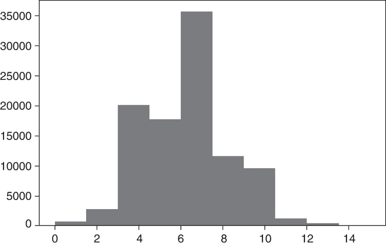

图 8.2 二项分布

图 8.2 中分布底部的数字代表每次 20 次试验中的成功次数。你可以看到，20 次中成功 6 次是最常见的结果，这与 30% 的成功率相符。

`scipy.stats` 子模块中建模的另一个分布是泊松分布。该分布模拟了在某个时间范围内发生特定数量独立事件的概率。分布的形状由其均值控制，你可以使用 `mu` 关键字设置该均值。例如，较低的均值（如 3）会使分布向左偏斜，如图 8.3 所示：

点击此处查看代码图片

```
P = stats.poisson(mu=3)

rvs = P.rvs(size=10000)

rvs

array([4, 4, 2, ..., 1, 0, 2])

plt.hist(rvs)

plt.show()
```

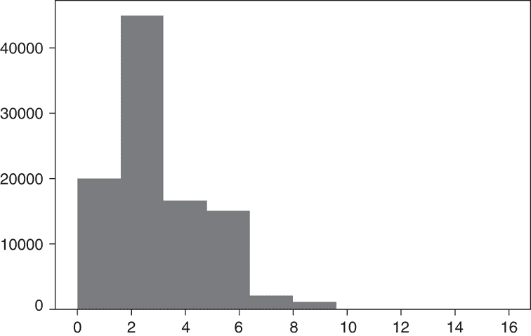

图 8.3 左偏泊松分布

较高的均值（如 15）会将分布向右推，如图 8.4 所示：

点击此处查看代码图片

```
P = stats.poisson(mu=15)

rvs = P.rvs(size=100000)

plt.hist(rvs)

plt.show()
```

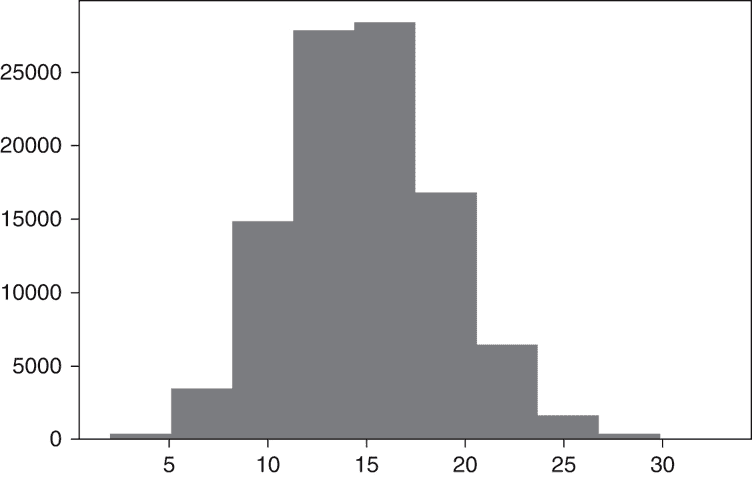

图 8.4 右偏泊松分布

`scipy.stats` 子模块中建模的其他离散分布包括 Beta-二项分布、玻尔兹曼分布（截断普朗克分布）、普朗克分布（离散指数分布）、几何分布、超几何分布、对数分布和尤尔-西蒙分布等。在撰写本文时，`scipy.stats` 子模块中建模了 14 种分布。

#### 连续分布

`scipy.stats` 子模块包含的连续分布远多于离散分布；截至撰写本文时，它有 87 种连续分布。这些分布都接受位置参数（`loc`）和尺度参数（`scale`）。它们的位置参数默认值为 `0`，尺度参数默认值为 `1.0`。

其中建模的一种连续分布是正态分布，你可能熟悉它的钟形曲线。在这个对称分布中，一半数据位于均值左侧，一半位于右侧。以下是使用默认位置和尺度参数创建正态分布的方法：

点击此处查看代码图片

```
N = stats. norm()

rvs = N.rvs(size=100000)

plt.hist(rvs, bins=1000)

plt.show()
```

图 8.5 展示了绘制的此分布。

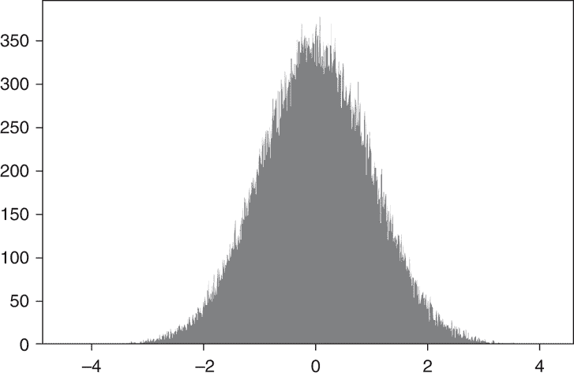

图 8.5 钟形曲线

你可以看到，该分布以 0 为中心，大致范围在 -4 到 4 之间。图 8.6 展示了创建第二个正态分布的效果——这次将位置参数设置为 30，尺度参数设置为 50：

点击此处查看代码图片

```
N1 = stats.norm(loc=30,scale=50)

rvs = N1.rvs(size=100000)

plt.hist(rvs, bins=1000)

plt.show()
```

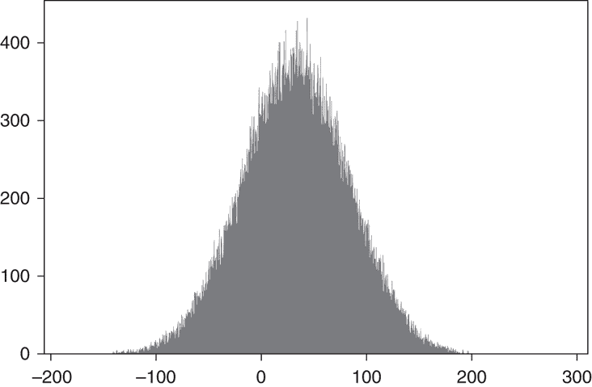

图 8.6 偏移的钟形曲线

注意，现在分布以 30 为中心，并且涵盖了更广泛的数值范围。连续分布共享一些通用函数，这些函数在代码清单 8.3 中进行了建模。请注意，此代码清单使用了具有偏移位置和更大标准差的正态分布。

代码清单 8.3 **正态分布**

点击此处查看代码图片

```
N1 = stats.norm(loc=30, scale=50)

N1.mean() # 分布的均值，与 loc 值匹配

30.0

N1.pdf(4) # 概率密度函数

0.006969850255179491

N1.cdf(2) # 累积分布函数

0.28773971884902705

N1.rvs() # 一个随机样本

171.55168607574785

N1.var() # 方差

2500.0

N1.median()# 中位数

30.0

N1.std() # 标准差

50.0
```

**注意**

如果你尝试此处显示的示例，由于随机数生成，某些值可能会有所不同。

以下连续分布是指数分布，其特点是曲线呈指数变化，无论是上升还是下降（参见图 8.7）：

点击此处查看代码图片

```
E = stats.expon()

rvs = E.rvs(size=100000)

plt.hist(rvs, bins=1000)

plt.show()
```

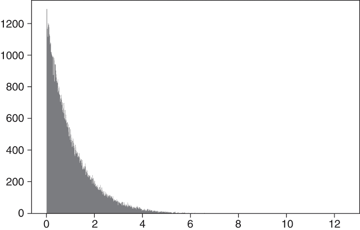

图 8.7 指数变化分布

你可以看到，图 8.7 显示了一条符合指数函数预期的曲线。以下是均匀分布，它具有恒定的概率，也称为矩形分布：

点击此处查看代码图片

```
U = stats.uniform()

rvs = U.rvs(size=10000)

rvs

array([8.24645026e-01, 5.02358065e-01, 4.95390940e-01, ...,

       8.63031657e-01, 1.05270200e-04, 1.03627699e-01])

plt.hist(rvs, bins=1000)

plt.show()
```

此分布在设定的范围内给出均匀的概率。其图形如图 8.8 所示。

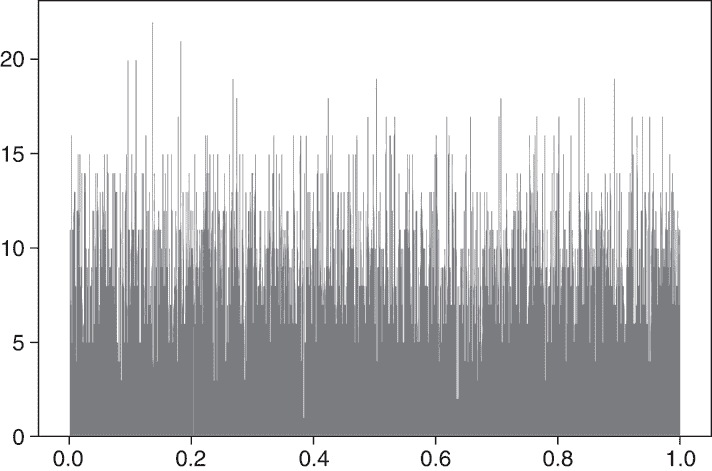

图 8.8 均匀分布

### 总结

NumPy 和 SciPy 库都提供了用于解决复杂数学问题的实用工具。这两个库涵盖了极其广泛和深入的资源，并且已有整本书专门介绍它们的应用。你只看到了众多功能中的一小部分。当你着手解决或建模复杂的数学问题时，应该首先查阅这些库。

### 问题

1.   使用 `scipy`.`stats` 子模块建模一个均值为 15 的正态分布。

2.   从问题 1 中建模的分布生成 25 个随机样本。

3.   哪个 scipy 子模块包含专为数学物理设计的实用工具？

4.   离散分布提供了哪种方法来计算其标准差？

## 9


## Pandas

需要说明的是，*添加*数据。

爱德华·R·塔夫特

本章内容

*   Pandas DataFrame 简介

*   创建 DataFrame

*   DataFrame 内省

*   访问数据

*   操作 DataFrame

*   操作 DataFrame 数据

Pandas DataFrame 构建于 NumPy 数组之上，可能是最常用的数据结构。DataFrame 就像是代码中的超级电子表格。它们是数据科学中使用的主要工具之一。本章将介绍如何创建 DataFrame、操作 DataFrame、访问 DataFrame 中的数据以及操作这些数据。

### 关于 DataFrame

Pandas DataFrame 与电子表格类似，由列和行组成。每一列都是一个 `pandas.Series` 对象。从某些方面来说，DataFrame 类似于一个带有列标签和索引标签的二维 NumPy 数组。然而，与 NumPy 数组不同的是，DataFrame 可以包含不同的数据类型。你可以将 `pandas.Series` 对象视为带标签的一维 NumPy 数组。与 NumPy 数组一样，`pandas.Series` 对象只能包含一种数据类型。`pandas.Series` 对象可以使用许多与数组相同的方法，例如 `min()`、`max()`、`mean()` 和 `medium()`。

通常的惯例是将 Pandas 包导入并别名为 `pd`：

```
import pandas as pd
```

### 创建 DataFrame

你可以从多种来源的数据创建 DataFrame，包括字典和列表，更常见的是通过读取文件来创建。你可以使用 `DataFrame` 构造函数创建一个空的 DataFrame：

点击此处查看代码图片

```
df = pd.DataFrame()

print(df)

Empty DataFrame

Columns: []

Index: []
```

不过，最佳实践是使用数据初始化 DataFrame。

#### 从字典创建 DataFrame

你可以从字典列表或字典创建 DataFrame，其中每个键是一个列标签，该键对应的值包含该列的数据。清单 9.1 展示了如何通过为每一列创建一个数据列表，然后创建一个以列名作为键、这些列表作为值的字典来创建 DataFrame。该清单展示了如何将此字典传递给 `DataFrame` 构造函数以构建 DataFrame。

清单 9.1 **从字典创建 DataFrame**

点击此处查看代码图片

```
first_names = ['shanda', 'rolly', 'molly', 'frank',

               'rip', 'steven', 'gwen', 'arthur']

last_names = ['smith', 'brocker', 'stein', 'bach',

              'spencer', 'de wilde', 'mason', 'davis']

ages = [43, 23, 78, 56, 26, 14, 46, 92]

data = {'first':first_names,

        'last':last_names,

        'ages':ages}

participants = pd.DataFrame(data)
```

生成的 DataFrame `participants` 在 Colab 或 Jupyter notebook 中显示如下：

|  | **first** | **last** | **ages** |
| --- | --- | --- | --- |
| **0** | shanda | smith | 43 |
| **1** | rolly | brocker | 23 |
| **2** | molly | stein | 78 |
| **3** | frank | bach | 56 |
| **4** | rip | spencer | 26 |
| **5** | steven | de wilde | 14 |
| **6** | gwen | mason | 46 |
| **7** | arthur | davis | 92 |

**注意**

在本章中，代码示例生成的 DataFrame 表格将在代码之后以表格形式呈现。

你可以看到顶部的列标签、每行中的数据以及左侧的索引标签。

#### 从列表的列表创建 DataFrame

你可以创建一个列表的列表，每个子列表包含一行数据，数据顺序与列的顺序一致：

点击此处查看代码图片

```
data = [["shanda", "smith", 43],

        ["rolly", "brocker", 23],

        ["molly", "stein", 78],

        ["frank", "bach", 56],

        ["rip", "spencer", 26],

        ["steven", "de wilde", 14],

        ["gwen", "mason", 46],

        ["arthur", "davis", 92]]
```

然后你可以将其用作数据参数：

点击此处查看代码图片

```
participants = pd.DataFrame(data)

participants
```

你会得到与从字典创建 DataFrame 相同的结果：

|  | **0** | **1** | **2** |
| --- | --- | --- | --- |
| **0** | shanda | smith | 43 |
| **1** | rolly | brocker | 23 |
| **2** | molly | stein | 78 |
| **3** | frank | bach | 56 |
| **4** | rip | spencer | 26 |
| **5** | steven | de wilde | 14 |
| **6** | gwen | mason | 46 |
| **7** | arthur | davis | 92 |

请注意，生成的 DataFrame 使用了整数列名。如果未提供列名，这是默认情况。你可以显式地提供一个字符串列表作为列名：

点击此处查看代码图片

```
column_names = ['first', 'last', 'ages']
```

类似地，你也可以提供一个列表作为索引标签：

点击此处查看代码图片

```
index_labels = ['a', 'b', 'c', 'd', 'e', 'f', 'g', 'h']
```

然后在初始化时使用这些标签，通过参数 `columns` 和 `index`：

点击此处查看代码图片

```
participants = pd.DataFrame(data,

                            columns=column_names,

                            index=index_labels)
```

|  | **first** | **last** | **ages** |
| --- | --- | --- | --- |
| **a** | shanda | smith | 43 |
| **b** | rolly | brocker | 23 |
| **c** | molly | stein | 78 |
| **d** | frank | bach | 56 |
| **e** | rip | spencer | 26 |
| **f** | steven | de wilde | 14 |
| **g** | gwen | mason | 46 |
| **h** | arthur | davis | 92 |

#### 从文件创建 DataFrame

虽然可以从字典和列表创建 DataFrame，但绝大多数情况下，你会从现有的数据源创建 DataFrame。文件是这些数据源中最常见的。Pandas 提供了从文件创建 DataFrame 的函数，支持许多常见的文件类型，包括 CSV、Excel、HTML、JSON 和 SQL 数据库连接。

假设你想从 FiveThirtyEight 网站 [`data.fivethirtyeight.com`](https://data.fivethirtyeight.com) 的数据集 `college_majors` 中打开一个 CSV 文件。解压并将 CSV 文件上传到 Colab 后，你只需将其路径提供给 Pandas 的 `read_csv` 函数即可打开它：

点击此处查看代码图片

```
college_majors = pd.read_csv('/content/all-ages.csv')

college_majors
```

|  | **Major** | **Major_category** | **Total** | **Unemployment_rate** |
| --- | --- | --- | --- | --- |
| **0** | GENERAL AGRICULTURE | Agriculture & Natural Resources | 128148 | 0.026147 |
| **1** | AGRICULTURE PRODUCTION AND MANAGEMENT | Agriculture & Natural Resources | 95326 | 0.028636 |
| **2** | AGRICULTURAL ECONOMICS | Agriculture & Natural Resources | 33955 | 0.030248 |
| **...** | ... | ... | ... | ... |
| **170** | MISCELLANEOUS BUSINESS & MEDICAL ADMINISTRATION | Business | 102753 | 0.052679 |
| **171** | HISTORY | Humanities & Liberal Arts | 712509 | 0.065851 |
| **172** | UNITED STATES HISTORY | Humanities & Liberal Arts | 17746 | 0.073500 |

Pandas 使用 CSV 文件中的数据来确定列标签和列类型。


### 与 DataFrame 数据交互

将数据加载到 DataFrame 后，你应该先查看一下它。Pandas 提供了多种访问 DataFrame 中数据的方式。你可以按行、按列、按单个单元格或这些方式的组合来查看数据。你也可以根据数据的值来提取数据。

**注意**

当我第一次加载不熟悉的数据时，我会先快速查看前几行，并检查数据的汇总统计信息。查看 DataFrame 的前几行能让我了解新数据的大致情况，并确认数据符合我的预期。

#### 头部与尾部

要查看 DataFrame 的前几行，你可以使用 `head` 方法，它会返回前五行：

```
college_majors.head()
```

|  | **专业** | **专业类别** | **总人数** | **失业率** |
| --- | --- | --- | --- | --- |
| **0** | 通用农业 | 农业与自然资源 | 128148 | 0.026147 |
| **1** | 农业生产与管理 | 农业与自然资源 | 95326 | 0.028636 |
| **2** | 农业经济学 | 农业与自然资源 | 33955 | 0.030248 |
| **3** | 动物科学 | 农业与自然资源 | 103549 | 0.042679 |
| **4** | 食品科学 | 农业与自然资源 | 24280 | 0.049188 |

`head` 方法接受一个可选参数，用于指定要返回的行数。你可以像这样指定返回前三行：

```
college_majors.head(3)
```

|  | **专业** | **专业类别** | **总人数** | **失业率** |
| --- | --- | --- | --- | --- |
| **0** | 通用农业 | 农业与自然资源 | 128148 | 0.026147 |
| **1** | 农业生产与管理 | 农业与自然资源 | 95326 | 0.028636 |
| **2** | 农业经济学 | 农业与自然资源 | 33955 | 0.030248 |

`tail` 方法的工作方式与 `head` 类似，但返回的是底部的行。它也接受一个可选参数来指定要返回的行数：

```
college_majors.tail()
```

|  | **专业** | **专业类别** | **总人数** | **失业率** |
| --- | --- | --- | --- | --- |
| **168** | 酒店管理 | 商业 | 200854 | 0.051447 |
| **169** | 管理信息系统与统计 | 商业 | 156673 | 0.043977 |
| **170** | 其他商业与医疗管理 | 商业 | 102753 | 0.052679 |
| **171** | 历史学 | 人文与通识教育 | 712509 | 0.065851 |
| **172** | 美国历史 | 人文与通识教育 | 17746 | 0.073500 |

#### 描述性统计

在查看了 DataFrame 的一些行之后，我喜欢了解数据的整体形态。一个用于此目的的工具是 DataFrame 的 `describe` 方法，它可以生成数据的各种描述性统计信息。你可以像下面这样不带参数地调用 `describe`：

```
college_majors.describe()
```

|  | **总人数** | **失业率** |
| --- | --- | --- |
| **计数** | 1.730000e+02 | 173.000000 |
| **均值** | 2.302566e+05 | 0.057355 |
| **标准差** | 4.220685e+05 | 0.019177 |
| **最小值** | 2.396000e+03 | 0.000000 |
| **25%** | 2.428000e+04 | 0.046261 |
| **50%** | 7.579100e+04 | 0.054719 |
| **75%** | 2.057630e+05 | 0.069043 |
| **最大值** | 3.123510e+06 | 0.156147 |

此方法会计算包含数值数据的列的计数、均值、标准差、最小值、最大值和分位数。它接受可选参数来控制处理哪些数据类型以及返回的分位数范围。要更改分位数，你可以使用 `percentiles` 参数：

点击此处查看代码图片

```
college_majors.describe(percentiles=[0.1, 0.9])
```

|  | **总人数** | **失业率** |
| --- | --- | --- |
| **计数** | 1.730000e+02 | 173.000000 |
| **均值** | 2.302566e+05 | 0.057355 |
| **标准差** | 4.220685e+05 | 0.019177 |
| **最小值** | 2.396000e+03 | 0.000000 |
| **10%** | 9.775600e+03 | 0.037053 |
| **50%** | 7.579100e+04 | 0.054719 |
| **90%** | 6.739758e+05 | 0.080062 |
| **最大值** | 3.123510e+06 | 0.156147 |

此示例指定了 10% 和 90% 的分位数，而不是默认的 25% 和 75%。请注意，无论参数如何，50% 分位数都会被包含在内。

如果你想查看非数值列计算的统计信息，可以指定要处理的数据类型。你可以通过使用 `include` 关键字来实现。传递给此关键字的值应该是一个数据类型序列，可以是 NumPy 数据类型，例如 `np.object`。在 Pandas 中，字符串的类型是 `object`，因此以下代码会包含字符串数据类型的列：

点击此处查看代码图片

```
import numpy as np

college_majors.describe(include=[np.object])
```

这也会找到数据类型的字符串名称，对于 `np.object` 来说，就是 `object`。以下代码会根据类型返回相应的统计信息：

点击此处查看代码图片

```
college_majors.describe(include=['object'])
```

因此，对于字符串，你会得到计数、唯一值的数量、出现频率最高的值以及该最高值的频率：

|  | **专业** | **专业类别** |
| --- | --- | --- |
| **计数** | 173 | 173 |
| **唯一值** | 173 | 16 |
| **最高频** | 地球科学 | 工程学 |
| **频次** | 1 | 29 |

你可以传递字符串 `all` 而不是数据类型列表，来为所有列生成统计信息：

点击此处查看代码图片

```
college_majors.describe(include='all')
```

|  | **专业** | **专业类别** | **总人数** | **失业率** |
| --- | --- | --- | --- | --- |
| **计数** | 173 | 173 | 1.730000e+02 | 173.000000 |
| **唯一值** | 173 | 16 | NaN | NaN |
| **最高频** | 地球科学 | 工程学 | NaN | NaN |
| **频次** | 1 | 29 | NaN | NaN |
| **均值** | NaN | NaN | 2.302566e+05 | 0.057355 |
| **标准差** | NaN | NaN | 4.220685e+05 | 0.019177 |
| **最小值** | NaN | NaN | 2.396000e+03 | 0.000000 |
| **25%** | NaN | NaN | 2.428000e+04 | 0.046261 |
| **50%** | NaN | NaN | 7.579100e+04 | 0.054719 |
| **75%** | NaN | NaN | 2.057630e+05 | 0.069043 |
| **最大值** | NaN | NaN | 3.123510e+06 | 0.156147 |

**注意**

当某个统计量不适用于某种数据类型时（例如字符串的标准差），会插入非数字值 `NAN`。

如果你想排除某些数据类型而不是指定要包含哪些，Pandas 提供了 `exclude` 参数，它接受与 `include` 相同类型的参数：

点击此处查看代码图片

```
college_majors.describe(exclude=['int'])
```

#### 访问数据

在你使用 `head` 或 `tail` 初步查看了 DataFrame，并使用 `describe` 了解了数据的整体形态之后，你就可以开始查看数据以及单独的列、行或单元格了。

这是本章前面提到的 `participants` DataFrame：

```
participants
```

|  | **名** | **姓** | **年龄** |
| --- | --- | --- | --- |
| **a** | shanda | smith | 43 |
| **b** | rolly | brocker | 23 |
| **c** | molly | stein | 78 |
| **d** | frank | bach | 56 |
| **e** | rip | spencer | 26 |
| **f** | steven | de wilde | 14 |
| **g** | gwen | mason | 46 |
| **h** | arthur | davis | 92 |


#### 方括号语法

要在 Pandas DataFrame 中访问列或行，你需要使用方括号语法。这种语法非常适合在交互式会话中探索和处理数据，并且使用它是一种最佳实践。

要访问单个列，你可以在方括号中提供列名作为参数，就像使用字典键一样：

点击此处查看代码图片

```
participants['first']

a    shanda

b     rolly

c     molly

d     frank

e       rip

f    steven

g      gwen

h    arthur

Name: first, dtype: object
```

你可以看到，这会返回该列的数据及其索引、标签和数据类型。如果列名不包含破折号或特殊字符，并且该列名与 DataFrame 的现有属性不同，你可以将列作为属性来访问。

例如，以下是访问 `ages` 列的方法：

点击此处查看代码图片

```
participants.ages

a    43

b    23

c    78

d    56

e    26

f    14

g    46

h    92

Name: ages, dtype: int64
```

这对于 `first` 或 `last` 列不起作用，因为这些列名已经是 DataFrame 的属性。

要访问多个列，你需要将列标签指定为一个列表：

点击此处查看代码图片

```
participants[['last', 'first']]
```

|  | **last** | **first** |
| --- | --- | --- |
| **a** | smith | shanda |
| **b** | brocker | rolly |
| **c** | stein | molly |
| **d** | bach | frank |
| **e** | spencer | rip |
| **f** | de wilde | steven |
| **g** | mason | gwen |

这将返回一个仅包含所请求列的 DataFrame。

方括号语法被重载，允许你同时获取行和列。要指定行，你需要使用切片作为参数。如果切片使用整数，那么这些整数表示要返回的行号。例如，要返回 DataFrame `participants` 的第 3、4 和 5 行，你可以使用切片 `3:6`：

```
participants[3:6]
```

|  | **first** | **last** | **ages** |
| --- | --- | --- | --- |
| **d** | frank | bach | 56 |
| **e** | rip | spencer | 26 |
| **f** | steven | de wilde | 14 |

你也可以使用索引标签进行切片。当你使用标签进行切片时，最后一个值会被包含在内。因此，要获取行 `a`、`b` 和 `c`，你可以使用 `a:c` 进行切片：

```
participants['a':'c']
```

|  | **first** | **last** | **ages** |
| --- | --- | --- | --- |
| **a** | shanda | smith | 43 |
| **b** | rolly | brocker | 23 |
| **c** | molly | stein | 78 |

你可以通过使用一个布尔值列表来指示要返回哪些行。该列表应为每行提供一个布尔值：`True` 表示需要的行，`False` 表示其他行。以下示例返回第二、第三和第六行：

点击此处查看代码图片

```
mask = [False, True, True, False, False, True, False, False]

participants[mask]
```

|  | **first** | **last** | **ages** |
| --- | --- | --- | --- |
| **b** | rolly | brocker | 23 |
| **c** | molly | stein | 78 |
| **f** | steven | de wilde | 14 |

方括号语法提供了一种非常方便且易于阅读的数据访问方式。它常用于交互式会话中实验和探索 DataFrame，但在处理大型数据集时，其性能并非最优。在生产代码或处理大型数据集时，推荐使用 DataFrame 的 `loc` 和 `iloc` 索引器来索引 DataFrame。这些索引器使用的方括号语法与你在此处看到的非常相似。`loc` 索引器使用标签进行索引，而 `iloc` 使用索引位置。

#### 按标签优化访问

使用 `loc` 索引器，你可以提供一个单独的标签，该行的值将被返回。例如，要获取标签为 `c` 的行的值，你只需提供 `c` 作为参数：

点击此处查看代码图片

```
participants.loc['c']

first    molly

last     stein

ages        78

Name: c, dtype: object
```

你可以提供一个标签切片，同样地，最后一个标签会被包含在内：

```
participants.loc['c':'f']
```

|  | **first** | **last** | **ages** |
| --- | --- | --- | --- |
| **c** | molly | stein | 78 |
| **d** | frank | bach | 56 |
| **e** | rip | spencer | 26 |
| **f** | steven | de wilde | 14 |

或者你可以提供一个布尔值序列：

点击此处查看代码图片

```
mask = [False, True, True, False, False, True, False, False]

participants.loc[mask]
```

|  | **first** | **last** | **ages** |
| --- | --- | --- | --- |
| **b** | rolly | brocker | 23 |
| **c** | molly | stein | 78 |
| **f** | steven | de wilde | 14 |

可选的第二个参数可以指示要返回哪些列。例如，如果你想要返回 `first` 列的所有行，你可以使用一个切片、一个逗号和列标签来指定所有行：

点击此处查看代码图片

```
participants.loc[:, 'first']

a    shanda

b     rolly

c     molly

d     frank

e       rip

f    steven

g      gwen

h    arthur

Name: first, dtype: object
```

你可以提供一个列标签列表：

点击此处查看代码图片

```
participants.loc[:'c', ['ages', 'last']]
```

|  | **ages** | **last** |
| --- | --- | --- |
| **a** | 43 | smith |
| **b** | 23 | brocker |
| **c** | 78 | stein |

或者你可以提供一个布尔值列表：

点击此处查看代码图片

```
participants.loc[:'c', [False, True, True]]
```

|  | **last** | **ages** |
| --- | --- | --- |
| **a** | smith | 43 |
| **b** | brocker | 23 |
| **c** | stein | 78 |

#### 按索引优化访问

`iloc` 索引器使你能够使用索引位置来选择行和列。与你之前看到的方括号用法非常相似，你可以使用单个值来指定单行：

点击此处查看代码图片

```
participants.iloc[3]

first    frank

last      bach

ages        56

Name: d, dtype: object
```

或者你可以通过使用切片来指定多行：

```
participants.iloc[1:4]
```

|  | **first** | **last** | **ages** |
| --- | --- | --- | --- |
| **b** | rolly | brocker | 23 |
| **c** | molly | stein | 78 |
| **d** | frank | bach | 56 |

你可以选择性地通过使用第二个切片来指示要返回哪一列：

```
participants.iloc[1:4, :2]
```

|  | **first** | **last** |
| --- | --- | --- |
| **b** | rolly | brocker |
| **c** | molly | stein |
| **d** | frank | bach |


#### 掩码与过滤

DataFrame 的一个强大功能是根据值来选择数据。你可以对列使用比较运算符，以查看哪些值满足某些条件。例如，如果你想查看 `college_majors` DataFrame 中哪些行的专业类别（Major_category）值为 `Humanities & Liberal Arts`，你可以使用相等运算符（`==`）：

点击此处查看代码图片

```
college_majors.Major_category == 'Humanities & Liberal Arts'

0      False

1      False

2      False

3      False

       ...

169    False

170    False

171     True

172     True

Name: Major_category, Length: 173, dtype: bool
```

这会生成一个 `pandas.Series` 对象，其中每一行如果匹配条件，则包含 `True`。一个布尔值序列本身有点意思，但真正的威力在于将其与索引器结合使用来过滤结果。请记住，`loc` 会为输入序列中每个 `True` 值返回对应的行。你可以基于比较运算符和某一行来创建条件，例如，下面展示了大于运算符和 `Total` 行的用法：

点击此处查看代码图片

```
total_mask = college_majors.loc[:, 'Total'] > 1200000
```

你可以将结果用作掩码，只选择满足此条件的行：

点击此处查看代码图片

```
top_majors = college_majors.loc[total_mask]

top_majors
```

|  | **专业** | **专业类别** | **总人数** | **失业率** |
| --- | --- | --- | --- | --- |
| **25** | 通识教育 | 教育 | 1438867 | 0.043904 |
| **28** | 初等教育 | 教育 | 1446701 | 0.038359 |
| **114** | 心理学 | 心理学与社会工作 | 1484075 | 0.069667 |
| **153** | 护理学 | 健康 | 1769892 | 0.026797 |
| **158** | 通用商学 | 商业 | 2148712 | 0.051378 |
| **159** | 会计学 | 商业 | 1779219 | 0.053415 |
| **161** | 商业管理与行政 | 商业 | 3123510 | 0.058865 |

你可以使用 `min()` 方法来检查生成的 DataFrame 是否满足条件：

```
top_majors.Total.min()

```

现在，假设你想查看哪些专业类别的失业率最低。你可以对单个列以及整个 DataFrame 使用 `describe` 方法。例如，如果你对 `Unemployment_rate` 列使用 `describe`，你可以看到底部百分位的最高失业率是 0.046261：

点击此处查看代码图片

```
college_majors.Unemployment_rate.describe()

count    173.000000

mean       0.057355

std        0.019177

min        0.000000

25%        0.046261

50%        0.054719

75%        0.069043

max        0.156147

Name: Unemployment_rate, dtype: float64
```

你可以为所有失业率小于或等于此值的行创建一个掩码：

点击此处查看代码图片

```
employ_rate_mask = college_majors.loc[:, 'Unemployment_rate'] <= 0.046261
```

你可以使用此掩码生成一个仅包含这些行的 DataFrame：

点击此处查看代码图片

```
employ_rate_majors = college_majors.loc[employ_rate_mask]
```

然后，你可以使用 `pandas.Series` 对象的 `unique` 方法来查看生成的 DataFrame 中包含哪些专业类别：

点击此处查看代码图片

```
employ_rate_majors.Major_category.unique()

array(['Agriculture & Natural Resources', 'Education', 'Engineering',

       'Biology & Life Science', 'Computers & Mathematics',

       'Humanities & Liberal Arts', 'Physical Sciences', 'Health',

       ‘Business’], dtype=object)
```

所有这些类别都至少有一行的失业率满足该条件。

#### Pandas 布尔运算符

你可以将三个布尔运算符 AND（`&`）、OR（`|`）和 NOT（`~`）与你的条件结果结合使用。你可以使用 `&` 或 `|` 来组合条件，创建更复杂的条件。你可以使用 `~` 来创建一个与你的条件相反的掩码。

例如，你可以使用 AND 基于之前的掩码创建一个新掩码，以查看最受欢迎专业中哪些专业类别的失业率较低。为此，你可以在现有掩码之间使用 `&` 运算符来生成一个新掩码：

点击此处查看代码图片

```
total_rate_mask = employ_rate_mask & total_mask

total_rate_mask

0      False

1      False

2      False

3      False

4      False

      ...

168    False

169    False

170    False

171    False

172    False

Length: 173, dtype: bool
```

通过查看生成的 DataFrame，你可以看到哪些最受欢迎的专业失业率最低：

点击此处查看代码图片

```
college_majors.loc[total_rate_mask]
```

|  | **专业** | **专业类别** | **总人数** | **失业率** |
| --- | --- | --- | --- | --- |
| **25** | 通识教育 | 教育 | 1438867 | 0.043904 |
| **28** | 初等教育 | 教育 | 1446701 | 0.038359 |
| **153** | 护理学 | 健康 | 1769892 | 0.026797 |

你可以将 `~` 运算符与你的失业率掩码结合使用，创建一个所有行的失业率都高于底部百分位的 DataFrame：

点击此处查看代码图片

```
lower_rate_mask = ~employ_rate_mask

lower_rate_majors = college_majors.loc[lower_rate_mask]
```

你可以通过对 `Unemployment_rate` 列使用 `min` 方法来验证这一点，以确保它高于底部百分位的最高失业率：

点击此处查看代码图片

```
lower_rate_majors.Unemployment_rate.min()

0.046261360999999994
```

要选择所有满足热门专业条件或失业率条件的行，你可以使用 `|` 运算符：

点击此处查看代码图片

```
college_majors.loc[total_mask | employ_rate_mask]
```

生成的 DataFrame 包含满足任一条件的所有行。


### 操作 DataFrame

一旦你在 DataFrame 中获得了所需的数据，你可能想要修改这个 DataFrame。你可以重命名列或索引，可以添加新的列和行，也可以删除列和行。

使用 DataFrame 的 `rename` 方法可以轻松更改列的标签。以下是如何使用 DataFrame 的 `columns` 属性来查看当前列名：

点击此处查看代码图片

```
participants.columns

Index(['first', 'last', 'ages'], dtype='object')
```

然后，你可以通过提供一个将每个旧列名映射到新列名的字典来重命名你选择的列。例如，下面是将列 `ages` 的标签更改为 `Age` 的方法：

点击此处查看代码图片

```
participants.rename(columns={'ages': 'Age'})
```

|  | **first** | **last** | **Age** |
| --- | --- | --- | --- |
| **a** | shanda | smith | 43 |
| **b** | rolly | brocker | 23 |
| **c** | molly | stein | 78 |
| **d** | frank | bach | 56 |
| **e** | rip | spencer | 26 |
| **f** | steven | de wilde | 14 |
| **g** | gwen | mason | 46 |
| **h** | arthur | davis | 92 |

默认情况下，`rename` 方法会使用新的列标签返回一个新的 DataFrame。因此，如果你再次检查原始 DataFrame 的列名，你会看到旧的列名：

点击此处查看代码图片

```
participants.columns

Index(['first', 'last', 'ages'], dtype='object')
```

许多 DataFrame 方法都是这样工作的（保留原始状态）。这些方法中的许多都提供了一个可选的 `inplace` 参数，如果将其设置为 `True`，则会修改原始 DataFrame：

点击此处查看代码图片

```
participants.rename(columns={'ages':'Age'}, inplace=True)

participants.columns

Index(['first', 'last', 'Age'], dtype='object')
```

你可以使用索引器语法来创建新列。为此，你只需像该列已存在一样，使用索引器和指定的值来访问它：

点击此处查看代码图片

```
participants['Zip Code'] = [94702, 97402, 94223, 94705,

97503, 94705, 94111, 95333]

participants
```

|  | **first** | **last** | **Age** | **Zip Code** |
| --- | --- | --- | --- | --- |
| **a** | shanda | smith | 43 | 94702 |
| **b** | rolly | brocker | 23 | 97402 |
| **c** | molly | stein | 78 | 94223 |
| **d** | frank | bach | 99 | 94705 |
| **e** | rip | spencer | 26 | 97503 |
| **f** | steven | de wilde | 14 | 94705 |
| **g** | gwen | mason | 46 | 94111 |
| **h** | arthur | davis | 92 | 95333 |

你可以使用列之间的运算（例如字符串拼接）来为新列创建值。如果你决定添加一列包含参与者的全名，你可以从现有的名字和姓氏列中构建这些值：

点击此处查看代码图片

```
participants['Full Name'] = ( participants.loc[:, 'first'] +

participants.loc[:, 'last'] )

participants
```

|  | **first** | **last** | **Age** | **Zip Code** | **Full Name** |
| --- | --- | --- | --- | --- | --- |
| **a** | shanda | smith | 43 | 94702 | shandasmith |
| **b** | rolly | brocker | 23 | 97402 | rollybrocker |
| **c** | molly | stein | 78 | 94223 | mollystein |
| **d** | frank | bach | 99 | 94705 | frankbach |
| **e** | rip | spencer | 26 | 97503 | ripspencer |
| **f** | steven | de wilde | 14 | 94705 | stevende wilde |
| **g** | gwen | mason | 46 | 94111 | gwenmason |
| **h** | arthur | davis | 92 | 95333 | arthurdavis |

你可以使用相同的语法来更新一列。例如，如果你决定全名列中的值应该在名字之间有一个空格，你可以使用相同的列名来分配新值：

点击此处查看代码图片

```
participants['Full Name'] = ( participants.loc[:, 'first'] +

' ' +

participants.loc[:, 'last'] )

participants
```

|  | **first** | **last** | **Age** | **Zip Code** | **Full Name** |
| --- | --- | --- | --- | --- | --- |
| **a** | shanda | smith | 43 | 94702 | shanda smith |
| **b** | rolly | brocker | 23 | 97402 | rolly brocker |
| **c** | molly | stein | 78 | 94223 | molly stein |
| **d** | frank | bach | 99 | 94705 | frank bach |
| **e** | rip | spencer | 26 | 97503 | rip spencer |
| **f** | steven | de wilde | 14 | 94705 | steven de wilde |
| **g** | gwen | mason | 46 | 94111 | gwen mason |
| **h** | arthur | davis | 92 | 95333 | arthur davis |

### 操作数据

Pandas 提供了许多方法来更改 DataFrame 中的数据。你可以使用之前用过的相同索引器来设置值。你可以对整个 DataFrame 或单个列进行操作。你还可以应用函数来更改列中的元素，或从多行或多列创建新值。

要使用索引器更改数据，你需要像选择查看数据一样，选择新数据要存放的位置，然后分配一个新值。例如，要将列 `h` 中的 `arthur` 更改为 `Paul`，你可以使用 `loc`：

点击此处查看代码图片

```
participants.loc['h', 'first'] = 'Paul'

participants
```

|  | **first** | **last** | **Age** | **Zip Code** | **Full Name** |
| --- | --- | --- | --- | --- | --- |
| **a** | shanda | smith | 43 | 94702 | shanda smith |
| **b** | rolly | brocker | 23 | 97402 | rolly brocker |
| **c** | molly | stein | 78 | 94223 | molly stein |
| **d** | frank | bach | 99 | 94705 | frank bach |
| **e** | rip | spencer | 26 | 97503 | rip spencer |
| **f** | steven | de wilde | 14 | 94705 | steven de wilde |
| **g** | gwen | mason | 46 | 94111 | gwen mason |
| **h** | paul | davis | 92 | 95333 | arthur davis |

或者，你可以使用 `iloc` 将行 `c` 中 Molly 的年龄设置为 `99`：

点击此处查看代码图片

```
participants.iloc[3, 2] = 99

participants
```

|  | **first** | **last** | **Age** | **Zip Code** | **Full Name** |
| --- | --- | --- | --- | --- | --- |
| **a** | shanda | smith | 43 | 94702 | shanda smith |
| **b** | rolly | brocker | 23 | 97402 | rolly brocker |
| **c** | molly | stein | 78 | 94223 | molly stein |
| **d** | frank | bach | 99 | 94705 | frank bach |
| **e** | rip | spencer | 26 | 97503 | rip spencer |
| **f** | steven | de wilde | 14 | 94705 | steven de wilde |
| **g** | gwen | mason | 46 | 94111 | gwen mason |
| **h** | paul | davis | 92 | 95333 | arthur davis |

如果你将其视为你之前在列表和字典中使用过的索引赋值的变体，这应该会显得相当直观。

在本章前面，你使用了列之间的运算来为新列构建值。你也可以使用就地运算符，例如 `+=`、`-=` 和 `/=`，来更改列中的值。例如，要将每个参与者的年龄减去 1，你可以使用 `-=` 运算符：

点击此处查看代码图片

```
participants.Age -= 1

participants
```

|  | **first** | **last** | **Age** | **Zip Code** | **Full Name** |
| --- | --- | --- | --- | --- | --- |
| **a** | shanda | smith | 42 | 94702 | shanda smith |
| **b** | rolly | brocker | 22 | 97402 | rolly brocker |
| **c** | molly | stein | 77 | 94223 | molly stein |
| **d** | frank | bach | 98 | 94705 | frank bach |
| **e** | rip | spencer | 25 | 97503 | rip spencer |
| **f** | steven | de wilde | 13 | 94705 | steven de wilde |
| **g** | gwen | mason | 45 | 94111 | gwen mason |
| **h** | paul | davis | 91 | 95333 | arthur davis |


#### `replace` 方法

`replace` 方法用于在 DataFrame 中查找并替换值。例如，你可以用它来将名称 `rolly` 替换为 `Smiley`：

点击此处查看代码图片

```
participants.replace('rolly', 'Smiley')
```

|  | **first** | **last** | **Age** | **Zip Code** | **Full Name** |
| --- | --- | --- | --- | --- | --- |
| **a** | shanda | smith | 42 | 94702 | shanda smith |
| **b** | smiley | brocker | 22 | 97402 | rolly brocker |
| **c** | molly | stein | 77 | 94223 | molly stein |
| **d** | frank | bach | 98 | 94705 | frank bach |
| **e** | rip | spencer | 25 | 97503 | rip spencer |
| **f** | steven | de wilde | 13 | 94705 | steven de wilde |

```
 ...
```

该方法也适用于正则表达式。以下是构建一个正则表达式的方法，该表达式匹配以 `s` 开头的单词，并将 `s` 替换为 `S`：

点击此处查看代码图片

```
participants.replace(r'(s)([a-z]+)', r'S\2', regex=True)
```

|  | **first** | **last** | **Age** | **Zip Code** | **Full Name** |
| --- | --- | --- | --- | --- | --- |
| **a** | shanda | smith | 42 | 94702 | Shanda Smith |
| **b** | rolly | brocker | 22 | 97402 | rolly brocker |
| **c** | molly | stein | 77 | 94223 | molly Stein |
| **d** | frank | bach | 98 | 94705 | frank bach |
| **e** | rip | spencer | 25 | 97503 | rip Spencer |
| **f** | steven | de wilde | 13 | 94705 | Steven de wilde |
| **g** | gwen | mason | 45 | 94111 | gwen mason |
| **h** | paul | davis | 91 | 95333 | arthur davis |

DataFrame 和 `pandas.Series` 对象都有一个 `apply()` 方法，可以对值调用函数。对于 `pandas.Series` 对象，`apply()` 方法会对 `pandas.Series` 对象中的每个值单独调用你选择的函数。

假设你定义了一个函数，用于将传入的任何字符串首字母大写：

点击此处查看代码图片

```
def cap_word(w):

    return w.capitalize()
```

然后，如果你将其作为参数传递给 `first` 列的 `apply()` 方法，它就会将每个名字首字母大写：

点击此处查看代码图片

```
participants.loc[:, 'first'].apply(cap_word)

a    Shanda

b     Rolly

c     Molly

d     Frank

e       Rip

f    Steven

g      Gwen

h      Paul

Name: first, dtype: object
```

对于 DataFrame，`apply` 将一行作为参数，使你能够从该行的列中生成新值。假设你定义了一个使用 `first` 和 `Age` 列值的函数：

点击此处查看代码图片

```
def say_hello(row):

    return f'{row["first"]} is {row["Age"]} years old.'
```

然后你可以将该函数应用于整个 DataFrame：

点击此处查看代码图片

```
participants.apply(say_hello, axis=1)

a    shanda is 42 years old.

b     rolly is 22 years old.

c     molly is 77 years old.

d     frank is 98 years old.

e       rip is 25 years old.

f    steven is 13 years old.

g      gwen is 45 years old.

h      paul is 91 years old.

dtype: object
```

你可以使用此方法跨行或跨列调用函数。使用 `axis` 参数来指示你的函数应处理行还是列。

### 交互式显示

如果你在 Colab 中处理 DataFrame，可以尝试运行以下代码片段：

点击此处查看代码图片

```
%load_ext google.colab.data_table
```

这会使你的 DataFrame 输出变为交互式，并允许你以交互方式筛选和选择。

### 总结

Pandas DataFrame 是在类似电子表格的环境中处理数据的强大工具。你可以从多种来源创建 DataFrame，但从文件创建 DataFrame 是最常见的方式。你可以通过添加新列和新行来扩展 DataFrame。你可以使用强大的索引器访问数据本身，也可以使用它们来设置数据。DataFrame 为探索和操作数据提供了绝佳的方式。

### 问题

使用下表回答以下问题：

| **样本量 (mg)** | **%P** | **%Q** |
| --- | --- | --- |
| 0.24 | 40 | 60 |
| 2.34 | 34 | 66 |
| 0.0234 | 12 | 88 |

1.   创建一个表示此表的 DataFrame。

2.   添加一个名为“Total Q”的新列，其中包含每个样本中 Q 的含量（以 mg 为单位）。

3.   将 %P 和 %Q 列除以 100。

## 10

## 可视化库

一幅图画的最大价值在于它能迫使我们注意到我们从未期望看到的东西。

约翰·图基

本章内容

*   使用 `matplotlib` 创建和样式化图表

*   使用 Seaborn 和 Seaborn 主题绘图

*   使用 Plotly 和 Bokeh 绘图

数据可视化对于探索和呈现数据至关重要。俗话说“一图胜千言”，这同样适用于理解数据。你通常可以从可视化中获得从汇总统计中不明显的见解。统计学家弗朗西斯·安斯库姆曾著名地创建了四个数据集，它们的汇总统计几乎相同，但在绘制图表时却差异巨大。

当你拥有可视化图表时，解释数据也通常更容易。想想图表在演示中的效果有多好。幸运的是，Python 中有不少专为可视化设计的库。

### `matplotlib`

`matplotlib` 是创建可出版级图表的基石工具。它被广泛独立使用，同时也是其他绘图库的基础。它是 SciPy 生态系统的一部分，与 NumPy 和 Pandas 并列。这是一个功能非常强大的大型项目，但也正因为其规模庞大，使用起来可能比较复杂。

`matplotlib` 有多个接口。如果你在网上搜索，尤其是在较旧的示例中，可能会看到 `pylab` 接口，通常这样导入：

```
from matplotlib.pylab import *
```

虽然那些较旧的示例可能有些用处，但现在不鼓励使用 `pylab`。它最初旨在模拟类似于 MATPLOT（一种非 Python 的数学绘图工具）的环境。但是，导入模块的所有内容（即 `import *` 所做的事情）在 Python 中通常被认为是一种不好的做法。推荐的做法是只显式导入你将使用的内容。

`matplotlib` 推荐的接口是 `pyplot`，按照惯例，其别名为 `plt`：

```
import matplotlib.pyplot as plt
```

`matplotlib` 中的两个主要概念是图形和轴。*图形*用于绘制数据。*轴*是可以通过坐标指定点的区域。轴通过图形进行可视化。一个图形可以有多个轴，但一个轴只能附加到一个图形上。

`matplotlib` 提供了两种创建图形和轴的方法：显式创建和隐式创建。以下示例展示了隐式方法。

有一些绘图方法，例如 `plt.plot` 和 `plt.hist`，它们会绘制到当前的轴和图形上。如果当前轴和图形不存在，这些方法会创建一个轴和一个父图形。

`plt.plot` 方法根据 x 和 y 值创建折线图，如图 10.1 所示：

点击此处查看代码图片

```
X = [0, 1, 2, 3, 4, 5, 7, 8, 9, 10]

Y = [20, 25, 35, 50, 10, 12, 20, 40, 70, 110]

plt.plot(X, Y)
```

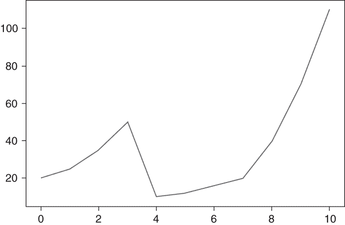

图 10.1 基于 x 和 y 值的折线图


#### 设置图表样式

你可以通过两种不同的机制来控制图表的样式。一种是使用 `matplotlib.Line2D` 类的任何属性。这些属性控制图表中使用的标记、线条样式和颜色。你可以在 `matplotlib` 文档中查看 `matplotlib.Line2D` 属性的完整列表（参见 [`matplotlib.org/3.3.3/api/_as_gen/matplotlib.lines.Line2D.html`](https://matplotlib.org/3.3.3/api/_as_gen/matplotlib.lines.Line2D.html)）。

你可以将这些属性作为关键字参数传递给 `plt.plot`。本节演示了 `marker`、`linestyle` 和 `color` 属性的用法。

可用的标记类型如下：

| `.` | 点标记 |
| `,` | 像素标记 |
| `o` | 圆形标记 |
| `v` | 下三角标记 |
| `^` | 上三角标记 |
| `<` | 左三角标记 |
| `>` | 右三角标记 |
| `1` | 下三叉标记 |
| `2` | 上三叉标记 |
| `3` | 左三叉标记 |
| `4` | 右三叉标记 |
| `s` | 方形标记 |
| `p` | 五边形标记 |
| `*` | 星形标记 |
| `h` | 六边形 1 标记 |
| `H` | 六边形 2 标记 |
| `+` | 加号标记 |
| `x` | x 标记 |
| `D` | 菱形标记 |
| `d` | 细菱形标记 |
| `&#124;` | 竖线标记 |
| `_` | 横线标记 |

你可以使用关键字 `marker` 来指定标记类型。此示例将标记设置为方形（参见图 10.2）：

点击此处查看代码图片

```
X = [0, 1, 2, 3, 4, 5, 7, 8, 9, 10]

Y = [20, 25, 35, 50, 10, 12, 20, 40, 70, 110]

plt.plot(X, Y, marker='s')
```

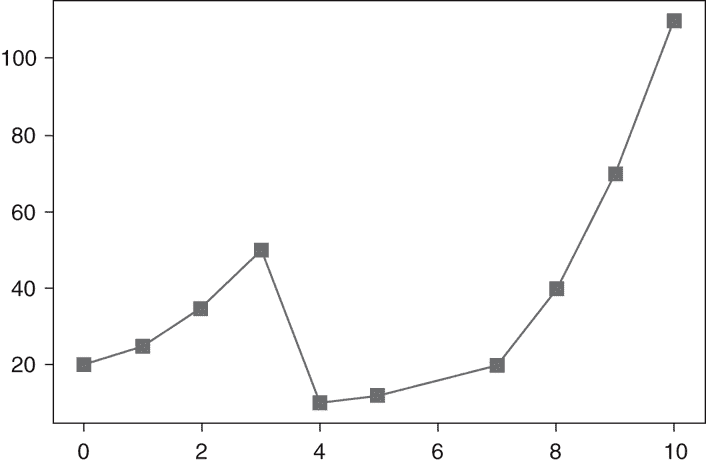

图 10.2 方形标记图

可用的线条样式如下：

| `-` | 实线样式 |
| `--` | 虚线样式 |
| `-.` | 点划线样式 |
| `:` | 点线样式 |

你可以使用关键字 `linestyle` 来设置线条样式（参见图 10.3）：

点击此处查看代码图片

```
X = [0, 1, 2, 3, 4, 5, 7, 8, 9, 10]

Y = [20, 25, 35, 50, 10, 12, 20, 40, 70, 110]

plt.plot(X, Y, marker='s', linestyle=':')
```


图 10.3 使用关键字 `linestyle` 设置参数

可用的颜色如下：

| `b` | 蓝色 |
| `g` | 绿色 |
| `r` | 红色 |
| `c` | 青色 |
| `m` | 品红色 |
| `y` | 黄色 |
| `k` | 黑色 |
| `w` | 白色 |

你可以使用 `color` 关键字来设置颜色。如果你尝试此示例，你将看到与图 10.3 相同的图表，但带有颜色：

点击此处查看代码图片

```
X = [0, 1, 2, 3, 4, 5, 7, 8, 9, 10]

Y = [20, 25, 35, 50, 10, 12, 20, 40, 70, 110]

plt.plot(X, Y, marker='s', linestyle=':', color='m')
```

另一种设置样式属性的方法是使用 `fmt` 参数。这是一个位置参数，位于 Y 参数的右侧。它由一个格式字符串组成，该字符串使用标记、线条样式和颜色设置的简写形式。格式字符串的形式为 `[marker][line][color]`，所有部分都是可选的。例如，对于图 10.4 中的图表，你可以使用格式字符串 `s-.r` 将标记设置为方形，线条样式设置为虚线，颜色设置为红色：

点击此处查看代码图片

```
X = [0, 1, 2, 3, 4, 5, 7, 8, 9, 10]

Y = [20, 25, 35, 50, 10, 12, 20, 40, 70, 110]

fmt = 's-.r'

plt.plot(X, Y, fmt)
```

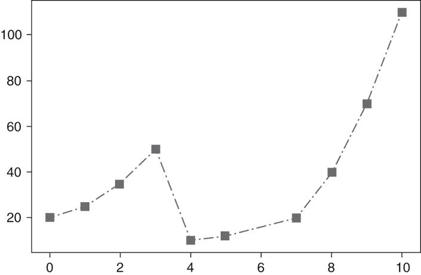

图 10.4 使用格式字符串 `s-.r` 的折线图

你可以同时使用格式字符串和关键字参数。例如，图 10.5 中的图表将格式字符串 '`s-.r``'` 与关键字 `linewidth` 结合使用：

点击此处查看代码图片

```
X = [0, 1, 2, 3, 4, 5, 7, 8, 9, 10]

Y = [20, 25, 35, 50, 10, 12, 20, 40, 70, 110]

fmt = 's-.r'

plt.plot(X, Y, fmt, linewidth=4.3)
```

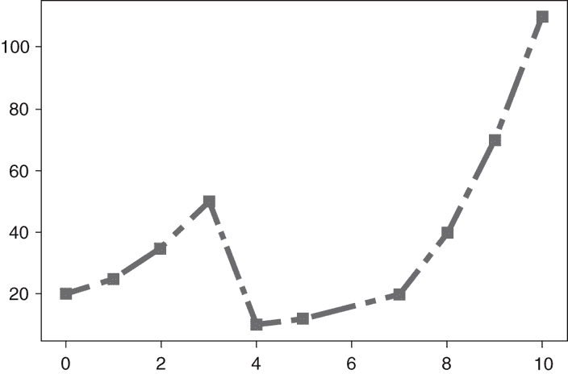

图 10.5 使用关键字 `linewidth` 格式化的折线图

#### 带标签的数据

`matplotlib` 的绘图函数可以使用带标签的数据，包括 Pandas DataFrames、字典以及几乎所有使用方括号语法访问数据的数据结构。你无需为 x 和 y 提供值序列，而是提供相应的标签。

以下是根据美国疾病控制与预防中心的数据（参见 [`www.cdc.gov/nchs/data/nhsr/nhsr122-508.pdf`](https://www.cdc.gov/nchs/data/nhsr/nhsr122-508.pdf)），创建一个 16 年间美国男性和女性平均身高的 DataFrame 的方法：

点击此处查看代码图片

```
import pandas as pd

data = {"Years": ["2000", "2002", "2004", "2006", "2008",

                  "2010", "2012", "2014", "2016"],

        "Men": [189.1, 191.8, 193.5, 196.0, 194.7,

                196.3, 194.4, 197.0, 197.8],

        "Women": [175.7, 176.4, 176.5, 176.2, 175.9,

                  175.9, 175.7, 175.8, 175.3]}

heights_df = pd.DataFrame(data)
```

你可以通过指定用于 x 和 y 的列标签以及从中提取数据的 DataFrame 来创建女性身高的折线图（参见图 10.6）：

点击此处查看代码图片

```
plt.plot('Years', 'Women', data=heights_df)
```

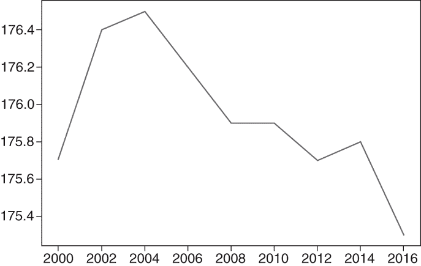

图 10.6 指定了 x 和 y 标签的折线图

#### 绘制多组数据

在同一图表上绘制多组数据有三种方法。第一种是多次调用绘图函数：

点击此处查看代码图片

```
X = [0, 1, 2, 3, 4, 5, 7, 8, 9, 10]

Y = [20, 25, 35, 50, 10, 12, 20, 40, 70, 110]

fmt = 's-.r'

X1 = [0, 1, 2, 3, 4, 5, 7, 8, 9, 10]

Y2 = [90, 89, 87, 82, 72, 60, 45, 28, 10, 0]

fmt2 = '^k:'

plt.plot(X, Y, fmt)

plt.plot(X1, Y2, fmt2)
```

请记住，`plt.plot` 使用当前的坐标轴和图形。这意味着多次调用将继续共享同一个图形和绘图。你可以在图 10.7 中看到同一图形上的多个绘图。

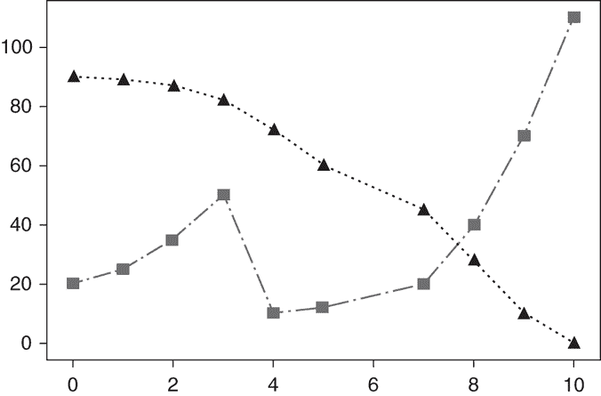

图 10.7 同一图形上的多个绘图

在同一图表上绘制多组数据的第二种方法是直接将多个数据集传递给绘图函数：

```
plt.plot(X, Y, fmt, X1, Y2, fmt2)
```

对于带标签的数据，你可以传递多个标签，每个列都将被添加到图表中（参见图 10.8）：

点击此处查看代码图片

```
plt.plot('Years', 'Women', 'Men', data=heights_df)
```

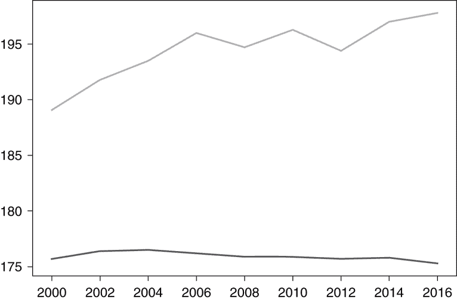

图 10.8 包含多个数据集的折线图

`matplotlib` 提供了便捷函数来添加标签、标题和图例。你可以按照以下方式为图 10.8 中的绘图创建一个带标签的版本（参见图 10.9）：

点击此处查看代码图片

```
plt.plot('Years', 'Women', 'Men', data=heights_df)

plt.xlabel('Year')

plt.ylabel('Height (Inches)')

plt.title("Heights over time")

plt.legend(['Women', 'Men'])
```

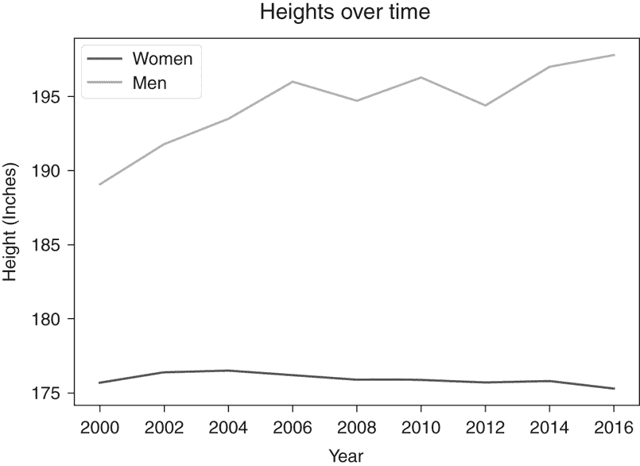

图 10.9 为绘图添加多个标签


#### 面向对象风格

到目前为止，你在本章中看到的处理图形和坐标轴的隐式方式是一种便捷的数据探索方法，尤其是在交互式环境中。`matplotlib` 也允许你直接处理图形和坐标轴，这能让你拥有更多控制权。`plt.subplots()` 函数会返回一个图形以及你指定数量的坐标轴。然后，你可以像使用隐式绘图时那样，在这些坐标轴上绘图：

点击此处查看代码图片

```
fig, ax = plt.subplots()

ax.plot('Years', 'Women', 'Men', data=heights_df)

ax.set_xlabel('Year')

ax.set_ylabel('Height (Inches)')

ax.set_title("Heights over time")

ax.legend(['Women', 'Men'])
```

结果将与使用相同数据在图 10.9 中绘制的图表一致。

如果你想在同一个图形上制作多个图表，可以指定多个坐标轴，如清单 10.1 所示。第一个参数指定行数，第二个参数指定列数。图 10.10 展示了一个在图形上创建两个坐标轴的示例。

清单 10.1 **创建多个坐标轴**

点击此处查看代码图片

```
fig, (ax1, ax2) = plt.subplots(1, 2).       # 创建一个图形和两个坐标轴

ax1.plot('Years', 'Women', data=heights_df) # 在第一个坐标轴上按年份绘制女性数据

ax1.set_xlabel('Year')                      # 标记第一个坐标轴的 x 轴

ax1.set_ylabel('Height (Inches)')           # 标记第一个坐标轴的 y 轴

ax1.set_title("Women")                      # 设置第一个坐标轴的标题

ax1.legend(['Women'])                       # 设置第一个坐标轴的图例

ax2.plot('Years', 'Men', data=heights_df )  # 绘制第二个坐标轴

ax2.set_xlabel('Year')                      # 设置第二个坐标轴的 x 轴标签

ax2.set_title("Men")                        # 设置第二个坐标轴的标题

ax2.legend(['Men'])                         # 设置第二个坐标轴的图例 

fig.autofmt_xdate(rotation=65)              # 旋转日期标签
```

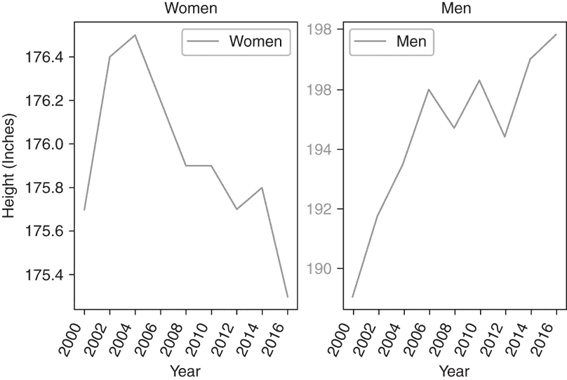

图 10.10 在图形上绘制两个坐标轴

隐式绘图风格非常适合在交互模式下探索数据。显式风格则能让你拥有更多控制权，通常推荐用于生产代码中的绘图。

### Seaborn

Seaborn 是一个基于 `matplotlib` 构建的统计绘图库。它旨在让创建美观的统计图形变得简单，并且以其默认样式通常比其他库提供的样式更美观而闻名。

按照惯例，Seaborn 被导入为 `sns`：

```
import seaborn as sns
```

Seaborn 包含一系列示例数据集，这些数据集用于其提供的文档和教程中。在探索 Seaborn 的功能时，这些数据集也提供了便捷的数据来源。你可以使用 `sns.load_dataset()` 函数，将数据集名称作为参数，将数据集加载为 Pandas DataFrame。可用的数据集列表请参见 [`github.com/mwaskom/seaborn-data`](https://github.com/mwaskom/seaborn-data)。

以下示例展示了如何加载一个车祸数据集，然后选择要使用的列：

点击此处查看代码图片

```
car_crashes = sns.load_dataset('car_crashes')

car_crashes = car_crashes[['total', 'not_distracted', 'alcohol']]
```

此示例使用 Seaborn 的 `sns.relplot()` 函数来绘制两列之间的关系（参见图 10.11）：

点击此处查看代码图片

```
sns.relplot(data=car_crashes,

            x='total',

            y='not_distracted')
```

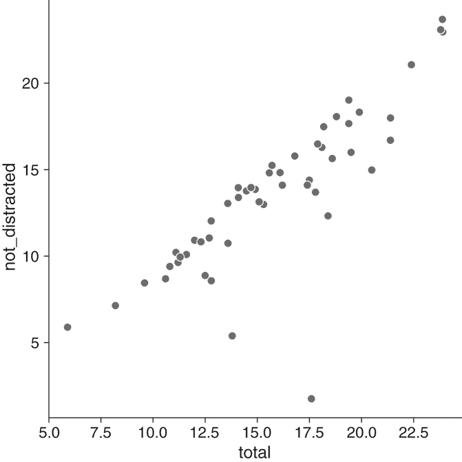

图 10.11 使用 Seaborn 的 `sns.relplot()` 函数绘制两列之间的关系

#### Seaborn 主题

使用 Seaborn 主题是控制图表外观的一种简单方法。要使用 Seaborn 的默认主题，可以使用以下函数：

```
sns.set_theme()
```

你可以重新绘制数据，以查看图 10.12 中所示的新外观：

点击此处查看代码图片

```
sns.relplot(data=car_crashes,

            x='total',

            y='not_distracted')
```

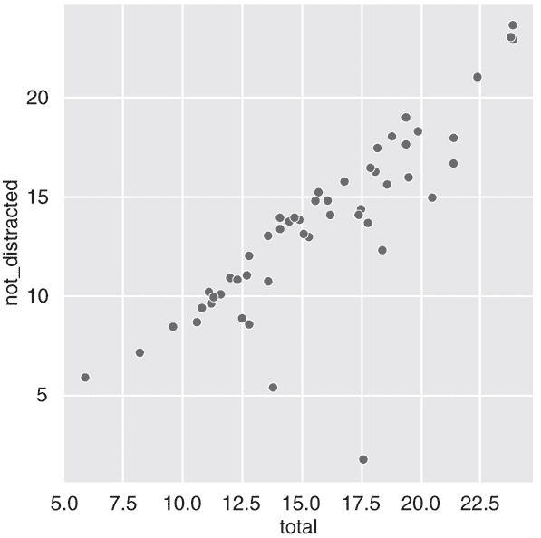

图 10.12 使用 Seaborn 主题控制图表外观

当你设置一个 Seaborn 主题时，它会应用于后续的所有绘图，即使是直接使用 `matplotlib` 创建的绘图也不例外。Seaborn 将 `matplotlib` 参数分为两组：一组处理绘图的美学风格，另一组处理缩放元素。

有五个预设的 Seaborn 样式主题可用：`darkgrid`、`whitegrid`、`dark`、`white` 和 `ticks`。你可以使用 `sns.set_style()` 函数来设置样式。例如，你可以像下面这样设置 `dark` 样式（参见图 10.13）：

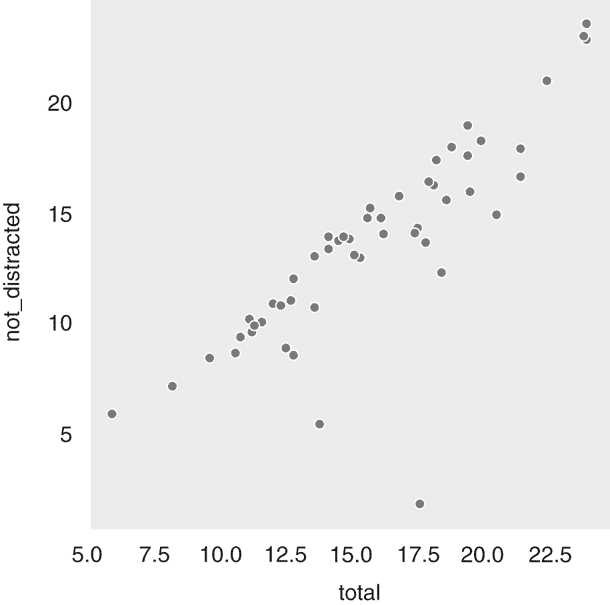

图 10.13 使用深色样式主题

点击此处查看代码图片

```
sns.set_style('dark')

sns.relplot(data=car_crashes,

           x='total',

           y='not_distracted')
```

用于设置图形元素缩放比例的主题基于目标演示场景。它们是 `paper`、`notebook`、`talk` 和 `poster`。

你可以使用 `sns.set_context` 函数来设置主题：

```
sns.set_context('talk')
```

如果你重新绘制数据，缩放比例会相应调整，如图 10.14 所示：

点击此处查看代码图片

```
sns.relplot(data=car_crashes,

            x='total',

            y='not_distracted')
```

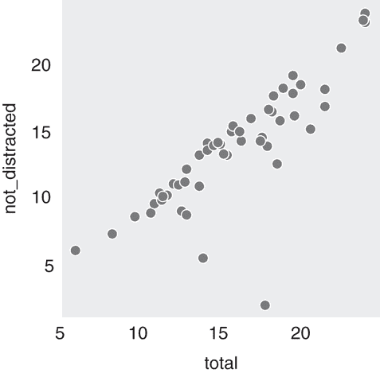

图 10.14 使用 `sns.set_context` 函数重新绘制数据

Seaborn 提供了多种绘图类型。其中，用于寻找数据相关性最有用的类型之一是 `sns.pairplot()`，它会创建一个坐标轴网格，绘制 DataFrame 中所有列之间的关系。你可以像下面这样使用鸢尾花数据集来创建一个配对图（参见图 10.15）：

点击此处查看代码图片

```
df = sns.load_dataset('iris')

sns.pairplot(df, hue='species')
```

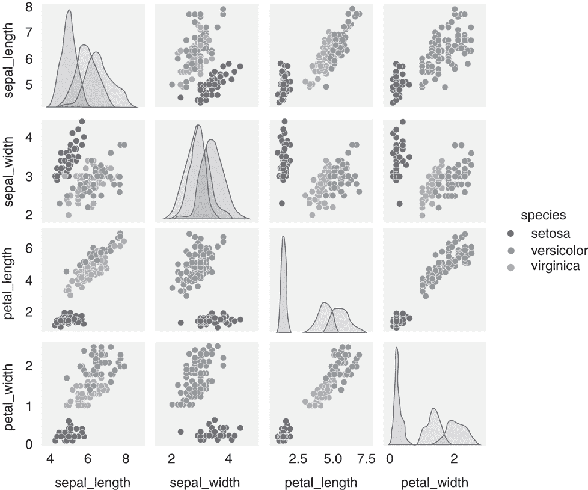

图 10.15 使用鸢尾花数据集绘制的配对图

### Plotly

`matplotlib` 和 Seaborn 是创建适合出版的静态图表的优秀工具。两者都可以扩展以创建交互式数据展示。然而，Plotly 和 Bokeh 库是专门为创建高质量交互式图表而设计的。Plotly 提供了多种图表类型，但其一个突出特点是能够轻松构建 3D 图表。图 10.16 展示了一个动态图表的静态版本。如果你在笔记本中运行此代码，将能够旋转和缩放该图表：

点击此处查看代码图片

```
import plotly.express as px

iris = px.data.iris()

fig = px.scatter_3d(iris,

                    x='sepal_length',

                    y='petal_width',

                    z='petal_length',

                    color='species')

fig.show()
```

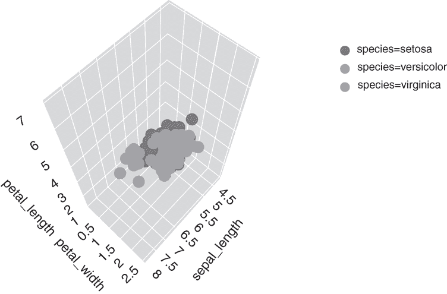

图 10.16 动态图表的静态版本


### Bokeh

Bokeh 是 Plotly 的替代方案，用于轻松创建交互式图形。Bokeh 的突出之处在于它使用了特殊的数据对象 `ColumnDataSource`。该对象提供了更好的性能，并且允许在不重新加载状态的情况下更新或追加数据。数据源还可以在多个图形之间共享，这样与一个图形中数据的交互会修改另一个图形中的数据。代码清单 10.2 设置了多个共享一个数据对象的图形，图 10.17 显示了结果。

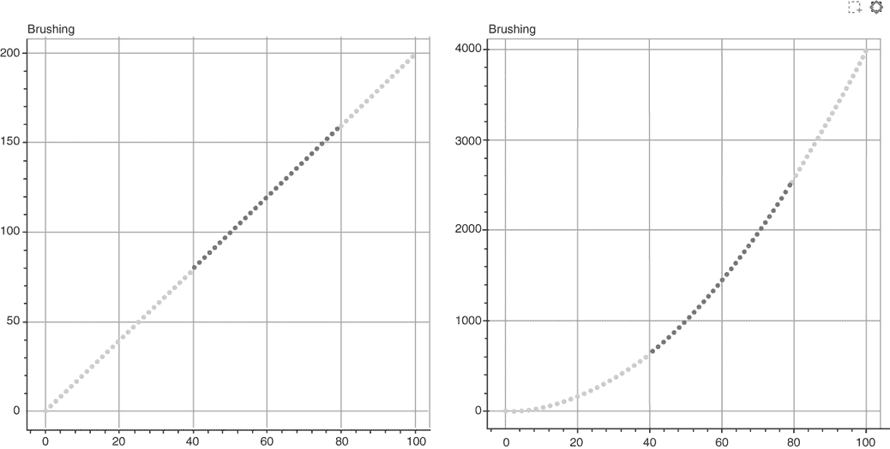

图 10.17 多个图形共享一个数据对象

**注意**

需要提前说明的是，Bokeh 在 Colab 中需要额外的设置。这个示例让你了解 Bokeh 的功能，但并未展示如何在 Colab 中绘制图形。

代码清单 10.2 **Bokeh 共享数据**

点击此处查看代码图片

```
from bokeh.io import output_notebook

from bokeh.plotting import figure, show

from bokeh.models import ColumnDataSource

from bokeh.layouts import gridplot

Y = [x for x in range(0,200, 2)] 

Y1 = [x**2 for x in Y]

X = [x for x in range(100)]

data={'x':X,

      'y':Y,

      'y1':Y1}

TOOLS = "box_select"                  # 选择交互工具 

source = ColumnDataSource(data=data)  # 创建 ColumnDataSource

left = figure(tools=TOOLS,

              title='Brushing')       # 使用所选工具创建图形 

left.circle('x',

            'y',

             source=source)           # 在第一个图形上创建圆形图 

right = figure(tools=TOOLS,

               title='Brushing')      # 使用所选工具创建图形 

right.circle('x',

             'y1',

              source=source)          # 在第二个图形上创建圆形图 

p = gridplot([[left, right]])         # 将图形放在网格上 

show(p)                               # 显示网格
```

输出的图形允许跨轴选择，正如所选工具所定义的那样。这意味着，如果你选择了一个图形的一部分，第二个图形中对应的点也会被选中。

### 其他可视化库

除了本章到目前为止介绍的库之外，还有许多其他优秀的可视化库。以下是一些你可能想要探索的库：

*   `geoplotlib`**：** 支持地图和地理数据的可视化
*   `ggplot`**：** 基于 R 语言包 ggplot2
*   `pygal`**：** 允许你轻松创建简单的图表
*   `folium`**：** 允许你创建交互式地图
*   `missingno`**：** 支持缺失数据的可视化

### 总结

可视化是数据探索中极其有用的部分，也是数据展示的重要组成部分。有许多可用于数据可视化的库，它们各有不同的专长和侧重点。`matplotlib` 是许多其他库的基础。它功能广泛，但学习曲线陡峭。Seaborn 是一个基于 `matplotlib` 构建的统计可视化库，可以轻松改善图表外观，并为不同的目标媒介创建图表。Plotly 和 Bokeh 都旨在创建交互式图表和仪表板。

### 问题

使用以下示例回答下列问题：

点击此处查看代码图片

```
 import matplotlib.pyplot as plt

import seaborn as sns

import pandas as pd

data = {'X'  : [x for x in range(50)],

        'Y'  : [y for y in range(50, 0, -1)],

        'Y1' : [y**2 for y in range(25, 75)]}

df = pd.DataFrame(data)
```

1.   使用 `matplotlib` 绘制列 `X` 和 `Y` 之间的关系。
2.   使用 `matplotlib` 将列 `X` 和 `Y1` 之间的关系添加到同一张图中。
3.   使用 `matplotlib` 将问题 1 和问题 2 中的关系绘制在同一图形的不同坐标轴上。
4.   使用 Seaborn 将主题更改为 `darkgrid`，然后重复问题 3 中的绘图。

## 11

## 机器学习库

在实验结束后才请来统计学家，可能无异于让他进行尸检：他或许能说出实验的死因。

——罗纳德·费希尔

本章内容

*   流行机器学习库概览
*   Scikit-learn 简介
*   机器学习流程概览

*机器学习* 包括让计算机利用数据找到解决问题的方法。相比之下，在传统编程中，程序员在代码中定义找到解决方案的方法，而不是解决方案本身。本章简要概述了一些用于机器学习的流行库。这些库实现了用于创建和训练机器学习模型的算法。这些模型根据问题的类型有不同的用途。例如，一些模型用于预测未来值，另一些模型用于将数据分类到组或类别中。

### 流行的机器学习库

四个最流行的机器学习库是 TensorFlow、Keras、PyTorch 和 Scikit-learn：

*   **TensorFlow：** 谷歌开发了这个强大的库供内部使用。它用于使用深度学习解决问题。这涉及到定义转换数据的层，并在解决方案拟合数据时对这些层进行调整。
*   **Keras：** 这个开源库旨在与 TensorFlow 配合使用，现在已包含在 TensorFlow 库中（参见 [`www.tensorflow.org/guide`](https://www.tensorflow.org/guide)）。
*   **PyTorch：** 这是 Facebook 对达到生产水平的机器学习库的贡献。它基于 Torch 库，该库利用 GPU 解决深度学习问题（参见 [`pytorch.org/docs/stable/index.html`](https://pytorch.org/docs/stable/index.html)）。
*   **Scikit-learn：** 这个用于入门机器学习的流行库构建在 NumPy 和 SciPy 之上。它包含了大多数传统算法的类。你将在下一节中了解更多关于 Scikit-learn 的信息。

### 机器学习的工作原理

机器学习算法可以分为两种类型：无监督学习和监督学习。无监督学习涉及在没有预先存在的结果进行测试的情况下发现关于数据的见解。这通常意味着根据数据的特征识别模式，而无需数据科学家的任何输入。监督学习涉及使用已知数据来训练和测试模型。通常，训练监督模型的步骤如下：

1.   转换数据。
2.   分离出测试数据。
3.   训练模型。
4.   测试准确性。

Scikit-learn 提供了简化这些步骤中每一步的工具，如下节所述。


#### 变换

对于某些算法，在训练模型之前对数据进行变换是有利的。例如，你可能希望将连续变量（如年龄）转换为离散类别（如年龄段）。Scikit-learn 包含多种类型的变换器，包括用于清洗、特征提取、降维和扩维的变换器。这些变换器以类的形式呈现，通常使用 `.fit()` 方法来确定变换，并使用 `.transform()` 方法通过该变换来修改数据。清单 11.1 使用了 `MinMaxScaler` 变换器，它可以将数值缩放到一个定义的范围内——默认情况下是 0 到 1 之间。

清单 11.1 **使用 `MinMaxScaler` 进行变换**

点击此处查看代码图片

```
import numpy as np

from sklearn.preprocessing import MinMaxScaler

data = np.array([[100, 34, 4], 

                  90,  2,  0],

                  78, -12, 16],

                  23,  45, 4]]) # 数据范围从 -12 到 100 的数组

data

array([[100,  34,   4],

      [ 90,   2,   0],

      [ 78, -12,  16],

      [ 23,  45,   4]])

minMax = MinMaxScaler()          # 创建一个变换器对象 

scaler = minMax.fit(data)        # 将变换器拟合到数据上 

scaler.transform(data)           # 缩放到 0 到 1 之间的范围

array([[1\.       ,  0.80701754,  0.25      ],

      [0.87012987,  0.24561404,  0\.        ],

      [0.71428571,  0\.        ,  1\.        ],

      [0\.        ,  1\.        ,  0.25      ]])
```

有时你可能希望在拟合变换器之前分离数据。这样做时，变换器的设置将不会受到测试数据的影响。拟合和变换需要分开的方法；很容易对训练数据进行拟合，并使用该拟合结果来变换测试数据。

#### 拆分测试数据和训练数据

训练模型时需要避免的一个重要陷阱是过拟合，当模型能完美预测用于训练它的数据，但对新数据的预测能力很差时，就会发生这种情况。从最简单的意义上讲，避免过拟合的方法是不使用训练模型的数据来测试模型。Scikit-learn 提供了辅助方法来简化数据拆分。

在查看数据拆分的示例之前，你可以加载一个简单的示例。与其他许多数据科学库一样，Scikit-learn 自带了一些样本数据集。清单 11.2 加载了 `iris` 数据集。请注意，`.load_iris()` 函数加载了两个 NumPy 数组数据：第一个是源数据（将用于进行预测的特征），第二个是要预测的目标特征。对于 `iris` 数据集，源数据有 150 个样本，每个样本包含 4 个特征，以及 150 个代表鸢尾花类型的目标值。

清单 11.2 **加载样本数据集**

点击此处查看代码图片

```
from sklearn import datasets # 加载样本数据集 

source, target = datasets.load_iris(return_X_y=True) # 加载源数据和目标数据 

print(type(source))

<class 'numpy.ndarray'>

print(source.shape)

(150, 4)

print(type(target))

<class 'numpy.ndarray'>

print(target.shape)

 (150,)
```

清单 11.3 使用 Scikit-learn 函数 `train_test_split()` 将库自带的 `iris` 数据集拆分为训练数据集和测试数据集。你可以看到样本被拆分，其中 112 个在训练集中，38 个在测试集中。

清单 11.3 **拆分数据集**

点击此处查看代码图片

```
from sklearn.model_selection import train_test_split

train_s, test_s, train_t, test_t = train_test_split(source, target)

train_s.shape

(112, 4)

train_t.shape

(112,)

test_s.shape

(38, 4)

test_t.shape

(38,)
```

#### 训练与测试

Scikit-learn 提供了许多代表各种机器学习算法的类。这些类被称为*估计器*。许多估计器可以在实例化时通过参数进行调整。每个估计器都有一个 `.fit()` 方法，用于训练模型。大多数 `.fit()` 方法接受两个参数。第一个是某种训练数据，称为*样本*。第二个是这些样本的结果或目标。这两个参数都应该是类似数组的对象，例如 NumPy 数组。训练完成后，模型可以使用其 `.predict()` 方法来预测结果。可以使用该方法所在模块中的函数来检查此预测的准确性。

清单 11.4 展示了一个使用 `KNeighborsClassifier` 估计器的简单示例。K-近邻是一种基于特征间距离对样本进行分组的算法。它通过将新样本与距离其最近的现有样本进行比较来进行预测。你可以通过选择与新样本进行比较的邻居数量来调整算法。模型训练完成后，你可以使用测试数据进行预测，并检查这些预测的准确性。

清单 11.4 **训练模型**

点击此处查看代码图片

```
from sklearn.neighbors import KNeighborsClassifier   # 导入估计器类 

from sklearn import metrics   # 导入 metrics 模块以测试准确性 

knn = KNeighborsClassifier(n_neighbors=3)   # 创建 3-邻居估计器

knn.fit(train_s, train_t)   # 使用训练数据训练模型

test_prediction = knn.predict(test_s)   # 从源数据进行预测

metrics.accuracy_score(test_t, test_prediction)   # 与测试数据对比的准确性 

0.8947368421052632
```

### 了解更多关于 Scikit-learn 的信息

本章仅触及了 Scikit-learn 功能的皮毛。其他重要特性包括用于交叉验证的工具（交叉验证会将数据集多次拆分以避免在测试数据上过拟合），以及管道（管道将变换器、估计器和交叉验证整合在一起）。如果你想了解更多关于 Scikit-learn 的信息，可以在 [`scikit-learn.org/stable/`](https://scikit-learn.org/stable/) 找到很棒的教程。

### 总结

用于创建机器学习模型的许多算法都在主要的 Python 机器学习库中有所体现。TensorFlow 是由 Google 创建的深度学习库。PyTorch 是由 Facebook 在 Torch 基础上构建的库。Scikit-learn 是一个用于入门机器学习的流行库。它拥有执行创建和分析模型所涉及步骤的模块和函数。

### 问题

1.   在训练监督估计器的哪个步骤中，Scikit-learn 变换器会很有用？

2.   为什么在机器学习中分离训练数据和测试数据很重要？

3.   在变换数据并训练模型之后，下一步应该做什么？

## 12

## 自然语言工具包

入门级统计学教科书中最早教授的内容之一就是相关性不等于因果性。这也是最早被遗忘的内容之一。

托马斯·索维尔

本章内容

*   NLTK 包简介

*   访问和加载样本文本

*   使用频率分布

*   文本对象

*   文本分类

使用计算机从文本中获取洞察是非常有用的。数据科学中专注于从文本中获取洞察的子领域被称为*自然语言处理*。自然语言工具包（NLTK）是一个用于所有语言处理相关任务的 Python 包。本章将快速介绍这个强大的包。


### NLTK 示例文本

NLTK 包提供了来自多个来源的示例文本，你可以下载这些文本并用于探索语言处理。古腾堡计划是一个将书籍副本放在网上的项目（参见 [`www.gutenberg.org`](http://www.gutenberg.org)），主要由公共领域的书籍组成。该收藏的一部分可供下载，用于 NLTK。你可以使用 `nltk.download()` 函数将数据下载到主目录下的 nltk_data/corpora 目录中：

点击此处查看代码图片

```
import nltk

nltk.download('gutenberg')

[nltk_data] Downloading package gutenberg to

[nltk_data]     /Users/kbehrman/nltk_data...

[nltk_data]   Unzipping corpora/gutenberg.zip.

True
```

然后，你可以将数据作为语料库阅读器对象导入到你的 Python 会话中：

**注意**

每个语料库阅读器都设计用于读取 NLTK 提供的特定文本集合。

点击此处查看代码图片

```
from nltk.corpus import gutenberg

gutenberg

<PlaintextCorpusReader in '/Users/kbehrman/nltk_data/corpora/gutenberg'>
```

针对不同类型的文本源，存在相应的语料库阅读器。此示例使用了 `PlaintextCorpusReader`，它是为纯文本设计的。你可以通过使用 `fileids()` 方法来列出各个文本，该方法会列出可用于加载文本的文件名：

点击此处查看代码图片

```
gutenberg.fileids()

['austen-emma.txt',

'austen-persuasion.txt',

'austen-sense.txt',

'bible-kjv.txt',

'blake-poems.txt',

'bryant-stories.txt',

'burgess-busterbrown.txt',

'carroll-alice.txt',

'chesterton-ball.txt',

'chesterton-brown.txt',

'chesterton-thursday.txt',

'edgeworth-parents.txt',

'melville-moby_dick.txt',

'milton-paradise.txt',

'shakespeare-caesar.txt',

'shakespeare-hamlet.txt',

'shakespeare-macbeth.txt',

'whitman-leaves.txt']
```

语料库阅读器有多种读取文本的方法。你可以将文本加载为单个单词、句子或段落。清单 12.1 以所有三种格式加载了威廉·莎士比亚的《尤利乌斯·凯撒》文本。

清单 12.1 **加载文本**

点击此处查看代码图片

```
caesar_w = gutenberg.words('shakespeare-caesar.txt') # 单词列表

caesar_w

['[', 'The', 'Tragedie', 'of', 'Julius', 'Caesar', ...]

nltk.download('punkt') # 下载用于定义句子结尾的分词器

[nltk_data] Downloading package punkt to /Users/kbehrman/nltk_data...

[nltk_data]   Unzipping tokenizers/punkt.zip.

True

caesar_s = gutenberg.sents('shakespeare-caesar.txt') # 句子列表

caesar_s

[['[', 'The', 'Tragedie', 'of', 'Julius', 'Caesar', 'by', 'William',

'Shakespeare', '1599', ']'], ['Actus', 'Primus', '.'], ...]

caesar_p = gutenberg.paras('shakespeare-caesar.txt') # 段落列表

caesar_p

[[['[', 'The', 'Tragedie', 'of', 'Julius', 'Caesar', 'by', 'William', 'Shakespeare',

'1599', ']']], [['Actus', 'Primus', '.'], ['Scoena', 'Prima', '.']], ...]
```

请注意，在将文本解析为句子之前，你需要下载 Punkt 分词器。*分词器*用于拆分或标记化一段文本。Punkt 分词器用于将文本拆分为句子，它被设计用于处理多种语言的文本。

清单 12.2 展示了如何使用 shell 命令 `ls` 查看主目录下的 NLTK 子目录，该命令会列出对象和目录。你可以看到有 corpora 和 tokenizers 两个目录。在 corpora 目录中，你可以看到已下载的收藏。在 tokenizers 目录中，你可以看到已下载的分词器。punkt 子目录包含每种所支持语言的对应文件。

清单 12.2 **数据目录**

点击此处查看代码图片

```
!ls /root/nltk_data

corpora    tokenizers

!ls /root/nltk_data/corpora

gutenberg     gutenberg.zip

!ls /root/nltk_data/tokenizers

punkt     punkt.zip

!ls /root/nltk_data/tokenizers/punkt

PY3               english.pickle    greek.pickle      russian.pickle

README            estonian.pickle   italian.pickle    slovene.pickle

czech.pickle      finnish.pickle    norwegian.pickle  spanish.pickle

danish.pickle     french.pickle     polish.pickle     swedish.pickle

dutch.pickle      german.pickle     portuguese.pickle turkish.pickle
```


### 频率分布

你可以使用 `nltk.FreqDist` 类统计文本中每个单词出现的次数。该类提供的方法可以让你查看哪些单词出现频率最高，以及文本中包含的不同单词数量。（在此上下文中，术语 *word* 指任何非空白字符的文本片段。）

`FreqDist` 将标点符号作为独立单词与其他文本区分开来。以下示例使用 `FreqDist` 查找文本中最常见的单词：

点击此处查看代码图片

```
caesar_dist = nltk.FreqDist(caesar_w)

caesar_dist.most_common(15)

[(',', 2204),

('.', 1296),

('I', 531),

('the', 502),

(':', 499),

('and', 409),

("'", 384),

('to', 370),

('you', 342),

('of', 336),

('?', 296),

('not', 249),

('a', 240),

('is', 230),

('And', 218)]
```

如果你想查看不包含标点符号的最常见单词，可以过滤掉标点符号。Python 标准库中的 `string` 模块提供了一个 `punctuation` 属性，你可以利用它来实现这一目的。代码清单 12.3 遍历了文本的原始单词。它检查每个元素是否为标点符号，如果不是，则将其添加到变量 `caesar_r` 的新列表中。该清单还比较了原始文件和过滤后文件的长度，发现文本中有 4,960 个标点符号。然后，该清单生成了一个新的频率分布，以显示最常见的非标点单词。

代码清单 12.3 **移除标点符号**

点击此处查看代码图片

```
import string

string.punctuation                      # 查看标点符号字符串

'!"#$%&\'()*+,-./:;<=>?@[\\]^_'{|}~'

caesar_r = []

for word in caesar_w:

if word not in string.punctuation:

caesar_r.append(word)           # 添加非标点单词

len(caesar_w) - len(caesar_r)           # 获取标点单词数量

caesar_dist = nltk.FreqDist(caesar_r)

caesar_dist.most_common(15)

[('I', 531),

('the', 502),

('and', 409),

('to', 370),

('you', 342),

('of', 336),

('not', 249),

('a', 240),

('is', 230),

('And', 218),

('d', 215),

('in', 204),

('that', 200),

('Caesar', 189),

('my', 188)]
```

在代码清单 12.3 中，你可以看到 Caesar 在文本中出现了 189 次。其他常见单词并不能提供太多关于文本的洞见。你可能希望过滤掉诸如“the”和“is”之类的常见单词；为此，你可以使用名为 `stopwords` 的 NLTK 语料库。代码清单 12.4 展示了如何下载该语料库，并在生成新的频率分布之前过滤掉这些单词。

代码清单 12.4 **过滤停用词**

点击此处查看代码图片

```
nltk.download('stopwords')                       # 下载停用词语料库

from nltk.corpus import stopwords

[nltk_data] Downloading package stopwords to

[nltk_data]     /Users/kbehrman/nltk_data...

[nltk_data]   Unzipping corpora/stopwords.zip.

english_stopwords = stopwords.words('english')   # 加载英文停用词

english_stopwords[:10]

['i', 'me', 'my', 'myself', 'we', 'our', 'ours', 'ourselves', 'you', "you're"]

caesar_r = []

for word in caesar_w:

if word not in string.punctuation:

if word.lower() not in english_stopwords:

caesar_r.append(word) # 既非标点也非停用词

len(caesar_w) - len(caesar_r)

caesar_dist = nltk.FreqDist(caesar_r)

caesar_dist.most_common(15)

[('Caesar', 189),

('Brutus', 161),

('Bru', 153),

('haue', 128),

('shall', 107),

('Cassi', 107),

('thou', 100),

('Cassius', 85),

('Antony', 75),

('know', 66),

('Enter', 63),

('men', 62),

('vs', 62),

('man', 58),

('thee', 55)]
```

现在，最常见单词的列表为你提供了更多关于文本的洞见：你可以看到哪些角色被提及最多。毫不意外，Caesar 和 Brutus 位居列表榜首。

代码清单 12.5 展示了 `FreqDist` 类的一些方法。

代码清单 12.5 **`FreqDist` 类**

点击此处查看代码图片

```
caesar_dist.max()                  # 获取出现次数最多的单词

'Caesar'

caesar_dist['Cassi']      # 获取特定单词的计数

caesar_dist.freq('Cassi') # 单词计数除以总计数

0.009616248764267098

caesar_dist.N()           # 获取单词总数

caesar_dist.tabulate(10)  # 显示前 10 个单词的计数

Caesar  Brutus     Bru    haue   shall   Cassi    thou Cassius  Antony    know

189     161     153     128     107     107     100      85      75      66
```

`FreqDist` 还内置了一个绘图方法。以下示例绘制了出现频率最高的 10 个单词（参见图 12.1）：

```
caesar_dist.plot(10)
```

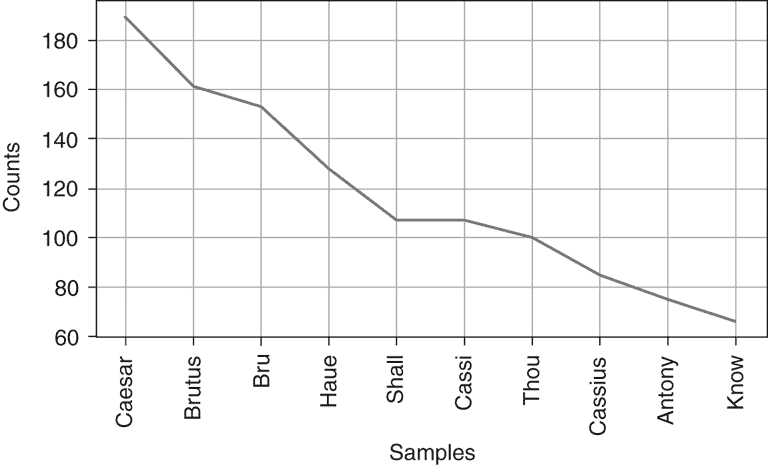

图 12.1 出现频率最高的十个单词

### 文本对象

NLTK 库提供了一个 `Text` 类，它提供了在开始探索新文本时非常有用的功能。`Text` 类在初始化时接受一个单词列表作为参数：

点击此处查看代码图片

```
from nltk.text import Text

caesar_t = Text(caesar_w)

type(caesar_t)

nltk.text.Text
```

`Text.concordance()` 方法显示给定单词周围的上下文。在此示例中，它显示了 Antony 在上下文中的五个实例：

点击此处查看代码图片

```
caesar_t.concordance('Antony', lines=5)

Displaying  5 of 75 matches:

efulnesse . Exeunt . Enter Caesar , Antony for the Course , Calphurnia , Porti

 Of that quicke Spirit that is in Antony : Let me not hinder Cassius your de

He loues no Playes , As thou dost Antony : he heares no Musicke ; Seldome he

r ' d him the Crowne ? Cask . Why Antony Bru . Tell vs the manner of it , ge

I did not marke it . I sawe Marke Antony offer him a Crowne , yet ' twas not
```

`Text.collocations()` 方法显示最常一起出现的单词：

点击此处查看代码图片

```
caesar_t.collocations(num=4)

Mark Antony; Marke Antony; Good morrow; Caius Ligarius
```

`Text.similar()` 方法查找出现在与给定单词相似上下文中的单词：

点击此处查看代码图片

```
caesar_t.similar('Caesar')

me it brutus you he rome that cassius this if men worke him vs feare world thee
```

`Text.findall()` 方法打印与正则表达式匹配的文本，用于搜索文本。你可以使用 `<` 和 `>` 定义单词边界，并使用 `.*` 作为匹配任意内容的通配符来定义正则表达式匹配模式。以下模式匹配所有单词 `O` 后跟以 `C` 开头的任意单词的出现：

点击此处查看代码图片

```
caesar_t.findall(r'<O><C.*>')

O Cicero; O Cassius; O Conspiracie; O Caesar; O Caesar; O Caesar; O

Constancie; O Caesar; O Caesar; O Caesar; O Cassius; O Cassius; O

Cassius; O Coward; O Cassius; O Clitus
```

`Text.dispersion_plot()` 方法允许你比较给定单词在文本中出现的位置（参见图 12.2）：

点击此处查看代码图片

```
caesar_t.dispersion_plot(['Caesar', 'Antony', 'Brutus', 'Cassi'])
```

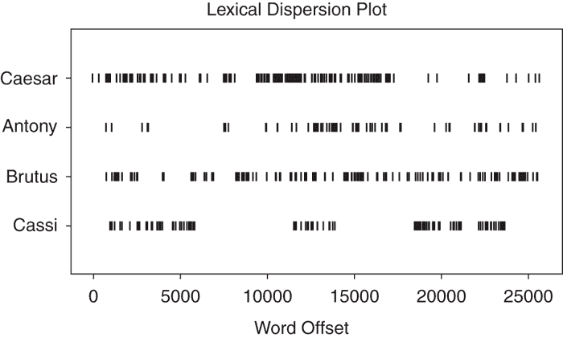

图 12.2 `Text.dispersion_plot()` 方法的结果


### 文本分类

NLTK 提供了多种分类器类，它们实现了不同的算法来处理文本数据的标注。通常，要创建一个用于文本分类的模型，你需要准备一组与类别或标签配对的特征。本节将通过一个简单的示例，使用 NLTK 提供的 Brown 语料库（参见 [`korpus.uib.no/icame/brown/bcm.html`](http://korpus.uib.no/icame/brown/bcm.html)）进行讲解。该语料库中的文本已被预先分类。

假设你认为，根据某些特定词汇的出现情况（由变量 `tell_words` 指向），可以将这些文本中的某个段落标记为“社论”或“小说”：

点击此处查看代码图片

```
tell_words = ['american', 'city', 'congress', 'country', 'county',

'editor', 'fact', 'government', 'national', 'nuclear',

'party', 'peace', 'political', 'power', 'president',

'public', 'state', 'states', 'united', 'war',

'washington', 'world', 'big', 'church', 'every', 'eyes',

'face', 'felt', 'found', 'god', 'hand', 'head', 'home',

'house', 'knew', 'moment', 'night', 'room', 'seemed',

'stood', 'think', 'though', 'thought', 'told', 'voice']
```

代码清单 12.6 展示了如何下载你将使用的语料库，并获取社论和小说类别的段落。

代码清单 12.6 **下载语料库**

点击此处查看代码图片

```
nltk.download('brown')                          # 下载 Brown 语料库

[nltk_data] Downloading package brown to /Users/kbehrman/nltk_data...

[nltk_data]   Unzipping corpora/brown.zip.

from nltk.corpus import brown

nltk.download('stopwords')

from nltk.corpus import stopwords

english_stopwords = stopwords.words('english')

ed_p = brown.paras(categories='editorial') # 仅加载社论段落

fic_p = brown.paras(categories='fiction')  # 仅加载小说段落

print(len(ed_p))

print(len(fic_p))

```

提供的段落格式是列表的列表，其中子列表代表句子。为了本练习的目的，假设你需要为每个段落获取一组单词。代码清单 12.7 定义了一个展平方法，然后对每个数据集中的段落进行展平。

代码清单 12.7 **展平嵌套列表**

点击此处查看代码图片

```
def flatten(paragraph):

output = set([])                        # 使用集合，因为我们只关心单词是否出现一次

for item in paragraph:

if isinstance(item, (list, tuple)):  # 如果 item 是列表或元组

output.update(item)

else:

output.add(item)                 # 添加 item

return output

ed_flat = []

for paragraph in ed_p:

ed_flat.append(flatten(paragraph))      # 展平社论段落

fic_flat = []

for paragraph in fic_p:

fic_flat.append(flatten(paragraph))     # 展平小说段落
```

接下来，你需要将每个段落与其来源类别对应的标签配对。代码清单 12.8 对社论和小说文本都执行此操作，然后使用 `random` 模块中的 `shuffle` 方法打乱顺序，以确保顺序不会影响分类器。

代码清单 12.8 **标注数据**

点击此处查看代码图片

```
labeled_data = []

for paragraph in ed_flat:

labeled_data.append((paragraph, 'editorial'))

for paragraph in fic_flat:

labeled_data.append((paragraph, 'fiction'))

from random import shuffle

shuffle(labeled_data)
```

分类器并不直接使用原始段落，而是期望一个特征集。这个特征集将以字典的形式呈现，将特征映射到值。代码清单 12.9 定义了一个函数来创建特征字典，如果在段落中找到了某个指示词，则其值设为 `True`，否则设为 `False`。然后，它使用该函数列出配对的（特征，标签）对。它将此信息拆分为训练数据和测试数据，以便你可以训练分类器。

代码清单 12.9 **定义特征**

点击此处查看代码图片

```
def define_features(paragraph):

features = {}

for tell_word in tell_words:

features[tell_word] = tell_word in paragraph

return features

feature_data = []

for labeled_paragraph in labeled_data:

paragraph, label = labeled_paragraph

feature_data.append((define_features(paragraph), label,))

train_data = feature_data[:1400]

test_data = feature_data[1400:]
```

代码清单 12.10 展示了如何使用 `nltk.NaiveBayesClassifier` 类训练模型，并使用训练好的模型对单个特征集进行分类，检查哪些指示词对训练影响最大，然后使用测试数据检查准确率。

代码清单 12.10 **训练和测试模型**

点击此处查看代码图片

```
bayes = nltk.NaiveBayesClassifier.train(train_data) # 训练模型

bayes.classify(train_data[0][0]) # 对训练集中的一个段落进行分类

'fictio'

bayes.show_most_informative_features()

Most Informative Features

knew = True           fictio : editor =     22.3 : 1.0

editor = True           editor : fictio =     16.6 : 1.0

stood = True           fictio : editor =     16.0 : 1.0

political = True           editor : fictio =     14.5 : 1.0

nuclear = True           editor : fictio =     12.4 : 1.0

government = True           editor : fictio =     10.8 : 1.0

thought = True           fictio : editor =     10.2 : 1.0

seemed = True           fictio : editor =      7.0 : 1.0

national = True           editor : fictio =      6.6 : 1.0

public = True           editor : fictio =      6.5 : 1.0

nltk.classify.accuracy(bayes, test_data) # 检查准确率

0.6842105263157895
```

你可以看到，该模型在预测测试数据标签方面的准确率约为 66%；这比抛硬币要好。

这个示例应该能让你对使用 NLTK 分类器有所了解。NLTK 的功能远不止本章所介绍的这些。如果你想了解更多关于使用 NLTK 进行自然语言处理的知识，请查阅该库的创建者所著的《Python 自然语言处理》一书（参见 [`www.nltk.org/book`](http://www.nltk.org/book)）。

### 小结

NLTK 库包含用于处理文本的工具，并附带了一些可以下载和使用的示例文本。`FreqDist` 类让你能够深入了解不同单词出现的频率。`Text` 类提供了一种便捷的方式来探索新文本。NLTK 内置了分类器类，可用于基于训练数据对文本进行分类。

### 练习

1.   以单词、句子和段落的形式加载简·奥斯汀的文本《爱玛》。

2.   统计刘易斯·卡罗尔的《爱丽丝梦游仙境》中单词 Alice 出现的次数。

3.   使用 `tabulate` 查看《爱丽丝梦游仙境》中排名前 10 的单词，排除标点符号和停用词。

4.   在《爱丽丝梦游仙境》中查找与 rabbit 相似的单词。

5.   使用 `names` 语料库查找《哈姆雷特》中出现频率最高的 10 个名字。

## 第三部分

## Python 进阶

## 13


## 函数式编程

控制复杂性是计算机编程的精髓。

——布莱恩·克尼汉

本章内容

*   函数式编程简介

*   状态与作用域

*   函数式函数

*   列表推导式

*   生成器

正如你在本书中目前所见，一个 Python 程序，在最基本的层面上，由一系列语句组成，这些语句可以是简单语句或复合语句。组织这些语句的方式会影响性能、可读性和修改的便利性。一些被广泛采用的方法包括过程式编程、函数式编程和面向对象编程。本章将介绍函数式编程的一些概念，包括推导式和生成器，这两者都借鉴自纯函数式语言。

### 函数式编程简介

函数式编程基于函数的数学定义。从这个意义上说，函数将输入映射到输出。对于任何输入，只能有一个输出；换句话说，对于不同的输入，其输出始终相同。某些编程语言，如 Haskell 和 Erlang，严格遵循这一限制。Python 足够灵活，可以在不严格遵循的情况下采用一些函数式概念。Python 中的函数式编程有时被称为*轻量函数式编程*。

#### 作用域与状态

程序的*状态*包括在程序某个特定时间点存在的名称、定义和值，包括函数定义、导入的模块以及分配给变量的值。状态具有所谓的*作用域*——即状态所适用的程序区域。作用域是分层的。当你缩进一个代码块时，这段代码就拥有了一个嵌套作用域。它从周围未缩进的代码继承作用域，但不会直接改变外部作用域。

代码清单 13.1 在外部作用域中为变量 `a` 和 `b` 设置了值。然后，函数的代码块将 `a` 设置为不同的值，并打印这两个变量。你可以看到，当函数被调用时，它使用自己对变量 `a` 的定义，但继承了外部作用域中 `b` 的定义。在外部作用域中，函数为 `a` 赋的值被忽略，因为它超出了作用域。

代码清单 13.1 **继承作用域**

点击此处查看代码图片

```
a = 'a outer'

b = 'b outer'

def scoped_function():

    a = 'a inner'

    print(a)

    print(b)

scoped_function()

a inner

b outer

print(a)

a outer

print(b)

b outer
```

#### 依赖全局状态

到目前为止，本书中的代码大多采用过程式方法呈现。在这种方法中，当前状态由当前行之前已执行的语句定义。该状态在程序中共享，并在整个过程中被修改。这意味着，一个利用状态来确定其输出的函数，在相同输入下可能会产生不同的输出。让我们看一些对比过程式方法和函数式方法的例子。

代码清单 13.2 创建了一个函数 `describe_the_wind()`，它使用在外部作用域中定义的变量 `wind` 返回一个句子。你可以看到，该函数的输出将根据这个变量而不同。

代码清单 13.2 **依赖外部作用域**

点击此处查看代码图片

```
wind = 'Southeast'

def describe_the_wind():

    return f'The wind blows from the {wind}'

describe_the_wind()

'The wind blows from the Southeast'

wind = 'North'

describe_the_wind()

'The wind blows from the North'      f
```

一种更函数式的方法是将变量作为参数传递。这样，无论外部状态如何，该函数对于传递给它的同一个值都会返回相同的结果：

点击此处查看代码图片

```
def describe_the_wind(wind):

    return f'The wind blows from the {wind}'

describe_the_wind('Northeast')

'The wind blows from the Northeast'
```

#### 改变状态

除了不依赖外部状态外，函数式函数也不应直接改变外部状态。代码清单 13.3 展示了一个在函数 `change_wind()` 内部改变外部状态变量 `WIND` 的程序。注意使用了关键字 `global`，它表示要改变一个外部状态变量，而不是在内部状态中定义一个新变量。

代码清单 13.3 **修改外部作用域**

点击此处查看代码图片

```
WINDS = ['Northeast', 'Northwest', 'Southeast', 'Southwest']

WIND = WINDS[0]

def change_wind():

    global WIND

    WIND = WINDS[(WINDS.index(WIND) + 1)%3]

WIND

'Northeast'

change_wind()

WIND

'Northwest'

for _ in WINDS:

    print(WIND)

    change_wind()

Northwest

Southeast

Northeast

Northwest
```

一种更函数式的获取相同输出的方法是将 `winds` 变量移到内部状态中，并让函数 `change_wind()` 接受一个参数来确定输出，如代码清单 13.4 所示。

代码清单 13.4 **不修改外部作用域**

点击此处查看代码图片

```
def change_wind(wind_index):

    winds = ['Northeast', 'Northwest', 'Southeast', 'Southwest']

    return winds[wind_index]

print( change_wind(0) )

Northeast

print( change_wind(1) )

Northwest

print( change_wind(2) )

Southeast

print( change_wind(3) )

Southwest
```

#### 改变可变数据

一种更隐蔽的改变外部状态的方式是传递可变对象。请记住，可变对象是指内容可以被改变的对象，例如列表和字典。如果你在外部状态中设置一个变量，将其作为参数传递给一个函数，然后在函数的内部状态中改变其值，该变量在外部状态中的版本将保留其原始值。示例如下：

点击此处查看代码图片

```
b = 1

def foo(a):

    a = 2

foo(b)

print(b)

```

然而，如果你将一个可变对象（例如字典）作为参数传递给函数，那么在该函数中对这个对象所做的任何更改也会反映在外部状态中。以下示例定义了一个函数，该函数接受一个字典作为参数并更改其一个值：

点击此处查看代码图片

```
d = {"vehicle": "ship", "owner": "Joseph Bruce Ismay"}

def change_mutable_data(data):

    '''一个改变可变数据的函数。'''

    data['owner'] = 'White Star Line'

change_mutable_data(d)

print(d)

{'vehicle': 'ship', 'owner': 'White Star Line'}
```

你可以看到，字典 `d` 在传递给这个函数后，其值在外部状态中被改变了。

以这种方式改变可变对象的外部作用域可能导致难以察觉的错误。如果你的数据结构不是太大，一种避免这种情况的方法是在内部作用域中制作一个副本，然后操作这个副本：

点击此处查看代码图片

```
d = {"vehicle": "ship", "owner": "Joseph Bruce Ismay"}

def change_owner(data):

    new_data = data.copy()

    new_data['owner'] = 'White Star Line'

    return new_data

changed = change_owner(d)

changed

{'owner': 'White Star Line', 'vehicle': 'ship'}
```

通过对副本进行操作，可以更容易地看出值是在哪里被更改的。


#### 函数式编程函数

Python 中有三个内置函数源自函数式编程领域，分别是 `map()`、`filter()` 和 `reduce()`。

`map()` 函数应用于一个值序列，并返回一个 `map` 对象。输入的序列可以是任何可迭代类型——即任何可以迭代的对象，例如 Python 序列。返回的 `map` 对象也是可迭代的，因此你可以遍历它，或者将其转换为列表来查看结果：

点击此处查看代码图片

```
def grow_flowers(d):

    return d * "❀"

gardens = map(grow_flowers, [0,1,2,3,4,5])

type(gardens)

map

list(gardens)

['', '❀', '❀❀', '❀❀❀', '❀❀❀❀', '❀❀❀❀❀']
```

你可以向 `map()` 提供一个接受多个参数的函数，并提供多个输入值序列：

点击此处查看代码图片

```
l1 = [0,1,2,3,4]

l2 = [11,10,9,8,7,6]

def multi(d1, d2):

    return d1 * d2

result = map(multi, l1, l2)

print( list(result) )

 [0, 10, 18, 24, 28]
```

注意在这个例子中，其中一个输入序列比另一个长。`map()` 函数会在到达最短输入序列的末尾时停止。

`reduce()` 函数也接受一个函数和一个可迭代对象作为参数。然后它使用该函数，基于输入返回一个单一值。例如，如果你想从账户余额中减去一笔金额，你可以使用 `for` 循环来实现，如下所示：

点击此处查看代码图片

```
initial_balance = 10000

debits = [20, 40, 300, 3000, 1, 234]

balance = initial_balance

for debit in debits:

    balance -= debit

balance

```

你可以使用 `reduce()` 函数达到相同的结果，如下所示：

点击此处查看代码图片

```
from functools import reduce

inital_balance = 10000

debits = [20, 40, 300, 3000, 1, 234]

def minus(a, b):

    return a - b

balance = reduce(minus, debits, initial_balance)

balance

```

`operator` 模块将所有标准运算符作为函数提供，包括用于标准数学运算的函数。你可以使用 `operator.sub()` 函数作为 `reduce()` 的参数，来替代 `minus()` 函数：

点击此处查看代码图片

```
from functools import reduce

import operator

initial_balance = 10000

debits = [20, 40, 300, 3000, 1, 234]

reduce(operator.sub, debits, initial_balance)

```

`filter()` 函数接受一个函数和一个可迭代对象作为参数。该函数应根据每个项目返回 `True` 或 `False`。结果是一个仅包含那些使函数返回 `True` 的输入值的可迭代对象。例如，要从一个字符串中只获取大写字母，你可以定义一个测试字符是否大写的函数，并将其与字符串一起传递给 `filter()`：

点击此处查看代码图片

```
charles = 'ChArlesTheBald'

def is_cap(a):

    return a.isupper()

retval = filter(is_cap, charles)

list(retval)

['C', 'A', 'T', 'B']
```

我真正推荐使用 lambda 函数的少数情况之一，是在使用 `map()`、`filter()` 和 `reduce()` 函数时。当你进行简单的比较时——例如找出所有大于 3 且小于 10 的数字——你可以以一种简洁易读的方式使用 lambda 函数和 `range()`：

点击此处查看代码图片

```
nums = filter(lambda x: x > 3, range(10))

list(nums)

 [4, 5, 6, 7, 8, 9]
```

### 列表推导式

列表推导式是借鉴自函数式编程语言 Haskell 的语法（参见 [`docs.python.org/3/howto/functional.html`](https://docs.python.org/3/howto/functional.html)）。Haskell 是一种完全函数式的编程语言，其语法设计便于采用纯函数式方法。你可以将列表推导式视为返回列表的单行 `for` 循环。尽管列表推导式源于函数式编程，但其使用已成为所有 Python 方法中的标准做法。

#### 列表推导式基本语法

列表推导式的基本语法如下：

点击此处查看代码图片

```
[ \<返回的项目\> for \<源项目\> in \<可迭代对象\> ]
```

例如，给定一个名字列表，你想将名字改为首字母大写格式（即首字母大写），你可以使用 `x.title()` 作为返回的项目，并将每个名字作为源项目：

点击此处查看代码图片

```
names = ['tim', 'tiger', 'tabassum', 'theodora', 'tanya']

capd = [x.title() for x in names]

capd

['Tim', 'Tiger', 'Tabassum', 'Theodora', 'Tanya']
```

这相当于使用 `for` 循环的以下过程：

点击此处查看代码图片

```
names = ['tim', 'tiger', 'tabassum', 'theodora', 'tanya']

capd = []

for name in names:

    capd.append(name.title())

capd

['Tim', 'Tiger', 'Tabassum', 'Theodora', 'Tanya']
```

#### 替换 `map` 和 `filter`

你可以使用列表推导式来替代 `map()` 和 `filter()` 函数。例如，以下代码将数字 0 到 5 映射到一个函数，该函数将它们插入到一个字符串中：

点击此处查看代码图片

```
def count_flower_petals(d):

    return f"{d} petals counted so far"

counts = map(count_flower_petals, range(6))

list(counts)

['0 petals counted so far',

 '1 petals counted so far',

 '2 petals counted so far',

 '3 petals counted so far',

 '4 petals counted so far',

 '5 petals counted so far']
```

你可以用下面这个简单得多的列表推导式来替换这段代码：

点击此处查看代码图片

```
[f"{x} petals counted so far" for x in range(6)]

['0 petals counted so far',

 '1 petals counted so far',

 '2 petals counted so far',

 '3 petals counted so far',

 '4 petals counted so far',

 '5 petals counted so far']
```

你还可以使用以下语法，为列表推导式添加一个条件：

点击此处查看代码图片

```
[ \<返回的项目\> for \<源项目\> in \<可迭代对象\> if \<条件\> ]
```

通过使用条件，你可以轻松复制 `filter()` 函数的功能。例如，以下 `filter()` 示例仅返回大写字母：

点击此处查看代码图片

```
characters = ['C', 'b', 'c', 'A', 'b', 'P', 'g', 'S']

def cap(a):

    return a.isupper()

retval = filter(cap, characters)

list(retval)

['C', 'A', 'P', 'S']
```

你可以用以下使用条件的列表推导式来替换这个函数：

点击此处查看代码图片

```
characters = ['C', 'b', 'c', 'A', 'b','P', 'g', 'S']

[x for x in characters if x.isupper()]

['C', 'A', 'P', 'S']
```

#### 多个变量

如果源可迭代对象中的项目是序列，你可以通过使用多个变量来解包它们：

点击此处查看代码图片

```
points = [(12, 3), (-1, 33), (12, 0)]

[ f'x: {x} y: {y}' for x, y in points ]

['x: 12 y: 3', 'x: -1 y: 33', 'x: 12 y: 0']
```

你可以通过在同一个列表推导式中使用多个 `for` 语句，来执行相当于嵌套 `for` 循环的操作：

点击此处查看代码图片

```
list_of_lists = [[1,2,3], [4,5,6], [7,8,9]]

[x for y in list_of_lists for x in y]

[1, 2, 3, 4, 5, 6, 7, 8, 9]
```


#### 字典推导式

字典推导式的语法与列表推导式类似。不过，列表推导式是向`list`中追加单个值，而字典推导式则是向字典中添加键值对。以下示例使用两个`lists`中的值来构建一个字典：

点击此处查看代码图片

```
names = ['James', 'Jokubus', 'Shaemus']

scores = [12, 33, 23]

{ name:score for name in names for score in scores}

{'James': 23, 'Jokubus': 23, 'Shaemus': 23}
```

### 生成器

在处理大范围数值时，使用`range`对象而非`list`的一大优势在于，`range`对象会按需计算结果。这意味着它的内存占用始终很小。生成器允许你使用自己的计算逻辑按需创建值，其工作方式与`range`对象类似。

#### 生成器表达式

创建生成器的一种方法是通过生成器表达式，其语法与列表推导式相同，只是将方括号替换为圆括号。以下示例展示了如何基于相同的计算创建一个`list`和一个生成器，并打印它们：

点击此处查看代码图片

```
l_ten = [x**3 for x in range(10)]

g_ten = (x**3 for x in range(10))

print(f"l_ten is a {type(l_ten)}")

l_ten is a <class 'list'>

print(f"l_ten prints as: {l_ten}")

l_ten prints as: [0, 1, 8, 27, 64, 125, 216, 343, 512, 729]

print(f"g_ten is a {type(g_ten)}")

g_ten is a <class 'generator'>

print(f"g_ten prints as: {g_ten}")

g_ten prints as: <generator object <genexpr> at 0x7f3704d52f68>
```

打印`list`时，你可以看到其内容；但生成器则不然。要从生成器中获取值，你必须请求下一个值，这可以通过使用`next()`函数来实现：

```
next(g_ten)

```

或者，更常见的是，你可以在`for`循环中遍历生成器：

点击此处查看代码图片

```
for x in g_ten:

    print(x)

```

由于生成器仅按需生成值，因此无法对其进行索引或切片：

点击此处查看代码图片

```
g_ten[3]

TypeError                          Traceback (most recent call last)

<ipython-input-6-e7b8f961aa33> in <module>()

---->  2 g_ten[3]

TypeError: 'generator' object is not subscriptable
```

生成器相对于`lists`的一个重要优势在于其内存占用。以下示例使用`sys.getsizeof()`函数来比较列表和生成器的大小：

点击此处查看代码图片

```
import sys

x = 100000000

l_big = [x for x in range(x)]

g_big = (x for x in range(x))

print( f"l_big is {sys.getsizeof(l_big)} bytes")

l_big is 859724472 bytes

print( f"g_big is {sys.getsizeof(g_big)} bytes")

g_big is 88 bytes
```

#### 生成器函数

你可以使用生成器函数来创建复杂的生成器。生成器函数看起来与普通函数类似，但将`return`语句替换为了`yield`语句。生成器会维护其自身的内部状态，并按需返回值：

点击此处查看代码图片

```
def square_them(numbers):

    for number in numbers:

        yield number * number

s = square_them(range(10000))

print(next(s))

print(next(s))

print(next(s))

print(next(s))

```

生成器相对于`lists`的另一个优势是能够创建无限生成器——即没有终点的生成器。无限生成器会按需返回任意数量的值。例如，你可以创建一个生成器，它可以根据需要多次递增一个数字：

点击此处查看代码图片

```
def counter(d):

    while True:

        d += 1

        yield d

c = counter(10)

print(next(c))

print(next(c))

print(next(c))

```

清单 13.5 将四个生成器串联在一起。这是一种有用的方式，既能保持每个生成器的可理解性，又能利用生成器的即时计算能力。

清单 13.5 **生成器管道**

点击此处查看代码图片

```
evens = (x*2 for x in range(5000000))

three_factors = (x//3 for x in evens if x%3 == 0)

titles = (f"this number is {x}" for x in three_factors)

capped = (x.title() for x in titles)

print(f"The first call to capped: {next(capped)}")

The first call to capped: This Number Is 0

print(f"The second call to capped: {next(capped)}") The second call to capped: This

Number Is 2

print(f"The third call to capped: {next(capped)}")

The third call to capped: This Number Is 4
```

使用生成器是让代码性能更优的好方法。当你需要遍历一个由计算值组成的长序列时，应该考虑使用生成器。

### 本章小结

函数式编程是一种组织程序的方法，对于设计可并发运行的软件非常有用。它基于这样一个理念：函数内部状态应该被调用它的代码的外部状态所改变，或者应该改变该外部状态。对于给定的输入，函数应始终返回相同的值。三个源自函数式编程世界的 Python 内置函数是`map()`、`filter()`和`reduce()`。使用列表推导式和生成器都是创建值序列的非常 Pythonic 的方式。当你要遍历大量值或不确定需要多少值时，建议使用生成器。

### 练习题

1.   以下代码会打印什么？

点击此处查看代码图片

```
a = 1

b = 2

def do_something(c):

    c = 3

    a = 4

    print(a)

    return c

b = do_something(b)

print(a + b)
```

2.   使用`map()`函数处理字符串`'omni'`，并返回列表`['oo','mm',` `'nn',` `'ii']`。

3.   使用`sum()`函数（该函数用于对序列内容求和）结合列表推导式，计算 100 以下所有正偶数的总和。

4.   编写一个生成器表达式，返回 1,000 以内的立方数。

5.   斐波那契数列以 0 和 1 开始，之后的每个数字都是前两个数字之和。编写一个生成器函数来计算斐波那契数列。

## 14

## 面向对象编程

任何傻瓜都能写出计算机能理解的代码。优秀的程序员写出人类能理解的代码。

——马丁·福勒

本章内容

*   关联状态与函数

*   类与对象

*   特殊函数

*   类继承

面向对象的编程方法是最流行的方法之一。它试图通过将功能与数据相结合来模拟对象及其关系。如果你考虑用代码模拟一辆汽车，面向对象的方法是将执行加速或刹车等操作的方法，以及油箱中的燃油量等数据，都附加到同一个对象上。其他方法则会将数据（本例中为油量）与函数定义分开，可能将数据作为参数传递给函数。面向对象方法的一大优势在于能够创建人类易于理解的复杂系统表示。


### 状态与函数的分组

与函数式方法不同，面向对象编程将数据和功能捆绑在一起，形成所谓的*对象*。可以说，Python 中的一切都是对象；即使是基本类型也拥有方法和数据。例如，一个 `int` 对象不仅仅保存一个值；它还有方法。其中一个方法是 `to_bytes()` 方法，它可以将值转换为其字节表示形式：

点击此处查看代码图片

```
my_num = 13

my_num.to_bytes(8, 'little')

b'\r\x00\x00\x00\x00\x00\x00\x00'
```

更复杂的数据类型，如列表、字符串、字典和 Pandas DataFrame，都结合了数据和功能。在 Python 中，附加到对象上的函数被称为*方法*。Python 面向对象能力的强大之处在于，你可以使用提供的库中的对象，也可以设计自己的对象。

#### 类与实例

对象由类定义。可以将类视为对象的模板。当你实例化一个类时，你会得到该类的对象。创建基本类定义的语法如下：

点击此处查看代码图片

```
class <类名>():

    <语句>
```

你可以使用 `pass` 语句定义一个什么都不做的简单类：

```
class DoNothing():

    pass
```

实例化类的语法如下：

```
<类名>()
```

因此，要从 `DoNothing` 类创建一个名为 `do_nothing` 的实例，你可以像这样实例化该对象：

```
do_nothing = DoNothing()
```

如果你检查这个对象的类型：

点击此处查看代码图片

```
type(do_nothing)

__main__.DoNothing
```

你会发现它是一个由 `DoNothing` 类定义的新类型。你可以通过使用内置的 `isinstance()` 函数来确认这一点，该函数用于测试一个对象是否是某个特定类的实例：

点击此处查看代码图片

```
isinstance(do_nothing, DoNothing)

True
```

定义附加到类上的方法最常见的方式是将函数定义缩进到类的内部作用域中，使用以下语法：

点击此处查看代码图片

```
class <类名>():

     def <函数名>():

        <语句>
```

该函数的第一个参数是调用它的实例。按照惯例，这个参数被命名为 `self`。下面的示例定义了一个类 `DoSomething`，其中包含方法 `return_self()`，该方法返回 `self`，然后创建一个实例并演示 `return_self()` 的返回值实际上就是该实例本身：

点击此处查看代码图片

```
class DoSomething():

    def return_self(self):

        return self

do_something = DoSomething()

do_something == do_something.return_self()

True
```

**注意**

虽然在方法定义中你需要将 `self` 作为参数，但在调用方法时，你不需要指定 `self`，因为它会在后台自动传递。

除了 `self` 参数之外，你可以像定义其他函数一样定义方法。你也可以使用 `self` 对象在类定义中创建和访问对象变量，语法如下：

```
self.<变量名>
```

类似地，方法和属性将附加到从该类实例化的对象上：

点击此处查看代码图片

```
class AddAttribute():

    def add_score(self):

        self.score = 14

add_attribute = AddAttribute()

add_attribute.add_score()

add_attribute.score

```

要在同一个类中从一个方法调用另一个方法，你可以使用以下语法：

```
self.<方法名>
```

代码清单 14.1 演示了如何在同一个类中从一个方法调用另一个方法。

代码清单 14.1 **内部调用方法**

点击此处查看代码图片

```
class InternalMethodCaller():

    def method_one(self):

        print('调用方法一')

    def method_two(self, n):

        print(f'方法二调用方法一 {n} 次')

        for _ in range(n):

            self.method_one()

internal_method_caller = InternalMethodCaller()

internal_method_caller.method_one()

调用方法一

internal_method_caller.method_two(2)

方法二调用方法一 2 次

调用方法一

调用方法一
```

#### 私有方法与变量

任何有权访问该对象的人都可以访问该对象的方法和变量。到目前为止你看到的方法和变量被称为*公有*的，因为它们代表旨在直接使用的数据和功能。有时在定义类的过程中，你需要定义不希望被直接使用的变量或方法。这些被称为*私有*属性，它们的实现细节可能会随着类的演变而改变。私有属性由公有方法在内部使用。Python 没有阻止访问私有属性的机制，但私有属性的名称通常以下划线开头，如下例所示：

点击此处查看代码图片

```
class PrivatePublic():

    def _private_method(self):

        print('私有')

    def public_method(self):

        # 调用私有方法

        self._private_method()

        # ... 执行其他操作
```

#### 类变量

使用语法 `self.<变量名>` 定义的变量被称为*实例变量*。这些变量绑定到类的各个实例。每个实例的实例变量可以有不同的值。你也可以将变量绑定到类。这些*类变量*由该类的所有实例共享。代码清单 14.2 演示了一个同时包含类变量和实例变量的类。该类的两个实例共享类变量的数据，但实例变量具有唯一的值。请注意，类变量并未附加到实例对象 `self` 上。

代码清单 14.2 **类变量与实例变量**

点击此处查看代码图片

```
class ClassyVariables():

    class_variable = '黄色'

    def __init__(self, color):

        self.instance_variable = color

red = ClassyVariables('红色')

blue = ClassyVariables('蓝色')

red.instance_variable

'红色'

red.class_variable

'黄色'

blue.class_variable

'黄色'

blue.instance_variable

'蓝色'
```

### 特殊方法

在 Python 中，一些特殊的方法名称被保留用于特定功能。这些方法包括用于运算符和容器功能的方法，以及对象初始化方法。这些方法中最常用的是 `__init__()` 方法，它在每次实例化对象时被调用。它通常用于设置对象的初始属性值。代码清单 14.3 定义了一个类 `Initialized`，其中包含一个 `__init__()` 方法，该方法接受一个额外的参数 `n`。当你实例化这个类的一个实例时，你必须为这个参数提供一个值，然后它会被赋值给变量 `count`。这个变量随后可以通过类中的其他方法以 `self.count` 的形式访问，或者通过实例化对象以 `<对象>.<属性>` 的形式访问。

代码清单 14.3 **`__init__` 方法**

点击此处查看代码图片

```
class Initialized():

    def __init__(self, n):

        self.count = n

    def increment_count(self):

        self.count += 1

initialized = Initialized(2)

initialized.count

initialized.increment_count()

initialized.count

```


#### 表示方法

`__repr__()` 和 `__str__()` 方法用于控制对象的表示形式。`__repr__()` 方法旨在提供对象的技术性描述。理想情况下，该描述包含重新创建对象所需的信息。当您将对象用作语句时，会看到这种表示形式。`__str__()` 方法旨在定义一种不那么严格但更人性化的表示形式。这是您将对象转换为字符串时的输出，就像 `print()` 函数自动执行的那样。清单 14.4 展示了 `__repr__()` 和 `__str__()` 的使用。

清单 14.4 **`__repr__` 和 `__str__`**

点击此处查看代码图片

```
class Represented():

    def __init__(self, n):

        self.n = n

    def __repr__(self):

        return f'Represented({self.n})'

    def __str__(self):

        return 'Object demonstrating __str__ and __repr__'

represented = Represented(13)

represented

Represented(13)

r = eval(represented.__repr__())

type(r)

__main__.Represented

r.n

str(represented)

'Object demonstrating __str__ and __repr__'

print(represented)

Object demonstrating __str__ and __repr__
```

#### 富比较方法

富比较方法用于定义对象在使用 Python 内置运算符时的行为。清单 14.5 展示了如何为各种比较运算符定义方法。`CompareMe` 类使用变量 `score` 来确定比较结果，并且仅在必要时才回退到变量 `time`。

清单 14.5 **比较方法**

点击此处查看代码图片

```
class CompareMe():

    def __init__(self, score, time):

        self.score = score

        self.time = time

    def __lt__(self, O):

        """ Less than"""

        print('called __lt__')

        if self.score == O.score:

            return self.time > O.time

        return self.score < O.score

    def __le__(self, O):

        """Less than or equal"""

        print('called __le__')

        return self.score <= O.score

    def __eq__(self, O):

        """Equal"""

        print('called __eq__')

        return (self.score, self.time) == (O.score, O.time)

    def __ne__(self, O):

        """Not Equal"""

        print('called __ne__')

        return (self.score, self.time) != (O.score, O.time)

    def __gt__(self, O):

        """Greater Than"""

        print('called __gt__')

        if self.score == O.score:

            return self.time < O.time

        return self.score > O.score

    def __ge__(self, O):

        """Greater Than or Equal"""

        print('called __ge__')

        return self.score >= O.score
```

清单 14.6 使用一些不同的值实例化 `CompareMe` 类，然后测试一些比较运算符。

清单 14.6 **尝试运算符**

点击此处查看代码图片

```
high_score  = CompareMe(100, 100)

mid_score   = CompareMe(50, 50)

mid_score_1 = CompareMe(50, 50)

low_time    = CompareMe(100, 25)

high_score > mid_score

called __gt__

True

high_score >= mid_score_1

called __ge__

True

high_score == low_time

called __eq__

False

mid_score == mid_score_1

called __eq__

True

low_time > high_score

called __gt__

True
```

可以定义将一个属性与一个对象进行比较的比较方法。清单 14.7 创建了一个类，该类直接将其 `score` 属性与另一个对象进行比较。这允许您将一个对象与任何其他可与 `int` 进行比较的类型进行比较。（为简洁起见，此清单仅实现了小于和等于方法。）

清单 14.7 **与对象比较**

点击此处查看代码图片

```
class ScoreMatters():

    def __init__(self, score):

        self.score = score

    def __lt__(self, O):

        return self.score < O

    def __eq__(self, O):

        return self.score == O

my_score = ScoreMatters(14)

my_score == 14.0

True

my_score < 15

True
```

在 Python 代码中定义令人困惑或不合逻辑的比较是很重要的。您需要在这些定义中牢记最终用户。例如，清单 14.8 定义了一个类，它总是比与之比较的任何东西都大——甚至比它自己还大。这可能会导致该类的最终用户感到困惑。

清单 14.8 **一个令人困惑的“大”类**

点击此处查看代码图片

```
class ImAllwaysBigger():

    def __gt__(self, O):

        return True

    def __ge__(self, O):

        return True

i_am_bigger = ImAllwaysBigger()

no_i_am_bigger = ImAllwaysBigger()

i_am_bigger > "Anything"

True

i_am_bigger > no_i_am_bigger

True

no_i_am_bigger > i_am_bigger

True

i_am_bigger > i_am_bigger

True
```

#### 数学运算符方法

Python 中有用于数学运算的特殊方法。清单 14.9 定义了一个类，该类实现了 `+`、`-` 和 `*` 运算符的方法。这个类基于其 `.value` 变量返回新对象。

清单 14.9 **选定的数学运算**

点击此处查看代码图片

```
class MathMe():

    def __init__(self, value):

        self.value = value

    def __add__(self, O):

        return MathMe(self.value + O.value)

    def __sub__(self, O):

        return MathMe(self.value - O.value)

    def __mul__(self, O):

        return MathMe(self.value * O.value)

m1 = MathMe(3)

m2 = MathMe(4)

m3 = m1 + m2

m3.value

m4 = m1 - m3

m4.value

m5 = m1 * m3

m5.value

```

还有更多特殊方法，包括用于位运算和定义支持切片的容器类对象的方法。有关特殊方法的完整列表，请参见 [`docs.python.org/3/reference/datamodel.html#special-method-names`](https://docs.python.org/3/reference/datamodel.html#special-method-names)。


### 继承

面向对象编程中最重要且最强大的概念之一就是继承。通过继承，一个类可以将另一个或多个类声明为父类。子类可以使用父类的方法和变量，就像它们是在子类自身定义中声明的一样。清单 14.10 定义了一个 `Person` 类，然后将其作为另一个类 `Student` 的父类。

清单 14.10 **基本继承**

点击此处查看代码图片

```
class Person():

def __init__(self, first_name, last_name):

self.first_name = first_name

self.last_name = last_name

class Student(Person):

def introduce_yourself(self):

print(f'Hello, my name is {self.first_name}')

barb = Student('Barb', 'Shilala')

barb.first_name

'Barb'

barb.introduce_yourself()

Hello, my name is Barb
```

请注意，方法 `Student.introduce_yourself()` 使用了变量 `Person.first_name`，就像它是在 `Student` 类中声明的一样。如果你检查该实例的类型，会发现它是 `Student`：

```
type(barb)

__main__.Student
```

重要的是，如果你使用 `isinstance()` 函数，你会发现该实例既是 `Student` 类的实例：

```
isinstance(barb, Student)

True
```

也是 `Person` 类的实例：

```
isinstance(barb, Person)

True
```

当你编写的代码期望类之间具有某些共享行为时，继承非常有用。例如，如果你正在实现一个作业编排系统，你可能期望每种类型的作业都有一个 `run()` 方法。与其测试每一种可能的作业类型，不如直接定义一个带有 `run()` 方法的父类。任何继承自该父类（因此也是该父类的实例）的作业都将定义有 `run()` 方法，如清单 14.11 所示。

清单 14.11 **测试基类**

点击此处查看代码图片

```
class Job():

def run(self):

print("I'm running")

class ExtractJob(Job):

def extract(self, data):

print('Extracting')

class TransformJob(Job):

def transform(self, data):

print('Transforming')

job_1 = ExtractJob()

job_2 = TransformJob()

for job in [job_1, job_2]:

if isinstance(job, Job):

job.run()

I'm running

I'm running
```

如果子类定义了一个与父类中同名的变量或方法，子类的实例将使用子类自身的定义。例如，假设你定义了一个带有 `run()` 方法的父类：

点击此处查看代码图片

```
class Parent():

def run(self):

print('I am a parent running carefully')
```

同时，你定义了一个重新定义了该方法的子类：

点击此处查看代码图片

```
class Child(Parent):

def run(self):

print('I am a child running wild')
```

那么子类的实例将使用子类自身的定义：

点击此处查看代码图片

```
chile = Child()

chile.run()

I am a child running wild
```

有时，显式调用父类的方法会很有用。例如，在子类的 `__init__()` 方法中调用父类的 `__init__()` 方法并不罕见。`super()` 函数可以访问父类及其属性。下面的示例使用 `super()` 从子类 `Student` 中调用 `Person.__init__()`：

点击此处查看代码图片

```
class person():

def __init__(self, first_name, last_name):

self.first_name = first_name

self.last_name = last_name

class student(person):

def __init__(self, school_name, first_name, last_name):

self.school_name = school_name

super().__init__(first_name, last_name)

lydia = student('boxford', 'lydia', 'smith')

lydia.last_name

'smith'
```

继承并不局限于单个父类或单层。一个类可以继承自另一个类，而后者本身又继承自另一个类：

点击此处查看代码图片

```
class A():

pass

class B(A):

pass

class C(B):

pass

c = C()

isinstance(c, B)

True

isinstance(c, A)

True
```

一个类也可以继承自多个父类：

点击此处查看代码图片

```
class A():

def a_method(self):

print(A's method)

class B():

def b_method(self):

print(B's method)

class C(A, B):

pass

c = C()

c.a_method()

A's method

c.b_method()

B's method
```

**注意**

总的来说，我建议在可能的情况下避免构建过于复杂的继承树。当你追踪通过继承树定义的变量和方法之间的交互时，复杂的继承会变得非常难以调试。

**注意**

关于面向对象设计的著作已经很多。我建议在开始一个大型面向对象项目之前进一步研究它，以避免不必要的陷阱。

### 总结

面向对象编程涉及将数据和功能分组到由类定义的对象中。特殊方法允许你定义能够与 Python 运算符和实现容器行为的类一起工作的类。类可以继承其他类的定义。

### 问题

1.   在类定义中，变量 `self` 代表什么？

2.   何时调用 `__init__()` 特殊方法？

3.   给定以下类定义：

点击此处查看代码图片

```
class Confuzed():

    def __init__(self, n):

        self.n = n

    def __add__(self, O):

        return self.n – O
```

对于以下代码，你期望得到什么结果？

```
c = Confuzed(12)

c + 12
```

4.   以下代码的输出是什么？

点击此处查看代码图片

```
class A():

    def say_hello(self):

        print('Hello from A')

    def say_goodbye(self):

        print('Goodbye from A')

class B(A):

    def say_goodbye(self):

        print('Goodbye from B')

b = B()

b.say_hello()

b.say_goodbye()
```

## 15

## 其他主题

程序最重要的属性是它是否实现了用户的意图。

C.A.R. Hoare

本章内容

*   列表排序

*   读写文件

*   `datetime` 对象

*   正则表达式

本章涵盖了一些 Python 标准库组件，这些组件对于数据科学和通用 Python 使用都是强大的工具。它从各种排序数据的方法开始，然后转向使用上下文管理器读写文件。接下来，本章探讨如何使用 `datetime` 对象表示时间。最后，本章介绍如何使用强大的正则表达式库搜索文本。至少对这些主题有一个高层次的了解是很重要的，因为它们在生产编程中都被大量使用。本章应使你对这些主题有足够的熟悉度，以便在需要时能够理解它们。

### 排序

一些 Python 数据结构，例如列表、NumPy 数组和 Pandas DataFrames，具有内置的排序功能。你可以直接使用这些数据结构，也可以使用自己的排序函数对其进行自定义。


#### 列表

对于 Python 列表，你可以使用内置的 `sort()` 方法，该方法会原地对列表进行排序。例如，假设你定义了一个表示鲸鱼名称的字符串列表：

点击此处查看代码图片

```
whales = [ 'Blue', 'Killer', 'Sperm', 'Humpback', 'Beluga', 'Bowhead' ]
```

如果你现在按如下方式使用该列表的 `sort()` 方法：

```
whales.sort()
```

你会看到该列表现在已按字母顺序排序：

点击此处查看代码图片

```
whales

['Beluga', 'Blue', 'Bowhead', 'Humpback', 'Killer', 'Sperm']
```

此方法不会返回列表的副本。如果你捕获返回值，会发现它是 `None`：

点击此处查看代码图片

```
return_value = whales.sort()

print(return_value)

None
```

如果你想创建列表的排序副本，可以使用 Python 的内置 `sorted()` 函数，该函数会返回一个排序后的列表：

点击此处查看代码图片

```
sorted(whales)

['Beluga', 'Blue', 'Bowhead', 'Humpback', 'Killer', 'Sperm']
```

你可以在任何可迭代对象上使用 `sorted()`，包括列表、字符串、集合、元组和字典。无论可迭代对象的类型如何，此函数都会返回一个排序后的列表。如果你在字符串上调用它，它会返回一个由字符串字符组成的排序列表：

点击此处查看代码图片

```
sorted("Moby Dick")

[' ', 'D', 'M', 'b', 'c', 'i', 'k', 'o', 'y']
```

`list.sort()` 方法和 `sorted()` 函数都接受一个可选的 `reverse` 参数，该参数默认为 `False`：

点击此处查看代码图片

```
sorted(whales, reverse=True)

['Blue', 'Sperm', 'Beluga', 'Killer', 'Bowhead', 'Humpback']
```

`list.sort()` 和 `sorted()` 也都接受一个可选的 `key` 参数，用于定义排序方式。例如，要根据字符串长度对鲸鱼名称进行排序，你可以定义一个返回字符串长度的 lambda 函数，并将其作为 key 参数传递：

点击此处查看代码图片

```
sorted(whales, key=lambda x: len(x))

['Blue', 'Sperm', 'Beluga', 'Killer', 'Bowhead', 'Humpback']
```

你也可以定义更复杂的 `key` 函数。以下示例展示了如何定义一个函数，该函数返回字符串的长度，除非该字符串是 `'``Beluga``'`，在这种情况下它返回 `1`。这意味着只要其他字符串的长度大于 `1`，`key` 函数就会按字符串长度对列表进行排序，但 `'``Beluga``'` 除外，它会被放在第一位：

点击此处查看代码图片

```
def beluga_first(item):

if item == 'Beluga':

return 1

return len(item)

sorted(whales, key=beluga_first)

['Beluga', 'Blue', 'Sperm', 'Killer', 'Bowhead', 'Humpback']
```

你也可以在你定义的类上使用 `sorted()`。清单 15.1 定义了 `Food` 类并实例化了它的四个实例。然后，它使用属性 `rating` 作为排序键对这些实例进行排序。

清单 15.1 **使用 Lambda 对对象进行排序**

点击此处查看代码图片

```
class Food():

def __init__(self, rating, name):

self.rating = rating

self.name = name

def __repr__(self):

return f'Food({self.rating}, {self.name})'

foods = [Food(3, 'Bannana'),

Food(9, 'Orange'),

Food(2, 'Tomato'),

Food(1, 'Olive')]

foods

[Food(3, Bannana), Food(9, Orange), Food(2, Tomato), Food(1, Olive)]

sorted(foods, key=lambda x: x.rating)

[Food(1, Olive), Food(2, Tomato), Food(3, Bannana), Food(9, Orange)]
```

如果你在字典上调用 `sorted()`，它会返回一个由字典键名组成的排序列表。从 Python 3.7 开始（参见 [`docs.python.org/3/whatsnew/3.7.html`](https://docs.python.org/3/whatsnew/3.7.html)），字典键会按照它们被插入字典的顺序出现。清单 15.2 根据来自 [`www.whalefacts.org/how-big-are-whales/`](https://www.whalefacts.org/how-big-are-whales/) 的数据创建了一个鲸鱼体重的字典。它打印字典键以演示它们保留了插入时的顺序。然后，你使用 `sorted()` 获取一个按字母数字排序的键名列表，并按顺序打印出鲸鱼名称和体重。

清单 15.2 **对字典键进行排序**

点击此处查看代码图片

```
weights = {'Blue': 300000,

'Killer': 12000,

'Sperm': 100000,

'Humpback': 78000,

'Beluga':  3500,

'Bowhead': 200000 }

for key in weights:

print(key)

Blue

Killer

Sperm

Humpback

Beluga

Bowhead

sorted(weights)

['Beluga', 'Blue', 'Bowhead', 'Humpback', 'Killer', 'Sperm']

for key in sorted(weights):

print(f'{key} {weights[key]}')

Beluga 3500

Blue 300000

Bowhead 200000

Humpback 78000

Killer 12000

Sperm 100000
```

Pandas DataFrames 有一个排序方法 `.sort_values()`，它接受一个可以排序的列名列表（参见清单 15.3）。

清单 15.3 **对 Pandas DataFrames 进行排序**

点击此处查看代码图片

```
import pandas as pd

data = {'first': ['Dan', 'Barb', Bob'],

'last': ['Huerando', 'Pousin', 'Smith'],

'score': [0, 143, 99]}

df = pd.DataFrame(data)

df

first    last       score

0       Dan     Huerando       0

1       Bob     Pousin       143

2       Bob     Smith         99

df.sort_values(by=['last','first'])

first    last       score

0       Bob      Pousin      143

1       Bob      Smith        99

2       Dan      Huerando      0
```

### 读取和写入文件

你已经看到 Pandas 可以直接将各种文件读取到 DataFrame 中。有时，你会希望在不使用 Pandas 的情况下读取和写入文件数据。Python 有一个内置函数 `open()`，给定一个路径，它会返回一个打开的文件对象。以下示例展示了如何从我的主目录打开一个配置文件（尽管你可以以相同的方式使用任何文件路径）：

点击此处查看代码图片

```
read_me = open('/Users/kbehrman/.vimrc')

read_me

<_io.TextIOWrapper name='/Users/kbehrman/.vimrc' mode='r' encoding='UTF-8'>
```

你可以使用 `.readline()` 方法从文件对象中读取单行：

点击此处查看代码图片

```
read_me.readline()

'set nocompatible\n'
```

文件对象会跟踪你在文件中的位置。每次后续调用 `.readline()` 时，下一行会作为字符串返回：

点击此处查看代码图片

```
read_me.readline()

'filetype off\n'
```

在完成文件操作后，关闭与文件的连接非常重要，否则可能会影响再次打开该文件的能力。你可以使用 `close()` 函数来执行此操作：

```
read_me.close()
```


#### 上下文管理器

使用上下文管理器复合语句是一种自动关闭文件的方式。这种语句以关键字 `with` 开头，并在退出其局部状态时关闭文件。以下示例通过上下文管理器打开一个文件，并使用 `readlines()` 方法读取其内容：

点击此处查看代码图片

```
with open('/Users/kbehrman/.vimrc') as open_file:

    data = open_file.readlines()

data[0]

'set nocompatible\n'
```

文件内容被读取为字符串列表，并赋值给名为 data 的变量，然后退出上下文，文件对象被自动关闭。

打开文件时，文件对象默认准备以文本形式读取。你可以指定其他状态，例如读取二进制（`'rb'`）、写入（`'w'`）和写入二进制（`'wb'`）。以下示例使用 `'w'` 参数写入一个新文件：

点击此处查看代码图片

```
text = 'My intriguing story'

with open('/Users/kbehrman/my_new_file.txt', 'w') as open_file:

    open_file.write(text)
```

你可以通过以下方式检查文件是否确实已创建：

点击此处查看代码图片

```
!ls /Users/kbehrman

Applications    Downloads       Movies          Public

Desktop         Google Drive    Music           my_new_file.txt

Documents       Library         Pictures        sample.json
```

JSON 是一种用于传输和存储数据的常见格式。Python 标准库包含一个用于与 JSON 相互转换的模块。该模块可以在 JSON 字符串和 Python 类型之间进行转换。此示例展示了如何打开并读取一个 JSON 文件：

点击此处查看代码图片

```
import json

with open('/Users/kbehrman/sample.json') as open_file:

    data = json.load(open_file)
```

### `datetime` 对象

随时间变化的数据模型，称为*时间序列数据*，常用于解决数据科学问题。为了使用这类数据，你需要一种表示时间的方式。一种常见方式是使用字符串。如果你需要更多功能，例如能够轻松地进行加减运算，或轻松提取年、月、日的值，则需要更复杂的工具。`Datetime` 库提供了多种建模时间的方式，以及用于时间值操作的有用功能。`datetime.datetime()` 类表示精确到微秒的时间点。清单 15.4 演示了如何创建一个 `datetime` 对象并访问其部分值。

清单 15.4 **`datetime` 属性**

点击此处查看代码图片

```
from datetime import datetime

dt = datetime(2022, 10, 1, 13, 59, 33, 10000)

dt

datetime.datetime(2022, 10, 1, 13, 59, 33, 10000)

dt.year

dt.month

dt.day

dt.hour

dt.minute

dt.second

dt.microsecond

```

你可以使用 `datetime.now()` 函数获取当前时间的对象：

点击此处查看代码图片

```
datetime.now()

datetime.datetime(2021, 3, 7, 13, 25, 22, 984991)
```

你可以使用 `datetime.strptime()` 和 `datetime.strftime()` 函数将字符串转换为 `datetime` 对象，以及将 `datetime` 对象转换为字符串。这两个函数都依赖于定义字符串处理方式的格式代码。这些格式代码在 Python 文档中定义，网址为 [`docs.python.org/3/library/datetime.html#strftime-strptime-behavior`](https://docs.python.org/3/library/datetime.html#strftime-strptime-behavior)。

清单 15.5 使用格式代码 `%Y`（四位年份）、`%m`（两位月份）和 `%d`（两位日期）从字符串创建一个 `datetime`。然后你可以使用 `%y`（表示两位年份）创建一个新的字符串版本。

清单 15.5 **`datetime` 对象与字符串的相互转换**

点击此处查看代码图片

```
dt = datetime.strptime('1968-06-20', '%Y-%m-%d')

dt

datetime.datetime(1968, 6, 20, 0, 0)

dt.strftime('%m/%d/%y')

'06/20/68'
```

你可以使用 `datetime.timedelta` 类创建一个相对于现有 `datetime` 的新 `datetime`：

点击此处查看代码图片

```
from datetime import timedelta

delta = timedelta(days=3)

dt - delta

datetime.datetime(1968, 6, 17, 0, 0)
```

Python 3.9 引入了一个名为 `zoneinfo` 的新包，用于设置时区。使用这个包，可以轻松设置 `datetime` 的时区：

点击此处查看代码图片

```
from zoneinfo import ZoneInfo

dt = datetime(2032, 10, 14, 23, tzinfo=ZoneInfo("America/Jujuy"))

dt.tzname()

'-03'
```

**注意**

在撰写本书时，Colab 仍在运行 Python 3.7，因此你可能还无法使用 `zoneinfo`。

`datetime` 库还包含一个 `datetime.date` 类：

点击此处查看代码图片

```
from datetime import date

date.today()

datetime.date(2021, 3, 7)
```

这个类与 `datetime.datetime` 类似，区别在于它只跟踪日期，而不跟踪一天中的时间。

### 正则表达式

本章介绍的最后一个包是正则表达式库 `re`。正则表达式（regex）提供了一种用于在文本中搜索的复杂语言。你可以将搜索模式定义为一个字符串，然后使用它来搜索目标文本。在最简单的层面上，搜索模式可以是你想要匹配的确切文本。以下示例定义了包含船长及其电子邮件地址的文本。然后使用 `re.match()` 函数搜索该文本，该函数返回一个 `match` 对象：

点击此处查看代码图片

```
captains = '''Ahab: ahab@pequod.com

              Peleg: peleg@pequod.com

              Ishmael: ishmael@pequod.com

              Herman: herman@acushnet.io

              Pollard: pollard@essex.me'''

import re

re.match("Ahab:", captains )

<re.Match object; span=(0, 5), match='Ahab:'>
```

你可以将此匹配结果与 `if` 语句一起使用，其代码块仅在文本匹配时执行。

点击此处查看代码图片

```
if re.match("Ahab:", captains ):

    print("We found Ahab")

We found Ahab
```

`re.match()` 函数从字符串开头开始匹配。如果你尝试匹配源字符串中较晚出现的子字符串，它将无法匹配：

点击此处查看代码图片

```
if re.match("Peleg", captains):

    print("We found Peleg")

else:

    print("No Peleg found!")

No Peleg found!
```

如果你想匹配文本中包含的任何子字符串，可以使用 `re.search()` 函数：

点击此处查看代码图片

```
re.search("Peleg", captains)

<re.Match object; span=(22, 27), match='Peleg'>
```


#### 字符集

字符集提供了定义更通用匹配的语法。字符集的语法是用方括号括起来的一组字符。要搜索 0 或 1 的首次出现，可以使用以下字符集：

```
"[01]"
```

要搜索元音后跟标点符号的首次出现，可以使用以下字符集：

```
"[aeiou][!,?.;]"
```

你可以使用连字符来表示字符集中的字符范围。对于任何数字，可以使用语法 `[0-9]`；对于任何大写字母，使用 `[A-Z]`；对于任何小写字母，使用 `[a-z]`。你可以在字符集后加上 `+` 来匹配一个或多个实例。你可以在字符集后加上花括号中的数字，以匹配连续出现的精确次数。清单 15.5 演示了字符集的使用。

清单 15.6 **字符集**

点击此处查看代码图片

```
re.search("[A-Z][a-z]", captains)

<re.Match object; span=(0, 2), match='Ah'>

re.search("[A-Za-z]+", captains)

<re.Match object; span=(0, 4), match='Ahab'>

re.search("[A-Za-z]{7}", captains)

<re.Match object; span=(46, 53), match='Ishmael'>

re.search("[a-z]+\@[a-z]+\.[a-z]+", captains)

<re.Match object; span=(6, 21), match='ahab@pequod.com'>
```

#### 字符类

字符类是预定义的字符组，用于简化匹配。你可以在 `re` 文档中查看完整的字符类列表（参见 [`docs.python.org/3/library/re.html`](https://docs.python.org/3/library/re.html)）。一些常用的字符类包括：`\d` 用于数字字符，`\s` 用于空白字符，`\w` 用于单词字符。单词字符通常匹配单词中常用的任何字符，以及数字和下划线。

要搜索被单词字符包围的数字的首次出现，可以使用 `"``\w\d\w``"`：

点击此处查看代码图片

```
re.search("\w\d\w", "His panic over Y2K was overwhelming.")

<re.Match object; span=(15, 18), match='Y2K'>
```

你可以像使用字符集一样，使用 `+` 或花括号来表示字符类的多个连续出现：

点击此处查看代码图片

```
re.search("\w+\@\w+\.\w+", captains)

<re.Match object; span=(6, 21), match='ahab@pequod.com'>
```

#### 分组

如果将正则表达式模式的一部分用括号括起来，它们就成为一个分组。你可以使用 `group()` 方法访问匹配对象上的分组。分组是编号的，其中分组 0 是整个匹配：

点击此处查看代码图片

```
m = re.search("(\w+)\@(\w+)\.(\w+)", captains)

print(f'分组  0 是 {m.group(0)}')

分组  0 是 ahab@pequod.com

print(f'分组  1 是 {m.group(1)}')

分组  1 是 ahab

print(f'分组  2 是 {m.group(2)}')

分组  2 是 pequod

print(f'分组  3 是 {m.group(3)}')

分组  3 是 com
```

#### 命名分组

通过名称而不是数字来引用分组通常很有用。定义命名分组的语法如下：

```
(?P<GROUP_NAME>PATTERN)
```

然后你可以使用分组名称而不是数字来获取分组：

点击此处查看代码图片

```
m = re.search("(?P<name>\w+)\@(?P<SLD>\w+)\.(?P<TLD>\w+)", captains)

print(f'''

电子邮件地址: {m.group()}

名称:  {m.group("name")}

二级域名: {m.group("SLD")}

顶级域名: {m.group("TLD")}''')

电子邮件地址: ahab@pequod.com

名称:  ahab

二级域名: pequod

顶级域名: com
```

#### 查找所有

到目前为止，你只能找到第一个匹配项。你可以使用 `re.findall()` 函数来匹配所有出现。此函数将每个匹配项作为字符串返回：

点击此处查看代码图片

```
re.findall("\w+\@\w+\.\w+", captains)

['ahab@pequod.com',

 'peleg@pequod.com',

 'ishmael@pequod.com',

 'herman@acushnet.io',

 'pollard@essex.me']
```

如果你定义了分组，`re.findall()` 会将每个匹配项作为字符串元组返回，每个字符串对应一个分组的匹配开始：

点击此处查看代码图片

```
re.findall("(?P<name>\w+)\@(?P<SLD>\w+)\.(?P<TLD>\w+)", captains)

[('ahab', 'pequod', 'com'),

 ('peleg', 'pequod', 'com'),

 ('ishmael', 'pequod', 'com'),

 ('herman', 'acushnet', 'io'),

 ('pollard', 'essex', 'me')]
```

#### 查找迭代器

如果你正在大型文本中搜索所有匹配项，可以使用 `re.finditer()`。此函数返回一个迭代器，每次迭代返回后续的匹配项：

点击此处查看代码图片

```
iterator = re.finditer("\w+\@\w+\.\w+", captains)

print(f"finditer 返回了一个 {type(iterator)} 对象" )

finditer 返回了一个 <class 'callable_iterator'> 对象

m = next(iterator)

f"""第一个匹配项 {m.group()} 已被处理，

而无需处理文本的其余部分"""

'第一个匹配项 ahab@pequod.com 已被处理，

而无需处理文本的其余部分'
```

#### 替换

你可以使用正则表达式进行替换和匹配。`re.sub()` 函数接受一个匹配模式、一个替换字符串和一个源文本：

点击此处查看代码图片

```
re.sub("\d", "#", "Your secret pin is 12345")

      'Your secret pin is #####'
```

#### 使用命名分组进行替换

你可以使用以下语法在替换字符串中引用命名分组：

```
\g<GROUP_NAME>
```

要反转 captains 文本中的电子邮件地址，可以按如下方式使用替换：

点击此处查看代码图片

```
new_text = re.sub("(?P<name>\w+)\@(?P<SLD>\w+)\.(?P<TLD>\w+)",

                  "\g<TLD>.\g<SLD>.\g<name>", captains)

print(new_text)

Ahab: com.pequod.ahab

Peleg: com.pequod.peleg

Ishmael: com.pequod.ishmael

Herman: io.acushnet.herman

Pollard: me.essex.pollard
```

#### 编译正则表达式

编译正则表达式模式需要一些开销。如果你多次使用同一个正则表达式，编译一次会更高效。你可以使用 `re.compile()` 函数来实现，该函数根据匹配模式返回一个编译后的正则表达式对象：

点击此处查看代码图片

```
regex = re.compile("\w+: (?P<name>\w+)\@(?P<SLD>\w+)\.(?P<TLD>\w+)")

regex

re.compile(r'\w+: (?P<name>\w+)\@(?P<SLD>\w+)\.(?P<TLD>\w+)', re.UNICODE)
```

该对象具有映射到许多 `re` 函数的方法，例如 `match()`、`search()`、`findall()`、`finditer()` 和 `sub()`，如清单 15.7 所示。

清单 15.7 **编译后的正则表达式**

点击此处查看代码图片

```
regex.match(captains)

<re.Match object; span=(0, 21), match='Ahab: ahab@pequod.com'>

regex.search(captains)

<re.Match object; span=(0, 21), match='Ahab: ahab@pequod.com'>

regex.findall(captains)

[('ahab', 'pequod', 'com'),

 ('peleg', 'pequod', 'com'),

 ('ishmael', 'pequod', 'com'),

 ('herman', 'acushnet', 'io'),

 ('pollard', 'essex', 'me')]

new_text = regex.sub("Ahoy \g<name>!", captains)

print(new_text)

Ahoy ahab!

Ahoy peleg!

Ahoy ishmael!

Ahoy herman!

Ahoy pollard!
```


### 本章小结

本章介绍了数据排序、文件对象、`Datetime`库和`re`库。对于任何 Python 开发者来说，至少对这些主题有初步了解都是很重要的。你可以使用`sorted()`函数或对象的`sort()`方法（例如列表对象所附带的`sort()`方法）进行排序。你可以使用`open()`函数打开文件，并且在文件打开期间，你可以从中读取数据或向其写入数据。`Datetime`库用于模拟时间，在处理时间序列数据时尤其有用。最后，你可以使用`re`库来定义复杂的文本搜索。

### 练习题

1.   在以下示例中，`sorted_names`的最终值是什么？

点击此处查看代码图片

```
names = ['Rolly', 'Polly', 'Molly']

sorted_names = names.sort()
```

2.   如何按降序对列表 `nums = [0, 4, 3, 2, 5]` 进行排序？

3.   上下文管理器会处理哪些特定于文件对象的清理工作？

4.   如何根据以下变量创建一个`datetime`对象：

点击此处查看代码图片

```
year = 2022

month = 10

day = 14

hour = 12

minute = 59

second = 11

microsecond = 100
```

5.   在正则表达式模式中，`\d`代表什么？

## A

## 章末练习题答案

此处列出了每章末尾练习题的答案。

### 第 1 章

1.   Jupyter notebooks。

2.   文本和代码。

3.   使用左侧导航栏“文件”部分中的“挂载驱动器”按钮。

4.   Google Colab 中的 Python。

### 第 2 章

1.   `int`

2.   它们会正常执行。

3.   `raise LastParamError`

4.   `print("Hello")`

5.   `2**3`

### 第 3 章

1.   `'a' in my_list`

2.   `my_string.count('b')`

3.   `my_list.append('a')`

4.   是

5.   `range(3, 14)`

### 第 4 章

1.   `dict(name='Smuah', height=62)`

或者

`{'name':'Smuah', 'height':62}`

或者

点击此处查看代码图片

```
dict([['name','Smuah'],['height',62]])
```

2.   `student['gpa'] = 4.0`

3.   `data.get('settings')`

4.   可变对象的数据可以被更改；不可变对象的数据在创建后不能被更改。

5.   `set("lost and lost again")`

### 第 5 章

1.   `Biya []`

2.   Hiya Henry

3.   `for x in range(9):`

```
 if x not in (3, 5, 7):

         print(x)
```

### 第 6 章

1.   `'after-nighttime'`

2.   `'before-nighttime'`

3.   一个错误。

4.   `@standard_logging`

5.   `a`

`b`

`1`

### 第 7 章

1.   NumPy 数组只包含一种数据类型。

NumPy 数组执行逐元素操作。

NumPy 数组具有矩阵数学方法。

2.

```
array([[1, 3],

       [2, 9]])
```

3.

```
array([[0, 1, 0],

       [4, 2, 9]])
```

4.   `5, 2, 3`

5.   `poly1d((6,2,5,1,-10))`

### 第 8 章

1.   `stats.norm(loc=15)`

2.   `nrm.rvs(25)`

3.   `scipy.special`

4.   `std`()

### 第 9 章

1.

点击此处查看代码图片

```
df = pd.DataFrame({'Sample Size(mg)':[ 0.24, 2.34, 0.0234 ],

                   '%P':                      [40, 34, 12 ],

                   '%Q':                     [60, 66, 88 ]})
```

或者

点击此处查看代码图片

```
df = pd.DataFrame([[ 0.24, 40, 60 ], 

                   [ 2.34, 34, 66],

                   [0.0234, 12, 88 ]],

                        columns=[ 'Sample Size(mg) ', '%P', '%Q' ])
```

2.

点击此处查看代码图片

```
df['Total Q'] = df['%Q']/df['Sample Size(mg)']
```

或者

点击此处查看代码图片

```
df['Total Q'] = df.loc[:,'%Q']/df.loc[:,'Sample Size(mg)']
```

或者

点击此处查看代码图片

```
df['Total Q'] = df.iloc[:,2]/df.iloc[:,0]
```

3.   `df.loc[:, ['%P', '%Q']] / 100`

### 第 10 章

1.   `plt.plot(data['X'], data['Y']`

2.   `plt.plot(data['X'], data['Y'])`

3.

点击此处查看代码图片

```
fig, (ax1, ax2) = plt.subplots(1, 2)

ax1.plot(data['X'], data['Y'])

ax2.plot(data['X'], data['Y1'])

fig.show()
```

或者

点击此处查看代码图片

```
fig, (ax1, ax2) = plt.subplots(1, 2)

ax1.plot('X','Y', data=data)

ax2.plot('X','Y1', data=data)

fig.show()
```

### 第 11 章

1.   转换数据。

2.   为了避免过拟合。

3.   测试模型的准确性。

### 第 12 章

1.

点击此处查看代码图片

```
gutenberg.words('austen-emma.txt')

gutenberg.sents('austen-emma.txt')

gutenberg.paras('austen-emma.txt')
```

2.

点击此处查看代码图片

```
alice = gutenberg.words('carroll-alice.txt')

alice['Alice']
```

3.

点击此处查看代码图片

```
alice = gutenberg.words('carroll-alice.txt')

alice_r = []

for word in alice_w:

    if word not in string.punctuation:

        if word.lower() not in english_stopwords:

            alice_r.append(word)

alice_dist = nltk.FreqDist(alice_r)

alice_dist.tabulate(10)
```

4.

点击此处查看代码图片

```
alice = Text(gutenberg.words('carroll-alice.txt'))

alice.similar('rabbit')
```

5.

点击此处查看代码图片

```
nltk.download('names')

names = nltk.corpus.names

all_names = names.words('male.txt')

all_names.extend( names.words('female.txt') )

hamlet_w = gutenberg.words('shakespeare-hamlet.txt')

hamlet_names = []

for word in hamlet_w:

    if word in all_names:

        hamlet_names.append(word)

hamlet_dist = nltk.FreqDist(hamlet_names)

hamlet_dist.most_common(5)
```

### 第 13 章

1.   `4`

`4`

2.

点击此处查看代码图片

```
list(map(lambda x: f'{x}'*2, 'omni'))
```

或者

点击此处查看代码图片

```
list(map(lambda x: f'{x}{x}', 'omni'))
```

3.   `sum([x for x in range(100, 2)])`

4.   `(x**2 for x in range(1000))`

5.

点击此处查看代码图片

```
def fib():

  f0 = 0

  f1 = 1

  while True:

      yield f0

      f0, f1 = f1, f0 + f1
```

### 第 14 章

1.   类的当前实例。

2.   当对象被实例化时。

3.   `0`

4.   `Hello from A`

`Goodbye from B`


### 第 15 章

1.   `None`

2.   `nums.sort(reverse=True)`

3.   关闭文件对象。

4.   `datetime(year, month, day, hour, minute, second, microsecond)`

5.   一个数字。

## 索引

### A

**匿名函数, 80**

**安斯库姆, F., 135**

**apply() 方法, 132–133**

**参数, 30**

**数组**

广播, 98–99

扩展维度, 99–100

修改值, 91

副本，修改值, 95

创建, 86–88

一维, 87

二维, 88

使用 reshape 方法, 88–89

逐元素运算, 91–92

过滤值, 92–94

索引, 89–90

矩阵运算, 96–97

方法, 95–96

一维, 87

序列与, 91

自动设置类型, 97

显式设置类型, 97–98

切片, 89–90

二维, 88

索引与切片, 90

视图, 94

修改值, 94

**断言语句, 16–17**

**赋值语句, 17**

**属性, 22**

**轴, 136, 143–144**

### B

**二项分布, 105–107**

**Bokeh, 149–150**

**布尔运算符, 14, 58–59, 125**

DataFrames 与, 126–127

**方括号语法, 121–122**

**break 语句, 64**

**break 语句, 19**

**广播, 98–99**

扩展维度, 99–100

**内置类型, 14**

### C

**单元格, 4–5**

**字符类, 209**

**字符集, 208–209**

**类, 22, 188–189**

datetime.date, 207

继承, 196–199

变量, 190–191

**分类器类, 166**

**代码块, 56, 63–64**

**collocations() 方法, 165**

**列**

创建, 128

更新, 129

**比较运算符, 57–58, 93–94**

**编译正则表达式, 211–212**

**复合语句, 55**

if, 59–62

结构, 56

**concordance() 方法, 165**

**构造函数**

dict(), 38

list(), 29

tuple(), 29

**上下文管理器, 205**

**continue 语句, 19**

**连续分布, 108**

指数分布, 110

正态分布, 108–110

均匀分布, 110–111

**控制语句, 56, 68**

**副本，修改值, 95**

**语料库读取器, 160**

加载文本, 160–161

分词器, 161

**语料库，下载, 166–167**

**创建**

数组, 86–88

一维, 87

二维, 88

使用 reshape 方法, 88–89

列, 128

DataFrames, 114

从字典, 114–115

从文件, 116

从列表的列表, 115–116

datetime 对象, 206

字典, 38

列表, 29–30

元组, 29–30


### D

**DataFrames（数据框），113**

访问数据，120–121

apply() 方法，132–133

布尔运算符，126–127

方括号语法，121–122

列

创建，128

更新，129

创建，114

从字典创建，114–115

从文件创建，116

从列表的列表创建，115–116

数据操作，129–131

describe 方法，118

exclude 参数，120

include 关键字，119–120

percentiles 参数，118–119

head 方法，117

交互操作，117

交互式显示，133

操作，127–128, 129

掩码与过滤，125–126

方法，128

优化访问

按索引，124

按标签，123–124

replace 方法，131–132

排序，204

tail 方法，118

**datetime 对象，207**

创建，206

设置时区，207

将字符串转换为 datetime 对象，207

**装饰器，76–77, 79**

语法，79–80

**del() 函数，40**

**删除语句，18**

**describe 方法，118**

exclude 参数，120

include 关键字，119–120

percentiles 参数，118–119

**dict() 构造函数，38**

**dict_key 视图，41–42**

**字典，37–39**

检查键是否存在，43

创建，38

从字典创建 DataFrames，114–115

get 方法，43–44

hash() 方法，45

键/值对

添加，39

更新，39

删除条目，39–40

有效的键类型，44–45

**字典推导式，181**

**字典视图，40–42**

dict_key，41–42

key_item，42

**difference() 方法，51**

**离散分布，105**

二项分布，105–107

泊松分布，107–108

**不相交集合，48**

**dispersion_plot() 方法，165–166**

**文档字符串，68–69**

**点号表示法，22**

**下载，语料库，166–167**

### E

**elif 语句，62**

**else 语句，61**

**相等运算符，56–57, 125**

**估计器，156**

**异常，18–19**

**指数分布，110**

**表达式，16**

生成器，182–183

**extend 方法，31**


### F

**图形**，136

**fileids() 方法**，160

**文件**

从文件创建 DataFrame，116

Google Colab，9–10

打开，205

读取与写入，204–205

**filter() 函数**，179

用列表推导式替代，180

**过滤**，DataFrame，125–126

**find 迭代器**，211

**findall() 方法**，165

**展平嵌套列表**，167

**for 循环**，63–64

**FreqDist 类**

内置绘图方法，164

方法，164

**频率分布**，161–162

过滤停用词，163–164

移除标点符号，162–163

**冻结集合**，53

**f-字符串**，34

**函数式编程**，173，174–175

修改可变数据，176–177

字典推导式，181

filter() 函数，179

生成器，182

表达式，182–183

函数，183–184

lambda 函数，179

列表推导式，179

条件语句与，181

多个变量，181

用列表推导式替代 map() 和 filter()，180

语法，179–180

map() 函数，177–178

operator 模块，179

reduce() 函数，178，179

作用域，173–174

继承，174

外部，175–176

状态，174

**函数**，15，67

匿名函数，80

控制语句，68

datetime.now()，206

装饰器，76–77，79

语法，79–80

del()，40

文档字符串，68–69

生成器，183–184

辅助函数，33–34

lambda，179

len，27

max，28

min，28

嵌套，77

嵌套包装，78–79

open()，204–205

作为参数，78

参数，69–70

默认值，71–72

关键字赋值，70–71

关键字通配符，74–75

可变默认值，72–73

位置通配符，74

仅限位置参数，73

re.compile()，211

re.findall()，210

re.finditer()，211

re.match()，207–208

re.search()，208

return 语句，75

reversed，41

作用域，75–76

sorted()，202–204

包装，77–78

**future 语句**，20

### G

**生成器**，182

表达式，182–183

函数，183–184

**get 方法**，43–44

**global 语句**，20

**Google Colab**，5–6

代码单元格，9

代码片段，11

与现有集合，11

文件，9–10

标题，7–8

LaTeX，8–9

笔记本，管理，10

Shell 命令，11–12

系统别名，11–12

文本单元格，6–8

**分组**，209–210

命名分组，210

### H

**hash() 方法**，45

**head 方法**，117

**辅助函数**，33–34

**高级编程语言**，15

### I

**if 语句**，59–62

**不可变对象**，44–45

**import 语句**，19–20

**index 方法**，28

**索引**，26

数组，89–90

DataFrame 与，124

**不等运算符**，56–57

**继承**，196–199

**继承作用域**，174

**安装**，NumPy，86

**实例**，188

**与 DataFrame 数据交互**，117

**查询**，27–28

**交集**，51

**整数**，14

numerator 属性，22

**issuperset() 方法**，50

**items() 方法**，40

### J-K

**JSON 文件**，打开与读取，205

**Jupyter 笔记本**，4–5

**Keras**，153

**key_item 视图**，42

**keys() 方法**，40

**键/值对**，37

添加，39

更新，39


### L

**标签，DataFrames 访问与，123–124**

**lambda 函数，80，179**

**LaTeX，8–9**

**len 函数，27**

**库。** *另请参阅* **NumPy；** **SciPy**

机器学习，153–154

SciPy，103

第三方，85

可视化，matplotlib，135–136

**列表推导式，179**

条件语句与，181

多个变量，181

用其替换 map() 和 filter()，180

语法，179–180

**list() 构造函数，29**

**列表，29**

添加和删除项目，30–31

创建，29–30

从列表创建 DataFrames，115–116

展平，167

嵌套，31

排序，32，201–204

解包，31–32

**循环**

break 语句，64

for 循环，63–64

while 循环，62–63

**低级编程语言，15**

### M

**机器学习，153。** *另请参阅* **Scikit-learn**

过拟合，155

拆分测试数据和训练数据，155–156

监督学习与无监督学习，154

变换，154–155

**魔法函数，12**

**操作 DataFrames，127–128，129**

**map() 函数，177–178**

用列表推导式替换，180

**Markdown，6**

**数学运算，21–22**

**数学运算符方法，195–196**

**matplotlib，135–136**

颜色，139

创建多个坐标轴，143–144

带标签的数据，140–141

线条样式，138

标记类型，137–138

面向对象风格，143

绘制多组数据，141–143

样式化图表，137，139–140

**矩阵运算，96–97**

**max 函数，28**

**方法，188–190**

to_bytes()，187–188

apply()，132–133

数组与方法，95–96

collocations()，165

concordance()，165

count，28

DataFrames，128

describe，118

exclude 参数，120

include 关键字，119–120

percentiles 参数，118–119

difference()，51

disjoint()，48

dispersion_plot()，165–166

extend，31

fileids()，160

findall()，165

get，43–44

hash()，45

head，117

index，28

继承，196–199

intersection()，51

issuperset()，50

items()，40

keys()，40

数学运算符，195–196

min()，125

pop，30

私有，190

公有，190

replace，131–132

表示，192

reverse，32

富比较，192–195

similar()，165

sort，32

sort()，201–202

特殊，191

subset()，49

symmetric difference()，51

tail，118

union()，50

values()，40

**min 函数，28**

**min() 方法，125**

**MinMaxScaler 变换器，154–155**

**多条语句，16**

**可变对象，44，176–177**


### N

**命名组，210**

替换与，211

**自然语言处理，159**

***《Python 自然语言处理》*，169**

**嵌套函数，77**

**嵌套列表，31**

**嵌套包装函数，78–79**

**NLTK（自然语言工具包），159**

分类器类，166

定义特征，168

下载语料库，166–167

展平嵌套列表，167

标注数据，167

训练与测试，168–169

语料库读取器，160

加载文本，160–161

分词器，161

`fileids()` 方法，160

`FreqDist` 类

内置绘图方法，164

方法，164

频率分布，161–162

过滤停用词，163–164

移除标点符号，162–163

示例文本，159–160

`Text` 类，165

`collocations()` 方法，165

`concordance()` 方法，165

`dispersion_plot()` 方法，165–166

`findall()` 方法，165

`similar()` 方法，165

**NoneType，15**

**nonlocal 语句，20**

**正态分布，108–110**

**笔记本，4–5**

Google Colab，5–6

Jupyter，4–5

管理，10

**数值类型，14**

**NumPy。** *另请参阅* **数组；** **SciPy**

创建数组，86–87

安装与导入，86

多项式，100–101

### O

**面向对象编程，187**

类，188–189

变量，190–191

继承，196–199

实例，188

方法，188–190

数学运算符，195–196

表示，192

富比较，192–195

特殊方法，191

对象，187–188

私有方法，190

**对象，22，187–188**

datetime，创建，206

求值，59

不可变，44–45

可变，44，176–177

range，34–35

**一维数组，87**

**open() 函数，204–205**

**in 运算符，26，40**

**or 运算符，59**

**运算符，21–22**

布尔运算符，58–59

布尔运算符，126–127

比较运算符，57–58，93–94

相等/不等运算符，56–57，125

in，40

数学运算符，28–29

or，59

海象运算符，60

**过拟合，155**

### P

**包，zoneinfo，207**

**Pandas DataFrames。** *请参阅* **DataFrames**

**参数**

默认值，71–72

作为函数参数，78

关键字赋值，70–71

关键字通配符，74–75

可变默认值，72–73

位置通配符，74

仅限位置参数，73

**解析器，14**

**pass 语句，18**

**Plotly，148–149**

**泊松分布，107–108**

**多项式，100–101**

**pop 方法，30**

**print 语句，20–21**

**私有方法，190**

**过程式编程，174**

**编程语言，高级与低级，15**

**真子集，49**

**公有方法，190**

**Punkt 分词器，161**

**Python，类型，14–15**

**PyTorch，154**

### Q-R

**引号，字符串与，33**

**raise 语句，18–19**

**range，34–35**

**原始字符串，33**

**读取文件，204–205**

**re.compile() 函数，211**

**reduce() 函数，178，179**

**re.findall() 函数，210**

**re.finditer() 函数，211**

**正则表达式，207–208**

编译，211–212

组，209–210

命名组，210

替换，211

使用命名组，211

**re.match() 函数，207–208**

**移除，字典中的条目，39–40**

**replace 方法，131–132**

**表示方法，192**

**re.search() 函数，208**

**return 语句，18，75**

**reverse 方法，32**

**富比较方法，192–195**

**运行语句，4**


### S

**Scikit-learn，154**

估计器，156

MinMaxScaler 转换器，154–155

拆分测试集和训练集，155–156

训练模型，156

训练与测试，156

教程，157

**SciPy，103**

连续分布，108

指数分布，110

正态分布，108–110

均匀分布，110–111

离散分布，105

二项分布，105–107

泊松分布，107–108

**scipy.misc 子模块，104–105**

**scipy.special 子模块，105**

**scipy.stats 子模块，105**

**作用域，20，75–76，173–174**

继承，174

**Seaborn，144–145**

绘图类型，148

主题，145–147

**序列，14，25**

数组与序列，91

冻结集合与序列，53

索引，26

查询，27–28

交集，51

列表，29

添加和删除元素，30–31

嵌套，31

排序，32

解包，31–32

数学运算，28–29

切片，27

成员测试，26

元组，29

解包，31–32

**集合，46–48**

差集，51

不相交，48

真子集，49

子集与集合，49

超集与集合，50

对称差集，51

并集，50

更新，51–52

**共享操作，25**

**similar() 方法，165**

**切片，27**

数组，89–90

DataFrame，122

**sort() 方法，201–202**

**sort 方法，32**

**sorted() 函数，202–204**

**排序，列表，32，201–204**

**特殊字符，33**

**语句，15–16**

assert，16–17

赋值，17

break，19，64

代码块，56，63–64

continue，19，64–65

delete，18

elif，62

else，61

表达式，16

future，20

global，20

if，59–62

import，19–20

多条语句，16

nonlocal，20

pass，18

print，20–21

raise，18–19

return，18，75

运行，4

yield，18

**停用词，163–164**

**字符串，14，32–33**

f-字符串，34

辅助函数，33–34

引号与字符串，33

原始字符串，33

特殊字符，33

转换为 datetime 对象，207

**子模块**

scipy.misc，104–105

scipy.special，105

scipy.stats，105

**subset() 方法，49**

**替换，211**

**超集，50**

**symmetric_difference() 方法，51**

**语法**

方括号，121–122

装饰器，79–80

列表推导式，179–180

### T

**tail 方法，118**

**TensorFlow，153**

**文本单元格，6–8**

**Text 类，165**

collocations() 方法，165

concordance() 方法，165

dispersion_plot() 方法，165–166

findall() 方法，165

similar() 方法，165

**第三方库，85**

**时间序列数据，206**

**时区，为 datetime 对象设置，207**

**to_bytes() 方法，187–188**

**分词器，161**

**转换，154–155**

**tuple() 构造函数，29**

**元组，29**

创建，29–30

解包，31–32

**二维数组，88**

索引与切片，90

**类型，14–15。** ***另请参阅*** **序列**

### U

**均匀分布，110–111**

**union() 方法，50**

**更新**

列，-129

集合，51–52


### V

**values() 方法，40**

**变量，190–191**

**视图，94**

更改其中的值，94

**可视化库，151**

Bokeh，149–150

matplotlib，135–136

颜色，139

创建多个坐标轴，143–144

带标签的数据，140–141

线条样式，138

标记类型，137–138

面向对象风格，143

绘制多组数据，141–143

图表样式设置，137，139–140

Plotly，148–149

Seaborn，144–145

图表类型，148

主题，145–147

### W

**海象运算符，60**

**while 循环，62–63**

**包装函数，77–78**

**写入文件数据，204–205**

### X-Y-Z

**yield 语句，18**

**zoneinfo 包，207**


## 代码片段

许多标题包含编程代码或配置示例。为了优化这些元素的呈现，请在单列横向模式下查看电子书，并将字体大小调整为最小设置。除了在可重排文本格式中呈现代码和配置外，我们还包含了模仿印刷书籍呈现方式的代码图片；因此，在可重排格式可能影响代码列表呈现的地方，您会看到“点击此处查看代码图片”链接。点击该链接可查看与印刷版一致的代码图片。要返回之前查看的页面，请点击设备或应用程序上的“返回”按钮。


                                                                                                                                                                                                                                                                                                                                                                                                                                   
