## 1 笔记本简介

所有动物生而平等，但有些动物比其他动物更平等。

乔治·奥威尔

本章内容

*   运行 Python 语句

*   Jupyter 笔记本简介

*   Google Colab 托管笔记本简介

*   文本和代码单元格

*   向 Colab 环境上传文件

*   使用系统别名运行 Shell 命令

*   魔法函数

本章介绍 Google Colab 的 Jupyter 笔记本环境，这是初学者入门科学 Python 开发的绝佳方式。本章首先探讨运行 Python 代码的传统方式。

### 运行 Python 语句

历史上，Python 要么在交互式 Python shell 中调用，要么通过向解释器提供文本文件来调用。如果您的系统上安装了 Python，您可以在命令行输入 `python` 来打开 Python 内置的交互式 shell：

点击此处查看代码图片

```
python

Python 3.9.1 (default, Mar  7 2021, 09:53:19)

[Clang 12.0.0 (clang-1200.0.32.29)] on darwin

Type "help", "copyright", "credits" or "license" for more information.
```

**注意**

对于本书中的代码，我们使用 **`粗体文本`** 表示用户输入（您需要键入的代码），使用 `非粗体文本` 表示任何产生的输出。

然后您可以输入 Python 语句并按 Enter 键运行它们：

```
print("Hello")

Hello
```

如上所示，每条语句的结果会直接显示在该语句行的下方。

当 Python 命令存储在扩展名为 .py 的文本文件中时，您可以在命令行通过键入 **`python`** 后跟文件名来运行它们。例如，如果您有一个名为 hello.py 的文件，其中包含语句 `print("Hello")`，您可以在命令行中按如下方式调用该文件，并在下一行看到其输出：

```
python hello.py

Hello
```

对于传统的 Python 软件项目，交互式 shell 足以作为探索语法或进行简单实验的场所。基于文件的代码才是真正进行开发和编写软件的地方。这些文件可以分发到任何需要运行代码的环境中。对于科学计算而言，这两种解决方案都不理想。科学家们希望既能与数据进行交互式互动，又能以基于文档的格式进行持久化和共享。基于笔记本的开发应运而生，填补了这一空白。

### Jupyter 笔记本

IPython 项目是 Python 交互式 shell 的一个功能更丰富的版本。Jupyter 项目源于 IPython 项目。Jupyter 笔记本将 Python shell 的交互性与基于文档格式的持久性结合在一起。笔记本是一个可执行文档，它将可执行代码与格式化文本相结合。笔记本由*单元格*组成，其中包含代码或文本。当执行一个代码单元格时，任何输出都会直接显示在该单元格下方。一个代码单元格执行的任何状态更改都会被后续执行的任何单元格共享。这意味着您可以逐个单元格地构建代码，而无需在做出更改时重新运行整个文档。这在探索和实验数据时尤其有用。

Jupyter 笔记本已被广泛用于数据科学工作。您可以在本地机器上运行这些笔记本，也可以从托管服务（例如 AWS、Kaggle、Databricks 或 Google 提供的服务）上运行。


### Google Colab

Colab（Colaboratory 的简称）是谷歌的托管笔记本服务。使用 Colab 是开始学习 Python 的绝佳方式，因为你无需安装任何软件，也无需处理库依赖或环境管理问题。本书的所有示例均使用 Colab 笔记本。要使用 Colab，你必须登录谷歌账号并访问 [`colab.research.google.com`](https://colab.research.google.com)（参见图 1.1）。在这里，你可以创建新笔记本或打开现有笔记本。现有笔记本可以包括谷歌提供的示例、你之前创建的笔记本，或者你复制到谷歌云端硬盘中的笔记本。

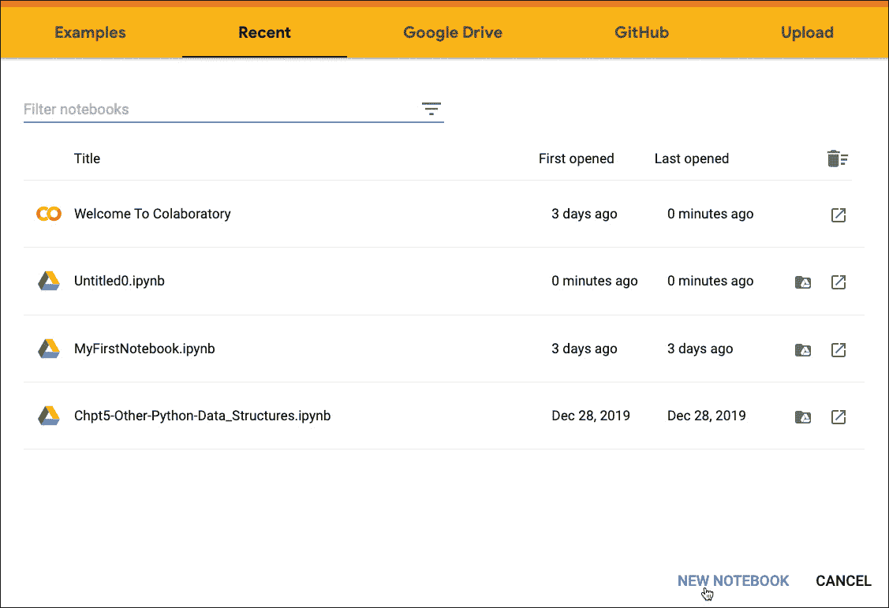

图 1.1 初始的 Google Colab 对话框

当你选择创建新笔记本时，它会在一个新的浏览器标签页中打开。你创建的第一个笔记本的默认标题是 Untitled0.ipynb。要更改其名称，请双击标题并输入新名称（参见图 1.2）。

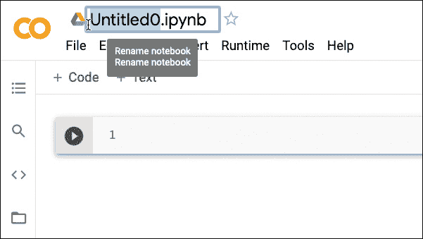

图 1.2 在 Google Colab 中重命名笔记本

Colab 会自动将你的笔记本保存到谷歌云端硬盘，你可以通过访问 [Drive.Google.com](http://Drive.Google.com) 来访问它们。默认位置是一个名为 Colab Notebooks 的目录（参见图 1.3）。

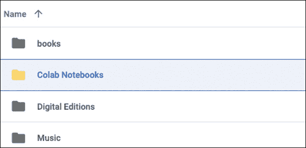

图 1.3 谷歌云端硬盘中的 Colab Notebooks 文件夹

#### Colab 文本单元格

一个新的 Google Colab 笔记本包含一个代码单元格。单元格可以是两种类型之一：文本或代码。你可以通过使用笔记本界面左上角的“+ 代码”和“+ 文本”按钮来添加新单元格。

文本单元格使用一种名为 Markdown 的语言进行格式化。（有关 Markdown 的更多信息，请参见 [`colab.research.google.com/notebooks/markdown_guide.ipynb`](https://colab.research.google.com/notebooks/markdown_guide.ipynb)。）要编辑单元格，请双击它，Markdown 代码将显示在右侧，其输出的预览显示在左侧（参见图 1.4）。

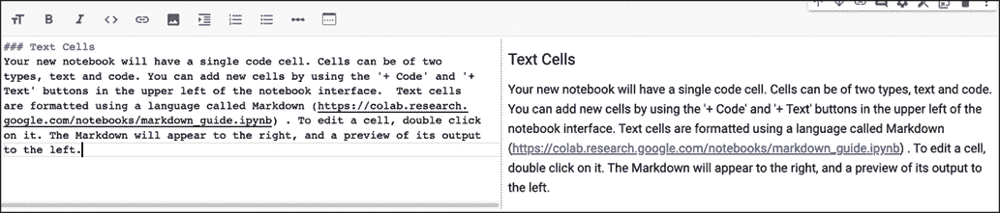

图 1.4 在 Google Colab 笔记本中编辑文本单元格

如图 1.5 所示，你可以修改笔记本中的文本，使其变为粗体、斜体、删除线和等宽字体。

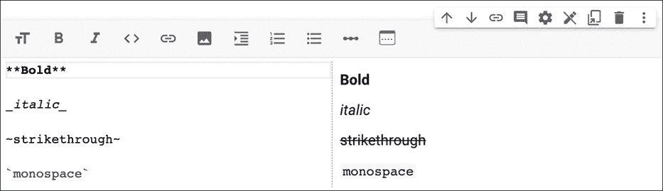

图 1.5 在 Google Colab 笔记本中格式化文本

如图 1.6 所示，你可以通过在项目前加上数字来创建编号列表，也可以通过星号来创建项目符号列表。

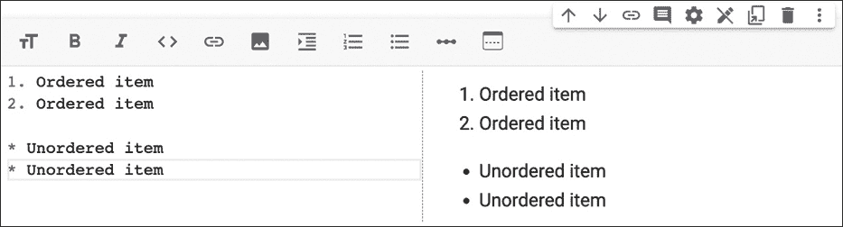

图 1.6 在 Google Colab 笔记本中创建列表

如图 1.7 所示，你可以通过在文本前添加井号来创建标题。一个井号创建一级标题，两个井号创建二级标题，以此类推。

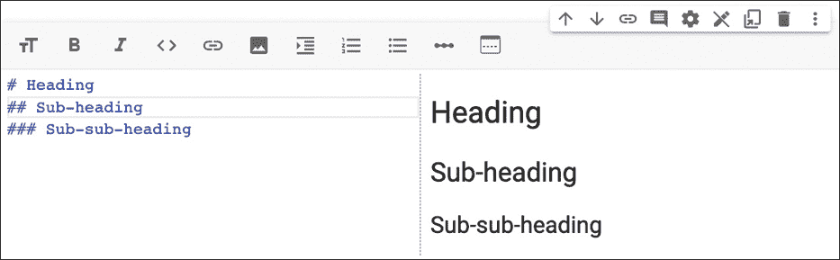

图 1.7 在 Google Colab 笔记本中创建标题

位于单元格顶部的标题决定了该单元格在文档中的层级。你可以通过打开目录来查看此层级，方法是点击笔记本界面左上角的菜单按钮，如图 1.8 所示。

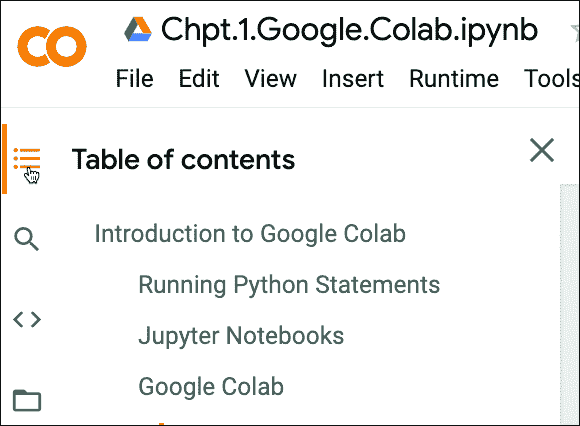

图 1.8 Google Colab 笔记本中的目录

你可以通过点击显示的标题来使用目录导航文档。包含子单元格的标题单元格在其标题文本旁边会有一个三角形。你可以点击此三角形来隐藏或查看子单元格（参见图 1.9）。

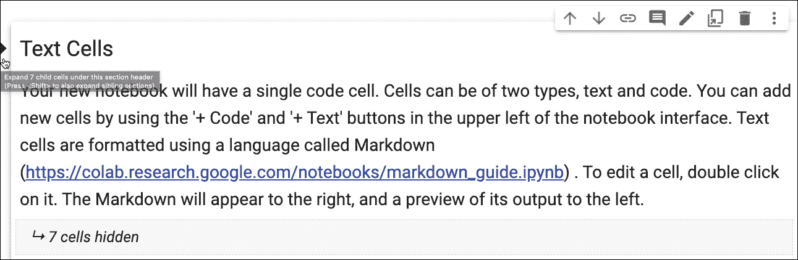

图 1.9 在 Google Colab 笔记本中隐藏单元格

##### LaTeX

LaTeX 语言（参见 [`www.latex-project.org/about/`](https://www.latex-project.org/about/)）专为准备技术文档而设计，在呈现数学文本方面表现出色。LaTeX 采用基于代码的方法，旨在让你专注于内容而非布局。你可以通过将 LaTeX 代码用美元符号括起来，将其插入到 Colab 笔记本的文本单元格中。图 1.10 展示了嵌入在 Colab 笔记本文本单元格中的 LaTeX 文档示例。

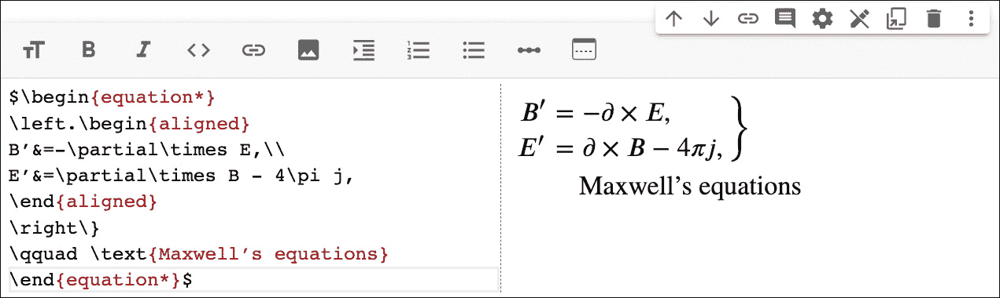

图 1.10 嵌入 Google Colab 笔记本中的 LaTeX

#### Colab 代码单元格

在 Google Colab 笔记本中，你使用代码单元格来编写和执行 Python 代码。要执行一条 Python 语句，请将其输入到代码单元格中，然后点击单元格左侧的“播放”按钮或按 Shift+Enter。按 Shift+Enter 会跳转到下一个单元格，如果后面没有单元格，则会创建一个新单元格。你执行的代码的任何输出都会显示在单元格下方，如下例所示：

```
print("Hello")

hello
```

本书的后续章节仅对 Colab 笔记本使用代码单元格。


#### Colab 文件

要查看 Colab 中可用的文件和文件夹，请点击界面左侧的“文件”按钮（参见图 1.11）。默认情况下，你可以访问 Google 提供的 `sample_data` 文件夹。

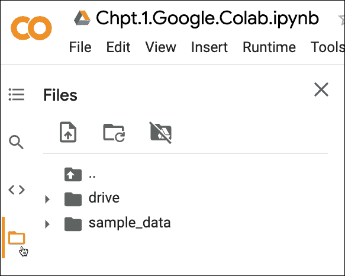

图 1.11 在 Google Colab 中查看文件

你也可以点击“上传”按钮将文件上传到当前会话中（参见图 1.12）。

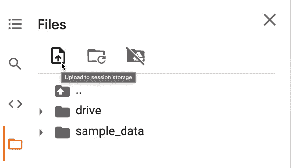

图 1.12 在 Google Colab 中上传文件

你上传的文件仅在你文档的当前会话中可用。如果你稍后再次打开同一个文档，需要重新上传它们。Colab 中所有可用文件的路径根目录都是 `/content/`，因此，如果你上传一个名为 `heights.over.time.csv` 的文件，它的路径就是 `/content/heights.over.time.csv`。

你可以通过点击“挂载云端硬盘”按钮来挂载你的 Google 云端硬盘（参见图 1.13）。你云端硬盘中的内容根路径为 `/content/drive`。

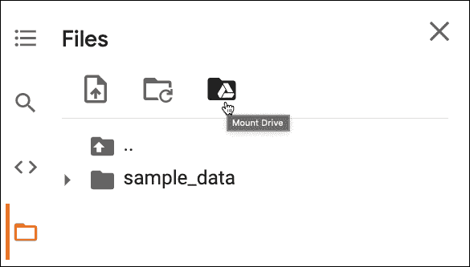

图 1.13 挂载你的 Google 云端硬盘

#### 管理 Colab 文档

默认情况下，笔记本会保存到你的 Google 云端硬盘。在“文件”菜单中，你可以看到其他保存笔记本的选项。你可以将它们保存到 GitHub，既可以作为 gist，也可以作为受追踪的文件。你还可以以 Jupyter 笔记本格式（扩展名为 `.ipynb`）或 Python 文件格式（扩展名为 `.py`）下载它们。你也可以通过点击笔记本界面右上角的“共享”按钮来共享笔记本。

#### Colab 代码片段

Colab 左侧导航栏中的“代码片段”部分允许你搜索和选择代码片段（参见图 1.14）。你可以通过点击“插入”按钮来插入选中的代码片段。使用代码片段是了解 Colab 能做什么的好方法，包括创建交互式表单、下载数据以及使用各种可视化选项。

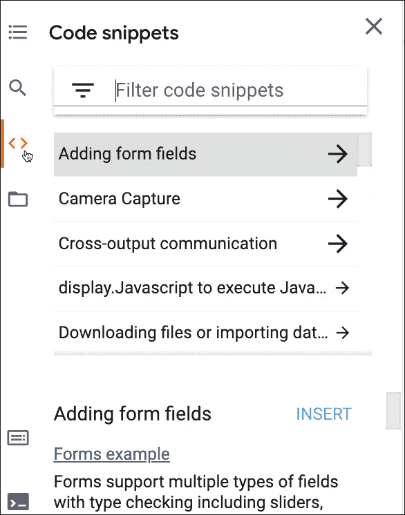

图 1.14 在 Google Colab 中使用代码片段

#### 现有合集

你可以使用 Google Colab 笔记本解释和演示技术、概念和工作流程。数据科学工作在许多遍布网络的笔记本合集中共享。Kaggle（参见 [`www.kaggle.com/code`](https://www.kaggle.com/code)）和 Google Seedbank（参见 [`research.google.com/seedbank/`](https://research.google.com/seedbank/)）都有大量共享的笔记本。

#### 系统别名

你可以通过在命令前加上感叹号，在 Colab 笔记本的代码单元格中运行 shell 命令。例如，以下示例打印当前工作目录：

```
!pwd

/content
```

你可以将 shell 命令的任何输出捕获到 Python 变量中，如下所示，并在后续代码中使用它：

```
var = !ls sample_data

print(var)
```

**注意**

暂时不必担心变量。你将在第 2 章“Python 基础”中学习它们。

#### 魔法函数

魔法函数是改变代码单元格运行方式的函数。例如，你可以使用魔法函数 `%timeit()` 来计算 Python 语句的执行时间，如下所示：

点击此处查看代码图片

```
import time

%timeit(time.sleep(1))
```

另一个例子是，你可以使用魔法函数 `%%html` 让一个单元格运行 HTML 代码：

点击此处查看代码图片

```
%%html

<marquee style='width: 30%; color: blue;'><b>Whee!</b></marquee>
```

**注意**

你可以在 Jupyter 文档中的“Cell Magics”示例笔记本中找到关于魔法函数的更多信息，地址为 [`nbviewer.jupyter.org/github/ipython/ipython/blob/1.x/examples/notebooks/Cell%20Magics.ipynb`](https://nbviewer.jupyter.org/github/ipython/ipython/blob/1.x/examples/notebooks/Cell%20Magics.ipynb)。

### 本章小结

Jupyter 笔记本是将格式化文本与可执行代码结合在一起的文档。它们已成为科学工作中非常流行的格式，网络上有很多示例。Google Colab 提供托管笔记本，并包含许多数据科学中常用的库。笔记本由文本单元格（使用 Markdown 格式化）和代码单元格（可以执行 Python 代码）组成。以下各章将展示许多 Colab 笔记本的示例。

### 问题

1.   Google Colab 托管哪种类型的笔记本？

2.   Google Colab 中有哪些可用的单元格类型？

3.   如何在 Colab 中挂载你的 Google 云端硬盘？

4.   Google Colab 的代码单元格中运行什么语言？

