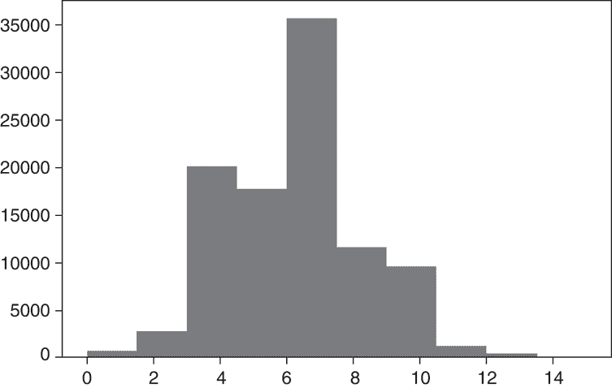
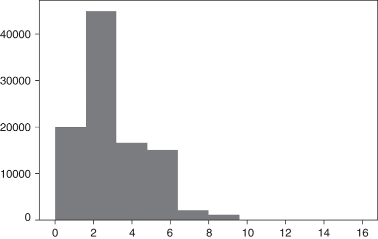
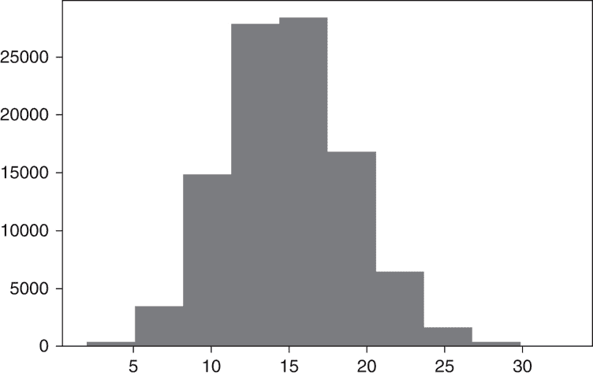
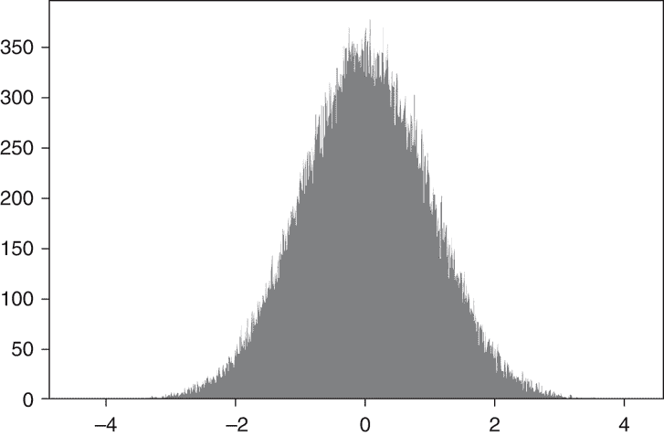
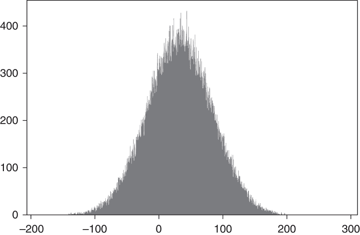
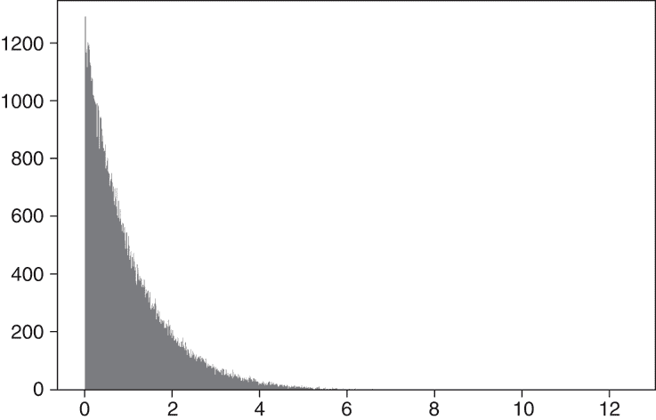
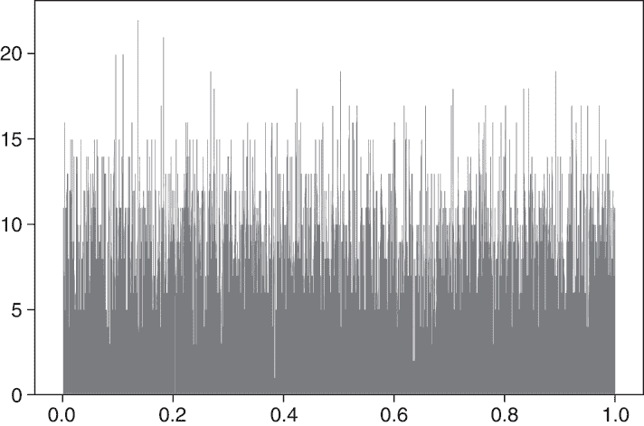

## 8 SciPy

大多数人使用统计就像醉汉使用路灯杆；更多是为了支撑而非照明。

安德鲁·朗

本章内容

*   使用 NumPy 进行数学运算
*   SciPy 简介
*   `scipy.misc` 子模块
*   `scipy.special` 子模块
*   `scipy.stats` 子模块

第 7 章 “NumPy” 介绍了 NumPy 数组，它们是许多数据科学相关库的基础构建块。本章介绍 SciPy 库，这是一个用于数学、科学和工程的库。

### SciPy 概述

SciPy 库是一个构建在 NumPy 之上的包集合，为科学计算提供工具。它包括处理优化、傅里叶变换、信号处理、线性代数、图像处理和统计等子模块。本章将涉及三个子模块：`scipy.misc` 子模块、`scipy.special` 子模块和 `scipy.stats`，这是对数据科学最有用的子模块。

本章还在一些示例中使用了 `matplotlib` 库。它具有多种图表类型以及图像的可视化能力。导入其绘图库的惯例是使用名称 `plt` 导入：

```python
import matplotlib.pyplot as plt
```

### `scipy.misc` 子模块

`scipy.misc` 子模块包含一些无处可归的函数。该模块中一个有趣的函数是 `scipy.misc.face()`，可以通过以下代码运行：

点击此处查看代码图片

```python
from scipy import misc

import matplotlib.pyplot as plt

face = misc.face()

plt.imshow(face)

plt.show()
```

你可以自己尝试生成输出。

`ascent` 函数返回一个可用于使用和演示的灰度图像。如果你调用 `ascent()`，结果是一个二维 NumPy 数组：

点击此处查看代码图片

```python
a = misc.ascent()

print(a)

[[ 83  83  83 ... 117 117 117]

 [ 82  82  83 ... 117 117 117]

 [ 80  81  83 ... 117 117 117]

              ...

 [178 178 178 ...  57  59  57]

 [178 178 178 ...  56  57  57]

 [178 178 178 ...  57  57  58]]
```

如果你将此数组传递给 `matplotlib` 绘图对象，你将看到如图 8.1 所示的图像：

```python
plt.imshow(a)

plt.show()
```


图 8.1 来自 `scipy.misc` 子模块的演示图像

如本例所示，你使用 `plt.imshow()` 方法来可视化图像。

### `scipy.special` 子模块

`scipy.special` 子模块包含数学物理的实用程序。它包括 Airy 函数、椭圆函数、Bessel 函数、Struve 函数等等。这些函数中的大多数支持广播并且与 NumPy 数组兼容。要使用这些函数，你只需从 SciPy 导入 `scipy.special` 并直接调用函数即可。例如，你可以使用 `special.factorial()` 函数计算一个数的阶乘：

点击此处查看代码图片

```python
from scipy import special

special.factorial(3)

6.0
```

你可以按如下方式计算组合数或排列数：

点击此处查看代码图片

```python
special.comb(10, 2)

45.0

special.perm(10,2)

90.0
```

此示例显示了 10 个物品，每次选择其中 2 个。

**注意**

`scipy.special` 有一个 `scipy.stats` 子模块，但它并非用于直接使用。相反，你应该使用 `scipy.stats` 子模块来满足你的统计需求。接下来将讨论此子模块。

### `scipy.stats` 子模块

`scipy.stats` 子模块提供概率分布和统计函数。以下各节将仅介绍此子模块中提供的几种分布。

#### 离散分布

SciPy 提供了一些共享某些通用方法的离散分布。这些通用方法在代码清单 8.2 中通过二项分布进行了演示。二项分布涉及一定次数的试验，每次试验的结果要么是成功，要么是失败。

代码清单 8.2 **二项分布**

点击此处查看代码图片

```python
from scipy import stats

B = stats.binom(20, 0.3) # 定义一个二项分布，包含

                         # 20 次试验，成功概率为 30%

B.pmf(2) # 概率质量函数（样本等于 2 的概率）

0.02784587252426866

B.cdf(4) # 累积分布函数（样本

         # 小于 4 的概率）

0.2375077788776017

B.mean # 分布的均值

6.0

B.var()# 分布的方差

4.199999999999999

B.std()# 分布的标准差

2.0493901531919194

B.rvs()# 从分布中获取一个随机样本

B.rvs(15) # 获取 15 个随机样本

array([ 2,  8,  6,  3,  5,  5, 10,  7,  5, 10,  5,  5,  5,  2,  6])
```

如果你从该分布中抽取足够大的随机样本：

点击此处查看代码图片

```python
rvs = B.rvs(size=100000)

rvs

array([11,  4,  4, ...,  7,  6,  8])
```

你可以使用 `matplotlib` 绘制它，并了解其形状（参见图 8.2）：

点击此处查看代码图片

```python
import matplotlib.pyplot as plt

plt.hist(rvs)

plt.show()
```



图 8.2 二项分布

图 8.2 中分布底部的数字代表每次 20 次试验中的成功次数。你可以看到，20 次中成功 6 次是最常见的结果，这与 30% 的成功率相符。

`scipy.stats` 子模块中建模的另一个分布是泊松分布。该分布模拟了在某个时间范围内发生特定数量独立事件的概率。分布的形状由其均值控制，你可以使用 `mu` 关键字设置该均值。例如，较低的均值（如 3）会使分布向左偏斜，如图 8.3 所示：

点击此处查看代码图片

```python
P = stats.poisson(mu=3)

rvs = P.rvs(size=10000)

rvs

array([4, 4, 2, ..., 1, 0, 2])

plt.hist(rvs)

plt.show()
```



图 8.3 左偏泊松分布

较高的均值（如 15）会将分布向右推，如图 8.4 所示：

点击此处查看代码图片

```python
P = stats.poisson(mu=15)

rvs = P.rvs(size=100000)

plt.hist(rvs)

plt.show()
```



图 8.4 右偏泊松分布

`scipy.stats` 子模块中建模的其他离散分布包括 Beta-二项分布、玻尔兹曼分布（截断普朗克分布）、普朗克分布（离散指数分布）、几何分布、超几何分布、对数分布和尤尔-西蒙分布等。在撰写本文时，`scipy.stats` 子模块中建模了 14 种分布。

#### 连续分布

`scipy.stats` 子模块包含的连续分布远多于离散分布；截至撰写本文时，它有 87 种连续分布。这些分布都接受位置参数（`loc`）和尺度参数（`scale`）。它们的位置参数默认值为 `0`，尺度参数默认值为 `1.0`。

其中建模的一种连续分布是正态分布，你可能熟悉它的钟形曲线。在这个对称分布中，一半数据位于均值左侧，一半位于右侧。以下是使用默认位置和尺度参数创建正态分布的方法：

点击此处查看代码图片

```python
N = stats.norm()

rvs = N.rvs(size=100000)

plt.hist(rvs, bins=1000)

plt.show()
```

图 8.5 展示了绘制的此分布。



图 8.5 钟形曲线

你可以看到，该分布以 0 为中心，大致范围在 -4 到 4 之间。图 8.6 展示了创建第二个正态分布的效果——这次将位置参数设置为 30，尺度参数设置为 50：

点击此处查看代码图片

```python
# 示例代码
```

## 小结

本章介绍了 SciPy 库及其核心子模块，展示了其在科学计算中的强大功能。从图像处理、特殊函数到统计分析，SciPy 为数据科学家和工程师提供了不可或缺的工具集。通过结合 NumPy 和 Matplotlib，我们可以高效地处理数据、进行计算并可视化结果。

### 代码清单 8.3 **正态分布**

```python
N1 = stats.norm(loc=30,scale=50)

rvs = N1.rvs(size=100000)

plt.hist(rvs, bins=1000)

plt.show()
```



图 8.6 偏移的钟形曲线

注意，现在分布以 30 为中心，并且涵盖了更广泛的数值范围。连续分布共享一些通用函数，这些函数在代码清单 8.3 中进行了建模。请注意，此代码清单使用了具有偏移位置和更大标准差的正态分布。

```python
N1 = stats.norm(loc=30, scale=50)

N1.mean() # 分布的均值，与 loc 值匹配

30.0

N1.pdf(4) # 概率密度函数

0.006969850255179491

N1.cdf(2) # 累积分布函数

0.28773971884902705

N1.rvs() # 一个随机样本

171.55168607574785

N1.var() # 方差

2500.0

N1.median()# 中位数

30.0

N1.std() # 标准差

50.0
```

**注意**

如果你尝试此处显示的示例，由于随机数生成，某些值可能会有所不同。

以下连续分布是指数分布，其特点是曲线呈指数变化，无论是上升还是下降（参见图 8.7）：

```python
E = stats.expon()

rvs = E.rvs(size=100000)

plt.hist(rvs, bins=1000)

plt.show()
```



图 8.7 指数变化分布

你可以看到，图 8.7 显示了一条符合指数函数预期的曲线。以下是均匀分布，它具有恒定的概率，也称为矩形分布：

```python
U = stats.uniform()

rvs = U.rvs(size=10000)

rvs

array([8.24645026e-01, 5.02358065e-01, 4.95390940e-01, ...,

       8.63031657e-01, 1.05270200e-04, 1.03627699e-01])

plt.hist(rvs, bins=1000)

plt.show()
```

此分布在设定的范围内给出均匀的概率。其图形如图 8.8 所示。



图 8.8 均匀分布

### 总结

`NumPy`和`SciPy`库都提供了用于解决复杂数学问题的实用工具。这两个库涵盖了极其广泛和深入的资源，并且已有整本书专门介绍它们的应用。你只看到了众多功能中的一小部分。当你着手解决或建模复杂的数学问题时，应该首先查阅这些库。

### 问题

1.  使用`scipy.stats`子模块建模一个均值为 15 的正态分布。
2.  从问题 1 中建模的分布生成 25 个随机样本。
3.  哪个`scipy`子模块包含专为数学物理设计的实用工具？
4.  离散分布提供了哪种方法来计算其标准差？