## 10 可视化库

一幅图画的最大价值在于它能迫使我们注意到我们从未期望看到的东西。

约翰·图基

本章内容

*   使用 `matplotlib` 创建和样式化图表

*   使用 Seaborn 和 Seaborn 主题绘图

*   使用 Plotly 和 Bokeh 绘图

数据可视化对于探索和呈现数据至关重要。俗话说“一图胜千言”，这同样适用于理解数据。你通常可以从可视化中获得从汇总统计中不明显的见解。统计学家弗朗西斯·安斯库姆曾著名地创建了四个数据集，它们的汇总统计几乎相同，但在绘制图表时却差异巨大。

当你拥有可视化图表时，解释数据也通常更容易。想想图表在演示中的效果有多好。幸运的是，Python 中有不少专为可视化设计的库。

### `matplotlib`

`matplotlib` 是创建可出版级图表的基石工具。它被广泛独立使用，同时也是其他绘图库的基础。它是 SciPy 生态系统的一部分，与 NumPy 和 Pandas 并列。这是一个功能非常强大的大型项目，但也正因为其规模庞大，使用起来可能比较复杂。

`matplotlib` 有多个接口。如果你在网上搜索，尤其是在较旧的示例中，可能会看到 `pylab` 接口，通常这样导入：

```
from matplotlib.pylab import *
```

虽然那些较旧的示例可能有些用处，但现在不鼓励使用 `pylab`。它最初旨在模拟类似于 MATPLOT（一种非 Python 的数学绘图工具）的环境。但是，导入模块的所有内容（即 `import *` 所做的事情）在 Python 中通常被认为是一种不好的做法。推荐的做法是只显式导入你将使用的内容。

`matplotlib` 推荐的接口是 `pyplot`，按照惯例，其别名为 `plt`：

```
import matplotlib.pyplot as plt
```

`matplotlib` 中的两个主要概念是图形和轴。*图形*用于绘制数据。*轴*是可以通过坐标指定点的区域。轴通过图形进行可视化。一个图形可以有多个轴，但一个轴只能附加到一个图形上。

`matplotlib` 提供了两种创建图形和轴的方法：显式创建和隐式创建。以下示例展示了隐式方法。

有一些绘图方法，例如 `plt.plot` 和 `plt.hist`，它们会绘制到当前的轴和图形上。如果当前轴和图形不存在，这些方法会创建一个轴和一个父图形。

`plt.plot` 方法根据 x 和 y 值创建折线图，如图 10.1 所示：

点击此处查看代码图片

```
X = [0, 1, 2, 3, 4, 5, 7, 8, 9, 10]

Y = [20, 25, 35, 50, 10, 12, 20, 40, 70, 110]

plt.plot(X, Y)
```

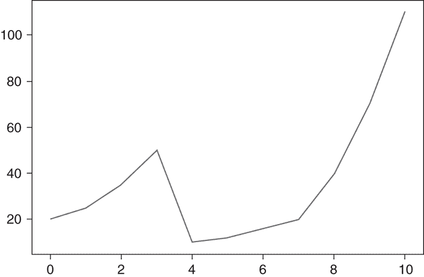

图 10.1 基于 x 和 y 值的折线图


#### 设置图表样式

你可以通过两种不同的机制来控制图表的样式。一种是使用 `matplotlib.Line2D` 类的任何属性。这些属性控制图表中使用的标记、线条样式和颜色。你可以在 `matplotlib` 文档中查看 `matplotlib.Line2D` 属性的完整列表（参见 [`matplotlib.org/3.3.3/api/_as_gen/matplotlib.lines.Line2D.html`](https://matplotlib.org/3.3.3/api/_as_gen/matplotlib.lines.Line2D.html)）。

你可以将这些属性作为关键字参数传递给 `plt.plot`。本节演示了 `marker`、`linestyle` 和 `color` 属性的用法。

可用的标记类型如下：

| `.` | 点标记 |
| `,` | 像素标记 |
| `o` | 圆形标记 |
| `v` | 下三角标记 |
| `^` | 上三角标记 |
| `<` | 左三角标记 |
| `>` | 右三角标记 |
| `1` | 下三叉标记 |
| `2` | 上三叉标记 |
| `3` | 左三叉标记 |
| `4` | 右三叉标记 |
| `s` | 方形标记 |
| `p` | 五边形标记 |
| `*` | 星形标记 |
| `h` | 六边形 1 标记 |
| `H` | 六边形 2 标记 |
| `+` | 加号标记 |
| `x` | x 标记 |
| `D` | 菱形标记 |
| `d` | 细菱形标记 |
| `&#124;` | 竖线标记 |
| `_` | 横线标记 |

你可以使用关键字 `marker` 来指定标记类型。此示例将标记设置为方形（参见图 10.2）：

点击此处查看代码图片

```
X = [0, 1, 2, 3, 4, 5, 7, 8, 9, 10]

Y = [20, 25, 35, 50, 10, 12, 20, 40, 70, 110]

plt.plot(X, Y, marker='s')
```

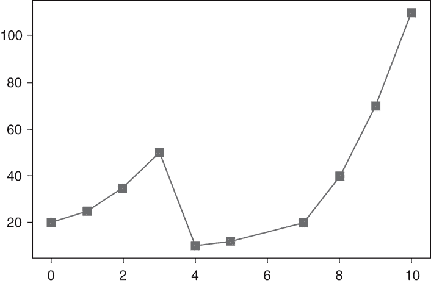

图 10.2 方形标记图

可用的线条样式如下：

| `-` | 实线样式 |
| `--` | 虚线样式 |
| `-.` | 点划线样式 |
| `:` | 点线样式 |

你可以使用关键字 `linestyle` 来设置线条样式（参见图 10.3）：

点击此处查看代码图片

```
X = [0, 1, 2, 3, 4, 5, 7, 8, 9, 10]

Y = [20, 25, 35, 50, 10, 12, 20, 40, 70, 110]

plt.plot(X, Y, marker='s', linestyle=':')
```


图 10.3 使用关键字 `linestyle` 设置参数

可用的颜色如下：

| `b` | 蓝色 |
| `g` | 绿色 |
| `r` | 红色 |
| `c` | 青色 |
| `m` | 品红色 |
| `y` | 黄色 |
| `k` | 黑色 |
| `w` | 白色 |

你可以使用 `color` 关键字来设置颜色。如果你尝试此示例，你将看到与图 10.3 相同的图表，但带有颜色：

点击此处查看代码图片

```
X = [0, 1, 2, 3, 4, 5, 7, 8, 9, 10]

Y = [20, 25, 35, 50, 10, 12, 20, 40, 70, 110]

plt.plot(X, Y, marker='s', linestyle=':', color='m')
```

另一种设置样式属性的方法是使用 `fmt` 参数。这是一个位置参数，位于 Y 参数的右侧。它由一个格式字符串组成，该字符串使用标记、线条样式和颜色设置的简写形式。格式字符串的形式为 `[marker][line][color]`，所有部分都是可选的。例如，对于图 10.4 中的图表，你可以使用格式字符串 `s-.r` 将标记设置为方形，线条样式设置为虚线，颜色设置为红色：

点击此处查看代码图片

```
X = [0, 1, 2, 3, 4, 5, 7, 8, 9, 10]

Y = [20, 25, 35, 50, 10, 12, 20, 40, 70, 110]

fmt = 's-.r'

plt.plot(X, Y, fmt)
```

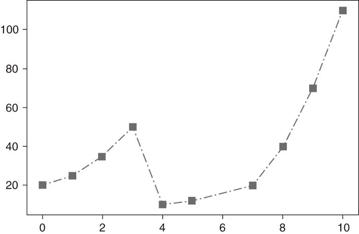

图 10.4 使用格式字符串 `s-.r` 的折线图

你可以同时使用格式字符串和关键字参数。例如，图 10.5 中的图表将格式字符串 '`s-.r``'` 与关键字 `linewidth` 结合使用：

点击此处查看代码图片

```
X = [0, 1, 2, 3, 4, 5, 7, 8, 9, 10]

Y = [20, 25, 35, 50, 10, 12, 20, 40, 70, 110]

fmt = 's-.r'

plt.plot(X, Y, fmt, linewidth=4.3)
```

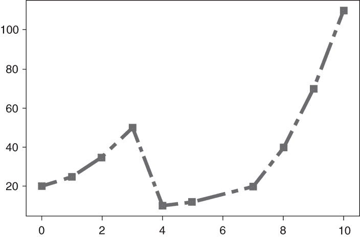

图 10.5 使用关键字 `linewidth` 格式化的折线图

#### 带标签的数据

`matplotlib` 的绘图函数可以使用带标签的数据，包括 Pandas DataFrames、字典以及几乎所有使用方括号语法访问数据的数据结构。你无需为 x 和 y 提供值序列，而是提供相应的标签。

以下是根据美国疾病控制与预防中心的数据（参见 [`www.cdc.gov/nchs/data/nhsr/nhsr122-508.pdf`](https://www.cdc.gov/nchs/data/nhsr/nhsr122-508.pdf)），创建一个 16 年间美国男性和女性平均身高的 DataFrame 的方法：

点击此处查看代码图片

```
import pandas as pd

data = {"Years": ["2000", "2002", "2004", "2006", "2008",

                  "2010", "2012", "2014", "2016"],

        "Men": [189.1, 191.8, 193.5, 196.0, 194.7,

                196.3, 194.4, 197.0, 197.8],

        "Women": [175.7, 176.4, 176.5, 176.2, 175.9,

                  175.9, 175.7, 175.8, 175.3]}

heights_df = pd.DataFrame(data)
```

你可以通过指定用于 x 和 y 的列标签以及从中提取数据的 DataFrame 来创建女性身高的折线图（参见图 10.6）：

点击此处查看代码图片

```
plt.plot('Years', 'Women', data=heights_df)
```

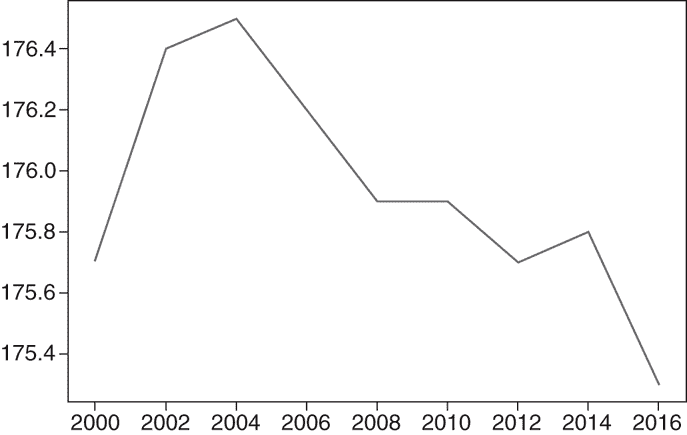

图 10.6 指定了 x 和 y 标签的折线图

#### 绘制多组数据

在同一图表上绘制多组数据有三种方法。第一种是多次调用绘图函数：

点击此处查看代码图片

```
X = [0, 1, 2, 3, 4, 5, 7, 8, 9, 10]

Y = [20, 25, 35, 50, 10, 12, 20, 40, 70, 110]

fmt = 's-.r'

X1 = [0, 1, 2, 3, 4, 5, 7, 8, 9, 10]

Y2 = [90, 89, 87, 82, 72, 60, 45, 28, 10, 0]

fmt2 = '^k:'

plt.plot(X, Y, fmt)

plt.plot(X1, Y2, fmt2)
```

请记住，`plt.plot` 使用当前的坐标轴和图形。这意味着多次调用将继续共享同一个图形和绘图。你可以在图 10.7 中看到同一图形上的多个绘图。

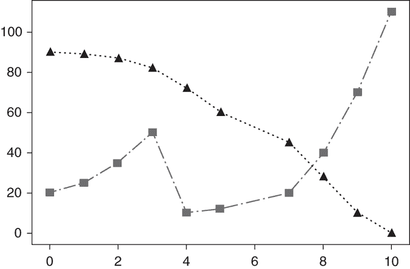

图 10.7 同一图形上的多个绘图

在同一图表上绘制多组数据的第二种方法是直接将多个数据集传递给绘图函数：

```
plt.plot(X, Y, fmt, X1, Y2, fmt2)
```

对于带标签的数据，你可以传递多个标签，每个列都将被添加到图表中（参见图 10.8）：

点击此处查看代码图片

```
plt.plot('Years', 'Women', 'Men', data=heights_df)
```

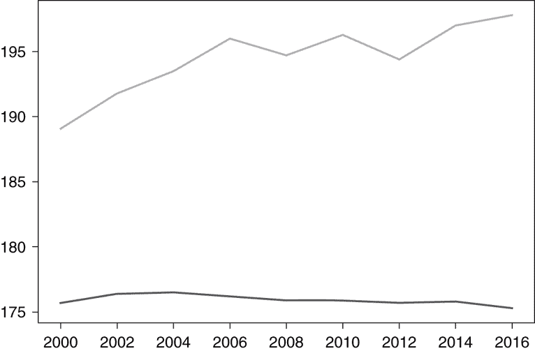

图 10.8 包含多个数据集的折线图

`matplotlib` 提供了便捷函数来添加标签、标题和图例。你可以按照以下方式为图 10.8 中的绘图创建一个带标签的版本（参见图 10.9）：

点击此处查看代码图片

```
plt.plot('Years', 'Women', 'Men', data=heights_df)

plt.xlabel('Year')

plt.ylabel('Height (Inches)')

plt.title("Heights over time")

plt.legend(['Women', 'Men'])
```

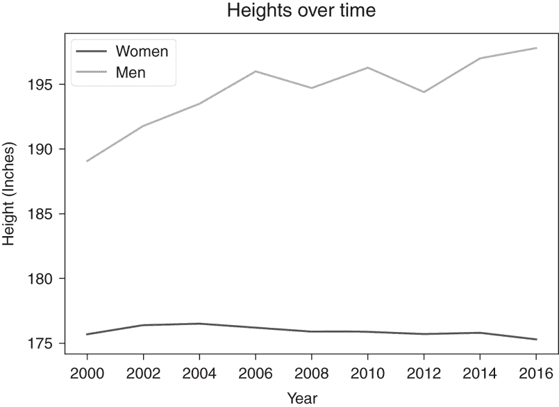

图 10.9 为绘图添加多个标签


#### 面向对象风格

到目前为止，你在本章中看到的处理图形和坐标轴的隐式方式是一种便捷的数据探索方法，尤其是在交互式环境中。`matplotlib` 也允许你直接处理图形和坐标轴，这能让你拥有更多控制权。`plt.subplots()` 函数会返回一个图形以及你指定数量的坐标轴。然后，你可以像使用隐式绘图时那样，在这些坐标轴上绘图：

点击此处查看代码图片

```
fig, ax = plt.subplots()

ax.plot('Years', 'Women', 'Men', data=heights_df)

ax.set_xlabel('Year')

ax.set_ylabel('Height (Inches)')

ax.set_title("Heights over time")

ax.legend(['Women', 'Men'])
```

结果将与使用相同数据在图 10.9 中绘制的图表一致。

如果你想在同一个图形上制作多个图表，可以指定多个坐标轴，如清单 10.1 所示。第一个参数指定行数，第二个参数指定列数。图 10.10 展示了一个在图形上创建两个坐标轴的示例。

清单 10.1 **创建多个坐标轴**

点击此处查看代码图片

```
fig, (ax1, ax2) = plt.subplots(1, 2).       # 创建一个图形和两个坐标轴

ax1.plot('Years', 'Women', data=heights_df) # 在第一个坐标轴上按年份绘制女性数据

ax1.set_xlabel('Year')                      # 标记第一个坐标轴的 x 轴

ax1.set_ylabel('Height (Inches)')           # 标记第一个坐标轴的 y 轴

ax1.set_title("Women")                      # 设置第一个坐标轴的标题

ax1.legend(['Women'])                       # 设置第一个坐标轴的图例

ax2.plot('Years', 'Men', data=heights_df )  # 绘制第二个坐标轴

ax2.set_xlabel('Year')                      # 设置第二个坐标轴的 x 轴标签

ax2.set_title("Men")                        # 设置第二个坐标轴的标题

ax2.legend(['Men'])                         # 设置第二个坐标轴的图例 

fig.autofmt_xdate(rotation=65)              # 旋转日期标签
```

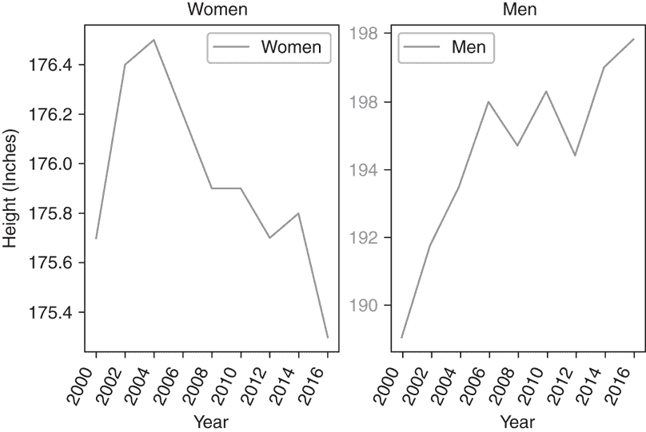

图 10.10 在图形上绘制两个坐标轴

隐式绘图风格非常适合在交互模式下探索数据。显式风格则能让你拥有更多控制权，通常推荐用于生产代码中的绘图。

### Seaborn

Seaborn 是一个基于 `matplotlib` 构建的统计绘图库。它旨在让创建美观的统计图形变得简单，并且以其默认样式通常比其他库提供的样式更美观而闻名。

按照惯例，Seaborn 被导入为 `sns`：

```
import seaborn as sns
```

Seaborn 包含一系列示例数据集，这些数据集用于其提供的文档和教程中。在探索 Seaborn 的功能时，这些数据集也提供了便捷的数据来源。你可以使用 `sns.load_dataset()` 函数，将数据集名称作为参数，将数据集加载为 Pandas DataFrame。可用的数据集列表请参见 [`github.com/mwaskom/seaborn-data`](https://github.com/mwaskom/seaborn-data)。

以下示例展示了如何加载一个车祸数据集，然后选择要使用的列：

点击此处查看代码图片

```
car_crashes = sns.load_dataset('car_crashes')

car_crashes = car_crashes[['total', 'not_distracted', 'alcohol']]
```

此示例使用 Seaborn 的 `sns.relplot()` 函数来绘制两列之间的关系（参见图 10.11）：

点击此处查看代码图片

```
sns.relplot(data=car_crashes,

            x='total',

            y='not_distracted')
```

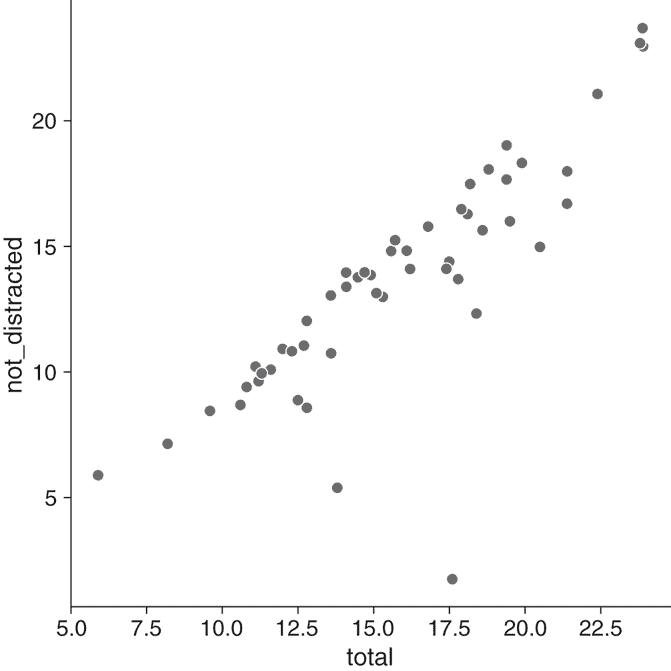

图 10.11 使用 Seaborn 的 `sns.relplot()` 函数绘制两列之间的关系

#### Seaborn 主题

使用 Seaborn 主题是控制图表外观的一种简单方法。要使用 Seaborn 的默认主题，可以使用以下函数：

```
sns.set_theme()
```

你可以重新绘制数据，以查看图 10.12 中所示的新外观：

点击此处查看代码图片

```
sns.relplot(data=car_crashes,

            x='total',

            y='not_distracted')
```

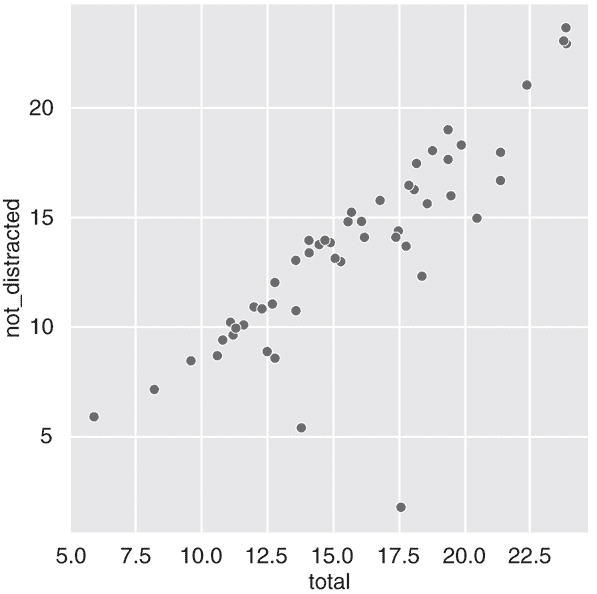

图 10.12 使用 Seaborn 主题控制图表外观

当你设置一个 Seaborn 主题时，它会应用于后续的所有绘图，即使是直接使用 `matplotlib` 创建的绘图也不例外。Seaborn 将 `matplotlib` 参数分为两组：一组处理绘图的美学风格，另一组处理缩放元素。

有五个预设的 Seaborn 样式主题可用：`darkgrid`、`whitegrid`、`dark`、`white` 和 `ticks`。你可以使用 `sns.set_style()` 函数来设置样式。例如，你可以像下面这样设置 `dark` 样式（参见图 10.13）：

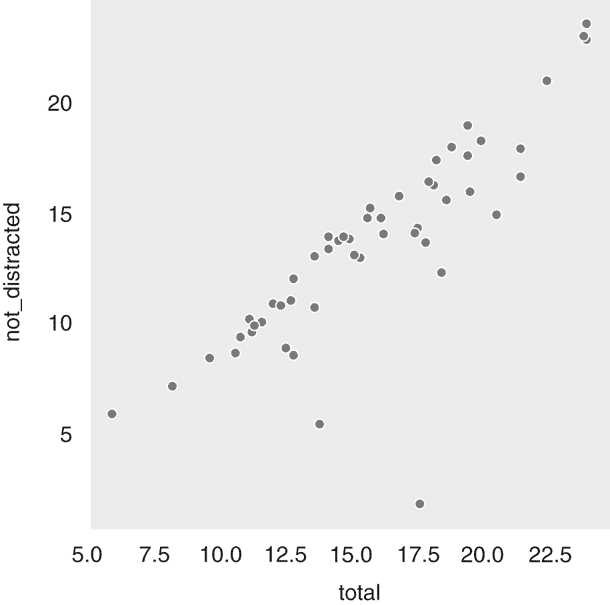

图 10.13 使用深色样式主题

点击此处查看代码图片

```
sns.set_style('dark')

sns.relplot(data=car_crashes,

           x='total',

           y='not_distracted')
```

用于设置图形元素缩放比例的主题基于目标演示场景。它们是 `paper`、`notebook`、`talk` 和 `poster`。

你可以使用 `sns.set_context` 函数来设置主题：

```
sns.set_context('talk')
```

如果你重新绘制数据，缩放比例会相应调整，如图 10.14 所示：

点击此处查看代码图片

```
sns.relplot(data=car_crashes,

            x='total',

            y='not_distracted')
```

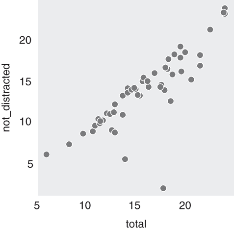

图 10.14 使用 `sns.set_context` 函数重新绘制数据

Seaborn 提供了多种绘图类型。其中，用于寻找数据相关性最有用的类型之一是 `sns.pairplot()`，它会创建一个坐标轴网格，绘制 DataFrame 中所有列之间的关系。你可以像下面这样使用鸢尾花数据集来创建一个配对图（参见图 10.15）：

点击此处查看代码图片

```
df = sns.load_dataset('iris')

sns.pairplot(df, hue='species')
```

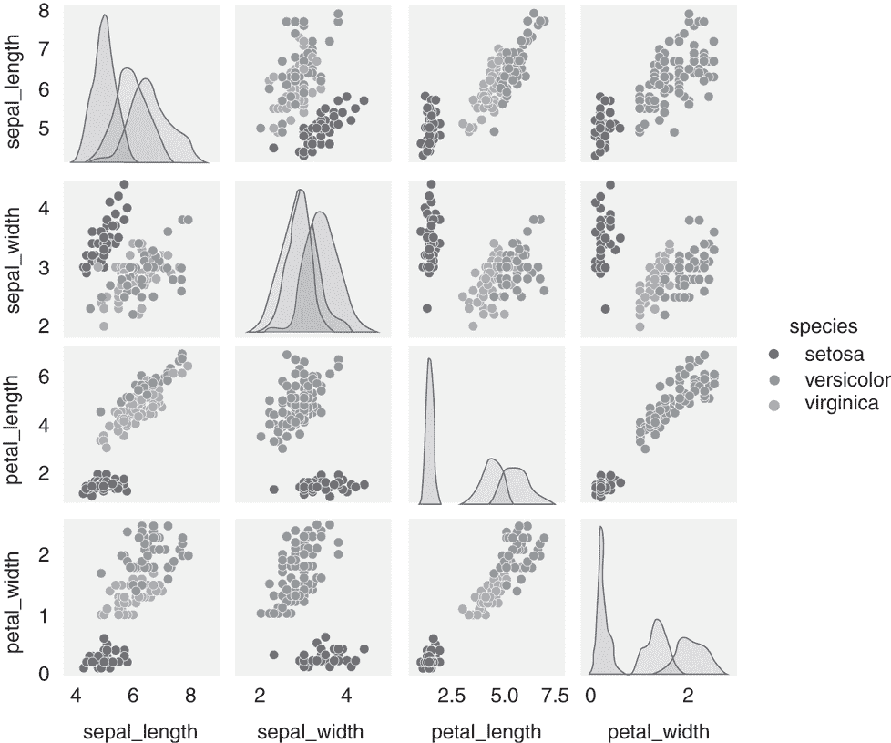

图 10.15 使用鸢尾花数据集绘制的配对图

### Plotly

`matplotlib` 和 Seaborn 是创建适合出版的静态图表的优秀工具。两者都可以扩展以创建交互式数据展示。然而，Plotly 和 Bokeh 库是专门为创建高质量交互式图表而设计的。Plotly 提供了多种图表类型，但其一个突出特点是能够轻松构建 3D 图表。图 10.16 展示了一个动态图表的静态版本。如果你在笔记本中运行此代码，将能够旋转和缩放该图表：

点击此处查看代码图片

```
import plotly.express as px

iris = px.data.iris()

fig = px.scatter_3d(iris,

                    x='sepal_length',

                    y='petal_width',

                    z='petal_length',

                    color='species')

fig.show()
```

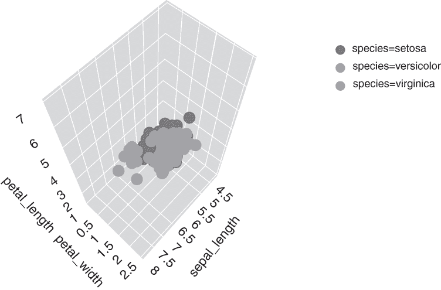

图 10.16 动态图表的静态版本


### Bokeh

Bokeh 是 Plotly 的替代方案，用于轻松创建交互式图形。Bokeh 的突出之处在于它使用了特殊的数据对象 `ColumnDataSource`。该对象提供了更好的性能，并且允许在不重新加载状态的情况下更新或追加数据。数据源还可以在多个图形之间共享，这样与一个图形中数据的交互会修改另一个图形中的数据。代码清单 10.2 设置了多个共享一个数据对象的图形，图 10.17 显示了结果。

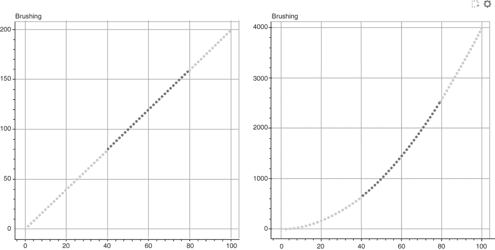

图 10.17 多个图形共享一个数据对象

**注意**

需要提前说明的是，Bokeh 在 Colab 中需要额外的设置。这个示例让你了解 Bokeh 的功能，但并未展示如何在 Colab 中绘制图形。

代码清单 10.2 **Bokeh 共享数据**

点击此处查看代码图片

```
from bokeh.io import output_notebook

from bokeh.plotting import figure, show

from bokeh.models import ColumnDataSource

from bokeh.layouts import gridplot

Y = [x for x in range(0,200, 2)] 

Y1 = [x**2 for x in Y]

X = [x for x in range(100)]

data={'x':X,

      'y':Y,

      'y1':Y1}

TOOLS = "box_select"                  # 选择交互工具 

source = ColumnDataSource(data=data)  # 创建 ColumnDataSource

left = figure(tools=TOOLS,

              title='Brushing')       # 使用所选工具创建图形 

left.circle('x',

            'y',

             source=source)           # 在第一个图形上创建圆形图 

right = figure(tools=TOOLS,

               title='Brushing')      # 使用所选工具创建图形 

right.circle('x',

             'y1',

              source=source)          # 在第二个图形上创建圆形图 

p = gridplot([[left, right]])         # 将图形放在网格上 

show(p)                               # 显示网格
```

输出的图形允许跨轴选择，正如所选工具所定义的那样。这意味着，如果你选择了一个图形的一部分，第二个图形中对应的点也会被选中。

### 其他可视化库

除了本章到目前为止介绍的库之外，还有许多其他优秀的可视化库。以下是一些你可能想要探索的库：

*   `geoplotlib`**：** 支持地图和地理数据的可视化
*   `ggplot`**：** 基于 R 语言包 ggplot2
*   `pygal`**：** 允许你轻松创建简单的图表
*   `folium`**：** 允许你创建交互式地图
*   `missingno`**：** 支持缺失数据的可视化

### 总结

可视化是数据探索中极其有用的部分，也是数据展示的重要组成部分。有许多可用于数据可视化的库，它们各有不同的专长和侧重点。`matplotlib` 是许多其他库的基础。它功能广泛，但学习曲线陡峭。Seaborn 是一个基于 `matplotlib` 构建的统计可视化库，可以轻松改善图表外观，并为不同的目标媒介创建图表。Plotly 和 Bokeh 都旨在创建交互式图表和仪表板。

### 问题

使用以下示例回答下列问题：

点击此处查看代码图片

```
 import matplotlib.pyplot as plt

import seaborn as sns

import pandas as pd

data = {'X'  : [x for x in range(50)],

        'Y'  : [y for y in range(50, 0, -1)],

        'Y1' : [y**2 for y in range(25, 75)]}

df = pd.DataFrame(data)
```

1.   使用 `matplotlib` 绘制列 `X` 和 `Y` 之间的关系。
2.   使用 `matplotlib` 将列 `X` 和 `Y1` 之间的关系添加到同一张图中。
3.   使用 `matplotlib` 将问题 1 和问题 2 中的关系绘制在同一图形的不同坐标轴上。
4.   使用 Seaborn 将主题更改为 `darkgrid`，然后重复问题 3 中的绘图。

