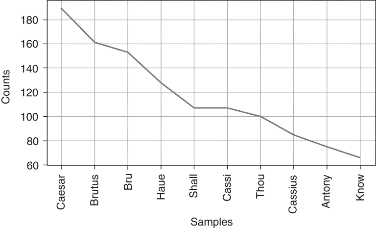
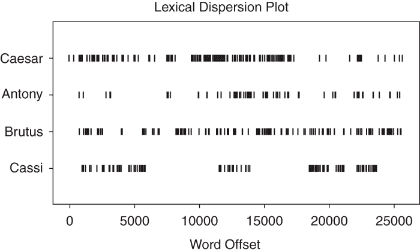

# 12 自然语言工具包

入门级统计学教科书中最早教授的内容之一就是相关性不等于因果性。这也是最早被遗忘的内容之一。

托马斯·索维尔

## 本章内容

*   `NLTK` 包简介

*   访问和加载样本文本

*   使用频率分布

*   文本对象

*   文本分类

使用计算机从文本中获取洞察是非常有用的。数据科学中专注于从文本中获取洞察的子领域被称为*自然语言处理*。自然语言工具包（`NLTK`）是一个用于所有语言处理相关任务的 Python 包。本章将快速介绍这个强大的包。

### NLTK 示例文本

`NLTK` 包提供了来自多个来源的示例文本，你可以下载这些文本并用于探索语言处理。古腾堡计划是一个将书籍副本放在网上的项目（参见 [`www.gutenberg.org`](http://www.gutenberg.org)），主要由公共领域的书籍组成。该收藏的一部分可供下载，用于 `NLTK`。你可以使用 `nltk.download()` 函数将数据下载到主目录下的 `nltk_data/corpora` 目录中：

```
import nltk

nltk.download('gutenberg')

[nltk_data] Downloading package gutenberg to

[nltk_data]     /Users/kbehrman/nltk_data...

[nltk_data]   Unzipping corpora/gutenberg.zip.

True
```

然后，你可以将数据作为语料库阅读器对象导入到你的 Python 会话中：

> **注意**
> 每个语料库阅读器都设计用于读取 `NLTK` 提供的特定文本集合。

```
from nltk.corpus import gutenberg

gutenberg

<PlaintextCorpusReader in '/Users/kbehrman/nltk_data/corpora/gutenberg'>
```

针对不同类型的文本源，存在相应的语料库阅读器。此示例使用了 `PlaintextCorpusReader`，它是为纯文本设计的。你可以通过使用 `fileids()` 方法来列出各个文本，该方法会列出可用于加载文本的文件名：

```
gutenberg.fileids()

['austen-emma.txt',

'austen-persuasion.txt',

'austen-sense.txt',

'bible-kjv.txt',

'blake-poems.txt',

'bryant-stories.txt',

'burgess-busterbrown.txt',

'carroll-alice.txt',

'chesterton-ball.txt',

'chesterton-brown.txt',

'chesterton-thursday.txt',

'edgeworth-parents.txt',

'melville-moby_dick.txt',

'milton-paradise.txt',

'shakespeare-caesar.txt',

'shakespeare-hamlet.txt',

'shakespeare-macbeth.txt',

'whitman-leaves.txt']
```

语料库阅读器有多种读取文本的方法。你可以将文本加载为单个单词、句子或段落。清单 12.1 以所有三种格式加载了威廉·莎士比亚的《尤利乌斯·凯撒》文本。

#### 清单 12.1 加载文本

```
caesar_w = gutenberg.words('shakespeare-caesar.txt') # 单词列表

caesar_w

['[', 'The', 'Tragedie', 'of', 'Julius', 'Caesar', ...]

nltk.download('punkt') # 下载用于定义句子结尾的分词器

[nltk_data] Downloading package punkt to /Users/kbehrman/nltk_data...

[nltk_data]   Unzipping tokenizers/punkt.zip.

True

caesar_s = gutenberg.sents('shakespeare-caesar.txt') # 句子列表

caesar_s

[['[', 'The', 'Tragedie', 'of', 'Julius', 'Caesar', 'by', 'William',

'Shakespeare', '1599', ']'], ['Actus', 'Primus', '.'], ...]

caesar_p = gutenberg.paras('shakespeare-caesar.txt') # 段落列表

caesar_p

[[['[', 'The', 'Tragedie', 'of', 'Julius', 'Caesar', 'by', 'William', 'Shakespeare',

'1599', ']']], [['Actus', 'Primus', '.'], ['Scoena', 'Prima', '.']], ...]
```

请注意，在将文本解析为句子之前，你需要下载 `Punkt` 分词器。*分词器*用于拆分或标记化一段文本。`Punkt` 分词器用于将文本拆分为句子，它被设计用于处理多种语言的文本。

清单 12.2 展示了如何使用 shell 命令 `ls` 查看主目录下的 `NLTK` 子目录，该命令会列出对象和目录。你可以看到有 `corpora` 和 `tokenizers` 两个目录。在 `corpora` 目录中，你可以看到已下载的收藏。在 `tokenizers` 目录中，你可以看到已下载的分词器。`punkt` 子目录包含每种所支持语言的对应文件。

#### 清单 12.2 数据目录

```
!ls /root/nltk_data

corpora    tokenizers

!ls /root/nltk_data/corpora

gutenberg     gutenberg.zip

!ls /root/nltk_data/tokenizers

punkt     punkt.zip

!ls /root/nltk_data/tokenizers/punkt

PY3               english.pickle    greek.pickle      russian.pickle

README            estonian.pickle   italian.pickle    slovene.pickle

czech.pickle      finnish.pickle    norwegian.pickle  spanish.pickle

danish.pickle     french.pickle     polish.pickle     swedish.pickle

dutch.pickle      german.pickle     portuguese.pickle turkish.pickle
```

### 频率分布

你可以使用 `nltk.FreqDist` 类统计文本中每个单词出现的次数。该类提供的方法可以让你查看哪些单词出现频率最高，以及文本中包含的不同单词数量。（在此上下文中，术语 *word* 指任何非空白字符的文本片段。）

`FreqDist` 将标点符号作为独立单词与其他文本区分开来。以下示例使用 `FreqDist` 查找文本中最常见的单词：

```
caesar_dist = nltk.FreqDist(caesar_w)

caesar_dist.most_common(15)

[(',', 2204),

('.', 1296),

('I', 531),

('the', 502),

(':', 499),

('and', 409),

("'", 384),

('to', 370),

('you', 342),

('of', 336),

('?', 296),

('not', 249),

('a', 240),

('is', 230),

('And', 218)]
```

如果你想查看不包含标点符号的最常见单词，可以过滤掉标点符号。Python 标准库中的 `string` 模块提供了一个 `punctuation` 属性，你可以利用它来实现这一目的。代码清单 12.3 遍历了文本的原始单词。它检查每个元素是否为标点符号，如果不是，则将其添加到变量 `caesar_r` 的新列表中。该清单还比较了原始文件和过滤后文件的长度，发现文本中有 4,960 个标点符号。然后，该清单生成了一个新的频率分布，以显示最常见的非标点单词。

#### 代码清单 12.3 移除标点符号

```
import string

caesar_r = [word for word in caesar_w if word not in string.punctuation]

caesar_dist_r = nltk.FreqDist(caesar_r)

caesar_dist_r.most_common(15)

[('I', 531),

('the', 502),

('and', 409),

('to', 370),

('you', 342),

('of', 336),

('not', 249),

('a', 240),

('is', 230),

('And', 218),

('that', 195),

('my', 155),

('It', 150),

('in', 149),

('Brutus', 145)]

len(caesar_w) - len(caesar_r)

4960
```

## 词频分析

在代码清单 12.3 中，你可以看到 `Caesar` 在文本中出现了 189 次。其他常见单词并不能提供太多关于文本的洞见。你可能希望过滤掉诸如“the”和“is”之类的常见单词；为此，你可以使用名为 `stopwords` 的 NLTK 语料库。

### 代码清单 12.4 过滤停用词

点击此处查看代码图片

```
nltk.download('stopwords')                       # 下载停用词语料库

from nltk.corpus import stopwords

[nltk_data] Downloading package stopwords to
[nltk_data]     /Users/kbehrman/nltk_data...
[nltk_data]   Unzipping corpora/stopwords.zip.

english_stopwords = stopwords.words('english')   # 加载英文停用词
english_stopwords[:10]
['i', 'me', 'my', 'myself', 'we', 'our', 'ours', 'ourselves', 'you', "you're"]

caesar_r = []
for word in caesar_w:
    if word not in string.punctuation:
        if word.lower() not in english_stopwords:
            caesar_r.append(word) # 既非标点也非停用词

len(caesar_w) - len(caesar_r)

caesar_dist = nltk.FreqDist(caesar_r)
caesar_dist.most_common(15)
[('Caesar', 189),
 ('Brutus', 161),
 ('Bru', 153),
 ('haue', 128),
 ('shall', 107),
 ('Cassi', 107),
 ('thou', 100),
 ('Cassius', 85),
 ('Antony', 75),
 ('know', 66),
 ('Enter', 63),
 ('men', 62),
 ('vs', 62),
 ('man', 58),
 ('thee', 55)]
```

现在，最常见单词的列表为你提供了更多关于文本的洞见：你可以看到哪些角色被提及最多。毫不意外，`Caesar` 和 `Brutus` 位居列表榜首。

### `FreqDist` 类

代码清单 12.5 展示了 `FreqDist` 类的一些方法。

点击此处查看代码图片

```
caesar_dist.max()                  # 获取出现次数最多的单词
'Caesar'

caesar_dist['Cassi']      # 获取特定单词的计数

caesar_dist.freq('Cassi') # 单词计数除以总计数
0.009616248764267098

caesar_dist.N()           # 获取单词总数

caesar_dist.tabulate(10)  # 显示前 10 个单词的计数
         Caesar       Brutus           Bru          haue         shall         Cassi          thou       Cassius        Antony          know
           189           161           153           128           107           107           100            85            75            66
```

`FreqDist` 还内置了一个绘图方法。以下示例绘制了出现频率最高的 10 个单词（参见图 12.1）：

```
caesar_dist.plot(10)
```



图 12.1 出现频率最高的十个单词

## 文本对象

NLTK 库提供了一个 `Text` 类，它提供了在开始探索新文本时非常有用的功能。`Text` 类在初始化时接受一个单词列表作为参数：

点击此处查看代码图片

```
from nltk.text import Text

caesar_t = Text(caesar_w)
type(caesar_t)
nltk.text.Text
```

### `Text.concordance()` 方法

`Text.concordance()` 方法显示给定单词周围的上下文。在此示例中，它显示了 `Antony` 在上下文中的五个实例：

点击此处查看代码图片

```
caesar_t.concordance('Antony', lines=5)
Displaying  5 of 75 matches:
efulnesse . Exeunt . Enter Caesar , Antony for the Course , Calphurnia , Porti
 Of that quicke Spirit that is in Antony : Let me not hinder Cassius your de
He loues no Playes , As thou dost Antony : he heares no Musicke ; Seldome he
r ' d him the Crowne ? Cask . Why Antony Bru . Tell vs the manner of it , ge
I did not mark it . I sawe Marke Antony offer him a Crowne , yet ' twas not
```

### `Text.collocations()` 方法

`Text.collocations()` 方法显示最常一起出现的单词：

点击此处查看代码图片

```
caesar_t.collocations(num=4)
Mark Antony; Marke Antony; Good morrow; Caius Ligarius
```

### `Text.similar()` 方法

`Text.similar()` 方法查找出现在与给定单词相似上下文中的单词：

点击此处查看代码图片

```
caesar_t.similar('Caesar')
me it brutus you he rome that cassius this if men worke him vs feare world thee
```

### `Text.findall()` 方法

`Text.findall()` 方法打印与正则表达式匹配的文本，用于搜索文本。你可以使用 `<` 和 `>` 定义单词边界，并使用 `.*` 作为匹配任意内容的通配符来定义正则表达式匹配模式。以下模式匹配所有单词 `O` 后跟以 `C` 开头的任意单词的出现：

点击此处查看代码图片

```
caesar_t.findall(r'<O><C.*>')
O Cicero; O Cassius; O Conspiracie; O Caesar; O Caesar; O Caesar; O
Constancie; O Caesar; O Caesar; O Caesar; O Cassius; O Cassius; O
Cassius; O Coward; O Cassius; O Clitus
```

### `Text.dispersion_plot()` 方法

`Text.dispersion_plot()` 方法允许你比较给定单词在文本中出现的位置（参见图 12.2）：

点击此处查看代码图片

```
caesar_t.dispersion_plot(['Caesar', 'Antony', 'Brutus', 'Cassi'])
```



图 12.2 `Text.dispersion_plot()` 方法的结果

## 文本分类

# NLTK文本分类示例

## 准备数据
NLTK提供了多种分类器类，它们实现了不同的算法来处理文本数据的标注。通常，要创建一个用于文本分类的模型，你需要准备一组与类别或标签配对的特征。本节将通过一个简单的示例，使用NLTK提供的Brown语料库（参见 [`http://korpus.uib.no/icame/brown/bcm.html`](http://korpus.uib.no/icame/brown/bcm.html)）进行讲解。该语料库中的文本已被预先分类。

假设你认为，根据某些特定词汇的出现情况（由变量 `tell_words` 指向），可以将这些文本中的某个段落标记为“社论”或“小说”。

```
tell_words = ['american', 'city', 'congress', 'country', 'county',
              'editor', 'fact', 'government', 'national', 'nuclear',
              'party', 'peace', 'political', 'power', 'president',
              'public', 'state', 'states', 'united', 'war',
              'washington', 'world', 'big', 'church', 'every', 'eyes',
              'face', 'felt', 'found', 'god', 'hand', 'head', 'home',
              'house', 'knew', 'moment', 'night', 'room', 'seemed',
              'stood', 'think', 'though', 'thought', 'told', 'voice']
```

代码清单12.6展示了如何下载你将使用的语料库，并获取社论和小说类别的段落。

### 代码清单12.6 下载语料库
```
nltk.download('brown')                          # 下载 Brown 语料库
#[nltk_data] Downloading package brown to /Users/kbehrman/nltk_data...
#[nltk_data]   Unzipping corpora/brown.zip.
from nltk.corpus import brown
nltk.download('stopwords')
from nltk.corpus import stopwords
english_stopwords = stopwords.words('english')
ed_p = brown.paras(categories='editorial') # 仅加载社论段落
fic_p = brown.paras(categories='fiction')  # 仅加载小说段落
print(len(ed_p))
print(len(fic_p))
```

提供的段落格式是列表的列表，其中子列表代表句子。为了本练习的目的，假设你需要为每个段落获取一组单词。代码清单12.7定义了一个展平方法，然后对每个数据集中的段落进行展平。

### 代码清单12.7 展平嵌套列表
```
def flatten(paragraph):
    output = set([])                        # 使用集合，因为我们只关心单词是否出现一次
    for item in paragraph:
        if isinstance(item, (list, tuple)):  # 如果 item 是列表或元组
            output.update(item)
        else:
            output.add(item)                 # 添加 item
    return output

ed_flat = []
for paragraph in ed_p:
    ed_flat.append(flatten(paragraph))      # 展平社论段落

fic_flat = []
for paragraph in fic_p:
    fic_flat.append(flatten(paragraph))     # 展平小说段落
```

接下来，你需要将每个段落与其来源类别对应的标签配对。代码清单12.8对社论和小说文本都执行此操作，然后使用 `random` 模块中的 `shuffle` 方法打乱顺序，以确保顺序不会影响分类器。

### 代码清单12.8 标注数据
```
labeled_data = []
for paragraph in ed_flat:
    labeled_data.append((paragraph, 'editorial'))
for paragraph in fic_flat:
    labeled_data.append((paragraph, 'fiction'))

from random import shuffle
shuffle(labeled_data)
```

## 定义特征
分类器并不直接使用原始段落，而是期望一个特征集。这个特征集将以字典的形式呈现，将特征映射到值。代码清单12.9定义了一个函数来创建特征字典，如果在段落中找到了某个指示词，则其值设为 `True`，否则设为 `False`。然后，它使用该函数列出配对的（特征，标签）对。它将此信息拆分为训练数据和测试数据，以便你可以训练分类器。

### 代码清单12.9 定义特征
```
def define_features(paragraph):
    features = {}
    for tell_word in tell_words:
        features[tell_word] = tell_word in paragraph
    return features

feature_data = []
for labeled_paragraph in labeled_data:
    paragraph, label = labeled_paragraph
    feature_data.append((define_features(paragraph), label,))

train_data = feature_data[:1400]
test_data = feature_data[1400:]
```

## 训练和评估
代码清单12.10展示了如何使用 `nltk.NaiveBayesClassifier` 类训练模型，并使用训练好的模型对单个特征集进行分类，检查哪些指示词对训练影响最大，然后使用测试数据检查准确率。

### 代码清单12.10 训练和测试模型
```
bayes = nltk.NaiveBayesClassifier.train(train_data) # 训练模型
bayes.classify(train_data[0][0]) # 对训练集中的一个段落进行分类
'fictio'

bayes.show_most_informative_features()
Most Informative Features
    knew = True           fictio : editor =     22.3 : 1.0
    editor = True           editor : fictio =     16.6 : 1.0
    stood = True           fictio : editor =     16.0 : 1.0
political = True           editor : fictio =     14.5 : 1.0
 nuclear = True           editor : fictio =     12.4 : 1.0
government = True           editor : fictio =     10.8 : 1.0
 thought = True           fictio : editor =     10.2 : 1.0
 seemed = True           fictio : editor =      7.0 : 1.0
 national = True           editor : fictio =      6.6 : 1.0
  public = True           editor : fictio =      6.5 : 1.0

nltk.classify.accuracy(bayes, test_data) # 检查准确率
0.6842105263157895
```

你可以看到，该模型在预测测试数据标签方面的准确率约为 66%；这比抛硬币要好。

这个示例应该能让你对使用 NLTK 分类器有所了解。NLTK 的功能远不止本章所介绍的这些。如果你想了解更多关于使用 NLTK 进行自然语言处理的知识，请查阅该库的创建者所著的《Python 自然语言处理》一书（参见 [`http://www.nltk.org/book`](http://www.nltk.org/book)）。

# 第三部分

## Python 进阶

### 小结

NLTK 库包含用于处理文本的工具，并附带了一些可以下载和使用的示例文本。`FreqDist` 类让你能够深入了解不同单词出现的频率。`Text` 类提供了一种便捷的方式来探索新文本。NLTK 内置了分类器类，可用于基于训练数据对文本进行分类。

### 练习

1. 以单词、句子和段落的形式加载简·奥斯汀的文本《爱玛》。
2. 统计刘易斯·卡罗尔的《爱丽丝梦游仙境》中单词 Alice 出现的次数。
3. 使用 `tabulate` 查看《爱丽丝梦游仙境》中排名前 10 的单词，排除标点符号和停用词。
4. 在《爱丽丝梦游仙境》中查找与 rabbit 相似的单词。
5. 使用 `names` 语料库查找《哈姆雷特》中出现频率最高的 10 个名字。