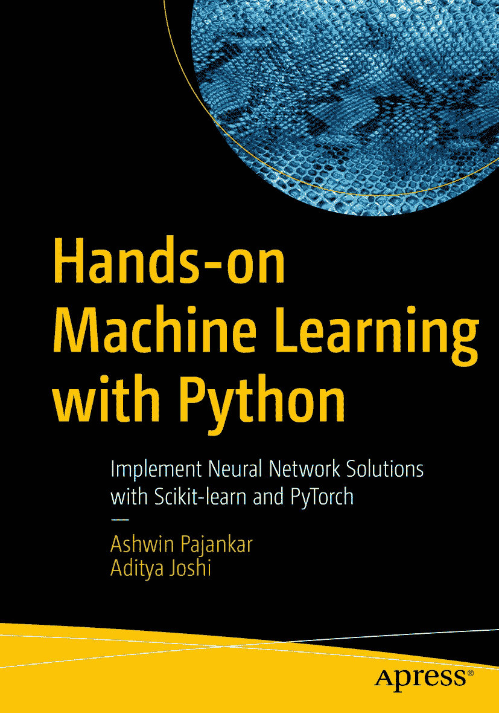
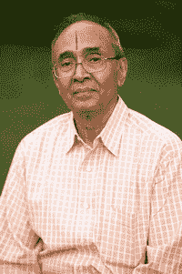

ISBN 978-1-4842-7920-5 e-ISBN 978-1-4842-7921-2 [`doi.org/10.1007/978-1-4842-7921-2`](https://doi.org/10.1007/978-1-4842-7921-2) © Ashwin Pajankar 和 Aditya Joshi 2022 Apress 标准 本出版物中使用的通用描述性名称、注册商标名称、商标、服务标志等，即使未作明确声明，也不意味着这些名称不受相关保护性法律和法规的约束，因此可自由用于一般用途。出版商、作者和编辑可以合理假定，本书中的建议和信息在出版之日是真实准确的。出版商、作者或编辑均不对本书所含材料或可能存在的任何错误或遗漏提供明示或暗示的担保。出版商对已出版地图中的管辖权主张和机构隶属关系保持中立。

本 Apress 印记由注册公司 APress Media, LLC（Springer Nature 的一部分）出版。

注册公司地址为：1 New York Plaza, New York, NY 10004, U.S.A.

*本书谨献给我们的老师 Govindarajulu Regeti 教授（1945 年 7 月 9 日–2021 年 3 月 18 日）的纪念*

*大家亲切地称他为 RGR，Govindarajulu 教授在 JNTU Kakinada 获得了电气与电子工程学士学位。他还在 IIT Kanpur 获得了硕士和博士学位。Govindarajulu 教授是 IIIT Hyderabad 的早期教员，并在使 IIIT Hyderabad 成为今天这样一流的学府中发挥了重要作用。他是该学院最受喜爱和欢呼的教员。他充满教学热情，并拥有老派的魅力。毫无疑问，他关心每一位学生个体，细心了解并指导他们。他在 IIIT Hyderabad 教授、指导和辅导了许多批学生（包括本书作者之一 Ashwin Pajankar）。*

引言

我们长期以来一直计划合作撰写一本关于机器学习的书。自从大约十年前我们开始学习这些主题以来，这个领域已经极大地发展和扩展。我们意识到，作为终身学习者，在任何领域的初始几步都需要一个更清晰的来源来明确指明道路。这还需要一套简洁的解释，以及偶尔通过阅读、学习和运用所学知识来扩展学习体验的想法。我们在学术生涯和软件开发、数据科学及机器学习的职业生涯中长期使用 Python。通过这本书，我们非常谦逊地尝试为绝对初学者编写一本关于机器学习主题的逐步指南。本书的每一章都包含所用概念的讲解、代码示例、代码示例的说明以及输出的截图。

第一章涵盖了在不同平台上搭建 Python 环境。第二章涵盖了 NumPy 和 Ndarrays。第三章探讨了使用 Matplotlib 进行可视化。第四章向我们介绍了 Pandas 数据科学库。所有这些初始章节都构建了编程和基本数据处理的基础，这是学习机器学习的先决条件之一。

下一节讨论传统的机器学习方法。在第五章中，我们从机器学习领域的鸟瞰视角开始，接着安装 Scikit-learn，并提供一个使用 Scikit-learn 的简短快速的机器学习解决方案示例。第六章详细阐述了帮助你理解和将结构化、文本及图像数据转换为机器学习库可接受格式的方法。在第七章中，我们介绍监督学习方法，从用于回归问题的线性回归和用于分类问题的逻辑回归与决策树开始。在每个实验中，我们还展示了如何使用决策边界图绘制算法已学到的可视化结果。第八章深入探讨了机器学习模型的进一步微调。我们解释了一些衡量模型性能的想法、过拟合和欠拟合的问题，以及处理这些问题和提升模型性能的方法。第九章继续讨论监督学习方法，特别关注朴素贝叶斯和支持向量机。第十章解释了集成学习方法，这些解决方案结合多个更简单的模型以产生比它们单独提供更好的性能。在第十一章中，我们讨论无监督学习方法，特别关注降维、聚类和频繁模式挖掘方法。每个部分都包含一个使用 Scikit-learn 实现所讨论方法的完整示例。

最后一节从第十二章介绍神经网络和深度学习的基本概念开始。我们介绍了一个非常流行的开源机器学习框架 PyTorch，它将在后续章节的示例中使用。第十三章从人工神经网络的解释开始，深入讨论了前馈和反向传播的理论基础，接着简要讨论了损失函数并给出了一个简单神经网络的示例。在下半部分，我们解释了如何创建一个能够识别手写数字的多层神经网络。在第十四章中，我们讨论了卷积神经网络，并通过一个图像分类的示例进行实践。第十五章讨论了循环神经网络，并引导你完成一个序列建模问题。在最后的第十六章中，我们讨论了规划、管理和工程化机器学习及数据科学项目的策略。我们还讨论了一个使用深度学习进行情感分析的简短端到端示例。

如果你是这个主题的新手，我们强烈建议你按顺序阅读各章，因为概念是层层递进的。请跟随所有代码部分，并随意修改和调整代码结构、数据集和超参数。如果你已经了解某些主题，可以随意跳到你感兴趣的主题，并仔细阅读相关章节。祝你学习愉快。

致谢

我要向 Aditya Joshi 表达我的感激之情，他是我在 IIIT Hyderabad 的学弟，现在是一位尊敬的同事，他撰写了本书最重要的大部分章节。我还要感谢我在 Apress 的导师 Celestin、Aditee、James Markham 以及编辑团队。感谢那些帮助我改进本书的审稿人。我也感谢 Govindrajulu 教授的家人——Srinivas（儿子）和 Amy（儿媳）——允许我将本书献给他以作纪念，并分享他的传记信息和照片用于出版。

> ——Ashwin Pajankar

我撰写本书的初衷，源于父亲阿肖克·库马尔·乔希（Ashok Kumar Joshi）的大力鼓励与支持，可惜他未能亲眼见证本书的完成。我由衷感谢朋友们和家人——尤其是我的母亲巴瓦娜·乔希（Bhavana Joshi）以及许多其他人，他们持续不断的支持是我推进这个项目的催化剂。我还要衷心感谢我的妻子尼哈·潘迪（Neha Pandey），在我加班工作（尤其是周末）时，她给予了充分的理解与耐心。我要感谢阿什温·帕詹卡（Ashwin Pajankar），他不仅是合著者，更是我整个旅程中的导师。我还要向 Innomatics 团队的卡尔帕纳·卡蒂基·雷迪（Kalpana Katiki Reddy）、维什瓦纳特·尼亚塔尼（Vishwanath Nyathani）和拉古拉姆·阿杜里（Raghuram Aduri）表达谢意，感谢他们让我有机会与数百名学习数据科学和机器学习的学生互动。我也要感谢阿克沙杰·维尔马（Akshaj Verma）在其中一个高级章节中为代码示例提供的支持。同时，感谢 Apress 的编辑团队，特别是塞莱斯廷·苏雷什·约翰（Celestin Suresh John）、阿迪蒂·米拉希（Aditee Mirashi）、詹姆斯·马卡姆（James Markham）以及所有参与此过程的人。

> ——阿迪亚·乔希（Aditya Joshi）

关于作者 关于技术审校

