# 1. 开始使用 Python 3 和 Jupyter Notebook

我希望各位都已阅读过引言和目录。这一点非常重要，因为如果你是完全的初学者，请不要跳过本章。整个机器学习和人工智能领域都需要扎实掌握该领域使用的工具和框架。本章作为本书将要涵盖的 Python 机器学习编程的基础章节。它将向新手读者介绍 Python 编程语言、科学 Python 生态系统以及用于 Python 编程的 Jupyter Notebook。

以下是本章我们将学习的内容列表：

*   Python 3 编程语言

*   安装 Python

*   Python 模式

*   Pip3 工具

*   科学 Python 生态系统

*   Python 实现与发行版

学习完本章后，我们将能够熟练地在 Windows 和 Debian Linux 系统上进行安装、运行程序以及使用 Jupyter notebook。

## Python 3 编程语言

Python 3 是一种现代编程语言。它兼具面向对象和过程式编程的特性。它可以在多种平台上运行。普通读者最容易接触到的平台是 macOS、Windows 和各种 Linux 发行版。Python 可以在所有这些平台上运行。其主要优势在于，在一个平台上编写的代码无需进行重大修改（平台特定代码除外）即可在另一个平台上运行。你可以在 [`www.python.org/`](http://www.python.org/) 阅读更多关于 Python 的信息。

### Python 编程语言的历史

ABC 语言是 Python 编程语言的前身。ABC 语言的灵感来源于 ALGOL 68 和 SETL 编程语言。Python 编程语言由吉多·范罗苏姆（Guido Van Rossum）在 20 世纪 80 年代末的圣诞假期期间作为业余项目创建。他当时在荷兰国家数学与计算机科学研究所（Centrum Wiskunde & Informatica）工作。范罗苏姆毕业于阿姆斯特丹大学计算机科学专业。他曾就职于谷歌和 Dropbox。目前，他在微软工作。

Python 有两个主要且不兼容的版本：Python 2 和 Python 3。Python 2 目前已不再积极开发和维护。整个编程世界正逐渐从 Python 2 切换到 Python 3。本书中的所有演示都将使用 Python 3。从现在起，每当我们使用**Python**这个词时，都指的是**Python 3**。

#### Python 编程语言的哲学

Python 编程语言的哲学被称为**Python 之禅**，可以在 [`www.python.org/dev/peps/pep-0020/`](http://www.python.org/dev/peps/pep-0020/) 查阅。以下是该 PEP（Python 增强提案）中的要点。其中一些很有趣。

1.  优美胜于丑陋。

2.  显式胜于隐式。

3.  简单胜于复杂。

4.  复杂胜于凌乱。

5.  扁平胜于嵌套。

6.  稀疏胜于密集。

7.  可读性很重要。

8.  特殊情况也不足以特殊到打破规则。

9.  尽管实用性胜过纯粹性。

10. 错误不应被静默忽略。

11. 除非明确需要静默。

12. 面对歧义，拒绝猜测的诱惑。

13. 应该有一种——最好只有一种——显而易见的方式来做这件事。

14. 尽管这种方式一开始可能并不明显，除非你是荷兰人。

15. 现在做胜于永不开始。

16. 尽管永不开始通常比*立刻*开始要好。

17. 如果实现难以解释，那可能是个坏主意。

18. 如果实现易于解释，那可能是个好主意。

19. 命名空间是个绝妙的主意——让我们更多地使用它们吧！

这些是几十年来影响 Python 编程语言发展并持续发挥作用的通用哲学指南。

### Python 的应用领域

Python 被用于各种应用程序。例如：

1.  教育

2.  自动化

3.  科学计算

4.  计算机视觉

5.  动画

6.  物联网

7.  网页开发

8.  桌面和移动应用

9.  管理

我们可以在 [`www.python.org/about/apps/`](http://www.python.org/about/apps/) 详细了解所有应用。许多组织使用 Python 创建了应用程序。我们可以在 [`www.python.org/success-stories/`](http://www.python.org/success-stories/) 阅读所有这些成功案例。现在，让我们开始我们自己的旅程。

## 安装 Python

我们将详细学习如何在 Windows 上安装 Python 3。访问 [`www.python.org`](http://www.python.org)，将鼠标指针悬停在**下载**选项上。它将打开下载菜单。它会根据你的操作系统显示相应的选项。在我们的例子中，它会显示 Windows 的下载选项。下载该文件。它是一个可执行的安装文件。在我的例子中，它下载的是 64 位版本的安装文件。如果你使用的是其他架构（例如 32 位），则会相应地下载合适的文件。图 1-1 显示了 Windows 的 Python 3 下载页面。

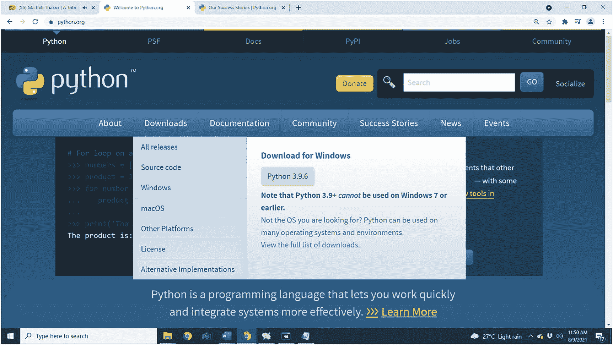

图 1-1

Windows 的 Python 3 下载

下载完成后，打开该文件。它将显示一个如图 1-2 所示的窗口。不要忘记勾选所有复选框，以便将 Python 的安装文件夹添加到 Windows 环境的 **PATH** 变量中。这使我们能够从命令提示符启动 Python。

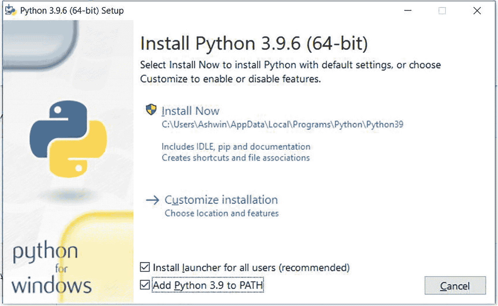

图 1-2

Windows 的 Python 3 安装（勾选所有复选框）

点击“立即安装”选项（需要管理员权限）。安装成功完成后，会显示如图 1-3 所示的消息。

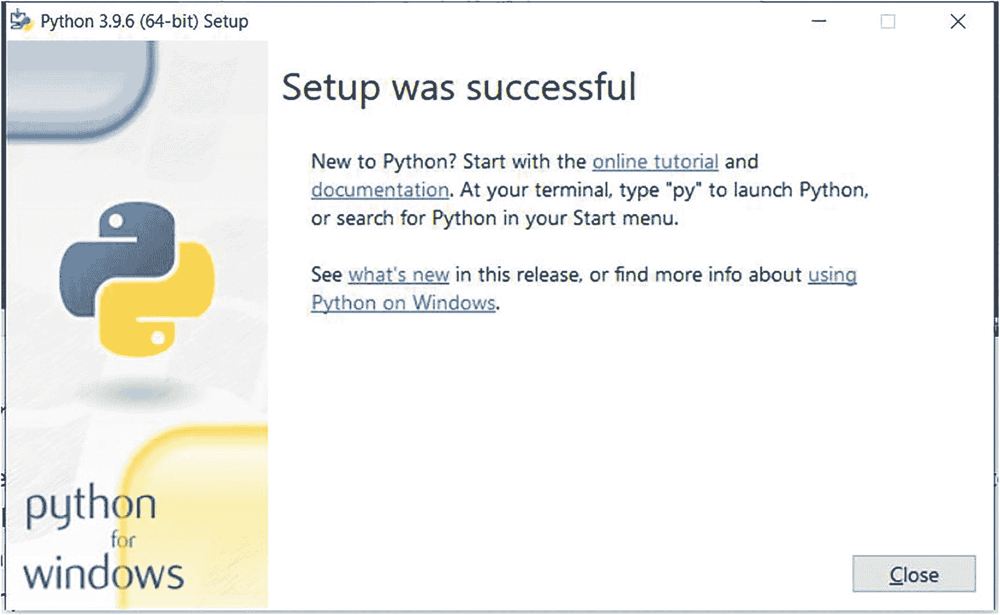

图 1-3

Python 3 安装成功消息

现在关闭窗口，我们已准备好开始我们的旅程。

### Linux 发行版上的 Python

Python 2 和 Python 3 已预装在所有主要的 Linux 发行版上。我们将在本章后面看到这一点。

### macOS 上的 Python

我们可以在 [`https://docs.python.org/3/using/mac.html`](https://docs.python.org/3/using/mac.html) 获取 macOS 上安装的详细说明。

## Python 模式

让我们学习各种 Python 模式。我们还将编写我们的第一个 Python 程序。


### 交互模式

Python 为我们提供了交互模式。我们可以通过打开 Windows 安装时自带的 IDLE（集成开发与学习环境）程序来调用 Python 交互模式。只需在 Windows 搜索栏中输入 IDLE，然后点击出现的 IDLE 图标，如图 1-4 所示。

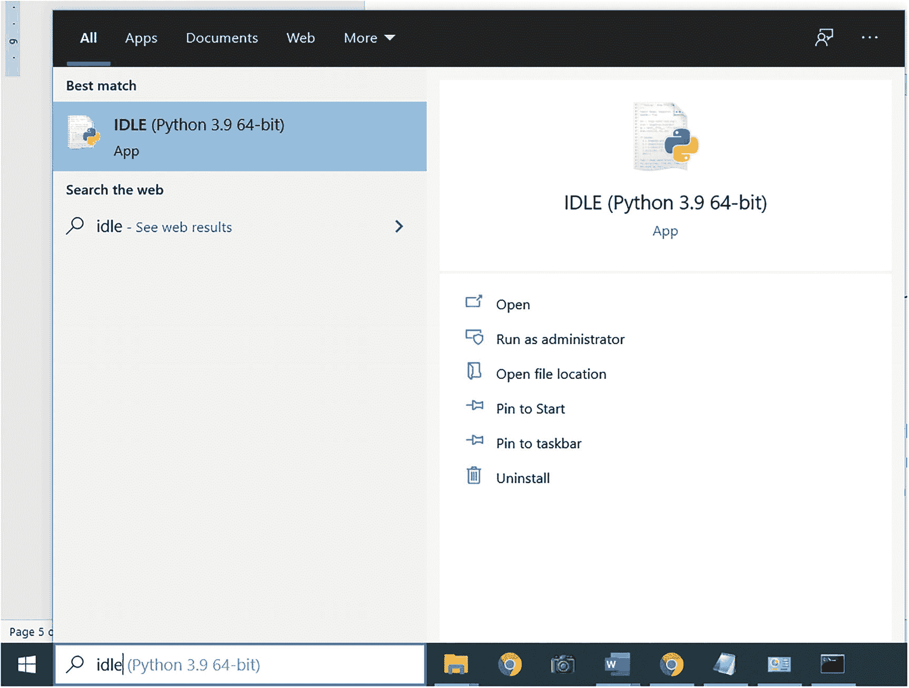

图 1-4

在 Windows 上启动 IDLE

它会显示一个窗口，如图 1-5 所示。

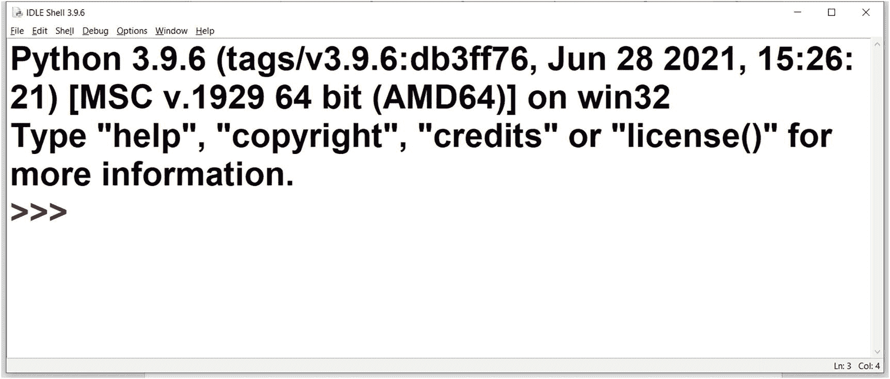

图 1-5

Windows 上的 IDLE 交互提示符

我们可以在其中输入以下代码：

```
print("Hello, World!")
```

然后按回车键运行。它将显示输出，如图 1-6 所示。

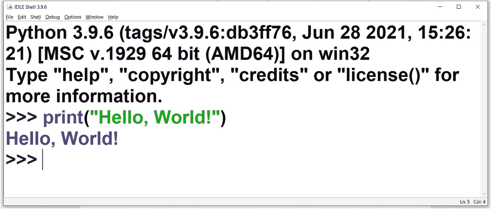

图 1-6

简单代码执行

现在我们知道 IDLE 可以逐行或逐块执行代码。在交互提示符中运行小型独立的代码片段非常方便。

我们也可以在不使用 IDLE 的情况下，通过在 Windows 命令提示符中输入命令来调用解释器模式。该命令是 `python`。运行该命令，它将以交互模式启动解释器，如图 1-7 所示。

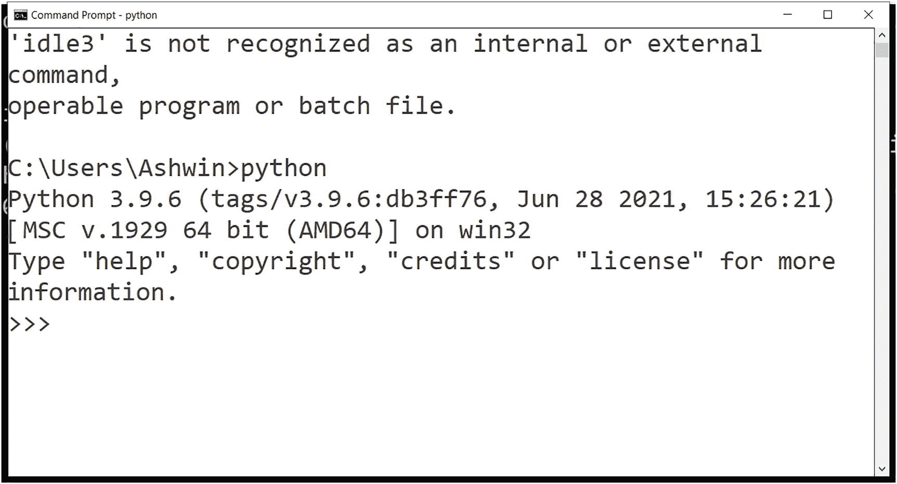

图 1-7

Windows 命令提示符中的 IDLE

我在一台配备 8GB 内存的 Raspberry Pi 4 上使用 Debian 发行版（Raspberry Pi OS）。IDLE 并未预装，但操作系统中包含 Python 2 和 Python 3。在命令提示符（终端或使用 SSH 客户端）中运行以下命令来安装适用于 Python 3 的 IDLE：

```
sudo pip3 install idle
```

这将为 Python 3 安装 IDLE。我们将在本章后面讨论 **pip** 工具。此外，即使没有 IDLE，我们也可以在 Linux 的命令提示符中输入命令 `python3` 来调用 Python 3 交互模式。请注意，由于 Linux 发行版同时包含 Python 2 和 Python 3，命令 `python` 将在命令提示符中调用 Python 2。对于 Python 3 解释器，在 Linux 上的命令是 `python3`。图 1-8 显示了在远程访问 Linux 命令提示符的 SSH 终端中正在进行的 Python 3 会话。

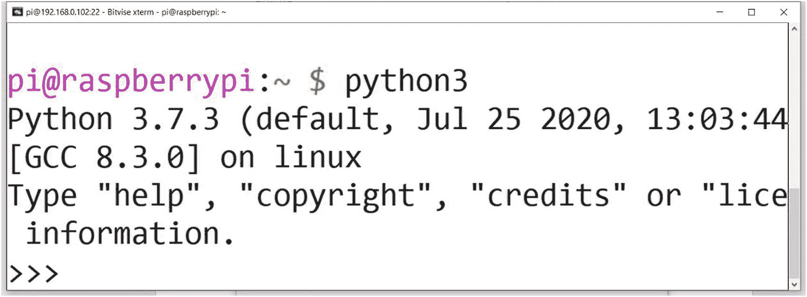

图 1-8

Linux 命令提示符上的 Python 3 解释器（远程 SSH 访问）

现在，我们可以通过在 Linux 桌面调用的命令提示符中输入命令 `idle` 来访问 Python 3 的 IDLE。如果我们在 SSH 终端中远程运行此命令，它会返回错误，因为远程 SSH 缺少 GUI 功能。我们只能在从 Linux 桌面环境调用的终端上运行此命令来调用 IDLE。这可以直接完成，也可以在像 VNC 这样的远程桌面环境中完成，如图 1-9 所示。

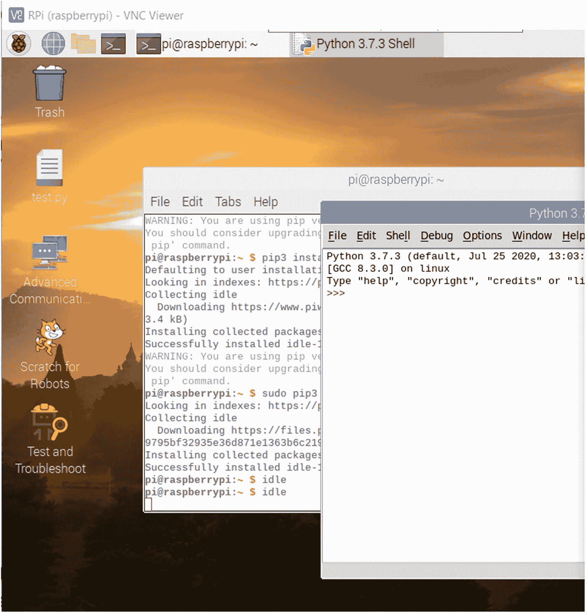

图 1-9

在 Linux 命令提示符上调用的 Python 3 IDLE（通过 VNC 远程桌面访问）

我们也可以从 Raspberry Pi OS 菜单中启动 IDLE，如图 1-10 所示。

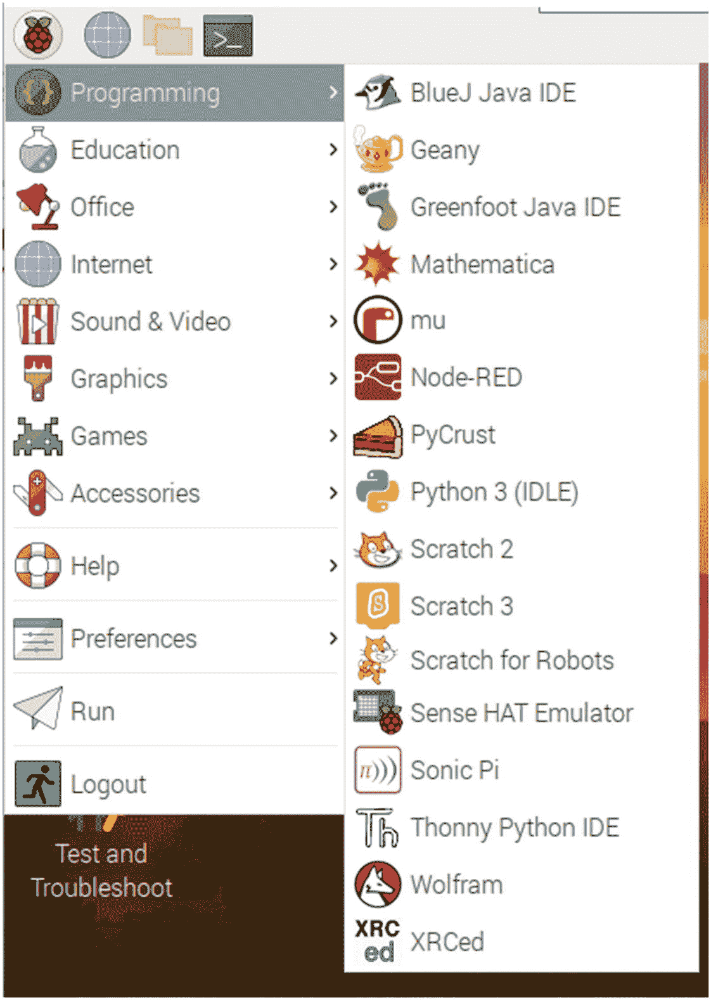

图 1-10

Linux 菜单下的 IDLE

无论你使用哪种 Linux 发行版，一旦安装，你肯定能在菜单和程序中找到 IDLE。如果找不到，可以按照前面所述在桌面的命令提示符中启动它。

Python 3 还有一个更具交互性的命令行环境，称为 IPython。我们可以通过在 Linux 和 Windows 的命令提示符中运行以下命令来安装它：

```
pip3 install ipython
```

这将在你的操作系统上为 Python 3 安装 IPython。我们可以通过在 Windows 和 Linux 的命令提示符中输入命令 `ipython` 来调用 IPython。我们可以用它来代替 IDLE 交互模式。图 1-11 显示了一个正在进行的 IPython 会话。

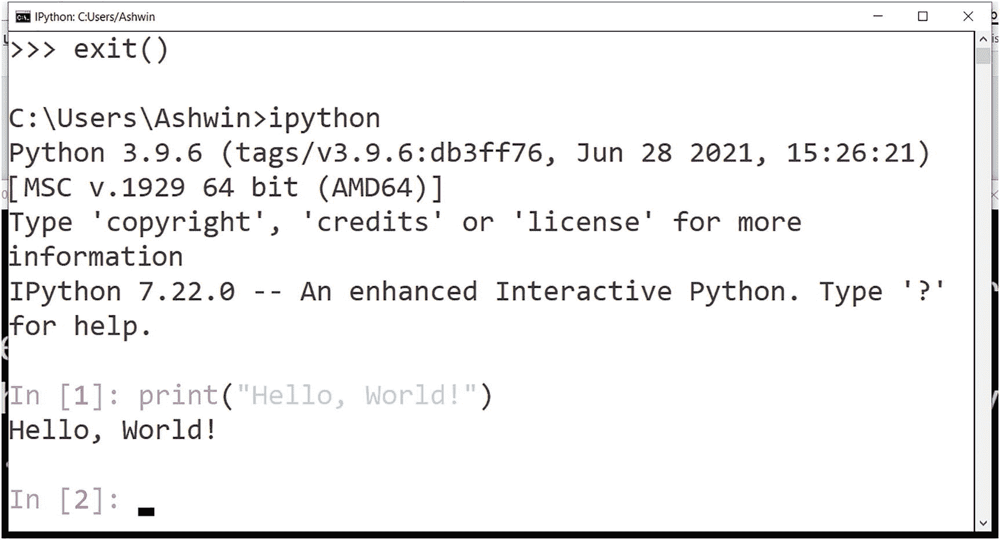

图 1-11

Windows 命令提示符中正在进行的 IPython 会话

最后，以下命令可以终止所有平台（Windows、macOS 和 Linux）上的 Python 解释器、IDLE 交互模式和 IPython 会话：

```
exit()
```

以上就是关于交互模式和 Python 解释器的全部内容。

### 脚本模式

Python 解释器的交互模式易于上手，非常适合原型设计等。然而，对于较大的程序，最好的方式是使用 IDLE。实际上，我们可以使用任何自己喜欢的编辑器来编写 Python 程序。但是，像记事本或 gedit 这样的纯文本编辑器无法运行程序。因此，我们使用像 IDLE 这样的 IDE。IDLE 更易于使用。只需点击 IDLE 解释器窗口顶部菜单栏中 **File** 菜单里的 **New File** 选项，它就会创建一个新的空白文件。我们需要保存它。IDLE 会自动为保存的文件添加 ***.py** 扩展名。然后输入以下代码行并再次保存：

```
print("Hello, World!")
```

然后转到菜单栏中的 **Run** 菜单，点击 **Run Module** 选项。我们也可以直接使用键盘上的快捷键 **F5** 来运行。图 1-12 显示了一个 IDLE 窗口及其输出。

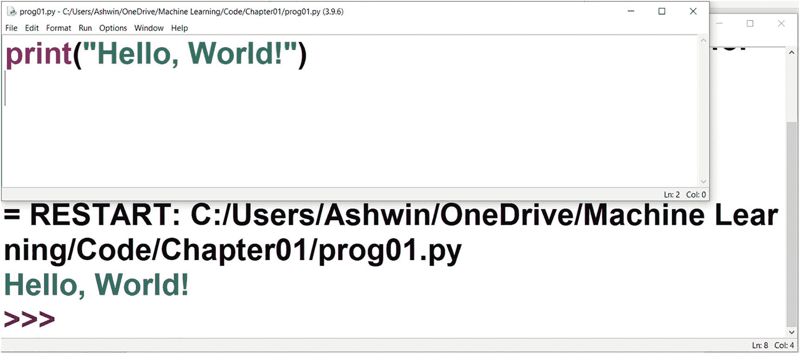

图 1-12

IDLE 中的 Python 程序及其输出

我们也可以从操作系统的命令提示符中启动该程序。在命令提示符中，只需打开保存 Python 程序的目录（使用命令 **cd**），然后运行以下命令：

```
python3 prog01.py
```

在 Windows 中，我们需要运行以下命令：

```
python prog01.py
```

Python 解释器将运行该程序，显示输出，然后将控制权返回给命令提示符。

在 Linux 中，我们也可以直接在命令提示符中运行 Python 代码文件，而无需直接调用解释器。为此，我们需要在文件开头添加以下代码行：

```
#!/usr/bin/python3
```

因此，代码文件最终看起来像这样：

```
#!/usr/bin/python3
print("Hello, World!")
```

在命令提示符中，打开目录（同样使用命令 **cd**），然后运行以下命令来更改文件模式：

```
chmod 755 prog01.py
```

这将使其成为可执行文件。我们现在可以使用以下命令直接调用该程序文件：

```
./prog01.py
```

Linux Shell 将使用代码文件第一行中提到的 Python 解释器来执行它。

要找出你的 Linux 发行版中 Python 解释器可执行文件的位置，请在命令提示符中运行以下命令：

```
which python3
```

在 Windows 中，可以通过以下命令完成相同操作：

```
where python
```

它将返回 Windows 中 Python 解释器可执行文件的位置。


## Pip3 实用工具

我们之前已经使用 pip 工具安装了一些东西。在本节中，我们将详细了解该工具。

Pip 代表 **pip installs packages**（pip 安装包）或 **pip installs Python**（pip 安装 Python）。这是一个递归缩写，意味着其术语的展开包含了自身。Pip 是 Python 及相关软件的包管理器工具，它是一个命令行工具。Pip3 是 pip 的 Python 3 版本，我们可以用它来为 Python 3 安装包。在整本书中，我们将全程使用它来安装库。让我们看看它的用法。

我们可以用它来查看已安装包的列表，如下所示：

```
pip3 list
```

它将显示所有已安装包的列表。我们可以按如下方式安装一个新包（此处以 Jupyter 为例）：

```
pip3 install jupyter
```

在 Linux 中，我们可能需要像这样结合 `sudo` 工具来使用它：

```
sudo pip3 install jupyter
```

我们还可以使用以下命令卸载包：

```
pip3 uninstall jupyter
```

## 科学计算 Python 生态系统

我们可以使用 Python 进行数值计算和科学编程。为此，我们需要使用科学计算 Python 生态系统。它包含以下核心组件：

1.  Python

2.  Jupyter Notebook

3.  NumPy

4.  SciPy

5.  Matplotlib

6.  SymPy

除了 SymPy，我们将使用其中的大部分组件。

上一节我们已经了解了如何安装 Jupyter。Jupyter 是一个基于 Web 浏览器的 Python 解释器。如果你还没有安装，请先安装它。

我们可以在 Windows 和 Linux 操作系统的命令提示符中使用以下命令启动 Jupyter：

```
jupyter notebook
```

它将启动 Jupyter Notebook 服务器进程，并自动打开一个基于 Web 浏览器的界面。作为本章的练习，请探索 Jupyter Notebook 并在其中运行一些小的代码片段。

## Python 实现与发行版

我们已经熟悉了 Python 的基础知识，并为 Python 编程配置好了计算机。我相信现在是时候探索 **Python 实现** 和 **Python 发行版** 这些概念了。这些概念对于初学者来说是必须了解的。

之前，我提到过 Python 是一种编程语言。然而，它远不止于此。我们都知道 **C** 编程语言。**C** 更像是一种编程标准。该标准由 ANSI 制定，各个组织编写自己的程序和工具（称为编译器），根据需求编译 C 程序。我曾在 Windows 上使用过多种编译器（及相关的 IDE）编写 C 程序，例如 Turbo C++、Microsoft Visual C++、GCC、LLVM 和 MinGW-w64。

我相信 Python 也在朝着类似的方向发展，因为许多组织都编写了自己的解释器来解释和执行 Python 代码。这些解释器也被称为 Python 的 **实现**。在本章前面，我们学习了如何从 [`www.python.org`](http://www.python.org) 下载和安装 Python 解释器（以及 IDLE）。这个解释器也被称为 **CPython 实现**。它由 C 和 Python 编写而成，是 Python 的参考实现。还有其他几种实现。以下是 Python 其他实现的部分列表：

*   IronPython（在 .NET 上运行的 Python）
*   Jython（在 Java 虚拟机上运行的 Python）
*   PyPy（带有 JIT 编译器的快速 Python 实现）
*   Stackless Python（支持微线程的 CPython 分支）
*   MicroPython（在微控制器上运行的 Python）

我们可以通过以下网址了解更多信息：

[`www.python.org/download/alternatives/`](http://www.python.org/download/alternatives/)

[`https://wiki.python.org/moin/PythonImplementations`](https://wiki.python.org/moin/PythonImplementations)

既然我们已经知道 Python 有多种实现，那么让我们来理解 **发行版** 的含义。Python 发行版是一个 Python 实现（解释器）与有用的库和工具捆绑在一起的产物。例如，CPython 实现和发行版附带了 IDLE 和 pip。因此，我们拥有了一套解释器、IDE 和包管理器，可以开始软件开发。以下网址列出了许多 Python 发行版：

[`https://wiki.python.org/moin/PythonDistributions`](https://wiki.python.org/moin/PythonDistributions)

这些 Python 实现和发行版的列表显然并不详尽。我们甚至可以编写自己的 Python 解释器（这不是一项容易的任务，但可以做到）。我们可以将其与一些有用的工具打包，并称之为我们自己的发行版。我从以下 stackoverflow.com 的讨论中学到了很多关于 **实现** 和 **发行版** 这两个术语的知识：

[`https://stackoverflow.com/questions/27450172/python-implementation-vs-python-distribution-vs-python-itself`](https://stackoverflow.com/questions/27450172/python-implementation-vs-python-distribution-vs-python-itself)

我鼓励所有读者访问该网址并阅读讨论内容。

## Anaconda

由于本书的主题涉及 **机器学习** 领域，而机器学习本身又是更广泛的 **科学计算** 领域的一部分，因此如果不讨论 **Anaconda** Python 发行版，本章将是不完整的。Anaconda 发行版专为科学社区的需求而定制，它附带了大量库，因此初学者无需安装任何东西即可开始科学计算。它还附带了 pip 以及另一个强大的包管理器 **conda**。我们可以在 [`www.anaconda.com/products/individual`](http://www.anaconda.com/products/individual) 下载个人版。

它将下载一个适合你操作系统的可安装文件（就像 Python 主页一样，它会自动检测你的操作系统并呈现最合适的安装文件）。继续安装即可。这和我们安装参考实现 CPython 一样简单。只需确保在安装过程中被询问时，勾选将 Anaconda 添加到 **PATH** 变量的选项。安装完成后，你就可以使用 PyCharm、Spyder 和 Jupyter Notebook 等大量工具和 IDE 开始编程了。你可以通过在 Windows 的搜索框中搜索“Anaconda Navigator”来打开它。Anaconda Navigator 是 Anaconda 发行版的统一界面，它在一个窗口中显示所有工具和实用程序，我们可以从中管理和使用它们。

然而，在此阶段，我想添加一个注意事项。如果你尚未安装 CPython、Anaconda 或任何其他 Python 发行版，请确保只安装一个（而不是多个）Python 发行版，因为对于初学者来说，在一台计算机上管理多个 Python 发行版和环境可能会有些混乱。因此，为了练习本书中的代码示例，请安装 CPython 或 Anaconda，但不要同时安装两者，至少不要同时安装。

此外，Anaconda 还有一个轻量级版本，称为 **Miniconda**。它附带 Python 解释器和 conda 包管理器。它还包含一些其他有用的包，如 pip、zlib 等。我们可以在 [`https://docs.conda.io/en/latest/miniconda.html`](https://docs.conda.io/en/latest/miniconda.html) 了解更多信息。

如果你想了解更多关于 conda 包管理器的信息，请阅读 [`https://docs.conda.io/projects/conda/en/latest/commands.html`](https://docs.conda.io/projects/conda/en/latest/commands.html) 上的文档。其中有一个 conda 和 pip 管理 Python 包的命令对比表。

另外，如果你想要一个详细的分步教程和探索指南，可以观看我在 YouTube 频道上创建的视频，网址是 [`www.youtube.com/watch?v=Cs4Law0FQ2E`](http://www.youtube.com/watch%253Fv%253DCs4Law0FQ2E)。


## 总结

在本章中，我们熟悉了 Python、IDLE 和 Anaconda。我们学习了如何使用 Python 解释器以及如何编写 Python 脚本。我们还学习了如何执行 Python 程序。在下一章中，我们将继续学习 NumPy。

