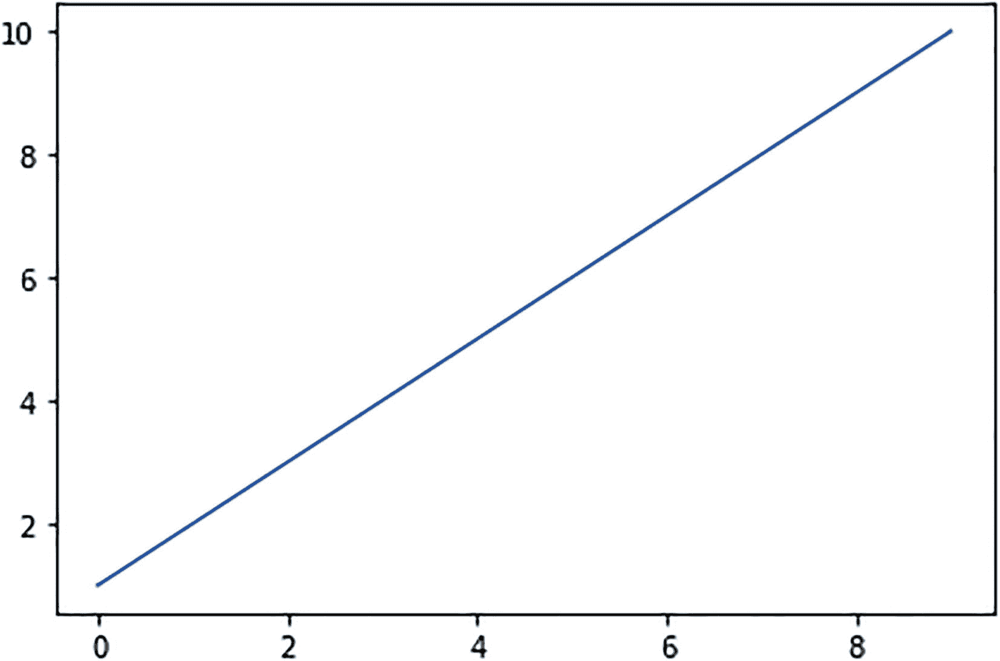
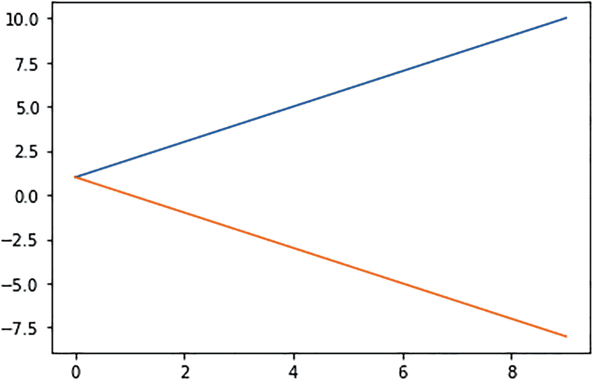
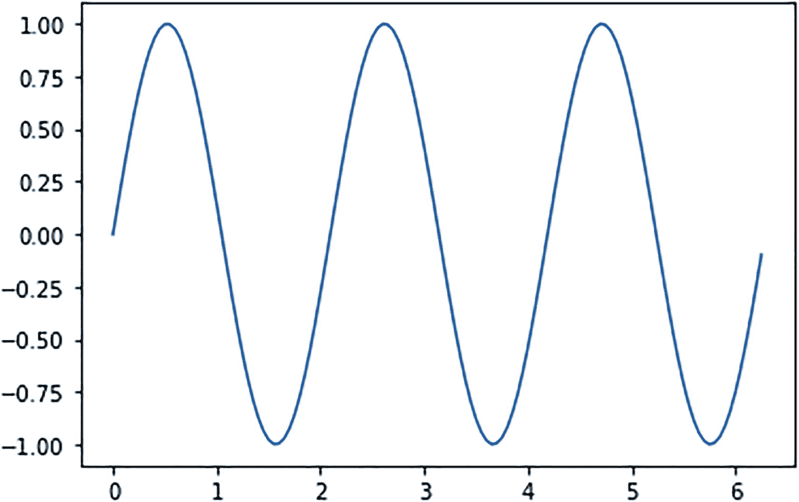
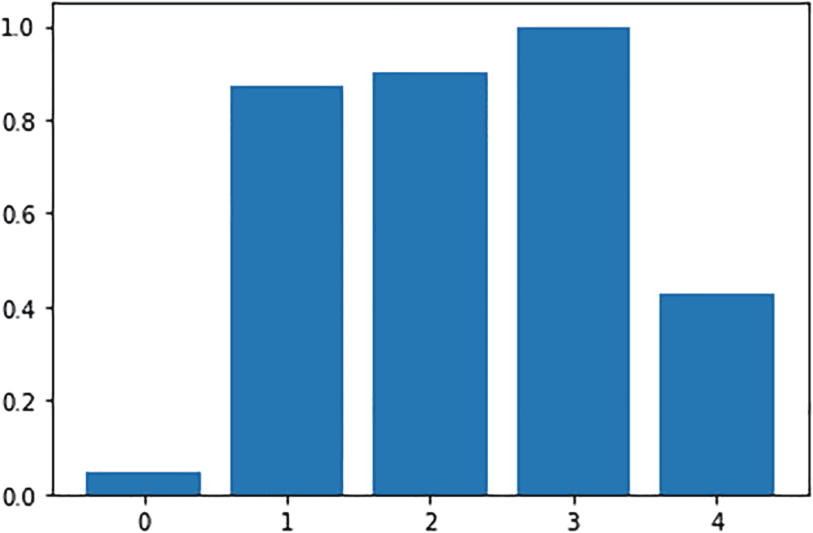
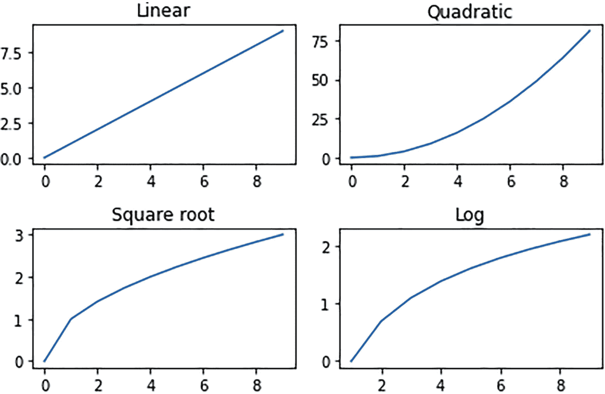
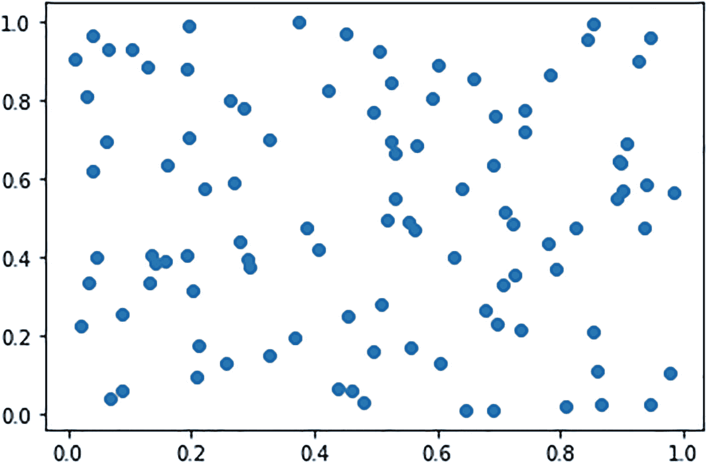
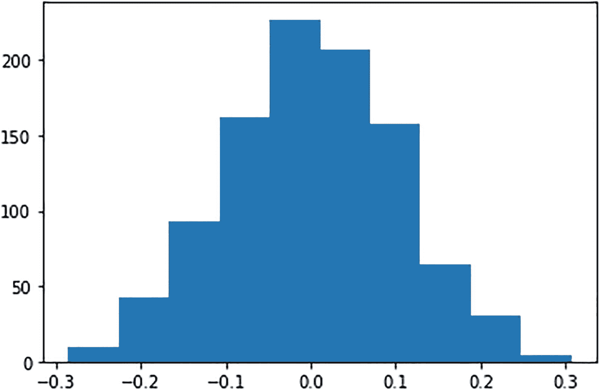
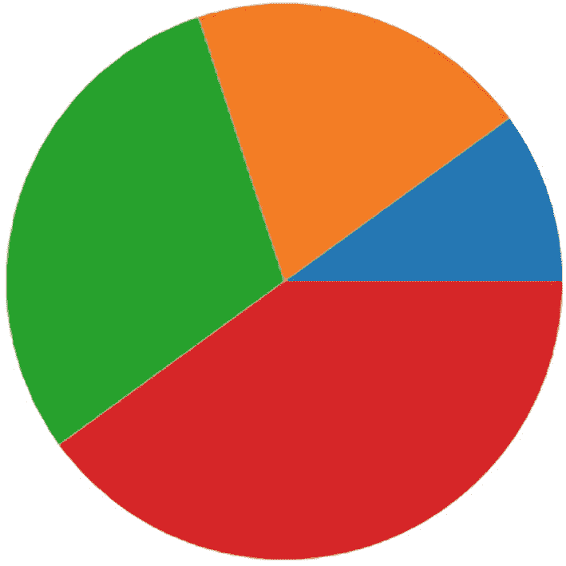

# 3. 数据可视化入门

我们在上一章学习了 NumPy 的基础知识。本章将重点学习 NumPy 库的更多函数。我们还将学习用于数据可视化的 Matplotlib 库的基础知识。与上一章一样，本章也将包含大量的动手编程练习。本章涵盖以下主题：

*   用于创建 Ndarray 的 NumPy 例程
*   Matplotlib 数据可视化

阅读完本章后，我们将能够熟练使用 NumPy 和 Matplotlib。

## 用于创建 Ndarray 的 NumPy 例程

让我们学习一些用于创建数组的 NumPy 例程。让我们为本章创建一个新的 Jupyter Notebook。

例程 `np.empty()` 创建一个给定大小的空数组。由于数组未初始化，其元素是随机的。

```python
import numpy as np
x = np.empty([3, 3], np.uint8)
print(x)
```

它将输出一个包含随机数的数组。由于数字是随机的，你的输出可能有所不同。我们可以按如下方式创建多维矩阵：

```python
x = np.empty([3, 3, 3], np.uint8)
print(x)
```

我们可以使用例程 `np.eye()` 创建一个除对角线元素外全为零的矩阵。对角线上的元素全为 1。

```python
y = np.eye(4, dtype=np.uint8)
print(y)
```

输出如下：

```
[[1 0 0 0]
[0 1 0 0]
[0 0 1 0]
[0 0 0 1]]
```

我们还可以按如下方式设置对角线的位置：

```python
y = np.eye(4, dtype=np.uint8, k=1)
print(y)
```

输出如下：

```
[[0 1 0 0]
[0 0 1 0]
[0 0 0 1]
[0 0 0 0]]
```

我们甚至可以为对角线位置设置负值，使其上的元素全为 1，如下所示：

```python
y = np.eye(4, dtype=np.uint8, k=-1)
print(y)
```

运行它并查看输出。

函数 `np.identity()` 返回指定大小的单位矩阵。单位矩阵是一个对角线元素全为 1，其余元素全为 0 的矩阵。以下是一些示例：

```python
x = np.identity(3, dtype= np.uint8)
print(x)
x = np.identity(4, dtype= np.uint8)
print(x)
```

例程 `np.ones()` 返回给定大小的矩阵，其所有元素均为 1。运行以下示例查看效果：

```python
x = np.ones((3, 3, 3), dtype=np.int16)
print(x)
x = np.ones((1, 1, 1), dtype=np.int16)
print(x)
```

让我们看一下 `arange()` 例程。它创建一个在给定区间内均匀分布值的 Ndarray。停止值参数是必需的。起始值和间隔参数分别有默认参数 0 和 1。让我们看一个例子：

```python
np.arange(10)
```

输出如下：

```
array([0, 1, 2, 3, 4, 5, 6, 7, 8, 9])
```

例程 `linspace()` 返回一个在指定区间内均匀分布数字的 Ndarray。我们必须向其传递起始值、结束值和值的数量，如下所示：

```python
np.linspace(0, 20, 30)
```

输出如下：

```
array([ 0.        ,  0.68965517,  1.37931034,  2.06896552,  2.75862069,
3.44827586,  4.13793103,  4.82758621,  5.51724138,  6.20689655,
6.89655172,  7.5862069 ,  8.27586207,  8.96551724,  9.65517241,
10.34482759, 11.03448276, 11.72413793, 12.4137931 , 13.10344828,
13.79310345, 14.48275862, 15.17241379, 15.86206897, 16.55172414,
17.24137931, 17.93103448, 18.62068966, 19.31034483, 20.        ])
```

类似地，我们可以按如下方式创建具有对数间隔的 Ndarray：

```python
np.logspace(0.1, 2, 10)
```

输出如下：

```
array([  1.25892541,   2.04696827,   3.32829814,   5.41169527,
8.79922544,  14.30722989,  23.26305067,  37.82489906,
61.50195043, 100.        ])
```

我们还可以创建具有几何间隔的 Ndarray：

```python
np.geomspace(0.1, 20, 10)
```

运行此代码并自己查看输出。

NumPy 本身就是一个庞大的主题，需要很多章节，甚至可能需要几本书才能非常详细地介绍它。我们看到的这些小示例应该能让您对 Ndarray（上一章）以及创建它们的例程有一个清晰的认识。在本书中，我们将频繁使用 NumPy 库来存储数据。

## Matplotlib 数据可视化

Matplotlib 是一个数据可视化库。它是科学 Python 生态系统不可或缺的一部分。许多其他数据可视化库仅仅是 Matplotlib 的封装。本书将大量使用 Matplotlib 的 Pyplot 模块。它提供了类似 MATLAB 的接口。让我们从编写演示程序开始。将以下所有代码输入到我们之前用于早期示例的同一个笔记本中。

以下命令被称为魔法命令，它使 Jupyter Notebook 能够显示 Matplotlib 可视化结果：

```
%matplotlib inline
```

我们可以按如下方式导入 Matplotlib 的 Pyplot 模块：

```python
import matplotlib.pyplot as plt
```

我们可以按如下方式绘制一个简单的线性图：

```python
x = np.arange(10)
y = x + 1
plt.plot(x, y)
plt.show()
```

输出如图 3-1 所示。


图 3-1 一个简单的线性图

我们可以按如下方式绘制多线图：

```python
x = np.arange(10)
y1 = 1 – x
plt.plot(x, y, x, y1)
plt.show()
```

输出如图 3-2 所示。


图 3-2 一个简单的多线图

正如我们所见，`plt.plot()` 例程可以将数据可视化为简单的线条。我们也可以用它绘制其他形式的数据。其限制是数据必须是一维的。让我们按如下方式绘制一个正弦波：

```python
n = 3
t = np.arange(0, np.pi*2, 0.05)
y = np.sin( n * t )
plt.plot(t, y)
plt.show()
```

输出如图 3-3 所示。


图 3-3 正弦波图

我们还可以有其他类型的图。让我们可视化一个条形图。

```python
n = 5
x = np.arange(n)
y = np.random.rand(n)
plt.bar(x, y)
plt.show()
```

输出如图 3-4 所示。


图 3-4 一个条形图

我们可以按如下面向对象的方式重写相同的代码：

```python
fig, ax = plt.subplots()
ax.bar(x, y)
ax.set_title('Bar Graph')
ax.set_xlabel('X')
ax.set_ylabel('Y')
plt.show()
```

正如我们所见，代码创建了一个图形和一个轴，我们可以使用它们来调用可视化例程并设置可视化的属性。

让我们看看如何创建子图。子图是可视化中的图。我们可以按如下方式创建它们：

```python
x = np.arange(10)
plt.subplot(2, 2, 1)
plt.plot(x, x)
plt.title('Linear')
plt.subplot(2, 2, 2)
plt.plot(x, x*x)
plt.title('Quadratic')
plt.subplot(2, 2, 3)
plt.plot(x, np.sqrt(x))
plt.title('Square root')
plt.subplot(2, 2, 4)
plt.plot(x, np.log(x))
plt.title('Log')
plt.tight_layout()
plt.show()
```

正如我们所见，我们在每次调用绘图例程之前创建一个子图。`tight_layout()` 例程在子图之间创建足够的间距。输出如图 3-5 所示。



图 3-5 子图

我们可以按如下面向对象的方式编写相同的代码：

```python
fig, ax = plt.subplots(2, 2)
ax[0][0].plot(x, x)
ax[0][0].set_title('Linear')
ax[0][1].plot(x, x*x)
ax[0][1].set_title('Quadratic')
ax[1][0].plot(x, np.sqrt(x))
ax[1][0].set_title('Square Root')
ax[1][1].plot(x, np.log(x))
ax[1][1].set_title('Log')
plt.subplots_adjust(left=0.1,
bottom=0.1,
right=0.9,
top=0.9,
wspace=0.4,
hspace=0.4)
plt.show()
```

至此，您一定已经明白，我们可以使用 MATLAB 风格的语法或面向对象的方式来编写代码。

### 散点图

让我们继续学习散点图。我们可以按如下方式将二维数据可视化为散点图：

```python
n = 100
x = np.random.rand(n)
y = np.random.rand(n)
plt.scatter(x, y)
plt.show()
```

输出如图 3-6 所示。



图 3-6 散点图

### 直方图

任何数据频率分布的图形化描述称为直方图。我们可以使用 Matplotlib 轻松创建直方图，如下所示：

```python
mu, sigma = 0, 0.1
x = np.random.normal(mu, sigma, 1000)
plt.hist(x)
plt.show()
```

这里，`mu` 表示均值，`sigma` 表示标准差。输出如图 3-7 所示。



图 3-7 直方图

### 饼图

让我们以饼图作为结束。

```python
x = np.array([10, 20, 30, 40])
plt.pie(x)
plt.show()
```

输出如图 3-8 所示。



图 3-8 饼图

## 总结

在本章中，我们学习了一些用于创建 NumPy Ndarrays 和可视化数据的例程。NumPy 和 Matplotlib 是科学 Python 生态系统中的重要库，它们在机器学习编程中经常被使用。这些章节远未涵盖 NumPy 和 Matplotlib 的所有方面。但是，通过本章的演示，您一定已经对这些例程的用法有了很好的理解。

在下一章中，我们将继续探索科学 Python 生态系统中的数据科学库 Pandas。我们将学习基本的数据结构、一些操作以及可视化技术。