# 4. Pandas 简介

我们探索了用于创建 NumPy Ndarrays 和数据可视化的例程。我们对这两个库已经相当熟悉，并且可以使用这些例程通过 Python 编程来创建、存储和可视化数据。在本章中，我们将了解科学 Python 生态系统的数据科学库 Pandas。我们将学习基本的数据结构、一些操作以及使用 Matplotlib 进行可视化的方法。

本章涵盖以下主题：

*   Pandas 基础

*   Pandas 中的 Series

*   Pandas 数据框

*   可视化数据框中的数据

阅读本章后，我们将能够熟练使用科学 Python 生态系统中的 Pandas 库。

## Pandas 基础

Pandas 是科学 Python 生态系统的数据分析和数据科学库。与 NumPy、Matplotlib、IPython 和 Jupyter Notebook 一样，它是该生态系统不可或缺的一部分。

它用于多维数据的存储、操作和可视化。它比 Ndarrays 更灵活，并且与之兼容。这意味着我们可以使用 Ndarrays 来创建 Pandas 数据结构。

让我们为本章的演示创建一个新的笔记本。我们可以使用以下命令在 Jupyter Notebook 会话中安装 Pandas：

```
!pip3 install pandas
```

以下代码将库导入到当前程序或 Jupyter Notebook 会话中：

```
import pandas as pd
```

我本人从零开始学习 Pandas 时，大量参考了其文档。本书涵盖了足以入门机器学习的 Pandas 基础知识。本章全部内容都致力于介绍 Pandas。如果您想详细了解它，Apress 出版了许多专门讨论该主题的书籍。您也可以参考 Pandas 项目的以下 URL 以了解更多信息：

[`https://pandas.pydata.org/`](https://pandas.pydata.org/)

让我们学习 Pandas 中一些重要且基本的数据结构。


## Pandas 中的 Series

Pandas Series 是一个带有索引的同质一维数组。它可以存储任何支持类型的数据。我们可以使用列表或 Ndarray 来创建 Pandas Series。让我们为本章的演示创建一个新的笔记本。首先导入所有需要的库：

```
%matplotlib inline
import pandas as pd
import numpy as np
import matplotlib.pyplot as plt
```

让我们使用列表创建一个简单的 Series，如下所示：

```
s1 = pd.Series([1, 2, 3 , 4, 5])
```

如果我们输入以下代码：

```
type(s1)
```

我们会得到以下输出：

```
pandas.core.series.Series
```

我们也可以使用以下代码创建一个 Series：

```
s2 = pd.Series(np.arange(5), dtype=np.uint8)
s2
```

输出如下：

```
0    0
1    1
2    2
3    3
4    4
dtype: uint8
```

第一列是索引，第二列是数据列。

我们可以通过使用一个已定义的 Ndarray 来创建 Series，如下所示：

```
arr1 = np.arange(5, dtype=np.uint8)
s3 = pd.Series(arr1, dtype=np.int16)
s3
```

在这种情况下，Series 的数据类型将被视为最终数据类型。

### Series 的属性

我们可以按如下方式检查 Series 的属性。

我们可以按如下方式检查 Series 成员的值：

```
s3.values
```

输出如下：

```
array([0, 1, 2, 3, 4], dtype=int16)
```

我们也可以使用以下代码检查 Series 的值：

```
s3.array
```

输出如下：

```
[0, 1, 2, 3, 4]
Length: 5, dtype: int16
```

我们可以检查 Series 的索引：

```
s3.index
```

输出如下：

```
RangeIndex(start=0, stop=5, step=1)
```

我们可以按如下方式检查数据类型：

```
s3.dtype
```

我们可以按如下方式检查形状：

```
s3.shape
```

我们可以按如下方式检查大小：

```
s3.size
```

我们可以按如下方式检查字节数：

```
s3.nbytes
```

并且我们可以按如下方式检查维度：

```
s3.ndim
```

## Pandas Dataframe

我们可以使用 Pandas 的二维索引内置数据结构，称为 dataframe。我们可以从 Series、Ndarray、列表和字典创建 dataframe。如果你曾经使用过关系数据库，那么你可以将 dataframe 视为数据库中的表。

让我们看看如何创建一个 dataframe。让我们为城市的人口数据创建一个字典，如下所示：

```
data = {'city': ['Bangalore', 'Bangalore', 'Bangalore',
'Mumbai', 'Mumbai', 'Mumbai'],
'year': [2020, 2021, 2022, 2020, 2021, 2022,],
'population': [10.0, 10.1, 10.2, 5.2, 5.3, 5.5]}
```

我们可以使用这个字典创建一个 dataframe：

```
df1 = pd.DataFrame(data)
print(df1)
```

输出如下：

```
city  year  population
0  Bangalore  2020        10.0
1  Bangalore  2021        10.1
2  Bangalore  2022        10.2
3     Mumbai  2020         5.2
4     Mumbai  2021         5.3
5     Mumbai  2022         5.5
```

我们可以直接使用以下代码查看 dataframe 的前五条记录：

```
df1.head()
```

运行此代码并查看输出。

我们也可以按特定的列顺序创建 dataframe，如下所示：

```
df2 = pd.DataFrame(data, columns=['year', 'city', 'population'])
print(df2)
```

输出如下：

```
year       city  population
0  2020  Bangalore        10.0
1  2021  Bangalore        10.1
2  2022  Bangalore        10.2
3  2020     Mumbai         5.2
4  2021     Mumbai         5.3
5  2022     Mumbai         5.5
```

正如我们所见，这次列的顺序不同了。

## 可视化 Dataframe 中的数据

我们已经学习了如何使用数据可视化库 Matplotlib 对 NumPy 数据进行可视化。现在，我们将学习如何可视化 Pandas 数据结构。Pandas 数据结构的对象会调用 Matplotlib 的可视化函数，例如 `plot()`。基本上，Pandas 为所有这些函数提供了一个包装器。让我们看一个简单的例子，如下所示：

```
df1 = pd.DataFrame()
df1['A'] = pd.Series(list(range(100)))
df1['B'] = np.random.randn(100, 1)
df1
```

所以这段代码创建了一个 dataframe。现在让我们绘制它：

```
df1.plot(x='A', y='B')
plt.show()
```

输出如图 4-1 所示。

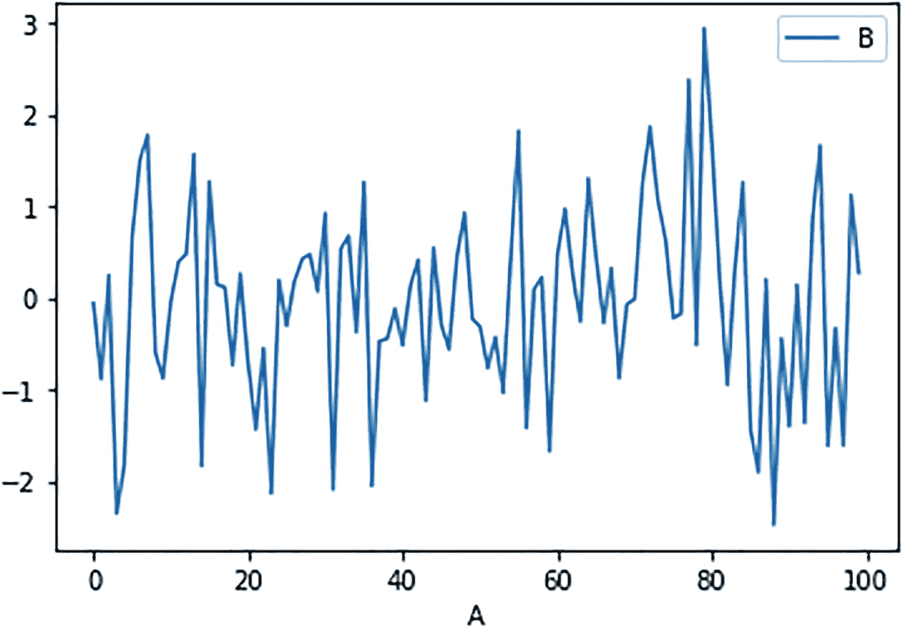

图 4-1

简单折线图

现在让我们探索其他绘图方法。我们将创建一个包含四列的数据集。这些列将包含使用 NumPy 生成的随机数据。因此你的输出肯定会不同。在本章的其余示例中，我们将使用生成的数据集。那么让我们生成数据集：

```
df2 = pd.DataFrame(np.random.rand(10, 4),
columns=['A', 'B', 'C', 'D'])
print(df2)
```

它会生成如下数据：

```
A         B         C         D
0  0.191049  0.783689  0.148840  0.409436
1  0.883680  0.957999  0.380425  0.059785
2  0.156075  0.490626  0.099506  0.057651
3  0.195678  0.568190  0.923467  0.321325
4  0.762878  0.111818  0.908522  0.290684
5  0.737371  0.024115  0.092134  0.595440
6  0.004746  0.575702  0.098865  0.351731
7  0.297704  0.657672  0.762490  0.444366
8  0.652769  0.856398  0.667210  0.032418
9  0.976591  0.848599  0.838138  0.724266
```

让我们按如下方式绘制条形图：

```
df2.plot.bar()
plt.show()
```

输出如图 4-2 所示。

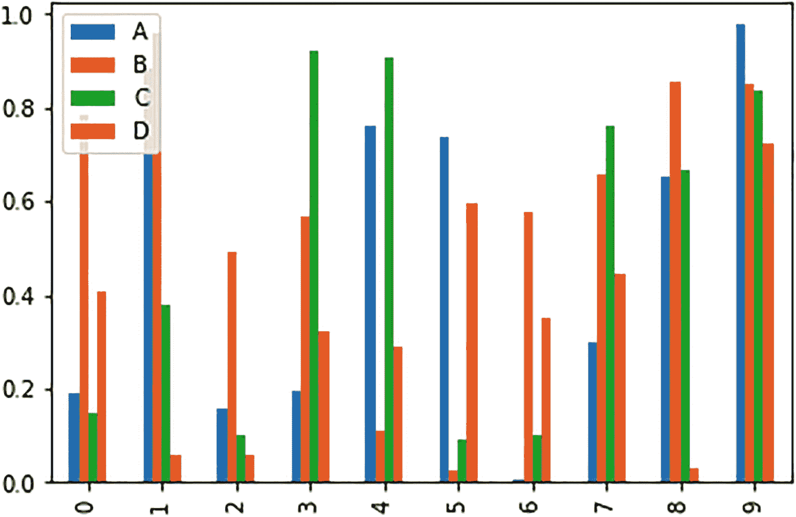

图 4-2

简单垂直条形图

我们也可以水平绘制这些图形，如下所示：

```
df2.plot.barh()
plt.show()
```

输出如图 4-3 所示。

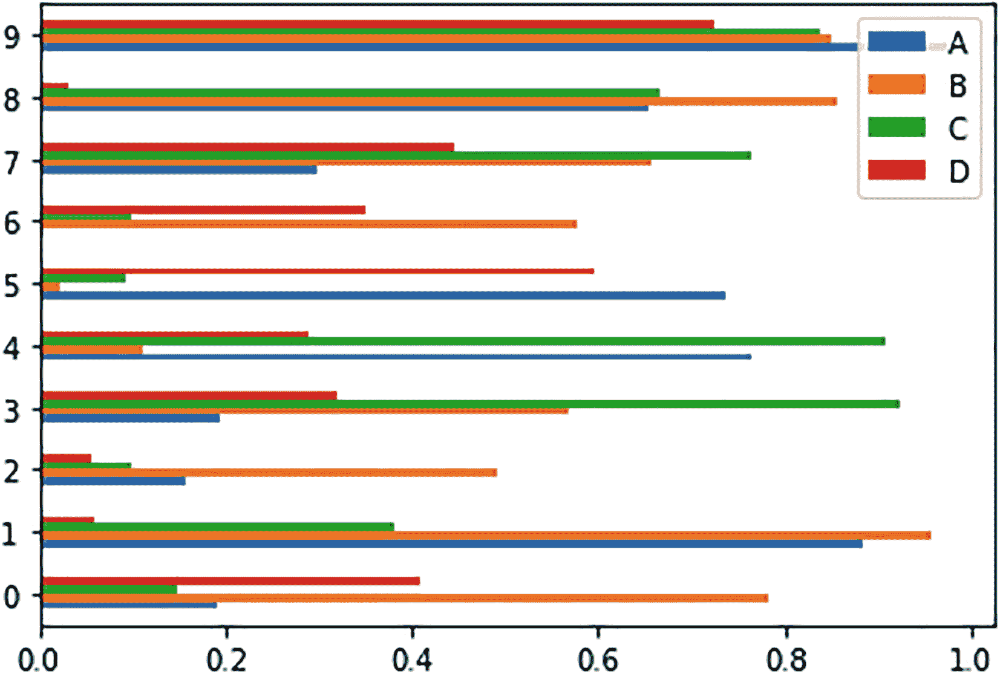

图 4-3

简单水平条形图

这些条形图是未堆叠的。我们可以按如下方式将它们堆叠起来：

```
df2.plot.bar(stacked = True)
plt.show()
```

输出如图 4-4 所示。

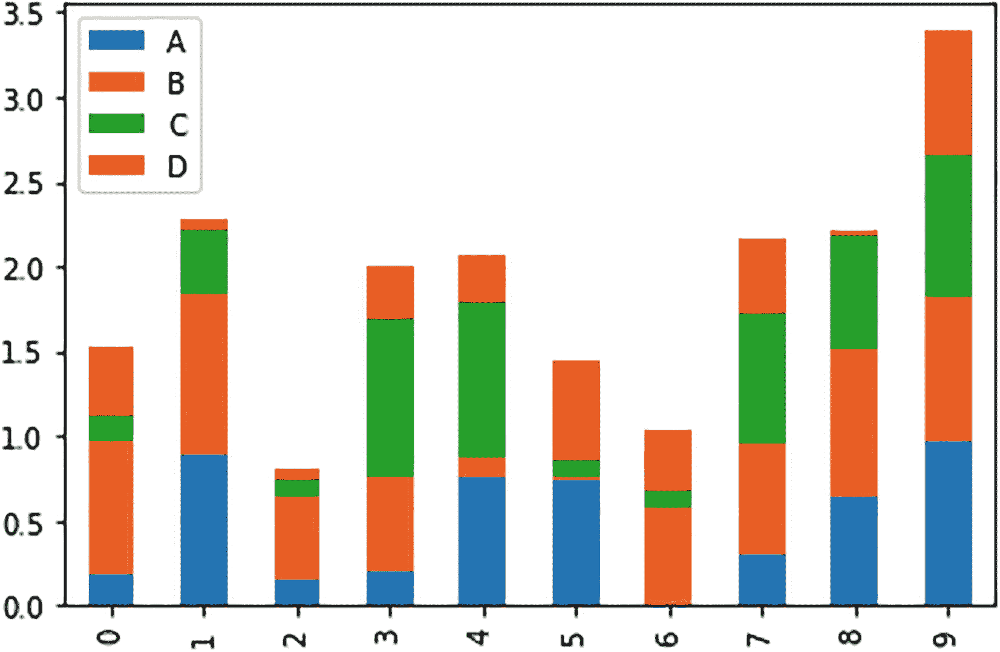

图 4-4

堆叠垂直条形图

我们可以有水平堆叠条形图，如下所示：

```
df2.plot.barh(stacked = True)
plt.show()
```

输出如图 4-5 所示。

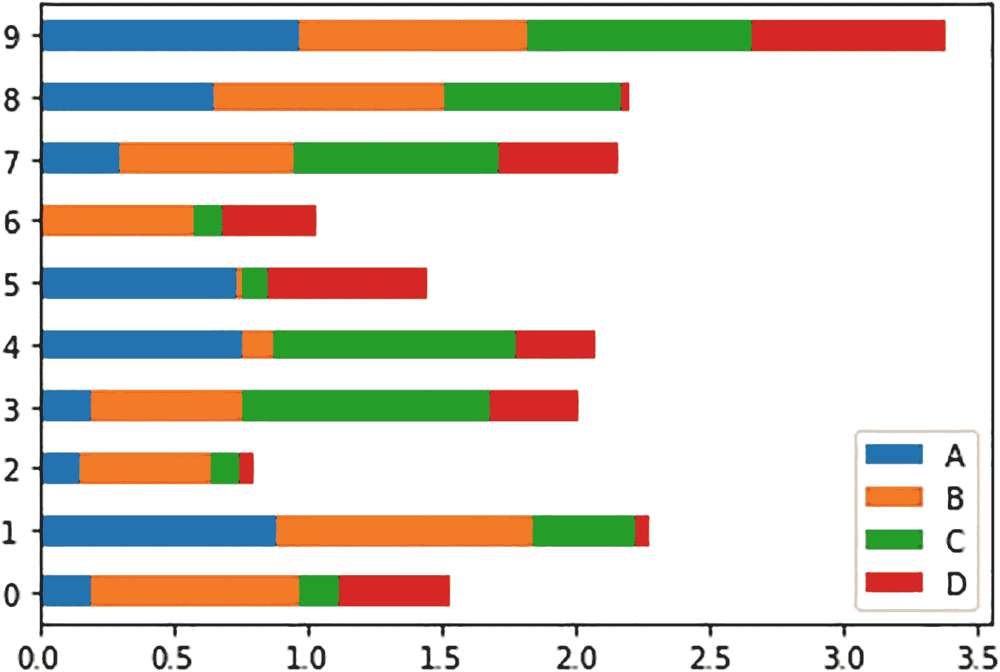

图 4-5

堆叠水平条形图

直方图是数据频率分布的视觉表示。我们可以按如下方式绘制一个简单的直方图：

```
df2.plot.hist(alpha=0.7)
plt.show()
```

输出如图 4-6 所示。

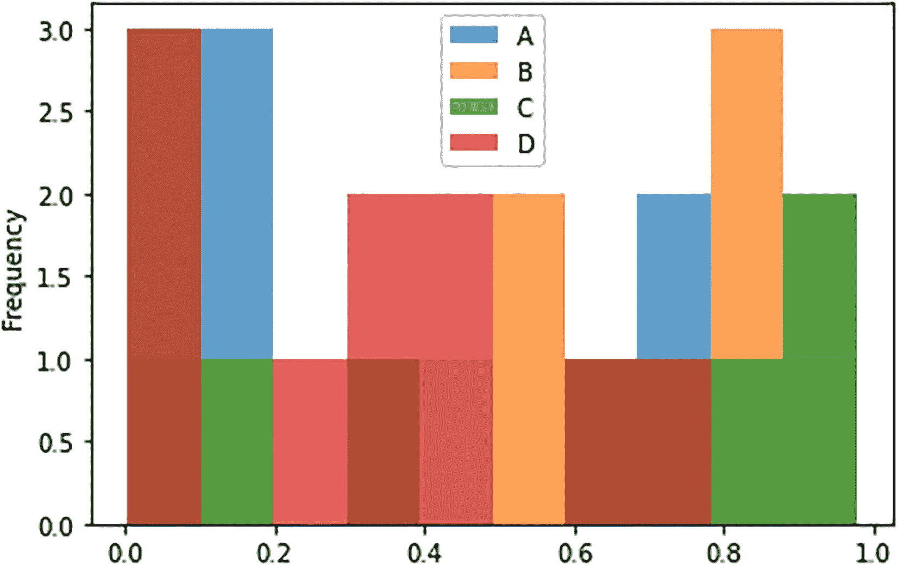

图 4-6

简单直方图

我们可以有一个堆叠直方图，如下所示：

```
df2.plot.hist(stacked=True, alpha=0.7)
plt.show()
```

输出如图 4-7 所示。

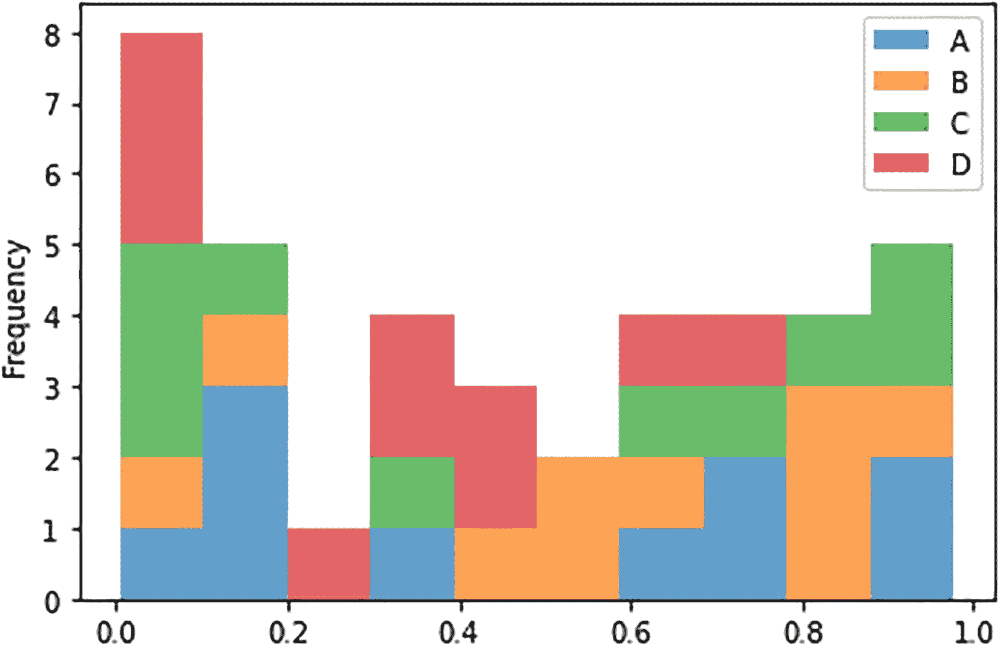

图 4-7

堆叠直方图

我们也可以自定义桶（也称为组数），如下所示：

```
df2.plot.hist(stacked=True, alpha=0.7, bins=20)
plt.show()
```

输出如图 4-8 所示。

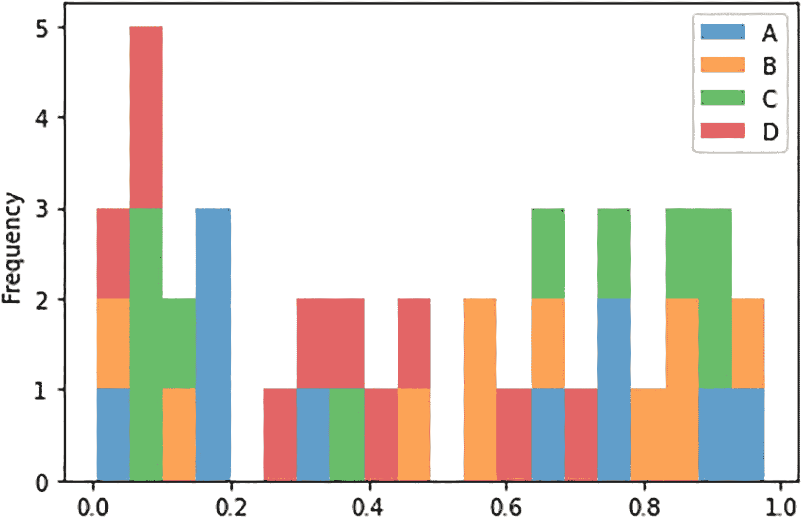

图 4-8

自定义组数/桶数的堆叠直方图

我们也可以绘制箱线图，如下所示：

```
df2.plot.box()
plt.show()
```

输出如图 4-9 所示。

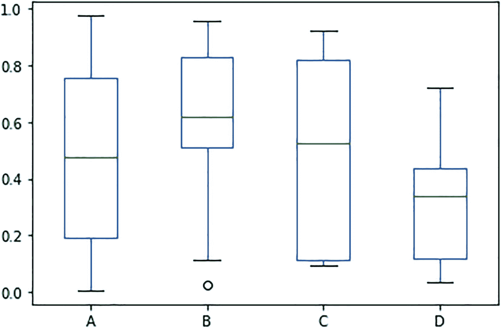

图 4-9

箱线图

我们可以绘制面积图，如下所示：

```
df2.plot.area()
plt.show()
```

输出如图 4-10 所示。

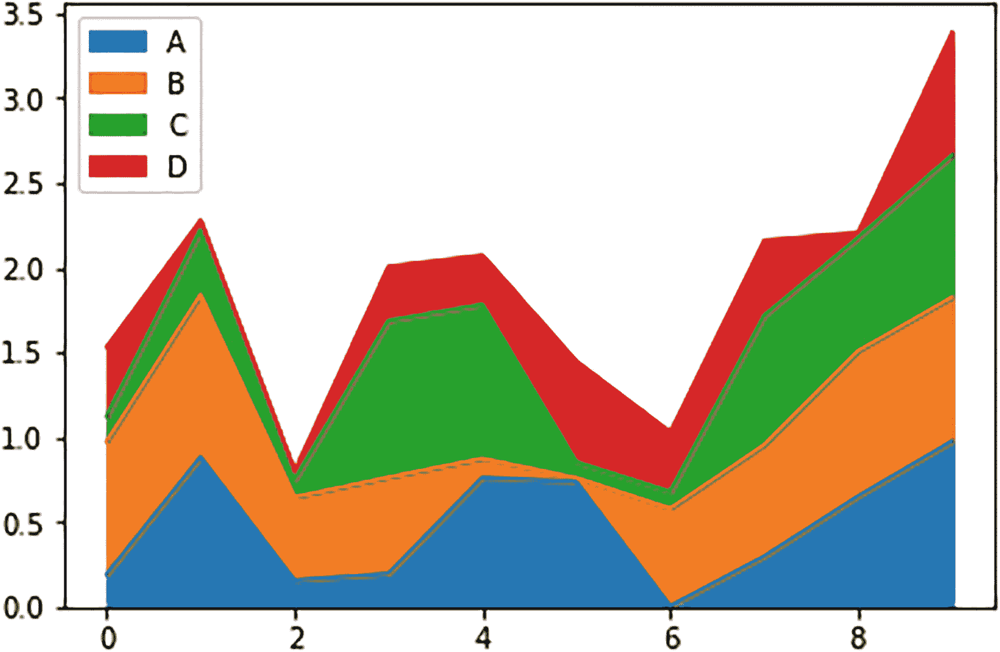

图 4-10

面积图

我们可以绘制一个未堆叠的面积图，如下所示：

```
df2.plot.area(stacked=False)
plt.show()
```

输出如图 4-11 所示。

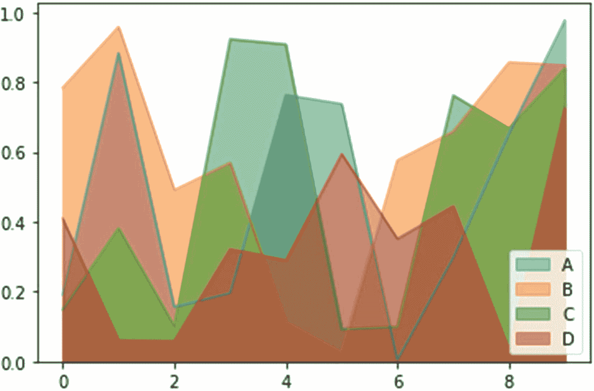

图 4-11

未堆叠面积图


## 总结

在本章中，我们学习了 Pandas 库的基础知识及其重要的数据结构：Series 和 DataFrame。我们还学习了如何对存储在 DataFrame 中的数据进行可视化。到目前为止，我们已经掌握了 NumPy、Matplotlib 和 Pandas 等库的基础知识。在后续的机器学习程序演示中，我们将频繁使用所有这些库。

从下一章开始，我们将深入机器学习的领域。在下一章中，我们将学习 Scikit-learn 的基础知识。

