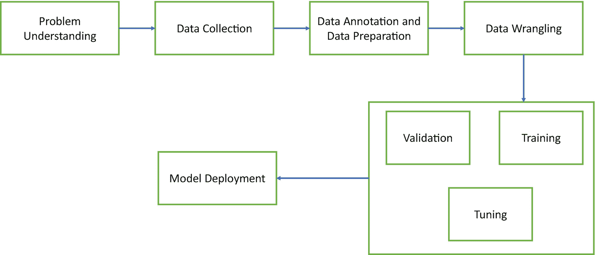
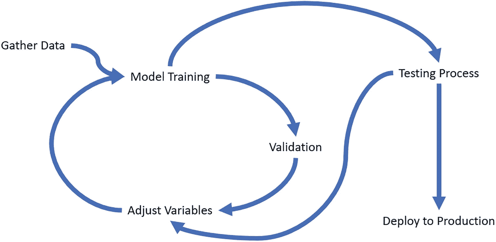

# 5. 使用 Scikit-learn 进行机器学习入门

当今万物互联的世界充满了数据。据估计，全球每秒会产生 2.5 万亿字节¹ 的数据。

机器学习是一门科学，它使计算机能够基于现有数据采取行动，而无需针对特定行为进行显式编程。从数据中学习的领域在过去半个世纪中不断发展。然而，由于过去十年中可用数据的数量和质量呈指数级增长，以及计算资源的可用性，我们见证了复杂的 AI 代理、自动驾驶汽车、高度智能的垃圾邮件过滤、图片标记应用、个性化网络搜索等技术的出现。这场技术革命的主要原因归功于机器学习。

Tom Mitchell 给出了最广为接受的机器学习定义。

> *如果一个计算机程序在完成某类任务 T 时的性能（由性能度量 P 衡量）随着经验 E 的增加而提高，那么我们就说该程序从经验 E 中学习。*
>
> ——Tom Mitchell

例如，一个用于分类所选电子邮件是否为垃圾邮件的机器人代理，会查看一个标注良好的历史邮件库，其中包含标明给定邮件是否为垃圾邮件的标签。这个标注好的邮件库充当了代理的经验。这里的任务是一个简单的二元问题：查看输入的电子邮件，并输出“是”或“否”来识别该邮件是否应被标记为垃圾邮件。基于学习过程，代理将正确或错误地对任何新邮件进行分类。这种正确性的概念由性能度量 P 来体现，在这里，P 可以简单地是正确识别出的垃圾邮件的比率。

在另一个例子中，我们可以有一个下国际象棋的代理。在机器学习范式中，它不仅仅是观察棋盘和棋子的位置，然后直接开始推荐正确的走法。它会观察过去进行的数千场对局，这些对局充当了经验，同时它也会注意哪些走法导致了胜利。任务是推荐国际象棋中的下一步最佳走法。性能通过观察与对手对弈的胜率来获得。经验则是过去多场对局中的所有走法。

在本章中，我们将探讨机器学习的基础知识及其广泛的类别和应用。随后，我们将讨论 Scikit-learn，这是用于机器学习的最流行的库，也是本书这一部分的主要焦点。我们将从安装开始，并了解 Scikit-learn 大多数组件所使用的顶层架构和 API 风格。我们将通过一个简单的示例进行实验，但详细内容将在后续相关章节中解释。

## 从数据中学习

机器学习的一般概念是专注于从数据中学习的过程，以发现隐藏的模式或预测未来事件。机器学习中有两种基本方法，即监督学习和无监督学习。主要区别在于，一种方法使用带标签的数据来帮助预测结果，而另一种则不需要。

### 监督学习

监督学习是一系列方法，这些方法要求数据中的每一行都有一个明确的标签，其中包含我们想要学习的正确预期输出。这些标签要么由领域专家手动编写，要么从以前的记录中获得，要么由软件日志生成。此类数据集用于监督算法对数据进行分类或预测结果。

#### 分类

分类是一系列监督学习方法，旨在从预定义的有限选项集（两个或更多）中分配一个离散的类别标签。此类标签的一个例子是监控金融交易并验证每笔交易是否存在欺诈的系统。需要包含常规交易和欺诈交易的过去数据，并明确说明哪些数据项（或行）是欺诈的。可能的类别是“欺诈交易”或“非欺诈交易”。另一个常见的例子是情感分析系统，它接收输入文本，并学习如何将给定文本分类为“正面”、“负面”或“中性”。如果你想构建一个预测电影评分的系统，你可能会收集电影描述、标签、类型信息和其他标签，以及最终的评分（十分制），该评分将作为标签。

因此，分配的标签是有限的，并且是清晰、离散和独特的。在某些情况下，一个数据项可以被分配多个标签——这被称为多类分类问题。

#### 回归

回归是一种监督学习技术，试图捕捉两个变量之间的关系。我们通常有一个或多个自变量（即我们总是知道的变量），并且我们希望学习如何预测因变量的值。在回归问题中，我们想要预测一个连续的实数值；这意味着目标值可以有无限多种可能性，这与只有少数几个选定值的分类不同。回归的一个例子是根据前一天的股票价值和交易量来预测第二天股票价值的系统。

监督学习特别适用于预测问题，在这些问题中，你希望根据过去的经验为给定的数据获得输出。它用于图像分类、情感分析、垃圾邮件过滤等用例。

### 无监督学习

无监督学习是一系列方法，专注于从给定的数据集中发现隐藏的模式和见解。在这种情况下，我们不需要带标签的数据。这些方法的目标是找到数据的底层结构、简化或压缩数据集，或者根据内在的相似性对数据进行分组。

无监督学习中一个常见的任务是聚类，这是一种将数据点（或对象）分组到簇中的方法，使得彼此相似的对象被分配到同一组，同时确保它们与其它组中的项目有显著差异。这在识别潜在客户群体以指导营销工作，以及分割图像以区分不同对象方面非常有用。

另一种无监督学习方法试图识别数据集中经常一起出现的项目——例如，对于超市，它可以发现诸如面包和牛奶经常被一起购买的模式。

后续章节将涵盖多种监督学习和无监督学习的算法。

## 机器学习系统的结构

机器学习系统要么独立运行，要么构成大规模企业应用的主要构建模块。

从生产和部署流程以及数据管道来看，可以广义地认为它由两个子过程构成。第一部分通常是离线过程，常涉及训练，在此过程中我们处理真实世界的数据，以学习能够帮助预测结果并在未见过的数据中发现模式的特定参数。第二部分是在线过程，涉及预测阶段，在此阶段我们利用之前学到的参数，在未见过的数据中找出结果。

根据所获结果的质量，我们可能会决定进行修改、添加更多数据，并重新启动整个过程。借助全面的评估指标、超参数调优方法以及正确的特征选择，这样的过程会迭代地产生越来越好的结果。

所涉及的整个端到端过程可以概括为以下六个阶段，如图 5-1 所示：



图 5-1 端到端过程示意图

1. 问题理解
2. 数据收集
3. 数据标注与数据准备
4. 数据整理
5. 模型开发、训练与评估
6. 模型部署与维护

### 问题理解

在编写第一行代码之前，你需要对你试图解决的问题有透彻的理解。这需要与多个利益相关者进行讨论，并就问题的恰当范围展开对话。这将为流程的后续阶段指明清晰的方向。

### 数据收集

一旦问题明确且恰当的范围已确定，我们就可以开始收集数据。数据可能来自机器日志、用户日志、交易记录等。在某些情况下，数据可能可以直接从组织内的其他团队或客户本身获取。在其他情况下，你可能需要聘请外部机构或从外部供应商处购买精心整理的数据。还有一些情况，你可能需要通过编写爬取脚本或利用某些网络服务的外部 API 来收集数据。

对于许多用例，你可以首先搜索通常在公共论坛或政府网站上共享的开源或公开可用的数据集。就本书的范围而言，我们将仅限于使用公开可用的数据集。

请记住，机器学习是由数据驱动的。最终结果的质量几乎总是取决于数据的数量和质量。

### 数据标注与数据准备

你由此获得的原始数据可能并不总是立即可用的。如果你在处理监督学习问题，你可能需要一个人或一个团队为你的数据分配正确的标签。例如，如果你正在为情感分析准备文本数据，你可以通过爬取博客和社交媒体页面来收集数据，之后，你需要获取每个句子，并根据其携带的情感极性为其分配正面或负面标签。

数据准备可能还需要数据清洗、重新格式化以及归一化。例如，在同一个例子中，你可能想要移除结构混乱、过短或使用其他语言的句子。对于图像，你可能需要调整大小、降噪、裁剪等操作。

在某些情况下，你可能希望通过组合多个数据源来扩充数据。例如，如果你有员工详细信息的官方记录，你可以连接数据库中包含该员工过往绩效记录的另一张表。

### 数据整理

在后续章节我们将学习的所有算法中，你会注意到它们对数据格式有特定要求。通常，我们希望将任何格式的数据转换或变换成包含数字的向量。对于图像，你可以查看颜色通道，每个通道（红、绿、蓝）包含一个 0`–`255 范围内的值。对于文本，有多种常见的方法可以将数据转换为向量格式。我们将在下一章深入研究这些方法。

### 模型开发、训练与评估

在大多数情况下，我们将利用 Scikit-learn、TensorFlow、PyTorch 等流行包中已有的算法实现。然而，在某些情况下，你可能需要在学习开始前对它们进行调整。然后，格式良好的数据被送入算法进行训练，在此过程中准备模型，这通常是一组与预定义方程或图相关的参数或权重。

训练通常与测试结合进行，经过多次迭代，直到获得质量可靠的模型，如图 5-2 所示。你将使用大部分可用数据学习模型参数，并使用相同的参数预测剩余部分的结果。我们将在后续章节深入探讨这个过程。这样做是为了评估你的模型在未见过的数据上的表现。这些性能指标可以帮助你通过调整必要的超参数来改进模型。



图 5-2 机器学习训练、验证和测试过程

一旦你最终确定了一组参数，你就可以保存你的模型并将其用于推理，这涉及使用遵循你在前几个阶段准备的管道的真实世界数据。

### 模型部署

一旦你创建了一个准备好进行推理的模型，你就需要使其成为一个可以集成到生产环境中的构建模块。在某些情况下，这可能是一组在需要预测时被调用的脚本。然而，在大多数企业场景中，这需要通过持续集成管道进行设置，并托管在能够处理预期负载的系统中。

随着模型的部署，它将看到新数据并为其预测值。在某些情况下，可能可以收集新数据并为未来的迭代构建改进版本的数据集。你将经常重新训练和更新模型，以提高模型的性能和可靠性。

现在你已经对机器学习过程有了清晰的认识，让我们来讨论一下最流行的机器学习包之一：Scikit-learn。

# Scikit-Learn

`Scikit-learn` 是一个非常流行的机器学习库，它通过简单一致的接口提供了各种监督和无监督机器学习算法的即用型实现。它构建于 `SciPy` 技术栈之上，该技术栈包括 `NumPy`、`SciPy`、`Matplotlib`、`Pandas` 等。

`SciPy` 的扩展通常被命名为 `SciKits`，它们在 `SciPy` 之上为常见功能提供额外的用途。其他类似的常用库有 `scikit-image` 和 `statsmodels`。`Scikit-learn` 在 `GitHub` 上被 46.4k 人关注，并被 fork 了 21.6k 次。在本章中，我们将互换使用 `Scikit-learn`、`sklearn` 和 `scikit learn` 来指代这个库。

`Scikit-learn` 最初于 2007 年由 David Cournapeau 作为 Google Summer of Code 项目启动，他也参与了 `NumPy` 和 `SciPy` 的开发。到 2010 年，越来越多的开发者开始参与进来，并于 2010 年 2 月发布了第一个公开版本。

目前，它是机器学习应用中最流行的库之一。在撰写本书时，`Scikit-learn` 0.24 是最新的稳定版本。

## 安装 Scikit-Learn

首先，检查你是否已经安装了 `Scikit-learn`。如果你安装了某个发行版，很可能已经自带了。在 `Jupyter Notebook` 中新建一个单元格，并运行以下代码：

```python
import sklearn
```

如果输出中没有出现任何消息，说明你已经安装了 `Scikit-learn`。

如果你没有安装 `Scikit-learn`，可能会遇到包含以下内容的错误信息：`ModuleNotFoundError: No module named ‘sklearn1’`

在这种情况下，你可以通过命令行或在 `Scikit-learn` 代码单元格内进行安装。请注意，`Scikit-learn` 需要基础的 `SciPy` 栈。在安装之前，你必须确保已安装可运行的 `Python`（本书要求 3.6 或更高版本），并且与 `NumPy`、`SciPy`、`Joblib`、`Matplotlib` 和 `Pandas` 兼容。

运行以下命令进行安装：

```bash
!pip install scikit-learn
```

你可以再次尝试运行导入语句，现在应该可以成功了。有关安装过程的更多详细信息，请参考官方文档页面：[`https://scikit-learn.org/stable/install.html`](https://scikit-learn.org/stable/install.html)。

另一个强烈推荐的替代方法是安装一个发行版，它通过易于配置的界面提供此类项目所需的完整技术栈，并允许你创建高度自定义的虚拟环境。其中一个流行的发行版是 `Anaconda`。你可以从以下地址下载并安装适合你系统的版本：[`www.anaconda.com/products/individual`](http://www.anaconda.com/products/individual)。

除了虚拟环境管理器（`conda`）和预配置的所需库安装外，`Anaconda` 还附带 `Jupyter Notebook` 和其他管理工具。

## 理解 API

`Scikit-learn` 流行和增长的一个主要原因在于，尽管其实现功能强大，但使用起来却非常简单。它按照以下广泛原则（参考 2013 年的论文）设计了简单的约定：

*   **一致性**，确保接口相似且数量有限
*   **可检查性**，提供透明的机制来存储和暴露参数
*   **非扩散性**，只允许使用自定义类来表示学习算法
*   **组合性**，允许将机器学习任务安排为简单的构建块
*   **合理的默认值**，为用户定义的参数提供可信赖的故障基准值

正如我们将在下一章中看到的，机器学习方法期望数据以一组称为特征的数值变量形式存在。这些数值可以表示为向量，并作为 `NumPy` 数组实现。`NumPy` 在保持代码简洁的同时，提供了高效的向量化操作。

`Scikit-learn` 的设计方式使其在库提供的各种功能中拥有相似的接口。它围绕三个主要的 API 组织，即：估计器（`estimator`）、预测器（`predictor`）和转换器（`transformer`）。估计器是分类、回归、聚类、特征提取和降维方法实现的核心接口。估计器通过超参数值进行初始化，并在 `fit` 方法中实现实际的学习过程，调用该方法时需要以 `X_train` 和 `y_train` 数组的形式提供输入数据和标签。它将运行学习算法来学习参数，并将其存储以备将来使用。

预测器提供一个 `predict` 方法，用于接收需要通过 `NumPy` 数组（我们通常称之为 `X_test`）进行预测的数据。它根据 `fit` 方法已学习的参数应用所需的转换，并提供预测值或标签。一些无监督学习估计器也提供 `predict` 方法来获取聚类标签。

转换器接口实现了通过预处理和特征提取阶段，以 `NumPy` 数组的形式转换给定数据的机制。缩放和归一化方法实现了 `transform` 方法，该方法可以在学习参数后调用。我们将在下一章深入讨论转换。

`Scikit-learn` 中的几种算法实现都实现了这三个接口中的一个或多个。某些方法可以链接起来，在一行代码中执行多个任务。通过使用 `Pipeline` 对象，可以进一步简化此过程，该对象将多个估计器链接成一个。因此，你可以将多个预处理、转换和预测步骤封装到一个对象中。

```python
pipe = Pipeline([('scaler', StandardScaler()), ('svc', SVC())])
```

可以直接使用 `pipe` 对象，将缩放和 SVM 预测器应用于稍后提供的数据。

## 你的第一个 Scikit-learn 实验

在深入使用 `Scikit-learn` 进行机器学习算法学习之前，我们可以先用 `Scikit-learn` 做一个简短的“Hello World”实验。我们将使用一个名为 `iris` 的简单数据集，其中包含三种鸢尾花的花瓣和花萼长度（图 5-3）。


幸运的是，`Scikit-learn` 自带了一些可直接使用的数据集。我们将直接导入这个数据集，并用它快速学习一个模型。要加载数据集，请输入以下代码：

```python
from sklearn import datasets
iris = datasets.load_iris()
print (iris)
print (iris.keys())
```

你应该能看到 `iris` 对象以字典形式呈现的各个组成部分，其中包括以下键：'data'、'target'、'frame'、'target_names'、'DESCR'、'feature_names' 和 'filename'。目前，我们关注的是 `data`、`target`、`target_names` 和 `feature_names`。

`Data` 包含一个二维 `NumPy` 数组，有 150 行和四列。`Target` 包含 150 个元素，其值为 0、1 和 2，分别对应 `target_names`，即 'setosa'、'versicolor' 和 'virginica' 这三种鸢尾花品种。`Feature_names` 则包含了 `data` 中四列数据的含义。

```python
print (iris.data[:10])
print (iris.target[:5])
```

这段代码会打印出鸢尾花数据集的前五个样本，以及它们对应的标签（即目标值），结果如下：

```
array([[5.1, 3.5, 1.4, 0.2],
       [4.9, 3. , 1.4, 0.2],
       [4.7, 3.2, 1.3, 0.2],
       [4.6, 3.1, 1.5, 0.2],
       [5. , 3.6, 1.4, 0.2]])
array([0, 0, 0, 0, 0])
```

这四列数据代表特征名称，你可以通过输入以下代码获取：

```python
iris.feature_names
```

输出结果应为：

```
['sepal length (cm)',
 'sepal width (cm)',
 'petal length (cm)',
 'petal width (cm)']
```

这些维度（以厘米为单位）正是前面每行中四个数字所代表的含义。目标值则是鸢尾花的品种，你可以通过以下代码获取：

```python
print (iris.target_names)
```

结果是一个包含三个元素的数组。

```
['setosa' 'versicolor' 'virginica']
```

由于我们打印的前五个元素的目标值都是 0，因此它们属于 `setosa` 品种，这是数据集中最小的花。

现在，我们将使用一种名为支持向量机（`SVM`）分类器的算法来创建一个估计器，我们将在专门的章节中详细研究它。要初始化并学习参数，请使用以下代码：

## 示例分析

```python
from sklearn import svm
clf = svm.SVC(gamma=0.001, C=100.)
clf.fit(iris.data[:-1], iris.target[:-1])
print (clf.predict(iris.data))
```

在这个例子中，我们首先从 Scikit-learn 中导入了支持向量机模块，该模块包含我们想要使用的估计器的实现。这个估计器 `svm.SVC` 使用两个超参数进行初始化，即 `gamma` 和 `C`，并赋予标准值。在下一行中，我们指示 `clf` 估计器对象使用 `fit()` 函数来学习参数，该函数通常接受两个参数：输入数据和对应的目标类别。在这个过程中，SVM 将学习必要的参数，即能够划分三个类别（0、1 和 2，分别对应 Iris setosa、Iris virginica 和 Iris versicolor）的边界线。在最后一行，我们使用预测器的 `predict()` 方法，根据已学习的模型打印出原始数据集的预测目标值。你将看到类似如下的输出：

```
array([0, 0, 0, 0, 0, 0, 0, 0, 0, 0, 0, 0, 0, 0, 0, 0, 0, 0, 0, 0, 0, 0, 0, 0, 0, 0, 0, 0, 0, 0, 0, 0, 0, 0, 0, 0, 0, 0, 0, 0, 0, 0, 0, 0, 0, 0, 0, 0, 0, 0, 1, 1, 1, 1, 1, 1, 1, 1, 1, 1, 1, 1, 1, 1, 1, 1, 1, 1, 1, 1, 1, 1, 1, 1, 1, 1, 1, 2, 1, 1, 1, 1, 1, 2, 1, 1, 1, 1, 1, 1, 1, 1, 1, 1, 1, 1, 1, 1, 1, 1, 2, 2, 2, 2, 2, 2, 1, 2, 2, 2, 2, 2, 2, 2, 2, 2, 2, 2, 2, 2, 2, 2, 2, 2, 2, 2, 2, 2, 2, 2, 2, 2, 2, 2, 2, 2, 2, 2, 2, 2, 2, 2, 2, 2, 2, 2, 2, 2, 2, 2])
```

请注意预测结果中的微小不一致——有几条记录的标记不一致。这些是预测结果，而非数据中实际存在的目标值。

## 总结

在本章中，我们获得了人工智能和机器学习的宏观图景，探索了机器学习开发流程，并理解了 Scikit-learn API 的基础知识。下一节的其他章节将详细讨论机器学习算法，并探讨如何调整工具以获得最佳结果的见解。我们将从下一章开始，讨论在开始训练过程之前，如何处理各种格式的数据。脚注 1