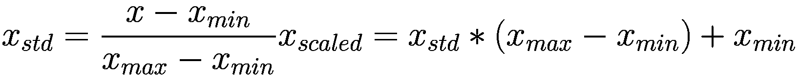
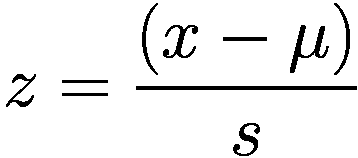
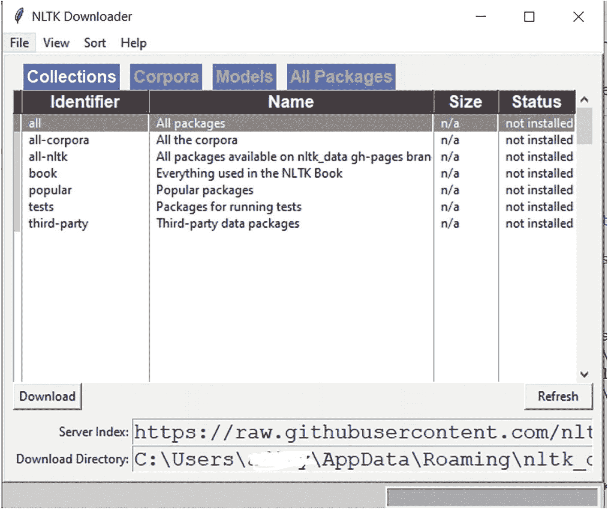
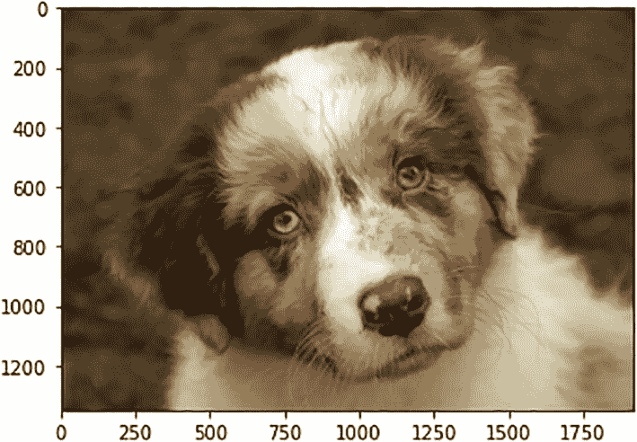
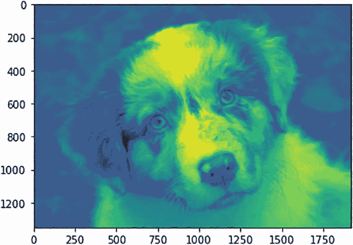
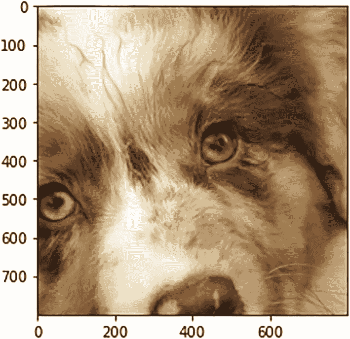
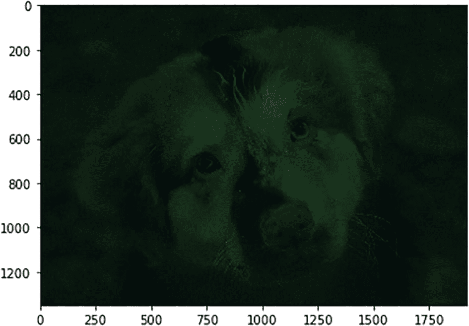

# 6. 为机器学习准备数据

正如我们在前一章中所见，数据收集、准备和规范化是任何机器学习实验中的首要步骤之一。几乎所有的机器学习算法（尽管有一些有趣的例外）都使用数字向量进行工作。即使是其他算法或工具，也要求数据以特定方式格式化。因此，无论你处理的是何种原始数据，你都应该知道如何将其转换为可用的格式，同时不丢失必要的细节。

在本章中，我们首先将审视在实验中可能遇到的不同类型的数据变量。在明确了这一区别之后，我们将深入处理来自逗号分隔值（CSV）文件的良好结构化数据——这将帮助我们理解如何处理数据不一致、缺失数据等问题，随后是特征选择和特征生成——这将帮助我们把数据行转换为数值向量。最后，我们将讨论文本和图像向量化的标准方法，这是最流行的非结构化数据类型。

## 数据变量的类型

数据变量通常根据它们支持的算术属性进行分类。考虑一个包含个人详细信息的数据集——其中包含一列关于此人毕业大学所在城市的信息，以及一列关于其全职工作年薪的信息。这两列数据都可能对将要构建的预测系统的分析产生影响。

然而，就每列数据可以进行的操作而言，存在一个主要区别。你可能会说 A 的收入是 B 的两倍。所有基本运算都可以应用于这些数据。但是，当你查看他们大学所在城市时，唯一能进行的操作就是判断 A 和 B 是否在同一个城市学习。基于这种区别，数据变量主要有两种类型。

1.  连续变量，可以取任何正数或负实数。这些变量不受限于可能的值，其精确程度取决于测量方法。例如，你的身高可能被测量为 170 厘米。这可能是更精确身高（例如 170.110 厘米）的舍入形式。

2.  离散变量，只能从允许的可能值集合中取特定值。例如，城市名称、员工级别等。即使这些变量采用数值形式，它们也会被限制在一组可能的值中，而不是数轴上的实数。例如，员工地址中的街区号或区域号将被视为离散变量。

另一种区别基于测量尺度，它根据变量可能获得的值以及可以应用于它们的算术运算，给出了更清晰的区分。按照这种方式，变量可以被认为处于四种尺度之一：名义尺度、顺序尺度、间隔尺度或比率尺度。


### 名义数据

名义数据是一种可以取任意非数值的数据类型。这类数据既无法测量也无法比较。名义数据可以是定性的或定量的；然而，由于其性质，无法对其应用任何算术运算。例如，姓名、地址、性别等都可以被视为名义数据属性。唯一可以研究的统计集中趋势是众数，即所研究属性中出现频率最高的数值。均值和**中位数**对于名义数据而言是没有意义的。

### 序数数据

序数数据是其值遵循一定顺序的数据类型。虽然这些值没有差异和增量的概念，但它们可以相互比较，判断谁更大、更小或相等。尽管这些值不支持基本的算术运算，但可以使用比较运算符进行比较。然而，中位数可以被视为一种有效的集中趋势度量。例如，T 恤尺码（S、M、L、XL 等）、客户调查中的李克特量表（总是、有时、很少、从不）等都是序数数据的例子。

### 区间数据

区间数据是一种具有序数数据属性（值可以比较）且区间等分的数据类型。这些数据属性支持加法和减法。华氏温度标度就是一个很好的例子。这意味着在 30°F 和 31°F 之间观察到的温差与 99°F 和 100°F 之间的温差是相同的。然而，我们不能说 60°F 比 30°F 热两倍。

### 比率数据

比率数据是一种具有自然零点，并支持区间数据所有属性以及乘法、除法等算术运算的数据类型。它对 0 有明确的定义——表示所研究的属性不存在。这些值是连续的，并支持所有数值运算。我们可以研究集中趋势的统计度量，以及像变异程度这样的离散度量。

## 转换

在任何机器学习实验中，你需要的首要步骤之一就是准备数据，并将其转换为算法能够接受的形式。在某些情况下，你需要找出并提取所需的信号，然后准备一个向量或元素来表示数据。这个过程被称为特征提取。

处理任何现实世界数据点的尝试，都是将其转换为特征向量。例如，如果你有关于某门课程注册学生的数据，每个学生（现实世界中的物理实体）都可以用他们的个人人口统计信息、教育信息等来表示。

个人信息：姓名、联系电话、出生日期、性别等。

教育信息：最高学历、当前就读项目、学号、注册课程、每门课程的成绩等。

这些属性中的大部分都需要进行转换。如果我们选择的算法要求每个属性都严格是数值型的，我们可能需要使用以下一些转换方法将非数值特征转换为数值。

1.  姓名：对于此类方法将被视为无意义。我们需要删除此字段。

2.  出生日期：我们可以使用此字段来计算学生当前的年龄。

3.  性别：可以是多种选项之一。我们将在下一节中了解如何处理这些数据。

4.  最高学历：可以是多种选项之一。由于其本质上是序数的，我们可以尝试一种不同的方法。这将在下一节中解释。

5.  每门课程的成绩：可以合并起来计算总分，并分桶到不同的等级。

### 转换名义属性

考虑**性别**属性，它可能有三个值——男、女和其他。这是一个名义属性，因为无法应用算术运算，也无法相互比较这些值。这可以表示为一个可能值的向量。

假设有一个学生具有以下值：

Edward Remirez, 男, 28 岁, 学士学位

我们可以将性别列转换为一组三个值：

Edward Remirez, 0, 1, 0, 28 岁, 学士学位

这种转换称为独热编码。表 6-1 展示了性别的不同值将如何以此格式进行转换。经历这种转换的特征会被转换为二进制数组，即为属性的每个可能值创建一个二进制列。如果生成的列中的值与实际值匹配，则记为 1，否则为 0。Scikit-learn 通过 `sklearn.preprocessing` 为此类转换提供了简单的接口。

表 6-1

“性别”字段以独热形式展开

| 性别 | 是女性？ | 是男性？ | 是其他？ |
| --- | --- | --- | --- |
| 女 | 1 | 0 | 0 |
| 男 | 0 | 1 | 0 |
| 其他 | 0 | 0 | 1 |

让我们为此示例准备一个简单的数据框。

```
import pandas as pd
df = pd.DataFrame([["Edward Remirez","Male",28,"Bachelors"],
["Arnav Sharma","Male",23,"Masters"],
["Sophia Smith","Female",19,"High School"]], columns=['Name','Gender','Age','Degree'])
```

该数据集包含三行四列，如表 6-2 所示。

表 6-2

包含三列的数据框

|   | Name | Gender | Age | Degree |
| --- | --- | --- | --- | --- |
| **0** | Edward Remirez | Male | 28 | Bachelors |
| **1** | Arnav Sharma | Male | 23 | Masters |
| **2** | Sophia Smith | Female | 19 | High School |

我们需要从 `sklearn.preprocessing` 导入必要的类，并实例化一个 `OneHotEncoder` 对象。

```
from sklearn.preprocessing import OneHotEncoder
encoder_for_gender = OneHotEncoder().fit(df[['Gender']])
```

你可以使用以下代码验证这些值及其列索引：

```
encoder_for_gender.categories_
```

如果你的数据集中有更多列，它们也会作为输出显示出来。

要将数据转换为转换后的属性，请使用以下代码：

```
gender_values = encoder_for_gender.transform(df[['Gender']])
```

`gender_values` 是一个稀疏矩阵；也就是说，元素仅存储在非零值存在的位置。你可以使用以下代码将其转换为 NumPy 数组：

```
gender_values.toarray()
```

在这里，你可以看到每行的性别列已被拆分为两列，第一列代表女性，第二列代表男性值。

```
array([[0., 1.],
[0., 1.],
[1., 0.]])
```

你可以使用以下代码将这些值重新打包到数据框中：

```
df[['Gender_F', 'Gender_M']] = gender_values.toarray()
```

数据框现在应如表 6-3 所示。

表 6-3

性别列已转换为独热向量的数据框

|   | Name | Gender | Age | Degree | Gender_F | Gender_M |
| --- | --- | --- | --- | --- | --- | --- |
| **0** | Edward Remirez | Male | 28 | Bachelors | 0.0 | 1.0 |
| **1** | Arnav Sharma | Male | 23 | Masters | 0.0 | 1.0 |
| **2** | Sophia Smith | Female | 19 | High School | 1.0 | 0.0 |


### 转换有序属性

某些属性具有值的相对顺序——这类属性可以用一种稍简单的方式进行转换，既能保留顺序信息，又有助于创建更有意义的模型。以同一位学生为例：

Edward Remirez, 男, 28 岁, 学士学位

我们知道教育水平遵循一定的顺序模式，即高中处于较低端，其次是学士学位、硕士学位、博士学位等。我们可以为每个标签分配一个数值，例如高中为 0，学士为 1，硕士为 2，博士为 3。

那么该行数据现在可以写成：

Edward Remirez, 0, 1, 0, 28 岁, 1

我们将沿用上一个示例中的相同数据集进行实验。下面是一个将 Degree 属性转换为有序编码的快速示例。

```
from sklearn.preprocessing import OrdinalEncoder
encoder_for_education = OrdinalEncoder()
encoder_for_education.fit_transform(df[['Degree']])
encoder_for_education.categories_
```

你将看到以下类别：

```
[array(['Bachelors', 'High School', 'Masters'], dtype=object)]
```

然而，我们期望的顺序是高中 > 学士 > 硕士 > 博士。因此，我们需要在初始化有序编码器时，不预设类别的顺序。我们应改为执行以下操作：

```
encoder_for_education = OrdinalEncoder(categories = [['Masters', 'Bachelors','High School', 'Doctoral']])
df[['Degree_encoded']] = encoder_for_education.fit_transform(df[['Degree']])
```

现在，数据框的转换结果如表 6-4 所示。

表 6-5

对性别和学位进行编码后仅包含数值数据的数据框

|     | 年龄 | Gender_F | Gender_M | Degree_encoded |
| --- | --- | --- | --- | --- |
| **0** | 28 | 0.0 | 1.0 | 0.0 |
| **1** | 23 | 0.0 | 1.0 | 2.0 |
| **2** | 19 | 1.0 | 0.0 | 1.0 |

表 6-4

使用有序编码对学位进行编码后的数据框

|     | 姓名 | 性别 | 年龄 | 学位 | Gender_F | Gender_M | Degree_encoded |
| --- | --- | --- | --- | --- | --- | --- | --- |
| **0** | Edward Remirez | 男 | 28 | 学士 | 0.0 | 1.0 | 0.0 |
| **1** | Arnav Sharma | 男 | 23 | 硕士 | 0.0 | 1.0 | 2.0 |
| **2** | Sophia Smith | 女 | 19 | 高中 | 1.0 | 0.0 | 1.0 |

现在可以移除性别和学位列。我们也可以移除姓名列，因为我们认为它包含的信息量极少，任何模型都无需捕捉。

```
df.drop(columns=['Name', 'Gender', 'Degree'], inplace=True)
```

这个数据框现在就可以使用了。它应该看起来像表 6-5 中所示的数据。

注意

如果我们需要引入一个新值，例如“研究生文凭”，它可能介于学士学位和硕士学位之间，那么我们将需要重新处理整个数据，以重新分配新值。

## 归一化

另一个重要的预处理步骤是对数据进行归一化，使特征处于相似的范围内。这一点尤其重要，特别是当实验使用的算法受分布形状影响，或基于向量或距离计算时。让我们看看上一个示例中生成的数据框。或者，我们可以使用以下代码创建一个完全相同的数据框：

```
df = pd.DataFrame({'Age': {0: 28, 1: 23, 2: 19},
'Gender_F': {0: 0.0, 1: 0.0, 2: 1.0},
'Gender_M': {0: 1.0, 1: 1.0, 2: 0.0},
'Degree_encoded': {0: 0.0, 1: 2.0, 2: 1.0}})
Df
```

这个数据框，如表 6-6 所示，包含两列全为 1 或 0 的列，而学位范围可以从 0 到 4。年龄列尚未处理——在大多数实际情况下，它可以是 16 到 60 之间的数字。在本节中，我们将研究两种主要的转换方法，可应用于年龄列以使其处于相似范围内。

表 6-6

重新创建的仅包含数值数据的数据框

|     | 年龄 | Gender_F | Gender_M | Degree_encoded |
| --- | --- | --- | --- | --- |
| **0** | 28 | 0.0 | 1.0 | 0.0 |
| **1** | 23 | 0.0 | 1.0 | 2.0 |
| **2** | 19 | 1.0 | 0.0 | 1.0 |

### 最小-最大缩放

最小-最大缩放通过将每个特征压缩到一个尺度上来进行转换，在该尺度上，数据集中的最小值映射为 0，最大值映射为 1。该转换由下式给出^(²)



如果需要，可以配置特征范围（最小值，最大值）。

```
from sklearn.preprocessing import MinMaxScaler
scaler = MinMaxScaler()
scaler.fit(df[['Age']])
df['Age'] = scaler.transform(df[['Age']])
```

现在你可以验证年龄列已被缩放到 0-1 范围，如表 6-7 所示。

表 6-7

使用最小-最大缩放转换年龄列后的数据框

|     | 年龄 | Gender_F | Gender_M | Degree_encoded |
| --- | --- | --- | --- | --- |
| **0** | 1.000000 | 0.0 | 1.0 | 0.0 |
| **1** | 0.444444 | 0.0 | 1.0 | 2.0 |
| **2** | 0.000000 | 1.0 | 0.0 | 1.0 |

### 标准缩放

标准缩放通过减去均值并缩放到单位方差来标准化特征值。该值表示相对于该列均值和方差的 z 值。样本的标准分数计算公式^(³)如下：



其中 *μ* 是均值，s 是样本的标准差。

我们可以取年龄列的原始值，并使用 `StandardScaler` 对其进行缩放。

```
from sklearn.preprocessing import StandardScaler
scaler = StandardScaler()
scaler.fit(df[['Age']])
df['Age'] = scaler.transform(df[['Age']])
```

这将得到如表 6-8 所示的值。

表 6-8

使用 StandardScaler 转换年龄列后的数据框

|     | 年龄 | Gender_F | Gender_M | Degree_encoded |
| --- | --- | --- | --- | --- |
| **0** | 1.267500 | 0.0 | 1.0 | 0.0 |
| **1** | -0.090536 | 0.0 | 1.0 | 2.0 |
| **2** | -1.176965 | 1.0 | 0.0 | 1.0 |

你可以使用以下代码查看缩放器的参数：

```
scaler.mean_
Out: array([23.33333333])
scaler.scale_
Out:array([3.68178701])
```

## 文本预处理

现实世界中有大量数据以文本形式存在——可能是调查的评论、电商网站上的产品评论，或者我们想要利用的社交媒体文本。处理、理解和生成文本这一主题涵盖在一个名为自然语言处理（NLP）的主要研究领域中。在本节中，我们将解释将文本转换为向量的基本技术，本书后续的一些示例可能需要用到这些技术。


### 准备 NLTK

Python 中最流行的 NLP 库之一是 NLTK，即自然语言工具包（Natural Language ToolKit）。如果你之前没有在你的机器上使用过 NLTK，我们需要检查它是否已准备好使用，如果没有，我们将下载所需的模型。

运行以下代码：

```
from nltk.tokenize import word_tokenize
```

如果操作成功，将不会产生任何输出。如果你是第一次使用 NLTK，使用 NLTK 函数可能会导致类似下面的错误。这意味着你的系统中不存在 NLTK 基本操作所需的预训练模型。

```
LookupError:
**********************************************************************
Resource punkt not found.
Please use the NLTK Downloader to obtain the resource:
>>> import nltk
>>> nltk.download('punkt')
For more information see: https://www.nltk.org/data.html
Attempted to load tokenizers/punkt/english.pickle
```

如果你看到此类错误，只需运行以下代码行：

```
import nltk
nltk.download()
```

这将打开一个类似于图 6-1 的窗口。



图 6-1

NLTK 包下载器窗口

我们可以单独选择需要安装的包。你只需选择 **book**，它将安装官方 NLTK 书籍和文档中示例所需的模型和工具，并且也包含本书中的示例。这需要几分钟时间，完成后，“状态”列将显示为“已安装”。

### 五步 NLP 流水线

当你遇到文本数据时，主要目标之一应该是开发一个流水线，该流水线以文本作为输入，并为每个句子或文档（或你希望考虑的任何数据单元）生成向量。它经历以下步骤：

#### 1. 分句

分句是寻找句子边界的过程。每个句子都是一个完整的、能传达意义的单元。在英语中，句号表示句子的边界——但这并不总是正确的。例如，句号或句点可用于缩写——因此，将每个句号视为多个句子之间分隔符的基于规则的方法可能是一个错误的假设。出于这个原因，有更复杂的方法可以检查句号是否不是有效的句子分隔符；或者使用复杂的正则表达式模式来分割句子。还有更复杂且实际可用的方法，利用最大熵模型来分割句子。在几个机器学习实验中，你会直接得到一个句子作为数据单元。

#### 2. 分词

分词将一个句子或序列分解为称为词元的单个组件或单元。词元可以是单词、特殊字符、数字等。

让我们在 NLTK 中尝试以下操作：

```
from nltk.tokenize import word_tokenize
word_tokenize("Let's learn machine learning")
```

输出是一个列表，包含代表每个词元的单独字符串。这些词元中的每一个都可以单独处理。

```
['Let', "'s", 'learn', 'machine', 'learning']
```

在某些情况下，我们希望执行**大小写折叠**，以便所有单词都以相同的大小写形式出现（最好是**小写**）。

```
tokens = [t.lower() for t in word_tokenize("Let's learn machine learning")]
print (tokens)
['let', "'s", 'learn', 'machine', 'learning']
```

#### 词干提取和词形还原

出于语法原因，同一个词根在文本中可以以不同的形式出现。在大多数情况下，它们会导致相似的含义，例如，work、working、worked——本质上都传达了相似的含义，尽管解释略有不同。词干提取是提取词根的过程。

一种用于词干提取的流行方法称为**波特词干算法**。^(⁴) 它执行一组基于规则的操作，如下所示：

```
SSES -> SS
IES  -> I
SS   -> SS
S    ->
```

我们可以在 Python 中使用 NLTK 中的 Porter Stemmer 实现。

```
from nltk.stem.porter import PorterStemmer
stemmer = PorterStemmer()
for token in tokens:
print(token, " : ", stemmer.stem(token))
```

这些代码行产生以下输出：

```
let  :  let
's  :  's
learn  :  learn
machine  :  machin
learning  :  learn
```

在较大的程序中，你可能会更喜欢以下推导式：

```
stemmed_tokens = [stemmer.stem(token) for token in tokens]
```

#### 移除停用词

有一些高频词会增加内存使用量，但可以忽略它们，同时错误增加最小。它们通常会增加大量噪音并减慢处理速度。这些词，如“a”、“and”、“now”等，被称为停用词，NLTK 可以通过与单词列表匹配来帮助我们移除它们。

```
from nltk.corpus import stopwords
eng_stopwords = stopwords.words('english')
for token in stemmed_tokens:
if token in stopwords.words('english'):
stemmed_tokens.remove(token)
```

你可以通过打印 `eng_stopwords` 的值来查看 NLTK 中提到的停用词的完整列表。在撰写本文时，它包含 179 个单词。然而，这些词占英文文本的 20% 以上，因此可以立即减少数据的大小。

#### 准备词向量

与所有其他类型的数据一样，文本也需要转换为向量形式。我们有几种机制——最简单的是将数据点（或句子）视为词袋，可以类似于独热机制进行编码，但有所变化，要么在代表所有出现单词的列中放入数字 1，要么放入给定句子中单词出现次数的计数。表 6-9 显示了一个示例。

表 6-9

一些句子的词袋表示

|   | about | bird | heard | is | the | word | you |
| --- | --- | --- | --- | --- | --- | --- | --- |
| About the bird, the bird, bird bird bird | 1 | 5 | 0 | 0 | 2 | 0 | 0 |
| You heard about the bird | 1 | 1 | 1 | 0 | 1 | 0 | 1 |
| The bird is the word | 0 | 1 | 0 | 1 | 2 | 1 | 0 |

为此，我们可以使用 Scikit-learn 中提供的 CountVectorizer 或其他向量化器之一。我们将在下面的端到端示例中看到它们的用法。

```
from nltk.tokenize import word_tokenize
from nltk.corpus import stopwords
from nltk.stem.porter import PorterStemmer
from sklearn.feature_extraction.text import CountVectorizer
stemmer = PorterStemmer()
eng_stopwords = stopwords.words('english')
data = ["Let's learn Machine Learning Now", "The Machines are Learning", "It is Learning Time"]
tokens = [word_tokenize(d) for d in data]
tokens = [[word.lower() for word in line] for line in tokens]
for i, line in enumerate(tokens):
for word in line:
if word in stopwords.words('english'):
line.remove(word)
tokens[i] = ' '.join(line)
matrix = CountVectorizer()
X = matrix.fit_transform(tokens).toarray()
```

这里，X 将变成一个形状为 (m, n) 的二维数组，其中 m 是数据中的行数，n 是词汇表大小，或用于表示文本向量的唯一单词数。

你可以通过比较特征名称与值来可视化文本向量：

```
pd.DataFrame(X, columns=matrix.get_feature_names())
```

表 6-10 显示了最终的向量表示，可以作为输入用于我们将在后续章节中学习的机器学习算法。

表 6-10

在数据框中表示为词袋的句子

|   | learn | learning | let | machine | machines | time |
| --- | --- | --- | --- | --- | --- | --- |
| **0** | 1 | 1 | 1 | 1 | 0 | 0 |
| **1** | 0 | 1 | 0 | 0 | 1 | 0 |
| **2** | 0 | 1 | 0 | 0 | 0 | 1 |


## 预处理图像

图像处理是机器学习和计算机视觉中的一个庞大子集，已有专门书籍进行论述。在本节中，我们将介绍本书部分示例中可能需要用到的基本概念。

全彩图像可视为一个三维数组，其中两个维度用于表示像素的行号和列号，第三个维度则代表颜色通道（红色、绿色或蓝色）。每个单元格中的数值表示该单元格中对应颜色通道的强度。

将图像读取为三维数组的一种简单方法是使用 Matplotlib 的 `imread` 函数。你可以通过以下方式指定机器上任意图像的路径：

```
import matplotlib.pyplot as plt
img = plt.imread('C:\\Users\\johndoe\\Documents\\ Images\\puppy.jpg')
```

如果使用 Linux 或 Mac 系统，请确保以正确的格式书写路径：

```
img = plt.imread('/home/johndoe/Pictures/puppy.jpg')
（澳大利亚牧羊犬红色幼犬，摄影：Andrea Stöckel）
```

我们可以使用以下代码显示图 6-2 中的图像：



图 6-2

使用 pyplot 的 imshow() 显示导入的图像

```
plt.imshow(img)
```

第三个维度代表通道，可能是红色、绿色或蓝色。以下代码可以获取图像中红色通道的像素值，并如图 6-3 所示进行显示：



图 6-3

显示图像的单个颜色通道

```
plt.imshow(img[:,:,0])
```

你可以使用 `img [ row , col , channel]` 索引图像中的任意特定像素。使用 `imshow()` 查看结果，如图 6-4 所示。



图 6-4

显示图像的裁剪部分

```
cropped_image = img[200:1000,700:1500, :]
```

```
plt.imshow(cropped_image)
```

图像处理和计算机视觉领域有丰富的库，其中最流行的是 OpenCV 和 Scikit-Image。以下是一个使用 Scikit-Image 进行边缘检测的示例，其输出结果如图 6-5 所示。



图 6-5

显示使用 Sobel 滤波器检测到的边缘

```
from skimage import io,filters
img = plt.imread('C:\\Users\\johndoe\\Documents\\ Images\\puppy.jpg')
edges = filters.sobel(img)
io.imshow(edges)
io.show()
```

该滤波器用于生成一幅强调原始图像边缘的图像，这可以作为涉及图像识别或分类系统的流水线的一部分。

## 小结

利用本章介绍的方法，你应该能够捕获数据，将其转换为预期格式，并在将其送入机器学习流水线的后续步骤之前执行必要的缩放。

在接下来的章节中，我们将学习机器学习算法，并通过实际示例了解如何使用 Scikit-learn 训练模型。

脚注 1   2   3

