# 7. 监督学习方法：第一部分

监督学习是一项学习任务，旨在针对给定的输入样本预测数值型或分类型输出。在这类问题中，你需要获取或创建一个带有明确标记输出的数据集。本章将介绍一些基础但重要的监督学习方法。

本章首先解释线性回归，随后进行一个基于 scikit-learn 的实验。我们还将讨论一些用于评估回归模型质量的指标。接下来，我们将讨论一种名为逻辑回归的分类方法，学习一个简单模型，并在决策边界图中可视化其预测结果。最后，我们将学习决策树，它是一系列强大方法的基础，可用于分类和回归。我们将探索一个简单示例并可视化该决策树。

## 线性回归

线性回归是一种监督学习方法，专门用于建模因变量与一个或多个自变量之间的关系。它试图构建一个能够输出数值的线性函数。

一个包含一个自变量的简单示例如图 7-1 所示。在此，我们试图建模学生考试成绩与他们毕业后第一份工作薪资之间的关系。

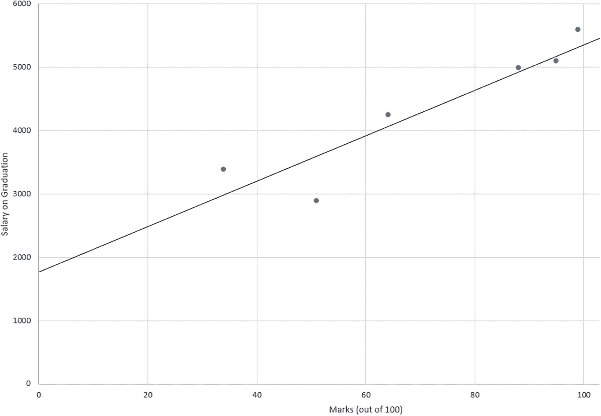

图 7-1

探索学生成绩与薪资之间的关系

粗略一看，尽管存在若干异常值，你仍能观察到两者之间的线性关系。我们试图找到一条最能整体拟合数据集中所有点的直线。

### 寻找回归线

在线性回归中，我们的目标是找到一个函数，该函数以自变量 X 的一个（或多个）值作为输入，并输出因变量 y 的值。基础几何学告诉我们，直线方程由下式给出：

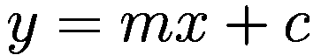

其中 m 是直线的斜率，c 是直线与 y 轴的交点。二维平面上的任何直线都可以由这两个参数定义。

学习过程或训练的目标是找到尽可能匹配数据点的最佳 m 和 c 值。由于现实世界数据的特性，没有任何一条直线能穿过所有点。这就引出了误差的概念。

误差定义为自变量的实际值与我们的回归线确定的值之间的差值。我们希望找到斜率 m 和 y 轴截距 c，使得总成本（由误差平方的平均值给出）最小。

通常，数据会有多列（x 的分量），分别称为 x[1]、x[2]、x[3]… x[n]，这将导致一条在 n 个轴上分别具有斜率 m[1]、m[2]、m[3]… m[n] 的直线。因此，你学习的参数数量为 (n + 1)，其中 n 是数据的列数或维度。为简单起见，我们将继续针对只有一个自变量列 x 的情况进行解释。

每个轴上的斜率由下式给出：

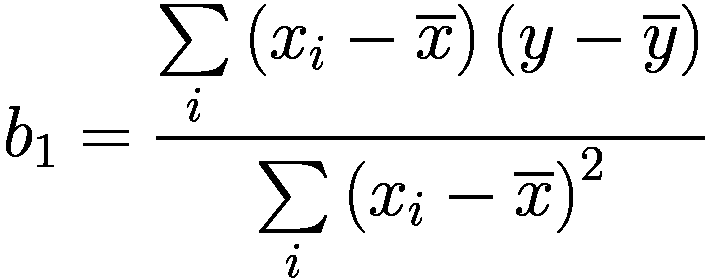

而 y 轴截距为：

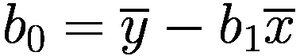

基于 y 轴截距 b[0] 和一个或多个斜率 b[k]，直线的最终方程可写为：

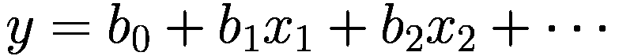


#### 使用 Python 进行线性回归

Scikit-learn 为普通最小二乘法的实现提供了一个易于使用的接口。

让我们创建一个示例数据集来进行操作。我们将创建一个包含两列的 Pandas 数据框：一列是自变量，表示学生的百分制成绩；另一列是因变量，表示他们毕业后的薪水。我们希望创建一个线性模型来表达两者之间的关系。这样，我们就能根据学生获得的成绩来预测他们将来能得到的薪水。

```
import numpy as np
import pandas as pd
data = pd.DataFrame({"marks":[34,95,64,88,99,51], "salary":[3400, 2900, 4250, 5000, 5100, 5600]})
```

正如我们在第 5 章中看到的，Scikit-learn 为大多数常见任务提供了标准 API。为了学习或拟合模型的参数，我们可以使用 `fit()` 方法，它接受两个参数：一个是输入（自变量）变量 X，另一个是输出（因变量）变量 y。X（通常大写）是一个形状为 (n, d) 的二维数组，其中 n 是训练数据行的数量，d 是列的数量。y（小写）是一个形状为 (n,) 的一维数组，包含训练数据每一行的一个对应项。要将数据转换为正确的形状，请使用以下代码：

```
X = data[['marks']].values
y = data['salary'].values
```

注意在创建 X 时多出的方括号。这会强制 Pandas 生成一个只有一列的二维数据框，然后将其转换为 NumPy 数组。使用以下代码验证形状：

print ( X.shape, y.shape )

它应该输出以下结果：

```
(6, 1) (6,)
```

现在，我们将从 Scikit-learn 导入 `LinearRegression` 并拟合模型。

```
from sklearn.linear_model import LinearRegression
reg = LinearRegression()
reg.fit(X,y)
```

模型已经创建好了。现在，我们可以根据学生的成绩来预测他们的薪水，使用以下代码：

```
reg.predict([[70]])
```

输出将是一个一维数组，包含根据学习到的模型预测的薪水。

```
array([4306.8224479])
```

这也允许你发送包含多行数据的数组：

```
reg.predict([[100],[50],[80]])
```

输出结果为：

```
array([5422.45511864, 3563.06733407, 4678.70000481])
```

#### 可视化我们的学习成果

既然我们知道了参数 m 和 c，我们可以画一条线来可视化它的拟合效果。我们可以使用以下代码检查系数（m）和截距（c）的值：

```
print (reg.coef_)
print (reg.intercept_)
Out: [37.18775569]
1703.6795495018537
```

注意，系数是一个数组，因为如果你的数据包含多个自变量，我们将学习多个斜率。让我们导入 Matplotlib 并可视化训练数据点和回归线。

```
import matplotlib.pyplot as plt
fig,ax = plt.subplots()
plt.scatter(X, y)
ax.axline(  (0, reg.intercept_), slope=reg.coef_ , label='regression line')
ax.legend()
plt.show()
```

由此生成的图表如图 7-2 所示。

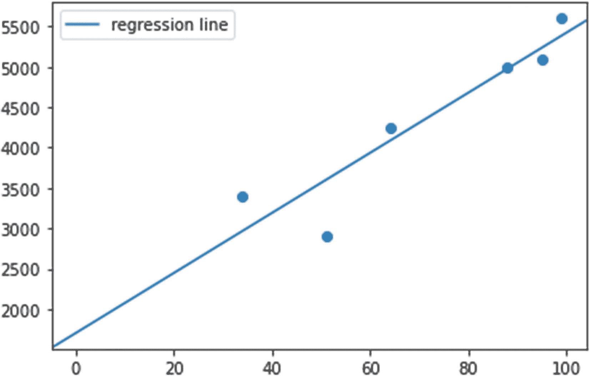

图 7-2

成绩与薪水的散点图和回归线

如果你感兴趣，可以对此代码稍作修改，以在图表中打印每个点的值，如图 7-3 所示。

```
import matplotlib.pyplot as plt
import random
fig,ax = plt.subplots()
fig.set_size_inches(15,7)
plt.scatter(X, y)
ax.axline(  (0, reg.intercept_), slope=reg.coef_ , label='regression line')
ax.legend()
ax.set_xlim(0,110)
ax.set_ylim(1000,10000)
for point in zip(X, y):
ax.text(point[0][0], point[1]+5, "("+str(point[0][0])+","+str(point[1])+")")
plt.show()
```

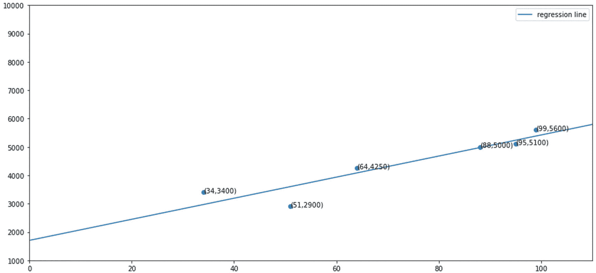

图 7-3

每个数据点带有文本标签的散点图

#### 评估线性回归

我们有几种评估指标来检查回归模型的性能。在这个例子中，我们将简单地比较我们的预测值与训练数据集中实际值的差距。在下面的代码块中，我们将准备一个数据框，用于比较实际薪水值与预测值。

```
results_table = pd.DataFrame(data=X, columns=['Marks'])
results_table['Predicted Salary'] = reg.predict(X)
results_table['Actual Salary'] = y
results_table['Error'] = results_table['Actual Salary']-results_table['Predicted Salary']
results_table['Error Squared'] = results_table['Error']* results_table['Error']
```

`results_table` 应该看起来像表 7-1 那样。

表 7-1

预测薪水相对于实际薪水的误差

|   | Marks | Predicted Salary | Actual Salary | Error | Error Squared |
| --- | --- | --- | --- | --- | --- |
| **0** | 34 | 2968.063243 | 3400 | 431.936757 | 186569.362040 |
| **1** | 51 | 3600.255090 | 2900 | -700.255090 | 490357.190739 |
| **2** | 64 | 4083.695914 | 4250 | 166.304086 | 27657.049103 |
| **3** | 88 | 4976.202050 | 5000 | 23.797950 | 566.342408 |
| **4** | 95 | 5236.516340 | 5100 | -136.516340 | 18636.711137 |
| **5** | 99 | 5385.267363 | 5600 | 214.732637 | 46110.105415 |

我们可以使用这个表格来计算平均绝对误差、均方误差，或者最常用的均方根误差。

```
import math
import NumPy as np
mean_absolute_error = np.abs(results_table['Error']).mean()
mean_squared_error = results_table['Error Squared'].mean()
root_mean_squared_error = math.sqrt(mean_squared_error)
print (mean_absolute_error)
print (mean_squared_error)
print (root_mean_squared_error)
```

这应该会输出三个误差值：

```
278.9238099821918
128316.12680688586
358.2124045966106
```

或者，你可以使用内部实现来获得相同的误差值。

```
from sklearn.metrics import mean_squared_error, mean_absolute_errorprint(mean_squared_error(results_table['Actual Salary'], results_table['Predicted Salary']))
print(math.sqrt(mean_squared_error(results_table['Actual Salary'], results_table['Predicted Salary'])))
print(mean_absolute_error(results_table['Actual Salary'], results_table['Predicted Salary']))
```

Scikit-learn 还提供了 R 平方值，用于衡量模型能够解释因变量中多少变异性。R 平方是衡量线性回归拟合优度的常用指标。从数学上讲，它等于 1 减去预测误差的平方和除以总平方和。其值通常在 0 到 1 之间，其中 1 代表理论上最佳模型。

```
from sklearn.metrics import r2_score
print ("R Squared: %.2f" % r2_score(y, reg.predict(X)))
```

输出结果为：

```
R Squared: 0.75
```


## 逻辑回归

逻辑回归是一种分类方法，用于对数据项属于两个类别之一的概率进行建模。在下图中，我们希望根据学生在机器学习和数据结构课程中获得的分数来预测他们能否找到工作。很明显，除少数学生外，那些在机器学习和数据结构两门课程中得分都相对较高的学生在毕业时已经获得了工作机会。有两名学生在机器学习上的分数低得多，尽管在数据结构上的分数相对较高，但他们也获得了工作机会。

我们希望创建一条边界线，根据学生在两门科目上的分数将他们分开，使得毕业时获得工作机会的学生位于线的一侧，而未获得工作机会的学生位于另一侧。图 7-4 展示了一条潜在的边界线。因此，当你获得一个新数据点在两门科目上的分数信息时，我们将能够预测他们是否会找到工作。

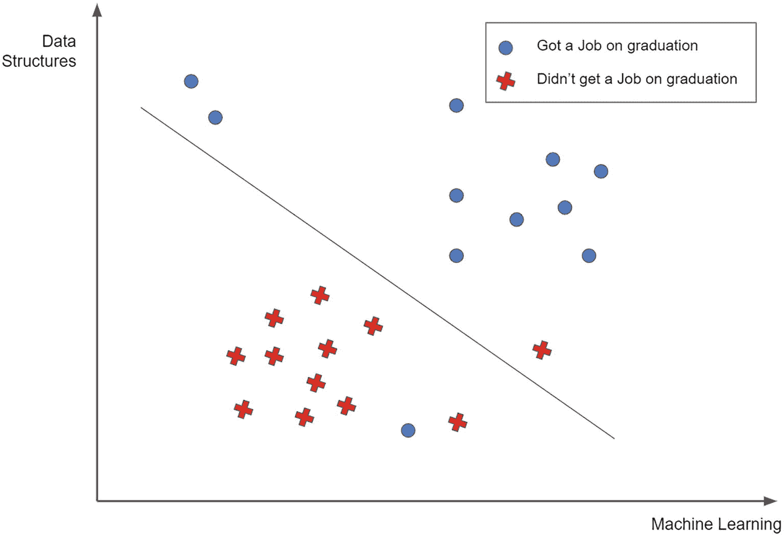

图 7-4

线性分类问题中的边界线

注意

这种分类技术被称为逻辑回归，尽管它用于预测二元分类变量，而不是像回归方法那样预测连续变量。其名称中包含“回归”一词是出于旧有惯例，因为我们在这里试图学习参数，以回归数据点属于某个分类类别的概率。

### 用于表达概率的直线与曲线

假设我们只有一维数据（例如，平均分数），并且有两个类别标签，分别表示找到工作和未找到工作的学生。在本讨论中，我们将它们称为正类和负类。我们可以尝试捕捉这种关系，找到一条线性回归线，该线给出一个点属于某个类别的概率。

然而，训练数据中的目标值要么是 0，要么是 1，其中 0 代表负类，1 代表正类。但是，这种数据很难通过线性关系来捕捉。我们更倾向于找到一条 S 形曲线或逻辑曲线，它试图捕捉这样一种模式：大部分预测值将位于 y=0 或 y=1 上，并且在此范围内会有一些值。这个因变量也可以被视为该点属于某个类别的概率。

S 形函数或逻辑函数如下所示

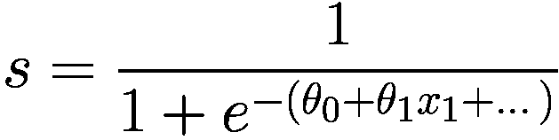

其中 *θ*[0], *θ*[1], … 代表参数（如果数据有多列，则为多个参数）。S 形曲线非常适合此类用例。学习过程的目标是找到使预测概率误差尽可能小的 *θ*。然而，模型的成本（或误差）是基于预测的类别，而不是概率值。

### 学习参数

我们使用一种简单的迭代方法来学习参数。参数值的任何变化都会导致线性决策边界的移动。我们从参数的随机初始值开始，通过观察误差，更新参数以略微减小误差。这种方法称为梯度下降。在这里，我们尝试利用成本函数的梯度来移动到尽可能小的成本。

对于每个参数，更新后的值由下式给出

重复 {

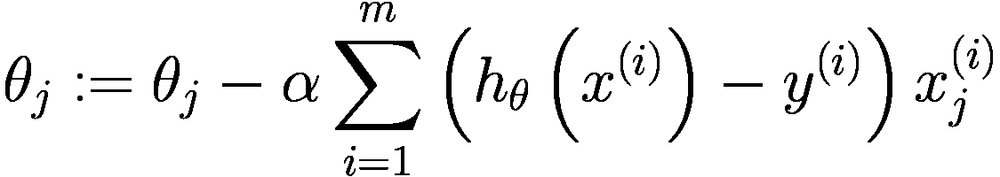

} *（同时更新 θ*[*j*]*）*

这里，*h**θ*)) 是数据集中每个训练行 x 的预测值，*y*^((*i*)) 是实际的目标类别标签。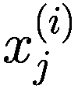 是训练数据中第 i 行第 j 列的值。*α* 是一个额外的参数（超参数），用于控制每次迭代中参数值应受影响的程度。

### 使用 Python 进行逻辑回归

在这个例子中，我们将重新审视鸢尾花数据集。该数据集包含 150 行数据，每行包含每朵花的花萼长度、花萼宽度、花瓣长度和花瓣宽度。基于花萼和花瓣的尺寸，我们希望能够预测给定的花朵是山鸢尾、变色鸢尾还是维吉尼亚鸢尾。

让我们使用 Scikit-learn 提供的内置数据集来准备数据集。

```
from sklearn import datasets
iris = datasets.load_iris()
```

`load_iris()` 方法返回一个包含以下键的字典：

```
dict_keys(['data', 'target', 'frame', 'target_names', 'DESCR', 'feature_names', 'filename'])
```

我们可以使用这些键的值来准备我们所需的数据。虽然我们需要原始数字来使用 Scikit-learn 训练逻辑回归模型，但在此示例中，我们将准备完整的数据框以观察数据的完整结构。

```
iris_data = pd.DataFrame(iris['data'], columns=iris['feature_names'])
iris_data['target'] = iris['target']
iris_data['target'] = iris_data['target'].apply(  lambda x:iris['target_names'][x]  )
```

在继续这个实验之前，我们将特意从山鸢尾和变色鸢尾类别中选取数据，以简化数据集，使其能够拟合二元分类模型。总共有三种类型——我们只取两种。

```
df = iris_data.query("target=='setosa' | target=='versicolor'")
```

让我们先看一下数据。有四个变量。让我们选取花瓣宽度和长度，在二维平面上绘制这 100 朵花。

```
import seaborn as sns
sns.FacetGrid(df, hue='target', size=5).map(plt.scatter, "petal length (cm)", "petal width (cm)").add_legend()
```

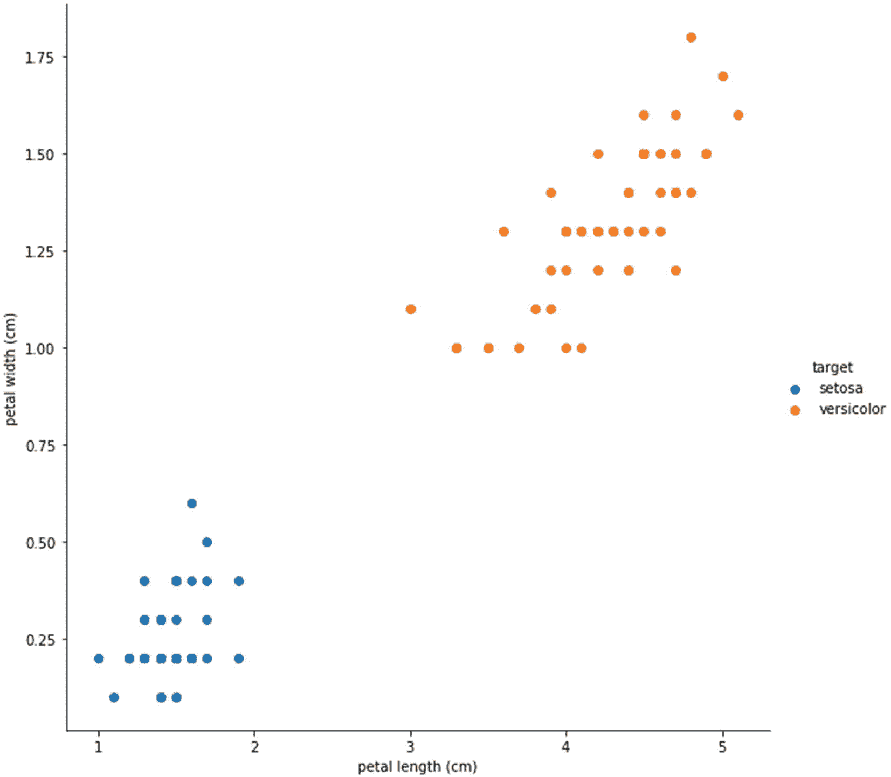

图 7-5

使用 Seaborn 沿两个维度显示的两种不同类型的鸢尾花

如图 7-5 所示，这两个类别大多是截然不同的，我们应该能够创建一条边界，以几乎零误差将两者清晰分开。

让我们使用 Scikit-learn 创建一个逻辑回归模型。

```
from sklearn.linear_model import LogisticRegression
logistic_regression = LogisticRegression()
X = iris_data.drop(columns=['target'])
y = iris_data['target']
logistic_regression.fit(X,y)
```

让我们创建一行数据来测试模型：

```
X_test =  [[5.6, 2.4, 3.8, 1.2]]
logistic_regression.predict(X_test)
```

这段代码的输出是

```
array(['versicolor'], dtype=object)
```


### 可视化决策边界

为了理解训练好的模型如何将数据分为两类，我们将仅使用两个维度重建模型，并基于花萼长度和花萼宽度绘制二维图表。我们限制维度是为了便于可视化和理解。

```
df = iris_data.query("target=='setosa' | target=='versicolor'")[['sepal length (cm)','sepal width (cm)','target']]
X = df.drop(columns=['target']).values
y = df['target'].values
y = [1 if x == 'setosa' else 0 for x in y]
logistic_regression.fit(X,y)
```

一旦我们学习了参数，我们将取这个二维空间中的每一个可能的点，例如 (3.0,3.0)、(3,3.1)、(3,3.2)……、(3.1,3.0)、(3.1,3.1)、(3.1,3.2)……等等。我们将预测每个此类点的可能类别，并根据预测结果对点进行着色。最终，我们应该能看到整个二维空间被划分为这两种颜色，其中一种颜色代表山鸢尾，另一种颜色代表变色鸢尾。

```
x_min, x_max = X[:, 0].min()-1, X[:,0].max()+1
y_min, y_max = X[:, 1].min()-1, X[:,1].max()+1
xx, yy = np.meshgrid(np.arange(x_min, x_max, 0.02), np.arange(y_min, y_max, 0.02))
Z = logistic_regression.predict(np.c_[xx.ravel(), yy.ravel()]).reshape(xx.shape)
plt.rcParams['figure.figsize']=(10,10)
plt.figure()
plt.contourf(xx, yy, Z, alpha=0.4)
plt.scatter(X[:,0], X[:,1], c=y, cmap='Blues')
plt.xlim(xx.min(), xx.max())
plt.ylim(yy.min(), yy.max())
```

上述代码准备了一个空间，其中包含了两个特征列最小值与最大值之间、步长为 0.2 的所有点。然后我们预测每个可能点的类别，并使用`contour`绘制它们。最后，我们根据原始数据点的类别标签为其着色并叠加显示。以下是你应该能够看到的边界。

图 7-6 中显示的两个类别之间的线性边界非常明显。

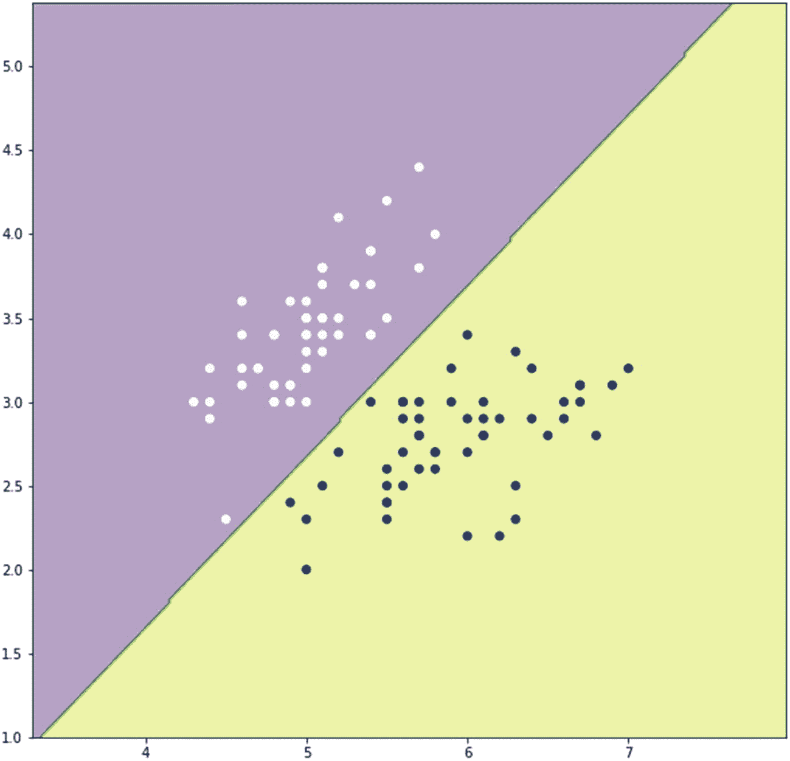

图 7-6

基于分类器性能绘制的决策边界

这是一种简单但快速高效的学习方法。在实际使用时，请注意特征的尺度应具有可比性，数据在各个类别间应保持平衡，并且不应有太多异常值。

## 决策树

决策树是一套有效且高度可解释的机器学习方法，它生成一组用于回归或分类的规则，这些规则以决策规则集的形式呈现，可以像流程图一样书写出来。

决策树是倒置绘制的，其根节点位于顶部。从根节点开始，树中充满了条件语句；基于这些条件语句的依次判断结果，控制流将被引导至叶节点（即末端的节点），这些叶节点表示最终预测的目标类别。

考虑以下一组条件测试：

1.  年龄是否大于 16？
2.  分数是否大于 85？

每个数据样本都会经历一系列这样的测试，直到到达树的叶节点，叶节点根据落在其上的训练数据样本的比例来确定类别标签。

### 构建决策树

决策树算法的学习阶段是一个递归过程。在每次递归中，它都会查看当前阶段提供的训练数据，并尝试找到最佳的可能分割点。如果数据量足够大，且目标类别具有足够的多样性，使得分割后能在下一阶段产生更清晰的目标标签划分，我们就进行分割。否则，如果提供给当前阶段的训练数据太少，或者全部属于同一个目标类别，我们就将其视为叶节点，并分配给定数据集中多数类别的标签。

#### 选择分割属性

因此，选择用于分割和创建条件的属性成为算法的核心。有多种分割准则，不同的实现方法据此得以区分。其中一种有趣的准则是使用熵的概念，它衡量数据中的随机性或不确定性程度。数据集的熵取决于节点中存在多少随机性。

在这种方法中，我们的目标是找到一个能够帮助我们在分割后降低熵的分割准则，从而得到更纯净的节点。

熵的计算公式为 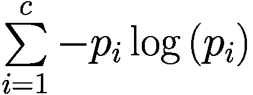，其中 c 是数据集中可能的类别标签数量。如果一个样本完全同质或属于同一类别，则熵为零；如果一个样本在所有类别中均匀分布，则其熵为 1。

为了理解这一点，考虑抛一枚公平硬币时得到任一面的概率。熵可以计算为

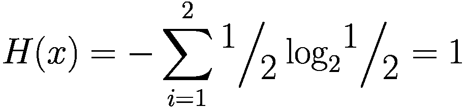

但如果硬币严重偏向，以至于我们几乎总是得到正面，那么熵将为 H(X) = 0。

这意味着数据中没有随机性，或者说我们可以 100% 确定抛硬币的预期结果。在决策树中，我们希望创建那些我们能确定其类别标签的叶节点；因此，我们需要最小化随机性，并最大化分割后熵的减少量。我们选择的属性应该能带来熵的最佳减少。

这由称为信息增益的量来体现，它衡量一个特征能为我们提供关于类别的信息量。因此，我们希望选择能带来最高信息增益的属性。

对于包含连续数据的属性，我们可以使用基尼指数准则。它是另一种不纯度的度量。基尼值越高，同质性越高。CART（分类与回归树）使用基尼方法来创建二叉分割。

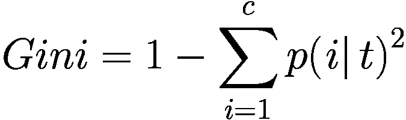

在使用 Scikit-learn 训练基于决策树的分类或回归模型时，我们可以通过 `criterion` 超参数来选择分割准则。


### Python 中的决策树

在此示例中，我们将使用完整的鸢尾花数据集，该数据集包含 150 个鸢尾花样本在三个类别中的信息。

```
import pandas as pd
from sklearn import datasets
iris = datasets.load_iris()
iris_data = pd.DataFrame(iris['data'], columns=iris['feature_names'])
iris_data['target'] = iris['target']
iris_data['target'] = iris_data['target'].apply(  lambda x:iris['target_names'][x]  )
print(iris_data.shape)
```

验证数据集的形状。它应该是

```
(150, 5)
```

让我们分离出将用于学习决策树的特征以及相关的类别标签。

```
X = iris_data[['sepal length (cm)', 'sepal width (cm)', 'petal length (cm)','petal width (cm)']]
y = iris_data['target']
```

然后，我们将数据分离为训练数据集和测试数据集。

```
from sklearn.model_selection import train_test_split
X_train, X_test, y_train, y_test = train_test_split (X,y,test_size=0.20, random_state=0)
```

这将把数据分离为 80% 的训练数据和 20% 的测试数据。因此，我们将基于由此创建的约 120 行 `(X_train 和 y_train)` 来构建决策树。之后，我们将预测约 30 行测试数据 `(X_test)` 的结果，并将预测结果与实际类别标签 `(y_test)` 进行比较。在以下几行中，我们初始化了一个决策树分类器，它使用基尼系数作为分裂标准，并构建最大深度为 4 的树。

```
from sklearn.tree import DecisionTreeClassifier
DT_model = DecisionTreeClassifier(criterion='gini', max_depth=10)
DT_model.fit(X_train, y_train)
```

为了找到测试数据集上的预测结果，我们使用以下代码：

```
y_pred = DT_model.predict(X_test)
```

`y_pred` 应该是一个数组，包含每个测试数据样本的预测目标类别。它看起来应该类似于下面的内容，尽管由于数据分割的随机性，结果可能会有所不同。

```
array(['virginica', 'versicolor', 'setosa', 'virginica', 'setosa', 'virginica', 'setosa', 'versicolor', 'versicolor', 'versicolor', 'virginica', 'versicolor', 'versicolor', 'versicolor',        'versicolor', 'setosa', 'versicolor', 'versicolor', 'setosa', 'setosa', 'virginica', 'versicolor', 'setosa'], dtype=object)
```

我们可以通过将预测结果与实际类别标签进行比较来评估决策树的性能。准确率比较的是 `y_pred` 与 `y_test` 完全相同的比例。这应该输出一个 0 到 1 之间的数字，其中 1 表示 100% 准确的结果。

```
from sklearn.metrics import accuracy_score
print (accuracy_score(y_test, y_pred))
```

混淆矩阵显示了实际标签和预测标签的交叉制表计数。

```
from sklearn.metrics import confusion_matrix
confusion_matrix(y_test, y_pred)
```

这将打印一个 3x3 的网格。第一行包含被预测为每个潜在目标类别的第一类测试数据集项目的计数。以下输出示例中的第一行显示，七个 Iris Setosa 样本被标记为 Iris Setosa，0 个被标记为 Iris Versicolor，0 个被标记为 Iris Virginica。

```
Out[14]:
array([[ 7,  0,  0],
[ 0, 11,  0],
[ 0,  0,  5]], dtype=int64)
```

我们将在下一章中更全面地讨论更多的评估和调优方法。

#### 剪枝

决策树可以通过剪枝来提高效率，即移除那些使特征重要性较低的枝干。我们可以使用诸如限制决策树的深度、分裂内部节点所需的最小样本数以及每个叶节点应包含的最小样本数等操作，来分配预定义的超参数以进行剪枝。

Scikit-learn 在 `tree` 包下提供了决策树的多种实现。我们将使用 `DecisionTreeClassifier`。该包还包含了 `DecisionTreeRegressor` 的实现，以及另外两个实现极度随机化树分类器和回归器的类。

```
from sklearn.tree import DecisionTreeClassifier
```

#### 解读决策树

决策树的优点之一是它们易于理解、解释和可视化。如果你能看到决策条件是如何排列的，以及最终标签是如何分配的，你就可以轻松理解数据的底层模式和已生成的模型。

Scikit-learn 提供了一个将决策树导出为 DOT 格式的选项，这是一种用于存储和共享关于图或树的结构和视觉属性信息的流行格式。我们可以将其与另一个名为 `PyDotPlus` 的库结合使用，该库允许我们从 DOT 数据创建图形。我们也可以直接使用 `DOT` 工具来可视化或导出图形。

为了在 Jupyter Notebook 中直接查看树，我们还需要 Graphviz，这是一个开源的图形可视化软件。你可以为你的系统下载并安装^(⁵)合适的发行版。你还需要安装 PyDotPlus 和 Python-Graphviz，以提取关于决策树的信息，并将其转换为可以在 Jupyter Notebook 上显示的格式。

你可以使用以下命令安装所需依赖：

```
%pip install pydotplus
%pip install python-graphviz
```

一旦你创建了一棵树，使用以下代码块导入所需的元素：

```
Import IPython
from sklearn.tree import export_graphviz
import pydotplus
import matplotlib.pyplot as plt
dot_data = export_graphviz(DT_model, feature_names= selected_cols)
graph = pydotplus.graph_from_dot_data(dot_data)
img = IPython.display.Image(graph.create_png())
```

在前面的代码中，`export_graphviz` 首先以 DOT 格式提取决策树的结构。DOT 格式^(⁶)使用简单且标准化的语法，通过定义良好的关键字和符号来表示图和树。然后，PyDotPlus 读取 DOT 格式并将其转换为 `pydotplus.graphviz.dot` 对象，该对象可用于创建图像，并使用 `IPython.display` 显示，看起来类似于图 7-7。

```
IPython.display.display(image)
```

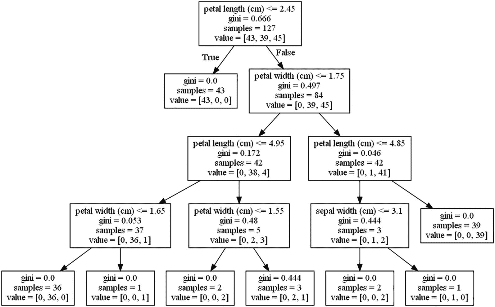

图 7-7

显示在鸢尾花数据集上训练后生成的决策树

树的每个内部节点显示一个关于某个参数的条件，基于该条件，我们遍历右子树或左子树。叶节点包含一个包含三个元素的值对象。这显示了最终到达该叶节点的训练样本中，每个类别各有多少个。例如，最左边的叶节点包含 value = [0,36,0]，这意味着 36 个训练样本属于 Iris Versicolor，没有样本属于 Iris Setosa 或 Iris Virginica。因此，如果在预测过程中有任何样本最终到达此叶节点，它将被预测为多数类，此处是 Versicolor。

决策树既可用于分类，也可用于回归。如果你想构建一个回归树，你可以使用 `sklearn.tree.DecisionTreeRegressor`，并将 `y_train` 准备为连续值的数组（或序列），而不是类别标签。

## 总结

在本章中，我们学习了回归和分类方法，即线性回归、逻辑回归和决策树。这些是你可以用来创建预测系统的一些基本监督学习方法。我们将深入探讨这些方法，并发现各种更全面地评估这些模型并对其进行调优的方法，以获得最佳可能的结果。

脚注 1   2


