# 8. 调优监督学习器

正如我们在前一章中所见，有多套监督学习算法，可以通过标记的训练数据来建模预测系统，这些数据可能预测一个实数（在回归中）或一个或多个离散类别（在分类中）。每种方法都提供了一组可以修改或调优的特征，以操控模型的能力——这可能会对由此获得的结果质量产生显著影响。

在本章中，我们将研究如何设计、评估和调优机器学习实验，以获得尽可能最佳的模型。

## 训练与测试过程

一个机器学习实验分为两个主要阶段。首先，模型在训练数据集上进行拟合。训练数据集包含训练元组，每个元组由一个输入向量和相应的输出组成。预测的量通常称为目标。在这个阶段，我们首先会通过特征工程来改善来自（在监督学习情况下）标记数据集的信号，然后学习模型的参数。

在第二阶段，模型用于预测另一个称为测试数据集的标记数据集的目标。该数据集也包含由输入向量和输出组成的训练元组。然而，这些数据在训练期间并未暴露给学习算法——因此，模型是未见过的。这提供了一种对模型进行无偏评估的方法。我们可以进一步修改过程或调整算法，以做出能产生更好评估指标的预测。图 8-1 中的框图解释了机器学习项目中训练和测试过程是如何进行的。

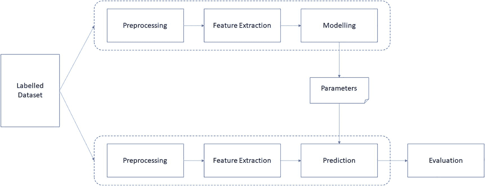

图 8-1：训练与测试过程

在某些情况下，我们改用验证集——用于调优模型。一旦我们获得了足够可靠的结果，我们再使用另一个测试数据集（也称为保留数据集），该数据集返回模型的最终评估指标。在其他一些实验中，我们反而将所有标记数据集合并，并使用交叉验证来得出指标。我们将在后面的章节中详细讨论这一点。

## 性能度量

一旦我们创建了一个机器学习模型，并将其拟合到数据管道中，以预测先前未见过的数据样本的结果，我们需要确保模型是准确的。

衡量分类器模型所能生成结果的质量是一个重要课题，需要充分理解模型以及问题所基于的领域。

### 混淆矩阵

混淆矩阵是一个简单的列联表，用于可视化分类算法的性能，该算法可以将元素分为两个或多个类别。在表中，每一行代表属于实际类别的项目，每一列代表属于预测类别的项目。

假设有一个模型，它捕获一个人的诊断信息，并据此预测此人是否患有病毒性疾病。假设我们有 100 个用于测试的标记行。请记住，这些行尚未用于训练模型，仅用于评估。这两行将代表病毒阴性的人和病毒阳性的人。这两列代表我们的分类模型预测为阴性或阳性的人。假设某个特定模型的表格如表 8-1 所示。

表 8-1：混淆矩阵示例

|          |        | 预测   |
| :------- | :----- | :----- |
|          |        | 阴性   | 阳性   |
| **实际** | 阴性   | 90（真阴性） | 3（假阳性） |
|          | 阳性   | 2（假阴性）  | 5（真阳性） |

快速浏览此表可知，测试数据集中共有 100 个项目。

其中，有 7 人（2+5）实际患有病毒性疾病，有 93 人（90+3）为阴性。

然而，模型预测了 92 人为阴性，其中包括两名实际为阳性的人。正确标记为阴性的样本称为真阴性（TN），错误标记为阴性的样本称为假阴性（FN）。类似地，模型预测了 8 人为阳性，其中 5 人被正确预测为阳性，因此表示真阳性（TP）。被错误标记为阳性但实际为阴性的三个项目称为假阳性（FP）。

真阳性和真阴性构成了模型的整体准确率。假阳性通常称为第一类错误，假阴性称为第二类错误。尽管两者之间通常存在权衡，但您应更关注哪种错误取决于您试图解决的问题。

#### 召回率

召回率是一种度量，表示在所有实际为阳性的项目中，被正确识别出的阳性测试数据项目的比例。它可以根据列联表计算如下：

$$ 召回率=\frac{真阳性}{真阳性+假阴性} $$

在前面的示例中，召回率为 5/7 = 0.714。

### 精确率

精确率是一种度量，表示正确预测的阳性点数与所有被预测为阳性的点数之比。它可以计算如下：

$$ 精确率=\frac{真阳性}{真阳性+假阳性} $$

在前面的示例中，精确率为 5/8，即 0.625。请注意，精确率和召回率没有单位。

精确率和召回率都应尽可能高。通过调整模型的超参数，可以调优模型以获得更好的召回率和精确率，我们将在后面的章节中看到这一点。然而，在某些情况下，我们发现当我们试图提高召回率时，精确率可能会相对下降。这意味着我们希望捕获尽可能多的阳性样本，但这样做时，我们也需要容忍模型将阴性样本误判为阳性。如果我们试图确保阳性预测样本的高精确率，我们可能会以降低召回率为代价。

### 准确率

准确率是一种简单的度量，表示有多少项目被正确分类到两个类别中。在这里，我们正确识别了 90 个阴性样本和 5 个阳性样本。因此，准确率为 (90+5)/100，即 0.95，或 95%。

### F 度量

F 度量或 F1 分数是通过取精确率和召回率的调和平均数得到的分数，用于给出分类模型优劣的总体印象。调和平均数不使用算术平均数，而是对极端值施加更多惩罚，并更倾向于两者中较低的值。其计算公式如下：

$$ F-度量=\frac{2\ast 精确率\ast 召回率}{精确率+召回率} $$

在此示例中，F 度量为 2x0.714x0.625/(0.714+0.625)，即 0.667。

### Python 中的性能指标

Scikit-learn 提供了三种评估模型质量的 API，分别是：估计器评分方法、评分参数和指标函数。估计器评分方法是指 `model.score()` 方法，它可以被任何分类器、回归或聚类类的对象调用。该方法在估计器的代码内部实现，无需导入任何额外的模块。其实现方式因估计器而异。例如，对于回归模型，它返回预测的决定系数 R²。对于逻辑回归或决策树，`score()` 方法返回给定测试数据和标签上的平均准确率。

接下来，我们将探索 `sklearn.metrics` 下提供的指标函数。

对于本节中的代码，我们假设您已经在上一章中创建了一个用于鸢尾花分类的分类器。一旦您导入了数据集，并准备了正确格式的 `X_train`、`y_train`、`X_test` 和 `y_test` 对象，您就可以初始化并拟合任何分类器。我们将沿用上一章中将数据分为三种鸢尾花类别之一的决策树模型。

```
DT_model = DecisionTreeClassifier(criterion="entropy", max_depth=3)
DT_model.fit(X_train, y_train)
```

现在，我们将导入 `sklearn.metrics`，以便访问该模块中的所有指标函数。

```
import sklearn.metrics
```

假设您已经训练好了模型，我们现在将为测试数据集找到预测的类别标签。

```
y_pred = DT_model.predict(X_test)
print (y_pred)
```

这应该会打印出包含所有测试数据样本预测值的数组。

```
['versicolor' 'setosa' 'virginica' 'versicolor' 'virginica' 'setosa' 'versicolor' 'virginica' 'versicolor' 'versicolor' 'virginica' 'setosa' 'setosa' 'setosa' 'setosa' 'versicolor' 'virginica' 'versicolor' 'versicolor' 'virginica' 'setosa' 'virginica' 'setosa' 'virginica' 'virginica' 'virginica' 'virginica' 'virginica' 'setosa' 'setosa' 'setosa' 'setosa' 'versicolor' 'setosa' 'setosa' 'virginica' 'versicolor' 'setosa']
```

使用以下代码打印混淆矩阵：

```
sklearn.metrics.confusion_matrix(y_test, y_pred)
```

这应该会打印出混淆矩阵。由于我们的数据包含三种鸢尾花类型的三个类别标签，因此有三行代表实际类别标签，三列代表预测的类别样本。

```
array([[15,  0,  0],
       [ 0, 10,  1],
       [ 0,  0, 12]], dtype=int64)
```

从这个图表可以解读出，有 15 个属于第一类（Setosa）的样本被正确分类。然而，第二类有 11 个样本，其中十个被正确分类，一个被分类为第三类。然后有 12 个样本，全部被正确识别为第三类。

`sklearn.metrics` 还包含了用于精确率、召回率和 F-measure 的函数。所有这些函数至少需要两个参数：实际类别标签和预测类别标签。如果您有超过两个类别，您可以提供一个额外的函数参数 `average`，它可以包含以下值之一：

*   `binary`：默认值，该函数仅报告正类标签的结果。

*   `micro`：通过计算总的真正例、假负例和假正例来全局计算指标。

*   `macro`：为每个标签计算指标，然后计算它们的未加权平均值。这没有考虑标签不平衡问题。

*   `weighted`：为每个标签计算指标，然后根据测试数据中每个标签的实例数量计算其加权平均值，并计入标签不平衡的影响。

我们现在可以在宏观层面找到本节讨论的性能指标。

```
p = sklearn.metrics.precision_score(y_test, y_pred, average='micro')
r = sklearn.metrics.recall_score(y_test, y_pred, average='micro')
f = sklearn.metrics.f1_score(y_test, y_pred, average='micro')
a = sklearn.metrics.accuracy_score(y_test,y_pred)
print ("以下是训练模型的指标：")
print ("精确率:\t{}\n 召回率:\t{}\nF 值:\t{}\n 准确率:\t{}".format(p,r,f,a))
```

这应该会生成以下输出，总结了基于提供`y_pred`的模型的指标。

```
以下是训练模型的指标：
精确率:  0.9736842105263158
召回率:     0.9736842105263158
F 值:    0.9736842105263158
准确率:   0.9736842105263158
```

### 分类报告

分类报告在一个视图中提供了分类任务所需的大部分重要且常见的指标。它显示了每个类别的精确率、召回率和 F1 值，以及支持度（即属于该类别的实际测试样本数量）。

`sklearn.metrics.classification_report()` 返回一个格式化字符串，其中包含测试数据中每个类别得分的摘要。使用以下代码打印它：

```
print (sklearn.metrics.classification_report(y_test, y_pred))
```

这应该会打印出以下摘要：

```
              precision    recall  f1-score   support
setosa       1.00      1.00      1.00        15
versicolor       1.00      0.91      0.95        11
virginica       0.92      1.00      0.96        12
accuracy                           0.97        38
macro avg       0.97      0.97      0.97        38
weighted avg       0.98      0.97      0.97        38
```

这更清晰地展示了基于我们的模型进行预测所获得结果的质量。

## 交叉验证

我们在前面的章节中看到，在处理监督学习问题时，我们将带标签的数据集分为两部分——即训练集和验证（或测试）集。与其依赖数据的静态部分来学习模型，并使用另一个静态部分进行验证，更好的做法是轮换训练和测试部分，以便能够确定模型对独立数据集的泛化能力。

在这种方案中，我们有一个预定义的测试数据集比例，例如 25%。这意味着我们将数据集分成四部分，从而进行四折交叉验证（图 8-2）。

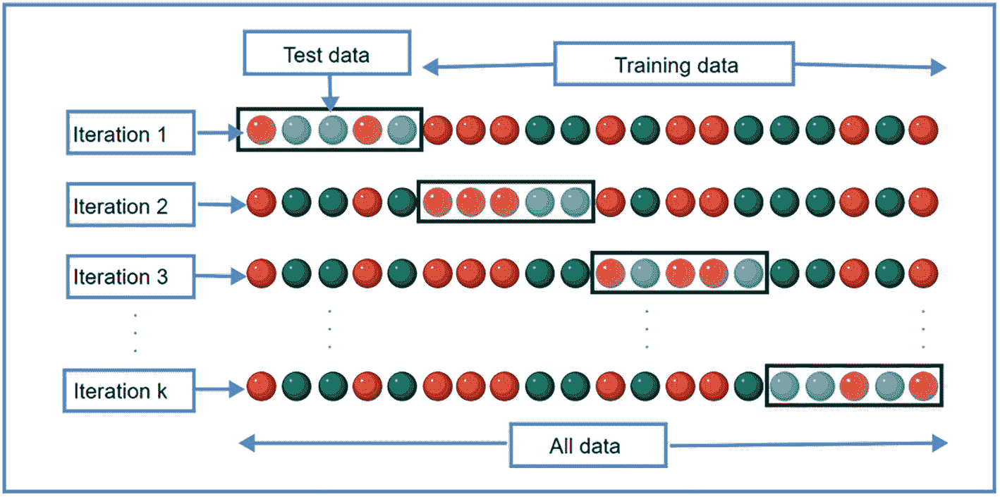

图 8-2

为 k 折交叉验证分配数据点

在交叉验证实验的第一次迭代中，我们将带标签数据的第一部分（或第一折）视为测试数据，其余三部分视为训练数据。我们学习模型，然后使用它来预测本次迭代中测试数据的标签，据此，我们可以计算准确率或我们在前面几页中看到的其他度量指标。

第一次迭代结束后，我们将第二部分（折）指定为测试数据，其余三部分作为训练数据来创建模型。然后我们获得另一组指标。我们重复这个过程 *k* 次，其中 k 是所创建的折数。这个过程称为 k 折交叉验证。

在 k 次迭代中，我们将获得 k 个指标，可以对这些指标进行平均，以找到一个更具泛化能力的指标，用于调整超参数。

如果将 k 折交叉验证的 k 设置为等于数据样本的数量，则模型在所有数据点（除一个之外）上进行训练，并且仅对该点进行预测。这被称为 `留一法交叉验证`。由于其性质，这种方法计算成本很高。

另一种变体是 `分层交叉验证`。它不是随机创建 k 折，而是通过分层抽样来划分数据。分层抽样在将数据划分为训练集和测试集时，会考虑类别标签表示的平衡性，并且在处理具有不平衡类别标签的数据时更为实用。

### 为什么需要交叉验证？

如果我们基于一个静态测试集调整模型，可能会过度优化并过拟合该测试集，导致模型无法泛化到更多未见数据。关于测试集的信息可能会间接渗透到模型中，评估指标也会失去泛化能力。因此，使用数据的多个折叠（fold）可以避免仅针对单一静态集调整结果。

### Python 中的交叉验证

对于交叉验证，我们不会像之前的示例那样使用随机生成的训练-测试划分，而是直接处理特征和标签值。让我们重新加载数据开始练习：

```
import pandas as pd
from sklearn import datasets
iris = datasets.load_iris()
X = pd.DataFrame(iris['data'], columns=iris['feature_names'])
y = iris['target']
```

现在完整的数据集包含在特征`X`和标签`y`中。

接下来，我们将使用五折交叉验证来创建多个数据划分：

```
from sklearn.model_selection import KFold
kf = KFold(n_splits=5)
kf.get_n_splits(X)
```

这将初始化五折交叉验证，生成五次划分迭代，每次迭代的训练集包含约 120 个元素，测试集包含约 30 个元素。我们可以通过以下方式查看每次迭代中选入训练集和测试集的元素索引：

```
for i, (train_index, test_index) in enumerate(kf.split(X)):
print ("Iteration "+str(i+1))
print("Train Indices:", train_index, "\nTest Indices:", test_index,"\n")
```

这将打印每次迭代中选入训练集和测试集的数据集索引。为简洁起见，以下输出已截断。

```
Iteration 1
Train Indices: [ 30  31  32  33  34  35  36  37  38  39  40  41  42  43  44  45  46  47 48  49  50  51  52  53  54  55  56  ....
... 136 137  138 139 140 141 142 143 144 145 146 147 148 149]
Test Indices: [ 0  1  2  3  4  5  6  7  8  9 10 11 12 13 14 15 16 17 18 19 20 21 22 23  24 25 26 27 28 29]
Iteration 2
Train Indices: [  0   1   2   3   4   5   6   7   8   9  10  11  ...
```

因此，在每次划分迭代中（共五次），k 折划分会指示应包含在训练集或测试集中的元素索引。

我们可以使用每次迭代中的数据点来拟合模型：

```
score_history = []
for train, test in kf.split(X, y):
clf = DecisionTreeClassifier()
clf.fit(X.values[train,:], y[train])
score_history.append(clf.score(X.values[test,:], y_pred))
```

或者，我们也可以使用 `sklearn.model_selection` 中的 `cross_val_score`，让 Scikit-learn 自动迭代创建多个模型，并将准确率指标呈现给你。我们将在后续章节的示例中看到这些内容。

## ROC 曲线

各种分类算法可以配置为基于数据项属于某个类别的概率的预定义阈值来生成类别标签。例如，在下图中，我们可以看到分类器的预测结果会根据阈值产生显著差异。这间接影响了精确率与召回率、灵敏度与特异度。

灵敏度（或召回率），正如我们在上一节中看到的，是真正例与所有正类数据项的比率。它也被称为真正例率。特异度是真负例与所有实际为负类的数据项的比率。通常，两者之间存在权衡。

在接下来的实验中，我们将训练一个逻辑回归模型，并根据模型在不同阈值下的分类输出，找到真正例率和假正例率。让我们使用 Scikit-learn 的内置功能为此类实验生成合成数据集：

```
from sklearn.datasets import make_moons
X1, Y1 = make_moons(n_samples=1000, shuffle=True, noise=0.1)
```
让我们使用`matplotlib`查看生成的数据集。结果应类似于图 8-3。
```python
import matplotlib.pyplot as plt
plt.figure(figsize=(8, 8))
plt.scatter(X1[:, 0], X1[:, 1], marker='o', c=Y1, s=25, edgecolor='k')
plt.show()
```
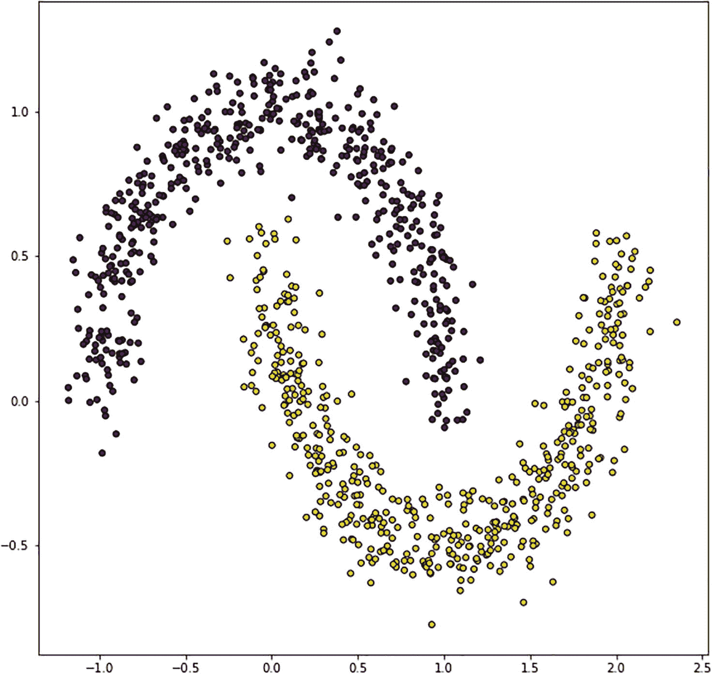
图 8-3 显示随机生成的数据集
要生成复杂度较低的数据集，可以使用：
```python
from sklearn.datasets import make_classification
X1, y1 = make_classification(n_classes=2, n_features=2, n_redundant=0, n_informative=1, n_clusters_per_class=1)
```
我们将训练一个逻辑回归模型。
```python
from sklearn.linear_model import LogisticRegression
from sklearn.model_selection import train_test_split
X_train, X_test, y_train, y_test = train_test_split(X1, y1, test_size=0.2, random_state=42)
logreg = LogisticRegression()
logreg.fit(X_train, y_train)
```
我们可以调用`predict_proba()`方法（而非`predict()`方法），该方法会生成每个点属于第二类（类别标签=1）的概率。
```python
logreg.predict_proba(X_test)
```
这将返回一个形状为 (20,2) 的数组。共有 20 个测试样本，两列分别给出了每个类别的概率。我们将取其中一列的概率值，调整阈值，并观察其对 TPR 和 FPR 的影响。
```python
y_pred_proba = logreg.predict_proba(X_test)[:, 1]
from sklearn.metrics import roc_curve
[fpr, tpr, thr] = roc_curve(y_test, y_pred_proba)
```
最后一条语句返回的对象可用于分析设置不同阈值的效果。该曲线可以跨越多个阈值进行追踪。在此之前，我们将引入另一个指标，该指标基于假正例率和真正例率，计算由此生成的曲线下面积。
```python
from sklearn.metrics import auc
auc(fpr, tpr)
>> 0.8728442728442728
```
让我们绘制图形。
```python
plt.figure()
plt.plot(fpr, tpr, color='coral', label='ROC Curve with Area Under Curve = ' + str(auc(fpr, tpr)))
plt.xlabel('False positive Rate (1 - specificity)')
plt.ylabel('True Positive Rate ')
plt.legend(loc='lower right')
plt.show()
```
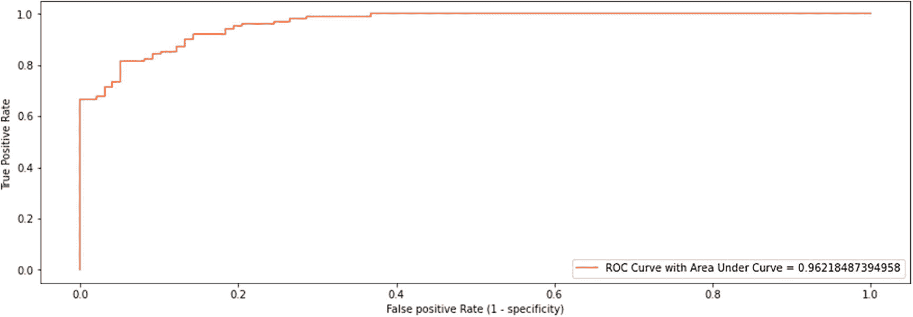
图 8-4 基于假正例率和真正例率绘制 ROC 曲线
图 8-4 展示了预测质量的实际特征。曲线下面积应尽可能高。ROC 曲线提供了一种更标准化的方式来比较多个模型，而不受可能影响最终结果的阈值影响。

## 过拟合与正则化
我们可以对模型进行微调，使其很好地拟合训练数据。在这个过程中，我们常常会调整算法的几个属性，这些属性可能直接影响模型的复杂度。让我们尝试使用线性回归，并采用一个更复杂的模型来更精确地拟合上一章中的训练数据点。我们将创建一组新的特征，对自变量进行简单的算术变换，并基于这些特征拟合线性回归。这种方法被称为多项式回归。
注意 在多项式回归中，我们仍然使用线性回归的方法来拟合一条线。不过，这是在将自变量扩展为多项式特征之后进行的。
在下面的代码块中，我们将使用上一章中用过的学生成绩-薪资数据集。我们将对特征进行扩展：
```python
import numpy as np
import pandas as pd
from sklearn.linear_model import LinearRegression
from sklearn.preprocessing import PolynomialFeatures
data = pd.DataFrame({"marks":[34,51,64,88,95,99], "salary":[3400, 2900, 4250, 5000, 5100, 5600]})
X = data[['marks']].values
y = data['salary'].values
poly = PolynomialFeatures(3)
X1 = poly.fit_transform(X)
```
此时，我们得到了一个形状为 (6,4) 的新数组`X1`，它由 x⁰、x¹、x² 和 x³ 生成。它看起来应该是这样的：
```
array([[1.00000e+00, 3.40000e+01, 1.15600e+03, 3.93040e+04],
       [1.00000e+00, 5.10000e+01, 2.60100e+03, 1.32651e+05],
       [1.00000e+00, 6.40000e+01, 4.09600e+03, 2.62144e+05],
       [1.00000e+00, 8.80000e+01, 7.74400e+03, 6.81472e+05],
       [1.00000e+00, 9.50000e+01, 9.02500e+03, 8.57375e+05],
       [1.00000e+00, 9.90000e+01, 9.80100e+03, 9.70299e+05]])
```
我们将像之前一样使用`LinearRegression`。不过，为了找到回归线（或多条线），我们将准备一个数组，其中包含从数据集中最小成绩到最大成绩的值，将其转换为相同的多项式特征，并预测这些值。这一次，我们将学习四个参数，而不是仅仅两个。我们由此创建的图将显示回归线。
```python
reg = LinearRegression()
reg.fit(X1, y)
X_seq = np.linspace(X.min(), X.max(), 100).reshape(-1, 1)
X_seq_1 = poly.fit_transform(X_seq)
y_seq = reg.predict(X_seq_1)
import matplotlib.pyplot as plt
plt.figure()
plt.scatter(X, y)
plt.plot(X_seq, y_seq, color="black")
plt.show()
```
这将打印出如图 8-5 所示的图形，该图显示了在我们的范围内每个可能点的预测值。
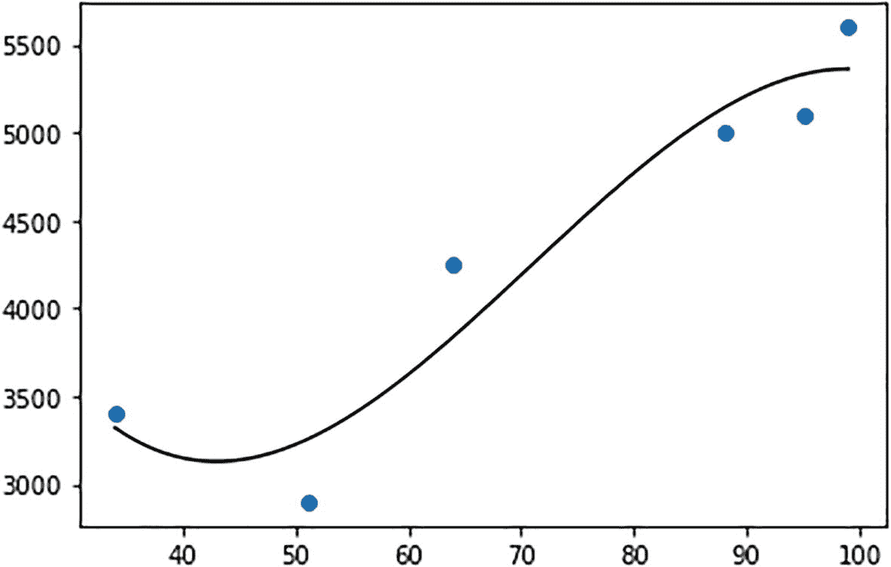
图 8-5 具有多项式特征的线性回归
你可以看到，我们可以增加复杂度，使预测更紧密地拟合训练数据，从而降低整体误差并提高准确性。这看起来很有希望，但可能会产生误导。
请记住，在解决任何机器学习问题时，你必须从一组假设中选择一个函数来拟合训练数据。通常，与系统在现实世界中部署后可能需要预测的数据相比，数据量非常小。我们的效率、准确性以及准确性的衡量标准，都受限于我们能够生成、收集或标注的标记数据的质量和数量。在前面的回归示例中，我们试图拟合一个三次多项式曲线，以最小化基于实际因变量的残差。尽管数据总体呈上升趋势，但该模型可能会产生误导。
以下修改允许你找到并绘制成绩从 0 到 100（而非训练数据的最小值和最大值）的预测值。
```python
X_seq = np.linspace(0, 100, 100).reshape(-1, 1)
X_seq_2 = poly.fit_transform(X_seq)
y_seq = reg.predict(X_seq_2)
plt.figure()
plt.scatter(X, y)
plt.plot(X_seq, y_seq, color="black")
plt.show()
```
由此生成的曲线如下所示。
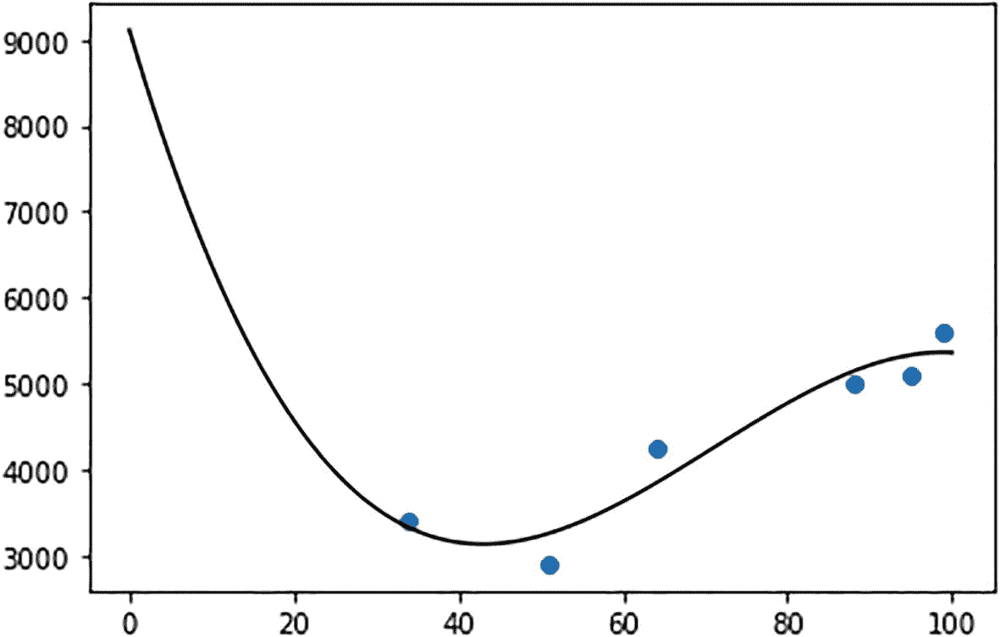
图 8-6 由于过度复杂的回归模型导致的过拟合曲线
```

# 机器学习中的过拟合、欠拟合与正则化

## 过拟合与欠拟合

在图 8-6 中，我们试图增加模型的复杂度，以便更好地捕捉训练数据；然而，这导致了对真实数据中不存在的数据产生了意外的误差。你可以看到，由于最左侧的点，对于低于该成绩的预测显示，较低的成绩对应着较高的薪资。问题在于，我们使模型变得过于复杂，以至于过度拟合了数据。这被称为`过拟合`。

与此相反的情况是模型未能从训练数据中充分学习。如果我们有一个自变量，我们会学习两个参数——y 轴截距和回归线的斜率。在前面的例子中，我们增加了参数的数量，以便更好地拟合这条线。

如果我们反而减少参数的数量，比如减少到 1 个，那么我们就大幅降低了模型的复杂度，并且能够从训练数据中捕捉到的细节会更少。在我们的例子中，只有一个参数的模型将基于训练数据返回平均薪资，因此，一条平行于 x 轴的水平线将代表预测结果，如图 8-7 所示。也就是说，无论学生取得多少成绩，该模型都会预测相同的薪资。这被称为`欠拟合`。

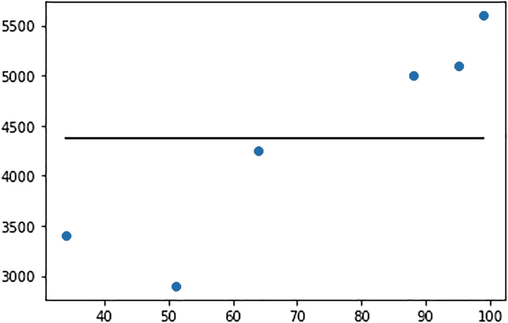

## 偏差与方差

偏差和方差是模型的属性，它们源于模型的过度简单或过度复杂。一般来说，偏差表示模型的预测值与实际值之间的差距。高偏差意味着模型过于简单，其学到的假设过于基础。因此，该模型无法正确捕捉数据中的必要模式。因此，该模型在训练和预测时都具有高误差。

方差表示模型对数据波动的敏感程度。假设我们有一个数据点代表一名获得 35 分成绩、薪资为 6000 美元的学生，另一个数据点代表一名获得 34 分成绩、薪资为 2000 美元的学生，系统试图从两者中学习差异；这可能会导致预测生成方式产生巨大差异。当方差很高时，模型会捕捉数据集的所有特征，包括噪声和随机性。因此，它会变得过度调整。然而，当遇到未见过的数据时，它可能会产生出乎意料的糟糕结果。这样的模型会产生较低的训练误差；然而，在测试时误差却相当高。

我们需要在偏差和方差之间找到平衡，以便得到一个既能对数据中的模式敏感，又能泛化到新的未见数据的模型。误差随模型复杂度的变化趋势如图 8-8 所示。

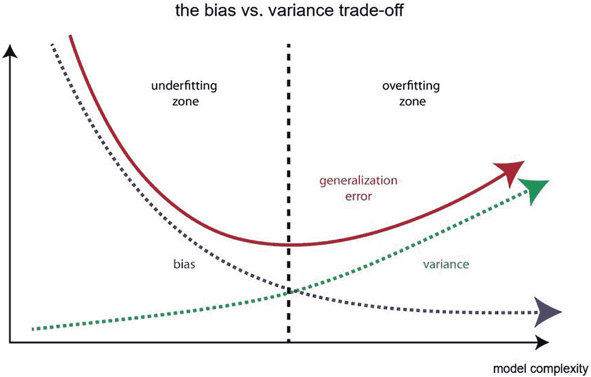

## 正则化

一种方法是通过调整代价函数来惩罚模型中的过度复杂性，从而找到正确的参数，而不是显式限制需要学习的参数数量。例如，某个算法的代价函数由`J(w)`给出，其中`w`表示参数的权重；新的代价函数如下所示：

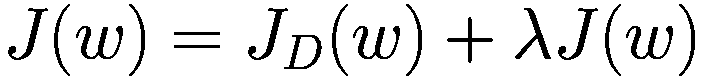

其中第一部分是残差平方和，正如我们在上一节中看到的，而新增部分是`λ`乘以所有权重的总和。`λ`是一个超参数，用于控制我们想要施加的正则化强度。由于代价函数中增加了这一部分，任何实例的参数权重都会直接对代价产生影响，而算法会试图最小化该代价。因此，如果任何权重过高，代价就会增加，算法会尝试远离这些权重集合。

最终，我们会达到一个平衡点：模型足够复杂，能够捕捉训练数据结构的本质，同时又通过惩罚过度复杂性，避免从极端异常值和噪声中学习。

### L1 和 L2 正则化

正则化是一种通过调整代价函数来避免学习过高权重，从而抑制学习过于复杂或灵活模型的技术，以此降低过拟合风险。L2 正则化是一种多项式时间的闭式解，它基于模型权重的平方和来惩罚模型。它有助于减少过拟合，但不会产生稀疏解。在岭回归中，应用了 L2 惩罚，将代价函数修改为：

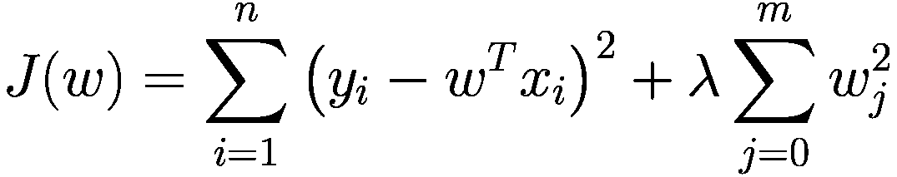

该方法产生的系数估计值也称为 L2 范数。

在套索回归中，应用了 L1 惩罚。它使用权重的绝对值（而不是 L2 惩罚中的平方）。因此代价函数变为：

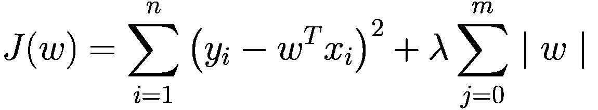

在许多实验中，我们会看到，对于逻辑回归和线性回归，L1 正则化会导致大量模型权重收敛到零（0）。这意味着经过正则化的模型已经认识到，为了得到一个不过拟合的解，某些特征的影响可以忽略不计。

让我们做一个简单的实验，来探究这两种方法对参数的影响。

```python
import numpy as np
import pandas as pd
from sklearn.linear_model import LinearRegression, Lasso, Ridge
from sklearn.preprocessing import PolynomialFeatures
import matplotlib.pyplot as plt
data = pd.DataFrame({"marks":[34,51,64,88,95,99], "salary":[3400, 2900, 4250, 5000, 5100, 5600]})
# data.bill
X = data[['marks']].values
y = data['salary'].values
fig, axs = plt.subplots(1,3, figsize=(15,5))
methods = ['Polynomial Regression', 'Lasso Regression alpha=1', 'Ridge Regression alpha=1']
for i in [0,1,2]:
poly = PolynomialFeatures(3)
X1 = poly.fit_transform(X)
if i==0:
reg = LinearRegression()
reg.fit(X1, y)
if i==1:
reg = Lasso(alpha=1)
reg.fit(X1, y)
if i==2:
reg = Ridge(alpha=1)
reg.fit(X1, y)
X_seq = np.linspace(0,X.max(),100).reshape(-1,1)
X_seq_1 = poly.fit_transform(X_seq)
y_seq = reg.predict(X_seq_1)
axs[i].scatter(X,y)
axs[i].plot(X_seq, y_seq,color="black")
axs[i].set_title(methods[i])
plt.show()
```

在这个代码示例中，我们再次尝试根据学生获得的分数来预测其薪水。这里，我们首先将唯一的自变量（分数）转换为多项式特征，然后基于此训练了三个模型。第一个是无正则化的回归，第二个是套索回归，第三个是岭回归。这两种技术的效果从它们产生的回归线中可以明显看出，如图 8-9 所示。

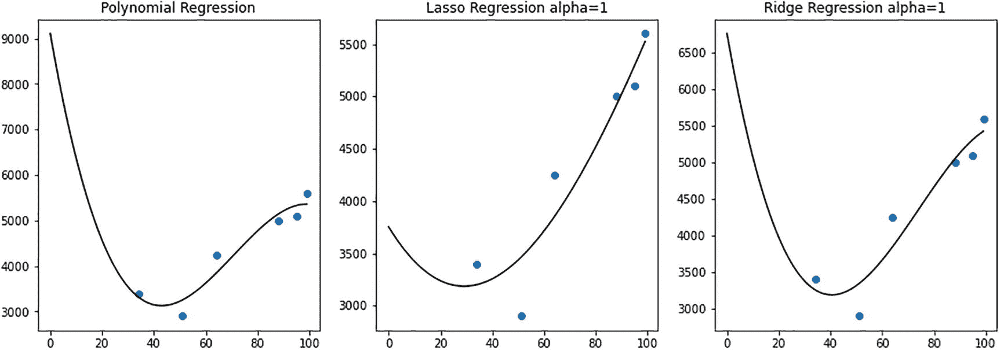

因此，我们看到正则化在不大幅增加偏差的情况下，显著降低了模型的方差。通过实验调整正则化强度`λ`的值来优化算法非常重要，以确保我们不会丢失数据中任何重要的模式。

## 超参数调优

在解决机器学习问题时，你需要设计和选择合适的特征、挑选算法，并针对所选算法（或多个算法）受其影响的超参数进行调优。

> **注意**：超参数和参数这两个术语不能互换使用。参数是模型在学习阶段学习到的权重。超参数是外部控制的元素，它们影响模型学习的内容和方式。

你可能会经常面临如下选择：

*   K-近邻算法中的“K”
*   岭回归和套索回归中的正则化强度
*   决策树的最大深度
*   梯度下降的学习率

### 超参数的影响

我们将进行一个简单的实验，看看在使用逻辑回归时，通过调整超参数，仅利用前两列特征对合成数据集的拟合程度如何。

让我们使用 Scikit-learn 的 `make_classification` 功能创建一个数据集。

```python
from sklearn.datasets import make_classification
X, y = make_classification(n_samples=400, n_features=2, n_informative=2, n_redundant=0)
```

我们需要创建独立的训练数据集和测试数据集来分析准确率。

```python
X_train, X_test, y_train, y_test = train_test_split(X,y, test_size=0.3)
```

现在我们将使用带多项式特征的逻辑回归。我们将迭代尝试不同的多项式次数，并观察其对准确率的影响。

## 超参数调优

```python
accuracy_history = []
for i in range(1,15):
    poly = PolynomialFeatures(i)
    X1 = poly.fit_transform(X_train)
    reg = LogisticRegression(max_iter=100)
    reg.fit(X1, y_train)
    X1_test = poly.transform(X_test)
    y_pred = reg.predict(X1_test)
    accuracy_history.append(accuracy_score(y_test, y_pred))
```

让我们绘制准确率图表：

```python
import matplotlib.pyplot as plt
plt.plot(accuracy_history)
```

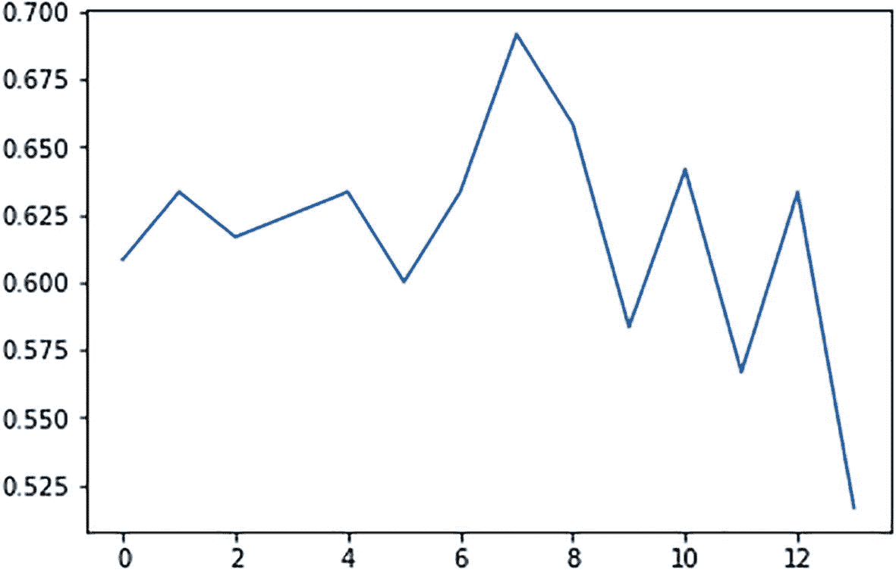

图 8-10 准确率随多项式特征变化的曲线

从图 8-10 中可以看出，准确率从次数 5 增加到次数 7，然后再次下降。基于这个仅针对一个超参数（即多项式次数）的分析，找到能产生最佳准确率的超参数值。在大多数实际场景中，你应该优先使用交叉验证，而不是使用专门的训练和测试数据集。

如果我们有多个超参数，就必须为每个超参数评估多个可能取值下的模型。让我们看看创建决策树分类器的场景。以下是一些可以调整的超参数：

*   `criterion`：基于基尼系数或基于信息熵。
*   `max_depth`：树的最大深度。
*   `min_samples_split`：分裂一个内部节点所需的最小样本数。可以是表示数量的整数，也可以是表示总样本比例的浮点数。
*   `min_samples_leaf`：叶节点所需的最小样本数。该值同时适用于左叶和右叶。

我们在前一章讨论了决策树的工作原理。你可以看到，这些决策会影响最终结果的质量。假设我们有以下可能性：

*   `criterion`：`gini`，`entropy`（两个可能值）
*   `max_depth`：`None`，`5`，`10`，`20`（四个可能值）
*   `min_samples_split`：`4`，`8`，`16`（三个可能值）
*   `min_samples_leaf`：`1`，`2`，`4`（三个可能值）

综合考虑所有选项，我们将构建多达 `2x4x3x3 = 72` 棵决策树，并从中选出指标最优的那一棵。虽然可以通过使用多重循环来进行选择，但 Scikit-learn 提供了现成的实现，可以穷举所有可能性（网格搜索）或测试随机可能性（随机搜索）。

### 网格搜索

网格搜索，或称参数扫描，是在指定的超参数空间子集内进行穷举搜索的过程。对于前面给出的例子，72 种超参数组合中的一部分如下所示：

1.  `{criterion:gini, max_depth:None, min_samples_split:4, min_samples_leaf:1}`
2.  `{criterion:gini, max_depth:None, min_samples_split:4, min_samples_leaf:2}`
3.  `{criterion:gini, max_depth:None, min_samples_split:4, min_samples_leaf:4}`
4.  `{criterion:gini, max_depth:None, min_samples_split:8, min_samples_leaf:1}`
5.  `{criterion:gini, max_depth:None, min_samples_split:8, min_samples_leaf:2}`

让我们将 `DecisionTreeClassifier` 初始化为基分类器，并准备可能的参数值列表。

```python
from sklearn.tree import DecisionTreeClassifier
from sklearn.model_selection import GridSearchCV
param_grid = {
    "criterion": ["gini", "entropy"],
    "max_depth": [None, 5, 10, 20],
    "min_samples_split": [4, 8, 16],
    "min_samples_leaf": [1, 2, 4]
}
base_estimator = DecisionTreeClassifier()
grid_search_cv = GridSearchCV(base_estimator, param_grid, verbose=1, cv=3)
```

我们将准备另一个合成数据集。这会生成一些可以可视化为两个半圆形图形的数据点。

```python
from sklearn.datasets import make_moons
from sklearn.model_selection import train_test_split
dataset = make_moons(n_samples=10000, shuffle=True, noise=0.4)
X_train, X_test, y_train, y_test = train_test_split(dataset[0], dataset[1], test_size=0.2, random_state=42)
```

我们无需自己编写循环来遍历所有可能值，而是使用 `grid_search_cv` 的 `fit()` 方法，该方法将构建 72 个模型并收集其结果。我们已经用参数网格和 3 折交叉验证初始化了一个 `GridSearchCV` 对象。我们设置了 `verbose=1`，这将使 `fit()` 方法打印进度详情。

```python
grid_search_cv.fit(X_train, y_train)
```

这应该会打印出：

```
Fitting 3 folds for each of 72 candidates, totalling 216 fits
```

这证实了我们内部构建了 72 个模型，结合 3 折搜索，总共生成了 216 棵独立的决策树。所有细节都返回在 `grid_search_cv.cv_results_` 对象中。你可以通过以下方式查看可以提取的所有信息：

```python
grid_search_cv.cv_results_.keys()
```

这应该会返回：

```
dict_keys(['mean_fit_time', 'std_fit_time', 'mean_score_time', 'std_score_time', 'param_criterion', 'param_max_depth', 'param_min_samples_leaf', 'param_min_samples_split', 'params', 'split0_test_score', 'split1_test_score', 'split2_test_score', 'mean_test_score', 'std_test_score', 'rank_test_score'])
```

为了简化解释，你可以直接使用 `grid_search_cv.best_score_` 找到最佳准确率。这是与最佳估计器关联的分数，可以通过以下方式返回：

```python
grid_search_cv.best_estimator_
```

这会返回：

```
DecisionTreeClassifier(criterion='entropy', max_depth=5, min_samples_leaf=4, min_samples_split=4)
```

你可以使用以下方式获取所有其他参数：

```python
grid_search_cv.best_estimator_.get_params()
```

### 随机搜索

随机搜索并非穷举参数空间中的所有组合，而是随机选择可能性并据此选出最佳模型。我们可以提供分布而非离散值来定义搜索空间。

你可以像下面这样初始化参数网格：

```python
from scipy.stats import randint
from sklearn.model_selection import RandomizedSearchCV
from sklearn.tree import DecisionTreeClassifier
base_estimator = DecisionTreeClassifier()
param_grid = {
    "criterion": ["gini", "entropy"],
    "max_depth": randint(1, 20),
    "min_samples_split": [1, 2, 4]
}
random_search_cv = RandomizedSearchCV(estimator=base_estimator, param_distributions=param_grid, n_iter=100, cv=5, verbose=2)
random_search_cv.fit(X_train, y_train)
```

这里，我们初始化了`parameter_grid`，使其从两个准则中选取一个，随机生成`max_depth`，并从`min_samples_split`的三个选项中选择一个。对于实数值，你也可以使用`scipy.stats.norm`作为相关`param_grid`键的值。

一个区别在于，你必须指定`n_iter`值，该值表示将根据我们定义的超参数值随机组合创建的独立估计器数量。

在实践中，使用网格搜索时生成的估计器数量会随着超参数数量的增加而扩大搜索空间，这可能导致某些情况变得不切实际。然而，由于网格搜索的穷举特性，它能够找到最佳的可能参数集。

在这种情况下，最好先尝试随机搜索，这有助于缩小搜索空间。然后，你可以使用有限的超参数集和可能的值进行彻底的网格搜索，从而全面找到最佳模型。

## 总结

本章提供了在任何机器学习实验中评估和调优模型所需的基本知识。在下一章中，我们将学习更多监督学习方法。