# 9. 监督学习方法：第二部分

我们已经讨论了几种回归和分类算法，并找到了有效验证模型性能和良好调优的方法。我们将通过一些更流行的算法来扩展我们的工具和技术库，这些算法在过去已被证明是各种机器学习问题的最先进方法。我们将可视化分类算法及其变体的决策边界，以更实际地理解其机制和结果。

## 朴素贝叶斯

朴素贝叶斯是一类贝叶斯分类器，旨在预测给定数据点属于特定类别的概率。这些方法基于贝叶斯定理，这是概率论中的基本定理之一。

朴素贝叶斯分类器有一个通用假设^(⁷)，即一个属性值对给定类别的影响独立于其他属性的值。这个假设称为类条件独立性。它简化了涉及的计算，因此被认为是“朴素”的。

### 贝叶斯定理

贝叶斯定理是计算条件概率的公式，以 18 世纪的神职人员托马斯·贝叶斯命名。该定理基于可能与事件相关的条件的先验知识来计算事件的概率。其表达式为

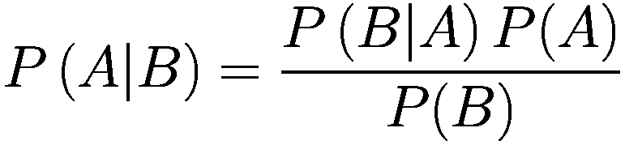

这给出了在事件 `B` 已发生的情况下，事件 `A` 发生的概率。考虑一个预测示例。

你正在开发一个捕捉雷达信号点的检测系统。假设事件 `A` 表示敌方出现在该区域。事件 `B` 表示雷达上出现信号点。

请记住，雷达上的信号点并不总是意味着敌方存在。同样，敌方也可能出现在该区域但雷达上没有信号点。因此，前面给出的公式将帮助我们计算在雷达出现信号点的情况下，敌方出现在该区域的概率。

要计算这个概率，我们需要收集大量过去的数据。过去的数据可以直接提供敌方出现在该区域的概率 `P(A)`，以及雷达上出现信号点的概率 `P(B)`。这些概率分别称为先验概率和边际概率。

对过去事件的彻底分析也有助于我们找到似然，即已知敌方在该区域的先验知识下，雷达上出现信号点的概率。这个似然由 `P(B|A)` 计算得出，在我们的机器学习实验中，它将从训练数据中提取。

### 条件概率

贝叶斯定理给出的公式的主要组成部分是条件概率。条件概率是衡量在另一个事件（通过假设、推定、断言或证据）已经发生的情况下，某个事件发生的概率。它由 `A` 和 `B` 的联合概率计算得出。

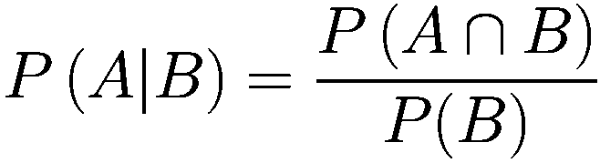

这里，`P(A∩B)` 是 `A` 和 `B` 都发生的概率。

如果我们修改这个公式以求解 `P(B|A)`，并尝试匹配 *P*(*A* ∩ *B*) 的转置项，最终将得到贝叶斯定理。

### 朴素贝叶斯的工作原理

简而言之，在训练阶段，朴素贝叶斯尝试计算给定类别标签的先验概率。接着，计算每个类别下每个属性的似然概率。这些信息用于通过贝叶斯公式计算后验概率，正如我们在前一节中所见。我们计算数据项属于每个类别的后验概率，并选择概率最高的类别标签。

在许多实际情况下，我们假设数据服从高斯分布，因此给定类别标签 `c` 时，某个数据项的概率可以定义为

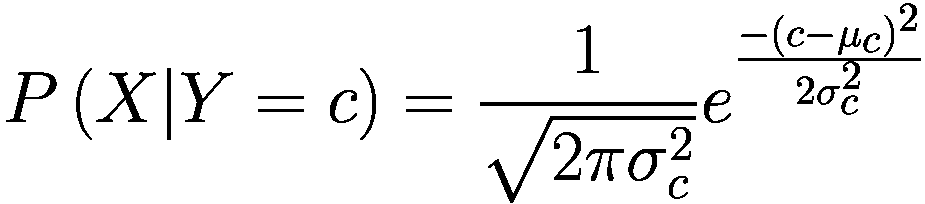

其中 `μ` 和 `σ` 是给定类别 `c` 下连续数据点属性的均值和方差。这在处理连续数据时尤其有效。如果数据不服从正态分布，可能可以先对其进行转换。

有可能某个类别没有训练样本，这会导致在某些情况下 `P(X|Y=c)` 为 0（零）。将这个值代入贝叶斯方程将导致零概率，这在某些情况下可能具有误导性。它还会抵消最终计算中其他概率的影响。通过在计算概率之前为每个计数加 1（一）可以解决这个问题。对于足够大的数据集，这样做引入的误差可以忽略不计，但积极效果是显著的。这被称为拉普拉斯修正。

### 多项式朴素贝叶斯

在某些情况下，由于数据是离散计数而非连续数据，我们假设数据服从多项式分布，而非高斯分布。当我们有 `k` 个互斥的可能结果，并且研究在 `n` 次试验中结果 `i` 出现的次数时，`X=(X[1], X[2], … X[k])` 服从多项式分布，其概率 `p = (p[1], p[2], … p[k])` 表示每个可能结果的概率。概率参数将变为：

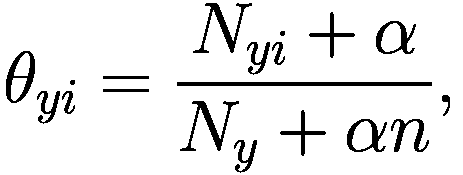

其中 `N[yi]` 是特征 `i` 在训练数据中类别 `y` 的样本中出现的次数，`N[y]` 是类别 `y` 所有特征的总计数。`α` 是一个控制平滑的参数。多项式朴素贝叶斯在短文本分类中已被证明非常有效，尤其是在对社交媒体（推特）短文本进行情感分析等场景中。

### Python 中的朴素贝叶斯

在本例中，我们将从可用数据集中加载鸢尾花数据集。由于鸢尾花数据集包含连续变量，我们将假设其服从高斯分布，并训练一个高斯朴素贝叶斯模型。

```python
from sklearn import datasets
import matplotlib.pyplot as plt
iris = datasets.load_iris()
X = iris.data[:, :]  # 我们可以选择单个特征
y = iris.target
```

请记住，朴素贝叶斯本质上是捕获相对于多个类别的概率。因此，与其他一些方法不同，这里不需要使用“一对多”等技术。我们将把数据集分割为训练集和测试集，其中 25% 的数据用于测试。

```python
from sklearn.model_selection import train_test_split
X_train, X_test, y_train, y_test = train_test_split(X, y, test_size = 0.25, random_state = 0)
```

现在，我们将从 `sklearn` 导入高斯朴素贝叶斯，并拟合它以找到参数和概率。

```python
from sklearn.naive_bayes import GaussianNB
clf = GaussianNB()
clf.fit(X_train, y_train)
```

你可以使用以下代码探索学习到的参数：

```python
clf.class_prior_  # 三个类别的先验概率
clf.sigma_ # 每个特征相对于每个类别的方差
clf.theta_ # 每个特征相对于每个类别的均值
```

正如我们在上一节中讨论的，如果我们知道先验概率以及每个特征的均值和方差，就可以用它来计算条件概率 `P(X| Y = c)`，进而利用贝叶斯定理预测 `P(Y=c | X)`。预测方法遵循相同的惯例：

```python
y_pred = clf.predict(X_test)
from sklearn.metrics import confusion_matrix
cm = confusion_matrix(y_test, y_pred)
array([[13,  0,  0],
       [ 0, 16,  0],
       [ 0,  0,  9]], dtype=int64)
```

该数据集简单且规模较小，分类器已经学习了正确的分布，能够正确预测未见数据。为了更好地理解模型，我们可以将决策边界可视化。在接下来的代码中，我们将仅使用数据的前两列重新训练分类器，以便在二维空间中可视化决策边界。

```python
from matplotlib.colors import ListedColormap
import numpy as np
clf = GaussianNB()
clf.fit(X_train[:,:2], y_train)
```

这里，我们仅使用 `X_train` 的前两列训练了一个新模型。这将使我们更清晰地了解分类器正在学习什么。

# 支持向量机

支持向量机（SVM）是一种高效且有效的方法，已被证明在各种场景中均能达到最先进的水平。它用于线性和非线性数据的分类。

与其他试图找到最小化两类之间误差的决策边界的分类方法不同，支持向量机试图找到一个最大化两类之间间隔的决策边界，称为最大间隔超平面。因此，支持向量分类器也被称为最大间隔分类器。

在图 9-2 中，你可以看到两个类别之间存在多种可能的决策边界。然而，支持向量机试图找到能够最大化两类之间分离程度的边界。

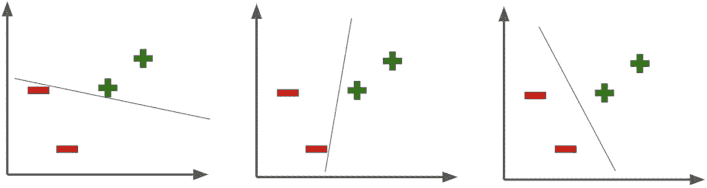

图 9-2 两个类别之间可能的决策边界

决策边界周围的间隔取决于那些能够产生最大间隔宽度的点，也就是距离最近的训练数据点之间的差异。这些点被称为`支持向量`，该方法也因此得名。训练数据集中的其他点对模型没有贡献。在学习过程中，目标是最大化间隔的宽度，并最小化间隔误差，即那些位于间隔错误一侧的点。

## SVM 的工作原理

划分数据点的超平面在其两侧平行于超平面的方向上具有相等的间隔。在二维空间中，超平面是一条将数据分为正类和负类的直线。图 9-3 展示了直线两侧平行且等距于超平面的间隔。

超平面可以表示为

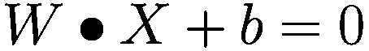

这里，`W` 是权重向量，`b` 是偏置（标量）。在二维空间中，点 (x[1], x[2]) 可以被认为位于超平面上。我们也可以将其写成

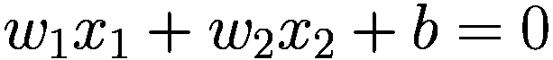

或者，为了简化实现，可以将偏置 `b` 表示为一个额外的权重 `w[0]`：

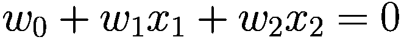

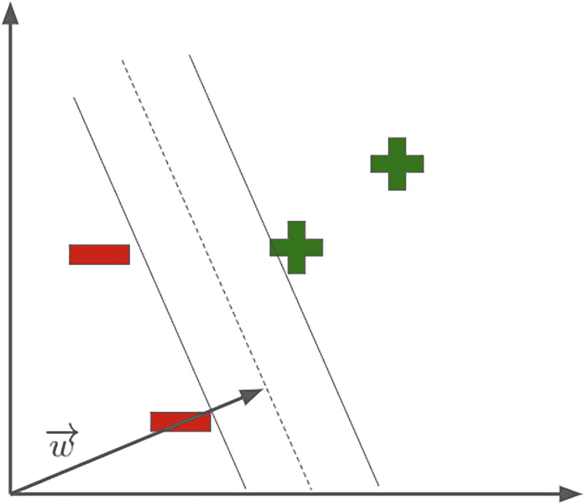

图 9-3 最大间隔超平面

对于位于分离超平面上方、属于正类（y = +1）的任何点，

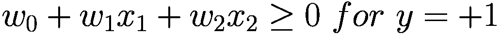

而对于位于分离超平面下方、属于负类（y = -1）的任何点，

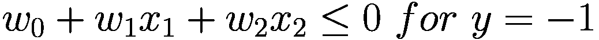

我们可以将这两个方程合并，并以简化形式写成

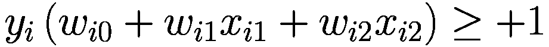

这对于所有位于间隔上的、属于类别 `y[i]` 的点 (x[i1,] x[i2]) 都成立。这些点被称为支持向量。

由于 `W` 是由 {w[1], w[2]} 组成的权重向量，我们可以将间隔到决策边界的距离写为 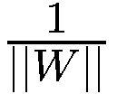，其中 `||W||` 是 `W` 的欧几里得范数。另一个间隔的距离也相同。因此，两个间隔之间的距离是 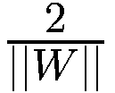。学习算法的目标是找到支持向量和最大间隔超平面，即最大化该距离的决策边界。这归结为一个带约束的二次优化问题，通过拉格朗日公式求解。对该求解方法的解释超出了本书的范围。

除了这种数学优化方法之外，SVM 还使用另一种方法来处理属于不同类别且线性不可分的数据项，以找到决策边界。

## 非线性分类

由于 SVM 可以创建线性决策边界，因此理解如何定制它们以在非线性可分数据中找到决策边界非常重要。以下是一个直观理解：为简单起见，我们考虑仅在一维空间中属于两个类别的非线性可分数据。这里的分离超平面将是一个点（超过某个点的所有点都属于正类）。但由于数据分布的特性，无法找到这样一个点。

通过一个简单的变换，我们为数据增加一个维度——如图 9-4 所示，就可以找到一个能够轻松分离这两个类别的超平面（现在是一条直线）。

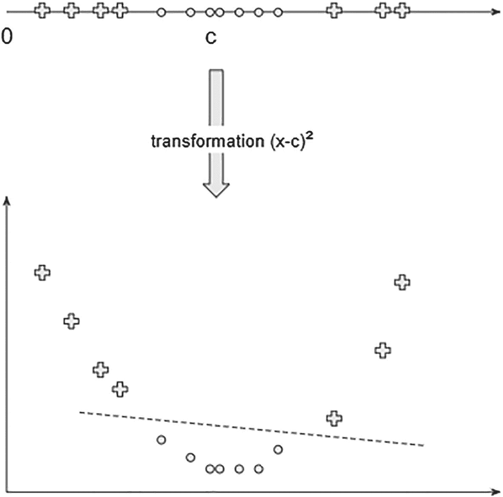

图 9-4 将原始数据从一维变换到二维，得到一条直线决策边界

因此，思路是首先使用非线性变换将数据变换到更高维度。然后，我们可以在新维度中找到一个能够轻松分离两个类别的超平面。此时，我们可以使用上一节中提到的相同 SVM 方法。然而，应用大量此类变换后再进行点积运算是低效的。这可以通过一种称为核技巧的方法来解决。

## SVM 中的核技巧

在二次优化中，我们只需要在计算点积时找到线性变换。假设一个数据点 `X[i]` 可以通过 `φ(X[i])` 变换到新空间，那么经常需要的点积将是针对所有支持向量 `X[i]` 和 `X[j]` 的 `φ(X[i]) ∙ φ(X[j])`。核函数是一种数学函数，用于计算变换空间中的点积。因此，我们可以写成

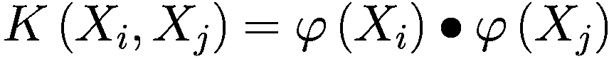

因此，在训练过程中，如果遇到任何需要先进行变换再进行点积的情况，我们可以用核函数来替代。计算在低维空间中进行，而决策边界可以看作是在高维空间中创建的。这被称为核技巧。下面列出了最常用的核函数：

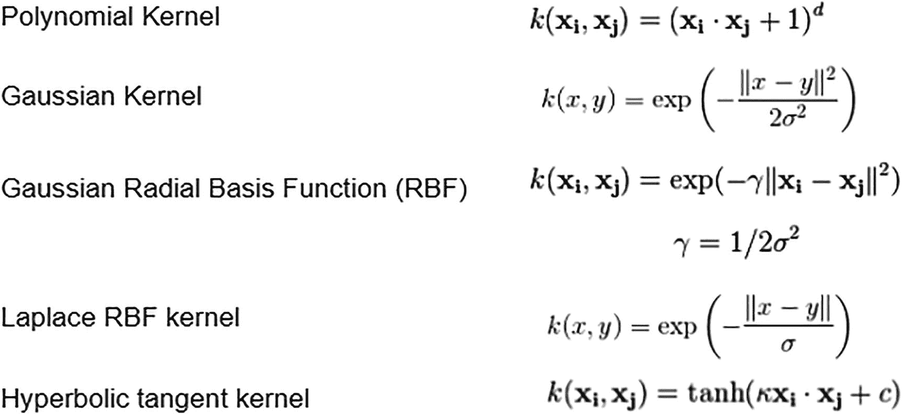

在 SVM 实现中，你可以通过超参数来尝试不同的核函数，这些超参数需要在实验过程中进行调整，同时还要注意你所选择的核函数所依赖的其他超参数。例如，如果你在 Scikit-learn 中选择多项式核，你需要将 `kernel` 定义为 `poly`，并添加一个 `degree` 参数来决定要使用的多项式次数。

## Python 中的支持向量机

我们将用一个简单的数据集进行实验，并通过 SVM 实现的不同核函数来可视化决策边界。Scikit-learn 在 `sklearn.svm` 包下提供了支持向量机。SVM 是一类可用于回归问题（通常称为 SVR，即支持向量回归）和分类问题（称为 SVC，即支持向量分类）的算法。

`sklearn.svm.LinearSVC` 基于 liblinear 实现，与基于 libsvm 的 `sklearn.svm.SVC` 相比，它提供了一组不同的惩罚项和损失函数。对于大型数据集，推荐使用 `LinearSVC` 而非 `SVC`。在接下来的示例中，我们将比较 `LinearSVC` 和具有不同类型核函数的 `SVC`。

选择合适的核函数需要通过基于交叉验证的模型选择进行实验。线性核和 RBF 核已被证明在许多常见用例中快速且高效。

```python
x_set, y_set = X_train[:,:2], y_train
X1, X2 = np.meshgrid(np.arange(start = x_set[:, 0].min() - 1, stop = x_set[:, 0].max() + 1, step = 0.01),
    np.arange(start = x_set[:, 1].min() - 1, stop = x_set[:, 1].max() + 1, step = 0.01))
plt.contourf(X1, X2, clf.predict(np.array([X1.ravel(), X2.ravel()]).T).reshape(X1.shape),
    alpha = 0.75, cmap = ListedColormap(('purple', 'green', 'yellow')))
plt.xlim(X1.min(), X1.max())
plt.ylim(X2.min(), X2.max())
for i, j in enumerate(np.unique(y_set)):
    plt.scatter(x_set[y_set == j, 0], x_set[y_set == j, 1],
        color = ListedColormap(('purple', 'green', 'yellow'))(i), label = j)
plt.legend()
plt.show()
```

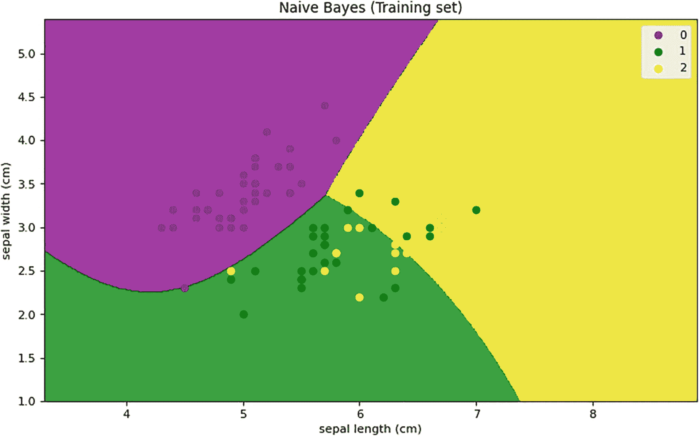

图 9-1 在鸢尾花数据集上训练的朴素贝叶斯分类器的决策边界

图 9-1 展示了通过上一页代码绘制的决策边界。尽管我们仅在前两个维度上展示数据，但第二类和第三类之间的重叠看起来比实际情况更明显——然而，这种可视化展示了贝叶斯方法在学习决策边界方面的灵活性和鲁棒性。

我们将继续使用鸢尾花（`Iris`）数据集进行此示例，但仅取前两列：首先，为了能够很好地可视化；其次，为了仅基于有限的参数做出决策边界。

```python
import numpy as np
import pandas as pd
from sklearn.datasets import load_iris

iris = load_iris()
df = pd.DataFrame(iris.data, columns=iris.feature_names)
df['species'] = pd.Categorical.from_codes(iris.target, iris.target_names)
df['target'] = iris.target
X = df.iloc[:,:2]
y = df.iloc[:,5]
```

我们可以使用默认超参数训练一个 `SVM`，如下所示：

```python
svc = svm.SVC(kernel='linear', C=C).fit(X, y)
```

`SVC` 可以接受以下核函数：`linear`、`poly`、`rbf`、`sigmoid` 和 `precomputed`。默认值是 `rbf`，即径向基函数。请记住，根据您选择的核函数，您可能需要提供额外的超参数。

例如，如果您决定构建一个使用多项式核函数的支持向量分类器，您可以添加另一个用于度数的超参数。如果您不提供额外的超参数，将采用默认值 `3`。

模型训练完成后，您可以查看支持向量——它们是数据集边界的代表。

```python
support_vector_indices = svc.support_
print(len(support_vector_indices))

support_vectors_per_class = svc.n_support_
print(support_vectors_per_class)

[ 2 34 34]
```

这些属性给出了支持向量的数量。在第二个输出中，您可以看到第一个类别只有两个支持向量；也就是说，我们在前几章中看到的 `Iris Setosa`（山鸢尾）相对更容易分离。

您可以找到作为支持向量的实际数据点：

```python
support_vectors = svc.support_vectors_
```

`support_vectors` 对象将包含用于构建最大化超平面的决策边界的每个训练数据点。您可以将它们可视化，以更清楚地理解模型学到了什么。以下代码将产生类似于图 9-5 的结果。

```python
xx,yy = np.meshgrid( np.arange(x_min, x_max, 0.1), np.arange(y_min, y_max, 0.1)  )
Z = clf.predict(np.c_[xx.ravel(), yy.ravel()])
Z = Z.reshape(xx.shape)

# 可视化支持向量
plt.scatter(X.iloc[:,0], X.iloc[:,1])
plt.contourf(xx, yy, Z, cmap=plt.cm.coolwarm, alpha=0.4)
plt.scatter(support_vectors[:,0], support_vectors[:,1], color='red')
plt.title('支持向量可视化')
plt.xlabel('X1')
plt.ylabel('X2')
plt.show()
```

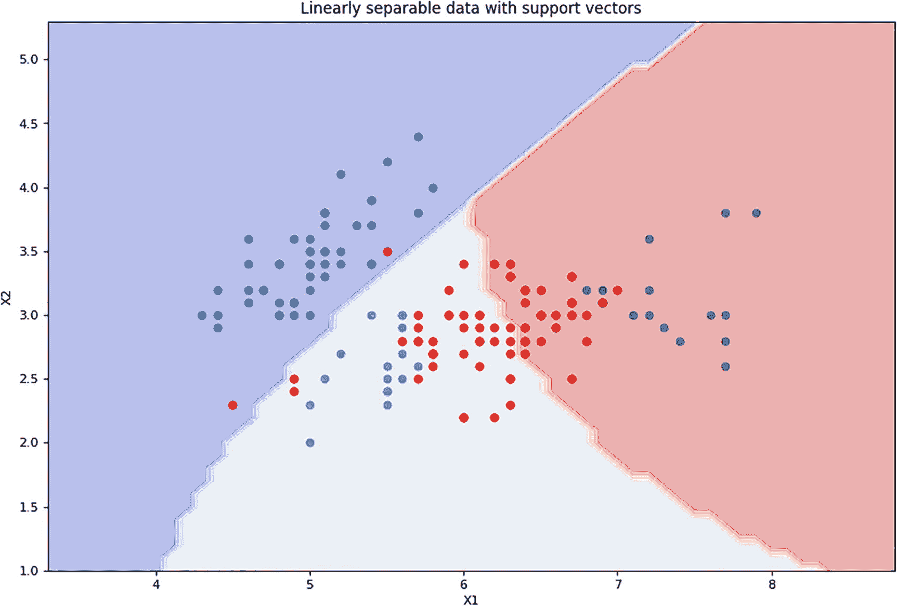

图 9-5 SVM 中的决策边界

请记住，我们目前将能力限制在二维空间——如果我们使用完整数据，结果会高效得多。然而，从这个图中很容易体会到支持向量分类器的鲁棒性和灵活性。

让我们为同一个数据集构建更多的支持向量分类器，并尝试比较它们。在此示例中，我们将取前两个类别（鸢尾花数据集的前 `100` 行），以便边界更清晰可见。这将使我们能够比较 `SVC` 的不同实现。

```python
X = df.iloc[:100,:2]
y = df.iloc[:100,5]
```

这里，`X` 和 `y` 来自内置的鸢尾花数据集。有关详细信息，请参阅前面的示例。这里，我们将数据集限制为前 `100` 行和两列。

让我们初始化这些分类器。我们将创建四个对象，分别对应线性核、`RBF` 核、多项式核以及一个用于 `LinearSVC` 实现的对象。我们可以调整所需的超参数。另一个可供您调整的超参数是 `C`，即正则化参数。它必须是一个正数，表示作为 `l2` 惩罚项应用的正则化强度的倒数。我们目前将其保留为默认值，但将其保留在代码中供您实验。

```python
from sklearn import svm

C = 1.0  # SVM 正则化参数
svc = svm.SVC(kernel='linear', C=C).fit(X, y)
rbf_svc = svm.SVC(kernel='rbf', gamma=0.7, C=C).fit(X, y)
poly_svc = svm.SVC(kernel='poly', degree=3, C=C).fit(X, y)
lin_svc = svm.LinearSVC(C=C).fit(X, y)
```

在这些代码行中，我们初始化并训练了三个基于 `SVC` 的分类器，分别使用线性核、`RBF` 核和多项式核。我们还有另一个使用 `LinearSVC` 的分类器，这是一个略有不同的实现。

```python
titles = ['线性核 SVC',
          'LinearSVC (线性核)',
          'RBF 核 SVC',
          '多项式核 (degree 3) SVC']

xx,yy = np.meshgrid( np.arange(x_min, x_max, 0.1), np.arange(y_min, y_max, 0.1)  )

plt.figure(figsize=(20,10))
for i, clf in enumerate((svc, lin_svc, rbf_svc, poly_svc)):
    plt.subplot(2, 2, i + 1)
    plt.subplots_adjust(wspace=0.4, hspace=0.4)
    Z = clf.predict(np.c_[xx.ravel(), yy.ravel()])
    # 将结果放入颜色图中
    Z = Z.reshape(xx.shape)
    plt.contourf(xx, yy, Z, cmap=plt.cm.coolwarm, alpha=0.4)
    # 同时绘制训练点
    plt.scatter(X.iloc[:, 0], X.iloc[:, 1], c=y, cmap=plt.cm.coolwarm)
    plt.xlabel('花萼长度')
    plt.ylabel('花萼宽度')
    plt.xlim(xx.min(), xx.max())
    plt.ylim(yy.min(), yy.max())
    plt.xticks(())
    plt.yticks(())
    plt.title(titles[i])
plt.show()
```

这将打印一个显示四种 `SVC` 实现的图表（图 9-6）。

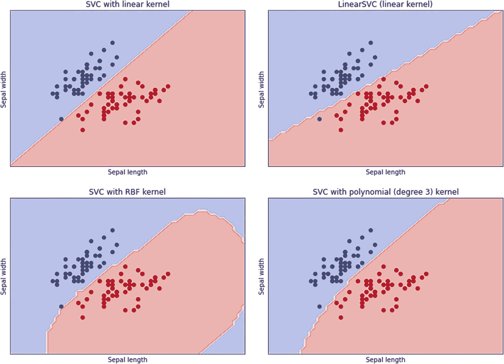

图 9-6 四种不同的支持向量分类器在鸢尾花数据集上的决策边界

`SVM` 在高维空间中非常有效。由于支持向量的概念（它是训练点中相对较小的子集），它们也非常节省内存。核函数可以帮助您使决策边界更加灵活和鲁棒。然而，需要注意的是，如果特征数量远大于样本数量，避免过拟合在选择核函数和正则化项时至关重要。^(⁸)

## 总结

本章介绍了先进的监督学习技术，这些技术已被证明在各种场景下都是最先进的。在下一章中，我们将讨论另一种方法，该方法结合了多个精度较低的模型的力量，以创建一个最终鲁棒的模型。

脚注 1   2