# 10. 集成学习方法

在过去的三个章节中，我们讨论并实验了几种监督学习方法，学习了如何评估它们并调整其性能。每一类算法都有其优缺点，并适用于特定类型的问题。

如图 10-1 所示，集成学习是一套使用多个机器学习模型的技术，旨在获得比任何单个模型都更优的性能。在许多应用场景中，这些单个模型被称为弱学习器。

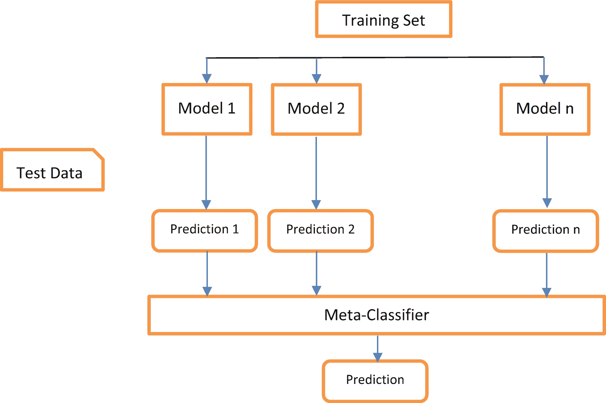

图 10-1

集成学习方法的顶层示意图

在本章中，我们将学习如何结合小型低性能弱学习器的学习能力，以创建一个高性能、更精确的模型。

## Bagging 与随机森林

正如我们在前一章中所见，决策树是通过选择能够最好地分离类别的属性之一来构建的。这可以通过计算信息增益或基尼指数来实现。根据分裂准则，数据集将流向图 10-2 所示的子节点之一。

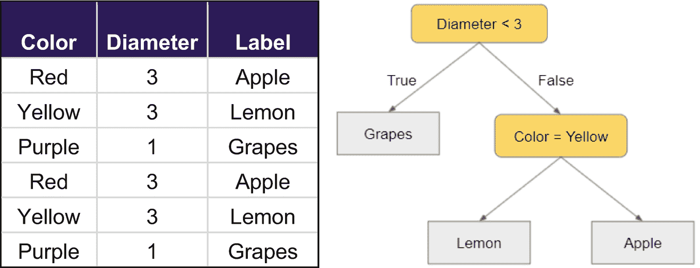

图 10-2

基于玩具数据集的简单决策树

如果我们选择一个略小的数据集子集，那么即使使用相同的分裂准则和剪枝规则，这样构建的树也可能与之前构建的树大不相同。

图 10-3 展示了一棵通过随机选择四个（共六个）数据点创建的新决策树。改变数据集可能会完全改变树的结构，因为分裂准则的计算会随之改变，以反映新训练数据集的统计特性。这就是一种简单但高效的集成方法——随机森林背后的思想。

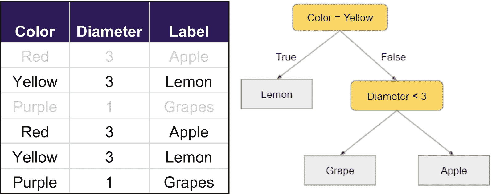

图 10-3

通过随机选择训练数据集子集创建的替代决策树

Bagging，即引导聚合（Bootstrap AGGregating），通过引导和聚合过程创建集成模型。我们不是在整个训练数据集上创建模型，而是抽取训练集的一个样本用于训练。该样本是随机生成的，每个训练数据点被抽中的概率相等。如果 N 代表训练数据集的大小，M 是用于训练的随机数据点数量，且 M < N，则每个点被有放回地随机抽样；也就是说，它可以在子集中出现多次。这也意味着存在某个数据点根本不会出现在训练数据集中的可能性。

在图 10-4 所示的训练过程中，我们创建了 k 个模型，其中 k 是一个预定义的数字，也是一个易于配置的超参数。每棵树都是独立构建的，因此该过程可以并行实现。最终，我们将得到 k 棵结构可能不同的独立决策树，它们对同一个测试项可能会给出不同的结果。

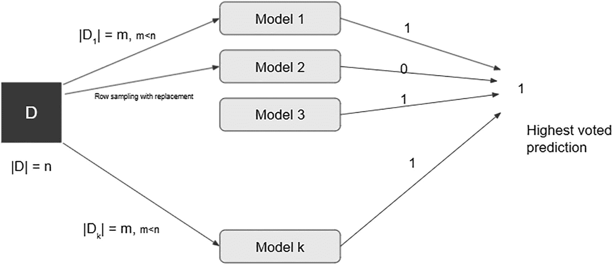

图 10-4

Bagging 或引导聚合过程

在预测阶段，测试项会通过每棵树，并由决策树为其分配一个标签。然后对这些标签进行聚合和投票——在 k 棵树中获得票数最多的标签被视为最终输出。在此示例中，如果 k=4，且四个模型预测的类别标签分别为 1、0、1 和 1，那么标签 1 获得三票，标签 0 获得一票。因此，最终分配的类别是 1。

### Python 中的随机森林

在这个简短的示例中，我们旨在构建一个用于鸢尾花数据集分类的随机森林，并可视化作为集成一部分的各个决策树。让我们从准备实验所需的数据集开始。

```
import pandas as pd
from sklearn.datasets import load_iris
iris = load_iris()
df = pd.DataFrame(iris.data, columns=iris.feature_names)
from sklearn.model_selection import train_test_split
X_train, X_test, y_train, y_test = train_test_split(df, iris.target, test_size=0.3)
```

在 Scikit-learn 中，`sklearn.ensemble` 包包含了用于分类、回归和异常检测的各种集成方法的实现。其中一个选项是 Bagging 元估计器，它接受另一个弱分类器作为参数，并在训练集的随机样本上构建该弱分类器的多个实例。这会将内部的弱分类器算法视为一个黑盒，无需更改内部模型的工作方式。

为了创建随机森林，我们将使用 `RandomForestClassifier`，它允许指定决策树特有的超参数，这些参数可以方便地在外部进行调整。它会在数据集的各种随机样本上学习大量的决策树分类器，以提高预测质量。

我们可以指定 Bagging 特有的超参数，例如 `max_samples`，用于指定每次迭代中随机选择的训练数据点的数量或比例。此外，我们还可以指定 `n_estimators`，即创建的决策树的数量。除此之外，其他超参数如 `max_depth`、`min_samples_split`、`criteria` 等，可以像构建决策树时那样使用。

让我们初始化一个包含十棵树的随机森林并进行训练。

```
from sklearn.ensemble import RandomForestClassifier
clf = RandomForestClassifier(n_estimators=10, max_samples=0.7)
clf.fit(X_train, y_train)
```

可以通过 `clf.estimators_` 来可视化组成的决策树。我们可以遍历它们，并使用 Graphviz 和 PyDotPlus 来可视化树的结构。

```
from IPython.display import Image
from sklearn.tree import export_graphviz
import pydotplus
for i, estimator in enumerate(clf.estimators_):
dot_data = export_graphviz(estimator)
graph = pydotplus.graph_from_dot_data(dot_data)
graph.write_png('tree'+str(i)+'.png')
display(Image(graph.create_png()))
```

其中一些树如图 10-5 所示。在此代码块中，我们还添加了一行代码，使用 `write_png()` 将每棵树保存到硬盘中。

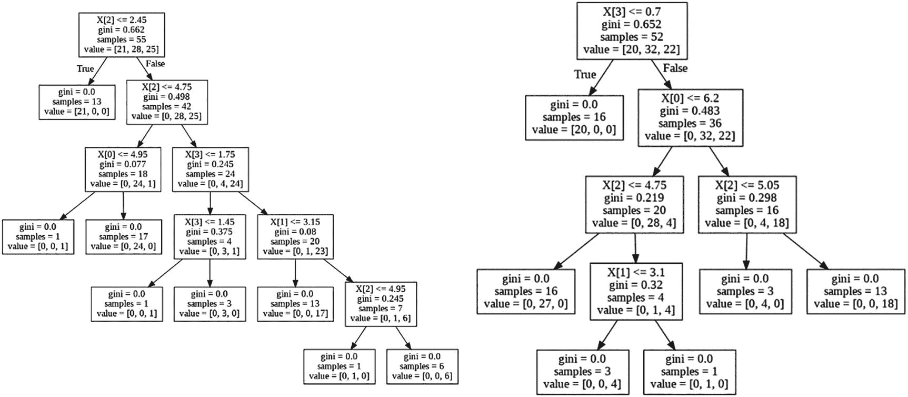

图 10-5

随机森林生成的部分树示例

由于 Bagging 过程中的每个决策树都是相互独立的，Scikit-learn 的随机森林实现也提供了并行构建树的选项。这可以通过传递 `n_jobs` 参数来实现。默认情况下，它被设置为 `None`，因此不会进行并行化。


## 提升方法

提升是另一种广受欢迎的集成学习技术。与通过随机抽样训练数据构建独立决策树不同，提升方法通过迭代过程构建决策树。

在提升方法中，集成模型是逐步创建的：从训练数据的一个子集中训练新模型，该子集会更多地包含先前模型错误分类的数据点。本节将讨论一种名为 AdaBoost 的提升方法，它使用此方法逐步构建决策树。

AdaBoost 通过构建决策桩进一步简化了决策树。决策桩本身是一个弱学习器，但提升过程最终将这些弱学习器组合起来，形成一个更准确的分类器。如图 10-6 所示，决策桩是一种仅包含一次分裂的简单决策树，因此其高度为 1。这意味着每个分类器仅使用一个特征将样本分成两个子集。

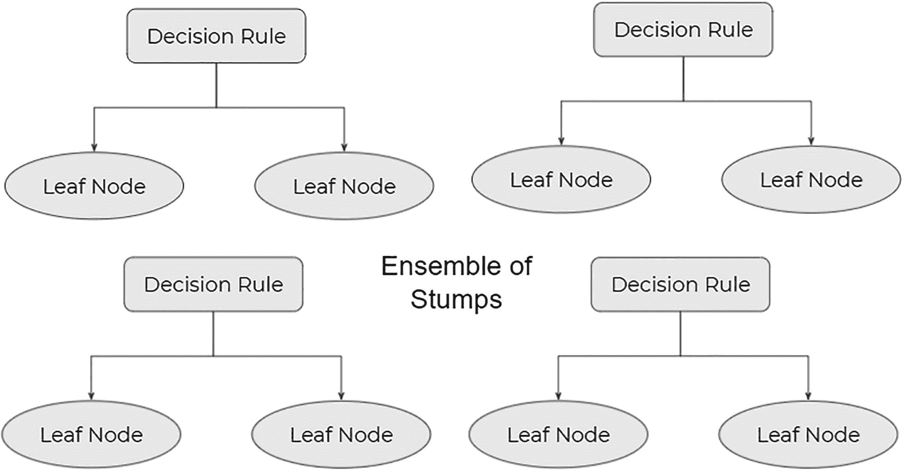

图 10-6

决策桩，决策树的最简形式

每个决策桩都是一个非常简单的分类器，具有线性且笔直的决策边界。因此，单个决策桩本身作用有限。然而，如图 10-7 所示，对每个决策桩分别进行抽样和赋权重的过程，正是提升最终结果的关键。

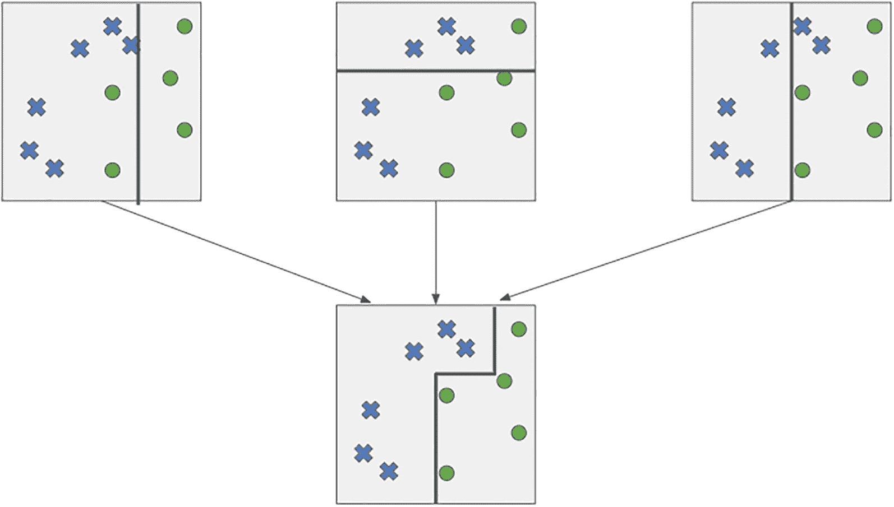

图 10-7

每个决策桩创建的决策边界组合起来，以获得更复杂的决策边界

假设，我们最初为训练数据的所有行分配 1/N 的抽样权重。然后根据这些权重进行抽样，并用抽样结果构建一个决策树或决策桩，称为模型 1。

假设我们要提升某个学习方法的准确率。给定数据集 D，包含 d 个带有类标签的元组：(X[1], y[1]), (X[2], y[2]), ... , (X[d], y[d])，其中 y[i] 是元组 X[i] 的类标签。初始时，AdaBoost 为每个训练元组分配相等的权重 1/d。要生成集成所需的 k 个分类器，需要在算法的剩余步骤中执行 k 轮。

在第 i 轮中，从 D 中抽样形成大小为 d 的训练集 D[i]。采用有放回抽样——同一个元组可能被多次选中。每个元组被选中的概率基于其权重。分类器模型 M[i] 由 D[i] 中的训练元组推导得出。在图 10-8 中，模型 1 由第一组样本生成，此时训练数据集中的每个样本权重相等。

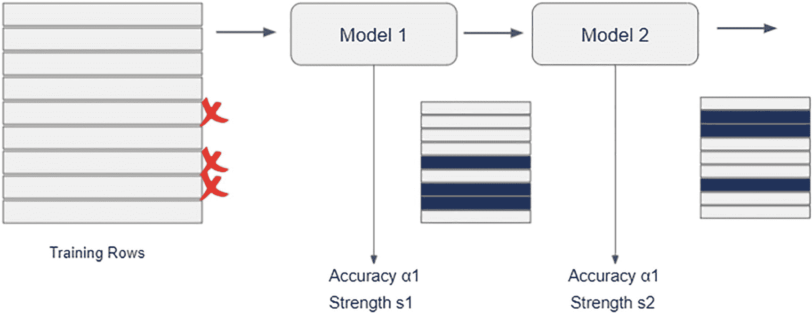

图 10-8

使用 AdaBoost 创建集成模型的过程

现在我们已经准备好一个简单的分类模型，接下来使用用于训练的同一数据集 D[i] 来测试该模型。然后根据训练元组的分类结果调整其权重。如果某个元组被错误分类，其权重增加；如果被正确分类，其权重减少。元组的权重反映了其分类难度——权重越高，表示被错误分类的次数越多。这些权重将用于生成下一轮分类器的训练样本。此过程的概览如图 10-8 所示。

每个模型的准确率直接用作该分类器的强度指标，并将在预测时使用。

在对未见数据进行分类预测时，与 Bagging 方法中对所有模型结果进行投票不同，我们计算各个模型的加权平均值。

我们将每个可能类别的权重初始化为 0。通过考虑模型的误差，使用以下公式计算每个模型的权重：

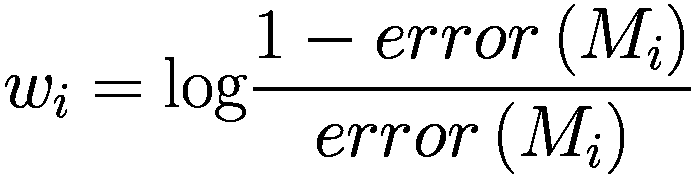

如果第 i 个模型预测结果为类别 c，且其权重为 w[i]，则将 w[i] 累加到总体预测中类别 c 的权重上。在获得所有类别的预测标签后，我们将权重最高的类别标签作为最终预测结果。

有时，最终得到的“提升后”模型可能不如从相同数据中导出的单个模型准确。Bagging 对模型过拟合的敏感度较低。虽然两者相比单个模型都能显著提高准确率，但提升方法往往能获得更高的准确率。

AdaBoost 易于实现。它通过迭代纠正弱分类器的错误，并组合弱学习器来提高准确率。你可以将许多基分类器与 AdaBoost 结合使用。AdaBoost 不易过拟合。这一点可以通过实验结果发现，但目前尚无确切的理论原因。然而，由于它试图完美拟合每一个数据点，因此受异常值影响很大。它对均匀噪声尤其敏感。


### Python 中的提升方法

为了更清晰的对比，我们将对上一个示例中使用的同一训练数据集运行 AdaBoost。我们已经提取了数据集，并将其划分为 `X_train`、`X_test`、`y_train` 和 `y_test`。

在 Scikit-learn 中，`sklearn.ensemble.AdaBoostClassifier` 接受一个基础估计器，其默认值为单层决策树（树桩）。不过，我们可以使用不同的超参数初始化一个决策树，然后将其传递给 `AdaBoostClassifier`。我们可以使用 `n_estimators` 配置弱学习器的数量，使用 `learning_rate` 配置学习率，该参数控制每次迭代中应用于每个分类器的权重。较高的学习率会增加每个单独分类器的贡献。其默认值为 1。

```
from sklearn.ensemble import AdaBoostClassifier
from sklearn.tree import DecisionTreeClassifier
base = DecisionTreeClassifier(criterion='gini', max_depth=1)
model_ada = AdaBoostClassifier(base_estimator = base, n_estimators=10)
model_ada.fit(X_train, y_train)
```

请记住，指定 `base_estimator` 是可选的。模型拟合后，我们可以使用 `model_ada.estimators_` 查看其组成的估计器。

如果你想可视化单个树桩的结构，可以使用上一节中提到的 PyDotPlus 方法。这些树桩将是仅包含一个分裂点的简单决策树。

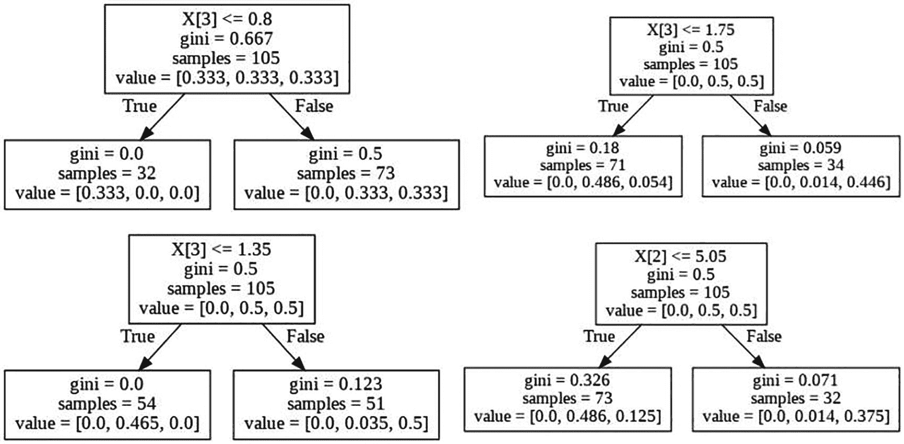

图 10-9

AdaBoost 模型创建的决策树桩

基于图 10-9 所示的组成估计器，AdaBoost 对象可以给出训练数据集中每个特征的整体重要性。在鸢尾花数据集中，我们有四个特征。以下代码将输出一个包含四个值的列表，表示这四个列的重要性。

```
model_ada.feature_importances_
array([0.1, 0\. , 0.3, 0.6])
```

AdaBoost 背后的思想是使用非常简单的弱学习器，并通过降低错误率来获得一个更精确的模型。我们可以指定一个基础估计器，而不是使用默认的树桩。让我们在合成数据集上运行一个实验，并可视化基础模型对整体准确率的影响。

我们将使用 `sklearn.datasets.make_classification` 方法构建一个合成数据集。以下是一个简单的示例。

```
import matplotlib.pyplot as plt
from sklearn.datasets import make_classification
plt.figure(figsize=(8, 8))
X, y = make_classification(n_samples = 1000, n_features=2, n_redundant=0, n_informative=2, n_clusters_per_class=1, n_classes=3)
plt.scatter(X[:, 0], X[:, 1], marker='o', c=y, s=25, edgecolor='k')
```

这里，我们指示 Scikit-learn 构建一个包含 1000 个样本的数据集，每个样本有两个特征，并将数据分散到三个簇中，每个簇代表一个类别。一个简单的可视化显示，它比鸢尾花数据集复杂得多——然而，这三个类别之间存在模糊的分离。此代码块的输出如图 10-10 所示。

由于随机生成，你的数据可能看起来不同。

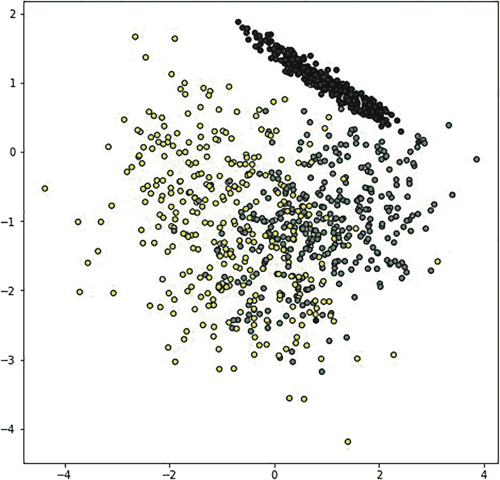

图 10-10

随机生成数据集的散点图

我们将使用此方法生成一个更复杂的数据集，并基于此训练一个 AdaBoost 模型。

```
from sklearn.model_selection import train_test_split
X, y = make_classification(n_samples = 3000, n_features=10, n_redundant=0, n_informative=10, n_clusters_per_class=1, n_classes=3)
X_train, X_test, y_train, y_test = train_test_split(X, y, test_size=0.3)
```

在这些代码行中，我们首先创建一个包含 3000 个样本的随机分类数据集，每个数据点有十个特征，分布在三个类别中，每个类别位于各自的簇内。我们将数据集拆分为训练集和测试集，以便报告的准确率指标独立地来自测试数据。

让我们导入所需的库。在此示例中，我们将显式创建 `DecisionTreeClassifier` 对象，以设置不同级别的深度，并分析其对整体准确率的影响。

一个名为 `accuracy_history` 的列表将存储多个模型的准确率，用于可视化和比较。

```
from sklearn.ensemble import AdaBoostClassifier
from sklearn.tree import DecisionTreeClassifier
from sklearn.metrics import accuracy_score
accuracy_history = []
```

现在，我们想要创建多个 AdaBoost 分类器，每个分类器包含相同数量的估计器，即 50 个。然而，在每次迭代中，组成决策树的深度将不同。

```
for i in range(1, 20):
tree = DecisionTreeClassifier(max_depth = i)
model_ada = AdaBoostClassifier(base_estimator=tree, n_estimators=50)
model_ada.fit(X_train, y_train)
y_pred = model_ada.predict(X_test)
accuracy_history.append(accuracy_score(y_test, y_pred))
```

因此，在第一次迭代中，我们创建一个由 50 个树桩（即深度为 1 的决策树）组成的 AdaBoostClassifier。在第二次迭代中，我们创建另一个由 50 个深度为 2 的决策树组成的 AdaBoostClassifier。第 20 个 AdaBoostClassifier 将由 50 个深度为 19 的决策树组成。

拥有更好、更复杂树的分类器会比拥有更简单树的分类器有显著改进吗？为了回答这个问题，我们将在每次迭代中找到对测试数据集的预测，并将准确率历史记录存储在列表中。让我们可视化准确率历史。

```
plt.figure(figsize=(8, 4))
plt.plot(accuracy_history, marker='o', linestyle='solid', linewidth=2, markersize=5)
plt.grid(True)
plt.xticks(range(1,20))
plt.ylim((0.5,1))
plt.xlabel("弱学习器的深度")
plt.ylabel("准确率得分")
plt.show()
```

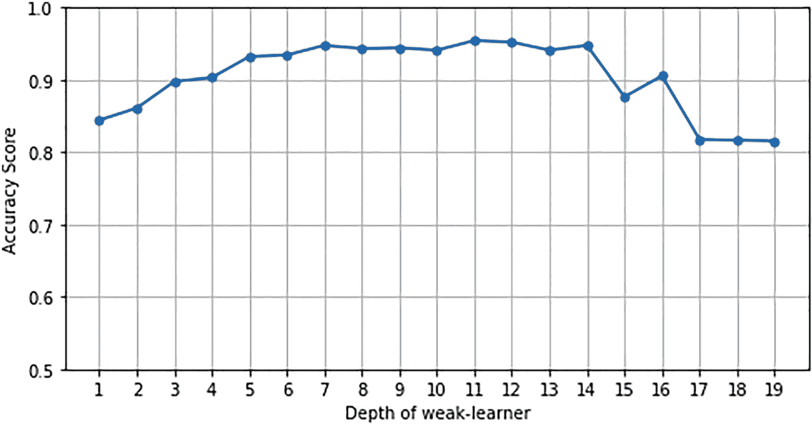

图 10-11

基于组成学习器深度的模型准确率

我们在图 10-11 中观察到，随着我们使组成树变得更复杂，准确率在开始时有所提高——然而，超过一定深度后，准确率不再提高。在某些实际场景中，树桩或非常简单的决策树可以在相对较低的计算需求下提供足够好的准确率。

## 堆叠集成

堆叠，或称堆叠泛化，是另一种集成学习技术，它通过为各个组成分类器分配权重，来结合多个机器学习模型的预测结果。

这与 Bagging 有显著不同——Bagging 是在训练数据集的不同样本上创建相同类型的模型（例如，决策树）的方法。在这里，我们可以选择不同种类的估计器，并设置不同的超参数。简单来说，堆叠集成构建了另一个学习层（元模型），该层学习如何组合组成模型的预测结果。

堆叠集成的实现方式因所解决的机器学习问题类型而异。如果我们在同一数据集上训练了多个回归模型，元模型将接收各个回归模型的输出，并尝试学习每个模型的权重，以产生最终的数值输出。


### Python 中的堆叠法

Scikit-learn 提供了一个易于使用的实现，用于通过 `sklearn.ensemble.StackingClassifier` 对估计器进行堆叠。它接受一个基础模型（估计器）列表，这些模型将被堆叠在一起。还有一个最终估计器（默认为逻辑回归），它尝试根据组成估计器的输出来学习预测最终值。最终估计器使用基础估计器的交叉验证预测进行训练。

```
from sklearn.model_selection import train_test_split
X, y = make_classification(n_samples = 3000, n_features=10, n_redundant=0, n_informative=10, n_clusters_per_class=1, n_classes=3)
X_train, X_test, y_train, y_test = train_test_split(X, y, test_size=0.3)
```

让我们导入逻辑回归、KNN、决策树、支持向量机和朴素贝叶斯的分类器模型。

```
from sklearn.linear_model import LogisticRegression
from sklearn.neighbors import KNeighborsClassifier
from sklearn.tree import DecisionTreeClassifier
from sklearn.svm import SVC
from sklearn.naive_bayes import GaussianNB
```

为了简化这个示例，让我们创建一个元组列表——每个元组包含每个分类器的名称和估计器对象。我们将考虑所有超参数的默认值。

```
models = [('Logistic Regression',LogisticRegression()),
('Nearest Neighbors',KNeighborsClassifier()),
('Decision Tree',DecisionTreeClassifier()),
('Support Vector Classifier',SVC()),
('Naive Bayes',GaussianNB())]
```

让我们在一个循环中训练并评估它们，并绘制这五个模型的准确率。此代码块的输出如图 10-12 所示。

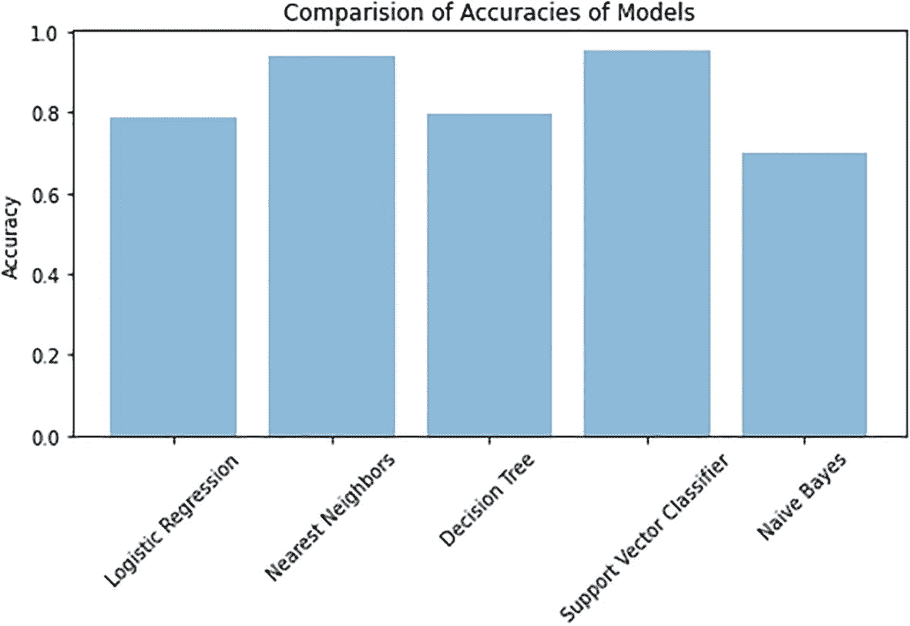

图 10-12

不同模型准确率对比

```
accuracy_list = []
for model in models:
model[1].fit(X_train, y_train)
y_pred = model[1].predict(X_test)
accuracy_list.append(accuracy_score(y_test, y_pred))
plt.figure(figsize=(8, 4))
model_names = [x[0] for x in models]
y_pos = range(len(models))
plt.bar(y_pos, accuracy_list, align='center', alpha=0.5)
plt.xticks(y_pos, [x[0] for x in models], rotation=45)
plt.ylabel('Accuracy')
plt.title('Comparision of Accuracies of Models')
plt.show()
```

与其只使用其中一个表现良好的模型，我们可以创建一个堆叠分类器，作为所有模型的集成。我们将指定之前初始化的五个模型，并将逻辑回归作为最终估计器，它将使用五个估计器的结果作为输入，并学习用于分配最终类别的权重。

```
from sklearn.ensemble import StackingClassifier
stacking_model = StackingClassifier(estimators=models, final_estimator=LogisticRegression(), cv=5)
stacking_model.fit(X_train, y_train)
```

这将启动对每个组成估计器的训练。要进行预测，我们只需使用 `stacking_model` 进行预测。

```
y_pred = stacking_model.predict(X_test)
accuracy_score(y_test, y_pred)
```

我们由此获得的准确率分数通常高于在任何单个模型上获得的最高准确率。我们想打印另一个柱状图来比较所有模型的准确率。

```
accuracy_list.append(accuracy_score(y_test, y_pred))
model_names = [x[0] for x in models]
model_names.append("Stacked Model")
plt.figure(figsize=(8, 4))
y_pos = range(len(model_names))
plt.bar(y_pos, accuracy_list, align='center', alpha=0.5)
plt.xticks(y_pos, model_names, rotation=45)
plt.ylabel('Accuracy')
plt.title('Comparision of Accuracies of Models')
plt.show()
```

图 10-13 显示，堆叠模型的表现确实优于任何单个模型。

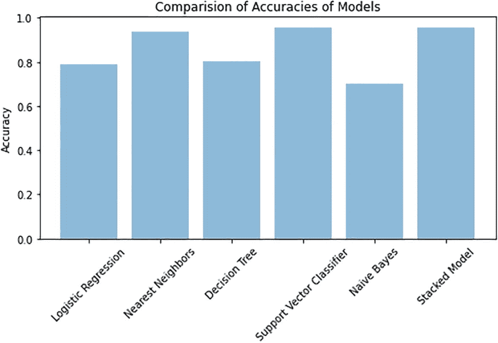

图 10-13

单个模型相对于堆叠模型的准确率对比

## 总结

在本章中，我们探讨了几种技术，用于组合相对较弱的学习器，以创建一个比单个模型准确得多的最终模型。Bagging、Boosting 和 Stacking 是组合各种估计器时常用的三种方法。

在下一章中，我们将研究一类不同的机器学习问题，称为无监督学习。

