# 11. 无监督学习方法

到目前为止，我们已经讨论了几种解决方案，用于根据给定的自变量预测连续变量，或预测特定数据项属于哪个或哪些类别。我们还讨论了一些组合多个模型以创建更有效的元模型的方法。所有这些方法都需要一个训练数据集，其中包含预期作为预测输出的值或标签，因此得名监督学习。在本节中，我们将讨论一类不同的机器学习问题及其解决方案，其目标不是预测，而是转换数据或发现模式，而无需一组明确的训练标签。

我们将讨论三种主要的无监督学习方法：

1.  降维

2.  聚类

3.  频繁模式挖掘

## 降维

降维指的是一组用于在减少的维度数量上总结数据的技术。将数据转换为减少的维度集的一个常见应用是可视化。在前面的章节中，我们看到鸢尾花数据集有四个自变量——花萼宽度、花萼长度、花瓣宽度和花瓣长度。如果我们想绘制 150 个数据点以了解分布情况，我们选择了其中两列并忽略了另外两列。然而，这种方法隐藏了某些模式，例如，两朵不同的花可能具有相似的花萼宽度，但花瓣宽度却截然不同，这恰恰是区分它们的关键。降维方法为我们提供了一种替代方法，可以将数据转换为一组新的两个维度，从而最大化原始数据集中的差异或方差。

降维的另一个常见用途是在进一步的机器学习实验之前对数据进行预处理，以简化结构并避免维度灾难。这些方法简化了数据集，同时仍然保留了内在的结构和模式。


### 理解维度灾难

你经常会遇到存在于高维空间中的数据。简单来说，就是数据中可能有太多列，不像我们目前看到的例子。这可能是独热编码或文本特征提取（如 n-gram）带来的影响，这些操作会导致结果维度数量庞大。当维度数量增加时，数据会变得过于稀疏——也就是说，列数增加了，但其中大部分由不重要的值（主要是零）组成。与此同时，数据样本的数量，也就是行数，保持不变。让我们以图 11-1 中的例子来识别这些模式。

假设你正在处理一个数据集（左侧），其中包含员工的详细信息，包括他们居住的城市和月薪（已换算成美元）。

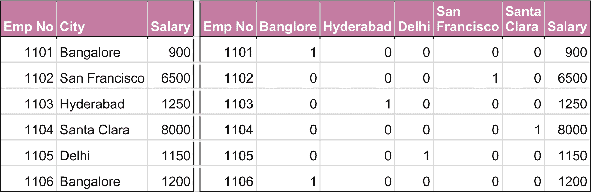

图 11-1

包含员工城市信息并以独热编码表示的示例数据集

城市列使用独热编码进行编码，如图 11-1 所示，因此扩展为五列，每列代表数据库中的一个唯一城市。虽然如果你知道每个城市属于哪个国家，模式很容易理解，但在没有额外信息的情况下，很难在如此稀疏的数据中找到这种模式。

主成分分析（PCA）是应用于降维的最简单、最常用的技术之一。它将数据转换为数量更少的维度，而这些维度所包含的信息量几乎与原始数据集相当。

### 主成分分析

执行主成分分析的过程首先计算所有列的协方差，并将其存储在一个矩阵中，该矩阵总结了所有变量之间的相互关系。这可以用来寻找特征向量（显示数据分散的方向）和特征值（显示沿每个特征向量的重要性程度）。

图 11-2 展示了一组最初在二维空间（X 和 Y）中绘制的数据点。PCA 试图将这些点投影到能产生最大方差（即数据最大分散程度）的维度上。如果我们将这些点投影到 X 轴上，我们会看到所有点都分布在 x1 和 x2 之间。方差将捕捉这些点在 X 轴上投影的分散程度。类似地，如果我们将点投影到 Y 轴上，它们将分布在 y1 和 y2 之间。如果我们能够投影到一个完全不同的轴上，即图 11-2 中标注的 K 轴，我们会观察到 k1 和 k2 之间的分散程度以及观察到的方差，都高于我们从 X 轴和 Y 轴投影得到的结果。如果 PCA 试图找到一个维度来投影数据集，它会选择这个维度。这就是第一主成分。如果我们想选择第二主成分，我们必须选择与之正交的轴。这里的目标首先是找到主成分，其次是为将原始数据映射到主成分提供一种变换。

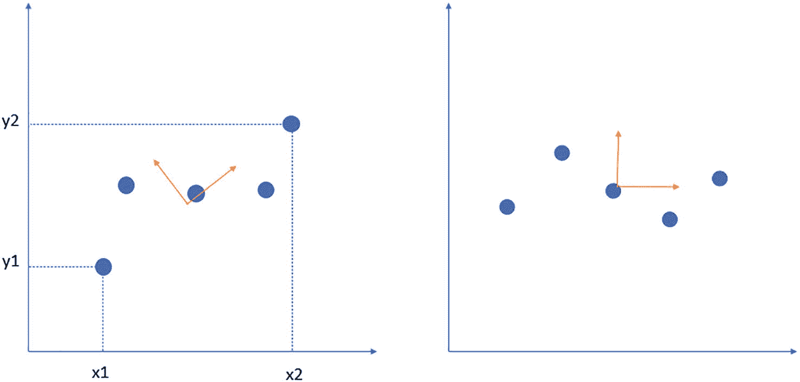

图 11-2

沿主成分对原始数据集进行变换

为了标准化数据以执行 PCA，我们首先计算一个 d 维均值向量；也就是说，计算每一列的均值。这用于标准化数据，并将所有列调整到相似的尺度。这有助于避免出现这样的情况：一个分布范围很大的列（例如薪资）会主导一个分布范围较小的列（例如 GPA）。标准化会将所有列调整到相似的尺度。

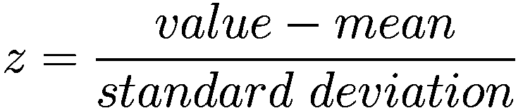

接下来是计算协方差矩阵，它提供了一种分析列之间关系的方法。协方差矩阵给出了数据集中每个维度组合的协方差。例如，对于一个有三列（d=3，分别称为 x、y 和 z）的数据集，协方差矩阵由下式给出：

![$$ \left[\begin{array}{ccc} Cov\left(x,x\right)&amp; Cov\left(x,y\right)&amp; Cov\left(x,z\right)\\ {} Cov\left(y,x\right)&amp; Cov\left(y,y\right)&amp; Cov\left(y,z\right)\\ {} Cov\left(z,x\right)&amp; Cov\left(z,y\right)&amp; Cov\left(z,z\right)\end{array}\right] $$](images/516449_1_En_11_Chapter/516449_1_En_11_Chapter_TeX_Equb.png)

其中 Cov(x,y) 表示 x 和 y 的协方差。如果为正，意味着 x 和 y 正相关；也就是说，它们的值同时增加或减少。如果为负，意味着它们负相关。如果 x 的值增加，y 的值则减少。

然后，我们计算协方差矩阵的特征向量和特征值，以识别主成分。PCA 的目标是找到能解释最大方差量的主成分。对应于最高特征值的特征向量就是第一主向量。我们可以决定需要多少个主成分，并据此选择相应的特征向量。如果我们希望使用 PCA 进行二维可视化，我们将选择前两个。

为了沿主成分分析的方向变换数据集，我们使用特征向量矩阵，并将其与标准化后的原始数据集相乘。


### Python 中的主成分分析

由于实现简单，主成分分析可以通过遵循前一节提到的步骤，使用基础的线性代数函数来完成。Scikit-learn 还提供了一种更简便的解决方案，可以使用与 sklearn 中其他操作一致的 API 风格来应用 PCA。让我们看看如何用它来对鸢尾花数据集执行 PCA，并从一个全新的角度对其进行可视化。我们将把鸢尾花数据集的四个特征分解为两个主成分，这两个主成分可以直接映射到二维图表上。让我们使用前一章用过的方法来导入数据集。

```
from sklearn import datasets
iris = datasets.load_iris()
X = iris.data
y = iris.target
```

如你所知，数据集中有四列数据——这很难在屏幕上进行可视化。在这个层面上，我们最多能做到的是可视化三个维度（并忽略第四个维度）。

```
from mpl_toolkits.mplot3d import Axes3D
import matplotlib.pyplot as plt
fig = plt.figure(1, figsize=(4, 3))
ax = Axes3D(fig, rect=[0, 0, .95, 1], elev=48, azim=134)
ax.scatter(X[:, 0], X[:, 1], X[:, 2], c=y, cmap=plt.cm.nipy_spectral, edgecolor='k')
```

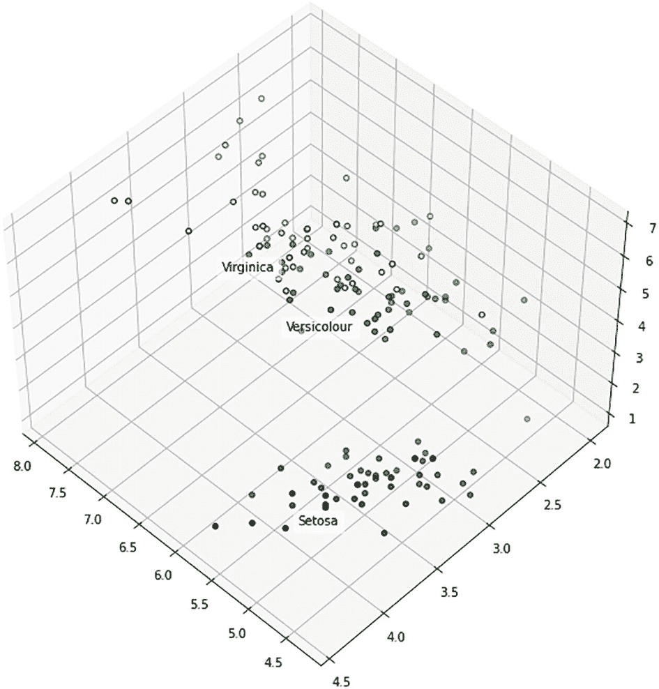

图 11-3

在三维坐标轴上表示的鸢尾花数据集

你可以使用 `ax.text3D()` 打印类别标签。

```
for name, label in [('Setosa', 0), ('Versicolour', 1), ('Virginica', 2)]:
ax.text3D(X[y == label, 0].mean(),
X[y == label, 1].mean() + 0.5,
X[y == label, 2].mean(), name,
horizontalalignment='center',
bbox=dict(alpha=.5, edgecolor='w', facecolor='w'))
plt.show()
```

如图 11-3 所示的三维图比我们之前见过的图表传达了更多的信息。然而，缺失的维度可能还蕴含着一些需要传达的信息。PCA 将帮助我们把数据转换到二维空间，同时确保数据分布的规律得以保留。

要执行 PCA，我们需要导入所需的类，并应用 `fit` 和 `transform`。这会将数据集转换到新的二维空间。

```
from sklearn import decomposition
pca = decomposition.PCA(n_components=2)
pca.fit(X)
X = pca.transform(X)
```

你可以在转换后检查 `X` 的前几行。

```
X[:5]
```

输出显示 `X` 现在是一个形状为 (150, 2) 的两列矩阵。这里一个有趣的观察是，`X` 的值实际上并不对应于实际的花萼和花瓣的长度或宽度。这些仅仅是新二维空间中的变换结果。

```
>> array([[-2.68412563,  0.31939725],
[-2.71414169, -0.17700123],
[-2.88899057, -0.14494943],
[-2.74534286, -0.31829898],
[-2.72871654,  0.32675451],
```

我们可以使用 Matplotlib 进行可视化，将每个代表性类别（鸢尾花的品种）的数据点用不同的颜色绘制出来。

```
fig = plt.figure(figsize=(8,8))
plt.scatter(X[:,0], X[:,1], c=y, cmap=plt.cm.nipy_spectral, edgecolor='k')
for name, label in [('Setosa', 0), ('Versicolour', 1), ('Virginica', 2)]:
plt.text(X[y == label, 0].mean(),  X[y == label, 1].mean(), name,  horizontalalignment='center', bbox=dict(alpha=0.8, edgecolor='w', facecolor='w'))
plt.show()
```

这将显示鸢尾花数据集经过 PCA 转换后的二维散点图。图 11-4 中的图显示了两个类别——杂色鸢尾和维吉尼亚鸢尾之间更真实的交互关系。在这个图中，你可以看到，像这样沿着方差最大的轴进行简单的变换，可以更好地简化数据集。

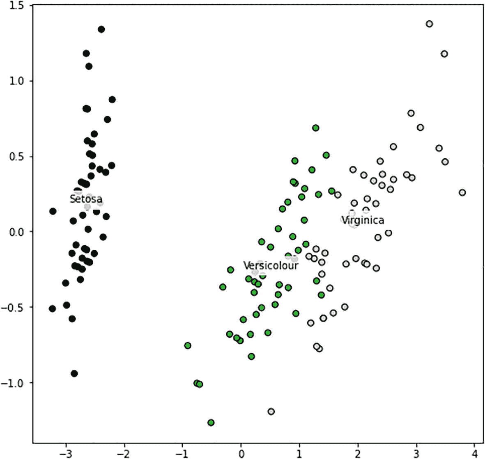

图 11-4

沿两个主成分表示的鸢尾花数据集

大规模数据集在各个学科中越来越普遍。为了解释这些数据集，我们需要降低维度，以保留最相关的数据。我们可以使用 PCA 来减少变量数量，避免多重共线性，或者避免相对于观测数量而言预测变量过多的问题。

特征降维是机器学习中一个关键的预处理步骤。因此，PCA 是预处理的重要步骤，对于数据压缩和去噪非常有用。它通过寻找一组比原始变量集更小的新变量来降低数据集的维度。

## 聚类

聚类是一套简单但非常高效的无监督学习方法，有助于将数据分组到有意义的组中，从而揭示潜在的规律。想象一下，你所在组织的人力资源总监要求你将所有员工分成五组——这样公司领导层就可以决定每个组的员工应该报名参加哪些培训项目。在这类问题中，你希望创建这样的分组，使得 (1) 同一组中的所有员工彼此之间大致相似，并且 (2) 不同组的员工彼此之间应有显著差异。这种需要将数据分成不同片段的问题，就称为聚类。

在这个问题中，我们没有预定义的员工类别。我们没有一个标签让算法学习如何找到映射关系，就像我们在几种分类算法中看到的那样。在这里，算法学习的是基于距离度量来划分数据。

在接下来的小节中，我们将首先学习一种非常流行的聚类方法，并查看其在 Python 中的实现。我们还将讨论聚类作为利用图像处理或计算机视觉的人工智能应用中的一个步骤的另一种应用。然后，我们将研究另一种能够检测任意形状聚类的聚类方法。

### 使用 K-Means 进行聚类

K-means 是一种基于质心的聚类划分方法。K-means 旨在创建 k 个聚类并将数据点分配其中，使得簇内相似度高，簇间相似度低。该算法基于最小化惯性（即簇内平方和）的概念。惯性由下式给出：

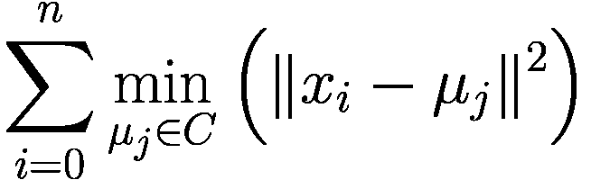

该算法首先选择 K 个随机点，这些点在此将被称为最终聚类的质心。然后，算法进入多次迭代来优化聚类。

在每次迭代中，对于每个数据点，算法通过计算该点与所有质心的距离来找到最近的质心，并将其分配到该聚类。一旦所有点都被分配到聚类中，就会通过计算所有点（在所有维度上）的平均值来得到一个新的质心。这个过程会一直持续，直到聚类中心或聚类分配不再发生变化，或者达到固定的迭代次数。

该算法从随机初始化的聚类中心开始。因此，并不总能保证良好的收敛性。在实践中，一个好的做法是使用随机初始化的聚类中心多次重复聚类算法，并对最终的聚类分布进行采样。


### Python 中的 K-Means 算法

Scikit-learn 提供了 K-means 算法的高效实现。

默认情况下，初始聚类中心的选择基于一种称为 **k-means++** 的算法。该算法首先在数据点中均匀随机选择一个聚类中心。然后迭代计算所有点与中心之间的距离。下一个聚类中心的选择基于加权概率分布，其中某个点被选中的概率与其到最近中心的平方距离分布成正比。重复此过程，直到选出 k 个点。这种方法通常能显著提升 k-means 算法的最终性能。当然，你也可以直接提供 k 个中心点。

让我们生成一个包含某种聚类形状的合成数据集。Scikit-learn 在 `sklearn.datasets` 中提供了此类函数。图 11-5 展示了一个散点图，其中包含清晰可辨的数据聚类。

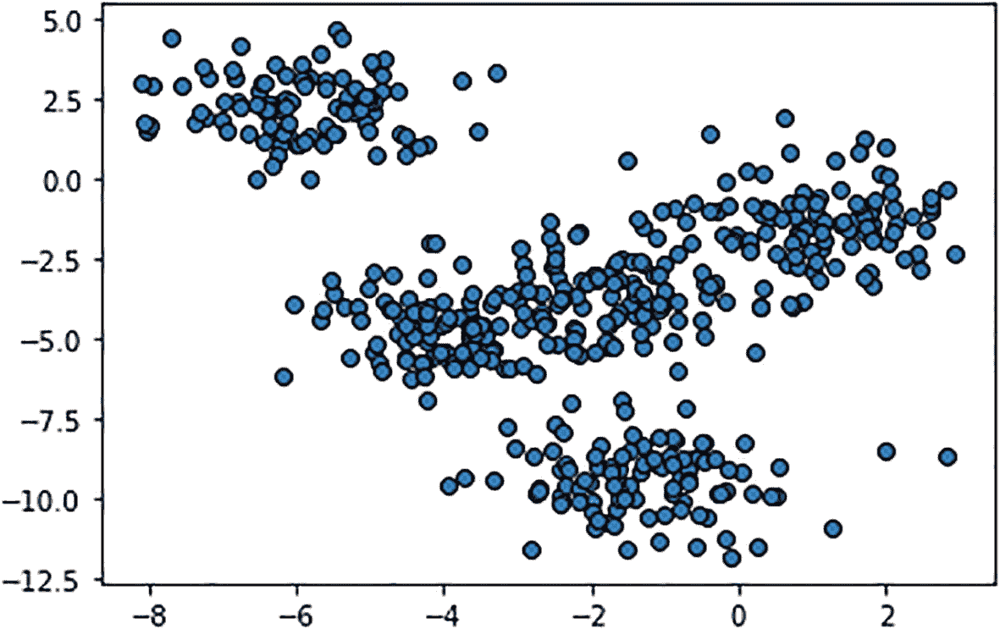

图 11-5

随机生成的聚类数据

```
from sklearn.datasets import make_blobs
X, y = make_blobs(n_samples=500, centers=5, n_features=2, random_state=2)
plt.scatter(X[:,0], X[:,1], edgecolor='k')
```

要执行 K-means 聚类，我们需要从 sklearn.clustering 中导入 KMeans。其用法与 sklearn 中用于监督学习的标准函数类似。

```
from sklearn.cluster import KMeans
kmeans = KMeans(n_clusters=5)
kmeans.fit(X)
```

这里，最后一行代码指示算法根据提供的数据学习聚类。要找到每个点的聚类标签，我们可以使用 predict 方法。

```
y = kmeans.predict(X)
```

或者，你也可以使用以下一行代码同时完成拟合和预测：

```
y = kmeans.fit_predict(X)
```

y 将是一个一维数组，包含从 0 到 4 的数字，每个数字代表由此生成的五个聚类之一。你可以使用以下代码获取聚类中心：

```
kmeans.cluster_centers_
>> array([[-3.99782236, -4.6960255 ],
[-5.92952036,  2.24987809],
[ 1.08160065, -1.26589927],
[-1.28478773, -9.3769836 ],
[-1.48976417, -3.56531061]])
```

由于数据是二维的，因此有五个二维聚类中心。数据点根据距离它们最近的聚类中心进行分配。

让我们看看生成的聚类。我们将为生成的 500 个点创建一个散点图，并根据它们所属的聚类分配颜色。我们还将使用不同的颜色（黑色）和标记来绘制聚类中心。

```
plt.scatter(X[:,0], X[:,1], c=y)
plt.scatter(kmeans.cluster_centers_[:,0], kmeans.cluster_centers_[:,1], c='black', marker='+')
```

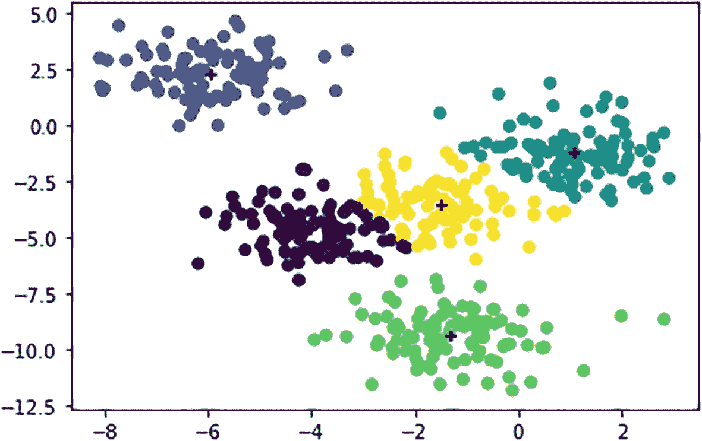

图 11-6

K-means 生成的五个聚类

如图 11-6 所示，中间的团块根据此聚类模型被分成了三部分。然而，凭直觉可以看出，这些部分并非清晰可分，因此应该只有一个更大的聚类来合并这三部分。让我们看看如果只生成三个聚类，会形成什么样的聚类。

```
kmeans = KMeans(n_clusters=3)
y = kmeans.fit_predict(X)
plt.scatter(X[:,0], X[:,1], c=y)
plt.scatter(kmeans.cluster_centers_[:,0], kmeans.cluster_centers_[:,1], c='black', marker='+')
```

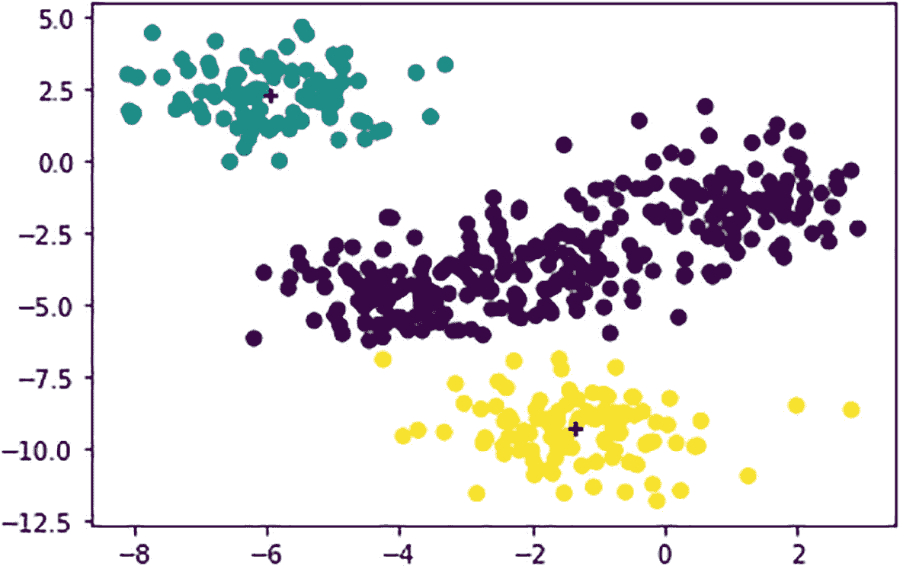

图 11-7

K-means 生成的三个聚类

正如我们所料，图 11-7 显示，中间较大的团块整体成为一个聚类，而另外两个聚类几乎保持不变。然而，有时我们可能需要更好的方法来定义哪个聚类更好。我们将在下一节讨论这个问题。

#### 如何确定合适的 K 值？

K-means 算法需要一个预先确定的 k 值。在某些情况下，例如我们在引言中讨论的情况，由于业务原因或领域知识，我们可能已经预先确定了 k 值。但是，如果没有明确的理由来预先确定 k 值，最好针对不同的 k 值使用 K-means 算法，并利用纯度或误差的概念来分析聚类的质量。随着 k 值的增加，误差总会减小——然而，我们会注意到某个 k 值（或几个 k 值）处误差显著下降。这个值被称为拐点，并被确定为安全值。

```
error = []
for i in range(1,21):
kmeans = KMeans(n_clusters=i).fit(X)
error.append(kmeans.inertia_)
import matplotlib.pyplot as plt
plt.plot(range(1,21), error)
plt.title("肘部图")
plt.xlabel("聚类数 (k)")
plt.ylabel("误差 (惯性)")
plt.xticks([1,2,3,4,5,6,7,8,9,10])
plt.show()
```

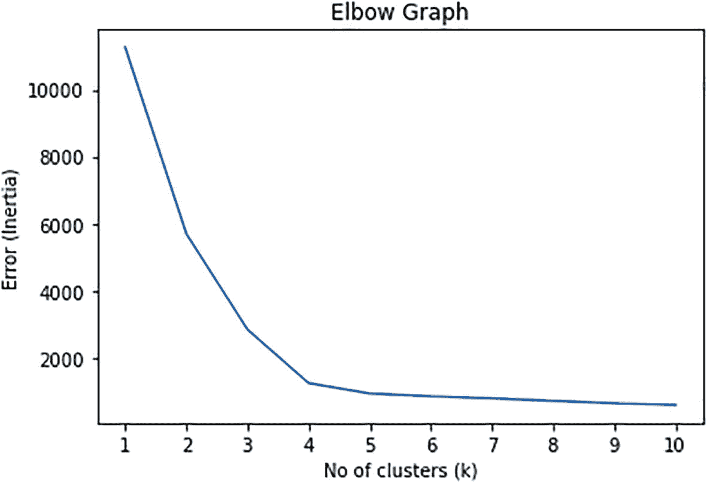

图 11-8

随着聚类数量的增加，错误率降低

图 11-8 中的图表显示，随着聚类数量的增加，以惯性表示的误差会减小。惯性表示聚类内部的凝聚程度。K-means 算法基于最小化惯性。当聚类数量从 1 增加到 2、3、4 和 5 时，这种误差的减少（或聚类质量的提升）非常显著。超过这个点之后，改进就微乎其微了。这个点被称为拐点，是确定应找到多少个聚类的一个良好指标。虽然拐点的位置并不总是非常明显，但我们通常通过观察肘部图来凭经验选择，并分析评估所选 k 值（例如 3）所产生聚类质量的汇总统计量。我们可能会使用不同的 k 值（例如 4）重复此过程，看看哪个 k 值能产生更有意义的结果。通过比较，对于我们的数据集，3 似乎是一个理想的聚类数——这从我们之前创建的两个聚类图中可以明显看出。

一个常用的评估聚类质量的指标是纯度，它衡量聚类中包含单一类别的程度。纯度需要定义聚类的类别概念。为了计算纯度，我们假设每个聚类代表其组成数据点中出现频率最高的类别。然后通过计算正确分配的数据点数量与总数据点数量的比值来得到准确率。


#### 用于图像分割的聚类

如前文所述，图像可被视为一个多维数据集，其中每个像素由一组数值表示。K-means 算法可用于将图像中的所有像素分组到预定数量的簇中。

在本例中，我们将了解如何使用 K-means 对图像的各个部分进行聚类或分割。我们将从维基共享资源^(⁹)下载一张图片，并以此探索 K-means 聚类方法如何帮助分割图像的各个部分。我们将使用 OpenCV 的实现。你可能需要使用以下命令安装适用于 Python 的 OpenCV：

```
%pip install opencv-python
```

现在，我们可以使用 opencv 在 Python 中加载图像，具体如下：

```
import numpy as np
import cv2
import matplotlib.pyplot as plt
original_image = cv2.imread("C:\\Data\\Wikimedia Images\\port_campbell.jpg")
plt.figure(figsize=(10,10))
plt.imshow(original_image)
```

结果将如图 11-9 所示。我们希望改变图像的色彩空间，并将其转换为 K-means 可以处理的形状。我们将使用 `cv2.cvtColor()` 来转换图像，然后进行重塑。

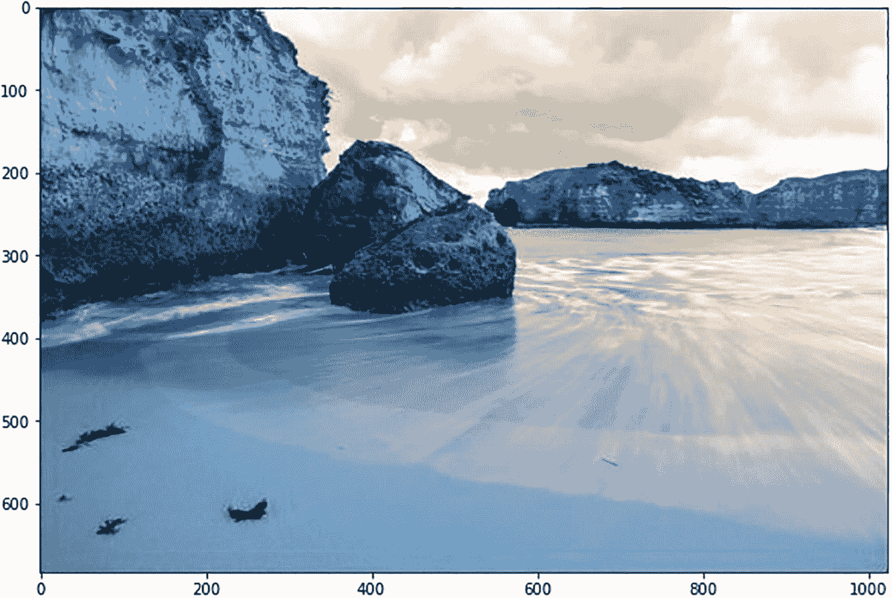

图 11-9

使用 `imshow()` 在 Python 中显示的图像

```
image = cv2.cvtColor(original_image, cv2.COLOR_BGR2RGB)
pixel_values = image.reshape((-1, 3))
pixel_values = np.float32(pixel_values)
```

OpenCV 提供了其 K-means 实现，该实现需要将图像像素作为样本、簇的数量以及指定算法何时停止的终止条件。

```
criteria = (cv2.TERM_CRITERIA_EPS + cv2.TERM_CRITERIA_MAX_ITER, 100, 0.2)
```

现在，我们可以使用 `cv2.kmeans()` 生成簇。我们建议你更改 K 的值，并观察输出如何变化。

```
K=5
_, labels, (centers) = cv2.kmeans(pixel_values, K, None, criteria, 10, cv2.KMEANS_RANDOM_CENTERS)
```

这将为图片中的每个像素分配一个簇（共五个）。`centers` 将是一个包含五行三列的数组，代表每个簇的平均颜色。`labels` 包含簇标签（一个从 0 到 5 的数字），代表图像中每个像素被分配到的簇。

我们将进行一些小的修改，以便将簇中心值转换为可以表示为 RGB 颜色的整数。

```
centers = np.uint8(centers)
labels = labels.flatten()
```

现在，我们可以绘制分割后的图像。

```
segmented_image = centers[labels.flatten()]
segmented_image = segmented_image.reshape(image.shape)
plt.figure(figsize=(10,10))
plt.imshow(segmented_image)
plt.show()
```

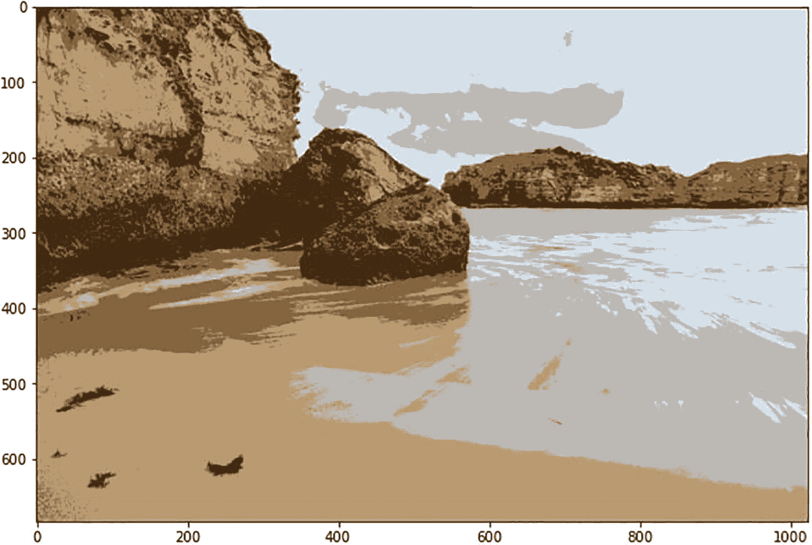

图 11-10

由不同颜色表示的五个分割区域

图 11-10 中的图像显示了每个像素根据其颜色被分配到的五个簇。K-means 是一种非常简单但高效且流行的图像分割技术。

#### 使用 DBSCAN 进行聚类

还有其他几种聚类算法，在簇预计不会以球形均匀分布的情况下更为有用。为了找到这些具有明显非球形形状的簇，我们可以使用基于密度的方法，该方法将簇建模为由稀疏区域分隔的密集区域。

DBSCAN，即具有噪声的基于密度的空间聚类应用，就是这样一种方法，它试图将数据点密度大于预定阈值的空间区域合并起来。

DBSCAN 需要一个预定的距离，称为 eps（epsilon），它表示被视为同一簇一部分的点之间的距离，以及 min_samples，它表示在 eps 距离内必须存在的数据点数量，以形成一个密集的簇区域。这些参数有助于控制算法对噪声的容忍度以及应被视为簇的分布形状。

DBSCAN 通过定位预期密度区域中存在的点来迭代地扩展簇。图 11-11 显示了从空间某个确定区域内的三个点开始的扩展过程。

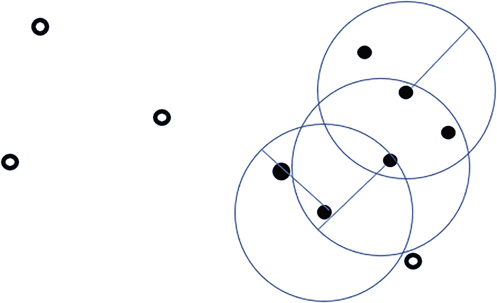

图 11-11

DBSCAN 通过邻近的点扩展簇

为了在 Scikit-learn 中进行实验，让我们构建遵循任意模式的合成数据。

```
from sklearn.datasets import make_moons, make_circles
X, y = make_moons(n_samples=1000, noise=0.1)
plt.scatter(X[:,0], X[:,1], edgecolor='k')
```

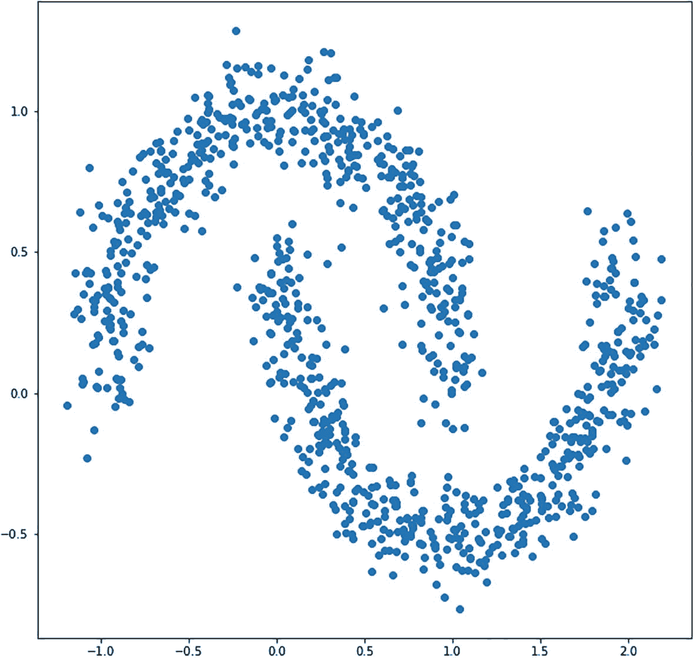

图 11-12

存在于有意义的簇中的数据点，某些算法可能无法捕捉到这些簇

图 11-12 的可视化显示数据集中存在直观的簇。如果我们尝试使用 K-means 定位这些簇，可能无法得到我们期望的聚类结果。

```
from sklearn.cluster import KMeans
kmeans = KMeans(n_clusters=2)
y= kmeans.fit_predict(X)
plt.scatter(X[:,0], X[:,1], c=y)
```

要使用 DBSCAN 查找簇，我们可以从 `sklearn.clustering` 导入 DBSCAN。

```
from sklearn.cluster import DBSCAN
dbscan = DBSCAN(eps=0.1, min_samples=2)
y= dbscan.fit_predict(X)
plt.scatter(X[:,0], X[:,1], c=y)
```

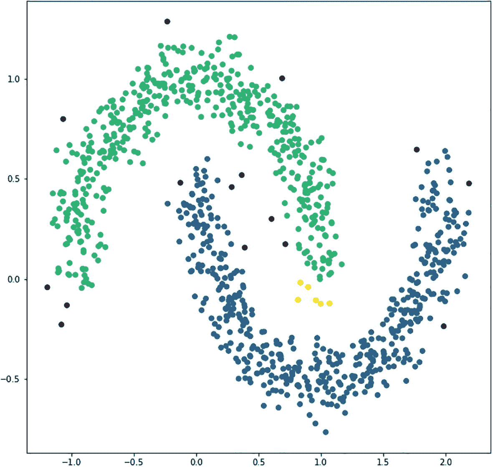

图 11-14

DBSCAN 检测到的簇。部分点被检测为异常值

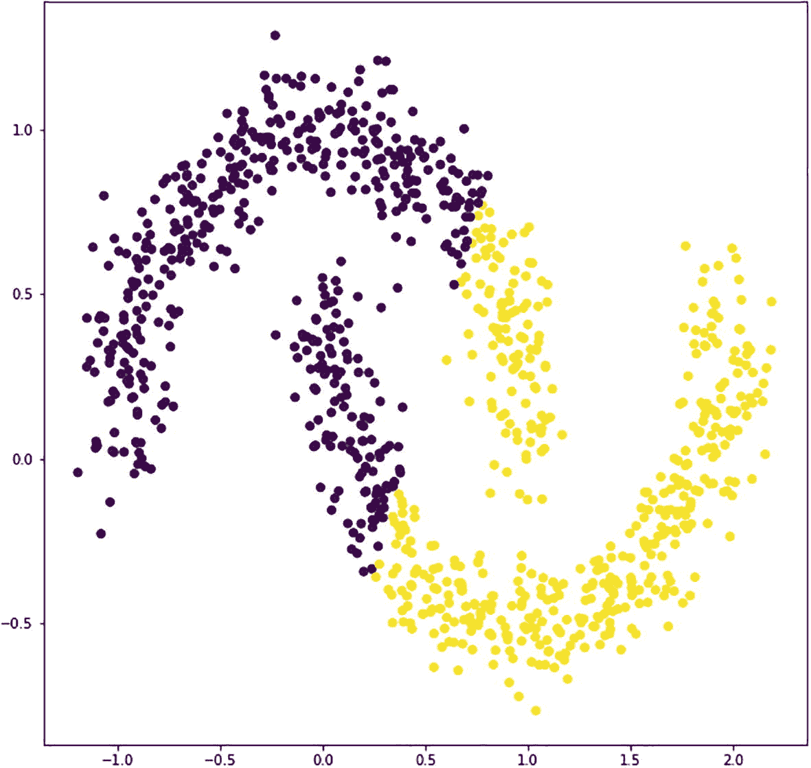

图 11-13

K-means 检测到的簇

DBSCAN 在查找此类簇时非常有用。它很稳健，也可用于检测噪声。图 11-13 和图 11-14 中显示的簇，在 K-means 与基于密度的算法生成的簇质量方面，形成了鲜明的对比。

## 频繁模式挖掘

频繁模式挖掘（FP mining）是一个非常流行的问题，在零售和电子商务领域有广泛应用。FP mining 试图基于数据集中同时出现的项目组合，发现数据中重复出现的（频繁）模式。如果你有来自零售店或超市的交易数据集，你可以找到通常一起购买的商品的模式，例如牛奶和面包。每笔交易可能包含一个或多个购买的商品。FP mining 算法为我们提供了一种方法，来查找属于同一交易的最常重复出现的商品组合。


### 市场购物篮分析

在此背景下，一个常用术语是**市场购物篮分析**。这是一个发现通常被一起购买的物品的过程。在零售管理领域，其应用可以帮助决策者确定产品应放置的位置。经常一起购买的物品可以彼此靠近放置，而在某些刻意设计的情况下，也可以彼此远离，这样顾客就不得不穿过其他货架，这可能会促使他们购买超出原本需求的商品。

市场购物篮分析也用于向上销售或交叉销售。这有助于根据顾客过去的购买行为，通过向顾客提供超出其购买意愿的商品来识别零售机会。

此类算法基于寻找关联规则来运作，即经常一起购买的物品集合，并附带一个表示支持度的数字和一个表示规则置信度的水平。

```
洗发水 => 护发素 [支持度 = 2%, 置信度 = 60%]
```

支持度为 2% 意味着在所有交易中，有 2% 的交易显示洗发水和护发素被一起购买。置信度为 60% 意味着购买洗发水的顾客中有 60% 也购买了护发素。

如果关联规则同时满足最小支持度阈值和最小置信度阈值，则被认为是有趣的。这些阈值由领域专家设定，或通过一系列对结果进行仔细分析的迭代过程来确定。

Apriori 算法是一种迭代算法，它逐步构建一个项集列表。它的核心思想是：频繁项集的所有子集也必须是频繁的。这被称为**先验性质**。这意味着，如果存在一个不太频繁的项集，例如 [洗发水, 蟑螂喷雾]，它不满足支持度阈值。如果向该项集中添加一个物品，得到 [洗发水, 蟑螂喷雾, 面包]，它出现的频率并不会比之前的项集更高。

Apriori 算法首先确定事务数据库中项集的支持度。所有支持度值高于最小或选定支持度值的事务都会被考虑。接着，寻找所有子集中置信度值高于阈值或最小置信度的规则。

Apriori 算法的计算成本很高。在大多数实际案例中，库存可能包含数千种（或更多数量级）商品。另一个常见问题是，当为了检测某些关联而降低支持度阈值时，也会增加无意义关联的数量。

另一种名为 **FP-growth** 的算法在大多数用于挖掘频繁项集的软件包中都有实现。它首先将表示频繁项的数据库压缩成一种树状结构，该结构保留了项集的关联信息。然后，它将压缩后的数据集划分为一组条件数据库，每个数据库与一个频繁项相关联。随后，这些数据库被分别挖掘。对于较大的数据集，FP-growth 算法比 Apriori 算法快得多。

### Python 中的频繁模式挖掘

Mlxtend（机器学习扩展）是一个 Python 库，它为 Python 的科学计算栈添加了额外的工具和扩展。对于本实验，你需要使用 `pip install` 来安装 mlxtend。

```
%pip install mlxtend
import pandas as pd
import numpy as np
import mlxtend
```

我们创建了一个 CSV 文件，其中包含每笔交易中购买的物品。

```
0,1,2,3,4,5,6
Bread,Wine,Eggs,Meat,Cheese,Butter,Diaper
Bread,Cheese,Meat,Diaper,Wine,Milk,Butter
Cheese,Meat,Eggs,Milk,Wine,,
Cheese,Meat,Eggs,Milk,Wine,,
```

我们在此代码中使用的数据集包含大约 315 笔交易，每行一笔交易。我们可以加载 CSV 文件并识别所有交易中存在的唯一物品。

```
df = pd.read_csv("fpdata.csv")
items = set()
for i in df:
items.update(df[''+str(i)+''].unique())
items.remove(np.nan)
import mlxtend
from mlxtend.frequent_patterns import apriori, association_rules
```

现在，我们将按照前几章介绍的方法，将数据集转换为独热编码形式。这里提供一种替代方法来完成同样的操作。编码后的数据框将类似于图 11-15 中所示的截图。

```
item_list = sorted(items)
encoded_vals = []
i=0
for index, row in df.iterrows():
labels = dict()
uncommons = list(items - set(row))
commons = set(row).intersection(items)
for item in commons:
labels[item] = 1
for item in uncommons:
labels[item] = 0
encoded_vals.append(labels)
one_hot_encoded_dataframe = pd.DataFrame(encoded_vals)
one_hot_encoded_dataframe
```

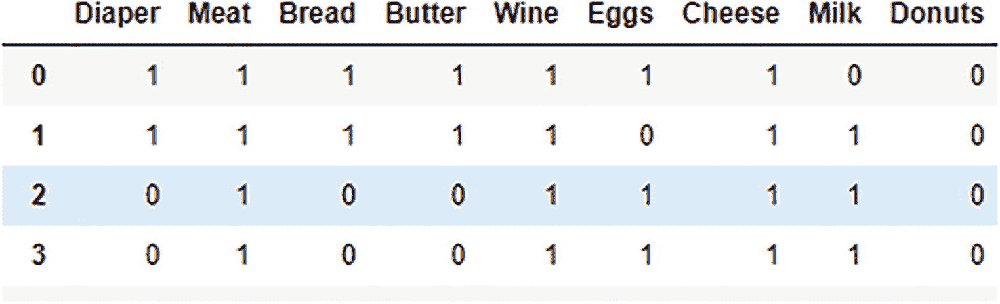

图 11-15

Apriori 算法实现所期望的独热编码数据框

`mlxtend.frequent_patterns` 中的 Apriori 算法和关联规则实现期望这种格式。我们可以生成一个列表

```
from mlxtend.frequent_patterns import apriori, association_rules
freq_items = apriori(one_hot_encoded_dataframe, min_support = 0.2, use_colnames=True)
freq_items['sup_count'] = freq_items['support']*315
freq_items
```

这将打印出所有找到的、在数据集中具有至少 20% 最小支持度的项集列表。截断后的截图如图 11-16 所示。结果从单一项集开始，这些项集意义不大，因为它们只是这些物品在数据集中的出现频率。然而，在第 9 行之后，你可以看到两个项集，它们展示了有趣的购买模式，比如面包和奶酪。后面的行显示了三个更有意义的项集。你可以调整 `min_support` 参数来查看更多项集。

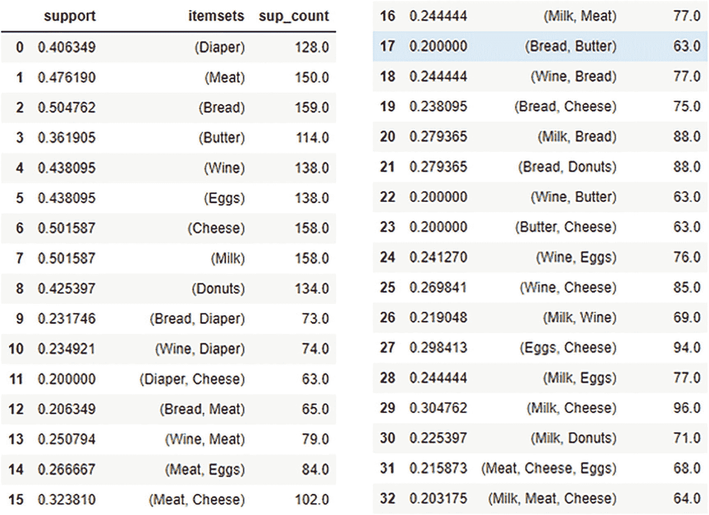

图 11-16

Apriori 算法检测到的频繁项集及其支持度计数

我们还可以打印关联规则列表及其相关的置信度分数。

```
rules = association_rules(freq_items, metric="confidence", min_threshold=0.5)
rules
```

这将显示有趣的规则，如图 11-17 所示。

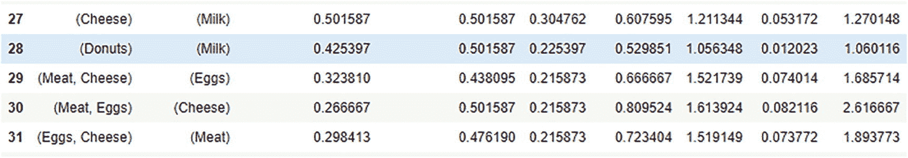

图 11-17

Apriori 算法检测到的关联规则

这里，第 29 行表明，那些购买了肉和奶酪的人也购买了鸡蛋，这由肉和奶酪的支持度 0.32、鸡蛋的支持度 0.43 以及包含这三者的规则的支持度 0.216 来表示。相关的置信度水平为 0.667，相当高且可靠。你可以探索数据集中的其他细节。

## 总结

我们学习了几种无监督学习方法，并讨论了它们的应用场景。利用这些工具和技术，你可以对真实数据集进行分析。在后续部分，我们将使用这些技术完成一个端到端的机器学习项目。

在接下来的章节中，我们将讨论另一组在过去十年中变得非常流行的方法——神经网络和深度学习。

脚注 1

