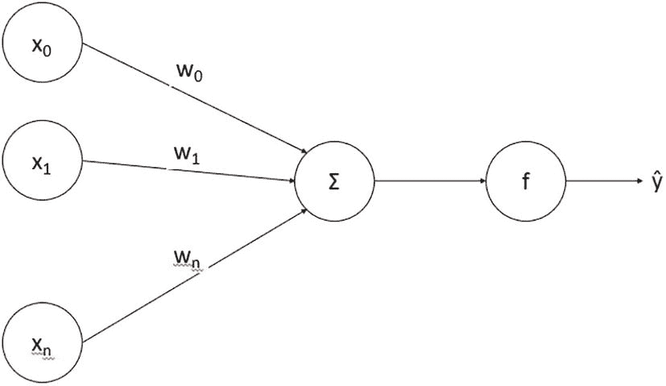
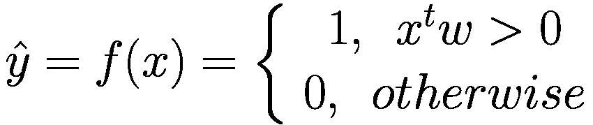
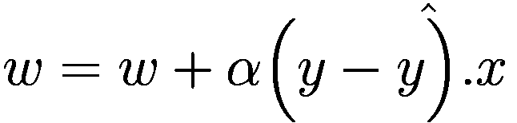
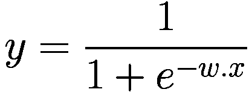
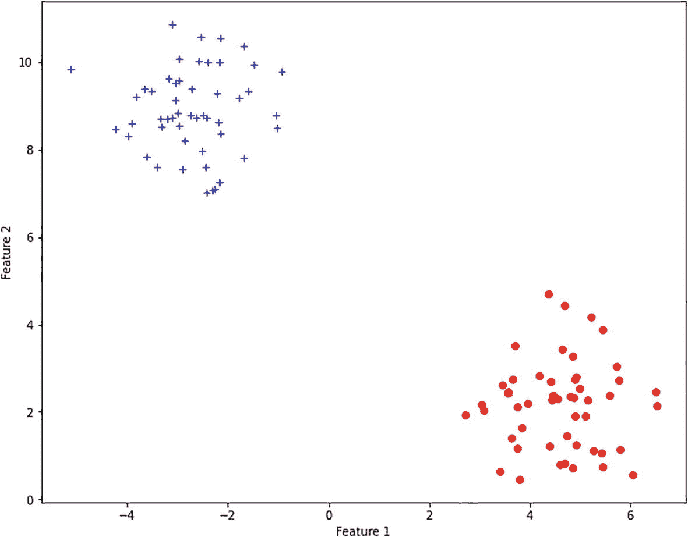
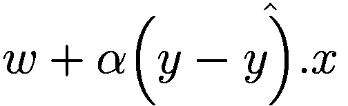
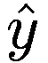
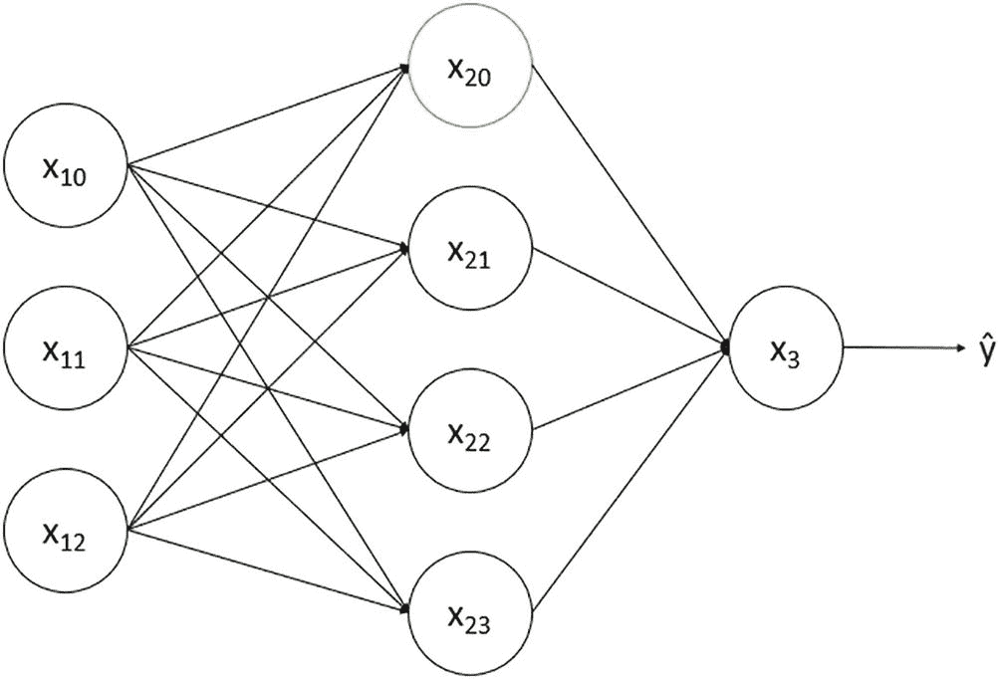

# 12. 神经网络与 PyTorch 基础

在过去的章节中，我们已经为机器学习方法奠定了基础。几十年来，这些“传统”的机器学习方法一直应用于学术研究和工业实践。然而，过去几年新创新的焦点一直是神经网络——各种深度神经网络架构的能力、性能和多功能性。

本章及接下来几章主要关注神经网络以及深度神经网络架构，特别是可直接应用于多种场景的卷积神经网络和循环神经网络。在本章中，我们将讨论神经网络的工作原理、它们如何适用于如此多种类型的解决方案，以及如何使用 PyTorch。

过去几年中，有几种软件库和工具包变得流行起来。Python 已成为大多数涉及机器学习的项目中最受欢迎的选择——而对于深度学习，PyTorch 是近年来受欢迎程度不断上升的竞争工具之一。我们将局限于这个库——尽管 API 和使用方式可能与其他工具不同，但其思想仍然直接相关且适用。

在本章中，我们将从感知机的基础知识开始，它是神经网络的基本构建模块。这还将涉及构建神经网络所需的基本数学运算。然后，我们将对 PyTorch 进行简明介绍，并了解其基本特性。我们将学习使用 PyTorch 进行基本计算。在本章及下一章中，你将根据相关性逐步了解 PyTorch 的特性。

神经网络是相互连接的计算节点，是深度学习算法的核心。神经网络最基本的元素称为感知机，它执行非常基本的向量算术运算。感知机可以组合在一起，相互依赖彼此的结果进行进一步计算，从而排列成计算单元层。这样的网络被称为神经网络。

我们将在后续章节中从基本单元——感知机开始，更详细地讨论神经网络。

尽管设计的简洁性是神经网络强大和流行的主要来源，但这些计算往往变得过于庞大和复杂，难以使用基本编程工具进行编程和操作，这导致了神经网络编程框架的兴起。

PyTorch 是最受欢迎的工具之一，常因其简单且更符合 Python 风格而备受赞誉——从而易于学习并提高开发者的生产力。PyTorch 与其他流行的深度学习库相比也毫不逊色，在某些情况下甚至更快。一位被高度引用的 AI 科学家在他的推文中总结了这些优势^(¹⁰)（图 12-1）。


图 12-1

Andrej Karpathy 关于 PyTorch 的推文。Andrej 目前领导特斯拉的 AI 和自动驾驶视觉团队

## 安装 PyTorch

安装 PyTorch 最推荐的方法之一是使用 Anaconda 发行版的包管理器工具——conda。如果你尚未安装 Anaconda，可以在 Anaconda 网站^(¹¹)下载适合你系统的软件包。Anaconda 是一个流行的 Python 发行版，提供强大的环境管理和包管理功能。安装 Anaconda 后，你可以使用以下命令：

```
conda install pytorch torchvision torchaudio cudatoolkit=10.2 -c pytorch
```

这将指示 conda 安装 PyTorch 及所需的库，包括 cudatoolkit，它为创建高性能的基于 GPU 的编程提供了环境。

或者，你可以使用 Python 的包管理器 pip 进行安装。

```
pip3 install torch torchvision torchaudio
```

要探索更多替代安装方式，你可以参考 PyTorch 的“入门”^(¹²)页面，该页面根据你的系统和需求提供了更多配置安装的选项。

安装完成后，你可以执行一个简单测试来验证 PyTorch 安装是否按预期工作。打开 Jupyter Notebook 或 Python Shell，导入 torch 并验证 PyTorch 版本。

```
import torch
torch.__version__
Out: '1.9.1'
```

## PyTorch 基础

在 PyTorch 中，张量（tensor）是一个术语，指代任何通用的多维数组。在实践中，张量建立了与向量空间相关的代数对象集合之间的多重线性关系。在 PyTorch 中，张量是编码输入、输出以及模型参数的主要数据结构。

### 创建张量

张量类似于 NumPy 中的 Ndarray。你可以从 Python 的列表或多维列表创建张量。你也可以从现有的 NumPy 数组创建张量。

```
mylist = [1,2,3,4]
mytensor = torch.tensor(mylist)
mytensor
Out: tensor([1, 2, 3, 4])
```

正如你所料，你也可以从 NumPy 数组创建张量。

```
import numpy as np
myarr = np.array([[1,2],[3,4]])
mytensor_2 = torch.from_numpy(myarr)
mytensor_2
Out: tensor([[1, 2],
[3, 4]], dtype=torch.int32)
```

当你从 NumPy 数组创建张量时，它不会被复制到新的内存位置——而是数组和张量共享同一内存位置。如果你对张量进行任何更改，这种更改将反映在创建它的原始数组中。

```
mytensor_2[1,1]=5
myarr
Out: tensor([[1, 2],
[3, 5]], dtype=torch.int32)
```

反过来，你也可以使用`mytensor_2.numpy()`返回一个共享相同数据的 NumPy 数组对象。就像 NumPy 的 Ndarray 一样，PyTorch 张量也是同质的；也就是说，张量中的所有元素都具有相同的数据类型。还有其他类似于 NumPy 数组创建方法的张量创建方法。这是一个创建简单张量的示例。

```
torch.zeros((2,3))
Out: tensor([[0., 0., 0.],
[0., 0., 0.]])
```

这将创建一个形状为 3x3 且所有值均为零的张量。NumPy 中类似的函数是 np.zeros(3,3)。它返回一个形状为 3x3 的数组。尽管表示形式相似，但张量是 PyTorch 中数据表示的主要单元。你可以使用类似的函数创建全 1 数组，或用户定义大小的随机值数组。

```
torch.ones((2,3))
Out: tensor([[1., 1., 1.],
[1., 1., 1.]])
torch.rand((2,3))
Out: tensor([[0.0279, 0.5261, 0.9984],
[0.7442, 0.3559, 0.3686]])
```

PyTorch 还包含一个方法，用于创建或初始化具有另一个张量属性（如形状）的张量。

```
torch.ones_like(mytensor_2)
Out: tensor([[1, 1],
[1, 1]], dtype=torch.int32)
```


### 张量运算

PyTorch 张量支持多种运算，其方式与 NumPy 数组类似——但功能更为强大。与标量的算术运算会被广播，即应用于张量的所有元素。形状兼容的张量之间的矩阵运算也以类似方式进行。

```
myarr = np.array([[1.0,2.0],[3.0,4.0]])
tensor1 = torch.from_numpy(myarr)
tensor1+1
Out: tensor([[2., 3.],
[4., 5.]], dtype=torch.float64)
tensor1/ tensor1
Out: tensor([[1., 1.],
[1., 1.]], dtype=torch.float64)
tensor1.sin()
Out: tensor([[ 0.8415,  0.9093],
[ 0.1411, -0.7568]], dtype=torch.float64)
tensor1.cos()
Out: tensor([[ 0.5403, -0.4161],
[-0.9900, -0.6536]], dtype=torch.float64)
tensor1.sqrt()
Out: tensor([[1.0000, 1.4142],
[1.7321, 2.0000]], dtype=torch.float64)
```

用于描述数据的函数也可以类似方式使用：

```
mean, median, min_val, max_val = tensor1.mean(), tensor1.median(), tensor1.min(), tensor1.max()
print ("Statistical Quantities: ")
print ("Mean: {}, \nMedian: {}, \nMinimum: {}, \nMaximum: {}".format(mean, median, min_val, max_val))
print ("The 90-quantile is present at {}".format(tensor1.quantile(0.5)))
```

这些运算会输出以下结果：

```
Statistical Quantities:
Mean: 2.5,
Median: 2.0,
Minimum: 1.0,
Maximum: 4.0
The 90-quantile is present at 2.5
```

与 NumPy 类似，PyTorch 也提供了诸如 `cat`、`hstack`、`vstack` 等运算来拼接张量。示例如下：

```
tensor2 = torch.tensor([[5,6],[7,8]])
torch.cat([tensor1, tensor2], 0)
```

此方法会拼接两个张量。拼接的方向（或轴）由第二个参数指定。`0` 表示张量将垂直拼接，`1` 则表示水平拼接。

```
tensor([[1., 2.],
[3., 4.],
[5., 6.],
[7., 8.]], dtype=torch.float64)
```

其他类似的函数有 `hstack` 和 `vstack`，它们也可用于水平或垂直拼接两个或多个张量。

```
torch.hstack((tensor1,tensor2))
Out: tensor([[1., 2., 5., 6.],
[3., 4., 7., 8.]], dtype=torch.float64)
torch.vstack((tensor1,tensor2))
Out: tensor([[1., 2.],
[3., 4.],
[5., 6.],
[7., 8.]], dtype=torch.float64)
```

还有一个 `reshape` 函数可以改变张量的形状。要将张量转换为具有任意列数的单行，我们可以使用形状 `(1, -1)`：

```
torch.reshape(tensor1, (1, -1))
Out: tensor([[1., 2., 3., 4.]], dtype=torch.float64)
```

我们将在后续章节中根据具体用途继续讨论更多运算。

## 感知机

感知机，如图 12-2 所示，是神经网络的最简单形式。它接收一个或多个通常描述数据项特征的量作为输入，对其进行简单计算，并产生单个输出。最简单的感知机形式是单层感知机——它易于理解、运行快速且实现简单，尽管它只能对线性可分的数据进行分类。



图 12-2

一个包含组成计算的简单感知机结构

如图 12-2 所示，感知机应用一个简单的计算，根据输入向量 x（其特征表示为 [x[1], x[2], x[3] … x[n]]）和权重向量（其特征表示为 [w[1], w[2], w[3], … w]）来预测类别标签。我们通常会添加一个额外的偏置项 w[0]，它不会根据输入影响输出。为简化计算，我们添加一个输入特征 x[0]，并将其值设为 1。因此，向量 x 和 w 通过一个简单的阶跃函数得出最终输出：



这里，x 是维度为 n+1 的输入向量，w 是权重向量，学习过程的目标是学习到尽可能最优的权重，使得通过将结果与训练标签进行比较而计算出的误差最小化。

为了训练感知机，我们首先用随机值初始化权重。我们使用训练数据集，根据前面展示的公式来找到预测输出。由于算法尚未学习到正确的权重集，结果可能与我们预期的相差甚远——从而导致误差。为了在后续迭代中减少噪声，我们根据当前输出对权重进行如下更新：



这里，我们还添加了一个步长参数 α，它控制权重受影响的严重程度。我们迭代地重复此过程，直到达到预定次数（或直到收敛），并希望在结束时能获得一个足够好的权重向量，从而产生较低的误差。为了预测输出，我们只需将特征 x 代入相同的计算即可。

我们在上一节中看到的计算函数称为阶跃函数。在许多情况下，你更可能看到的是 Sigmoid 函数，即：



让我们先看看如何使用基本的 Python 和 NumPy 来编程实现这些，之后我们将使用 PyTorch 来完成同样的工作。


### Python 中的感知机

我们将首先使用 Scikit-learn 的数据集模块创建一个简单的可分数据集。你也可以使用我们之前用过的任何其他数据集。

```
from sklearn import datasets
import matplotlib.pyplot as plt
X, y = datasets.make_blobs(n_samples=100,n_features=2, centers=2, random_state=42, shuffle=1)
```

这些代码行将创建 100 行数据，包含两个特征，这些数据被分成两大簇。在构建感知机之前，我们先将其可视化。

```
fig = plt.figure(figsize=(10,8))
plt.plot(X[:, 0][y == 0], X[:, 1][y == 0], 'b+')
plt.plot(X[:, 0][y == 1], X[:, 1][y == 1], 'ro')
plt.xlabel("特征 1")
plt.ylabel("特征 2")
```

数据点清晰可见，如图 12-3 所示，我们特意选择了这种随机生成的数据集，以保持分类边界的简单性。



图 12-3

使用 make_blobs 生成的简单数据集

我们已有 X 和 y。接下来，我们从零开始创建 `fit()` 和 `predict()` 方法。你知道，权重是根据当前步骤每个数据点的预测值来更新的。在公式  中，我们已经知道 x 和 y；*α* 是一个超参数，你可以配置它来设置步长，而 w 是我们将在该过程中学习的一组权重。

因为我们的数据集包含两个特征，所以权重向量中需要三个权重（2 个特征权重 + 1 个偏置项）。我们先实现预测函数。

```
def predict(X, weight):
return np.where(np.dot(X, weight) > 0.0, 1, 0)
```

这实现了  的公式，首先计算输入数据与权重的乘积，然后应用条件判断结果乘积是否大于 0。这个函数既可以作为预测函数，也可以帮助我们找到更新权重的正确值。

请记住，虽然有三个权重，但数据集仍然只有两列。我们将添加一列来补偿偏置，从而得到形状为 100x3 的矩阵。我们将权重初始化为随机值。

```
X = np.concatenate( (np.ones((X.shape[0],1)), X), axis=1)
weight = np.random.random(X.shape[1])
```

初始化之后，我们将运行一个迭代过程，直到达到预定的迭代次数（或轮次），并且在每次迭代中，处理每个数据点并更新权重。`fit()` 方法现在应该如下所示：

```
def fit(X, y, niter=100, alpha=0.1):
X = np.concatenate( (np.ones((X.shape[0],1)), X), axis=1)
weight = np.random.random(X.shape[1])
for i in range(niter):
err = 0
for xi, target in zip(X, y):
weight += alpha * (target - predict(xi, weight)) * xi
return weight
```

我们没有将代码结构化为一个可以在内部存储权重的类——而是必须返回权重，然后将其提供给 `predict` 方法。为了学习权重，我们现在可以调用：

```
w = fit(X,y)
w
Out: array([ 0.21313539,  0.96752865, -0.84990543])
```

w 是一个权重向量，包含三个值，分别代表偏置和每个特征对应的系数。我们可以使用 `predict()` 方法来预测输出。让我们从 X 中随机选取一些元素，来比较我们的感知机如何标记它们：

```
random_elements = np.random.choice(X.shape[0], size=5, replace=False)
X_test = X[random_elements, :]
```

X_test 现在将包含数据集中的五个随机行。在调用 `predict` 方法之前，我们需要添加一个全为 1 的额外列。

```
X_test = np.concatenate( (np.ones((X_test.shape[0],1)), X_test), axis=1)
```

现在让我们调用 `predict` 方法，并将结果与实际值进行比较。

```
print (predict(X_test, w))
print (y[random_elements])
Out:
[0 0 1 0 0]
[0 0 1 0 0]
```

结果看起来不错，因为数据集太简单了——但是，请记住，在决策边界不清晰的情况下，简单的感知机表现不佳。我们将在接下来的章节中讨论如何组合这些简单的计算单元来创建更复杂的神经网络。

## 人工神经网络

一个简单的感知机通过单个阈值逻辑单元来学习数据集每个特征的重要性，它尝试组合特征的加权和并将其传递给一个函数。我们使用了一个简单的阶跃函数，在 Python 中通过 if-else 条件实现，或者在使用 NumPy 时通过 `np.where` 函数实现。我们可以使用 sigmoid 函数或其他替代函数来操控特征集如何以及何时产生输出——或者说激活神经元。我们可以组合多个这样的激活，并以全连接层的形式将它们连接起来。

这样的网络超越了简单感知机的局限性，允许你创建多个全连接层，从而创建隐藏层，进而形成一个多层感知机，如图 12-4 所示。输出可能成为下一层的输入，并由下一层的一组新权重进一步处理。



图 12-4

一个具有单个输出单元的简单多层感知机

计算单元可以以不同的方式排列，以创建更多样化的深度神经网络。卷积神经网络（CNN）使用一种特殊的层，通过滑动滤波器对输入图像应用滤波器以生成激活图。CNN 在许多计算机视觉（CV）或自然语言处理（NLP）应用中是非常优选的选择。我们将在第 14 章中更深入地讨论它们。

另一种流行的神经网络架构称为循环神经网络（RNN），它具有一个内部状态，其值根据输入数据维护，以便结合状态和输入样本产生输出。这还可能更新内部状态并影响未来的输出。因此，这有助于解释数据中的序列信息，这在 NLP 应用中非常有帮助。我们将在第 15 章中学习这一点。

## 总结

在本章中，我们讨论了神经网络的基础知识，并开始探索 PyTorch 来定义张量并创建能够学习分类数据的简单神经单元。下一章将讨论用于学习神经网络中网络权重的算法，从而引出前向传播和反向传播。

脚注 1   2   3


