# 13. 前馈神经网络

人工神经网络（ANN）是受大脑神经元启发而构建的相互连接的计算单元集合，由此创建的程序能够学习结构化、文本、语音或视觉数据中的模式。人工神经网络中的基本计算单元被认为类似于（或者更确切地说，受启发于）一种神经细胞，它从多个来源接收输入信号，对其进行运算，并根据给定条件激活，然后将信号传递给与其相连的其他神经元。图 13-1 展示了生物神经元与人工神经元之间的象征性联系。

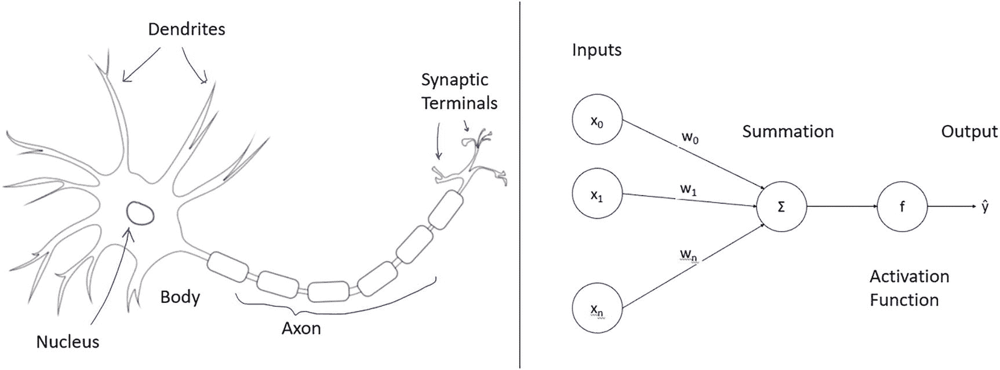

**图 13-1** 生物神经元与人工神经元的比较

正如神经元聚集在一起形成大脑的各个部分，共同负责识别某些模式或执行某个动作一样，人工神经网络也由大量这样的单元组成。正如我们在前一章中看到的，神经元或计算单元组合来自多个来源的信号，应用一个激活函数，并将处理后的信号传递给与其相连的其他神经元。在实际应用中，可能存在数十到数百万个神经元，它们可以被训练，根据训练数据中的输入和期望输出值来运行和激活。

在本章中，我们将研究神经网络，其中计算单元的层彼此连接，直到一个输出层。在这些网络中，输入信号在每一层被运算并前馈，而训练过程则比较输出并回溯所需的更改，以开发出更好的神经网络。

本章涵盖的概念构成了更先进的深度神经网络架构的基础。我们将讨论通过一个称为反向传播的过程来训练神经网络，该过程基于梯度下降。我们将使用 PyTorch 为回归和分类问题创建神经网络。

## 前馈神经网络

前馈神经网络是人工神经网络的一种简单形式，其中计算单元将值逐步向输出端传递，并以一种高效的方式组合它们，从而得到改进的结果。前馈神经网络中的计算单元将信息向前传播（没有循环或反向链接），经过隐藏节点，然后到达输出节点。图 13-2 展示了一个简单的前馈神经网络示例。

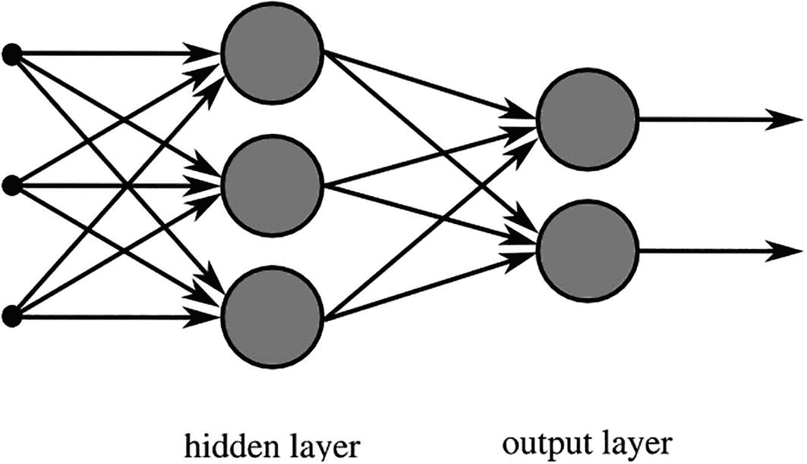

**图 13-2** 一个简单的前馈神经网络

### 训练神经网络

反向传播是训练神经网络的过程。反向传播大致基于自 20 世纪 60 年代以来一直在使用的技术，尽管它在 1986 年由 Rumelhart、Hinton 和 Williams 明确定义，随后在 1987 年由 Yann LeCun 进行了研究。在此期间，神经网络领域出现了几项有前景的工作，它们构成了当今深度学习领域的基础，尽管由于当时有限的计算基础设施，它们未能引起公众的广泛关注。后来，大约在 2010 年代，计算机处理器和图形处理器（GPU）的成本急剧下降，从而促进了已有数十年历史的模型的改进和新颖神经网络架构的创建，进而推动了它们在语音识别、计算机视觉和自然语言处理中的应用。

#### 梯度下降

神经网络的训练需要一个称为 `梯度下降` 的过程，这是一种用于寻找损失函数或成本函数最小值（或最大值）的迭代算法。想象一个回归问题（类似于我们在第 7 章中看到的），其中基于一个连续输入变量来确定一个连续输出变量。在大多数实际情况下，预测输出（如图 13-3 中的线所示）不会与实际（期望）输出完全相同。这种差异称为误差或残差，学习算法的目标是最小化总残差或残差的某种其他聚合。

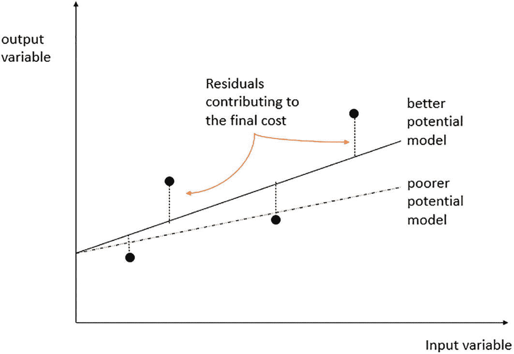

**图 13-3** 回归模型中的误差

学习过程倾向于学习一条直线的方程参数，形式为 `y` = `w[0]` + `w[1]`*`x[1]` + `w[2]`*`x[2]` + ⋯。为了简化我们的示例，我们将只关注一个变量，因此得到 `y` = `w[0]` + `w[1]`*`x[1]`。解决此类问题的方法之一是梯度下降。在这个例子中，我们定义一个优化函数，这里是一个成本函数，它显示了模型的结果与训练数据中实际值的差距。在线性回归中，我们可以使用均方误差，即模型预测值与实际值之差的平方的平均值。

```
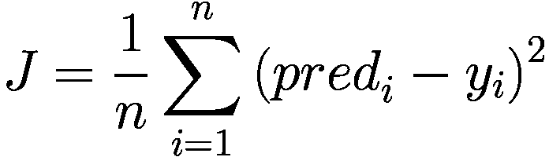
```

梯度下降背后的思想是，训练良好的模型应该是成本函数最小化的模型。每一组可能的斜率（`w[0]`, `w[1]`,…）都会产生一个不同的模型。图 13-4 显示了成本相对于某个斜率（例如 `w[1]`）的变化。

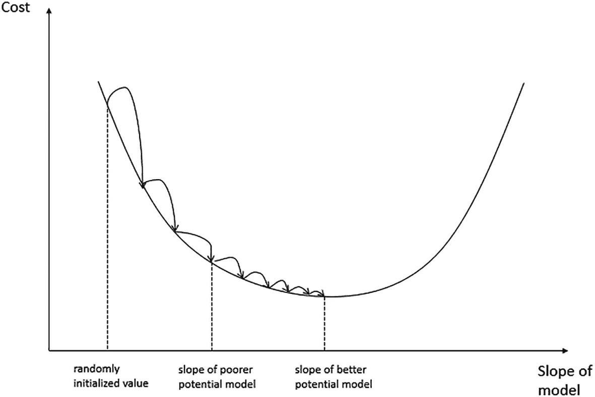

**图 13-4** 梯度下降算法旨在找到使成本最小化的参数

我们的目标是找到一个能产生最小成本的斜率。你可以在图中看到曲线最低点对应的点。梯度下降算法从一个随机初始化的值开始，并根据该点处成本相对于斜率的偏导数所给出的斜率，算法会进行如下更改：

```
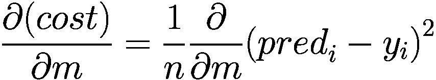
```

这可以简化为：

```
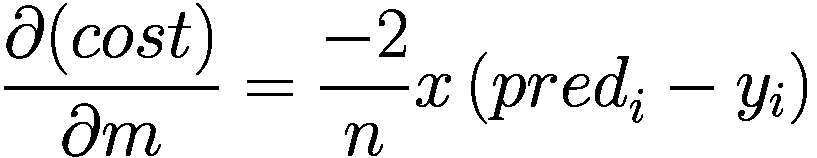
```

这表示 `m` 值的更新，理想情况下应导向一个成本较低的模型。这个过程是反向传播算法的基础，通过正确选择损失函数，我们可以训练神经网络来解决更复杂的问题。

如果我们将这个想法转化为神经网络的术语，梯度下降为我们提供了一种方法来更新单层神经网络的权重，就像我们在前一章中看到的那样。

#### 反向传播

在多层级网络中，此方法可直接应用于最终层，我们可以在该层找到实际值（或目标值）与预测值之间的差异；然而，这无法应用于隐藏层，因为我们没有任何目标值可供比较。为了持续更新神经网络中所有单个细胞的权重，我们计算最终层的误差，并将该误差从最后一层反向传播到第一层。这个过程被称为反向传播。

让我们考虑一个简化的神经网络，它包含一个隐藏层，如图 13-5 所示。我们只有三个节点：第一个代表输入，第二个是隐藏层，它根据权重 `w[1]` 和偏置 `b[1]` 对输入执行计算，第三个是输出层，它也根据权重 `w[2]` 和偏置 `b[2]` 对隐藏层的输出执行计算。

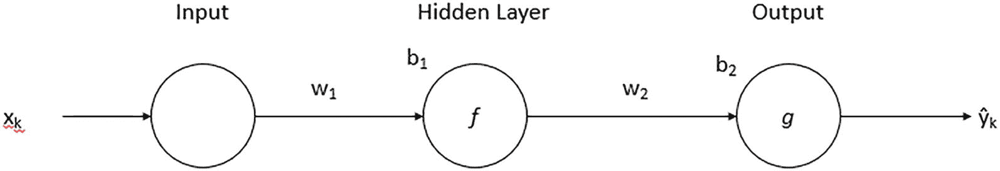

图 13-5 含一个隐藏层的简化神经网络

这里，第一个节点接收输入并将其转发给第二个节点，即隐藏层。隐藏层将权重 `w[1]` 应用于输入并加上偏置 `b[1]`，从而产生 `w[1]x[k]+b[1]`，然后对其应用激活函数 `f`。因此，隐藏层的输出是 `f(w[1]x[k]+b[1])`。

隐藏层的输出被转发作为第三个单元的输入。这将乘以 `w[2]` 并加上偏置 `b[2]`。因此，第三个单元的输入是 `w[2] *f(w[1]x[k]+b[1]) + b[2]`。

当对其应用激活函数 `g` 时，它产生输出 `g(w[2] *f(w[1]x[k]+b[1]) + b[2])`，这就是预测输出，在图 13-5 中也表示为 `ŷ[k]`。

这个前向传播过程在训练阶段的每次迭代中都会发生。一旦我们知道训练数据集中所有项的预测值，我们就可以找到损失函数或代价函数。为了解释这一点，我们继续使用上一节定义的相同损失函数。

```
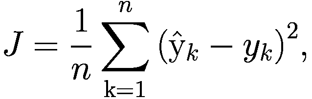
```

（其中）

```
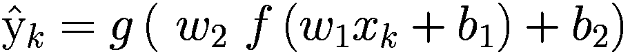
```

我们知道，可以计算损失函数关于 `w[1]` 的导数来更新 `w[1]`，以便在下一次迭代中减少整体损失。

```
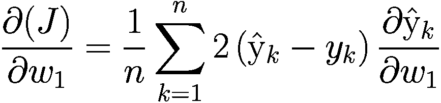
```

这引出了另一个量，使用链式法则求解如下：

# 反向传播

我们可以通过链式法则计算损失函数关于权重 ${w}_1$ 的偏导数。

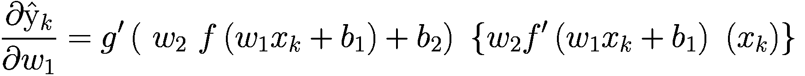

或者

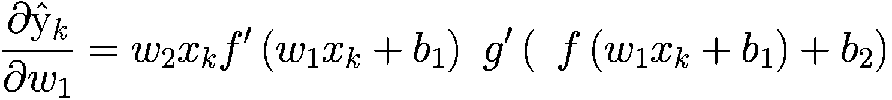

我们可以找到关于 `w[2]` 的偏导数，如下所示：

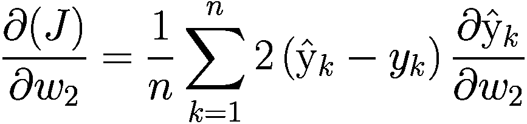

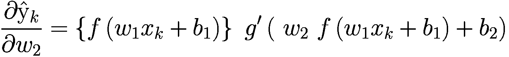

因此，在更复杂的网络中，我们可以继续沿反向方向计算偏导数。我们会注意到，有一些量我们之前已经计算过，例如前面例子中的 `f(w[1]x[k] + b[1])`。你可以看到，在每次迭代中，中间值和输出值在前向传递过程中被计算出来，随后是从输出层开始，使用梯度下降更新权重的过程，并向后移动直到所有权重都被更新。这被称为反向传播。

## 损失函数

在前面的解释中，我们使用了一个称为均方误差（MSE）的损失函数。由于其性质，这种损失函数适用于输出为连续变量的回归问题。根据手头的问题，你还可以使用其他几种常见的损失函数。

### 均方误差（MSE）

该函数计算实际值与预测值之间误差的平方和的平均值。它会对模型的大误差进行惩罚，而忽略小误差。这也被称为 L2 损失。对于两个值 `y` 和 `ŷ`（通常分别是期望输出和预测输出），每个训练样本的误差分量由下式给出：

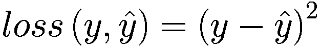

### 平均绝对误差

不考虑平方，我们可以简单地查看误差的绝对值之和，并在整个数据集上取平均值。这也被称为 L1 损失，并且它对异常值具有鲁棒性。

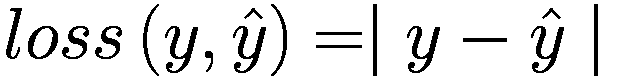

### 负对数似然损失

在简单的分类问题中，负对数似然损失是一个高效的选择，它鼓励模型以高概率正确预测，并在模型以较低概率预测正确类别时对其进行惩罚。

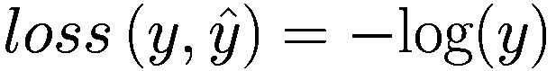

### 交叉熵损失

这是一个适用于分类问题的函数。它会惩罚模型以高概率产生错误输出。在训练具有 `C` 个类别的分类问题时，它是最常用的损失函数之一。

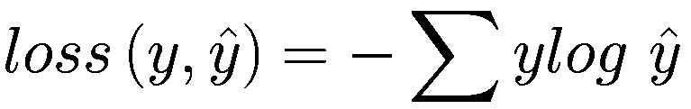

### 铰链损失

在希望学习非线性嵌入的问题中，铰链损失根据输入张量 `x` 和标签张量 `y`（包含 1 或 -1）来衡量损失。这通常用于衡量两个输入是相似还是不相似。

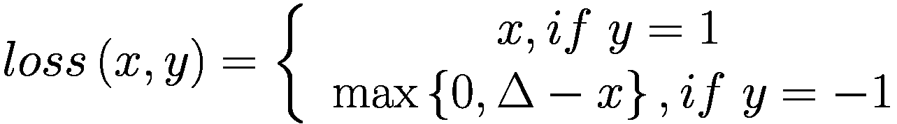

关于 PyTorch 中定义的更多损失函数，你可以查阅官方文档。^(¹³)

## 用于回归的 ANN

让我们使用 PyTorch 创建一个用于回归问题的简单神经网络。首先，创建一个包含一个自变量 (`X`) 和一个因变量 (`y`) 的简单数据集，其中 `X` 和 `y` 之间可能存在近似线性的关系。我们将创建形状为 `[20,1]` 的张量，表示 20 个输入值和 20 个输出值。输出图如图 13-6 所示。

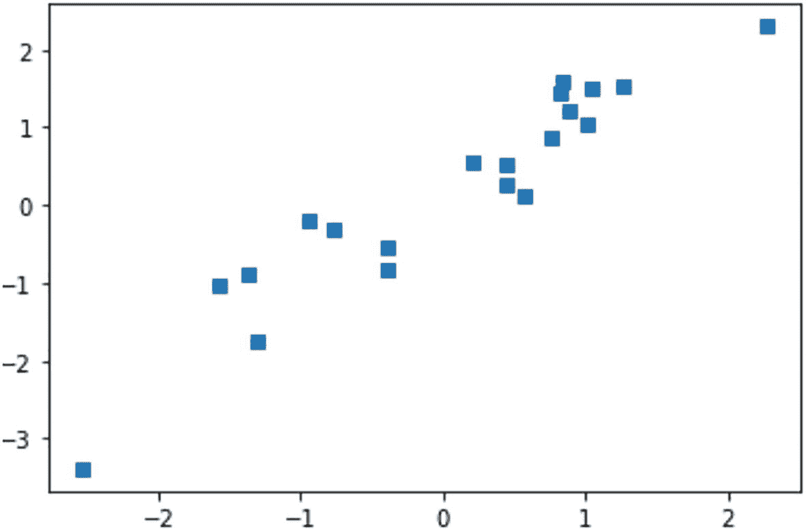

图 13-6

随机生成的回归样本

```python
from matplotlib import pyplot
import torch
import torch.nn as nn
x = torch.randn(20,1)
y = x + torch.randn(20,1)/2
pyplot.scatter(x,y)
pyplot.show()
```

数据已准备就绪。该模型是一个简单的顺序模型，它将包含一个输入层，后跟一个激活函数，以及另一个输出层。

```python
model = nn.Sequential(
nn.Linear(1,1),
nn.ReLU(),
nn.Linear(1,1)
)
```

激活函数是应用于加权输入 `f(w[i]x[i])` 的函数 `f`。ReLU，即修正线性单元，是一个简单的函数，对于任何负输入，它输出 0；对于正输入，它输出不变的输入值。我们将在下一节讨论 ReLU 和其他激活函数。

因为我们只有一个输入变量，我们期望学习两个权重：`w[1]` 和 `b`。为便于实现，我们将 `b` 称为 `w[0]`。对于输入线性层和输出线性层，将各有两个权重集，因此总共有四个随机初始化的权重，我们需要在训练过程中学习它们。让我们查看模型参数，以了解将要学习的数量。

```python
list(model.parameters())
Out: [Parameter containing:
tensor([[-0.7681]], requires_grad=True),
Parameter containing:
tensor([0.2275], requires_grad=True),
Parameter containing:
tensor([[0.1391]], requires_grad=True),
Parameter containing:
tensor([-0.1167], requires_grad=True)]
```

现在，我们可以开始学习权重的过程，该过程使用定义为优化器的方法来最小化损失函数。但是，请记住，PyTorch 要求数据以张量的形式存在。让我们快速 (1) 将数据缩放到 `0`–`1` 范围内，并且 (2) 转换为张量。

```python
x = (x-x.min())/(x.max()-x.min())
y = (y-y.min())/(y.max()-y.min())
```

现在，我们需要初始化均方误差 (MSE) 损失函数和一个优化器，该优化器将使用随机梯度下降来更新权重。

```python
lossfunction = nn.MSELoss()
optimizer = torch.optim.SGD(model.parameters(), lr=0.05)
```

在初始化优化器时，我们定义了一个学习率为 `0.05`。这会影响权重更新的速度（快或慢）。

学习过程需要多次迭代，分为三个步骤：

1.  前向传播：使用当前的权重集计算输出。

2.  损失计算：将输出与实际值进行比较。

3.  反向传播：使用损失来更新权重。

这里，我们使用一个 `for` 循环来迭代 50 个周期。在此过程中，我们还将跟踪损失，以便稍后可视化误差如何随周期变化。

# 神经网络基础与训练

```
loss_history = []
for epoch in range(50):
pred = model(x)
loss = lossfunction(pred, y)
loss_history.append(loss)
optimizer.zero_grad()
loss.backward()
optimizer.step()
```

经过 50 次迭代后，我们期望损失足够低，以产生不错的结果。让我们通过绘制 `loss_history` 图表来可视化损失的变化。我们必须记住，由 `lossfunction()` 产生的损失对象也将包含作为张量的数据，我们需要将其分离，以便 Matplotlib 可以处理它。

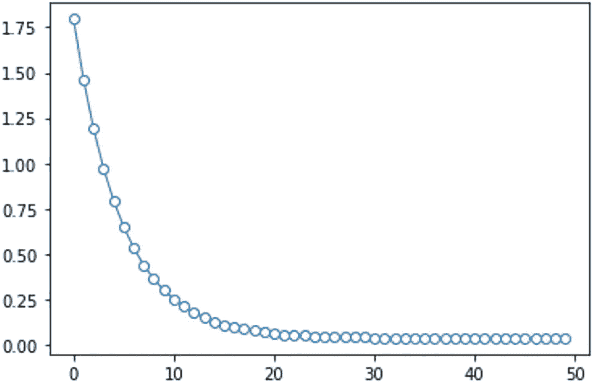

图 13-7

随着模型训练更多周期，损失减少，并在某点后收敛

```
import matplotlib.pyplot as plt
plt.plot([x.detach() for x in loss_history], 'o-', markerfacecolor='w', linewidth=1)
plt.plot()
```

从图 13-7 可以明显看出，损失在第十个周期之前迅速下降，之后误差变得非常低，梯度减小，进一步的变化变慢——直到大约第 30 个周期，之后损失保持不变，权重的变化微乎其微。

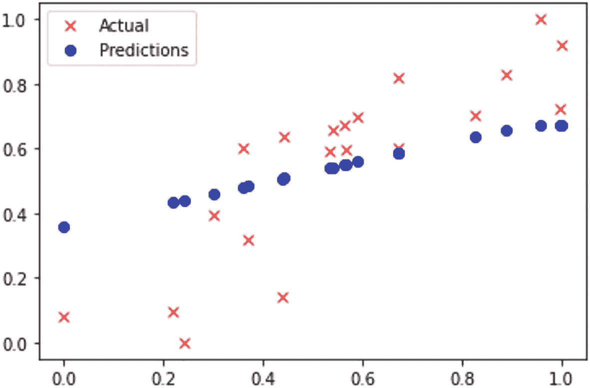

图 13-8

简单神经网络预测的实际值和输出

让我们看看系统产生的结果。由此产生的结果如图 13-8 所示。

```
predictions = model(x)
plt.plot(x, y, 'rx', label="实际值")
plt.plot(x, predictions.detach(), 'bo', label="预测值")
plt.legend()
plt.show()
```

这个过于简单的单层神经网络对于可以使用相当直接的统计解决方案的问题，可能并不总能给出最佳结果。尽管图表显示损失明显减少，但最终的回归线可能不会像你期望的那样紧密拟合。你可以多次定义模型并训练它，以观察由于随机初始化而产生的差异。

有了这个模型，你现在就可以处理更复杂的神经网络架构了。我们将首先构建一个具有不同激活函数的多层神经网络，并使用我们迄今为止使用的相同数据集来对鸢尾花进行分类。

# 激活函数

神经网络中的每个计算单元接收输入，乘以权重，加上偏置，并在将其转发到下一层之前对其应用激活函数。这成为下一层计算单元的输入。在此示例中，我们使用了修正线性单元 (ReLU)，对于输入 `x`，如果 `x>0`，则返回 `x`；否则返回 0。因此，如果一个单元的加权计算产生负值，ReLU 会将其设为 0，这将成为下一层的输入。如果输入为零或负数，激活函数的导数为 0，否则为 1。

已经定义了许多激活函数。以下是一些你可能经常看到使用的激活函数。

## ReLU 激活函数

修正线性单元是一个简单高效的函数，如果输入为正，则原样输出；对于负输入则不激活；因此，它修正了传入的信号。它在计算上快速、非线性且可微。其定义如下：

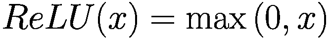

然而，由于在负输入的情况下，神经元完全不影响输出，其对输出的贡献变为零，因此在反向传播期间无法学习。这通过 `ReLU` 的一个变体（称为 `LeakyReLU`）得到了解决。

图 13-9 显示了 `ReLU` 和 `LeakyReLU` 的图形。

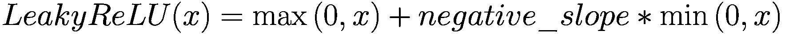

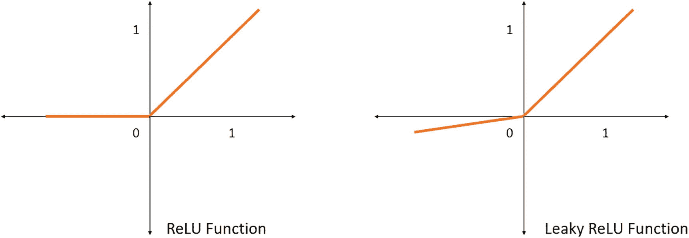

图 13-9

`ReLU` 和 `LeakyReLU` 激活函数

`LeakyReLU` 为负信号产生一个相对较小的输出，这可以通过更改 `negative_slope` 来配置。

## Sigmoid 激活函数

Sigmoid 函数输出介于 0 和 1 之间的值，对于负输入，输出值接近 0；对于正输入，输出值接近 1。当输入为 0 时，输出为 0.5。你可以在图 13-10 中看到 Sigmoid 激活函数的图像。该函数非常适合分类问题，如果用于输出层，介于 0 和 1 之间的输出值可以解释为概率。

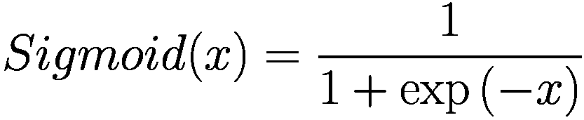

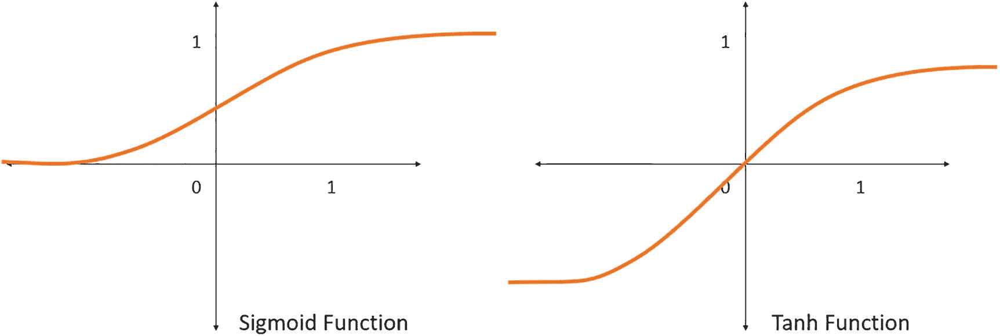

图 13-10

Sigmoid 和 tanh 激活函数

然而，Sigmoid 的计算成本更高。如果输入值过大或过小，可能导致神经网络停止学习。这个问题被称为梯度消失问题。

## Tanh 激活函数

Tanh 函数与 Sigmoid 函数类似，但输出介于 -1 和 1 之间，对于负输入，输出值接近 -1；对于正输入，输出值接近 1。该函数经过原点 (0,0)。Tanh 函数的图像如图 13-10 所示。你可以看到，虽然这两个函数看起来相似，但 tanh 函数有显著不同。

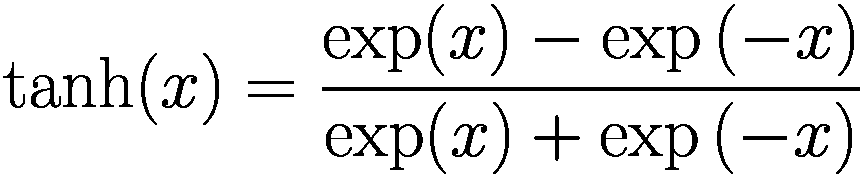

尽管形状相似，但 tanh 函数的梯度远强于 Sigmoid 函数。它也用于我们希望将负输入作为负输出传递的层。

如果向 Sigmoid 函数提供一个非常大的负输入，输出值将接近零，因此在反向传播过程中，权重更新会非常缓慢。在这种情况下，Tanh 函数能改善网络的性能。

# 多层人工神经网络

我们可以通过 (1) 在层中添加更多计算单元以及 (2) 添加更多层来使网络稍大一些。我们可以通过修改上一个示例中指定层的方式来调整网络。

```
model = nn.Sequential(
nn.Linear(1,8),
nn.ReLU(),
nn.Linear(8,4),
nn.Sigmoid(),
nn.Linear(4,1),
)
```

这里，我们定义了一个输入层，它接收一个输入并将其转发到具有八个单元的层。随后是 `ReLU` 激活函数，然后进入具有八个单元的层，该层再转发到具有四个单元的另一个层。接着是 `Sigmoid` 激活函数，最后转发到具有一个单元的输出层。

如果需要，我们可以修改输出层使其包含多个单元。让我们处理一个之前见过的多类分类问题。鸢尾花数据集包含来自三种鸢尾花品种的样本。我们可以在输出层创建三个单元，这些单元将指示一个鸢尾花样本属于三个类别之一的概率。

让我们像之前一样导入鸢尾花数据集。

```
import pandas as pd
import numpy as np
from sklearn.datasets import load_iris
from sklearn.preprocessing import StandardScaler
iris = load_iris()
df = pd.DataFrame(data=iris.data, columns=iris.feature_names)
df['class'] = iris.target
x = df.drop(labels='class', axis=1).astype(np.float32).values
y = df['class'].astype(np.float32).values
```

因为我们将使用 PyTorch，所以导入所需的库。

```
import torch, torch.nn as nn
```

现在我们需要将 `x` 和 `y` 转换为张量。这可以使用 `torch.tensor()` 完成。请注意，我们还将把张量转换为所需的数据类型，以避免在后续阶段出现数据格式相关的问题。

```
data = torch.tensor( x ).float()
labels = torch.tensor( y ).long()
print (data.size())
print (labels.size())
Out: torch.Size([150, 4])
torch.Size([150])
```

现在我们将定义一个简单的神经网络，它接受四个输入，隐藏层有 16 个单元，输出层有三个单元。所有激活函数都使用 `ReLU`。该网络的示意图如图 13-11 所示。

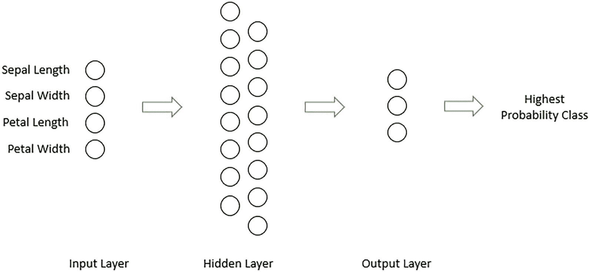

图 13-11

一个具有一个隐藏层的简单神经网络

# PyTorch 神经网络训练与决策边界可视化

## 模型定义

```
model = nn.Sequential(
    nn.Linear(4,16),
    nn.ReLU(),
    nn.Linear(16,16),
    nn.ReLU(),
    nn.Linear(16,3),
)
```

## 损失函数与优化器定义

让我们定义损失函数和优化器。

```
crossentropyloss = nn.CrossEntropyLoss()
optimizer = torch.optim.SGD(model.parameters(),lr=.01)
```

## 训练循环与性能跟踪

现在我们可以启动训练循环。在这个例子中，我们将训练 1000 次迭代，即 1000 个周期。与上一个示例一样，我们将跟踪损失以可视化学习过程。我们还将通过比较模型的预测与原始数据集中的值来计算准确率，并记录这些值以便可视化。

```
maxiter = 1000
losses = []
accuracy = []
for epoch in range(maxiter):
    preds = model(data)
    loss = crossentropyloss(preds,labels)
    losses.append(loss.detach())
    optimizer.zero_grad()
    loss.backward()
    optimizer.step()
    matches = (torch.argmax(preds,axis=1) == labels).float()
    matchesNumeric = matches.float()
    accuracyPct = 100*torch.mean(matches)
    accuracy.append( accuracyPct )
```

## 训练结果可视化

经过 1000 次迭代后，我们假设损失已充分降低，准确率已趋于稳定。让我们绘制这两个图表：

```
import matplotlib.pyplot as plt
fig,ax = plt.subplots(1,2,figsize=(13,4))
ax[0].plot(losses)
ax[0].set_ylabel('Loss')
ax[0].set_xlabel('epoch')
ax[0].set_title('Losses')
ax[1].plot(accuracy)
ax[1].set_ylabel('accuracy')
ax[1].set_xlabel('epoch')
ax[1].set_title('Accuracy')
plt.show()
```

`图 13-12` 显示了损失的逐渐下降，在 800 个周期之后几乎不再有显著变化。准确率图表显示，在初始周期中准确率急剧上升，并达到了足够高的水平。

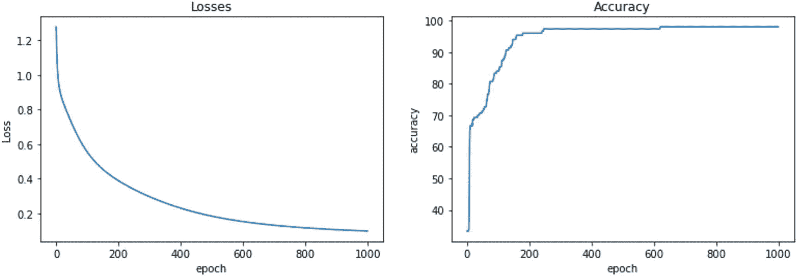

`图 13-12`

损失减少和准确率随训练轮次增长的曲线图

## 最终准确率评估

为了监控准确率，我们再次对最终模型进行预测，并与原始值进行比较：

```
predictions = model(data)
predlabels = torch.argmax(predictions,axis=1)
final_accuracy = 100*torch.mean((predlabels == labels).float())
final_accuracy
Out: tensor(98.)
```

我们已经获得了足够好的准确率。

## 决策边界可视化

然而，与其在此结束这个实验，不如去理解此类网络会创建怎样的决策边界，这将是一个有趣的想法。这可能会揭示更多关于人工神经网络如何创建边界的见解。

为此，我们将创建一个新程序，以便模型基于数据的两个维度（而非四个维度）进行构建。以下是完整代码：

```
import matplotlib.pyplot as plt
import pandas as pd
import numpy as np
from sklearn.datasets import load_iris
from sklearn.preprocessing import StandardScaler
import torch, torch.nn as nn
from matplotlib.colors import ListedColormap

iris = load_iris()
df = pd.DataFrame(data=iris.data, columns=iris.feature_names)
df['class'] = iris.target

x = df.drop(labels='class', axis=1).astype(np.float32).values
y = df['class'].astype(np.float32).values

data = torch.tensor( x[:,1:3] ).float()
labels = torch.tensor( y ).long()

model = nn.Sequential(
    nn.Linear(2,128),   # 输入层
    nn.ReLU(),         # 激活函数
    nn.Linear(128, 128),  # 隐藏层
    nn.Sigmoid(),         # 激活函数
    nn.Linear(128,3),   # 输出层
)
crossentropyloss = nn.CrossEntropyLoss()
optimizer = torch.optim.SGD(model.parameters(),lr=.01)

maxiter = 1000
for epochi in range(maxiter):
    preds = model(data)
    loss = crossentropyloss(preds,labels)
    optimizer.zero_grad()
    loss.backward()
    optimizer.step()
```

## 等高线图绘制

此时，模型已经训练完毕，我们可以继续准备一个二维空间，用于绘制等高线图，该图将根据模型对每个点的标记方式显示决策边界。

```
x1_min, x1_max = x[:, 1].min() - 1, x[:, 1].max() + 1
x2_min, x2_max = x[:, 2].min() - 1, x[:, 2].max() + 1
xx1, xx2 = np.meshgrid(np.arange(x1_min, x1_max, 0.01), np.arange(x2_min, x2_max, 0.01))

predictions = model(torch.tensor(np.array([xx1.ravel(), xx2.ravel()]).astype(np.float32)).T)
predlabels = torch.argmax(predictions,axis=1)

markers = ('s', 'x', 'o', '^', 'v')
colors = ('red', 'blue', 'lightgreen', 'gray', 'cyan')
cmap = ListedColormap(colors[:len(np.unique(y))])

Z = predlabels.T
Z = Z.reshape(xx1.shape)

plt.contourf(xx1, xx2, Z, alpha=0.3, cmap=cmap)
plt.xlim(xx1.min(), xx1.max())
plt.ylim(xx2.min(), xx2.max())
for idx, cl in enumerate(np.unique(y)):
    plt.scatter(x=x[y == cl, 1],  y=x[y == cl, 2], c=colors[idx], marker=markers[idx], alpha=0.5, label=cl,  edgecolor='black')
```

因此，我们将得到一个清晰的图，展示二维特征空间中每个点如何被分类，如 `图 13-3` 所示。在此基础上，我们还叠加了原始训练点。

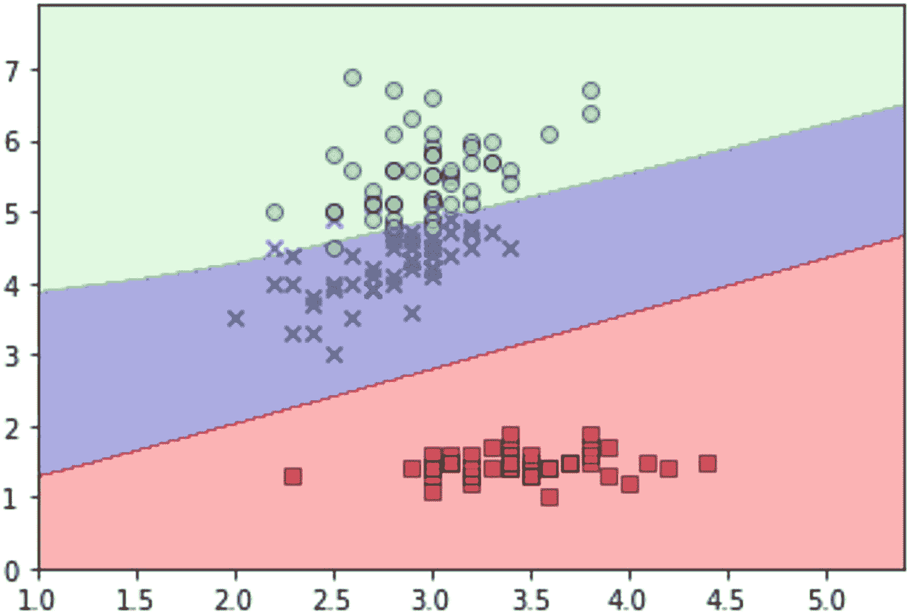

`图 13-13`

神经网络为分类鸢尾花数据创建的决策边界

根据网络结构和激活函数的不同，边界可能会有很大差异。然而，这里一个有趣的模式是决策边界可能不是直线——对于更复杂的数据，它们甚至可能更加复杂。

## 神经网络类定义

既然你已经了解了如何构建神经网络，让我们选择另一个分类问题并加以实践。

### PyTorch 中的神经网络类

在前面的示例中，我们总是使用 `nn.Sequential()` 来定义神经网络的结构，它允许我们定义层和激活函数如何相互连接。另一种定义网络的方式是创建一个继承自 `nn.Module` 的神经网络类，该类定义将要使用的层，并实现一个方法来定义前向传播如何进行。当你想要建模一个复杂模型，而不是现有模块的简单序列时，这种方法特别有用。

让我们使用 `sklearn` 的 `make_classification()` 方法准备用于分类的数据，以创建两个不同的簇。

## 定义简单神经网络

```python
from sklearn.datasets import make_classification
import matplotlib.pyplot as plt
X, y = make_classification(n_samples=100, n_features=2, n_redundant=0, n_informative=2, n_clusters_per_class=1, n_classes=2, random_state=15)
plt.scatter(X[:, 0], X[:, 1], marker='o', c=y, s=25, edgecolor='k')
```

现在，我们将定义一个简单的神经网络，它包含一个接受两个输入的输入层、一个具有八个节点的隐藏层以及一个具有一个节点（表示类别 0 或 1）的输出层。

```python
import torch, torch.nn as nn, torch.nn.functional as F
import numpy as np
class MyNetwork(nn.Module):
    def __init__(self):
        super().__init__()
        self.input = nn.Linear(2,8)
        self.hidden = nn.Linear(8,8)
        self.output = nn.Linear(8,1)
    def forward(self,x):
        x = self.input(x)
        x = F.relu( x )
        x = self.hidden(x)
        x = F.relu(x)
        x = self.output(x)
        x = torch.sigmoid(x)
        return x
```

在这个类中，我们需要明确指定层和激活函数的顺序，以及我们将在下一节中看到的额外操作。这个类可以被实例化，并且模型可以像我们在前面的示例中那样，在多个训练轮次上进行训练。我们添加了几行代码来打印一个图表，以显示损失的变化，如图 13-14 所示。

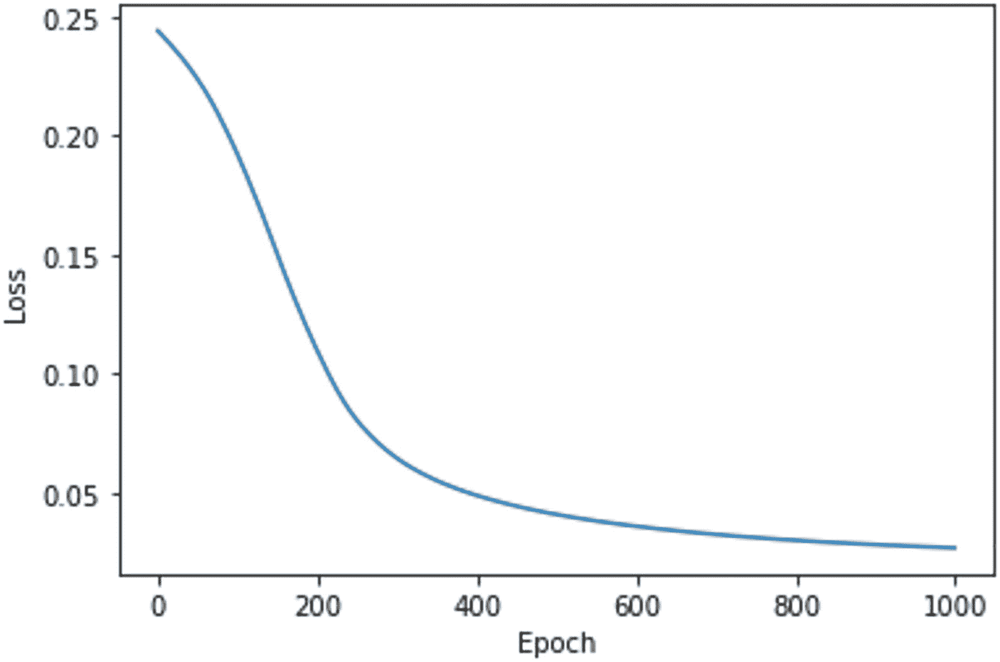

图 13-14 分类损失随训练轮次的变化

```python
mymodel = MyNetwork()
data = torch.tensor(X.astype(np.float32))
labels = torch.tensor(y.reshape(1,100).T.astype(np.float32))
learningRate = .05
lossfun = nn.MSELoss()
optimizer = torch.optim.SGD(mymodel.parameters(),lr=learningRate)
numepochs = 1000
losses = torch.zeros(numepochs)
for epochi in range(numepochs):
    yHat = mymodel(data)
    loss = lossfun(yHat,labels)
    losses[epochi] = loss
    optimizer.zero_grad()
    loss.backward()
    optimizer.step()
# 显示损失
plt.plot(losses.detach())
plt.xlabel('训练轮次')
plt.ylabel('损失')
plt.show()
```

创建这样的类有助于我们定义更复杂的网络模块，这些模块可能由多个较小的模块组成，尽管在较简单的网络中，`Sequential` 是一个不错的选择。

### 过拟合与丢弃法

正如我们在前几章中看到的，过拟合是机器学习任务中的常见问题，即模型可能从训练数据集中学习过多，导致泛化能力不佳。这在神经网络中同样存在，并且由于其灵活的特性，神经网络更容易出现过拟合。

通常，解决过拟合有两种方法。一种是使用足够大量的训练数据样本。第二种方法则需要通过调整网络结构和网络参数来修改网络的复杂度。你可以减少模型中的某些层，或者减少每层中的计算节点数量。

另一种在神经网络中广泛使用的方法称为丢弃法。你可以在特定层定义丢弃操作，使得模型在训练过程中随机地、有意识地忽略部分节点，从而使这些节点被丢弃——这样它们就无法从训练数据样本中“学习过多”。

由于丢弃意味着更少的计算量，训练过程会变得更快，尽管你可能需要更多的训练轮次来确保损失足够低。实践证明，使用丢弃法能有效减少复杂图像分类和自然语言处理问题中的过拟合现象。

在 PyTorch 中，丢弃法可以通过设置丢弃概率来定义，如下所示：

```python
dropout = nn.Dropout(p=prob)
```

在神经网络类中，我们可以在前向传播定义中添加丢弃层，并预设 20% 的丢弃率。请参见以下代码中的改动：

```python
class MyNetwork(nn.Module):
    def __init__(self):
        super().__init__()
        self.input = nn.Linear(2,8)
        self.hidden = nn.Linear(8,8)
        self.output = nn.Linear(8,1)
    def forward(self,x):
        x = self.input(x)
        x = F.relu( x )
        x = F.dropout(x,p=0.2)
        x = self.hidden(x)
        x = F.relu(x)
        x = F.dropout(x,p=0.2)
        x = self.output(x)
        x = torch.sigmoid(x)
        return x
```

如果你持续追踪损失值，它们可能会像图 13-15 所示。尽管损失值并非平滑下降，但我们最终会发现，随着训练轮次的增加，损失值会逐渐降低，并且经过一定轮次后，网络很可能被训练到具有足够可用损失值的状态。

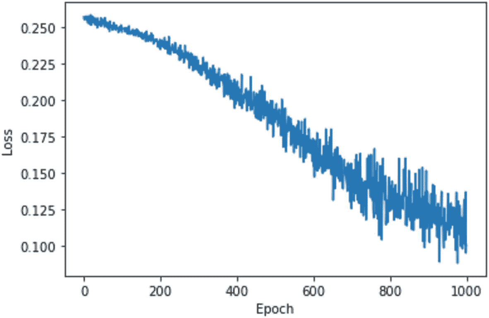

图 13-15 损失函数的变化

## 对手写数字进行分类

现在我们已经能够创建基本的神经网络，接下来让我们使用一个更真实的数据集，来解决一个图像分类问题。对于这个任务，我们将使用由 Yann LeCun 推广的数据集，该数据集包含 70,000 个手写数字样本，称为 MNIST（改进的国家标准与技术研究所）数据库。这个数据集已被广泛用于图像处理和分类。图 13-16 展示了一些数字示例。

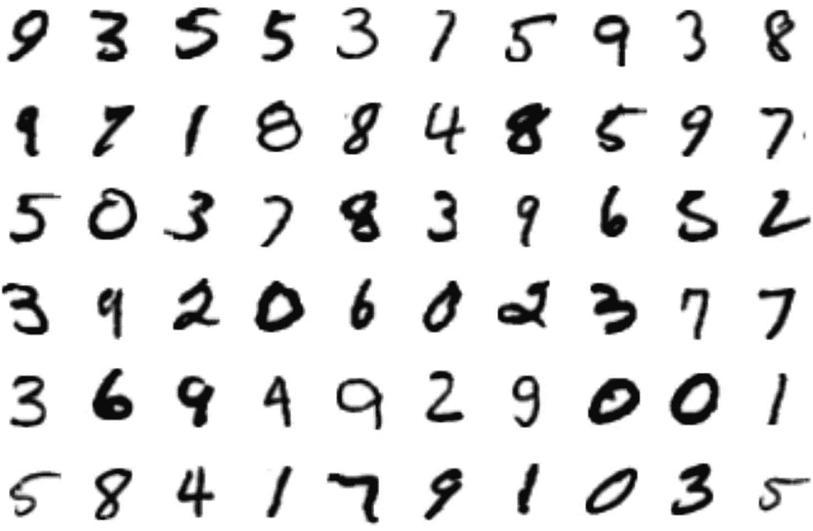

图 13-16 来自 MNIST 数字数据集的数字

让我们导入所需的库。对于这个程序，我们还需要导入 `torchvision`，它是 PyTorch 的一部分，提供了各种数据集、模型和图像变换功能。

```python
import numpy as np
import matplotlib.pyplot as plt
import torch
import torch.nn as nn
import torch.optim as optim
import torchvision
from torchvision import datasets, transforms
```

在以编程方式下载数据集之前，我们可以定义一个必须应用的变换列表，以帮助我们处理数据集。我们需要将图像转换为张量格式。我们可以使用 `torchvision.datasets()` 来下载数据集。

```python
transform = transforms.Compose([transforms.ToTensor()])
trainset = datasets.MNIST('train', download=True, train=True, transform=transform)
testset = datasets.MNIST('test', download=True, train=False, transform=transform)
train_loader = torch.utils.data.DataLoader(trainset, batch_size=64, shuffle=True)
test_loader = torch.utils.data.DataLoader(testset, batch_size=64, shuffle=True)
```

文件将被导出到“/train/MNIST/raw”和“/test/MNIST/raw”文件夹中。接下来的两行代码分别为训练数据和测试数据初始化了一个 `DataLoader` 对象。`DataLoader` 并不直接提供数据，而是可以通过用户定义的可迭代对象来控制。在定义神经网络之前，让我们先查看一个数据项。以下代码将生成一批包含 64 个元素的训练数据。

```python
dataiter = iter(train_loader)
images, labels = dataiter.next()
```

你可以使用以下代码定位一张图片：

```python
plt.imshow(images[0].numpy().squeeze(), cmap='gray_r');
```

每个数字都位于一个 28x28 像素的方框中。在这个灰度数据集中，每个像素包含一个从 0 到 255 的值，表示颜色（以暗度表示）。因此，每张图像由 784 个值定义。现在我们可以继续定义网络了。我们知道输入层包含 784 个单元，输出层包含 10 个单元，每个单元代表一个数字。我们将再添加两个隐藏层，每层包含 64 个单元。在这个例子中，我们将激活函数保持为 ReLU，并且由于这是一个多分类问题，损失层将使用交叉熵。图 13-17 总结了我们将在本例中创建的神经网络。

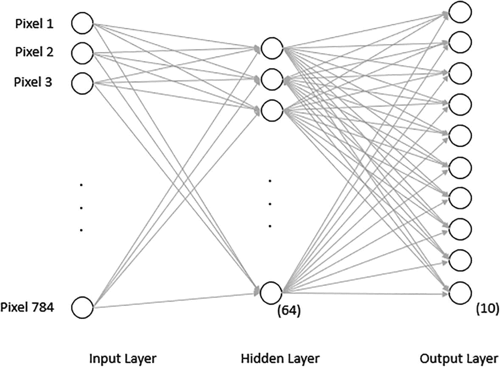

图 13-17

用于对手写数字进行分类的神经网络。输入长度始终为 784，输出长度为 10，每个输出代表一个数字

```python
model = nn.Sequential(nn.Linear(784, 64),
nn.ReLU(),
nn.Linear(64,64),
nn.ReLU(),
nn.Linear(64,10),
)
print(model)
```
Out:
```
Sequential(
(0): Linear(in_features=784, out_features=64, bias=True)
(1): ReLU()
(2): Linear(in_features=64, out_features=64, bias=True)
(3): ReLU()
(4): Linear(in_features=64, out_features=10, bias=True)
)
```

现在我们定义损失函数和优化器。

```python
lossfn = nn.CrossEntropyLoss()
optimizer = torch.optim.SGD(model.parameters(),lr=.01)
```

在训练阶段，我们将轮次数限制为十次，因为这个数据集比我们之前涉及的示例要大得多。不过，这应该足以将损失降低到足够低的水平，使模型能够对大多数示例进行良好预测。在每个轮次内，`train_loader` 会以每批 64 个条目的方式迭代数据。

```python
losses = []
for epoch in range(10):
running_loss = 0
for images, labels in train_loader:
images = images.view(images.shape[0], -1)
optimizer.zero_grad()
output = model(images)
loss = lossfn(output, labels)
loss.backward()
optimizer.step()
running_loss += loss.item()
print("Epoch {} - Training loss: {}".format(epoch, running_loss/len(train_loader)))
losses.append(running_loss/len(train_loader))
```

这应该会显示每个周期（`epoch`）中损失逐渐减少。

```
Epoch 0 - Training loss: 1.7003767946635737
Epoch 1 - Training loss: 0.5622020193190971
Epoch 2 - Training loss: 0.4039541946005211
Epoch 3 - Training loss: 0.35494661225534196
Epoch 4 - Training loss: 0.32477016467402486
Epoch 5 - Training loss: 0.302617403871215
Epoch 6 - Training loss: 0.2849765776086654
Epoch 7 - Training loss: 0.2697247594261347
Epoch 8 - Training loss: 0.25579357369622185
Epoch 9 - Training loss: 0.24312975907773732
```

图 13-18 展示了损失随时间减少的情况。

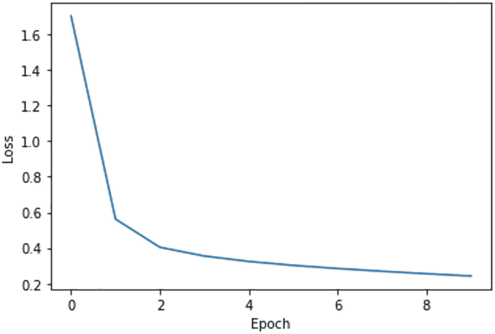

图 13-18

损失在几个周期内的变化

```python
plt.plot(losses)
plt.xlabel('Epoch')
plt.ylabel('Loss')
plt.show()
```

现在，我们来测试模型对测试数据集中一个样本的预测效果：

```python
testimgs, testlabels = iter(test_loader).next()
plt.imshow(testimgs[0][0].numpy().squeeze(), cmap='gray_r');
```

图 13-19 展示了测试数据集中的第一个数字。我们看到的这个样本清晰地表明它是数字八（8）。

请注意，MNIST 数据集中的某些样本可能不那么清晰。正如你所料，该数据集包含一些甚至对人类读者来说都可能造成混淆的例子，例如，一个看起来更像零（0）的六（6），或者一个看起来更像一（1）的七（7）。一些仅训练了少量周期的简单神经网络可能不会非常准确。

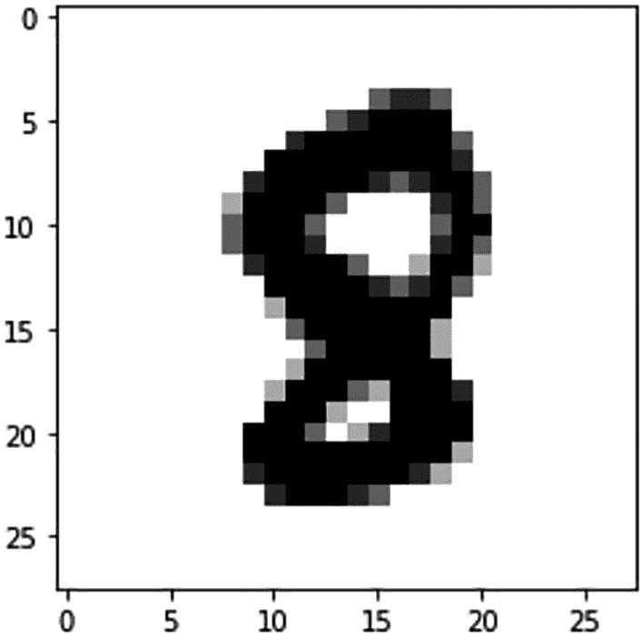

图 13-19

MNIST 数据集中的一个单独数字

我们首先将图像压缩为 1x784 的单元格格式，并找出输出层的值。最大值将对应预测值。我们还将输出单元格的值转换为概率，从中可以选择最佳值作为输出。

```python
img = testimgs[0].view(1, 784)
with torch.no_grad():
logps = model(img)
ps = torch.exp(logps)
probabilities = list(ps.numpy()[0])
prediction = probabilities.index(max(probabilities))
print(prediction)
```
Out: `8`

这里，所有十个输出单元都代表一个概率。你可以探索概率对象来查看其他输出的概率——我们可以看到，这个八（8）也有很小的概率被识别为 6 或 2。

## 总结

在本章中，我们学习了神经网络单元的工作原理，以及如何将它们组合起来创建更强大的、能够解决复杂问题的神经网络。我们为回归和分类问题创建了简单和复杂的神经网络。在下一章中，我们将继续学习一种特殊的神经网络架构，它特别适用于图像和其他二维或三维数据。

脚注 1