# 14. 卷积神经网络

卷积神经网络（CNN）是一种前馈神经网络，其包含具有专门功能的层，通过将滤波器在输入图像的小区域上滑动来应用滤波器，从而生成激活图。回想一下，常规的前馈网络由单个计算单元或神经元组成，训练过程需要反向传播来学习它们的权重和偏置。每个计算单元使用点积将输入与权重结合，并将其传递给一个非线性函数，该函数产生一个输出。这个输出通常用作下一层神经元的输入，直到我们到达输出层。CNN 的开发核心在于，通过在其至少一个层中使用称为卷积的数学运算来寻找图像中的特征。

在本章中，我们将了解 CNN 的工作原理，接着讨论 CNN 中可能调整的各个部分，并查看卷积神经网络实际应用的示例。

## 卷积操作

图像中的每个像素并非独立的数据源，而是依赖于其周围的像素——通常通过相似的值（相似的颜色或强度）来表现同一物体的连续性，或通过颜色或亮度值的急剧变化来表现物体的突变边界。卷积使我们能够通过一组预定义的、作用于图像的内核来捕捉这些特征。

卷积是一种数学运算，它将一个内核（或滤波器）应用于输入数据（通常是图像）的一部分以生成一个元素，然后滑过整个图像，最终生成一幅修改后的图像。考虑如图 14-1 所示的矩阵和滤波器。

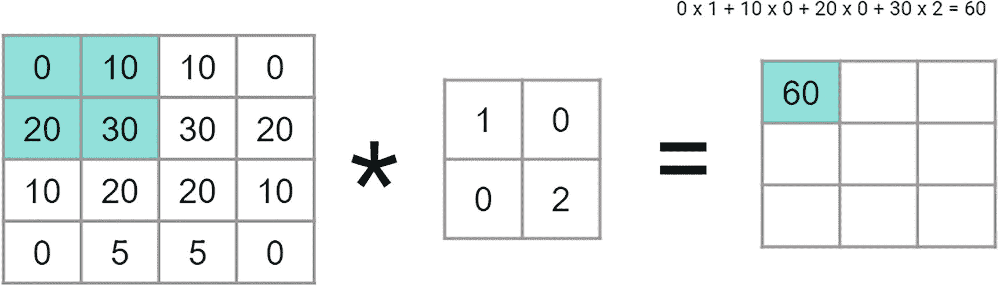
*图 14-1: 使用 4 x 4 矩阵和 2 x 2 滤波器进行的部分卷积操作*

4x4 矩阵与一个 2x2 滤波器进行运算，这导致滤波器映射到矩阵的左上角部分。这会生成一个单一值，作为输出保存在结果矩阵的某个单元格中，如图 14-1 所示。然后滤波器向右滑动，对图像的下一部分执行类似的计算，如图 14-2 所示。

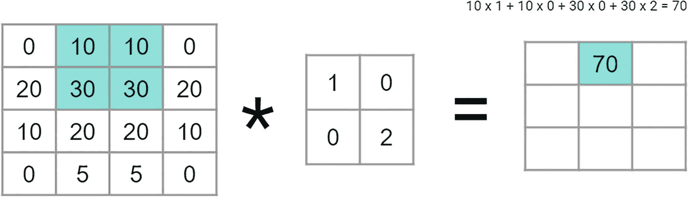
*图 14-2: 使用 4 x 4 矩阵和 2 x 2 滤波器进行的后续卷积操作*

此过程持续进行，直到原始矩阵的所有值都被填充完毕，如图 14-3 所示。

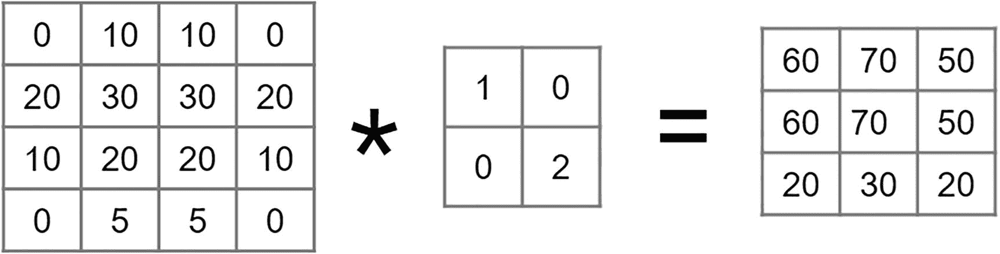
*图 14-3: 使用 4 x 4 矩阵和 2 x 2 滤波器的卷积操作结果*

由于结果矩阵小得多，我们有时会添加填充，以使结果图像与原始图像尺寸相近。因此，我们可能会从如图 14-4 所示的填充矩阵开始。

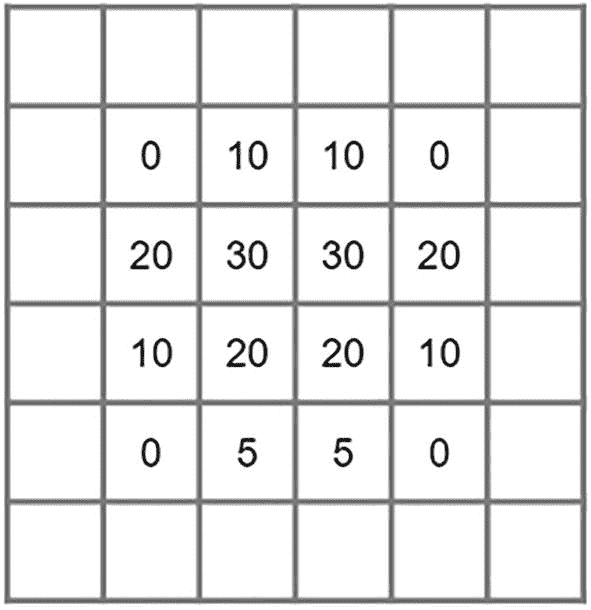
*图 14-4: 确保卷积结果形状相同的填充*

滤波器本质上会滤除所有与滤波器包含的模式无关的内容。我们希望学习滤波器，以便根据给定的数据集发现模式。简单来说，卷积就是一个滑动的模式查找器。在图像处理软件中，有一些标准滤波器可以提供常见的特效，如锐化、模糊、边缘检测等。图 14-5 展示了一个简单的例子。


*图 14-5: 用于检测图像部分的滤波器*

我们可以构建更复杂的滤波器，用于发现特定类型的模式。图 14-6 展示了一个包含人眼模式（或图像）的滤波器，当使用此滤波器对图像执行卷积操作时，结果中滤波器与原始图像中模式高度匹配的位置将包含一个高值。

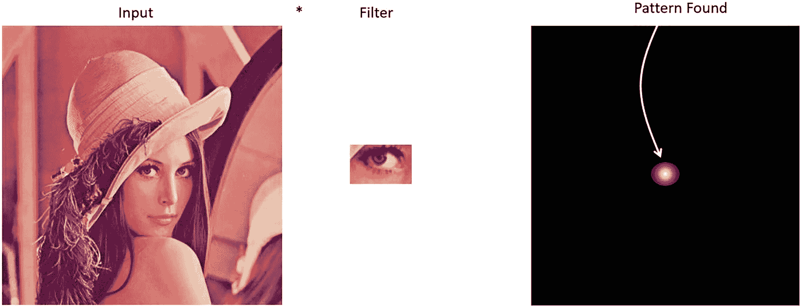
*图 14-6: 用于检测图像中模式的滤波器*

在彩色图像中，每幅图像都是一个 3 x r x h 的三维数组，其中 r 是行数，h 是以像素为单位的图像高度。有三个大小为 r x h 的矩阵通道，分别代表图像的红色、绿色和蓝色通道。对于这种情况，内核也必须是三通道内核。因此，如果我们有一个二维的 3x3 内核，现在我们将有一个大小为 3x3x3 的内核，其中我们将内核的各个层应用于图像的每个通道。

将滤波器应用于图像后，结果矩阵将是一个二维图像，如图 14-7 所示。

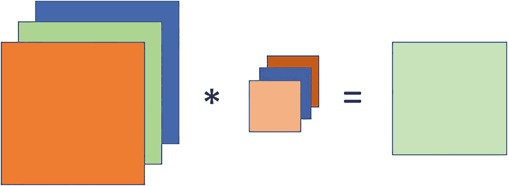
*图 14-7: 跨多个通道的滤波器产生单通道输出*

我们可以有多个内核。每个内核将生成一个二维矩阵，如图 14-8 所示。因此，如果我们使用三个不同的内核，结果将是一个三维矩阵，其中每个内核的结果作为层沿其中一个维度呈现。

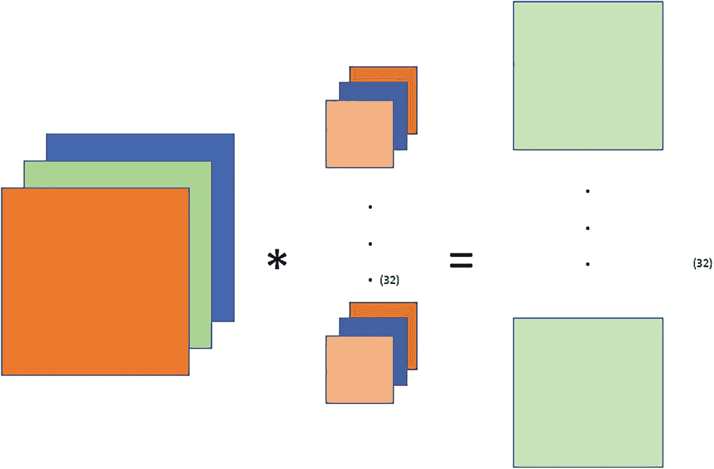
*图 14-8: 多个滤波器产生多个输出*

需要注意的是，许多库实现的是一个称为互相关的函数。正如我们在前一章中看到的，参数是通过在反向传播期间反向传播梯度来学习的。在 CNN 中，反向传播使用相同但翻转的卷积操作，并使用相同的参数来学习滤波器的正确权重。

## CNN 的结构

CNN 是在至少一个层中利用卷积操作的神经网络。有许多流行的架构已被证明在各种图像分类相关任务中非常有效。图 14-9 展示了卷积神经网络的一个简单且最标准的配置。

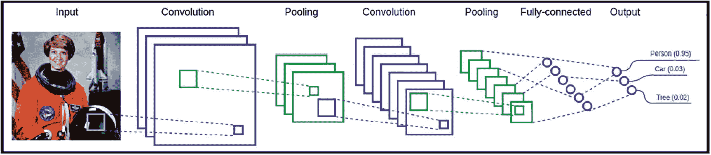
*图 14-9: 卷积神经网络的标准配置*

输入是一个形状为 H x W x C 的张量，保存图像像素的原始值。H 和 W 代表以像素为单位的图像高度和宽度，C 代表通道数（对于 RGB 彩色图像通常为三，对于单色灰度图像为一）。输入连接到卷积层，该层使用 F 个滤波器对图像执行卷积操作。因此，在填充为 1、步长为 1（将在下文中解释）的情况下，这将产生一个大小为 H x W x F 的输出。随后是一个激活层（最好是 `ReLU`），它不会影响尺寸。

在卷积和激活之后，池化层可以通过聚合相邻像素并对数据进行下采样来压缩关于图像的特征激活信息。最大池化可用于选取图像每个部分的最大值。它有助于使表示具有平移不变性，即不受图像中特征位置微小变化的影响。因此，H x W x F 的图像可能会产生大小为 H/2 x W/2 x F 的输出。

此时，我们可以选择将其展平，并前向传递到一个或多个任意的全连接层，输出层有 C 个单元，其中 C 是图像输入可能被分类到的类别数量。

在许多应用中，我们会添加多组卷积层，后接池化层，这可以聚合在前一阶段检测到的多个特征。

### 填充与步幅

在指定卷积层中滤波器的超参数时，我们可以选择深度、步幅和填充。这些决策会对最终生成的模型的性能和能力产生重大影响。

深度（即滤波器的数量）决定了网络能够捕获图像中多少种不同的特征。每个滤波器可以学习发现图像中的某种模式、特定类型的边缘或颜色组合。在指定深度时，我们还需要指定滤波器的大小。

步幅定义了滤波器在原始图像上滑动的距离。默认步幅为 1 意味着滤波器每次只移动一个像素。步幅为 2 则意味着滤波器会跳过两个像素，然后在图像的下一个位置执行乘法和求和运算。

图 14-10 展示了因步幅变化而导致的输出差异。

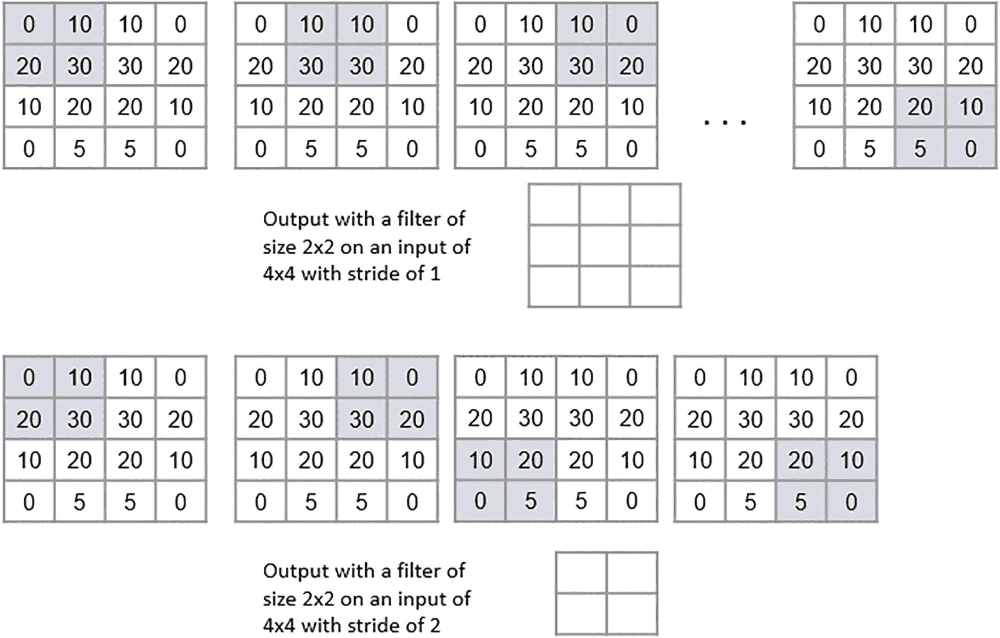
*图 14-10: 不同步幅导致的输出形状差异*

填充会在原始图像的边界处增加额外的行和列，并在这些单元格中填入数值 0。由于卷积运算会结合图像中较大区域的信息，当填充为 1 且步幅为 1 时，输出结果的大小将与输入图像相同。

## PyTorch 中的 CNN

PyTorch 提供了多个用于实现卷积层的类。卷积可以通过让滤波器沿图像的一个方向或多个方向滑动来实现。一维卷积已被证明在文本分类任务中与其他神经网络层结合使用时非常有效，其中文本嵌入可作为原始文本的表示。如果你特别关注沿某个轴捕获特征，一维卷积也可用于图像；但在大多数情况下，二维卷积更为合适。

在 PyTorch 的二维卷积实现中，你需要定义输入通道数、输出通道数和卷积核大小。默认步幅为 1，填充为 0。让我们导入所需模块并定义一个简单的二维卷积层。

```
from torch import nn
conv = nn.Conv2d(3,15,3,1,1)
conv
```

输出：
```
Conv2d(3, 15, kernel_size=(3, 3), stride=(1, 1), padding=(1, 1))
```

这将创建一个卷积层，它接受 3 个通道作为输入，输出 15 个通道，卷积核形状为 3x3。该卷积核将在添加了额外行和列的原始图像上操作，并以一个像素的步长滑动。

在三个通道的每一个上，都有 15 个大小为 3x3 的滤波器。要查看待学习权重的形状，可以使用以下代码：

```
conv.weight.shape
```

输出：
```
torch.Size([15, 3, 3, 3])
```

为了理解滤波器如何运作，让我们运行一个简单的滤波器卷积。导入一张图片^(¹⁴)，使用一个简单的滤波器，并观察它如何影响图像。

```
import urllib.request
from PIL import Image
urllib.request.urlretrieve('https://upload.wikimedia.org/wikipedia/commons/thumb/2/26/Boat_in_the_beach_Chacachacare.jpg/640px-Boat_in_the_beach_Chacachacare.jpg', "boat.png")
img = Image.open("boat.png")
```

上述代码下载了 jpg 文件并将其本地保存为 PNG 文件。然后我们打开该 PNG 文件。你可以将图像加载为 NumPy 数组，使用 `np.array(img)` 查看单个像素的值。请注意，我们加载的图像结构将通道信息放在最内层维度——这与在 Torch 中加载图像时的结构不同。

```python
from PIL import Image
import torchvision.transforms.functional as TF
x = TF.to_tensor(img)
x.unsqueeze_(0)
print(x.shape)
Out: torch.Size([1, 3, 378, 640])
```

PyTorch 由此确认我们加载了一张包含三个通道的图像，这些通道包含了一张高 378 像素、宽 640 像素的图像信息。

让我们定义一个简单的滤波器来显著增强对比度：

```python
imgfilter = torch.zeros((1,3,3, 3))
imgfilter[0,:]=torch.tensor([[-10,10,-10],[10,100,10],[-10,10,-10]])
imgfilter = torch.nn.Parameter(imgfilter)
```

让我们看看卷积的效果：

```python
import torch.nn.functional as F
z = F.conv2d(x, imgfilter, padding=1, stride=1)
z = z.detach().numpy()[0][0]
output = Image.fromarray(z)
output.show()
```

在这个实现中，`z` 最初被创建为一个 `1x1x378x640` 的数组，我们从中提取出实际的图像。这将生成一幅高对比度的灰度图像，如图 14-11 所示。


图 14-11

由自定义滤波器生成的锐化灰度图像

在这个过程中，我们希望学习那些有助于找到图像特定特征的滤波器，这些特征可能有助于改善（降低）损失。

现在，让我们将所有内容整合起来，使用卷积层创建一个神经网络来对图像进行分类。

## 使用 CNN 进行图像分类

在本示例中，我们将使用另一个流行的数据集——MNIST Fashion。MNIST Fashion 之所以备受关注，是因为人们对于使用 MNIST 数字数据集存在争议，许多相对简单的基于 CNN 的网络都能轻松达到 99%或更高的准确率。在苹果公司（截至 2021 年中）工作的、被广泛引用的深度学习研究员伊恩·古德费洛曾在社交媒体上评论道：“机器学习社区非但没有转向比 MNIST 更难的数据集，反而比以往更深入地研究它。”这促使人们探索其他数据集，而 Zalando 十类别服装分类数据集很快引起了公众的注意。

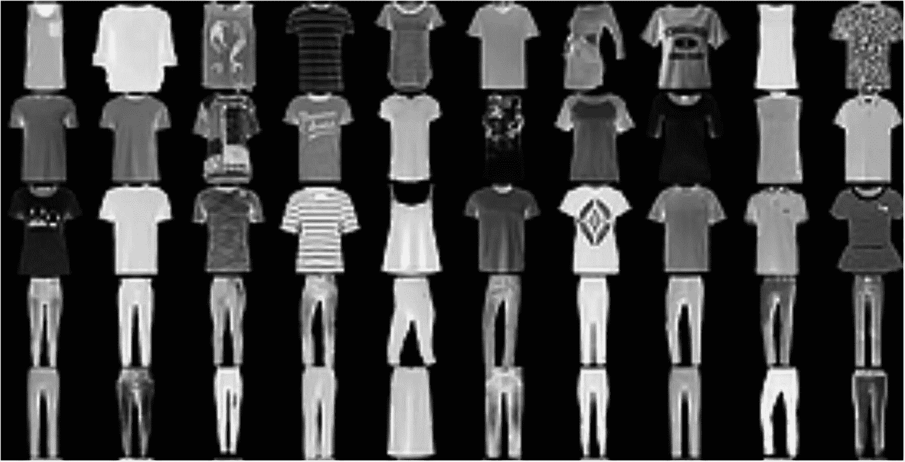

图 14-12

MNIST Fashion 数据集中的物品

数据集中的每张图像都是 `28x28` 像素的灰度图像，每个像素是 `0` 到 `255` 之间的整数。训练集有 `60000` 个样本，测试集有 `10000` 个样本，每个样本属于以下类别之一：T 恤/上衣、裤子、套头衫、连衣裙、外套、凉鞋、衬衫、运动鞋、包和踝靴。数据集的一小部分如图 14-12 所示。

在本示例中，我们将构建一个基于 CNN 的神经网络，其输出层有十个单元，这将帮助我们把一张 `28x28` 像素的灰度图像分类为十个类别之一。Torchvision 数据集包含用于下载 MNIST Fashion 数据集的 API。让我们从导入所需的模块开始。

```python
import numpy as np
import pandas as pd
import matplotlib.pyplot as plt
import torch
import torch.nn as nn
from torch.autograd import Variable
import torchvision
import torchvision.transforms as transforms
from torch.utils.data import Dataset, DataLoader
from sklearn.metrics import confusion_matrix
```

我们需要定义转换（transforms）来将数据转换为所需的相同形状和格式。然后，我们将调用 `FashionMNIST()` 来初始化训练和测试数据集，如果数据不存在，它会将数据下载到指定的文件夹 `fashion_data` 中。

```python
all_transforms = transforms.Compose([
transforms.ToTensor()
])
train_data = torchvision.datasets.FashionMNIST ('fashion_data', train=True, download=True, transform=all_transforms)
test_data = torchvision.datasets.FashionMNIST ('fashion_data', train=False, transform=all_transforms)
Out: Downloading http://fashion-mnist.s3-website.eu-central-1.amazonaws.com/train-images-idx3-ubyte.gz
Downloading http://fashion-mnist.s3-website.eu-central-1.amazonaws.com/train-images-idx3-ubyte.gz to fashion_data_train\FashionMNIST\raw\train-images-idx3-ubyte.gz
...
```

这将安装大约 80MB 的压缩数据。现在，我们可以使用预定义的 `batch_size` 来初始化 `DataLoader()` 对象。

```python
train_loader = DataLoader(train_data, batch_size=64, shuffle=True)
test_loader = DataLoader(test_data, batch_size=64, shuffle=True)
```

我们建议您修改 `batch_size`，因为在资源充足的系统中，更大的 `batch_size` 可能更合适。让我们检查一批数据样本。

```python
samples, labels = next(iter(train_loader))
samples.size()
Out: torch.Size([64, 1, 28, 28])
```

这确认了样本包含 `64` 个元素，每个样本的形状为 `28x28`。每张图像只有一个灰度通道。标签包含一个大小为 `[64]` 的张量，其中包含 `0` 到 `9` 的数字，用于表示每个样本所属的类别。让我们创建一个 MNIST Fashion 标签的映射，以便在需要时可以引用它：

```python
def mnist_label(label):
output_mapping = {
0: "T-shirt/Top",
1: "Trouser",
2: "Pullover",
3: "Dress",
4: "Coat",
5: "Sandal",
6: "Shirt",
7: "Sneaker",
8: "Bag",
9: "Ankle Boot"
}
label = (label.item() if type(label) == torch.Tensor else label)
return output_mapping[label]
```

让我们从样本中尝试一个样本并检查其标签。

```python
idx = 2
plt.imshow(samples[idx].squeeze(), cmap="gray")
print (mnist_label(labels[idx].item()))
```

您可以通过更改前面 `idx` 变量的值来检查数据集中的其他元素。某个样本的输出如图 14-13 所示。

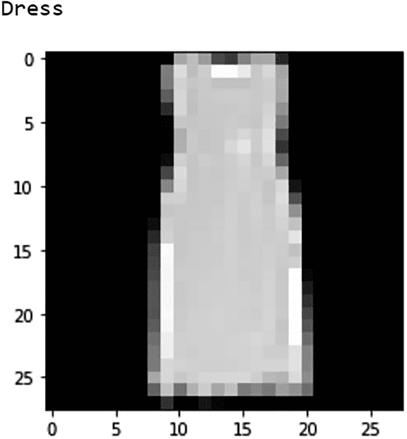

图 14-13

MNIST Fashion 数据集中的一个样本

为了进一步探索数据，您可以在网格中可视化多个样本。以下代码段将产生类似于图 14-14 的输出。

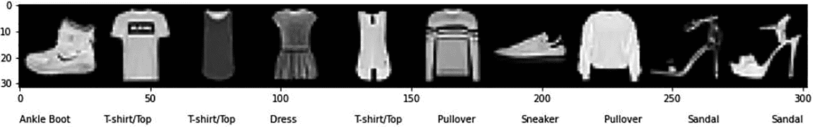

图 14-14

加载到训练数据集中的 MNIST 样本及其标签

```
# 数据加载与可视化

```
sample_loader = torch.utils.data.DataLoader(train_data, batch_size=10)
batch = next(iter(sample_loader))
images, labels = batch
grid = torchvision.utils.make_grid(images, nrow=10)
plt.figure(figsize=(15, 20))
plt.imshow(np.transpose(grid, (1, 2, 0)))
for i, label in enumerate(labels):
plt.text(32*i, 45, mnist_label(label))
```

现在我们对数据有了更清晰的理解，可以继续设计神经网络了。在这类网络中，需要牢记的一个有趣方面是每一层输入和输出张量的大小。

## 卷积层设计

输入层由一张 1x28x28 像素的图像组成。这将连接到一个卷积层（`conv2d`），该层接收一个通道的输入，并通过 32 个滤波器产生 32 个通道。这个数字是可配置的，并决定了该层的复杂度。在这一层中，我们可以使用 ReLU 作为激活函数。为了简化并确保提取的特征更具通用性和平移不变性，我们将添加一个二维最大池化层。最大池化的大小将影响后续层的设计。图 14-15 总结了网络卷积部分的结构。

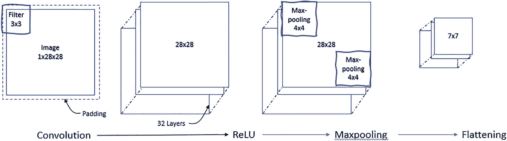

这可以定义为：

```
convlayer = nn.Sequential(
    nn.Conv2d(in_channels=1, out_channels=32, kernel_size=3, padding=1),
    nn.ReLU(),
    nn.MaxPool2d(kernel_size=4, stride=4)
)
```

## 模型构建

最大池化会生成一个 32x7x7 的张量，我们可以将其传递到一个密集网络。我们将创建一个密集层，其输入为 32x7x7，输出为任意选择的 64 个。这也定义了下一层被限制为 64 个单元。我们知道输出层需要有十个输出。图 14-16 简化了我们最终创建的神经网络。

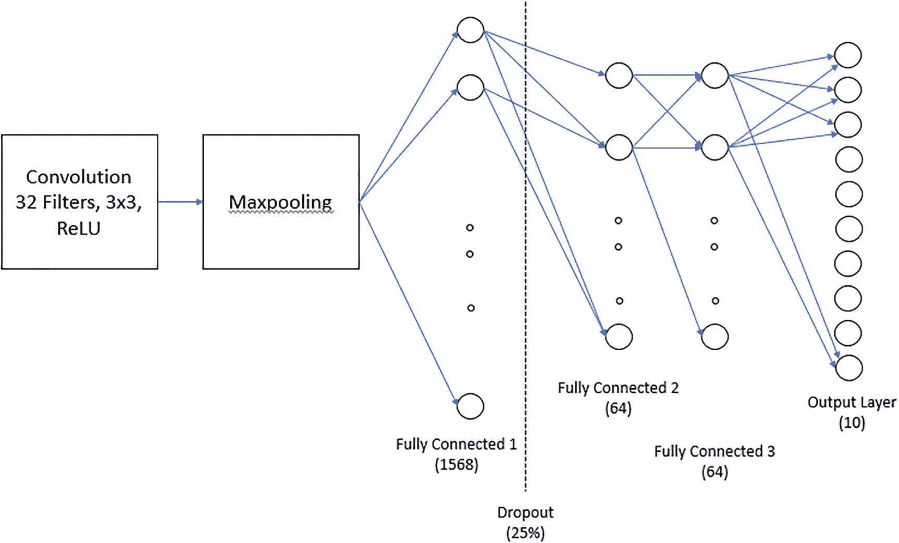

### 定义神经网络类

让我们为这个网络创建模型类。正如我们在前一章中看到的，我们需要在构造函数中定义各个层，并在一个名为`forward()`的方法中将它们连接起来，该方法将在前向传播阶段计算输出。我们将使用与上一页相同的卷积层定义。以下是整合后的类。

```
class FashionCNN(nn.Module):
    def __init__(self):
        super(FashionCNN, self).__init__()
        self.convlayer = nn.Sequential(
            nn.Conv2d(in_channels=1, out_channels=32, kernel_size=3, padding=1),
            nn.ReLU(),
            nn.MaxPool2d(kernel_size=4, stride=4)
        )
        self.fully_connected_layer_1 = nn.Linear(in_features=32*7*7, out_features=64)
        self.drop = nn.Dropout2d(0.25)
        self.fully_connected_layer_2 = nn.Linear(in_features=64, out_features=64)
        self.fully_connected_layer_3 = nn.Linear(in_features=64, out_features=10)

    def forward(self, x):
        out = self.convlayer(x)
        out = out.view(out.size(0), -1)
        out = self.fully_connected_layer_1(out)
        out = self.drop(out)
        out = self.fully_connected_layer_2(out)
        out = self.fully_connected_layer_3(out)
        return out
```

您可以通过初始化该类的一个对象来查看由此创建的模型的详细信息。

```
model = FashionCNN()
print(model)
```

输出如下：

```
FashionCNN(
  (convlayer): Sequential(
    (0): Conv2d(1, 32, kernel_size=(3, 3), stride=(1, 1), padding=(1, 1))
    (1): ReLU()
    (2): MaxPool2d(kernel_size=4, stride=4, padding=0, dilation=1, ceil_mode=False)
  )
  (fully_connected_layer_1): Linear(in_features=1568, out_features=64, bias=True)
  (drop): Dropout2d(p=0.25, inplace=False)
  (fully_connected_layer_2): Linear(in_features=64, out_features=64, bias=True)
  (fully_connected_layer_3): Linear(in_features=64, out_features=10, bias=True)
)
```

## 模型训练

现在我们可以初始化损失函数和优化器，并创建一个用于训练过程的通用循环。我们将像之前一样记录损失和准确率。

```
error = nn.CrossEntropyLoss()
optimizer = torch.optim.Adam(model.parameters(), lr=0.005)
lstlosses = []
lstiterations = []
lstaccuracy = []
```

不过，我们也可以使用测试数据来计算测试准确率，并跟踪训练和测试准确率在训练期间的变化。训练循环将负责三项任务：(1) 遍历 `train_loader` 并执行前向传播和反向传播以优化参数；(2) 遍历测试加载器以预测测试数据项的标签并记录测试准确率；(3) 由于训练过程较慢，打印或记录一条表明训练进度的语句。让我们创建额外的对象来跟踪测试项。

```
predictions_list = []
labels_list = []
num_epochs = 10 # 指定训练的最大轮数
num_batches = 0 # 记录训练数据的批次数量
batch_size = 100 # 可配置，用于跟踪准确率
for epoch in range(num_epochs):
    print ("Epoch: {} of {}".format(epoch+1, num_epochs))
    for images, labels in train_loader:
        train = Variable(images)
        labels = Variable(labels)
        outputs = model(train)
        loss = error(outputs, labels)
        optimizer.zero_grad()
        loss.backward()
        optimizer.step()
        num_batches += 1
        if num_batches % batch_size==0:
            total = 0
            matches = 0
            for images, labels in test_loader:
                labels_list.append(labels)
                test = Variable(images)
                outputs = model(test)
                predictions = torch.max(outputs, 1)[1]
                predictions_list.append(predictions)
                matches += (predictions == labels).sum()
                total += len(labels)
            accuracy = matches * 100 / total
            lstlosses.append(loss.data)
            lstiterations.append(num_batches)
            lstaccuracy.append(accuracy)
            if not (num_batches % batch_size):
                print("Iteration: {}, Loss: {}, Accuracy: {}%".format(num_batches, loss.data, accuracy))
```

这个代码块会花费一些时间，并间歇性地打印损失和准确率信息。
```

# 训练过程与模型优化

```
Out:
Epoch: 1 of 10
Iteration: 50, Loss: 0.6086341142654419, Accuracy: 76.94999694824219%
Iteration: 100, Loss: 0.5399684906005859, Accuracy: 79.62000274658203%
Iteration: 150, Loss: 0.46176013350486755, Accuracy: 82.83000183105469%
Iteration: 200, Loss: 0.3623868227005005, Accuracy: 83.23999786376953%
Iteration: 250, Loss: 0.26515936851501465, Accuracy: 85.12999725341797%
...
Iteration: 900, Loss: 0.4560268521308899, Accuracy: 86.41000366210938%
Epoch: 2 of 10
Iteration: 950, Loss: 0.3548094928264618, Accuracy: 86.93000030517578%
Iteration: 1000, Loss: 0.18031403422355652, Accuracy: 87.3499984741211%
Iteration: 1050, Loss: 0.35414841771125793, Accuracy: 87.13999938964844%
Iteration: 1100, Loss: 0.2871503233909607, Accuracy: 87.5199966430664%
...
```

为了进一步实验并提高准确率，你可以选择增加 `conv2d` 层或全连接层的数量。另一个需要考虑的因素是滤波器的大小、最大池化长度以及全连接层中的单元数量。你可以添加更多卷积层并按如下方式配置你的网络：

```python
self.convlayer_2 = nn.Sequential(
    nn.Conv2d(in_channels=1, out_channels=32, kernel_size=3, padding=1),
    nn.ReLU(),
    nn.MaxPool2d(kernel_size=4, stride=4)
)
```

像这样的更改通常需要你重新考虑可能受影响的每个张量的形状。由于 PyTorch API 提供的简便性，你只需要添加 `convlayer_2` 如何适配 `in forward()`，而 `loss.backward()` 和 `optimizer.step()` 将相应地更新参数。

由于我们在训练过程中记录了损失和准确率，我们可以通过使用 Matplotlib 将它们可视化，来了解模型在各个轮次中的表现。

```python
plt.plot(lstiterations, lstlosses)
plt.xlabel("No. of Iteration")
plt.ylabel("Loss")
plt.title("Iterations vs Loss")
plt.show()
```

```python
plt.plot(lstiterations, lstaccuracy)
plt.xlabel("Iterations")
plt.ylabel("Accuracy")
plt.show()
```

图 14-17 中的图表表明，尽管还有进一步改进的空间，但损失已随轮次增加而减少，准确率也已提高。

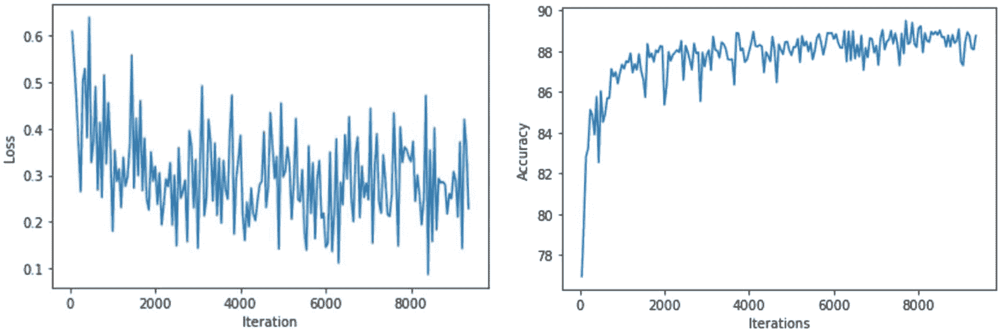

图 14-17

多次迭代中损失和准确率的变化

## 模型学到了什么？

在任何时候，都可以使用 `model.parameters()` 访问模型的参数（权重和偏置），它会返回一个张量生成器，可以对其进行迭代以获取所有权重。模型在初始化后立即包含参数值——大多数是随机值，这些值会在反向传播过程中更新。

```python
list(model.parameters())[0].shape
Out: torch.Size([32, 1, 3, 3])
```

索引 0 处返回的张量包含卷积层的 32 个滤波器，以单通道（灰度）3x3 尺寸图像的形式呈现。让我们读取它们的值并进行可视化，看看卷积层实际学到了什么。

```python
filters = list(model.parameters())[0]
filters
Out: Parameter containing:
tensor([[[[ 2.7956e-01, -2.4780e-01, -2.0801e-01],
          [ 2.3427e-01, -1.0169e-01, -2.2255e-01],
          [-8.3205e-02,  4.7983e-02,  2.8062e-01]]],
       [[[ 1.4788e-02, -3.9390e-02, -9.7228e-02],
          [-2.4128e-01, -2.5705e-01,  2.2378e-01],
          [ 1.3481e-01, -2.4824e-01, -2.8518e-01]]],
       ...
```

这是截断后的输出，显示了前两个滤波器。我们可以使用 Matplotlib 将这些值可视化。输出如图 14-18 所示。

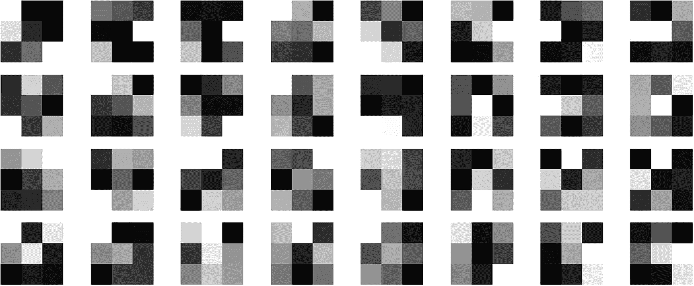

图 14-18

可视化后的滤波器

```python
plt.figure(figsize=(20, 17))
for i, filter in enumerate(filters):
    plt.subplot(8, 8, i+1)
    plt.imshow(filter[0, :, :].detach(), cmap='gray')
    plt.axis('off')
    plt.show()
```

更大尺寸的滤波器或后续卷积层的滤波器甚至可以显示出更易理解的特征，比如衬衫的领子或鞋子的鞋跟。在许多实际应用中，会构建具有多个卷积层的更复杂的网络，这些网络后面会连接密集层。

## CNN 的深度网络

CNN 最初于 20 世纪 90 年代中期被提出，但由于当时计算基础设施的技术水平有限，其应用范围受到限制。在过去十年中，CNN 通过包含多个卷积层的深度网络，在复杂分类数据集上表现出高性能，从而再次受到关注。

其中，Alex Krizhevsky 的网络（称为 AlexNet）被认为是最受欢迎且最具影响力的论文之一，它为计算机视觉指明了未来方向。该网络用于对 ImageNet 进行分类，ImageNet 是一个包含数千个类别图像的大型数据库。图 14-19 展示了 AlexNet 的结构，该图发表于原始论文中。

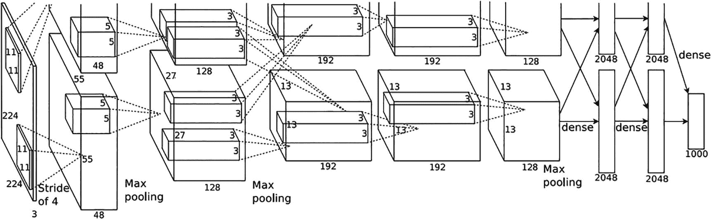

图 14-19

AlexNet 示意图

AlexNet 包含高度优化的二维卷积 GPU 实现，该实现用于五个卷积层，随后是最大池化层和一个密集网络。输出层是一个 100 单元的层，用于生成在 1000 个类别标签上的分布。他们利用了 Hinton 等人近期推广的 dropout 层，其概率为 0.5，以克服过拟合。这种 dropout 被认为可以迫使神经元不依赖特定其他神经元的存在，从而学习更鲁棒的特征。

## 总结

在本章中，我们学习了一种高度专业化的神经网络架构，称为卷积神经网络（CNN），并将其应用于图像分类示例。在下一章中，我们将研究另一种架构，该架构由于实现了保持状态的内存，因此对文本和语音等序列数据非常有效。这些循环神经网络（RNN）根据其应用场景的不同而有不同类型。

脚注 1