# 15. 循环神经网络

在前面的章节中，我们已经看到，可以表示为向量的简单数据可以轻松地提供给前馈神经网络的输入层。像图像这样更复杂的数据，既可以经过变换和展平后以向量形式作为输入发送，也可以用于在卷积神经网络（CNN）中学习滤波器。CNN 有助于捕获数据中由于像素邻近区域存在特定值而产生的关键模式。然而，在文本、语音等数据格式中，通常还存在另一种模式，如图 15-1 所示。

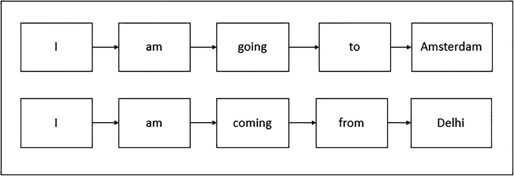

图 15-1

文本作为标记序列

在像这样的序列数据格式中，可以观察到，就时间步（例如，基于音频的时间片，或文本中的逐字符）而言，当前步与上一步（或多步）数据之间的模式，如果其中某一步的数据发生变化，会导致不同的含义。

循环神经网络（RNN）是一种专门用于处理时间序列数据的神经网络。在本章中，我们将学习 RNN 基本单元的结构，以及它们如何融入更大的神经网络。我们还将研究专门的 RNN 单元，例如 LSTM，它在机器翻译、文本转语音生成、语音识别等任务中打破了记录。

## 循环单元

循环神经网络接收提供的数据块，并使用内部状态来产生输出。内部状态是根据旧的内部状态和输入 `–` 计算得出的；因此，我们可以说，神经网络中循环单元在先前步骤的输出间接决定了当前步骤的输出。从某种意义上说，如果我们这样理解，循环神经网络会将其部分输出作为下一个时间步的输入。

假设在特定时间戳获取的数据以 D 维向量的形式存在。在时间步索引 1 处，x(1) 是大小为 D 的输入向量，随后在时间步索引 2 处是 x(2)，依此类推，直到时间步 T 处的 x(T)。这表示数据集的一个样本，其形式为 TxD 形状的矩阵，如图 15-2 所示。对于 N 个这样的样本，可以假设数据的形式为 NxTxD 形状的矩阵，如图 15-2 所示。

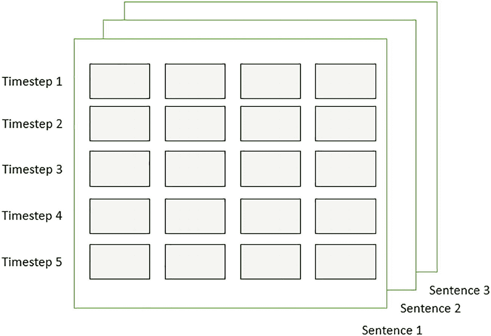

图 15-2

跨时间步表示为向量的文本

在最简单的层面上，每个单元的输入都应用于一个加权函数，正如你在前面章节中看到的那样。这些权重在时间上是共享的，并应用于每个输入以及前一步的输出。此操作可以如图 15-3 所示进行表示。

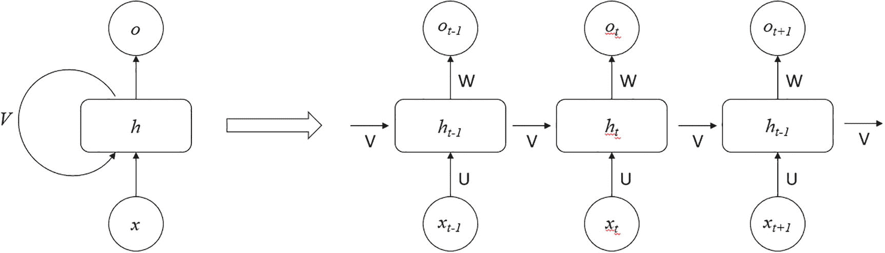

图 15-3

RNN 单元跨时间步展开

左侧部分显示，传递给循环单元并应用权重 W 的输入 x 会产生输出 o。当这种递归随时间展开时，如右侧部分所示，你可以看到有三个时间步，分别对应输入 x[t-1]、x[t] 和 x[t+1]。在步骤 t，隐藏层中发生的操作可以表示为

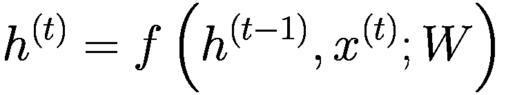

因此，随时间进行的扩展或展开，产生了一个现在看起来类似于具有多个隐藏层的前馈网络的网络，每个隐藏层代表在一个时间步执行的操作。这种扩展取决于序列长度以及由批量大小给出的此类组合的数量。

你可以将展开的结构视为一个前馈网络。在训练阶段，我们的目标是通过根据预测与实际输出标签计算损失来学习权重，并相应地计算用于反向传播的梯度，这将调整权重以在下次迭代中产生更好的预测。

如果我们展开所有输入时间步，我们将网络扩展为一个结构，其中每个时间步的输入通过具有共享权重的隐藏层通向输出。在这种技术中，每个时间步都可以看作是隐藏层的扩展，前一个时间步的内部状态作为输入。每个时间步有一个输入时间步、一个网络副本和一个输出。然后为每个时间步计算并累积误差。网络被重新折叠起来，并更新权重。这被称为时间反向传播（BPTT）。

我们会注意到，由于链式法则，我们经常会看到对非常小的值重复进行类似的乘法运算，这可能导致结果趋近于 0 或无穷大。我们将在后面讨论这个问题以及一个常见的潜在解决方案。

## RNN 的类型

序列问题并不相同。然而，RNN 背后的概念为我们提供了充足的想法来创建循环神经网络以解决各种问题。根据具体情况，RNN 可以采取不同的形式，这决定了针对特定问题应使用哪种类型的 RNN。图 15-4 展示了下面讨论的不同类型 RNN 的简化结构。

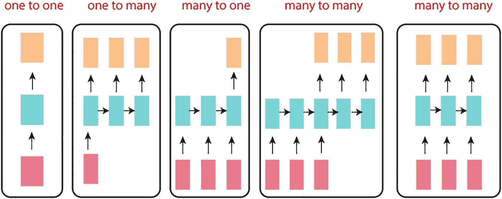

图 15-4

循环神经网络的类型

### 一对一

一对一是一种不需要循环单元的形式，每个输入由一个隐藏层处理，随后是输出层。这些是普通的神经网络，处理固定大小的输入到固定大小的输出，并且它们独立于先前的信息/输出。


### 一对多

这类循环神经网络接收固定大小的输入，并生成一个序列数据作为输出。它们常用于解决图像描述和音乐生成等问题。输入是静态大小的，例如一张图像，而输出则是一个单词序列。

### 多对一

这类循环神经网络接收一个信息序列作为输入，并生成固定大小的输出。因此，输入可以是单词序列或音频信号，它们可能产生固定大小的输出，例如情感极性（正面或负面标签）。

### 多对多

多对多 RNN 有两种类型。第一种是输入大小等于输出大小的 RNN——因此，从某种意义上说，输入序列中的每个项目都会产生一个输出。一个常见的例子是序列标注或实体识别。对于句子中的每个单词，我们生成诸如人名、地点、组织或其他词语的标签。另一种类型的 RNN 可能会产生与输入序列大小不同的输出序列。这在机器翻译中非常有用，因为一种语言中的每个单词可能无法直接映射到另一种语言中的某个单词，但单词在序列中的出现方式会在目标语言中产生意义。

因此，基于不同的配置，循环神经网络能够处理任意长度的输入并相应地生成输出。然而，它们面临的一个主要缺点是，在任何时间步，网络都只能利用当前输入和过去的输出，而无法根据未来的输入做出任何改变。不过，对于大多数应用来说，使用 RNN 构建一个能够捕捉历史信息的模型已经足够了。我们将在后续章节中重新讨论这类场景。

## Python 中的 RNN

PyTorch 提供了一个 RNN 实现，它需要指定循环层的参数，并且可以作为更大网络的一部分添加。它对输入数据应用权重和偏置，并将其与加权的隐藏状态相结合，最后对其应用一个非线性函数（ReLU 或 tanH）。这为下一个输入提供了隐藏状态。

让我们从一个接收数字序列的简单示例开始。首先导入所需的库。RNN 在 `torch.nn` 下定义。

```
import torch
import torch.nn as nn
import torch.optim as optim
import numpy as np
from torch.utils.data import Dataset, DataLoader
```

让我们创建一个简单的张量序列。

```
data = torch.Tensor([1, 2, 3, 4, 5, 6, 7, 8, 9, 10, 11, 12, 13, 14, 15, 16, 17, 18, 19, 20])
print("Data: ", data.shape, "\n\n", data)
Out:
Data:  torch.Size([20])
tensor([ 1.,  2.,  3.,  4.,  5.,  6.,  7.,  8.,  9., 10., 11., 12., 13., 14., 15., 16., 17., 18., 19., 20.])
```

要定义一个简单的 RNN，我们需要定义序列长度、批次大小和输入大小。在这个例子中，我们将根据序列中连续的五个数字来预测接下来的两个数字。

我们只有一列简单数据，而我们要解决的问题是：必须观察一个长度为五个输入的序列，才能预测接下来的两个输出。

```
INPUT_SIZE = 1
SEQ_LENGTH = 5
HIDDEN_SIZE = 2
NUM_LAYERS = 1
BATCH_SIZE = 4
```

在大多数情况下，一个或多个 RNN 层将作为更大网络的一部分，该网络以输出层结束。根据指定网络层外观的超参数，我们可以使用以下方式定义 RNN 层：

```
rnn = nn.RNN(input_size=INPUT_SIZE, hidden_size=HIDDEN_SIZE, num_layers = 1, batch_first=True)
```

我们可以将数据作为输入，并使用以下方式获取输出和隐藏状态。输入的大小取决于批次大小、序列长度和输入大小——即我们之前定义的参数。`nn.RNN()` 也可以接受预设的隐藏层值，如果未指定，则默认为全零。

```
inputs = data.view(BATCH_SIZE, SEQ_LENGTH, INPUT_SIZE)
out, h_n = rnn(inputs)
```

我们收到的输出是一个张量，其中包含来自最后一个 RNN 层所有时间步的输出。其大小为（序列长度，批次，方向数 * 隐藏大小），其中对于双向 RNN，方向数为 2，否则为 1。

## 长短期记忆网络

正如我们在前几节中看到的，随着网络规模增大，RNN 无法成功传播那些趋于零（或在某些情况下趋于无穷大）的梯度，从而导致梯度消失问题。当输入是长序列时，例如来自产品评论或博客文章的长句子，这个问题尤为明显。

考虑以下示例：

> *我今年没去阿姆斯特丹，但去年夏天我在那里，城里到处都很拥挤。*

并非所有单词都与解释句子含义相关。但当我们看整个句子时，知道“城市”这个词指的是与“阿姆斯特丹”相同的实体是很重要的。如图 15-5 所示的长依赖关系应该被保留。

在 RNN 中，当前时间步的输入和上一个时间步计算出的隐藏状态会合并，并通过 tanh 激活函数。由此产生的输出也作为下一个时间步的隐藏状态。长短期记忆网络（LSTM）是一种架构，它通过允许梯度不变地流动，部分解决了梯度消失问题。LSTM 单元被专门构建用来记住序列中重要的部分，从而只保留相关信息进行预测。

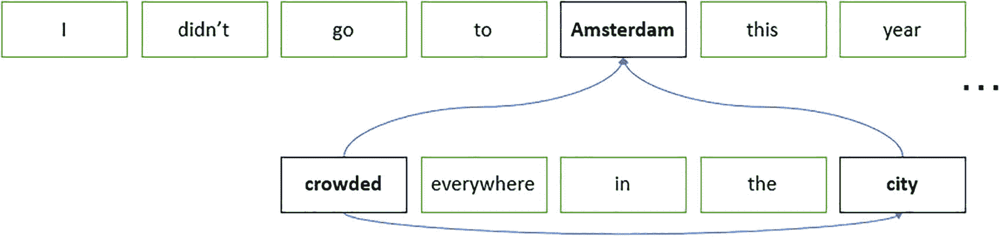

图 15-5

长句子可能连接长期依赖关系

LSTM 被设计用来持有一个可以被称为记忆的细胞状态。由于细胞持有记忆，来自较早时间步的信息可以传递到较晚的时间步，从而保留序列中的长期依赖关系。记忆块由门控制——这些门是简单的操作，决定在训练过程中哪些信息应该被保留或遗忘。这是通过在单元内的某些计算中应用 sigmoid 激活函数来实现的，该函数对任何负值输出零，从而引出了遗忘信息的概念。


### LSTM 单元

LSTM 单元的结构如图 15-6 所示。LSTM 单元中接收输入的第一个部分称为遗忘门。**遗忘门**决定哪些信息应该保留或遗忘（或丢弃）。该门将上一时间步的隐藏状态与当前输入结合，并通过 sigmoid 函数处理。无论遗忘操作如何，输入与上一隐藏状态的结合都会通过 sigmoid 函数和 tanh 函数处理。tanh 函数的输出作为候选值，可能进一步传播，而 sigmoid 函数的输出则作为评估函数，决定这些值的重要性。随后，tanh 输出与 sigmoid 输出相乘。LSTM 单元的这部分称为**输入门**。

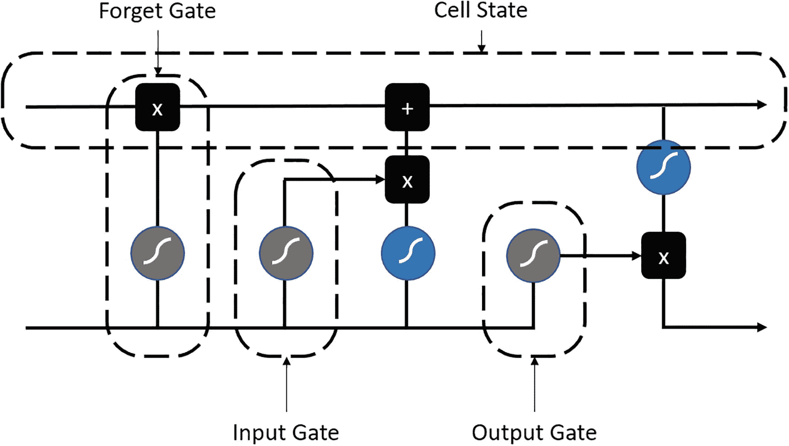

图 15-6

循环神经网络单元的结构

遗忘门的输出是一个向量，它与上一单元状态相乘，从而使应被遗忘的值变为零。我们将此结果与输入门计算得到的值相加，从而得到新的单元状态。

LSTM 单元的输出成为隐藏状态，它将在下一步与输入结合；同时，单元状态会直接传播到后续步骤，无需进一步变换。**输出门**将候选值（上一隐藏状态与当前输入，经过 sigmoid 激活）与刚计算出的单元状态结合，首先对单元状态应用 tanh 激活，然后通过乘法运算形成下一个隐藏状态。

## 时间序列预测

在本例中，我们将使用一个公开可用的数据源，其中包含与 COVID-19 疫情相关的统计数据。COVID-19 大流行是由严重急性呼吸综合征冠状病毒 2 引起的全球性大流行病（在撰写本书时仍在持续）。该病毒于 2019 年 12 月在中国武汉首次发现，随后迅速传播至全球，导致数百万人死亡和住院。

COVID-19 疫情也推动了公共医疗领域分析技术的应用，一个广泛普及的典型用例是预测冠状病毒病例的未来增长，以便相应规划医疗系统。在本练习中，我们将使用一个包含各国 COVID 病例和死亡统计数据的数据库。这些数据按日期详细记录——从而为建模和学习序列变化提供了可能。

本例使用的数据来自**欧洲疾病预防与控制中心**的网站^(¹⁵)，不过你也可以从任何可靠来源使用较新的数据。你可以从其网页下载 CSV 文件，或在终端或 Jupyter Notebook 中使用 wget 命令（在 Linux 上）。在 Jupyter Notebook 中，你需要在命令前加上感叹号。

```
!wget https://opendata.ecdc.europa.eu/covid19/casedistribution/csv/data.csv
```

如果你的系统未安装 wget，你将收到如下错误信息：

```
'wget' 不是内部或外部命令，也不是可运行的程序或批处理文件。
```

在这种情况下，你可以安装 wget，或者从网站下载 CSV 文件并将其移动到 Jupyter Notebook 易于访问的位置。获取数据后，导入所需库：

```
import numpy as np
import matplotlib.pyplot as plt
import pandas as pd
import torch
import torch.nn as nn
from torch.autograd import Variable
from sklearn.preprocessing import MinMaxScaler
```

你可以使用 read_csv() 将数据加载为 Pandas 数据框：

```
covid_data = pd.read_csv("data.csv")
covid_data
```

该数据集包含 61900 行和 12 列。该数据集包含 61900 行和 12 列。数据框的截图如图 15-7 所示。请注意，如果此位置的数据集将来更新，这些数字可能会发生变化。

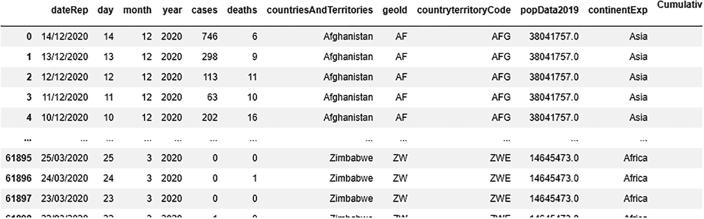

图 15-7

在 Jupyter Notebook 中加载后验证的数据集

为了简化用例，我们将尝试对一个国家的病例数据进行建模。为了筛选数据，我们将只选择 countryterritoryCode 为 USA 的行。

```
covid_data[covid_data['countryterritoryCode']=='USA']
```

之后，我们需要通过以下代码仅索引日期列 dateRep 和病例列 cases：

```
data = covid_data[covid_data['countryterritoryCode']=='USA']       [['dateRep', 'cases']]
```

现在数据仅包含筛选出的国家的两列。由于世界各地的日期格式不同，并且日期像其他字段一样被加载为对象而非日期/时间字段，我们需要进一步处理。

```
data['dateRep'] = pd.to_datetime(data['dateRep'], format="%d/%m/%Y")
```

数据对象可以按日期升序排序，这样起始日期（病例大多为 0）会排在顶部。我们还将日期列转换为索引。

```
data = data.sort_values(by="dateRep", key=pd.to_datetime)
data = data.set_index('dateRep')
```

数据对象现在应类似于图 15-8 所示的截图。

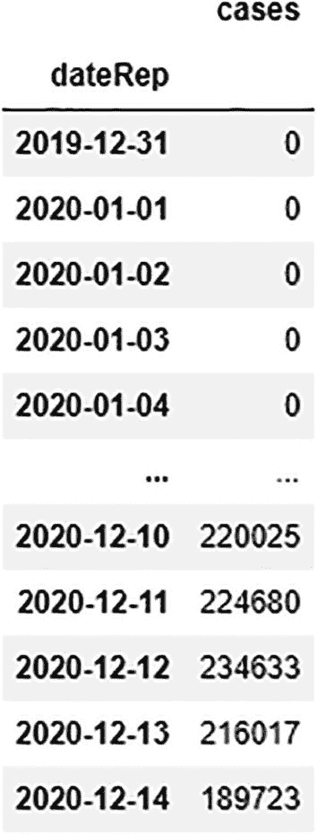

图 15-8

显示美国 COVID-19 病例增长情况的部分数据框

让我们快速可视化 2020 年美国病例的增长情况。

```
fig = plt.gcf().set_size_inches(12,8)
plt.plot(data, label = '美国 COVID-19 病例')
plt.show()
```


图 15-9 显示，起初数字接近零，但到 4 月份开始增长，并在年底超过了 20 万。在序列建模中，我们假设可以根据前几天的数字变化来预测特定日期的数字。

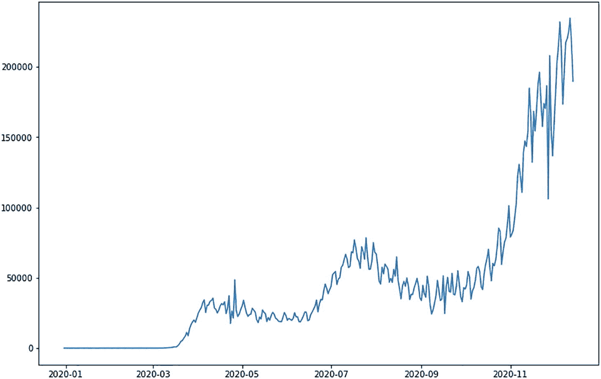

**图 15-9**
美国 COVID-19 病例图

正如我们之前所见，我们需要找到序列的片段。例如，数据来自某个从周日开始的特定周。在文本数据中，n-gram（最常见的是二元组和三元组）非常流行，尽管最近字符片段和字符 n-gram 也适用于可以使用 RNN/LSTM 解决的问题。

我们将创建一个函数，该函数接受一个 NumPy 数组和一个定义序列长度的整数，并返回指定序列长度的片段。例如，序列长度为 3 的`[1,2,3,4,5,6]`应创建片段`[1,2,3]`、`[2,3,4]`、`[3,4,5]`和`[4,5,6]`。但是，在这个问题中，我们还需要预测下一个元素；也就是说，`1,2,3`后面应该跟`4`。这些片段会略有不同，如图 15-10 所示。

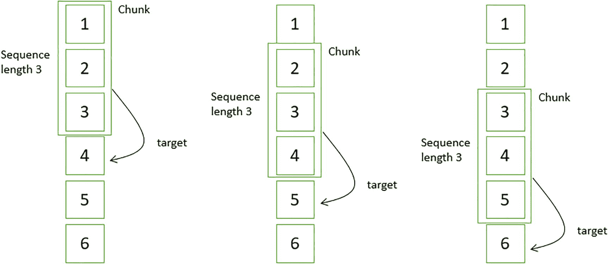

**图 15-10**
用于预测下一个项目的长序列窗口或片段

以下是其中一种可能的实现方式。

```
def chunkify(data, seq_length):
chunks = []
targets = []
for i in range(len(data)-seq_length-1):
chunks.append(data[i:(i+seq_length)])
targets.append(data[i+seq_length])
return np.array(chunks),np.array(targets)
```

序列中的每个数字都是一个数据元素；因此，你可以将数组重塑为 nx1 的形状。这样，我们就可以继续调用：

```
chunkify([[1],[2],[3],[4],[5],[6]],3)
Out:
(array([[[1],
[2],
[3]],
[[2],
[3],
[4]]]),
array([[4],
[5]]))
```

数据的预处理还需要将数据缩放到合适的值。我们可以使用`MinMaxScaler`。我们将使用 80%的数据作为训练集，并保持序列长度为 5。

```
sc = MinMaxScaler()
training_data = sc.fit_transform(data.values.copy())
seq_length = 5
x, y = chunkify(training_data, seq_length)
train_size = int(len(y) * 0.8)
test_size = len(y) - train_size
```

在进一步操作之前，我们需要将数据集转换为张量。我们可以将索引`train_size`之前的片段和目标转换为张量，以便与 PyTorch 网络一起使用。

```
dataX = Variable(torch.Tensor(np.array(x)))
dataY = Variable(torch.Tensor(np.array(y)))
trainX = Variable(torch.Tensor(np.array(x[0:train_size])))
trainY = Variable(torch.Tensor(np.array(y[0:train_size])))
testX = Variable(torch.Tensor(np.array(x[train_size:len(x)])))
testY = Variable(torch.Tensor(np.array(y[train_size:len(y)])))
```

在网络中，我们将定义一个 LSTM 层，后跟一个全连接层。在 PyTorch 中，LSTM 在`torch.nn`中定义。它接受诸如输入大小、隐藏状态特征大小和循环层数等参数。如果指定了`num_layers`，模型将堆叠相应数量的 LSTM，使得第一个 LSTM 的输出提供给第二个 LSTM，依此类推。由于这是一个回归问题，损失函数可以是均方误差，这在回归问题中被广泛使用。

让我们创建一个模型类。我们需要定义各个层。我们将保持结构简单，包含一个 LSTM 层，后跟全连接输出。在`forward()`方法中，我们将首先创建一个初始化为零的隐藏状态和细胞记忆。LSTM 的输出将应用于全连接层，并作为输出返回。

```
class CovidPrediction(nn.Module):
def __init__(self, num_classes, input_size, hidden_size, num_layers):
super(CovidPrediction, self).__init__()
self.num_classes = num_classes
self.num_layers = num_layers
self.input_size = input_size
self.hidden_size = hidden_size
self.seq_length = seq_length
self.lstm = nn.LSTM(input_size=input_size, hidden_size=hidden_size, num_layers=num_layers, batch_first=True)
self.fully_connected = nn.Linear(hidden_size, num_classes)
def forward(self, x):
h0 = Variable(torch.zeros(self.num_layers, x.size(0), self.hidden_size))
c0 = Variable(torch.zeros(self.num_layers, x.size(0), self.hidden_size))
ula, (h_out, _) = self.lstm(x, (h0, c0))
h_out = h_out.view(-1, self.hidden_size)
out = self.fully_connected(h_out)
return out
```

我们可以在这里看到模型的结构：

```
model = CovidPrediction(1, 1, 4, 1)
print(model)
Out:
CovidPrediction(
(lstm): LSTM(1, 4, batch_first=True)
(fully_connected): Linear(in_features=4, out_features=1, bias=True)
)
```

这个模型相当简单。让我们定义损失函数和优化器，并运行训练循环。

```
num_epochs = 1000
learning_rate = 0.01
model = CovidPrediction(1, 1, 4, 1)
criterion = torch.nn.MSELoss()
optimizer = torch.optim.Adam(model.parameters(), lr=learning_rate)
for epoch in range(num_epochs):
outputs = model(trainX)
loss = criterion(outputs, trainY)
loss.backward()
optimizer.step()
if epoch % 100 == 0:
print("Iteration: %d, loss:%f" % (epoch, loss.item()))
```

训练循环将显示损失随时间的变化。

```
Iteration: 0, loss:0.162355
Iteration: 1, loss:0.162353
Iteration: 2, loss:0.162353
Iteration: 3, loss:0.162353
Iteration: 4, loss:0.162353
```

训练完成后，你可以预测每个五个值片段之后应该跟随的目标。换句话说，通过观察连续五天的 COVID-19 感染人数，我们将预测第六天的预期感染人数。

为了可视化模型预测未来病例的准确程度，让我们预测训练数据集中所有可能的片段，并将它们与训练数据集中的实际值进行比较。

```
model.eval()
train_predict = model(dataX)
```

我们需要将这些值转换为 NumPy 数组。

```
data_predict = train_predict.data.numpy()
data_actual = dataY.data.numpy()
```

由于数据之前是使用 MinMax 变换缩放的，我们需要应用逆变换来获取实际值。

```
data_predict = sc.inverse_transform(data_predict)
data_actual = sc.inverse_transform(data_actual)
```

让我们进行可视化比较。图 15-11 显示了以下代码的输出。你可以看到，在后期，由于训练数据值的限制，模型结果偏离了实际值。

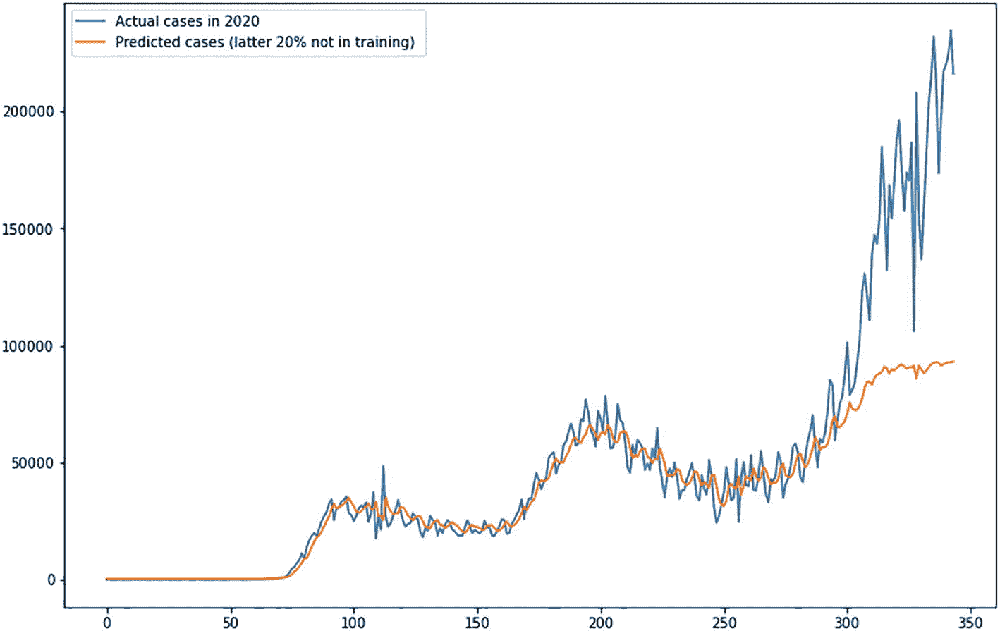

**图 15-11**
美国实际与预测的 COVID-19 病例数

```
fig = plt.gcf().set_size_inches(12,8)
plt.plot(data_actual)
plt.plot(data_predict)
plt.suptitle('')
plt.legend(['2020 年实际病例', '预测病例（后 20%未参与训练）'], loc='upper left')
```

尽管该模型对大部分数据看起来可靠，但由于数据的性质（COVID 病例仍在增加），模型无法捕捉这些峰值，因为：(1) 缩放会限制模型对极高值的理解；(2) 训练数据中没有足够的峰值模式。

在后续运行中，我们使用 100%的美国训练数据训练了 5000 个周期，并将模型应用于印度的 COVID-19 统计数据，这导致了接近的预测。

```
data = covid_data[covid_data['countryterritoryCode']=='IND'] [['dateRep', 'cases']]
data['dateRep'] = pd.to_datetime(data['dateRep'], format="%d/%m/%Y")
data = data.sort_values(by="dateRep", key=pd.to_datetime)
data = data.set_index('dateRep')
```

为了进行预测，我们将修改预测块中的相关部分。


```
sc = MinMaxScaler()
seq_length = 5
training_data = sc.fit_transform(data.values.copy())
x, y = chunkify(training_data, seq_length)
dataX = Variable(torch.Tensor(np.array(x)))
dataY = Variable(torch.Tensor(np.array(y)))
```

我们将使用相同的代码块进行评估。

```
model.eval()
train_predict = model(dataX)
data_predict = train_predict.data.numpy()
data_actual = dataY.data.numpy()
data_predict = sc.inverse_transform(data_predict)
data_actual = sc.inverse_transform(data_actual)
# plt.axvline(x=train_size, c='r', linestyle='--')
fig = plt.gcf().set_size_inches(12,8)
plt.plot(data_actual)
plt.plot(data_predict)
plt.suptitle('')
plt.legend(['2020 年印度实际新冠肺炎病例数', '新冠肺炎预测病例数'], loc='upper left')
```

图 15-12 展示了印度实际病例数与预测病例数的对比图。可以看出，该模型能够紧密地预测新冠肺炎病例。我们建议您尝试为其他序列数据（如字符 n-gram 级别的文本）构建类似的模型。

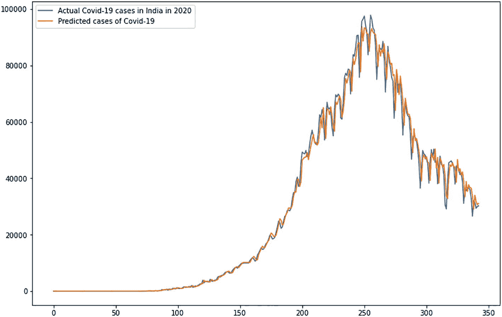

图 15-12

印度实际与预测的新冠肺炎病例数

## 门控循环单元

RNN 和 LSTM 在过去十年中变得非常流行，这推动了更多序列建模架构的普及。其中一种架构是由 Cho 等人在 2014 年提出的门控循环单元（GRU）。GRU 的结构如图 15-13 所示。

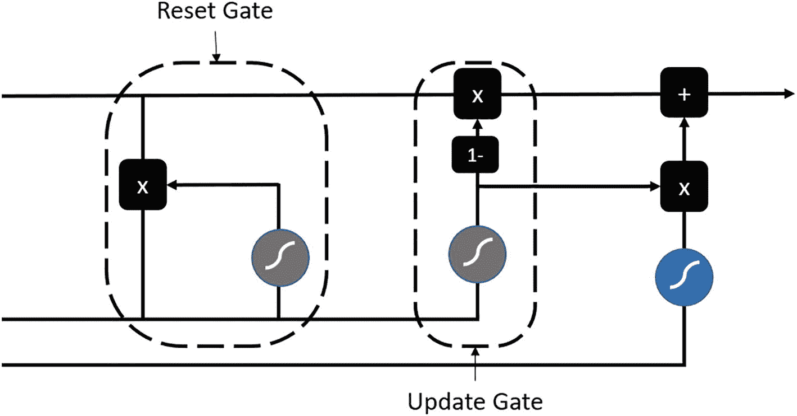

图 15-13

门控循环单元的结构

GRU 引入了更新门（Update Gate）来决定应添加或丢弃哪些新信息，以及重置门（Reset Gate）来丢弃部分过去的信息。这些机制与 LSTM 类似，但缺少输出门，且使用的参数更少，因此训练速度相对更快。它们在音乐建模、语音建模和自然语言处理（NLP）中非常流行。PyTorch 在 `nn.GRU()` 中提供了 GRU 的实现。

## 总结

在本章中，我们学习了循环神经网络和 LSTM，了解了它们如何帮助捕捉数据的序列特性，并通过一些修改在序列中保持关系。前几章为我们提供了一些更复杂的工具，这些工具已被用于构建机器学习和人工智能领域的最先进技术。

在下一章中，我们将把所有内容整合起来，讨论数据科学和人工智能项目是如何进行结构设计、规划、实施和部署的。

脚注 1

