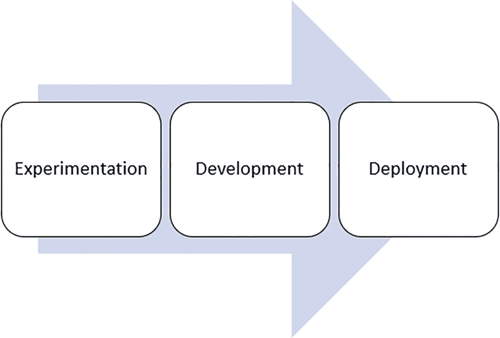
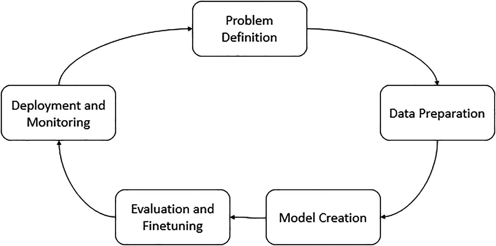
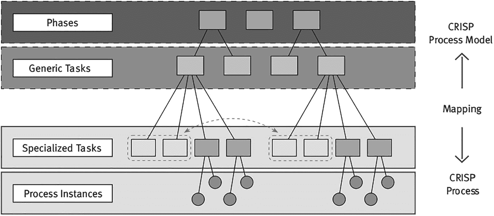
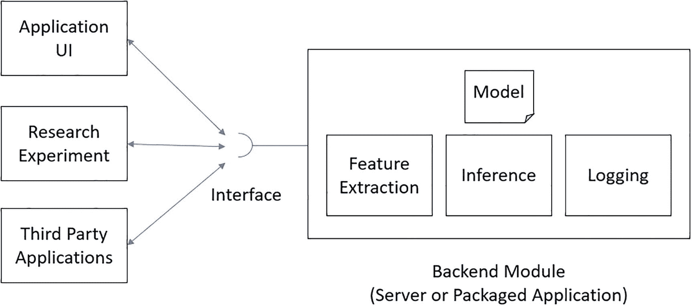
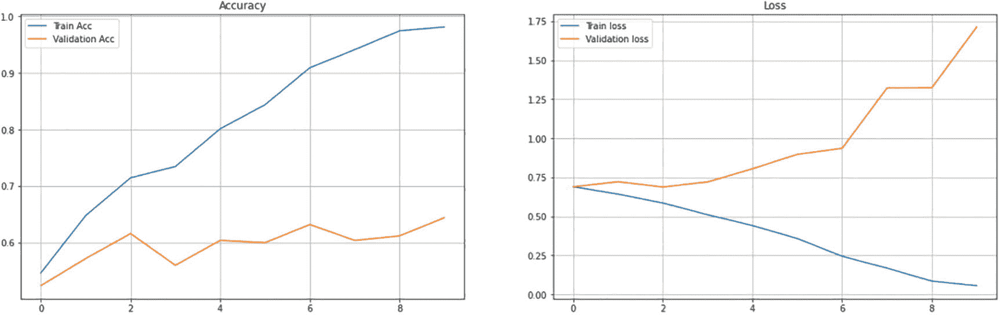

# 16. 整合所有内容

本书前几章介绍了数据分析方法、特征提取技术以及传统的机器学习和深度学习技术。我们对数值、文本和视觉数据进行了多次实验，并了解了如何分析和调整性能。

当您作为大型团队的一员，致力于解决业务或研究问题，或构建将被数百万用户使用的复杂人工智能驱动软件时，您必须始终以最终目标为导向来规划项目（图 16-1）。这促使您考虑数据科学的管理和工程方面。



图 16-1

机器学习项目成功部署的实践

在本章中，我们将讨论规划数据科学和人工智能项目的策略、持久化模型的工具，以及将模型作为微服务托管的方法，以便在不断发展的应用程序中使用。

## 数据科学生命周期

数据科学和人工智能项目非常复杂，很容易陷入细枝末节，或者过于专注于创建模型和托管，而忽视了长期愿景。每个数据科学项目都不同，可能使用不同的框架和流程进行管理——然而，所有项目都有相似的步骤（图 16-2）。



图 16-2

迭代式数据科学生命周期流程

该流程通常始于明确业务或研究目标，并生成能够正确定义我们试图解决问题的工件。这有助于清晰理解所需的数据，进而扩展到对数据源的分析、获取数据所需的技术专长和成本，以及评估数据在多大程度上能够支持实现业务目标。一旦获得数据，我们可能需要清洗、预处理，并在某些情况下合并多个数据源以提高数据质量。

流程的下一步是模型创建。基于业务目标和技术约束，我们决定哪些类型的解决方案可能适用于此问题。我们通常从使用基本特征工程和现成解决方案的简单实验开始，然后进行更深入的模型开发。根据数据类型、所选解决方案和计算能力的可用性，开发和训练可能需要数小时到数天的时间。这与彻底的评估和调优密切相关。

这个生命周期并非僵化的结构，而是从顶层展示了流程。此类流程的目的是提供一套标准步骤，以及每个步骤所需信息的细节，以及所产生的交付物和文档。其中一个非常流行的框架是 `CRISP-DM`。

### CRISP-DM 流程

`CRISP-DM`（跨行业数据挖掘标准流程）是一个流程框架，它定义了数据密集型项目中的常见任务，这些任务按一系列阶段执行，旨在为数据挖掘应用创建可重复的流程。它是一个开放标准，由全球数百家大型企业开发并遵循。该标准最初于 1996 年制定，随后成立了 `CRISP-DM` 特别兴趣小组，该小组获得了欧盟委员会的资助，并举办了一系列研讨会，在过去几十年中不断定义和完善相关流程及工件。



图 16-3

`CRISP-DM` 方法论

图 16-3 展示了流程模型如何在四个抽象级别上进行设计。在顶层，阶段定义了几个通用任务，这些任务旨在成为定义明确、完整且稳定的任务，并作为特殊任务来执行。可能存在一个名为“收集用户数据”的通用任务，它可能需要专门的任务，例如：(1) 从数据库导出用户表，(2) 使用外部服务查找用户位置，以及 (3) 通过 `API` 从用户的 `LinkedIn` 个人资料下载数据。第四层涵盖了专门任务的实际实现——同时也记录了所执行任务的操作、决策和结果。

`CRISP-DM` 模型包含六个阶段。以下各节将逐一描述。

#### 阶段 1：业务理解

在深入项目之前，第一步是从利益相关者的角度理解项目的最终目标。可能存在相互冲突的目标，如果在此阶段不加以分析，可能会导致不必要的重复成本。在此阶段结束时，我们将拥有一套清晰的业务目标和业务成功标准。我们还会在评估情况时分析资源可用性和风险。之后，我们从技术数据挖掘的角度定义项目目标，并制定项目计划。

#### 第二阶段：数据理解

此阶段涉及收集初始数据的各项任务。大多数项目需要整合来自多个来源的数据——这可以在本阶段或下一阶段完成。但此处的重点是创建一份初始数据收集报告，说明数据是如何获取的以及遇到了哪些问题。该阶段还包括数据探索、数据描述以及验证数据质量。任何潜在的数据质量问题都必须得到处理。

#### 第三阶段：数据准备

数据准备阶段假设初始数据已经获取并研究过，且已针对潜在风险制定了计划。此阶段的最终目标是生成可用于建模或分析的、可直接使用的数据集。此外，还需提供一份描述数据集的附加文档。

作为本阶段的一部分，需要选择数据集——并为每个数据集记录纳入和排除的原因。随后是数据清洗，以提升数据质量。这可能涉及数据转换、衍生更多属性或丰富数据集。在清洗、转换和整合之后，对数据进行格式化，以便在后续阶段更简单地加载数据。

#### 第四阶段：建模

建模阶段是指基于我们目前所学的各种建模和机器学习技术，构建并评估不同模型。第一步是选择要使用的建模技术。根据您希望探索和评估的不同建模方法或算法，此任务会有不同的实例。您将生成测试设计、构建模型、对其进行全面评估，并评估模型与系统技术需求的契合程度。

#### 第五阶段：评估

评估阶段广泛审视哪个模型能满足业务需求。该阶段涉及的任务是在实际应用中测试模型，并评估生成的结果。之后是审查流程任务，在此我们对数据挖掘工作进行全面审查，以确定是否有任何重要因素或任务本应被涵盖。最后，我们确定后续步骤，决定模型是否需要进一步调优，还是进入模型部署阶段。在本阶段结束时，我们已记录下模型的质量以及下一步应采取的可行措施清单。

#### 第六阶段：部署

最后一个阶段是部署，它将迄今为止完成的工作投入实际使用。此阶段因业务需求、组织策略和工程需求的不同而有很大差异。它从规划部署开始，涉及制定包含部署策略的部署计划。我们还需要规划一个全面的监控和维护计划，以避免端到端项目启动后出现问题。最后，项目团队撰写项目总结，并进行项目回顾，讨论并记录哪些方面进展顺利、哪些方面可以做得更好，以及未来如何改进。

在实践中，大多数组织将这些阶段作为指导方针，并根据自身的预算、治理要求和需求创建自己的流程。许多小规模团队可能不会遵循这些步骤，而是陷入开发和改进的漫长迭代循环中，无法避免那些如果事先研究过本可以妥善规划和处理的陷阱。

在本章的下一部分，我们将学习数据科学和人工智能项目开发与部署的技术方面。

## 机器学习应用如何提供服务

一旦模型创建完成，它必须与更大的企业应用程序集成。最常见的模型服务形式是作为服务或微服务。这种架构（图 16-4）的目标是封装预测/推理过程的整个工作流，包括数据准备、特征提取、加载先前创建的模型、预测输出值，并且通常通过一个易于使用的接口进行日志记录。这些接口最常见的形式是 `Web` 服务器中的一个端点。



图 16-4

将机器学习模型作为微服务提供

在大型应用程序中，这些服务器通常通过 `Docker` 托管在云上，以便于部署。为人工智能应用部署、监控和维护机器学习模型的概念，正以 `MLOps` 的形式扩展为结构清晰的概念。

在接下来的几页中，我们将进行一个小项目，该项目最终将作为一个机器学习应用进行托管。

## 通过示例学习

在这个小项目中，我们将使用 `PyTorch` 构建一个情感分析工具，旨在通过实验模型架构来获得相对较好的性能，保存参数，并使用 `Flask` 进行托管。

情感分析的首次尝试是 1961 年发布的 `General Inquirer` 系统。情感分析中的典型任务是文本极性分类，其中感兴趣的类别是正面和负面，有时还包括中性类别。随着计算能力、机器学习算法以及后来深度学习的进步，情感分析在许多情况下变得更加准确和普遍。

### 定义问题

情感分析是一个广阔的领域，涵盖了识别情感、观点、情绪和态度的问题。它还有许多不同的名称和略有差异的任务，例如情感分析、意见挖掘、观点提取、情感挖掘、主观性分析、情感影响分析、情绪分析、评论挖掘等。

在此问题中，我们将构建一个模型，用于对电影评论句子是正面、负面还是中性进行分类。在传统的机器学习方法中，特征工程是主要任务。特征向量是分类算法作为输入的实际内容（文档、推文等）的表示。除了作为一个属性之外，特征的目的在问题的上下文中会更容易理解。特征是可能有助于解决问题的特性。

在深度学习方法中，我们可以使用嵌入或字符序列。但首先，我们必须获取数据。

在某些情况下，您会通过数据库日志收集数据，或者雇佣数据收集团队，或者像我们这样幸运地偶然发现一个免费可用的数据集。一个包含 50,000 条电影评论的数据集^(¹⁶)由斯坦福大学收集并准备，于 2011 年发布。

### 数据

你可以从其网页下载数据，不过我们即将解释的解决方案同样适用于其他数据集，包括来自产品评论或社交媒体文本的数据集。从网站下载的数据集包含一个压缩的 `tar` 文件，解压后会展开为两个文件夹，即 `test` 和 `train`，以及一些包含数据集信息的附加文件。`Kaggle` 上提供了该数据集的预处理版本，^(¹⁷)由 `Lakshmipathi N.` 分享。

该数据集包含 50,000 条评论，每条评论都被标记为正面或负面。这为我们指明了神经网络结构最后一层的设计方向——我们只需要一个带有 `sigmoid` 激活函数的节点。如果类别超过两个，例如正面、负面或中性，我们将创建三个节点，每个节点代表一个情感类别标签。值最高的节点将指示预测结果。

假设你已经下载了数据集，其中每一行包含一条评论及其情感标签（`CSV` 格式），我们可以开始探索它。


```
import pandas as pd
dataset = "data/IMDB Dataset.csv"
df = pd.read_csv(dataset, sep=",")
sample_row = df.sample()
sample_row['review'].values
Out:
array(["Etienne Girardot is just a character actor--the sort of person people almost never would know by name. However, he once again plays the coroner--one of the only actors in the Philo Vance films that played his role more than once.
```

为简洁起见，此处输出已被截断。你可以使用 `sample_row['sentiment']` 查看该评论的标记情感，对于此样本，结果为 `positive`。

为了准备机器学习实验，我们将数据划分为训练集和测试集。

```
from sklearn.model_selection import train_test_split
X,y = df['review'].values,df['sentiment'].values
X_traindata,X_testdata,y_traindata,y_testdata = train_test_split(X,y,stratify=y)
print(f'Training Data shape : {X_traindata.shape}')
print(f'Test Data shape     : {X_testdata.shape}')
print(f'Training Target shape : {y_traindata.shape}')
print(f'Test Target shape     : {y_testdata.shape}')
Out:
Training Data shape : (37500,)x
Test Data shape     : (12500,)
Training Target shape : (37500,)
Test Target shape     : (12500,)
```

我们知道大多数模型要求数据转换为特定格式。在我们基于 RNN 的模型中，需要将数据转换为数字序列——其中每个数字代表词汇表中的一个单词。

在预处理阶段，我们需要：(1) 将所有单词转换为小写，(2) 对字符串进行分词和清洗，(3) 移除停用词，(4) 基于我们对训练语料库中单词的了解，准备一个单词字典，并根据该字典将所有单词转换为数字。

我们还将转换情感标签，使得负面由 0 表示，正面由 1 表示。在此实现中，我们将词汇表大小限制为 2000——因此，在创建序列时只会考虑最常用的 2000 个单词，其他单词将被忽略。你可以根据计算能力和目标结果质量来调整这个数字。实现如下所示：

```
import re
import numPy as np
from collections import Counter
def preprocess_string(s):
    s = re.sub(r"[^\w\s]", '', s)
    s = re.sub(r"\s+", '', s)
    s = re.sub(r"\d", '', s)
    return s
def mytokenizer(x_train,y_train,x_val,y_val):
    word_list = []
    stop_words = set(stopwords.words('english'))
    for sent in x_train:
        for word in sent.lower().split():
            word = preprocess_string(word)
            if word not in stop_words and word != '':
                word_list.append(word)
    corpus = Counter(word_list)
    corpus_ = sorted(corpus,key=corpus.get,reverse=True)[:2000]
    onehot_dict = {w:i+1 for i,w in enumerate(corpus_)}
    final_list_train,final_list_test = [],[]
    for sent in x_train:
        final_list_train.append([onehot_dict[preprocess_string(word)] for word in sent.lower().split() if preprocess_string(word) in onehot_dict.keys()])
    for sent in x_val:
        final_list_test.append([onehot_dict[preprocess_string(word)] for word in sent.lower().split() if preprocess_string(word) in onehot_dict.keys()])
    encoded_train = [1 if label =='positive' else 0 for label in y_train]
    encoded_test = [1 if label =='positive' else 0 for label in y_val]
    return np.array(final_list_train), np.array(encoded_train),np.array(final_list_test), np.array(encoded_test),onehot_dict
```

现在我们可以使用以下代码准备训练和测试数组：

```
X_train,y_train,X_test,y_test,vocab = mytokenizer(X_traindata,y_traindata,X_testdata,y_testdata)
```

你可能会收到类似这样的错误信息：

```
LookupError:
***********************************************************
Resource stopwords not found.
Please use the NLTK Downloader to obtain the resource:
>>> import nltk
>>> nltk.download('stopwords')
For more information see: https://www.nltk.org/data.html
Attempted to load corpora/stopwords
Searched in:
- 'C:\\Users\\JohnDoe/nltk_data'
- 'C:\\Users\\ JohnDoe \\Anaconda3\\nltk_data'
- 'C:\\Users\\ JohnDoe \\Anaconda3\\share\\nltk_data'
- 'C:\\Users\\ JohnDoe \\Anaconda3\\lib\\nltk_data'
- 'C:\\Users\\ JohnDoe \\AppData\\Roaming\\nltk_data'
- 'C:\\nltk_data'
- 'D:\\nltk_data'
- 'E:\\nltk_data'
************************************************************
```

这意味着 `nltk` 中没有停用词列表，我们可以使用 `nltk.download()` 进行安装。这在你的 Python 环境中只需执行一次。更多详情，请参考 NLTK^(¹⁸)文档。

或者，你也可以自行构建一个停用词列表，并添加逻辑来移除停用词列表中的单词。

在继续之前，我们应该验证对象是否具有正确的形状和大小。

`vocab` 应该是一个长度为 2000 的字典（这是我们限制的词汇表大小）。`X_train`、`y_train`、`X_test` 和 `y_test` 应该是 `numpy.ndarray`，其大小与原始数据集的划分一致。

由于我们计划在此任务中使用 RNN，而 RNN 要求序列具有特定长度——因此，如果句子太短，我们需要对序列进行填充，通常用 0 填充。如果句子太长，我们必须确定一个最大长度并进行截断——这在预测阶段遇到未见过的数据时可能更常发生。为了确定这个长度，让我们探索训练数据集，看看评论的长度。


```
review_length = [len(i) for i in X_train]
print ("Average Review Length : {} \nMaximum Review Length : {} ".format(pd.Series(review_length).mean(), pd.Series(review_length).max()))
Out:
Average Review Length : 81.74666666666667
Maximum Review Length : 662
```

从这些数据来看，评论长度相当长。然而，通常情况下，我们会有大量短评论，而非常长的评论则很少。将评论序列长度截断为 200 个单词并非错误，这当然会丢失超过 200 个单词的评论中的信息，但我们假设这类评论非常罕见，并且对模型性能影响不大。

每篇评论如果较长，应限制在 200 词以内。如果不足 200 词怎么办？我们会用空单元格（或零）进行填充。

```
def pad(sentences, seq_len):
    features = np.zeros((len(sentences), seq_len),dtype=int)
    for ii, review in enumerate(sentences):
        if len(review) != 0:
            features[ii, -len(review):] = np.array(review)[:seq_len]
    return features
```

我们可以在使用训练数据集之前对其进行测试。在以下几行中，我们将传入一个包含十个元素的数据行，并调用该函数将其填充至长度为 20。

```
test = pad(np.array([list(range(10))]), 20)
test
Out: array([[0, 0, 0, 0, 0, 0, 0, 0, 0, 0, 0, 1, 2, 3, 4, 5, 6, 7, 8, 9]])
```

如果我们改为传入 1 到 30 的数字，该函数将截断末尾的十个数字。

```
test = pad(np.array([list(range(30))]), 20)
test
Out: array([[ 0,  1,  2,  3,  4,  5,  6,  7,  8,  9, 10, 11, 12, 13, 14, 15, 16, 17, 18, 19]])
```

现在可以对训练集和测试集进行填充了。

```
X_train = pad(X_train,200)
X_test = pad(X_test,200)
```

数据现已准备就绪。我们可以继续定义神经网络。如果有可用的 GPU，我们将设备设置为 GPU。稍后会在代码中使用这个变量。

```
import torch
is_cuda = torch.cuda.is_available()
if is_cuda:
    device = torch.device("cuda")
else:
    device = torch.device("cpu")
print (device)
Out:
GPU
```

### 准备模型

我们首先需要将数据集转换为张量。可以使用`torch.from_numpy()`创建张量，然后通过`TensorDataset()`将数据值和标签打包在一起。接着，我们可以定义`DataLoader`来加载数据，以便进行更大规模的实验。

```
import torch
import torch.nn as nn
import torch.nn.functional as F
from torch.utils.data import TensorDataset, DataLoader
# 创建张量数据集
train_data = TensorDataset(torch.from_numpy(X_train), torch.from_numpy(y_train))
valid_data = TensorDataset(torch.from_numpy(X_test), torch.from_numpy(y_test))
batch_size=50
train_loader = DataLoader(train_data, shuffle=True, batch_size=batch_size)
valid_loader = DataLoader(valid_data, shuffle=True, batch_size=batch_size)
```

该模型是一个简单的模型，包含一个输入层，接着是 LSTM 层，最后是一个带 `sigmoid` 激活函数的单单元输出层。我们将使用 `dropout` 层进行基本正则化，以避免过拟合。

输入层是一个嵌入层，其形状表示批次大小、层大小和序列长度。在模型类中，`forward()` 方法将实现前向传播计算。我们还将实现 `init_hidden()` 方法，将 LSTM 的隐藏状态初始化为零。隐藏状态存储了 RNN 根据当前序列中先前标记的预测结果而得到的内部状态，以维持序列内的记忆概念。然而，重要的是，当我们读取下一条评论的第一个标记时，状态应被重置，然后由后续标记更新和使用。具体实现如下：

```
class SentimentAnalysisModel(nn.Module):
    def __init__(self, no_layers, vocab_size, hidden_dim, embedding_dim, drop_prob=0.5):
        super(SentimentAnalysisModel,self).__init__()
        self.output_dim = output_dim
        self.hidden_dim = hidden_dim
        self.no_layers = no_layers
        self.vocab_size = vocab_size
        self.embedding = nn.Embedding(vocab_size, embedding_dim)
        self.lstm = nn.LSTM(input_size=embedding_dim, hidden_size=self.hidden_dim, num_layers=no_layers, batch_first=True)
        self.dropout = nn.Dropout(0.3)
        self.fc = nn.Linear(self.hidden_dim, output_dim)
        self.sig = nn.Sigmoid()
    def forward(self,x,hidden):
        batch_size = x.size(0)
        embeds = self.embedding(x)
        lstm_out, hidden = self.lstm(embeds, hidden)
        lstm_out = lstm_out.contiguous().view(-1, self.hidden_dim)
        out = self.dropout(lstm_out)
        out = self.fc(out)
        sig_out = self.sig(out)
        sig_out = sig_out.view(batch_size, -1)
        sig_out = sig_out[:, -1] # 获取最后一批标签
        return sig_out, hidden
    def init_hidden(self, batch_size):
        ''' 初始化隐藏状态 '''
        h0 = torch.zeros((self.no_layers, batch_size, self.hidden_dim)).to(device)
        c0 = torch.zeros((self.no_layers, batch_size, self.hidden_dim)).to(device)
        hidden = (h0,c0)
        return hidden
```

现在我们可以初始化模型对象了。超参数可以单独定义，以便后续微调模型。`no_layers` 用于定义 RNN 的堆叠层数。`vocab_size` 会递增，以调整嵌入层的形状，使其能够容纳填充评论中的 0 值。`output_dim` 为 1，表示输出层只有一个节点，该节点包含一个可视为评论正面概率的数字。`hidden_dim` 用于指定 LSTM 中隐藏状态的大小。

```
no_layers = 2
vocab_size = len(vocab) + 1
embedding_dim = 64
output_dim = 1
hidden_dim = 256
model = SentimentAnalysisModel (no_layers,  vocab_size, hidden_dim, embedding_dim, drop_prob=0.5)
model.to(device)
print(model)
```

模型输出应如下所示：

```
SentimentAnalysisModel(
(embedding): Embedding(2001, 64)
(lstm): LSTM(64, 256, num_layers=2, batch_first=True)
(dropout): Dropout(p=0.3, inplace=False)
(fc): Linear(in_features=256, out_features=1, bias=True)
(sig): Sigmoid()
)
```

好的，作为一名高级文档工程师和翻译员，我将严格遵循您提供的注意事项和示例格式，将给定的英文文本翻译成中文。

让我们来定义训练循环。我们将使用二元交叉熵损失函数，这对于简单的二元分类问题来说是一个不错的选择。我们将学习率保持为 0.01，优化器采用 `Adam` 优化算法。

训练循环可以设置为运行大量周期（epochs）。我们将跟踪每个周期（epoch）的准确率和损失，以观察性能在多次训练迭代中如何提升。

准确率将简单地比较输出层的输出并进行四舍五入。在所有样本中，准确率将简单地显示被正确标记的训练数据点的比例。

```
def acc(pred,label):
return torch.sum(torch.round(pred.squeeze()) == label.squeeze()).item()
```

训练循环的实现如下：

```
lr=0.001
criterion = nn.BCELoss()
optimizer = torch.optim.Adam(model.parameters(), lr=lr)
clip = 5
epochs = 10
valid_loss_min = np.Inf
# train for some number of epochs
epoch_tr_loss,epoch_vl_loss = [],[]
epoch_tr_acc,epoch_vl_acc = [],[]
for epoch in range(epochs):
train_losses = []
train_acc = 0.0
model.train()
# initialize hidden state
h = model.init_hidden(batch_size)
for inputs, labels in train_loader:
inputs, labels = inputs.to(device), labels.to(device)
# Creating new variables for the hidden state, otherwise
# we'd backprop through the entire training history
h = tuple([each.data for each in h])
model.zero_grad()
output,h = model(inputs,h)
loss = criterion(output.squeeze(), labels.float())
loss.backward()
train_losses.append(loss.item())
# calculating accuracy
accuracy = acc(output,labels)
train_acc += accuracy
#`clip_grad_norm` helps prevent the exploding gradient problem in RNNs / LSTMs.
nn.utils.clip_grad_norm_(model.parameters(), clip)
optimizer.step()
val_h = model.init_hidden(batch_size)
val_losses = []
val_acc = 0.0
model.eval()
for inputs, labels in valid_loader:
val_h = tuple([each.data for each in val_h])
inputs, labels = inputs.to(device), labels.to(device)
output, val_h = model(inputs, val_h)
val_loss = criterion(output.squeeze(), labels.float())
val_losses.append(val_loss.item())
accuracy = acc(output,labels)
val_acc += accuracy
epoch_train_loss = np.mean(train_losses)
epoch_val_loss = np.mean(val_losses)
epoch_train_acc = train_acc/len(train_loader.dataset)
epoch_val_acc = val_acc/len(valid_loader.dataset)
epoch_tr_loss.append(epoch_train_loss)
epoch_vl_loss.append(epoch_val_loss)
epoch_tr_acc.append(epoch_train_acc)
epoch_vl_acc.append(epoch_val_acc)
print(f'Epoch {epoch+1}')
print(f'train_loss : {epoch_train_loss} val_loss : {epoch_val_loss}')
print(f'train_accuracy : {epoch_train_acc*100} val_accuracy : {epoch_val_acc*100}')
if epoch_val_loss  {:.6f}).  Saving model ...'.format(valid_loss_min,epoch_val_loss))
valid_loss_min = epoch_val_loss
print('\n')
```

我们添加了足够的打印语句，以清晰展示模型在每个周期（epoch）的学习情况。您将能看到如下日志：

```
Epoch 1
train_loss : 0.6903249303499858 val_loss : 0.6897501349449158
train_accuracy : 54.666666666666664 val_accuracy : 52.400000000000006
Validation loss change (inf --> 0.689750).  Saving model ...
Epoch 2
train_loss : 0.6426109115282694 val_loss : 0.7218503952026367
train_accuracy : 64.8 val_accuracy : 57.199999999999996
```

我们还可以将这些数据可视化为图表，如图 16-5 所示。



图 16-5

各周期（epoch）的准确率和损失

```
import matplotlib.pyplot as plt
fig = plt.figure(figsize = (20, 6))
plt.subplot(1, 2, 1)
plt.plot(epoch_tr_acc, label='Train Acc')
plt.plot(epoch_vl_acc, label='Validation Acc')
plt.title("Accuracy")
plt.legend()
plt.grid()
plt.subplot(1, 2, 2)
plt.plot(epoch_tr_loss, label='Train loss')
plt.plot(epoch_vl_loss, label='Validation loss')
plt.title("Loss")
plt.legend()
plt.grid()
plt.show()
```

为了进一步改进和调优，您可以调整模型架构和超参数，而最简单的方法是增加周期（epoch）数量或添加更多标记数据。

### 序列化用于未来预测

通常，您会尝试修改网络架构、调整特征创建方式（如词汇表）以及其他超参数。一旦获得了足够高且能在应用中可靠使用的准确率，您就应该保存模型状态，这样就不必在每次需要预测句子情感时重复进行计算密集型的训练过程。

假设我们不再使用训练方法，以下是预测阶段需要存储的项目：

*   将句子转换为序列的逻辑

*   包含单词到数字映射的词汇表字典

*   网络架构和前向传播计算

Python 的 `pickle` 模块常用于序列化对象并将其永久存储在磁盘上。PyTorch 提供了一种保存模型参数的方法，该方法内部默认使用 `pickle`，并且可以使用此函数保存模型、张量和各种对象的字典。

```
torch.save(model.state_dict(), 'model_path.pt')
```

# 情感分析模型部署与服务

`state_dict` 是一个 Python 字典对象，它将每一层映射到其参数张量。将来，您可以使用以下方式加载参数：

```python
model = SentimentAnalysisModel (args)
model.load_state_dict(torch.load('model_path.pt'))
```

请记住，这仅保存模型参数。您仍然需要之前在代码中指定的模型定义。

推理方法可以使用词汇表字典将词元序列转换为数字序列。我们将把它填充到之前决定的长度（200），并将其用作模型的输入。此方法的实现如下：

```python
def inference(text):
    word_seq = np.array([vocab[preprocess_string(word)] for word in text.split() if preprocess_string(word) in vocab.keys()])
    word_seq = np.expand_dims(word_seq,axis=0)
    padded =  torch.from_numpy(pad(word_seq,500))
    inputs = padded.to(device)
    batch_size = 1
    h = model.init_hidden(batch_size)
    h = tuple([each.data for each in h])
    output, h = model(inputs, h)
    return(output.item())
```

您可以简单地调用此方法来查找情感分数。如果要进行推理，请确保调用 `model.eval()`。

```python
inference("The plot was deeply engaging and I couldn't move")
```

这将预处理句子，将其拆分为词元，转换为词汇索引序列，将输入序列传递给网络，并在前向传播后返回输出层获得的值。此返回值是 `0.6632`，表示积极情感。如果用例需要，您可以添加一个条件语句，返回包含“positive”或“negative”字符串，而不是数字。

## 托管模型

在更大的应用程序中使用训练好的模型的一种非常流行的方法是将其作为微服务托管。这意味着将使用一个可以接受 GET 请求的小型 HTTP 服务器。

在这个例子中，我们可以构建并创建一个能够接受 GET 数据的服务器，该数据将是一条评论。服务器将读取数据并响应一个情感标签。

### Flask 中的 Hello World

如果你尚未安装 `Flask`，可以使用以下命令进行安装：

```bash
pip install Flask
```

以下是一个在 `Flask` 中非常简单的 Hello World 应用。你需要创建一个 `Flask()` 对象，并实现一个由 `@app.route()` 定义的地址所使用的函数。这里，我们定义了一个端点，它将接受对服务器 URL 的请求，该 URL 表示为 `http://server-url:5000/hello`，并返回一个字符串 "Hello World!"。我们需要指定：

```python
from flask import Flask
app = Flask(__name__)
@app.route('/hello')
def hello():
    return 'Hello World!'
app.run(port=5000)
```

如果你在 `Jupyter` 或终端中运行它，你将能够看到服务器日志：

```
* Serving Flask app "__main__" (lazy loading)
* Environment: production
WARNING: This is a development server. Do not use it in a production deployment.
Use a production WSGI server instead.
* Debug mode: off
```

现在，你可以在浏览器中导航到 `http://127.0.0.1:5000/hello` 并确认输出。服务器日志将对此进行确认。

```
127.0.0.1 - - [28/Jun/2021 10:10:00] "GET /hello HTTP/1.1" 200
```

要托管模型，你可以创建一个单独的 Python 文件，并定义一个新的路由：

```python
@app.route("/getsentiment", methods=['GET'])
def addParams():
    args = request.args
    text = args['reviewtext']
    score = inference(text)
    label = 'positive' if score >0.5 else 'negative'
    return {'sentimentscore': score, 'sentimentlabel':label}
```

前端应用可以向 `http://server:port/getsentiment` 发送请求，并将数据作为 `reviewtext` 参数传递，然后接收一个包含 `sentimentscore` 和 `sentimentlabel` 的 JSON/字典。

## 下一步

机器学习、人工智能和数据科学领域在过去几十年中一直在不断发展，并且随着更新的硬件技术和算法视角的不断演进，它们将继续发展。

AI 并非能解决我们所有无解问题的魔法棒——而是一套结构良好的概念、理论和技术，帮助我们理解并实现解决方案，使机器能够通过观察我们提供的数据来学习。理解潜在偏见的影响，并彻底审视我们实践成果所涉及的项目和产品的伦理方面，这一点至关重要。本书并非终点，而是引导你踏上数据科学之旅各个步骤的便捷工具。

# 索引

## A
绝对误差 准确率 激活函数 `ReLU` `sigmoid` `tanh` `AdaBoost` `AlexNet` `Anaconda` `Anaconda` 导航器 `Anaconda` Python 发行版 `Apriori` 算法 人工神经网络（`ANN`） 回归 人工神经元

## B
反向传播 时间反向传播（`BPTT`） `Bagging` 贝叶斯定理 偏差与方差 生物神经元 `Boosting` `AdaBoost` 决策桩 在 Python 中 自助聚合过程

## C
类条件独立性 分类报告 手写数字分类 聚类 `K-Means` 在 Python 中 `DBSCAN` 图像分割 中间斑点 标准 `sklearn` 函数 `k` 值 随机生成数据 逗号分隔值（`CSV`）文件 计算机视觉（`CV`） 条件概率 混淆矩阵 连续变量 卷积神经网络（`CNN`） 配置 深度网络 图像分类 参见图像分类 填充/步长 在 PyTorch 中 结构 卷积操作 代价函数 协方差矩阵 `CPython` 实现 互相关 交叉熵损失 跨行业数据挖掘标准流程（`CRISP-DM`）过程 业务理解 数据准备阶段 数据理解 部署 评估阶段 方法论 建模 交叉验证

## D
数据框 数据科学生命周期 `CRISP-DM` 过程 参见跨行业数据挖掘标准流程（`CRISP-DM`）过程 迭代过程 模型创建 数据变量 区间数据 名义数据 有序数据 比率数据 `DecisionTreeClassifier` 决策树 定义 学习阶段 在 Python 中 解释 剪枝 分裂准则 深度学习算法 深度神经网络 基于密度的噪声应用空间聚类（`DBSCAN`） 降维 维度灾难 主成分分析 协方差矩阵 数据点 最大方差 在 Python 中 数据集变换 离散变量

## E
集成学习方法 顶层示意图 熵

## F
假阴性（`FN`） 假阳性（`FP`） 特征提取 前馈神经网络 人工神经网络 训练神经网络 反向传播 梯度下降 损失函数 参见损失函数 `fit()` 方法 `F-measure` 遗忘门 `forward()` 方法 频繁模式挖掘（`FP` 挖掘） 购物篮分析 在 Python 中 `F1` 分数

## G
门控循环单元（`GRU`） 高斯分布 高斯朴素贝叶斯模型 梯度下降 网格搜索

## H
合页损失 直方图 超参数调优 数据集创建 网格搜索 随机搜索

## I
图像分类 `DataLoader()` 基于 `CNN` 的神经网络 滤波器可视化 损失函数/优化器 `Matplotlib` 最大池化 `MNIST` Fashion 数据集 模型参数 操作 `ReLU` 最大池化大小 `ImageNet` `Ndarray` 索引 推理方法 输入门 区间数据 `Iris` 数据集

## J
`Jupyter` Notebooks

## K
核函数 核技巧 `k` 折交叉验证 `K-Means`

## L
带标签数据集 拉格朗日公式 拉普拉斯修正 `Lasso` 回归 学习 数据托管 模型 模型准备 预测阶段 问题定义 留一法交叉验证 线性回归 评估指标 多项式特征 Python 监督学习方法 可视化 `linspace()` 例程 `Linux` 发行版 `load_iris()` 方法 逻辑回归 边界线创建 决策边界线 `vs`. 曲线 表达式 概率 参数学习 Python 长短期记忆 损失函数 交叉熵损失 合页损失 平均绝对误差 均方误差 负对数似然损失

## M
机器学习 定义 模型作为微服务 监督学习 无监督学习 购物篮分析 `Matplotlib` 数据可视化 条形图 直方图 线性图 魔法命令 多线图 饼图 `Pyplot` 模块 散点图 正弦图 子图 矩阵运算 最大熵模型 最大间隔分类器 最大池化 平均绝对误差 均方误差（`MSE`） `Miniconda` 最小-最大缩放 `MinMax` 变换 `MNIST` Fashion 数据集 `model.score()` 方法 改进版国家标准与技术研究所（`MNIST`）数据库 多维数组 多层 `ANN` 边界 决策边界 `Iris` 数据集 带隐藏层的神经网络 PyTorch 中的 `NN` 类 过拟合/丢弃 损失减少 `ReLU`

## N
朴素贝叶斯 贝叶斯定理 分类器 条件概率 多项式 后验概率 在 Python 中 自然语言处理（`NLP`） 应用 流水线 移除停用词 分词 词干提取/词形还原 标记化 词向量 `Natural Language ToolKit`（`NLTK`） `N` 维数组（`Ndarray`） 常量 创建 索引 多维 `NumPy` 例程 属性 负对数似然损失 神经网络 名义数据 非线性分类 归一化 最小-最大缩放 标准缩放 `np.identity()` 函数 `NumPy` 库 安装 `Ndarray` 参见 `N` 维数组（`Ndarray`） 数值计算例程 `Ndarray` 创建

## O
有序数据 输出门 过拟合

## P, Q
`Pandas` 数据框 数据可视化 面积图 箱/桶 直方图 箱线图 数据框创建 生成数据集 直方图 水平条 堆叠直方图 堆叠水平条 堆叠垂直条 非堆叠面积图 垂直条 定义 系列 `PATH` 变量 感知机 在 Python 中 结构 组成计算 随机值权重 性能指标 准确率 混淆矩阵 `f-measure` 精确率 召回率 性能指标 `Pip3` 工具 多项式回归 `Porter` 词干提取器 精确率 `predict()` 方法 文本预处理 `NLP` 参见自然语言处理（`NLP`） 主成分分析 图像处理 `PyDotPlus` Python 发行版 实现 安装 `Linux` 发行版 `macOS` `Windows` 模式 交互模式 脚本模式 性能指标 `Python 3` 编程语言 应用 历史 面向对象/过程式编程 哲学 `PyTorch` `CNN` 定义 安装 `NN` 类 张量操作 张量创建

## R
`RandomForestClassifier` 随机森林 在 Python 中 随机生成数据集 随机搜索 比率数据 召回率 修正线性单元（`ReLU`） 循环神经网络（`RNN`） `LSTM` 单元 在 Python 中 类型 多对多 多对一 一对多 一对一 循环单元 回归 `ANN` 随机生成样本 正则化 `ROC` 曲线 均方根误差

## S
科学 Python 生态系统 `Scikit-learn` `API` 定义 `hello-world` 实验 安装 `R` 平方值 分割 情感分析 `Sigmoid` 激活函数 `sklearn.metrics` 堆叠泛化 堆叠集成 标准缩放 分层交叉验证 子图 监督学习 分类 回归 系统结构 数据标注/数据准备 数据收集 数据整理 端到端过程 评估 模型部署 模型开发 问题理解 训练 支持向量分类器 支持向量机（`SVM`） 决策边界 超平面 核技巧 最大间隔超平面 非线性分类 在 Python 中 支持向量机（`SVM`）分类器

## T
`Tanh` 激活函数 测试数据集 时间序列预测 标记化 `torchvision.datasets()` 训练与测试过程 训练数据集 变换 名义属性 非数值特征转换为数值 有序属性 `Transform` 方法 真阴性（`TN`） 真阳性（`TP`） 第一类/第二类错误

## U, V
欠拟合 无监督学习 无监督学习方法 聚类 参见聚类 降维 `FP` 挖掘

## W, X, Y, Z
弱学习器