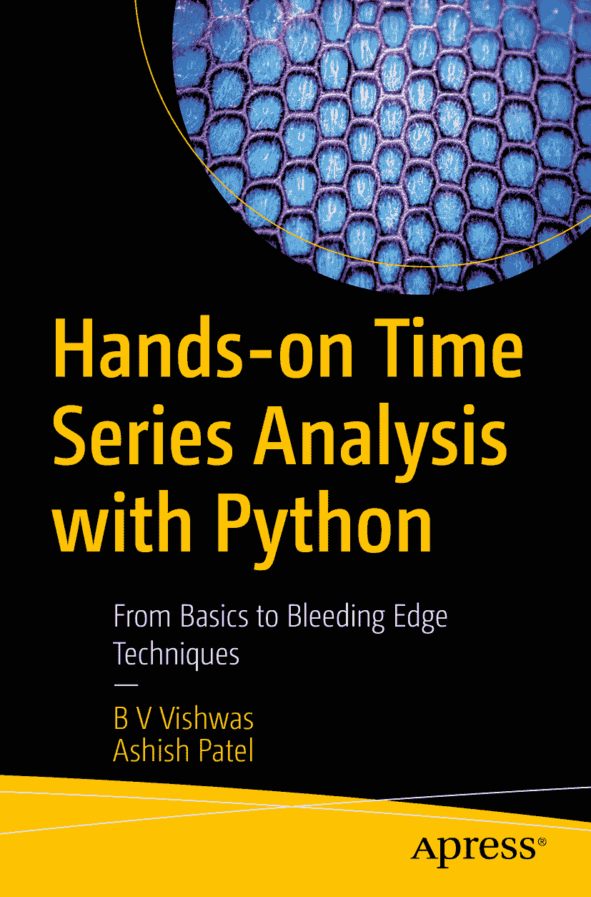

ISBN 978-1-4842-5991-7 e-ISBN 978-1-4842-5992-4 [`doi.org/10.1007/978-1-4842-5992-4`](https://doi.org/10.1007/978-1-4842-5992-4) © B V Vishwas and Ashish Patel 2020 Apress Standard 本出版物中使用通用描述性名称、注册商标、商标、服务标记等，即使未作特别声明，也不意味着这些名称不受相关保护法律和法规的约束，因此可自由使用。出版商、作者和编辑假定本书中的建议和信息在出版之日是真实准确的。出版商和作者或编辑均不对本书所含材料或可能存在的任何错误或遗漏提供明示或暗示的担保。出版商对已出版地图中的管辖权主张和机构归属保持中立。本书通过 Springer Science+Business Media New York 在全球图书贸易中发行，地址：233 Spring Street, 6th Floor, New York, NY 10013。电话：1-800-SPRINGER，传真：(201) 348-4505，电子邮件：orders-ny@springer-sbm.com，或访问 www.springeronline.com。Apress Media, LLC 是一家加利福尼亚有限责任公司，其唯一成员（所有者）是 Springer Science + Business Media Finance Inc (SSBM Finance Inc)。SSBM Finance Inc 是一家特拉华州公司。引言

本书通过完整的示例，解释了从传统到前沿的时间序列概念和技术。

本书首先介绍时间序列的基础知识及其特征、时间序列数据的结构与组成部分、预处理，以及通过数据整理构建特征的方法。接着，本书涵盖了传统的时间序列技术，例如平滑方法 ARMA、ARIMA、SARIMA、SARIMAX、VAR 和 VARMA，并使用 [Statsmodels](https://www.statsmodels.org/) 和 Pmdarima 等流行框架进行讲解。

此外，本书进一步介绍了如何利用基于深度学习的高级技术（如 ANN、CNN、RNN、LSTM、GRU 和 Autoencoder）来解决时间序列问题，并使用 Tensorflow 实现。最后，本书解释了如何使用流行框架 fbprophet 对时间序列分析进行建模。

完成本书后，读者将掌握解决时间序列问题的概念和技术的全面知识。本书中提供的所有代码均可在 Jupyter Notebooks 中找到；这使得读者能够进行动手实验，并以令人兴奋的方式对其进行改进。

致谢

这是我的第一本书，我发现将想法和实际经验转化为当前的形式是一项艰巨的任务。我感谢全能的上帝在所有努力中保佑和指引我。我要感谢我的父母（Vijay Kumar 和 Rathnamma）、兄弟（Shreyas）、其他家人和朋友，感谢他们帮助我渡过人生的海洋。

> —B V Vishwas

首先，我要感谢全能的上帝，感谢他在整个写作过程中赐予的祝福。我要向我的父母（Dinesh Kumar N Patel 和 Javnika ben D Patel）、我的姐姐（Nisha Patel）以及我的家人和朋友（Shailesh Patel、Sanket Patel、Nikit Patel、Mansi Patel、Khushboo Shah）表达我深切而诚挚的感谢，感谢他们的支持和宝贵的祈祷。

> —Ashish Patel

特别感谢 Celestin Suresh John、Aditee Mirashi、James Markham、Alexey Panchekha 以及 Apress 团队，是他们让这本书得以问世。

关于作者 关于技术审校

