# 1. 时间序列特征

*时间序列*是一组按时间存储的数据点。对这种数据进行的数学和统计分析，以发现隐藏模式和有意义的信息，被称为*时间序列分析*。时间序列建模技术用于理解数据中的过去模式，并尝试预测未来趋势。这些技术和方法已经发展了几十年。

具有连续时间戳和目标变量的观测值有时会被分解为分钟、小时、天、周、月、年等，并被视为简单的回归问题，但这并不是处理此类数据的正确方法，因为获得的结果很差。在本章中，你将学习处理时间序列数据的正确方法。

数据有不同的类型，例如结构化、半结构化和非结构化，每种类型都应以自己的方式处理，以获得最大的信息量。在本书中，我们将研究结构化的时间序列数据，例如来自股票市场、天气、出生率、交通、共享单车应用等的数据。

本章是对时间序列数据类型、其组成部分以及分解方法的简要介绍。

## 数据类型

*时间序列分析*是一种测量一组连续数据点的统计技术。这是一种以时间为标准度量的方法，分为三种类型，如图 1-1 所示。

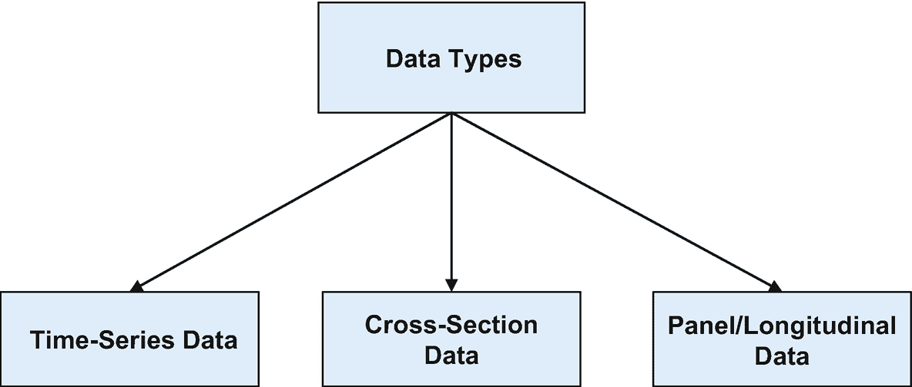

图 1-1

数据类型

### 时间序列数据

时间序列包含在一段时间内按时间顺序增加、减少或以其他方式变化的数据点。仅包含单个特征或变量记录的时间序列称为*单变量*时间序列。如果记录包含多个特征或变量，则该序列称为*多变量*时间序列。此外，时间序列可以以两种方式指定：连续或离散。

在*连续*时间序列中，数据观测在整个时间段内连续进行，例如地震仪震级数据、语音数据等。图 1-2 展示了从 1975 年到 2015 年连续测量的地震数据。

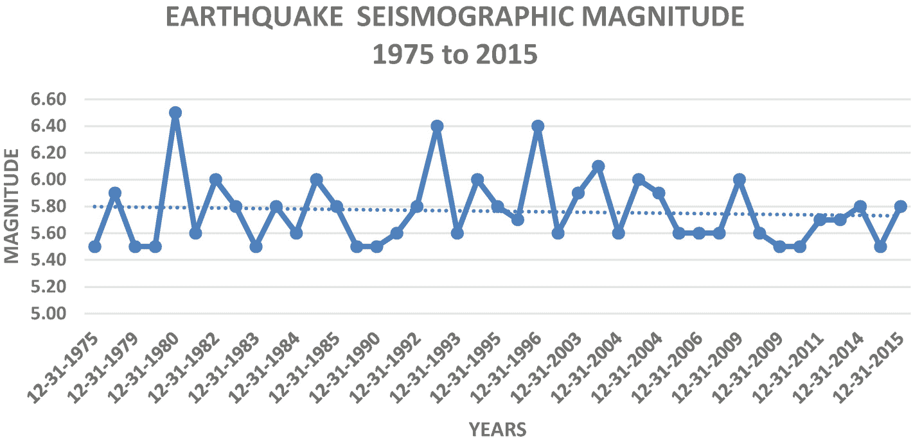

图 1-2

四十年地震仪震级数据

图 1-3 展示了印度一个世纪以来的温度变化情况，并清楚地表明温度正在单调上升。

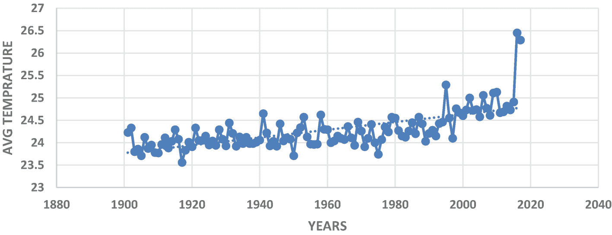

图 1-3

印度 1901 年至 2017 年的温度数据

在*离散*时间序列中，数据观测在特定时间或等间隔进行，例如温度的升高或降低、货币汇率、气压数据等。图 1-2 展示了印度 1901 年至 2017 年的平均温度分析，该温度随时间升高或降低。这种数据行为是离散的。

### 横截面数据

*横截面数据*是在特定时间点针对多个主体收集的数据，例如特定日期特定股票组合的收盘价、选举的民意调查、人口中的肥胖水平等。横截面研究用于许多研究领域，例如医学、经济学、心理学等。例如，根据世界卫生组织 2017 年的报告，高血压是印度死亡的重要原因之一。世界卫生组织对几个风险因素（考虑了各种主体）进行了研究，这反映了横截面调查数据。图 1-4 展示了横截面数据。


图 1-4

印度按风险因素划分的死亡人数


### 面板数据/纵向数据

*面板数据/纵向数据*包含对同一对象在不同时间段内多次观测的结果。这类数据是根据横截面数据单元（如个人、公司或政府机构）中的观测数量定期确定的。表 1-1 提供了在几年内对多人收集的数据示例，其中收集的数据包括收入、年龄和性别。

表 1-1

面板数据示例

| 面板数据 A |  |  |  |  |
| --- | --- | --- | --- | --- |
| **姓名** | **年份** | **收入** | **年龄** | **性别** |
| **艾伦** | 2016 | 42145 | 24 | 女 |
| **艾伦** | 2017 | 47797 | 21 | 女 |
| **艾伦** | 2018 | 41391 | 23 | 女 |
| **玛丽莎** | 2016 | 41100 | 22 | 男 |
| **玛丽莎** | 2017 | 25800 | 23 | 男 |
| **玛丽莎** | 2018 | 34508 | 22 | 男 |
| **面板数据 B** |  |  |  |  |
| **姓名** | **年份** | **收入** | **年龄** | **性别** |
| **玛丽莎** | 2016 | 42688 | 27 | 女 |
| **玛丽莎** | 2017 | 21219 | 25 | 女 |
| **艾伦** | 2016 | 46340 | 26 | 男 |
| **艾伦** | 2017 | 22715 | 22 | 男 |
| **艾伦** | 2018 | 34653 | 21 | 男 |
| **艾丽西亚** | 2017 | 31553 | 29 | 女 |

在表 1-1 中，数据集 A 和 B（包含收入、年龄和性别属性）是针对不同人群多年收集的。数据集 A 描述了对艾伦和玛丽莎两人在三年（2016、2017、2018）内的观测情况；这被称为*平衡面板数据*。数据集 B 被称为*非平衡面板数据*，因为并非每个个体在每一年都有数据。

## 趋势

*趋势*是在一段时间内观察到的模式，表示相对于时间的平均变化率。趋势通常显示数据在长期内是增加（上升趋势）还是减少（下降趋势）。在给定的时间段内，增加或减少的方向并不一定始终相同。趋势线也可以使用蜡烛图绘制。

例如，您可能听说过黄金、白银、股票价格、汽油、柴油等不同市场商品的涨跌，或者银行利率或住房贷款利率的升降。这些都是商品市场状况，它们会随时间增加或减少，从而在数据中显示出趋势。

### 使用 Hodrick-Prescott 滤波器检测趋势

Hodrick-Prescott (HP) 滤波器已成为消除数据中趋势运动的基准方法。该方法广泛应用于应用宏观经济学研究中的计量经济学方法。该技术是非参数化的，用于将时间序列分解为趋势成分；它是一个不受经济理论或先验趋势规范影响的周期成分。与所有非参数方法一样，HP 滤波器在很大程度上依赖于一个控制平滑程度的调谐参数。该方法广泛应用于中央银行、国际经济机构、行业和政府中的应用宏观经济学中。

通过以下示例代码，您可以了解 EXINUS 股票在一段时间内的变化情况：

```
import pandas as pd
from statsmodels.tsa.filters.hp_filter import hpfilter
df = pd.read_excel(r'\Data\India_Exchange_Rate_Dataset.xls',\
index_col=0,parse_dates=True)
EXINUS_cycle,EXINUS_trend = hpfilter(df['EXINUS'], lamb=1600)
EXINUS_trend.plot(figsize=(15,6)).autoscale(axis='x',tight=True)
```

图 1-5 显示了该时期内的上升趋势。

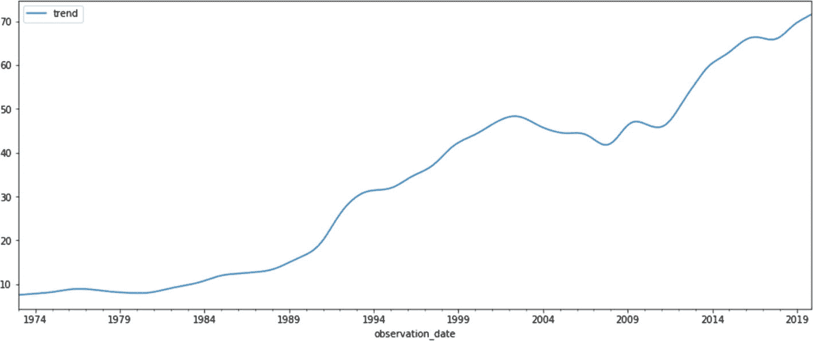

图 1-5

EXINUS 股票显示上升趋势

### 时间序列去趋势

*去趋势*是从时间序列数据中移除趋势的过程，或者指随时间变化的均值。它在时间跨度内持续增加或减少。识别、建模甚至从时间序列数据集中移除趋势数据可能是有益的。以下是去趋势时间序列数据的方法：

*   Pandas 差分法

*   SciPy 信号法

*   HP 滤波器法

#### 使用 Pandas 差分法去趋势

Pandas 库有一个内置函数用于计算数据集的差值。这个 `diff()` 函数既可用于序列，也可用于 DataFrame。它可以提供一个周期值来进行移位以形成差值。以下代码是 Pandas 差分法的示例。

*   `Warning` 是 Python 的一个内置模块，用于处理警告消息。

*   `Pyplot` 是 Matplotlib 的一个子模块，用于设计数据的图形表示。

```
import pandas as pd
import matplotlib.pyplot as plt
import warnings
warnings.filterwarnings("ignore")
df = pd.read_excel(r'\Data\India_Exchange_Rate_Dataset.xls',\
index_col=0,parse_dates=True)
diff = df.EXINUS.diff()
plt.figure(figsize=(15,6))
plt.plot(diff)
plt.title('Detrending using Differencing', fontsize=16)
plt.xlabel('Year')
plt.ylabel('EXINUS exchange rate')
plt.show()
```

图 1-6 显示了使用 Pandas 差分法去除趋势后的数据。

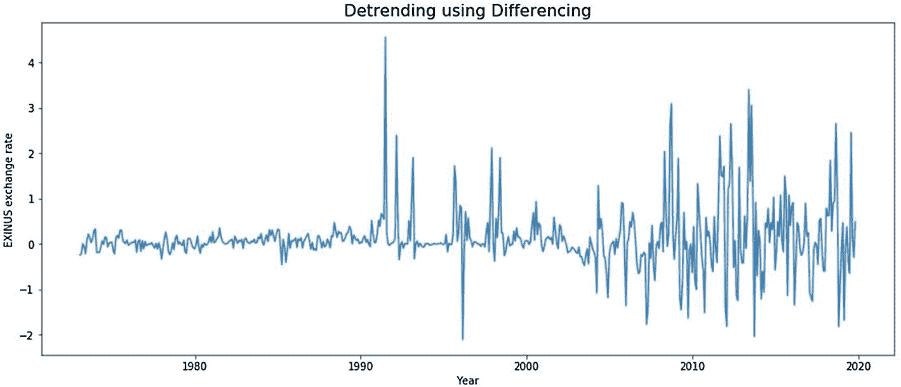

图 1-6

使用差分法去除趋势

#### 使用 SciPy 信号法去趋势

信号是时间序列数据的另一种形式。每个信号都会以不同的顺序增加或减少。使用 SciPy 库，可以从信号数据中移除线性趋势。以下代码展示了 SciPy 去趋势的示例。

*   `Signal.detrend` 是 SciPy 的一个子模块，用于从数据中移除沿某个轴的线性趋势。

```
import pandas as pd
import matplotlib.pyplot as plt
from scipy import signal
import warnings
warnings.filterwarnings("ignore")
df = pd.read_excel(r'\Data\India_Exchange_Rate_Dataset.xls',\
index_col=0,parse_dates=True)
detrended = signal.detrend(df.EXINUS.values)
plt.figure(figsize=(15,6))
plt.plot(detrended)
plt.xlabel('EXINUS')
plt.ylabel('Frequency')
plt.title('Detrending using Scipy Signal', fontsize=16)
plt.show()
```

图 1-7 显示了使用 SciPy 去趋势后的数据。

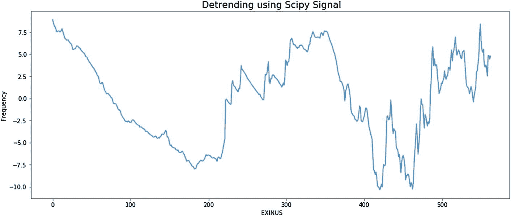

图 1-7

使用 SciPy 移除信号中的线性趋势

#### 使用 HP 滤波器去趋势

HP 滤波器也用于对时间序列进行去趋势处理并平滑数据。它用于移除短期波动。以下代码展示了 HP 滤波器去趋势的示例。

*   `Hpfilter` 是 Statmodels 的一个子模块，用于移除平滑趋势。

```
import pandas as pd
import matplotlib.pyplot as plt
from statsmodels.tsa.filters.hp_filter import hpfilter
import warnings
warnings.filterwarnings("ignore")
df = pd.read_excel(r'\Data\India_Exchange_Rate_Dataset.xls',\
index_col=0,parse_dates=True)
EXINUS_cycle,EXINUS_trend = hpfilter(df['EXINUS'], lamb=1600)
df['trend'] = EXINUS_trend
.
detrended = df.EXINUS - df['trend']
plt.figure(figsize=(15,6))
plt.plot(detrended)
plt.title('Detrending using HP Filter', fontsize=16)
plt.xlabel('Year')
plt.ylabel('EXINUS exchange rate')
plt.show()
```

图 1-8 显示了移除平滑趋势后的数据。

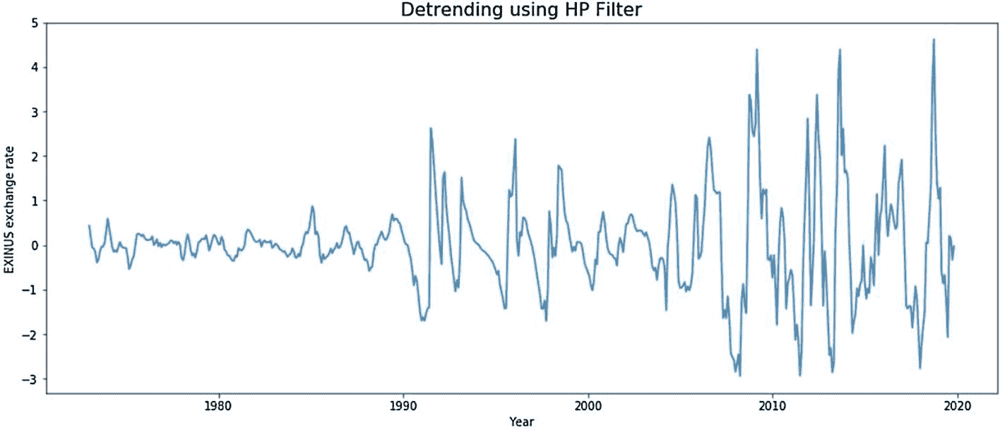

图 1-8

使用 HP 滤波器去除趋势


## 季节性

季节性是一种周期性波动，指相同模式在固定的时间间隔内重复出现。它是经济、天气和股票市场时间序列数据的一个特征；在科学数据中则较为少见。在其他行业中，许多现象都表现为周期性重复的季节效应。例如，零售额往往在圣诞节期间增加，之后减少。

以下方法可用于检测季节性：

*   多个[箱线图](https://www.itl.nist.gov/div898/handbook/eda/section3/boxplot.htm)

*   自相关图

### 多个[箱线图](https://www.itl.nist.gov/div898/handbook/eda/section3/boxplot.htm)

*箱线图*是一种用于描绘数据在某个范围内分布情况的基本图表。它是展示最小值、第一四分位数、中位数、第三四分位数和最大值的标准方法。以下代码展示了借助多个箱线图检测季节性的示例。见图 1-9。

*   Seaborn 是一个类似于 Matplotlib 的图形表示包。

    ```
    import pandas as pd
    import seaborn as sns
    import matplotlib.pyplot as plt
    import warnings
    warnings.filterwarnings("ignore")
    df=pd.read_excel(r'\Data\India_Exchange_Rate_Dataset.xls',\
    parse_dates=True)
    df['month'] = df['observation_date'].dt.strftime('%b')
    df['year'] = [d.year for d in df.observation_date]
    df['month'] = [d.strftime('%b') for d in df.observation_date]
    years = df['year'].unique()
    plt.figure(figsize=(15,6))
    sns.boxplot(x='month', y='EXINUS', data=df).set_title("Multi Month-wise Box Plot")
    plt.show()
    ```

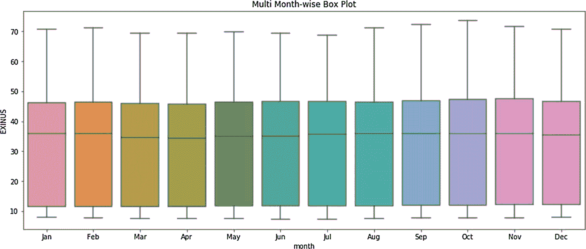

图 1-9

用于识别季节性的多箱线图

### 自相关图

*自相关*用于检查数据中的随机性。它有助于识别周期未知的数据类型。例如，对于月度数据，如果存在规律性的季节效应，我们期望看到每 12 个月后出现显著的峰值滞后。图 1-10 演示了借助自相关图检测季节性的示例。

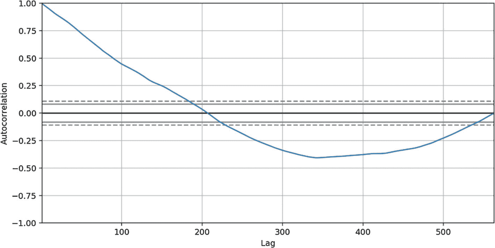

图 1-10

用于识别季节性的自相关图

```
from pandas.plotting import autocorrelation_plot
import pandas as pd
import matplotlib.pyplot as plt
df = pd.read_excel(r'\Data\India_Exchange_Rate_Dataset.xls',\
index_col=0,parse_dates=True)
plt.rcParams.update({'figure.figsize':(15,6), 'figure.dpi':220})
autocorrelation_plot(df.EXINUS.tolist())
```

注意

有时识别季节性并不容易；在这种情况下，我们需要评估其他图表，例如序列图或季节性子序列图。

### 时间序列数据的去季节化

*去季节化*是指从时间序列数据中移除季节性。它剥离了季节效应的模式，以消除季节性影响。时间序列数据包含四个主要组成部分。

*   **水平**指时间序列数据的平均值。

*   **趋势**指时间序列数据中增加或减少的值。

*   **季节性**指时间序列数据中重复出现的周期模式。

*   **噪声**指时间序列数据中的随机方差。

注意

*加法模型*是指时间序列数据将这四个组成部分线性组合以体现线性趋势和季节性；*乘法模型*是指将这些组成部分相乘，以体现非线性趋势和季节性。

### 季节性分解

*分解*是理解时间序列预测中泛化问题和相关问题的过程。我们可以利用季节性分解从数据中移除季节性，并仅检查包含趋势、周期性和不规则变化的数据。图 1-11 展示了去除季节性后的数据。

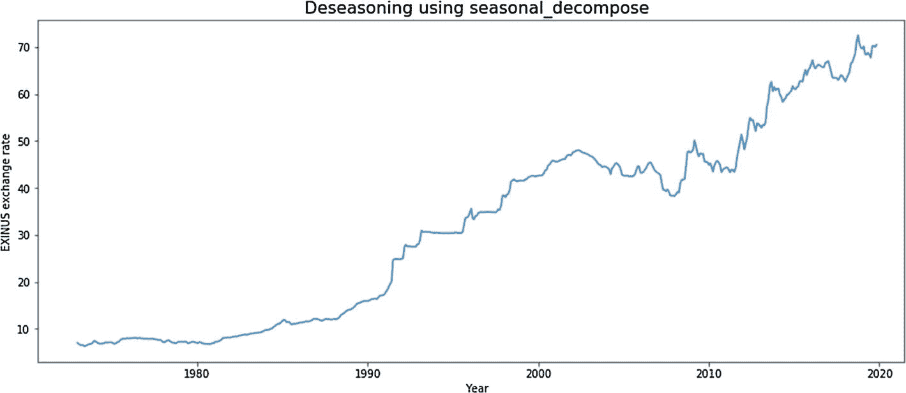

图 1-11

使用 Statsmodels 的 seasonal_decompose 进行去季节化

```
import pandas as pd
import matplotlib.pyplot as plt
from statsmodels.tsa.seasonal import seasonal_decompose
import warnings
warnings.filterwarnings("ignore")
df = pd.read_excel(r'\Data\India_Exchange_Rate_Dataset.xls',
index_col=0,parse_dates=True)
result_mul = seasonal_decompose(df['EXINUS'], model='multiplicative', extrapolate_trend='freq')
deseason = df['EXINUS'] - result_mul.seasonal
plt.figure(figsize=(15,6))
plt.plot(deseason)
plt.title('Deseasoning using seasonal_decompose', fontsize=16)
plt.xlabel('Year')
plt.ylabel('EXINUS exchange rate')
plt.show()
```

## 周期性变化

周期性成分是围绕长期趋势的波动，每隔几个时间单位出现一次；这种行为的频率低于季节性。它是时间序列中的一个循环过程。在商业/经济领域，以下是三种不同类型的周期性变化示例：

*   **繁荣**：众所周知，当组织繁荣时，物价上涨，但收益也会增加。另一方面，繁荣也会导致过度发展、交通挑战、工资率上涨、劳动力不足、高回报率、市场现金短缺和价格让步等，最终导致萧条。

*   **萧条**：众所周知，当交易和企业出现悲观情绪时，工厂倒闭，组织崩溃，失业蔓延，工资和成本都很低。

*   **复苏**：这表现为货币的适宜性、低利率下现金的可获得性、对商品或货币需求的增加（在低利率下）、流行商品和服务的增加，其特点是复苏的情况，最终导致繁荣或景气。

### 检测周期性变化

以下代码展示了如何分解时间序列数据并仅可视化周期模式：

```
from statsmodels.tsa.filters.hp_filter import hpfilter
import pandas as pd
import matplotlib.pyplot as plt
import warnings
warnings.filterwarnings("ignore")
%matplotlib inline
df = pd.read_excel(r'\Data\India_Exchange_Rate_Dataset.xls',
index_col=0,parse_dates=True)
EXINUS_cycle,EXINUS_trend = hpfilter(df['EXINUS'], lamb=1600)
df['cycle'] =EXINUS_cycle
df['trend'] =EXINUS_trend
df[['cycle']].plot(figsize=(15,6)).autoscale(axis='x',tight=True)
plt.title('Extracting Cyclic Variations', fontsize=16)
plt.xlabel('Year')
plt.ylabel('EXINUS exchange rate')
plt.show()
```

图 1-12 展示了从其他数据中分离出的周期行为。

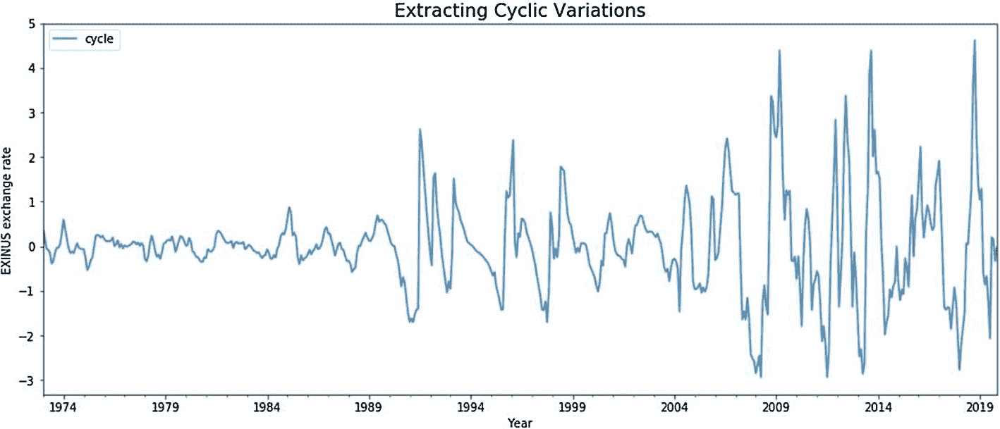

图 1-12

使用 HP 滤波器提取周期性变化

## 误差、意外变化和残差

当从时间序列数据中移除趋势和周期性变化后，留下的无法解释的模式称为误差、意外变化或残差。有多种方法可用于检查不规则变化，例如概率论、移动平均法和自回归时间序列方法。如果我们能在数据中发现任何周期性变化，它将被视为残差的一部分。这些因意外情况而发生的变化被称为意外变化或不可预测的误差。


## 将时间序列分解为各组成部分

*分解*是一种用于将时间序列数据分离为不同元素的方法，例如趋势、季节性、周期变化和残差。我们可以利用统计模型中的季节性分解，将数据分解为其组成部分，并将序列视为加法或乘法模型。

*   **趋势（T(t)）** 表示时间序列数据值的增加或减少。

*   **季节性（S[t]）** 表示时间序列数据中重复出现的短期周期。

*   **周期变化（c[t]）** 表示时间序列数据长期趋势中的波动。

*   **残差（e[t]）** 表示时间序列数据的不规则变化。

加法模型适用于时间序列数据的线性趋势，例如随时间恒定变化的数据。加法模型公式如下：

*Y[t] = T[t] + S[t] + c[t] + e[t]*

乘法模型适用于非线性类型的数据，例如二次型或指数型。乘法模型公式如下：

Y[t] = T[t] * S[t] * c[t] * e[t]

以下示例展示了加法模型和乘法模型：

```
from statsmodels.tsa.seasonal import seasonal_decompose
import pandas as pd
df = pd.read_excel(r'Data\India_Exchange_Rate_Dataset.xls',
index_col=0,parse_dates=True)
result = seasonal_decompose(df['EXINUS'], model='add')
result.plot()
result = seasonal_decompose(df['EXINUS'], model='mul')
result.plot()
```

图 1-13 和图 1-14 展示了时间序列分解的两种方法。

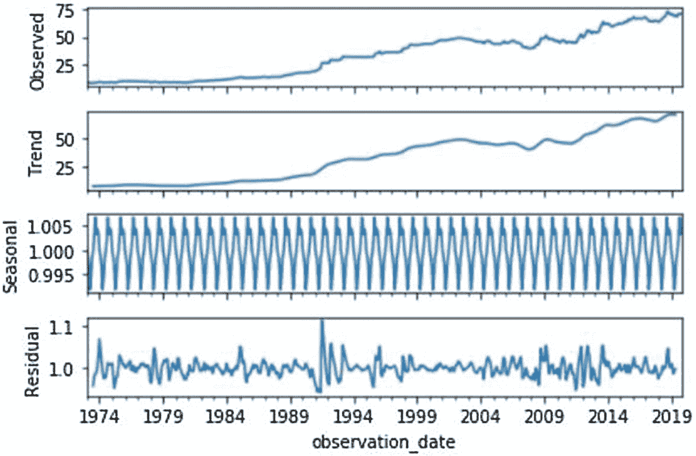

图 1-14

使用乘法模型分解时间序列数据

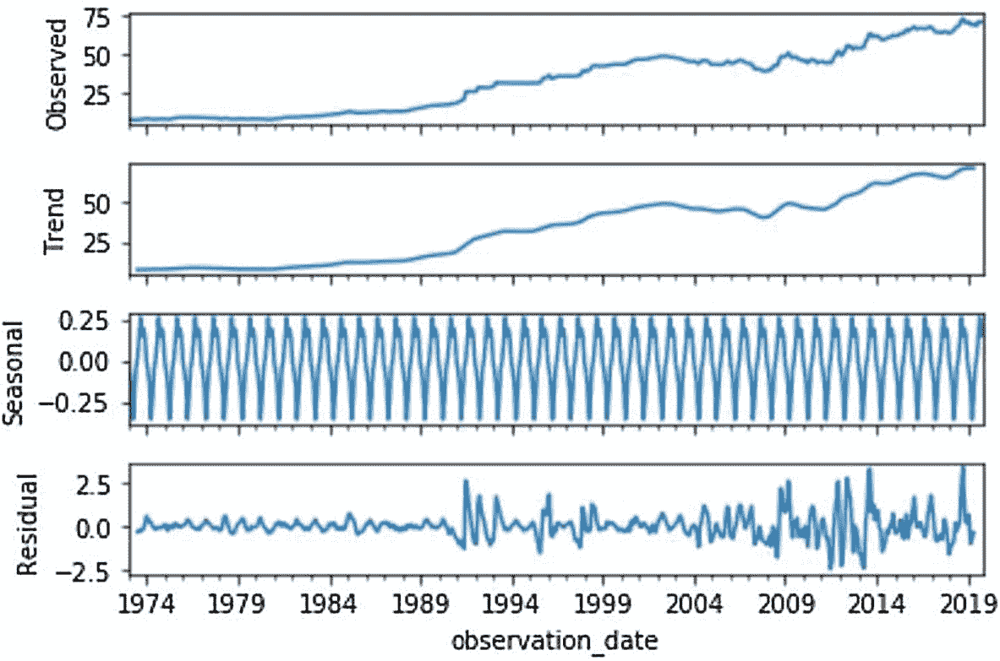

图 1-13

使用加法模型分解时间序列数据

## 总结

在本章中，我们讨论了什么是时间序列数据，并简要介绍了使用多种技术分离时间序列组成部分（如趋势、季节性、周期变化和误差）的各种方法。在下一章中，你将学习如何对时间序列数据进行数据整理。

