# 2. 时间序列的数据整理与准备

在数据科学领域，“垃圾进，垃圾出”这句话绝对适用。

*数据整理*是一门艺术，它借助预处理策略，将原始数据转换并映射为有价值的信息。其目标是提供丰富的数据，以便能够从中获取最大洞察。它包含诸如加载、插补、应用转换、处理异常值、清洗、集成、处理不一致性、降维以及特征工程等操作。数据整理是机器学习建模中不可或缺且主要的部分。现实世界的数据无疑是混乱的，不进行任何整理就直接将数据用于建模是不合理的。

本章介绍如何借助 Pandas 读取多种数据文件格式。内容涵盖如何进行数据选择、转换和清洗，以及如何借助 Pandas 和 Pandasql 推导基本统计量。

注意

本章介绍的函数和方法具有比此处涵盖的更多功能。你可以在 Pandas 和 Pandasql 的官方网站上更详细地探索它们。

## 将数据加载到 Pandas 中

Pandas 是用于数据整理的最著名的框架。它包含旨在使数据分析快速便捷的数据操作和分析工具。在现实世界中，数据通过各种工具和设备生成；因此，它有不同的格式，例如 CSV、Excel 和 JSON。此外，有时需要从 URL 读取数据。所有数据都包含若干记录和变量。在本节中，你将学习如何使用 Pandas 处理各种数据格式。

### 使用 CSV 加载数据

该数据集描绘了随时间变化的女性出生人数。Pandas 有一个内置函数用于读取 CSV 文件。以下代码导入数据集：

```
import pandas as pd
df = pd.read_csv(r'\Data\daily-total-female-births-CA.csv')
df.head(5)
```

以下是 CSV 文件中的前五条记录：

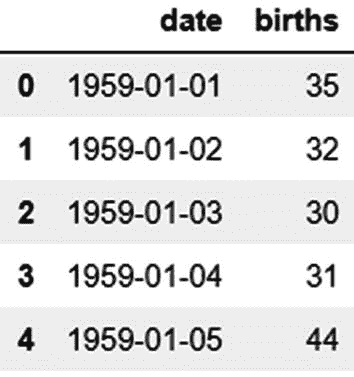

如果文件有不同的分隔符，请使用 `sep = ‘ ’` 并填入分隔符，例如 `(;, |,\t,‘ ’)`。

### 使用 Excel 加载数据

伊斯坦布尔证券交易所数据集包含伊斯坦布尔证券交易所的收益率，以及从 2009 年 6 月 5 日到 2011 年 2 月 22 日期间其他七个国际指数（SP、DAX、FTSE、NIKKEI、BOVESPA、MSCE_EU、MSCI_EM）的收益率。数据按工作日组织。该数据以 Excel 格式提供，Pandas 有一个内置函数用于读取 Excel 文件。以下代码导入数据集：

```
import pandas as pd
dfExcel = pd.read_excel(r'\Data\istambul_stock_exchange.xlsx', sheet_name = 'Data')
dfExcel.head(5)
```

以下是 Excel 文件中的前五条记录：

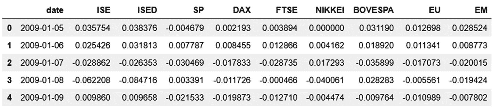

### 使用 JSON 加载数据

此示例数据集为 JSON 格式。以下代码导入数据集：

```
import pandas as pd
dfJson = pd.read_json(r'\Data\test.json')
dfJson.head(5)
```

以下是 JSON 中的记录：

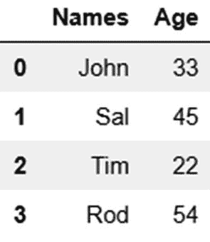

### 从 URL 加载数据

鲍鱼数据集包含 4,177 个观测值和 9 个变量。它不在任何文件结构中；相反，我们可以将其作为文本显示在特定 URL 上。以下代码导入数据集：

```
import pandas as pd
dfURL = pd.read_csv(r'https://archive.ics.uci.edu/ml/machine-learning-databases/abalone/abalone.data', names =['Sex', 'Length','Diameter', 'Height','Whole weight', 'Shucked weight','Viscera weight', 'Shell weight', 'Rings'])
dfURL.head(5)
```

以下是来自 URL 的记录：


## 并排探索 Pandasql 和 Pandas

Pandasql 是一个用于在 Pandas DataFrames 上运行 SQL 查询的 Python 框架。它具有许多基本属性，并且与 R 中的 sqldf 框架用途相似。它帮助我们使用 SQL 语法查询 Pandas DataFrames。它提供了一个 SQL 接口来对 Pandas DataFrame 执行数据整理。Pandasql 帮助精通 SQL 的分析师和数据工程师顺利过渡到 Python（Pandas）。

使用 `pip install pandasql` 安装该库。在本章中，我们将探索使用 Pandas 和 Pandasql 解决不同问题的方法，例如选择数据、转换数据以及获取数据的基本摘要。

### 选择前五条记录

借助 `pandas.head()` 函数，我们可以从数据集中获取前 N 条记录。我们可以借助 Pandasql 执行相同的操作。该示例说明了如何使用 Pandas 和 Pandasql 执行此操作。

以下是使用 Pandas 的方法：

```
import pandas as pd
dfp = pd.read_excel(r'\Data\Absenteeism_at_work.xls')
dfp.head(5)
```

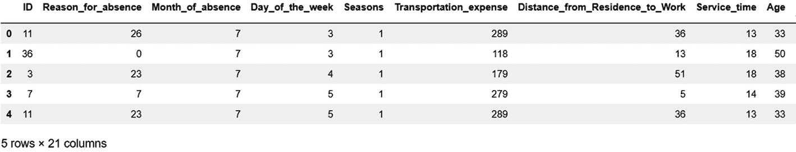

以下是使用 Pandasql 的方法：

```
from pandasql import sqldf
dfpsql = pd.read_excel(r'\Data\Absenteeism_at_work.xls')
Query_string = """ select * from dfpsql limit 5 """
sqldf(Query_string, globals())
```

Pandasql 中使用的主要函数是 `sqldf`。它接受两个参数：一个 SQL 查询字符串和一组会话/环境变量（`locals()` 或 `globals()`）。

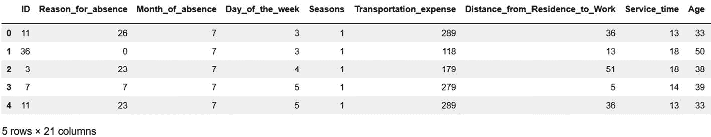


### 应用筛选器

数据筛选是数据预处理的重要环节。通过筛选，我们可以选择数据集的一个较小分区，并使用该子集进行查看和处理；我们需要特定的条件或规则来筛选数据。这也被称为*数据子集化*或*数据下钻*。以下示例说明了如何使用 Pandas 和 Pandasql 应用筛选器。

以下是使用 Pandas 的方法：

```
import pandas as pd
dfp = pd.read_excel(r'\Data\Absenteeism_at_work.xls')
dfp[(dfp['Age'] >=30) & (dfp['Age'] <=45)]
```

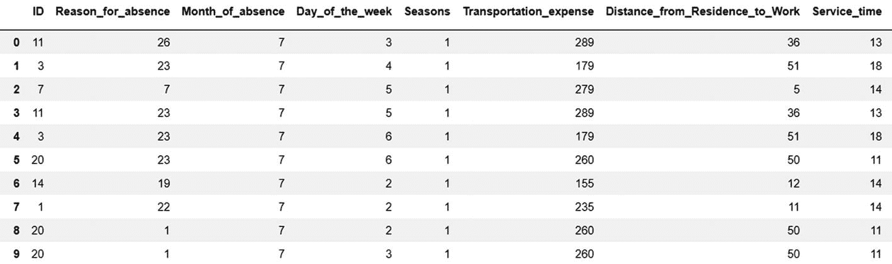

以下是使用 Pandasql 的方法：

```
from pandasql import sqldf
dfpsql = pd.read_excel(r'\Data\Absenteeism_at_work.xls')
Query_string = """ select * from dfpsql where age>=30 and age<=45 """
sqldf(Query_string, globals())
```

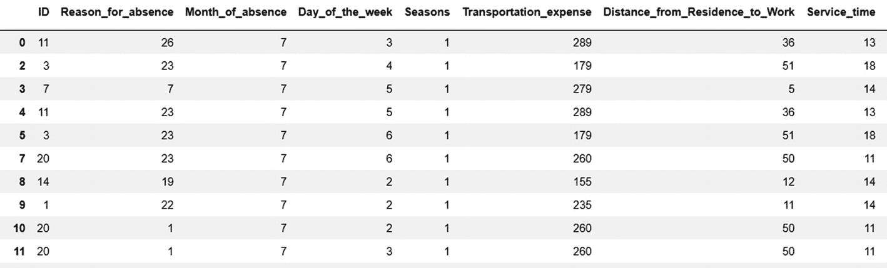

### 去重（唯一值）

数据集中存在多条重复记录。如果我们想选择特定变量的唯一值数量，可以使用 Pandas 的 `unique()` 函数。以下示例说明了如何使用 Pandas 和 Pandasql 实现此操作。

以下是使用 Pandas 的方法：

```
import pandas as pd
dfp = pd.read_excel(r'\Data\Absenteeism_at_work.xls')
dfp['ID'].unique()
```

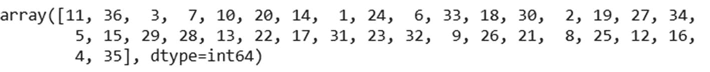

以下是使用 Pandasql 的方法：

```
from pandasql import sqldf
dfpsql = pd.read_excel(r'\Data\Absenteeism_at_work.xls')
Query_string = """ select distinct ID from dfpsql;"""
sqldf(Query_string, globals())
```

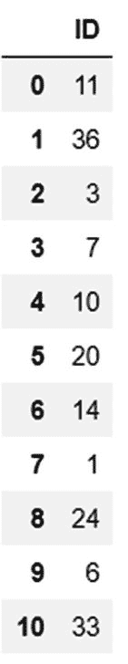

### IN

数据筛选是通过使用某些条件从数据集中提取必要数据的过程。对数据集进行筛选有多种方法。有时我们想调查数据是否与特定的 DataFrame 或 Series 相关联。在这种情况下，我们可以使用 Pandas 的 `isin()` 函数，该函数检查值是否存在于序列中。该过程也可以在 Pandasql 中执行。以下示例说明了如何使用 Pandas 和 Pandasql 实现此操作。

以下是使用 Pandas 的方法：

```
import pandas as pd
dfp = pd.read_excel(r'\Data\Absenteeism_at_work.xls')
dfp[dfp.Age.isin([20,30,40])]
```

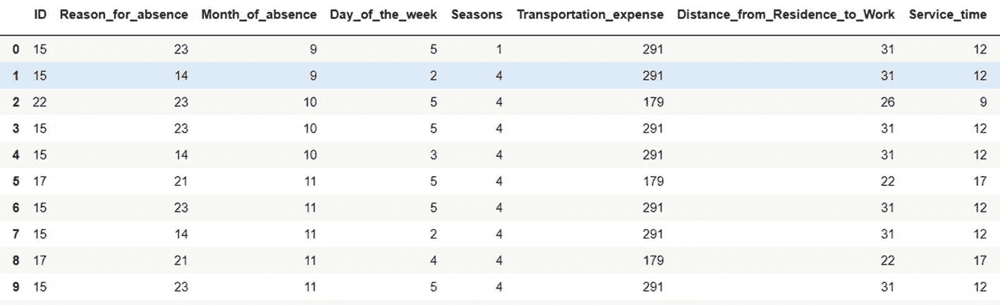

以下是使用 Pandasql 的方法：

```
from pandasql import sqldf
dfpsql = pd.read_excel(r'\Data\Absenteeism_at_work.xls')
Query_string = """ select * from dfpsql where Age in (20,30,40);"""
sqldf(Query_string, globals())
```

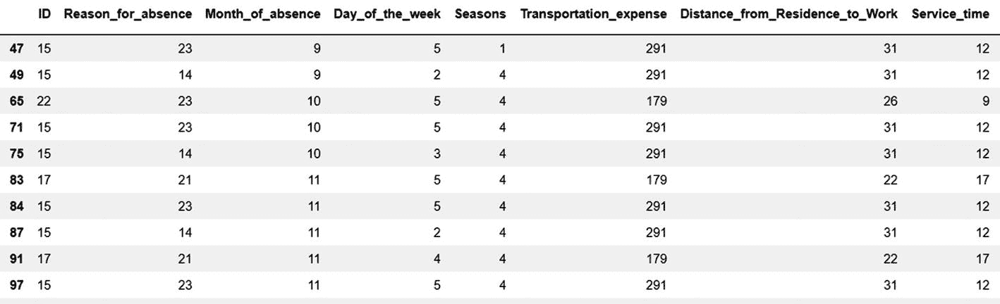

### NOT IN

`NOT IN` 操作用于与前述类似的目的。如果我们想检查某个值是否不属于某个序列，可以使用波浪号（`~`）符号来执行 `NOT IN` 操作。

以下是使用 Pandas 的示例：

```
import pandas as pd
dfp = pd.read_excel(r'\Data\Absenteeism_at_work.xls')
dfp[~dfp.Age.isin([20,30,40])]
```

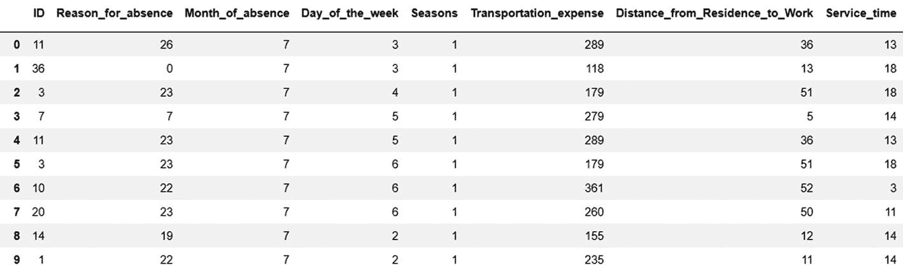

以下是使用 Pandasql 的示例：

```
from pandasql import sqldf
dfpsql = pd.read_excel(r'\Data\Absenteeism_at_work.xls')
Query_string = """ select * from dfpsql where Age not in(20,30,40);"""
sqldf(Query_string, globals())
```

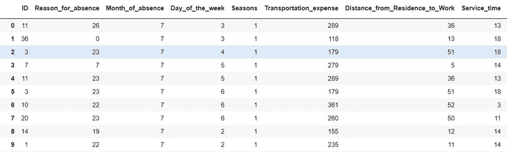

## 数据升序排列

`ORDER BY` 根据所选值对结果集进行升序或降序排序。Pandas 有一个 `sort_value()` 函数，可以使用不同的排序算法，例如快速排序、归并排序和堆排序。默认值为升序，其布尔值为 `True`。除此之外，我们还可以按轴进行排序，例如 0 表示索引，1 表示列。SQL 有一个 `ORDER BY` 子句来执行类似的排序操作。

以下是使用 Pandas 的示例：

```
import pandas as pd
dfp = pd.read_excel(r'\Data\Absenteeism_at_work.xls')
dfp.sort_values(['Age','Service_time'], ascending= True)
```

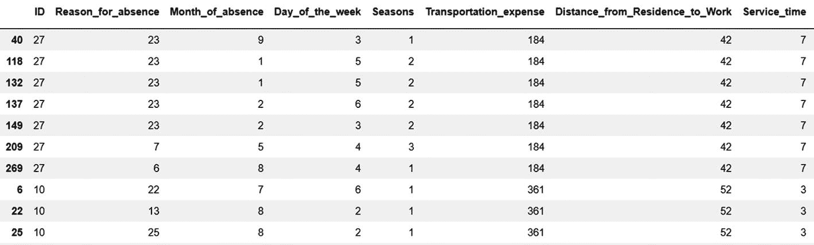

以下是使用 Pandasql 的示例：

SQLite 中的 `ORDER BY` 默认为升序。

```
from pandasql import sqldf
dfpsql = pd.read_excel(r'\Data\Absenteeism_at_work.xls')
Query_string = """ select * from dfpsql order by Age,Service_time;"""
sqldf(Query_string, globals())
```


## 数据降序排列

如前所述，`sort_value()` 函数可以按升序或降序对结果进行排序。它需要参数 `ascending = False` 来按降序排序。您也可以更新其他一些参数，如 `ORDER BY` 升序部分所述。

以下是使用 Pandas 的示例：

```
import pandas as pd
dfp = pd.read_excel(r'\Data\Absenteeism_at_work.xls')
dfp.sort_values(['Age','Service_time'], ascending= False)
```

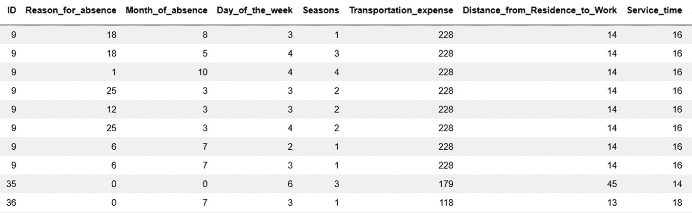

您可以通过在列名旁边使用 `desc` 关键字来按降序对结果进行排序，如下所示：

```
from pandasql import sqldf
dfpsql = pd.read_excel(r'\Data\Absenteeism_at_work.xls')
Query_string = """ select * from dfpsql order by Age Desc,Service_time Desc;"""
sqldf(Query_string, globals())
```

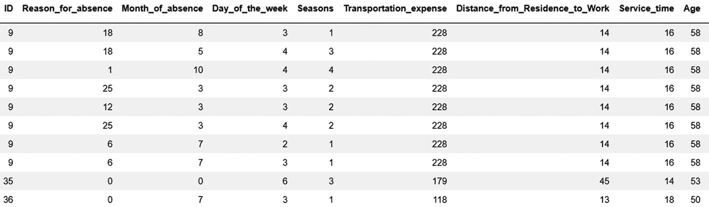

## 聚合

*聚合*是挖掘数据的过程，以便数据可以被调查、收集并以汇总的方式呈现。它允许您对单个或多个向量执行计算，通常与 Pandas 中的 `group by()` 函数一起使用。它执行多种操作，例如拆分、应用和合并。此示例说明了 Pandas 和 Pandasql 中的聚合操作。

在以下示例中，我们利用 Pandas 中的 `.agg` 来实现所需结果：

```
import pandas as pd
dfp = pd.read_excel(r'\Data\Absenteeism_at_work.xls')
dfp.agg({'Transportation_expense': ['count','min', 'max', 'mean']})
```

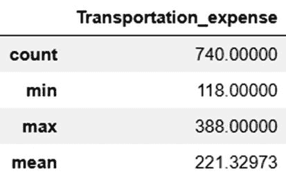

也可以直接在列上进行聚合，如下所示：

```
dfp.Transportation_expense.min()
```

以下是使用 Pandasql 的示例：

```
from pandasql import sqldf
dfpsql = pd.read_excel(r'\Data\Absenteeism_at_work.xls')
Query_string = """ select count(Transportation_expense) as count, min(Transportation_expense) as min, max(Transportation_expense) as max, avg(Transportation_expense) as mean from dfp;"""
sqldf(Query_string, globals())
```

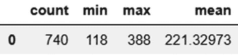


### GROUP BY

我们可以使用 `GROUP BY` 根据所使用的聚合函数将相同的数据分组。换句话说，它将具有相似值的行分组为汇总行。我们在 Pandas 中使用 `groupby()` 函数执行此操作。SQL 有其自己的 `GROUP BY` 子句来执行类似的操作。该示例说明了 Pandas 和 Pandasql 中的 `GROUP BY` 操作。

以下是使用 Pandas 的示例：

```
import pandas as pd
dfp = pd.read_excel(r'\Data\Absenteeism_at_work.xls')
dfp.groupby('ID')['Service_time'].sum()
```

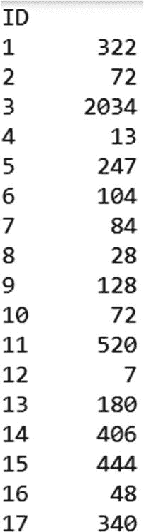

以下是使用 Pandasql 的示例：

```
from pandasql import sqldf
dfpsql = pd.read_excel(r'\Data\Absenteeism_at_work.xls')
Query_string = """ select ID , sum(Service_time) as Sum_Service_time from dfp
group by ID;"""
sqldf(Query_string, globals())
```

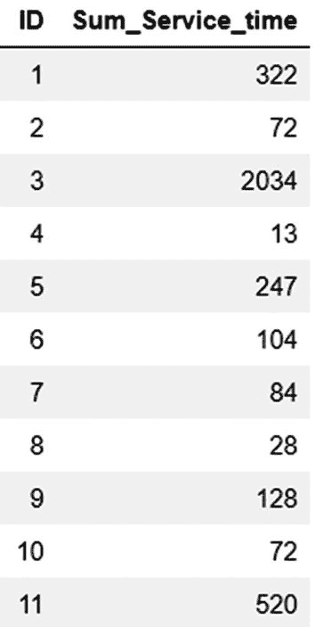

### GROUP BY 与聚合

`groupby()` 函数根据所选特征提供一组相似的数据；我们可以使用 Pandas 中的 `.agg()` 函数对其他特征执行不同的聚合操作。在 SQL 中，我们使用 `GROUP BY` 对查询返回的数据组应用聚合函数。`FILTER` 是与聚合函数一起使用的修饰符，用于限制聚合中使用的值。

以下是使用 Pandas 的示例：

```
import pandas as pd
dfp = pd.read_excel(r'\Data\Absenteeism_at_work.xls')
dfp.groupby('Reason_for_absence').agg({'Age': ['mean','min','max']})
```

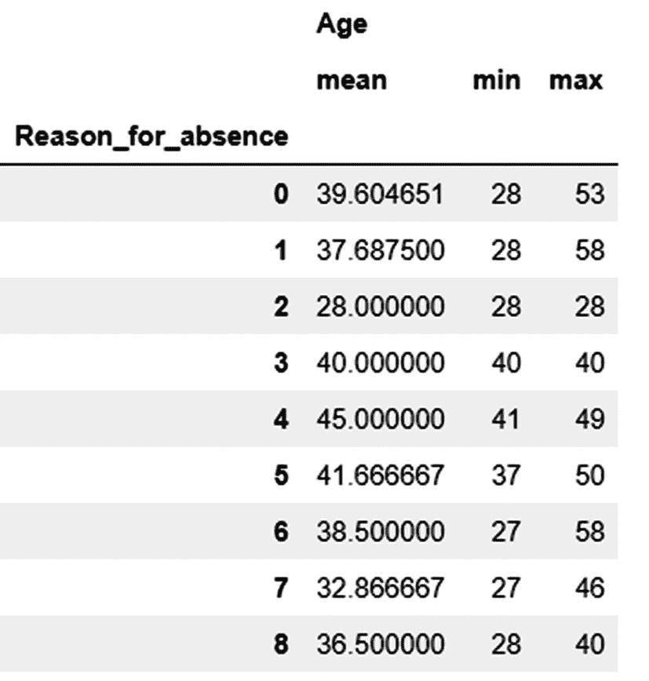

以下是使用 Pandasql 的示例：

```
from pandasql import sqldf
dfpsql = pd.read_excel(r'\Data\Absenteeism_at_work.xls')
Query_string = """ select Reason_for_absence , avg(Age) as mean, min(Age) as min, max(Age) as max from dfp
group by Reason_for_absence;"""
sqldf(Query_string, globals())
```

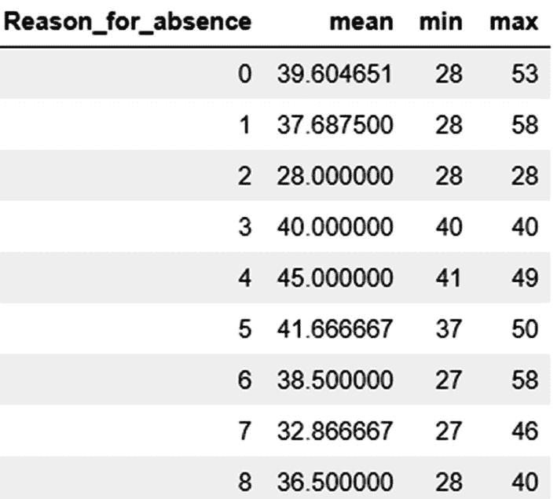

## 连接（合并）

在 Pandas、Python 以及 SQL 和 R 等其他语言中，术语 *join* 和 *merge* 含义相同。实际上，它们的基本操作是等效的，但执行操作的方式不同。Pandas 中的 *join* 利用索引来合并两个数据源，而 *merge* 则寻找重叠的列进行合并。在 Pandas 中，使用 `merge()` 和 `join()` 函数。在 SQL 中，`MERGE` 和 `JOIN` 运算符执行与 Pandas 中相同的操作。此示例说明了 Pandas 和 Pandasql 中的聚合操作。

我们创建了示例员工表和部门表来说明连接示例。

```
import pandas as pd
data1 = {
'Empid': [1011, 1012, 1013, 1014, 1015],
'Name': ['John', 'Rahul', 'Rick', 'Morty', 'Tim'],
'Designation': ['Manager', 'Research Engineer', 'Research Engineer', 'VP', 'Delivery Manager'],
'Date_of_joining': ['01-Jan-2000', '23-sep-2006',
'11-Jan-2012','21-Jan-1991','12-Jan-1990']}
Emp_df = pd.DataFrame(data1, columns = ['Empid',
'Name', 'Designation','Date_of_joining'])
print(Emp_df.head(5))
```

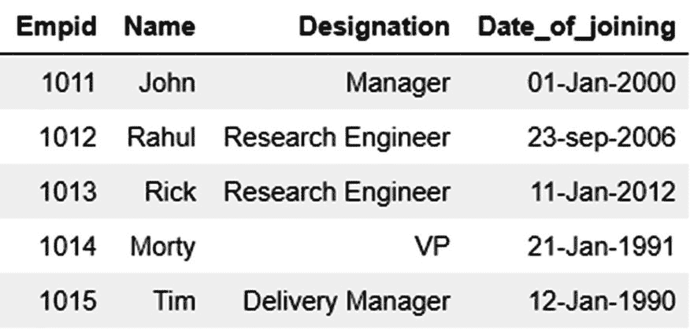

```
import pandas as pddata2 = {
'Empid': [1011, 1017, 1013, 1019, 1015],
'Deptartment': ['Management', 'Research',
'Research', 'Management', 'Delivery'],
'Total_Experience': [18, 10, 10, 28, 22]}
Dept_df = pd.DataFrame(data2, columns = ['Empid',
'Deptartment', 'Total_Experience'])
print(Dept_df.head(5))
```

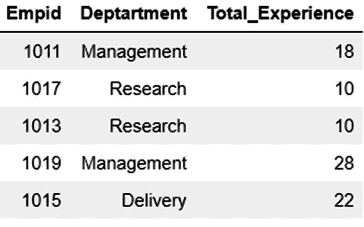

### 内连接

内合并/内连接会保留两个 DataFrame 中合并值都包含“on”值的行。它选择在一个或多个表中具有匹配值（连接列）的记录。


以下是使用 Pandas 的示例：

```
import pandas as pd
data1 = {
'Empid': [1011, 1012, 1013, 1014, 1015],
'Name': ['John', 'Rahul', 'Rick', 'Morty', 'Tim'],
'Designation': ['Manager', 'Research Engineer', 'Research Engineer', 'VP', 'Delivery Manager'],
'Date_of_joining': ['01-Jan-2000', '23-sep-2006',
'11-Jan-2012','21-Jan-1991','12-Jan-1990']}
Emp_df = pd.DataFrame(data1, columns = ['Empid',
'Name', 'Designation','Date_of_joining'])
data2 = {
'Empid': [1011, 1017, 1013, 1019, 1015],
'Deptartment': ['Management', 'Research',
'Research', 'Management', 'Delivery'],
'Total_Experience': [18, 10, 10, 28, 22]}
Dept_df = pd.DataFrame(data2, columns = ['Empid',
'Deptartment', 'Total_Experience'])
pd.merge(Emp_df, Dept_df, left_on="Empid",right_on='Empid', how="inner")
```

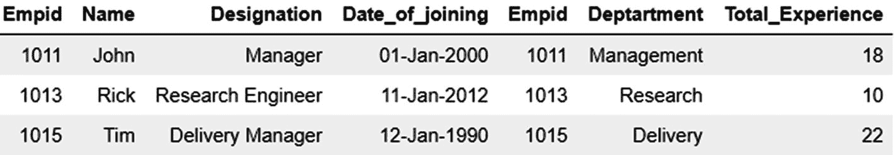

以下是使用 Pandasql 的示例：

```
import pandas as pd
data1 = {
'Empid': [1011, 1012, 1013, 1014, 1015],
'Name': ['John', 'Rahul', 'Rick', 'Morty', 'Tim'],
'Designation': ['Manager', 'Research Engineer', 'Research Engineer', 'VP', 'Delivery Manager'],
'Date_of_joining': ['01-Jan-2000', '23-sep-2006',
'11-Jan-2012','21-Jan-1991','12-Jan-1990']}
Emp_df = pd.DataFrame(data1, columns = ['Empid',
'Name', 'Designation','Date_of_joining'])
data2 = {
'Empid': [1011, 1017, 1013, 1019, 1015],
'Deptartment': ['Management', 'Research',
'Research', 'Management', 'Delivery'],
'Total_Experience': [18, 10, 10, 28, 22]}
Dept_df = pd.DataFrame(data2, columns = ['Empid',
'Deptartment', 'Total_Experience'])
Query_string = """ select * from Emp_df a INNER JOIN Dept_df b ON  a.Empid = b.Empid;"""
sqldf(Query_string, globals())
```

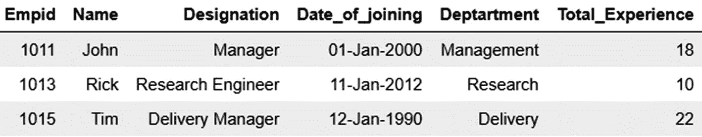


### 左连接（LEFT JOIN）

左合并或左连接会在右侧 DataFrame 中找到匹配的“on”变量时，保留左侧 DataFrame 中的行，并在结果中添加空值或 NaN 值。它会保留左表中的所有记录，并根据连接条件从一个或多个表中选择匹配的记录。


以下是使用 Pandas 的示例：

```
import pandas as pd
data1 = {
'Empid': [1011, 1012, 1013, 1014, 1015],
'Name': ['John', 'Rahul', 'Rick', 'Morty', 'Tim'],
'Designation': ['Manager', 'Research Engineer', 'Research Engineer', 'VP', 'Delivery Manager'],
'Date_of_joining': ['01-Jan-2000', '23-sep-2006',
'11-Jan-2012','21-Jan-1991','12-Jan-1990']}
Emp_df = pd.DataFrame(data1, columns = ['Empid',
'Name', 'Designation','Date_of_joining'])
data2 = {
'Empid': [1011, 1017, 1013, 1019, 1015],
'Deptartment': ['Management', 'Research',
'Research', 'Management', 'Delivery'],
'Total_Experience': [18, 10, 10, 28, 22]}
Dept_df = pd.DataFrame(data2, columns = ['Empid',
'Deptartment', 'Total_Experience'])
pd.merge(Emp_df, Dept_df,left_on='Empid',right_on='Empid', how="left")
```

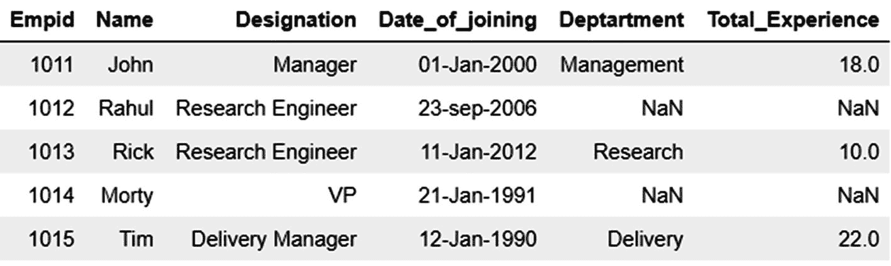

以下是使用 Pandasql 的示例：

```
import pandas as pd
data1 = {
'Empid': [1011, 1012, 1013, 1014, 1015],
'Name': ['John', 'Rahul', 'Rick', 'Morty', 'Tim'],
'Designation': ['Manager', 'Research Engineer', 'Research Engineer', 'VP', 'Delivery Manager'],
'Date_of_joining': ['01-Jan-2000', '23-sep-2006',
'11-Jan-2012','21-Jan-1991','12-Jan-1990']}
Emp_df = pd.DataFrame(data1, columns = ['Empid',
'Name', 'Designation','Date_of_joining'])
data2 = {
'Empid': [1011, 1017, 1013, 1019, 1015],
'Deptartment': ['Management', 'Research',
'Research', 'Management', 'Delivery'],
'Total_Experience': [18, 10, 10, 28, 22]}
Dept_df = pd.DataFrame(data2, columns = ['Empid',
'Deptartment', 'Total_Experience'])
Query_string = """ select * from Emp_df a LEFT JOIN Dept_df b ON  a.Empid = b.Empid;"""
sqldf(Query_string, globals())
```

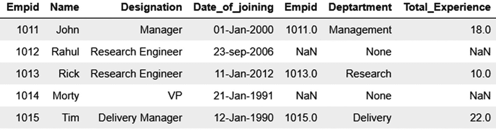

### 右连接（RIGHT JOIN）

右合并或右连接会保留右侧 DataFrame 中的每一行。当缺失值在左侧列中找到“on”变量时，会将空值/NaN 值添加到结果中。它会保留右表中的所有记录，并根据连接条件从一个或多个表中选择匹配的记录。


以下是使用 Pandas 的示例：

```
import pandas as pd
data1 = {
'Empid': [1011, 1012, 1013, 1014, 1015],
'Name': ['John', 'Rahul', 'Rick', 'Morty', 'Tim'],
'Designation': ['Manager', 'Research Engineer', 'Research Engineer', 'VP', 'Delivery Manager'],
'Date_of_joining': ['01-Jan-2000', '23-sep-2006',
'11-Jan-2012','21-Jan-1991','12-Jan-1990']}
Emp_df = pd.DataFrame(data1, columns = ['Empid',
'Name', 'Designation','Date_of_joining'])
data2 = {
'Empid': [1011, 1017, 1013, 1019, 1015],
'Deptartment': ['Management', 'Research',
'Research', 'Management', 'Delivery'],
'Total_Experience': [18, 10, 10, 28, 22]}
Dept_df = pd.DataFrame(data2, columns = ['Empid',
'Deptartment', 'Total_Experience'])
pd.merge(Emp_df, Dept_df,left_on='Empid',right_on='Empid', how="right")
```

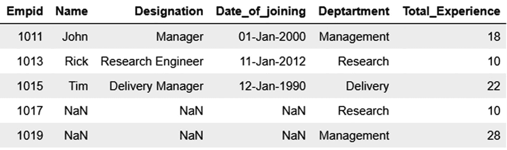

以下是使用 Pandasql 的示例：

```
import pandas as pd
data1 = {
'Empid': [1011, 1012, 1013, 1014, 1015],
'Name': ['John', 'Rahul', 'Rick', 'Morty', 'Tim'],
'Designation': ['Manager', 'Research Engineer', 'Research Engineer', 'VP', 'Delivery Manager'],
'Date_of_joining': ['01-Jan-2000', '23-sep-2006',
'11-Jan-2012','21-Jan-1991','12-Jan-1990']}
Emp_df = pd.DataFrame(data1, columns = ['Empid',
'Name', 'Designation','Date_of_joining'])
data2 = {
'Empid': [1011, 1017, 1013, 1019, 1015],
'Deptartment': ['Management', 'Research',
'Research', 'Management', 'Delivery'],
'Total_Experience': [18, 10, 10, 28, 22]}
Dept_df = pd.DataFrame(data2, columns = ['Empid',
'Deptartment', 'Total_Experience'])
Query_string = """ select a.Empid,Name,Designation,Date_of_joining,Deptartment,Total_Experience from Dept_df a LEFT JOIN Emp_df b ON  a.Empid = b.Empid;"""
sqldf(Query_string, globals())
```

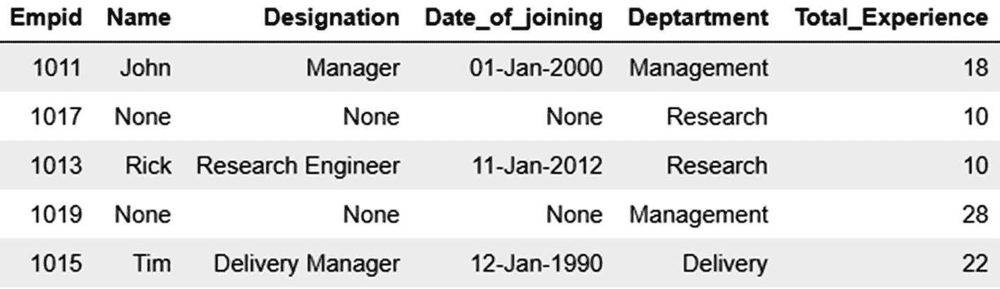

### 外连接（OUTER JOIN）

外合并/全外连接会返回左右 DataFrame 中所有匹配的行，否则返回 NaN 或空值。它会根据连接条件返回两个表中的所有记录，无论它们是否匹配。不匹配的记录将显示为空值。


以下是使用 Pandas 的示例：

```
import pandas as pd
data1 = {
'Empid': [1011, 1012, 1013, 1014, 1015],
'Name': ['John', 'Rahul', 'Rick', 'Morty', 'Tim'],
'Designation': ['Manager', 'Research Engineer', 'Research Engineer', 'VP', 'Delivery Manager'],
'Date_of_joining': ['01-Jan-2000', '23-sep-2006',
'11-Jan-2012','21-Jan-1991','12-Jan-1990']}
Emp_df = pd.DataFrame(data1, columns = ['Empid',
'Name', 'Designation','Date_of_joining'])
data2 = {
'Empid': [1011, 1017, 1013, 1019, 1015],
'Deptartment': ['Management', 'Research',
'Research', 'Management', 'Delivery'],
'Total_Experience': [18, 10, 10, 28, 22]}
Dept_df = pd.DataFrame(data2, columns = ['Empid',
'Deptartment', 'Total_Experience'])
pd.merge(Emp_df, Dept_df,left_on='Empid',right_on='Empid', how="outer")
```

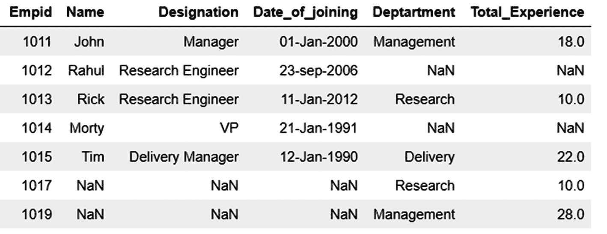

以下是使用 Pandasql 的示例：

```
import pandas as pd
data1 = {
'Empid': [1011, 1012, 1013, 1014, 1015],
'Name': ['John', 'Rahul', 'Rick', 'Morty', 'Tim'],
'Designation': ['Manager', 'Research Engineer', 'Research Engineer', 'VP', 'Delivery Manager'],
'Date_of_joining': ['01-Jan-2000', '23-sep-2006',
'11-Jan-2012','21-Jan-1991','12-Jan-1990']}
Emp_df = pd.DataFrame(data1, columns = ['Empid',
'Name', 'Designation','Date_of_joining'])
data2 = {
'Empid': [1011, 1017, 1013, 1019, 1015],
'Deptartment': ['Management', 'Research',
'Research', 'Management', 'Delivery'],
'Total_Experience': [18, 10, 10, 28, 22]}
Dept_df = pd.DataFrame(data2, columns = ['Empid',
'Deptartment', 'Total_Experience'])
# SQLite 当前不支持外连接（OUTER join）
Query_string = """ select * from Emp_df a left OUTER JOIN Dept_df b ON  a.Empid = b.Empid;"""
sqldf(Query_string, globals())
```

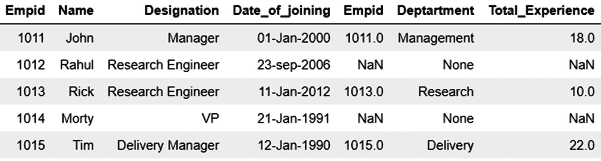


## DataFrame 摘要

*描述性统计*是一种以有意义的方式描述数据的方法，可用于表示整个总体或样本。它包含两个部分：*集中趋势度量*，用于衡量样本和总体的摘要（例如均值、中位数和众数）；以及*变异性度量*，用于衡量数据集中的离散程度（例如极差、四分位距、方差和标准差）。在 Pandas 中，它提供了一个名为 `describe()` 的内置函数。以下示例展示了 Pandas 中的详细结果。

在 Pandas 中，`describe()` 函数会返回多个描述性统计值（例如均值、标准差、最小值、中位数、最大值、第一四分位数、第三四分位数）。

```
import pandas as pd
dfsumm = pd.read_csv(r'https://archive.ics.uci.edu/ml/machine-learning-databases/abalone/abalone.data', names =['Sex',
'Length','Diameter', 'Height','Whole weight', 'Shucked weight','Viscera weight', 'Shell weight', 'Rings'])
dfsumm.head(5)
```

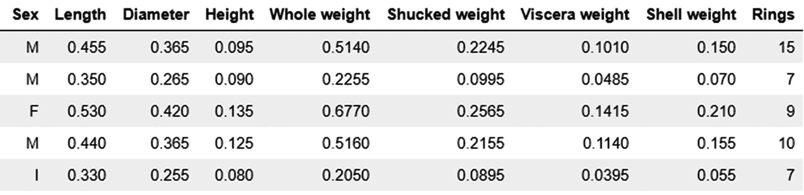

```
dfsumm.describe()
```

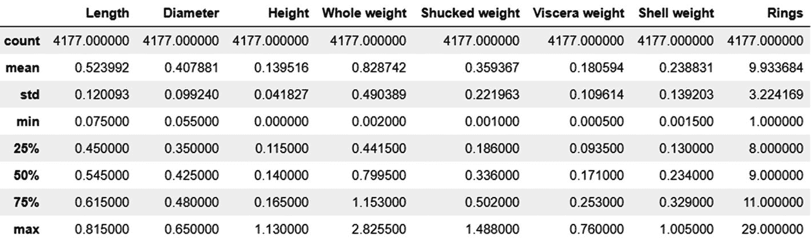

## 重采样

*重采样*是一种将基于时间的观测数据转换为不同时间间隔的方法。换句话说，它用于将一种时间频率转换为另一种时间频率格式。例如，假设我们想将月度数据转换为年度格式，或者将周数据上采样为小时数据。我们可以执行上采样或下采样操作。为此，每个数据对象必须具有类似 DateTime 的 `index（Datetimeindex、PeriodIndex、TimedeltaIndex）`。以下示例展示了 Pandas 中重采样操作的结果：

```
import pandas as pd
df = pd.read_csv(r'\Data\daily-total-female-births-CA.csv',index_col =0,
parse_dates=['date'])
df.head(5)
```

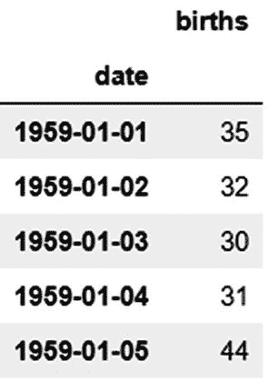

### 按月重采样

以下是按月重采样的方法：

```
df.births.resample('M').mean()
```

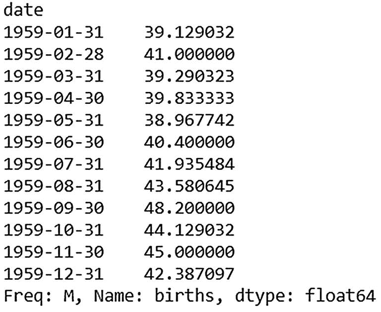

### 按季度重采样

以下是按季度重采样的方法：

```
df.births.resample('Q').mean()
```

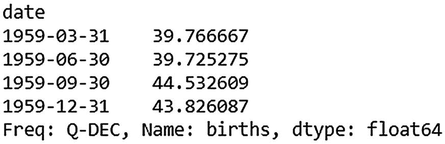

### 按年重采样

以下是按年重采样的方法：

```
df.births.resample('Y').mean()
```

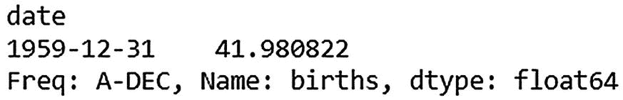

### 按周重采样

以下是按周重采样的方法：

```
df.births.resample('W').mean()
```

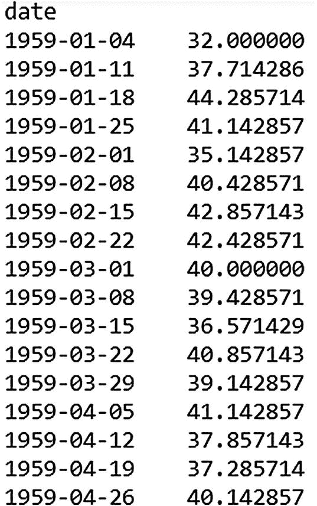

### 按半月重采样

以下是按半月重采样的方法：

```
df.births.resample('SM').mean()
```

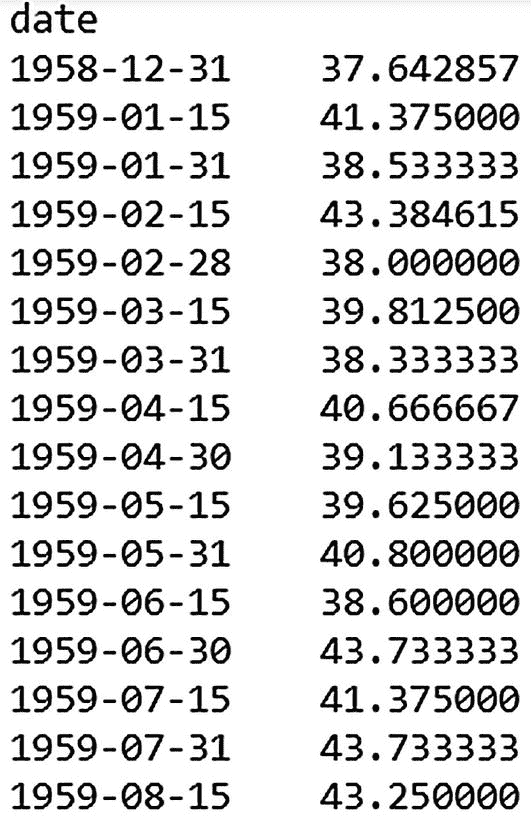

## 窗口函数

*窗口函数*用于计算多种操作，例如滚动计数、滚动求和、滚动均值、滚动中位数、滚动方差、滚动标准差、滚动最小值、滚动最大值、滚动相关性、滚动协方差、滚动偏度、滚动峰度、滚动分位数等。此外，我们还可以执行其他一些操作，例如扩展窗口和指数加权移动窗口。以下示例展示了 Pandas 中窗口操作的结果：

```
import pandas as pd
dfExcelwin = pd.read_excel(r'\Data\istambul_stock_exchange.xlsx', sheet_name = 'Data',index_col =0,parse_dates=['date'])
dfExcelwin.head(5)
```

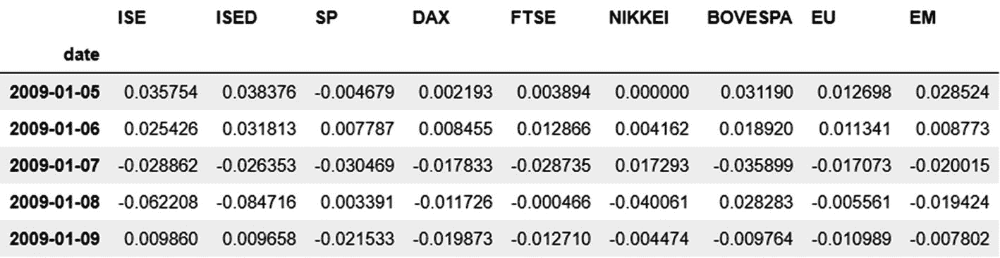

### 滚动窗口

滚动窗口功能支持以下方法：`count`、`sum`、`mean`、`median`、`var`、`std`、`min`、`max`、`corr`、`cov`、`skew`、`kurt`、`quantile`、`sum` 和 `aggregate`。

```
import pandas as pd
dfExcelwin = pd.read_excel(r'\Data\istambul_stock_exchange.xlsx', sheet_name = 'Data',index_col =0,parse_dates=['date'])
dfExcelwin.rolling(window=4).mean().head(10)
```

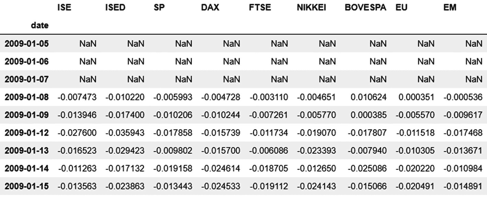

### 扩展窗口

扩展窗口支持以下方法：`count`、`sum`、`mean`、`median`、`var`、`std`、`min`、`max`、`corr`、`cov`、`skew`、`kurt`、`quantile`、`sum`、`aggregate` 和 `quantile`。

```
import pandas as pd
dfExcelwin = pd.read_excel(r'\Data\istambul_stock_exchange.xlsx', sheet_name = 'Data',index_col =0,parse_dates=['date'])
dfExcelwin.expanding(min_periods=4).mean().head(10)
```

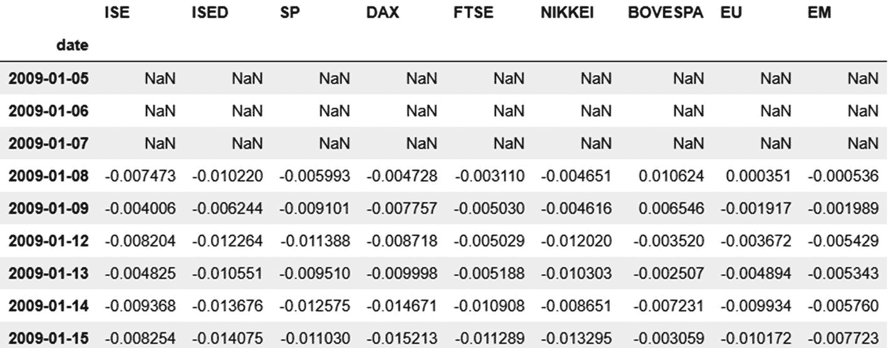

### 指数加权移动窗口

扩展窗口支持以下方法：`mean`、`std`、`var`、`corr` 和 `cov`。

```
import pandas as pd
dfExcelwin = pd.read_excel(r'\Data\istambul_stock_exchange.xlsx', sheet_name = 'Data',index_col =0,parse_dates=['date'])dfExcelwin.ewm(com=0.5).mean().head(10)
```

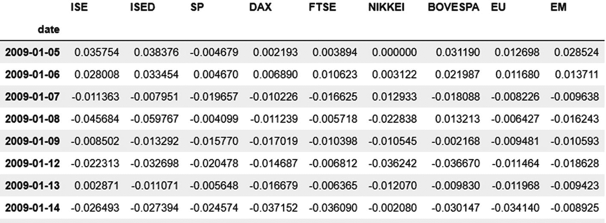

## 移位

*移位*也称为“滞后”，是将一个值在时间上向前或向后移动。Pandas 有一个 `df.shift()` 函数，用于按所需周期数移动索引，并可选择指定时间频率。以下示例展示了 Pandas 中移位操作的结果：

```
import pandas as pd
dfshift = pd.read_excel(r'\Data\istambul stock exchange.xlsx', sheet_name = 'Data',index_col =0, parse_dates=['date'])
dfshift.head(5)
```

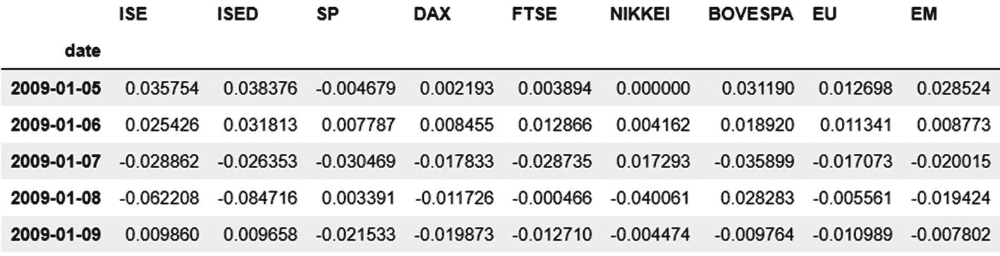

```
dfshift.shift(periods=3).head(7)
```

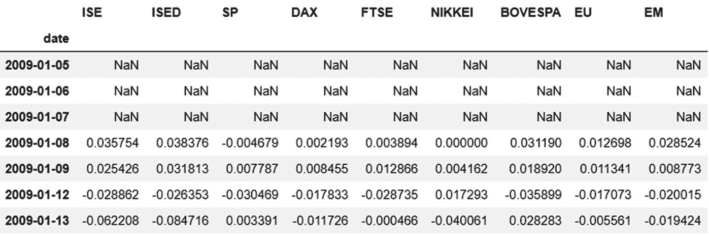

```
dfshift.shift(periods=-1).head(7)
```

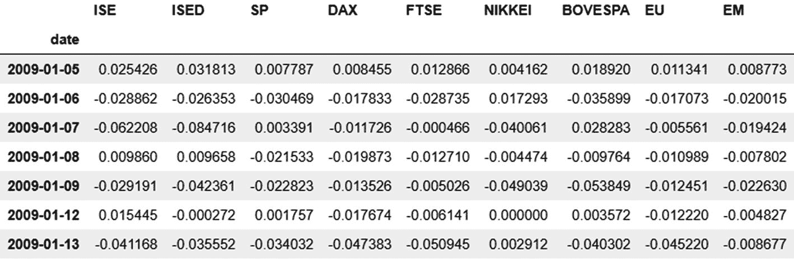

```
dfshift.shift(periods=3, axis =1).head(7)
```

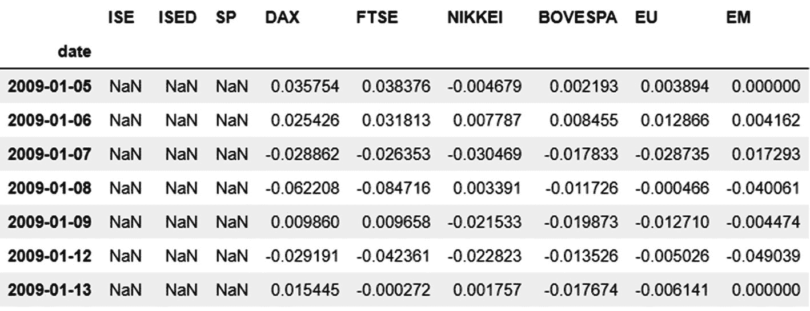

```
dfshift.shift(periods=3,fill_value=0).head(7)
```

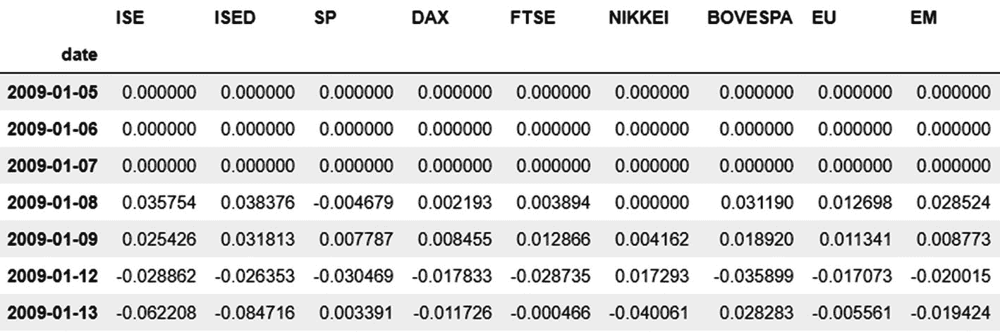


## 处理缺失数据

当在 DataFrame 或数据集的相应位置找不到数据值时，就会出现缺失值或缺失数据。缺失值会给数据集带来许多问题。它会降低数据的统计效力，并且丢失的数据可能会增加数据集中的偏差。因此，处理这些缺失值以保持数据的特性至关重要。Pandas 提供了多种处理缺失值的方法，例如 `bfill()`、`ffill()`、`interpolate()` 和 `fillna()`。以下示例说明了 Pandas 中缺失值处理操作的结果：

```
import pandas as pd
dfmiss = pd.read_csv(r'\Data\daily-total-female-births-CA-with_nulls.csv',index_col =0, parse_dates=['date'])
dfmiss
```

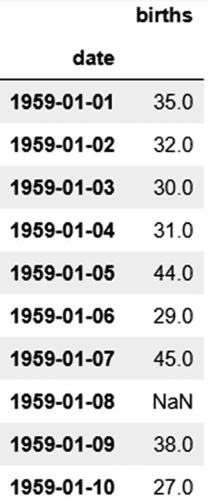

*   `Isnull()` 是一个用于检测类数组对象中缺失值的函数。

```
dfmiss.isnull().sum()
```


### 后向填充

后向方法会填充数据集中的缺失值，并使用下一个有效观测值来填补空缺。

```
dfmiss.bfill()
```


### 前向填充

前向填充方法会将最后一个有效观测值向前传播到下一个有效值。

```
dfmiss.ffill()
```


### 填充缺失值

此方法使用一个常量值来替换 NA/NaN 值。

```
dfmiss.fillna(10)
```


### 插值

此方法沿前向方向对值进行线性插值。

```
dfmiss.interpolate(method='linear',limit_direction='forward')
```


## 总结

在本章中，我们讨论了借助 Pandas 和 Pandasql 执行数据整理的不同技术。在下一章中，您将学习一些简单、双倍和三重指数平滑技术。

