# 3. 平滑方法

平滑是一种统计方法，我们可以用它来创建一个近似函数，以消除数据中的不规则性并尝试捕捉重要的模式。Robert Goodell Brown 是指数平滑之父，他于 1956 年发表了《用于预测需求的指数平滑》（[`https://industrydocuments.library.ucsf.edu/tobacco/docs/#id=jzlc0130`](https://industrydocuments.library.ucsf.edu/tobacco/docs/%2523id%253Djzlc0130)）。1957 年，Charles C. Holt 教授在卡内基梅隆大学从事预测研究，并发表了一篇题为《通过指数加权移动平均预测季节性和趋势》的论文，其中讨论了双指数平滑。三年后的 1960 年，Holt 的学生 Peter R. Winters 通过结合季节性开发了一种算法，并发表了《通过指数加权移动平均预测销售额》（[`https://pubsonline.informs.org/doi/abs/10.1287/mnsc.6.3.324`](https://pubsonline.informs.org/doi/abs/10.1287/mnsc.6.3.324)）。

平滑技术是一类时间序列预测算法，它利用先前观测值的加权平均值来预测或预报新值。该技术的主要思想是对时间序列中的近期值赋予更高的权重。它用于短期预测模型。当时间序列数据随时间缓慢变化时，该技术更为有效。它将误差、趋势和季节性成分协调到计算平滑参数中。这些成分以加法或乘法方式合并。

本章介绍简单、双倍和三重指数平滑背后的数学原理，以及如何有效地利用它们来解决时间序列问题。

## 简单指数平滑简介

简单指数平滑是指数平滑算法中最简单的模型之一。此类技术用于没有明显趋势或季节性模式的单变量观测数据。它涉及一个称为 `alpha` 的参数，即平滑参数。其核心思想是采用加权移动平均，包括指数递减的权重，该权重将更高的权重分配给最近的观测值。SES 背后的概念是通过使用序列中所有先前值的加权平均值来预测未来值。此方法可用于预测没有趋势或季节性的序列。

在本节中，让我们看看简单指数平滑背后较高层次的数学原理。

假设一个序列具有以下特征：

*   水平 (`L[t]`)
*   无趋势
*   无季节性
*   噪声（大致恒定）

SES 是在最近时间点上的预测估计水平。

`F[t+k] = L[t]`

让我们估计并更新水平 (`L[t]`)。

以下是水平更新方程：

`L[t] = αY[t] + (1-α) L[t-1]`

我们取时间 `L[t]` 处的水平，并通过整合来自最近数据点 `Y[t]` 的信息来更新先前的水平 `L[t-1]`。我们可以看到这是一个加权平均值，其中 `α` 和 `1-α` 是权重。

平滑常数等于 `α`。

`α` 值介于 0 和 1 之间，即 `0≤α≤1`。

该算法从它看到的新数据中学习新的水平。初始化整个系统的一种可能方法是将 `L[1]` 设置为序列中的第一个记录。

`F[1] = L[1] = Y[1]`

为什么它被称为指数平滑？

以下是水平更新方程：

`L[t] = αY[t] + (1-α) L[t-1]`

用其公式替换 `L[t]`，如下所示：

`L[t] = αY[t] + (1-α) [(αY[t-1] +(1-α)L[t-2]] = αY[t]+ α(1-α) Y[t-1]+(1-α)² L[t-2] = … = αY[t]+ α(1-α) Y[t-1]+ α (1-α)² Y[t-2] + […]`

我们可以看到，我们最终得到的是序列中所有值的平均值，但这些值的权重随着时间回溯呈指数衰减。因此，这被称为*指数平滑*。当 `α = 1` 时，过去的值不会影响预测。当 `α = 0` 时，过去的值在平均值中具有相等的权重，这被称为*欠平滑*。在这种情况下，我们不会对近期信息赋予更多权重，这被称为*过平滑*。

以下是 `alpha` 的影响：

| `α` | `α (1- α)` | `α (1- α)`^2 | `α (1- α)`^3 |
| --- | --- | --- | --- |
| 0.9 | 0.089 | 0.0089 | 0.00089 |
| 0.5 | 0.25 | 0.125 | 0.0625 |
| 0.1 | 0.09 | 0.081 | 0.0729 |

在所有情况下，随着我们回溯过去，`alpha` 较大时衰减很快，而 `alpha` 较小时衰减较慢。

## 简单指数平滑实战

在上一节中，你了解了简单指数平滑背后的数学原理。现在，让我们在一个时间序列数据集上实现它。

导入所需的库并加载 CSV 数据，该数据是 2014 年至 2019 年的 Facebook 股票数据。

*   **NumPy** 是 Python 中科学计算的核心库。它提供了一个高性能的多维数组对象以及用于处理这些数组的工具。
*   **sklearn** 是用于 Python 编程语言的机器学习库。

```python
from statsmodels.tsa.api import SimpleExpSmoothing
import pandas as pd
import numpy as np
from sklearn import metrics
df = pd.read_csv(r'\Data\FB.csv')
```

图 3-1 提供了数据的预览。

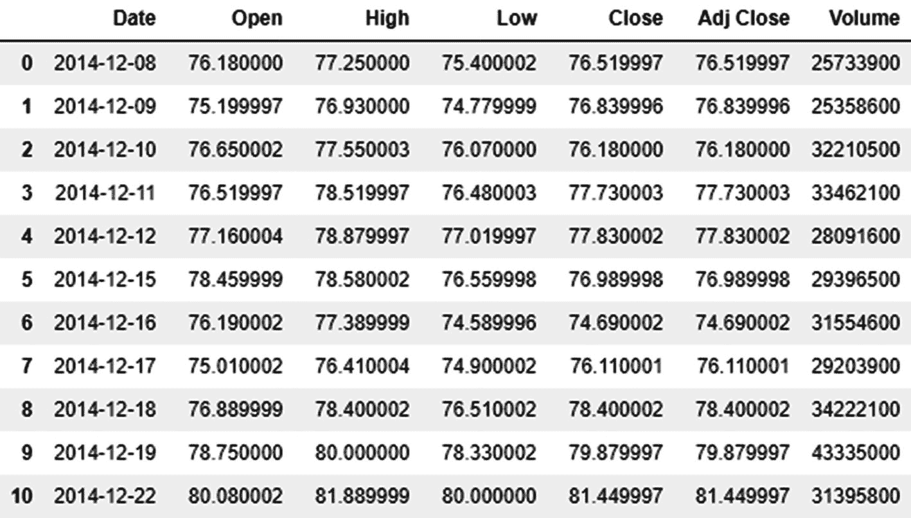

图 3-1

数据集的前十行

```python
Print(df)
```

建模将仅针对数据集中的“收盘价”列进行。复制一份数据以执行训练/测试分割，其中训练集用于训练，在获得满意结果后，我们将在测试数据上评估结果。

训练集将包含除最后 30 天之外的所有数据，而测试集仅包含最后 30 天，用于与预测结果进行评估。

```python
X = df['Close']
test = X.iloc[-30:]
train = X.iloc[:-30]
```

让我们参考一下简单指数平滑算法的超参数。

`SimpleExpSmoothing` 参数指定如下：

*   **`smoothing_level` (float, 可选)**：这是简单指数平滑的 `smoothing_level` 值。如果设置了该值，则将使用此值作为平滑水平。
*   **`optimized` (bool)**：指定是否应自动优化之前未设置的值。

创建一个包含所有所需评估指标的函数，该函数将一次性给出结果。此函数有助于我们了解预测值与实际值的偏差程度。

*   **均方误差 (`MSE`)** 告诉你回归线与一组点的接近程度。它通过计算点到回归线的距离（这些距离即为误差）并对其求平方来实现。误差越接近零，模型越好。
*   **平均绝对误差 (`MAE`)** 衡量一组预测中误差的平均幅度，而不考虑其方向。误差越接近零，模型越好。
*   **均方根误差 (`RMSE`)** 是一个二次评分规则，也衡量误差的平均幅度。它是预测值与实际观测值之间平均平方差的平方根。误差越接近零，模型越好。
*   **平均绝对百分比误差 (`MAPE`)** 是衡量预测系统准确性的统计指标。它以百分比形式衡量。主要用于时间序列预测。误差越接近零，模型越好。
*   **R 平方** 确定因变量中可由[自变量](https://corporatefinanceinstitute.com/resources/knowledge/modeling/independent-variable/)解释的方差比例。误差越接近零，模型越好。

`MAPE` 和 `RMSE` 是用于检查预测模型准确性的显著统计指标。

```python
def timeseries_evaluation_metrics_func(y_true, y_pred):
    def mean_absolute_percentage_error(y_true, y_pred):
        y_true, y_pred = np.array(y_true), np.array(y_pred)
        return np.mean(np.abs((y_true - y_pred) / y_true)) * 100
    print('Evaluation metric results:-')
    print(f'MSE is : {metrics.mean_squared_error(y_true, y_pred)}')
    print(f'MAE is : {metrics.mean_absolute_error(y_true, y_pred)}')
    print(f'RMSE is : {np.sqrt(metrics.mean_squared_error(y_true, y_pred))}')
    print(f'MAPE is : {mean_absolute_percentage_error(y_true, y_pred)}')
    print(f'R2 is : {metrics.r2_score(y_true, y_pred)}',end='\n\n')
```

# 指数平滑法

以下代码片段用于寻找最佳平滑参数，其范围从 0 到 1。将拟合平滑水平模型，并将其结果捕获到 `temp_df` 中。以下结果显示，1.0 给出的 RMSE 最小。

`SimpleExpSmoothing` 参数是从 Statsmodels 包中导入的。这里我们用它来训练数据。训练数据被转换为 NumPy 数组。结果见图 3-2。

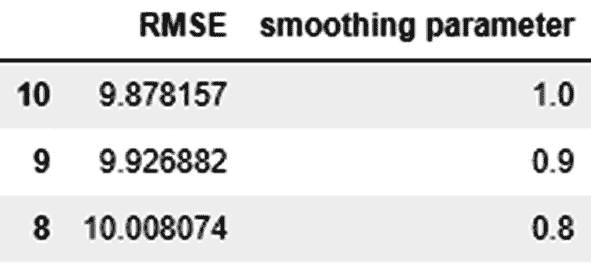

图 3-2

最优参数搜索结果

```python
resu = []
temp_df = pd.DataFrame()
for i in [0, 0.10, 0.20, 0.30, 0.40, 0.50, 0.60, 0.70, 0.80, 0.90,1]:
print(f'Fitting for smoothing level= {i}')
fit_v = SimpleExpSmoothing(np.asarray(train)).fit(i)
fcst_pred_v= fit_v.forecast(30)
timeseries_evaluation_metrics_func(test,fcst_pred_v)
rmse = np.sqrt(metrics.mean_squared_error(test, fcst_pred_v))
df3 = {'smoothing parameter':i, 'RMSE': rmse}
temp_df = temp_df.append(df3, ignore_index=True)
temp_df.sort_values(by=['RMSE']).head(3)
```

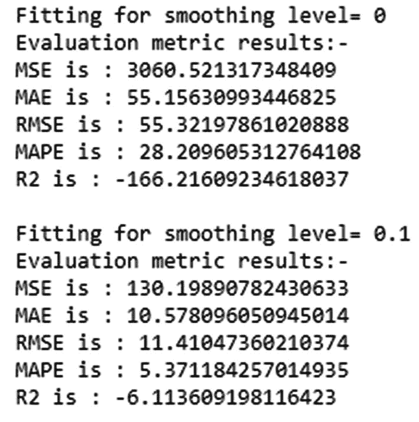

从之前的搜索中，当 `smoothing_level` 等于 0.1 时，RMSE 最小。让我们使用相同的值来训练模型。

```python
fitSES = SimpleExpSmoothing(np.asarray(train)).fit(smoothing_level = 0.1,optimized= False)
fcst_gs_pred = fitSES.forecast(30)
timeseries_evaluation_metrics_func(test,fcst_gs_pred)
```

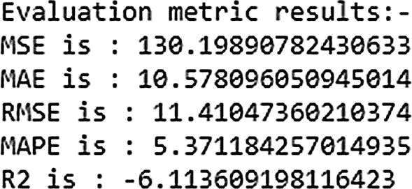

让我们检查一下 `SimpleExpSmoothing` 是否能够通过调整一些设置来自动找到最佳参数。见图 3-3。

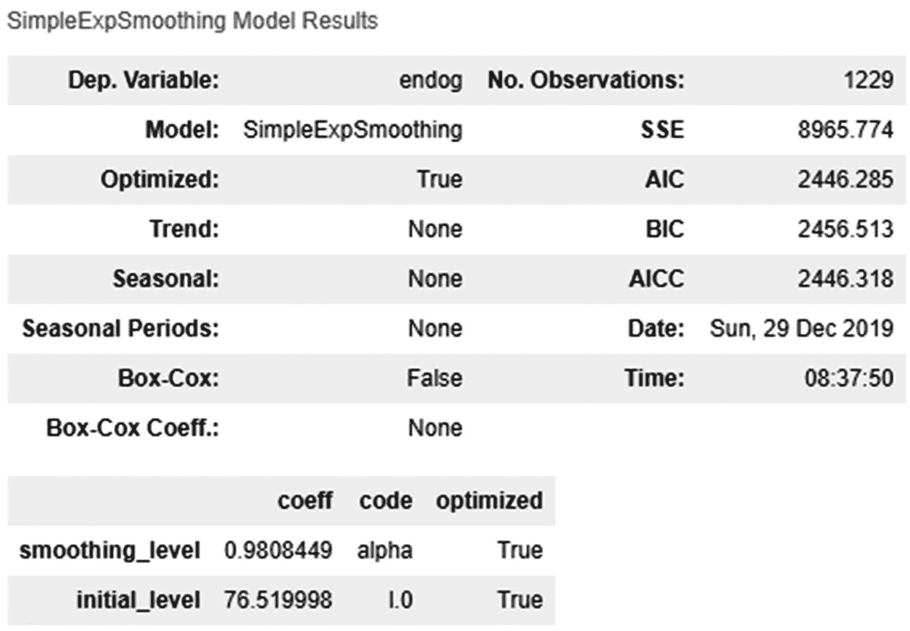

图 3-3

所选最佳参数的摘要

*   `optimized = True` 通过最大化对数似然来估计模型参数。
*   `use_brute= True` 使用暴力（网格）优化器搜索良好的起始值。

```python
fitSESauto = SimpleExpSmoothing(np.asarray(train)).fit( optimized= True, use_brute = True)
fcst_auto_pred = fitSESauto.forecast(30)
timeseries_evaluation_metrics_func(test,fcst_auto_pred)
```


```python
fitSESauto.summary()
```

现在我们有了结果，让我们将索引设置为与测试索引类似，以便图表能够正确对齐。见图 3-4。

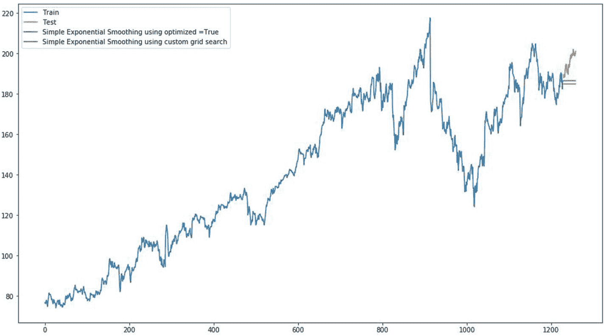

图 3-4

折线图展示了简单指数平滑不同配置之间的结果比较

```python
df_fcst_gs_pred = pd.DataFrame(fcst_gs_pred, columns=['Close_grid_Search'])
df_fcst_gs_pred["new_index"] = range(1229, 1259)
df_fcst_gs_pred = df_fcst_gs_pred.set_index("new_index")
df_fcst_auto_pred = pd.DataFrame(fcst_auto_pred, columns=['Close_auto_search'])
df_fcst_auto_pred["new_index"] = range(1229, 1259)
df_fcst_auto_pred = df_fcst_auto_pred.set_index("new_index")
import matplotlib.pyplot as plt
get_ipython().run_line_magic('matplotlib', 'inline')
plt.rcParams["figure.figsize"] = [16,9]
plt.plot( train, label='Train')
plt.plot(test, label='Test')
plt.plot(fcst_auto_pred, label='Simple Exponential Smoothing using optimized =True')
plt.plot(fcst_gs_pred, label='Simple Exponential Smoothing using custom grid search')
plt.legend(loc='best')
plt.show()
```

我们可以清晰地看到，简单指数平滑法在股票市场数据上表现不佳，因为股票数据通常包含趋势和季节性。我们的基础模型无法捕捉这些细节。

在下一节中，我们将学习双指数平滑法背后的数学原理，以及如何高效地使用它。

## 双指数平滑法简介

正如你在上一节中所见，当数据存在趋势时，简单指数平滑法效果不佳。在这种情况下，我们可以使用双指数平滑法。与其它方法相比，这是一种更可靠的处理包含趋势但不含季节性的数据的方法。该方法在公式中引入了一个时间趋势方程。两个不同的权重（即平滑参数）用于同时更新这两个分量。

霍尔特指数平滑法有时也被称为双指数平滑法。其核心思想是利用简单指数平滑法（SES）并加以改进，以捕捉趋势分量。

假设一个时间序列包含以下成分：

*   水平（Level）
*   趋势（Trend）
*   无季节性
*   噪声（Noise）

预测值 = 最近时间点的水平估计值 + 趋势估计值。

`F[t+k] = l[t] + kT[t]`

其中，`l[t]` 是最近的水平值。`T[t]` 是最近的时间点趋势值。`k` 是我们试图预测的未来步数。

我们将有两个更新方程，分别针对水平和趋势，两者都从数据中学习。

以下是水平的更新方程：

`L[t] = αY[t] + (1-α) (L[t-1] + T[t-1])`

`L[t-1]` 调整了之前的水平值。`T[t-1]` 增加了趋势项。`(L[t-1] + T[t-1])` 通过添加趋势来调整之前的水平值。

以下是趋势的更新方程：

`T[t] = β (L[t] - L[t-1]) + (1-β) T[t-1]`

取上一时间段的趋势值 `T[t-1]`，并通过显示最近水平估计值的差异 `L[t] - L[t-1]` 来更新它。这种设置允许趋势随时间自适应地变化。

`β` 控制着趋势调整的速度。如果序列中的趋势变化很快，我们希望它学习得更快，因此我们有：

`α > 0 且 < 1`

`β > 0 且 < 1`

我们可以调整霍尔特指数平滑法的预测公式，以捕捉加法趋势或乘法趋势。

以下是加法趋势：

预测值 = 最近的水平估计值 + 趋势估计值。

`F[t+k] = L[t] + kT[t]`

以下是乘法趋势：

预测值 = 最近的水平估计值 × 趋势估计值。

`F[t+k] = L[t] × (T[t])^K`

*阻尼（Dampening）* 意味着未来时间趋势在一条直线上递减（无趋势）。霍尔特线性方法生成的预测显示未来存在恒定趋势（递增或递减）。

## 双指数平滑法实战

在上一节中，你学习了双指数平滑法背后的数学原理。现在让我们在一个时间序列数据集上实现它。

导入所需的库并加载 CSV 数据，该数据是 2014 年至 2019 年的 Facebook 股票数据。

# 双指数平滑与网格搜索示例

```python
import pandas as pd
import numpy as np
from sklearn import metrics
from timeit import default_timer as timer
from statsmodels.tsa.api import ExponentialSmoothing, SimpleExpSmoothing, Holt
df = pd.read_csv(r'\Data\FB.csv')
```

让我们先快速浏览一下数据（见图 3-5）。

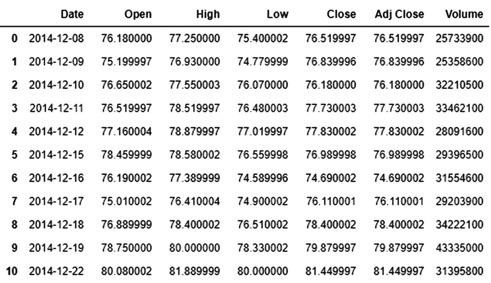
**图 3-5：加载数据集的前十行**

```python
print(df)
```

建模将仅针对数据集中的“Close”列进行。让我们进行训练集和测试集的划分。

训练集将包含除最后 30 天之外的所有数据。测试集仅包含最后 30 天，用于评估预测结果。

```python
train = df.Close[0:-30]
test = df.Close[-30:]
```

创建一个包含所有必要评估指标的函数，该函数将一次性给出结果。

```python
def timeseries_evaluation_metrics_func(y_true, y_pred):
    def mean_absolute_percentage_error(y_true, y_pred):
        y_true, y_pred = np.array(y_true), np.array(y_pred)
        return np.mean(np.abs((y_true - y_pred) / y_true)) * 100
    print('Evaluation metric results:-')
    print(f'MSE is : {metrics.mean_squared_error(y_true, y_pred)}')
    print(f'MAE is : {metrics.mean_absolute_error(y_true, y_pred)}')
    print(f'RMSE is : {np.sqrt(metrics.mean_squared_error(y_true, y_pred))}')
    print(f'MAPE is : {mean_absolute_percentage_error(y_true, y_pred)}')
    print(f'R2 is : {metrics.r2_score(y_true, y_pred)}', end='\n\n')
```

以下代码片段是一个简单的网格搜索。首先，我们为 `smoothing_level`、`smoothing_slope`、`damping_slope` 和 `damped` 定义参数范围，然后尝试找到能产生最佳 RMSE 和 R2 的可行参数组合。

```python
from sklearn.model_selection import ParameterGrid
param_grid = {'smoothing_level': [0.10, 0.20,.30,.40,.50,.60,.70,.80,.90], 'smoothing_slope':[0.10, 0.20,.30,.40,.50,.60,.70,.80,.90],
              'damping_slope': [0.10, 0.20,.30,.40,.50,.60,.70,.80,.90],'damped' : [True, False]}
pg = list(ParameterGrid(param_grid))
```

## 双指数平滑（Holt）方法参数说明

### 主要参数
- **`endog` (类数组对象)**：时间序列。
- **`exponential` (布尔值, 可选)**：趋势分量的类型。
- **`damped` (布尔值, 可选)**：趋势分量是否应被阻尼。

### 拟合参数
- **`smoothing_level` (浮点数, 可选)**：这是简单指数平滑法的 alpha 值。如果设置了该值，则此设置将被用作该参数的值。
- **`smoothing_slope` (浮点数, 可选)**：这是霍尔特趋势方法的 beta 值。如果设置了该值，则此设置将被用作该参数的值。
- **`damping_slope` (浮点数, 可选)**：这是阻尼方法的 phi 值。如果设置了该值，则此设置将被用作该参数的值。
- **`optimized` (布尔值, 可选)**：指定是否自动优化那些尚未设置的值。

## 执行自定义网格搜索

```python
df_results_moni = pd.DataFrame(columns=['smoothing_level', 'smoothing_slope', 'damping_slope','damped','RMSE','r2'])
start = timer()
for a,b in enumerate(pg):
    smoothing_level = b.get('smoothing_level')
    smoothing_slope = b.get('smoothing_slope')
    damping_slope = b.get('damping_slope')
    damped = b.get('damped')
    print(smoothing_level, smoothing_slope, damping_slope,damped)
    fit1 = Holt(train,damped =damped ).fit(smoothing_level=smoothing_level, smoothing_slope=smoothing_slope, damping_slope = damping_slope, optimized=False)
    #fit1.summary
    z = fit1.forecast(30)
    print(z)
    df_pred = pd.DataFrame(z, columns=['Forecasted_result'])
    RMSE = np.sqrt(metrics.mean_squared_error(test, df_pred.Forecasted_result))
    r2 = metrics.r2_score(test, df_pred.Forecasted_result)
    print( f' RMSE is {np.sqrt(metrics.mean_squared_error(test, df_pred.Forecasted_result))}')
    df_results_moni = df_results_moni.append({'smoothing_level' :smoothing_level, 'smoothing_slope':smoothing_slope, 'damping_slope' :damping_slope,'damped':damped,'RMSE': RMSE,'r2':r2}, ignore_index=True)
end = timer()
print(f' Total time taken to complete grid search in seconds: {(end - start)}')
print(f' Below mentioned parameter gives least RMSE and r2')
df_results_moni.sort_values(by=['RMSE','r2']).head(1)
```

请参见图 3-6 和图 3-7。

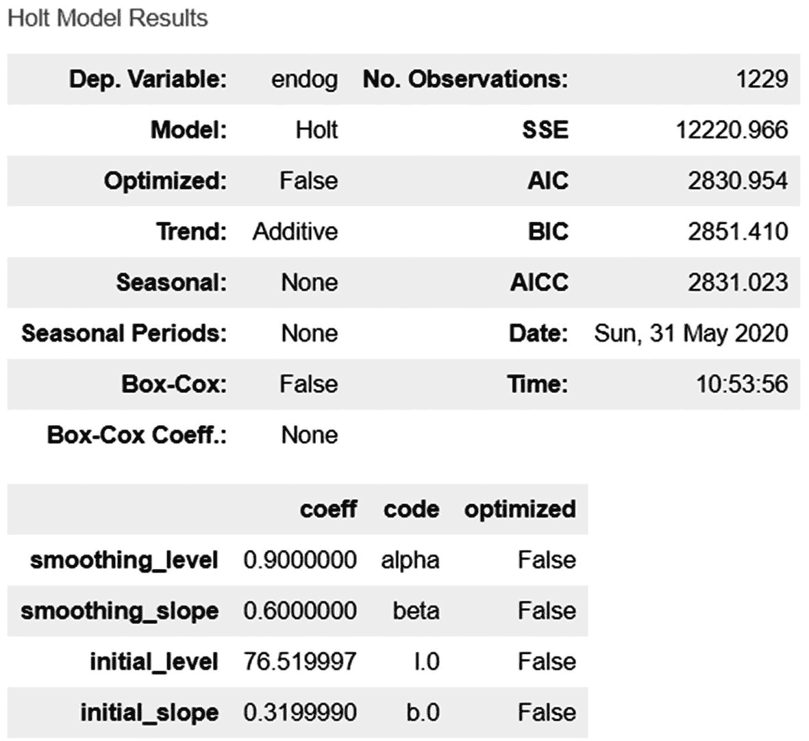
**图 3-7：自定义网格搜索模型摘要**

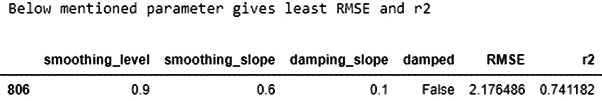
**图 3-6：从自定义网格搜索中选择的最佳参数**

## 应用最佳参数并评估

```python
fit1 = Holt(train,damped =False ).fit(smoothing_level=0.9, smoothing_slope=0.6, damping_slope = 0.1, optimized=False)
Forecast_custom_pred = fit1.forecast(30)
fit1.summary()
```

现在，让我们拟合双指数平滑模型的自定义网格搜索结果并评估结果。请参见图 3-8。

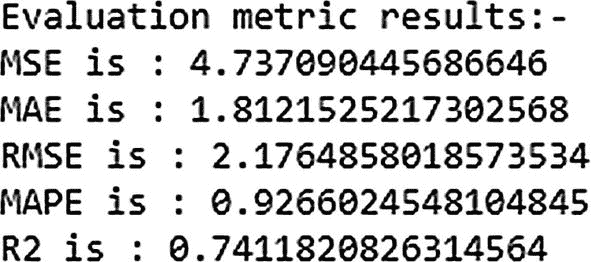
**图 3-8：使用自定义网格搜索参数后的结果**

```python
timeseries_evaluation_metrics_func(test,Forecast_custom_pred)
```

让我们通过调整一些设置来检查双指数平滑是否能够自行找到最佳参数，如下所示：

*   `optimized = True` 通过最大化对数似然来估计模型参数。
*   `use_brute = True` 使用暴力（网格）优化器搜索良好的起始值。

```python
fitESAUTO = Holt(train).fit(optimized=True, use_brute=True)
fitESAUTO.summary()
```

请参见图 3-9、图 3-10 和图 3-11。

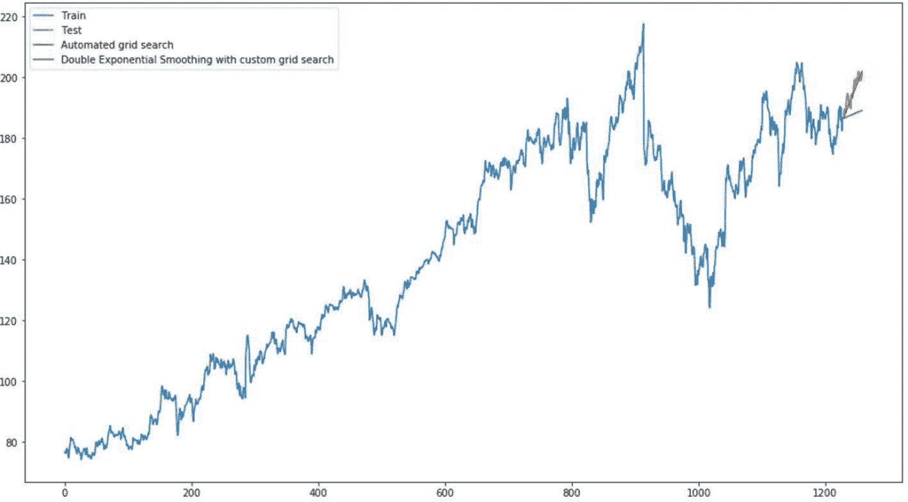
**图 3-11** 描绘双指数平滑不同配置结果对比的折线图

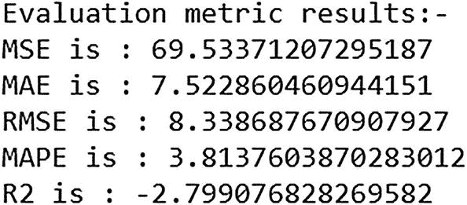
**图 3-10** 使用自动网格搜索参数后的结果

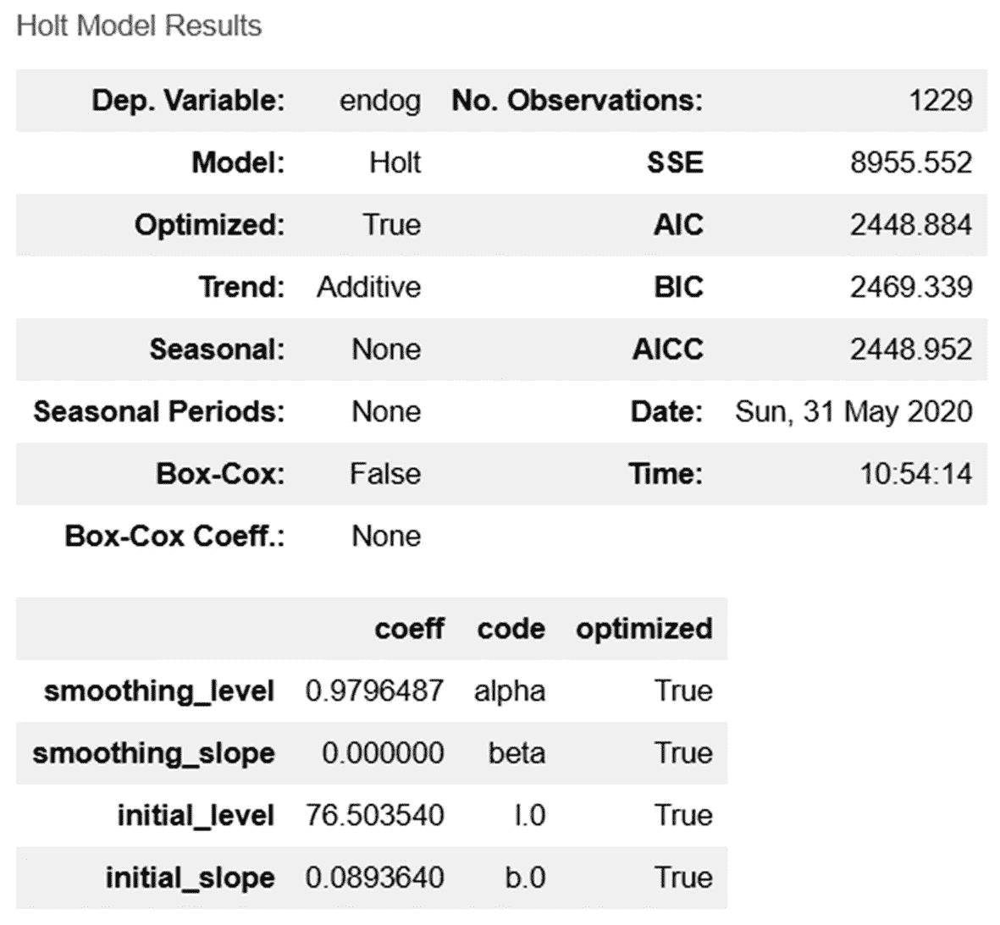
**图 3-9** 自动网格搜索模型摘要

```python
fitESAUTOpred = fitESAUTO.forecast(30)
timeseries_evaluation_metrics_func(test, fitESAUTOpred)
```

```python
import matplotlib.pyplot as plt
get_ipython().run_line_magic('matplotlib', 'inline')
plt.rcParams["figure.figsize"] = [16,9]
plt.plot(train, label='训练集')
plt.plot(test, label='测试集')
plt.plot(fitESAUTOpred, label='自动网格搜索')
plt.plot(Forecast_custom_pred, label='带自定义网格搜索的双指数平滑')
plt.legend(loc='best')
plt.show()
```

从评估指标和图表中，我们可以看到双指数平滑的性能明显优于简单指数平滑。

在下一节中，我们将学习三重指数平滑背后的数学原理以及如何高效使用它。

### 三重指数平滑简介

三重指数平滑是一种预测方法，它执行三次指数平滑。当数据随时间呈现趋势和季节性时，可以应用此方法。它包含所有平滑分量方程，例如趋势和季节性。季节性包括两种不同类型，即加法和乘法，这在数学中是一种类似的操作。Winter 方法使用了 Holt 方法的思想并增加了季节性。Winter 是 Holt 的学生，他通过添加一个额外的方程来更新季节性，从而扩展了 Holt 的方法。这种三重指数平滑也称为 Holt-Winters 方法。

假设一个序列包含以下成分：
*   水平
*   趋势
*   季节性
*   噪声

预测方程可以调整以处理加法或乘法趋势和季节性。

这是加法季节性模型：
预测 = 最近时间点的估计水平 + 趋势 + 季节性。
`F[t+k] = l[t] + kT[t] + S[t+k-M]`

这是带有加法趋势的乘法季节性模型：
预测 = 最近时间点的估计（水平 × 趋势）× 季节性。
`F[t+k] = (l[t] + kT[t]) * S[t+k-M]`

假设我们的序列包含水平、趋势和季节性，以及带有噪声的 `M` 个季节。

在 Holt-Winter 指数平滑中，我们有三个平滑常数。

**水平**：`Lt = α * (y[t]/S[t-M]) + (1 - α) * (L[t-1] + T[t-1])`
`S` 是季节性分量。当我们计算 `y[t]/S[t-M]` 时，我们是在对 `y` 的值进行去季节性化。
在水平方程中，我们通过 `L[t-1]` 更新先前的水平，加上 `T[t-1]`，然后结合 `y[t]` 的去季节性化值。

**趋势**：`T[t] = β * (L[t] - L[t-1]) + (1 - β) * T[t-1]`（加法趋势）
我们可以通过考虑水平之间的最新差异来更新先前的趋势。

**季节性**：`St = γ * (Y[t]/L[t]) + (1 - γ) * S[t-M]`（乘法季节性）
`Y[t]` 除以水平分量 `L[t]`。这给出了 `Y` 的去趋势值。
因此，通过将最近的季节性分量 `St-M` 与 `Yt` 的去趋势值相结合来更新季节性。

### 三次指数平滑实战

在上一节中，你了解了三次指数平滑背后的数学原理。现在，让我们在一个时间序列数据集上实现它。

导入所需的库并加载 CSV 数据，该数据是 Facebook 2014 年至 2019 年的股票数据。

```python
from statsmodels.tsa.api import ExponentialSmoothing
import pandas as pd
import numpy as np
from sklearn import metrics
from timeit import default_timer as timer
df = pd.read_csv(r'\Data\FB.csv')
```

让我们先快速浏览一下数据（图 3-12）。

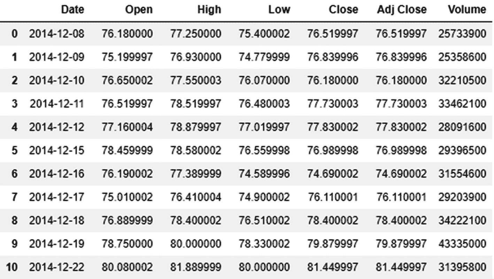
**图 3-12** 数据集的前十行

```python
print(df)
```

建模将仅针对数据集中的“收盘价”列进行。复制一份数据，然后进行训练集和测试集的划分。

训练集将包含除最后 30 天数据之外的所有数据。测试集仅包含最后 30 天的数据，用于评估预测结果。

```python
X = df['Close']
test = X.iloc[-30:]
train = X.iloc[:-30]
```

让我们参考一下三次指数平滑算法的超参数。

以下是 Holt-Winter 指数平滑参数：
*   `endog` (array-like)：时间序列
*   `trend` (`{"add", "mul", "additive", "multiplicative", None}`, 可选)：趋势分量的类型
*   `damped` (`bool`, 可选)：趋势分量是否应被阻尼
*   `seasonal` (`{"add", "mul", "additive", "multiplicative", None}`, 可选)：季节分量的类型
*   `seasonal_periods` (`int`, 可选)：Holt-Winters 方法要考虑的季节数

以下是拟合参数：
*   `smoothing_level` (`float`, 可选)：这是简单指数平滑的 `alpha` 值。如果设置了该值，则将使用此设置作为该值。
*   `smoothing_slope` (`float`, 可选)：这是 Holt 趋势方法的 `beta` 值。如果设置了该值，则将使用此设置作为该值。
*   `smoothing_seasonal` (`float`, 可选)：这是 Holt-Winter 季节方法的 `gamma` 值。如果设置了该值，则将使用此设置作为该值。
*   `damping_slope` (`float`, 可选)：这是阻尼方法的 `phi` 值。如果设置了该值，则将使用此设置作为该值。
*   `optimized` (`bool`, 可选)：指定是否应自动优化之前未设置的值。
*   `use_boxcox` (`{True, False, 'log', float}`, 可选)：指定是否应首先对数据应用 Box-Cox 变换。如果为 `log`，则应用对数变换。如果为 `float`，则使用等于该 `float` 值的 `lambda`。
*   `remove_bias` (`bool`, 可选)：指定在返回预测值和拟合值之前是否应从其中移除偏差。它通过强制平均残差为零来实现这一点。
*   `use_basinhopping` (`bool`, 可选)：指定优化器是否应使用盆地跳跃法更努力地寻找最优值。

创建一个包含所有所需评估指标的函数，该函数将一次性给出结果。

```
def timeseries_evaluation_metrics_func(y_true, y_pred):
def mean_absolute_percentage_error(y_true, y_pred):
y_true, y_pred = np.array(y_true), np.array(y_pred)
return np.mean(np.abs((y_true - y_pred) / y_true)) * 100
print('Evaluation metric results:-')
print(f'MSE is : {metrics.mean_squared_error(y_true, y_pred)}')
print(f'MAE is : {metrics.mean_absolute_error(y_true, y_pred)}')
print(f'RMSE is : {np.sqrt(metrics.mean_squared_error(y_true, y_pred))}')
print(f'MAPE is : {mean_absolute_percentage_error(y_true, y_pred)}')
print(f'R2 is : {metrics.r2_score(y_true, y_pred)}',end='\n\n')
```

以下代码片段是一个简单的网格搜索。首先，我们定义 `seasonal`、`trend`、`seasonal_periods`、`smoothing_level`、`smoothing_slope`、`damping_slope`、`damped`、`use_boxcox`、`remove_bias` 和 `use_basinhopping` 的参数范围。然后，我们尝试找到能产生最佳 `RMSE` 和 `R2` 的组合。执行以下代码需要一些时间，因为我们的搜索空间较大：

```
from sklearn.model_selection import ParameterGrid
param_grid = {'trend': ['add', 'mul'],'seasonal' :['add', 'mul'],'seasonal_periods':[3,6,12], 'smoothing_level': [0.10, 0.20,.30,.40,.50,.60,.70,.80,.90], 'smoothing_slope':[0.10, 0.20,.30,.40,.50,.60,.70,.80,.90],
'damping_slope': [0.10, 0.20,.30,.40,.50,.60,.70,.80,.90],'damped' : [True, False], 'use_boxcox':[True, False],
'remove_bias':[True, False],'use_basinhopping':[True, False]}
pg = list(ParameterGrid(param_grid))
df_results_moni = pd.DataFrame(columns=['trend','seasonal_periods','smoothing_level', 'smoothing_slope',
'damping_slope','damped','use_boxcox','remove_bias','use_basinhopping','RMSE','r2'])
start = timer()
print('Starting Grid Search..')
for a,b in enumerate(pg):
trend = b.get('trend')
smoothing_level = b.get('smoothing_level')
seasonal_periods = b.get('seasonal_periods')
smoothing_level = b.get('smoothing_level')
smoothing_slope = b.get('smoothing_slope')
damping_slope = b.get('damping_slope')
damped = b.get('damped')
use_boxcox = b.get('use_boxcox')
remove_bias = b.get('remove_bias')
use_basinhopping = b.get('use_basinhopping')
#print(trend,smoothing_level, smoothing_slope,damping_slope,damped,use_boxcox,remove_bias,use_basinhopping)
fit1 = ExponentialSmoothing(train,trend=trend, damped=damped,seasonal_periods=seasonal_periods ).fit(smoothing_level=smoothing_level,
smoothing_slope=smoothing_slope, damping_slope = damping_slope,use_boxcox=use_boxcox,optimized=False)
#fit1.summary
z = fit1.forecast(30)
#print(z)
df_pred = pd.DataFrame(z, columns=['Forecasted_result'])
RMSE = np.sqrt(metrics.mean_squared_error(test, df_pred.Forecasted_result))
r2 = metrics.r2_score(test, df_pred.Forecasted_result)
#print( f' RMSE is {np.sqrt(metrics.mean_squared_error(test, df_pred.Forecasted_result))}')
df_results_moni = df_results_moni.append({'trend':trend,'seasonal_periods':seasonal_periods,'smoothing_level':smoothing_level, 'smoothing_slope':smoothing_slope,
'damping_slope':damping_slope,'damped':damped,'use_boxcox':use_boxcox,'use_basinhopping':use_basinhopping,'RMSE':RMSE,'r2':r2}, ignore_index=True)
print('End of Grid Search')
end = timer()
print(f' Total time taken to complete grid search in seconds: {(end - start)}')
```

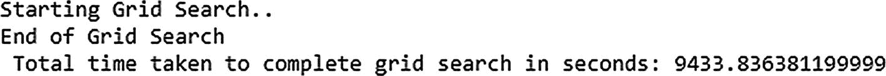

完成自定义网格搜索后，所有可能的组合及其结果都存储在 `df_results_moni` DataFrame 中（图 3-13）。

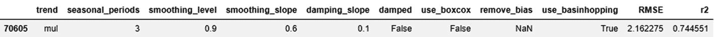

图 3-13 自定义网格搜索的最佳参数

```
print(f' Below mentioned parameter gives least RMSE and r2')
df_results_moni.sort_values(by=['RMSE','r2']).head(1)
```

使用网格搜索参数拟合模型并评估结果（图 3-14）。

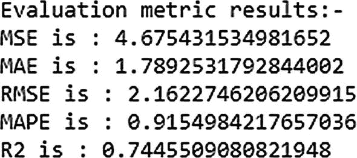

图 3-14 使用自定义网格搜索参数后的结果

```
fit1 = ExponentialSmoothing(train,trend='mul', damped=False,seasonal_periods=3 ).fit(smoothing_level=0.9,
smoothing_slope=0.6, damping_slope = 0.6,use_boxcox=False,use_basinhopping = True,optimized=False)
Forecast_custom_pred = fit1.forecast(30)
fit1.summary()
timeseries_evaluation_metrics_func(test,Forecast_custom_pred)
```

让我们通过调整一些设置（如下所示，见图 3-15），来检验三次指数平滑法能否自行找到最佳参数：

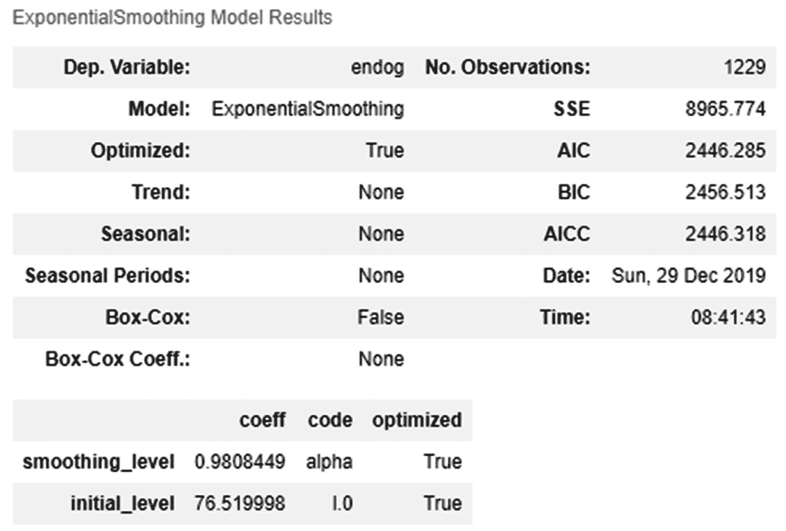

图 3-15

### 自动网格搜索模型摘要

*   `optimized = True` 通过最大化对数似然来估计模型参数。
*   `use_brute = True` 使用暴力（网格）优化器搜索良好的起始值。

```
fitESAUTO = ExponentialSmoothing(train).fit(optimized= True, use_brute = True)
fitESAUTO.summary()
```

见图 3-16 和图 3-17。

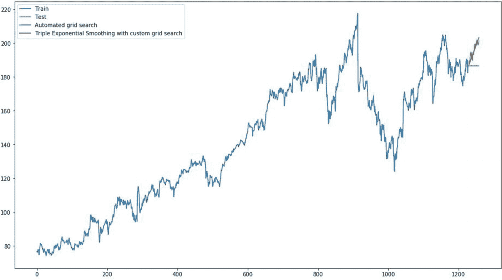

图 3-17 描绘三次指数平滑法不同配置结果对比的折线图

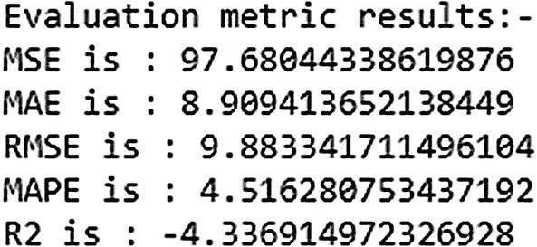

图 3-16 使用自动网格搜索参数后的结果

```
fitESAUTOpred = fitESAUTO.forecast(30)
timeseries_evaluation_metrics_func(test,fitESAUTOpred)
```

```
import matplotlib.pyplot as plt
get_ipython().run_line_magic('matplotlib', 'inline')
plt.rcParams["figure.figsize"] = [16,9]
plt.plot( train, label='Train')
plt.plot(test, label='Test')
plt.plot(fitESAUTOpred, label='Automated grid search')
plt.plot(Forecast_custom_pred, label='Triple Exponential Smoothing with custom grid search')
plt.legend(loc='best')
plt.show()
```

通过仔细观察评估指标和图表，我们可以得出结论：三次指数平滑法略优于二次指数平滑法。

因此，你可以得出以下结论：

*   如果不存在趋势或季节性，则使用简单指数平滑法。
*   如果存在趋势但无季节性，则使用二次指数平滑法。
*   如果同时存在趋势和季节性，则使用三次指数平滑法。

## 总结

在本章中，你学习了简单、二次和三次指数平滑背后的数学原理，以及如何使用自定义和自动网格搜索来找到最佳超参数，从而使模型能够产生最佳结果。在下一章中，你将学习时间序列数据的各种回归扩展技术。