# 4. 时间序列数据的回归扩展技术

在本章中，你将学习如何利用回归技术高效地解决时间序列问题。*回归*是机器学习中的一种监督学习技术，你尝试使用一个或多个回归变量来估计目标变量。在本章中，你将了解时间序列数据中*平稳性*的含义，以及如何使数据平稳、如何解读 p 值、如何检验序列是否平稳。最后，我们将探讨 AR、MA、ARIMA、SARIMA、SARIMAX、VAR 和 VARMA 技术，并使用真实世界的数据集解决一些问题。

## 时间序列中平稳行为的类型

*平稳*数据意味着特定过程的统计属性不随时间变化。平稳时间序列数据有五种形式。

1.  **严格或强平稳**：一个随机过程是一个无条件联合概率分布，当在时间上平移时，该分布不会改变。这意味着该分布随时间保持不变。

2.  **一阶平稳**：该序列具有不随时间变化的恒定均值。其他统计属性（如方差）可能会发生变化。

3.  **弱（二阶）平稳**：在弱平稳数据中，均值、方差和协方差在整个时间序列中保持恒定。它也被称为协方差/均值平稳性。

4.  **趋势平稳**：该序列围绕趋势变化（统计属性均值发生变化）。这些趋势可能是线性的或二次的。

5.  **差分平稳**：当数据为时间序列时，这种类型的序列具有一个或多个差分。

因此，如果数据表现出恒定均值、方差和自相关的行为，则称其为*平稳*的。为了训练时间序列预测模型，必须将数据转换为平稳格式。因此，你需要知道如何检查时间序列是否平稳。图 4-1 和图 4-2 展示了一些数据在使其平稳前后的情况。

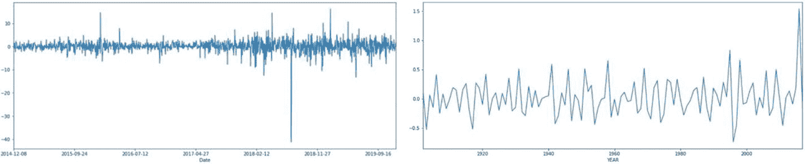

图 4-2

平稳化操作后

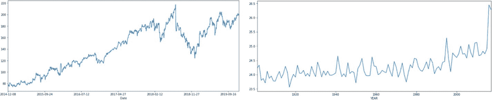

图 4-1

平稳化操作前

## 使数据平稳

当时间序列数据非平稳时，意味着它包含应被移除的趋势和季节性模式。通过使数据平稳，我们的数据将具有恒定的均值和方差，并且大多数统计概念都可以应用。为了检查时间序列是否平稳，我们可以使用三种方法。

*   图表

*   汇总统计

*   统计检验

### 使用图表

前面的图表以可视化形式展示了时间序列数据。这有助于我们理解时间序列是否随时间线性增加或减少，这被称为*非平稳*时间序列。不增加或减少且随时间呈现恒定增长的图被称为*平稳*时间序列。

### 使用汇总统计

汇总统计确定了所有基本要素，如均值、标准差、方差、最小值、最大值和四分位距，这些要素有助于区分数据的行为。它帮助我们评估数据中的季节性或随机模式，以便我们检查是否存在显著差异。无论时间序列是否平稳，我们都可以将时间序列中的数据分成不同的组，在这些组中我们可以比较均值、方差和标准差等差异因素。如果观察到的因素发生变化且在统计上显著，我们就说该时间序列是*非平稳*的。在许多领域，如销售、金融、零售、医疗保健等，我们会发现由于季节性和增长趋势，均值和方差持续变化的不规则行为模式。


### 使用统计单位根检验

统计检验会对数据做出一个强有力的假设。同样，我们也可以对时间序列数据做出一些假设。为此，我们必须检查时间序列的原假设是否被拒绝。因此，我们可以阐明结果，以使特定问题具有意义。统计单位根检验包含以下五种方法，每种方法都包含一个单位根平稳性检验：

*   **迪基-富勒检验**：该方法基于线性回归。序列相关性是该方法的一个大问题。

*   **增广迪基-富勒检验**：该方法解决了迪基-富勒检验的序列相关问题，并能处理庞大而复杂的模型。该方法被广泛使用。

*   **施密特-菲利普斯检验**：该方法包含了原假设和备择假设中确定性变量的系数。该方法的替代方法是 ro 检验和 tau 检验。

*   **菲利普斯-佩龙检验**：该检验是对迪基-富勒检验的改进，它优化了对误差项中自相关和异方差性的检验。

*   **KPSS 检验**：这是 ADF 检验的逆过程，其原假设是趋势平稳过程，备择假设是存在单位根。

单位根平稳性检验背后的概念是，给定时间序列的统计特性并非随时间恒定不变。在这种情况下，我们使用此统计检验来检查时间序列是平稳的还是非平稳的。

这里我们将解释单位根的数学方程。

*   从数学上讲，该方程表示如下：

**Y**[**t**] **= a * Y**[**t-1**] **+ €**[**t**]

**Y**[**t-1**] **= a * y**[**t-2**] **+ €**[**t-1**]

其中 Y[t] 是时间 t 的实例，€[t] 是误差项。要计算 Y[t]，我们必须先计算 Y[t-1]。

*   对于所有观测值，以下公式适用：

**Y**[**t**] **= a**^(**n**) *** y**[**t-n**] **+ €**[**t-1**] *** a**^(**i**)

*   如果在前面的公式中 a 的值包含 1，那么预测值将是 Yt-n，并且它是从 t-n 到 t 的所有误差之和（这表明方差随时间增加）。这在时间序列领域被称为*单位根*。

*   对于平稳时间序列，方差不能是时间的函数部分。因此，单位根检验通过监测 a = 1 的值来检查时间序列中是否存在单位根。

接下来你将学习如何解读 p 值。

## 解读 P 值

在单位根平稳性检验中，我们需要处理原假设（H0），即时间序列非平稳，以及备择假设（H1），即时间序列平稳。当我们执行此单位根平稳性检验时，结果将以 p 值形式呈现。因此，理解如何解读 p 值至关重要。p 值有助于确定结果的显著性。

如果 p 值低于阈值，则我们拒绝原假设，这意味着时间序列是平稳的。如果 p 值超过阈值，并且我们无法拒绝原假设，则意味着时间序列是非平稳的。ADF 检验会查看检验统计量、p 值以及在 1%、2.5%、5% 和 10% 置信区间下找到的临界值。

下图显示，如果显著性水平设置为 0.05，则相应的置信水平为 95%：

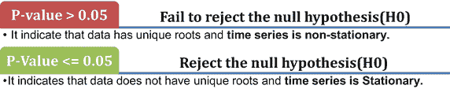

## 增广迪基-富勒检验

增广迪基-富勒检验是一种用于平稳性检验的显著且合理的统计检验。它可用于判断序列中是否存在单位根，此外，它还有助于我们理解时间序列是否平稳。ADF 检验包含原假设（H0），即时间序列中存在单位根。备择假设用于时间序列的平稳版本。它是迪基-富勒检验的增广版本，最适合用于大型且更复杂的时间序列数据集。

该检验使用一个负数。该数字的负值越大，在某个置信水平下拒绝存在单位根假设的可能性就越高。

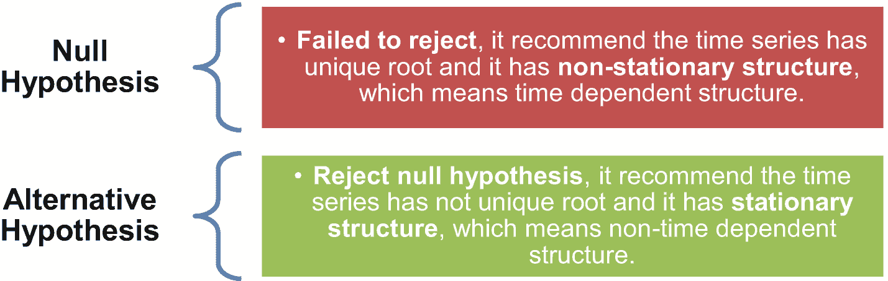

## 克瓦特科夫斯基-菲利普斯-施密特-辛检验

克瓦特科夫斯基-菲利普斯-施密特-辛检验用于检验原假设，即时间序列围绕一个确定性趋势是平稳的（即趋势平稳），而备择假设是存在单位根。存在单位根不是原假设，而是备择假设，这与 ADF 检验的形式相反。此外，在 KPSS 检验中，不存在单位根并非平稳性的证据，而是（根据设计）趋势平稳性的证据。这主要用于趋势平稳性检验。*趋势平稳*数据是指没有单位根但呈现趋势的序列。

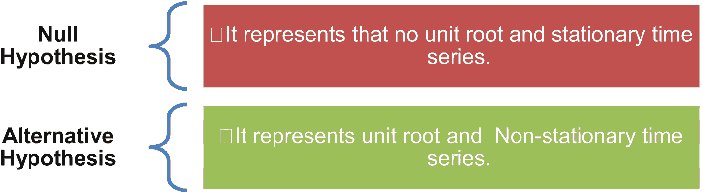

以下是 KPSS 检验的解读：

检验统计量、p 值和临界值是在 1%、2.5%、5% 和 10% 的置信区间下找到的。

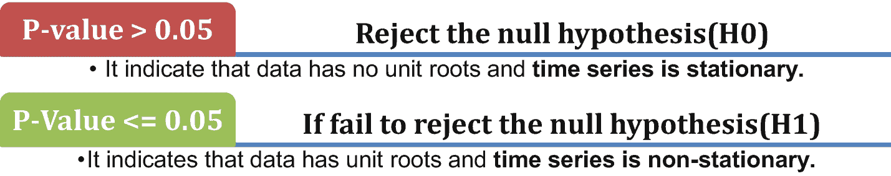

## 使用平稳数据技术

在上一节中，你学习了如何借助 ADF 检验和 KPSS 检验来解读 p 值；在本节中，让我们看看使数据平稳的各种方法。

### 差分法

*差分法*（滞后差分）是转换时间序列以稳定均值的过程。我们有几种方法可以识别时间序列，例如折线图，它表示序列随时间的变化。在这些趋势中，可以观察到季节性和随机游走，这是随时间推移而发生的变化，这种行为被认为是非平稳时间序列。明确的规则指出，需要从训练时间序列预测模型的数据中移除趋势和季节性。

以下是进行差分的原因：

*   将非平稳数据转换为平稳时间序列

*   移除季节性趋势
    *   对季度数据取四阶差分

    *   对月度数据取 12 阶差分

### 随机游走

随机游走是时间序列呈现不规则增长时的行为。当增长不随时间恒定不变时，预测从一个时期（Y[t]）到下一个时期（Y[t-1]）发生的变化会更好。在不同的时间戳中，从左向右移动，独立于变量的移动会随机地向上或向下迈出一步。所谓的随机游走表明，时间序列的未来步骤或方向可能以随机方式变化（图 4-3）。

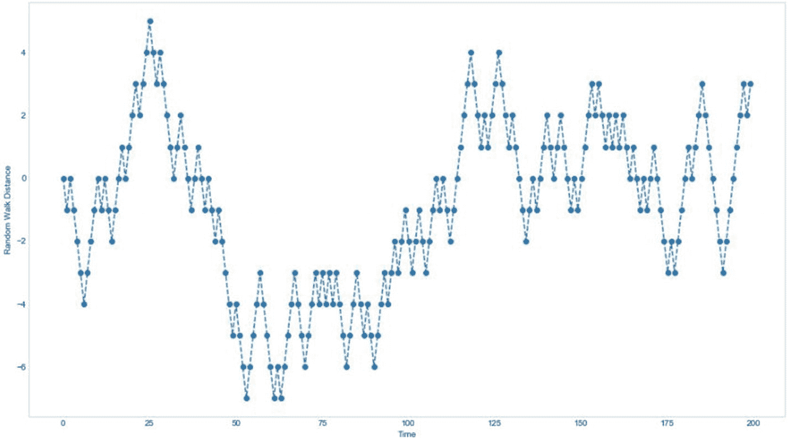

图 4-3

随机游走的一维表示

以下是随机游走的步骤：

1.  从 ***t***[***0***] 开始随机游走。

2.  随机选择下一步移动，***t***[***n-1***]。

3.  重复步骤 2。


### 一阶差分（趋势差分）

因此，时间序列中两个连续观测值之间的变化可以写成如下形式：

**Y’**[**t**] **= Y**[**t**] **- Y**[**t-1**]

当差分后的序列包含白噪声（εt）时，公式可以写成：

**Y**[**t**] **- Y**[**t-1**] **=** εt

**Y**[**t**] **= Y**[**t-1**] **+** εt

其中 εt = 白噪声。这被称为*标准随机游走*。

随机游走表示时间序列是非平稳的。这在金融、经济和微观经济学数据中最为常见。随机游走通常具有长期上涨和下跌的趋势，以及不确定和不可预测的变化。图 4-4 展示了股票价格的随机游走行为。

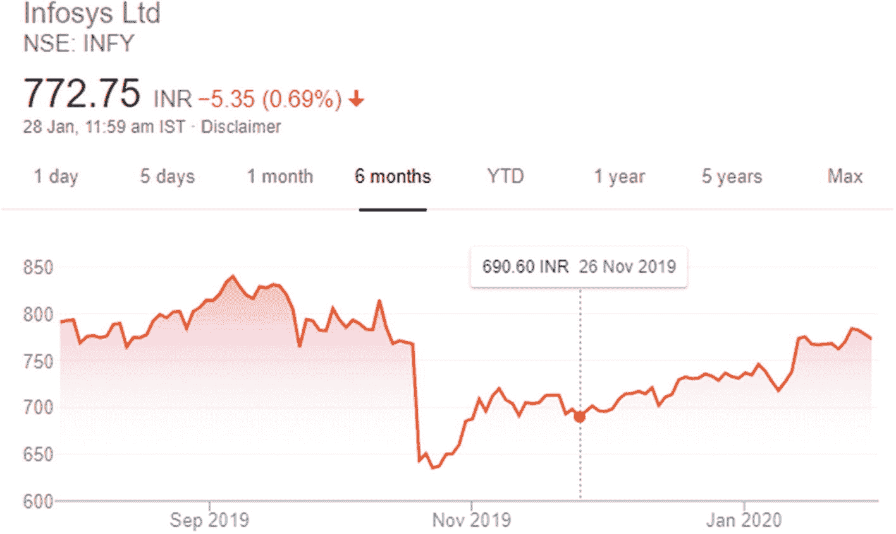

图 4-4

Infosys 有限公司股票价格的随机游走行为（来源：Money Control）

例如，我们可以看到 Infosys 有限公司的股票价格在过去六个月中经历了上涨和下跌。这就是随机游走行为。由于随机的涨跌，任何未来的时刻都是不可预测的。

因此，这里很明显，随机时间序列具有非零均值。在这种情况下，最终的公式被称为*带漂移的随机游走*，如下所示：

**Y**[**t**] **= c + Y**[**t-1**] **+ ε**[**t**]

其中 c 是两个观测值之间变化的平均值。

*   如果 c 为正，则 *Y*[*t*] 的平均变化将上升，并且 Y[t] 将向上移动。
*   如果 c 为负，则 *Y*[*t*] 的值将向下移动。

**注意：**

*   时间序列中的一阶差分将消除线性趋势（即，差分数=1）。
*   二阶差分将消除二次趋势（即，差分数=2）。
*   此外，在时间序列中，以周期为滞后期进行的一阶差分将消除季节性趋势。

### 二阶差分（趋势差分）

当一阶差分未能使数据平稳时，二阶差分是一种用于使一阶差分数据平稳的技术。因此，有必要应用二阶差分来获得平稳序列。

**Y”**[**t**] **= Y’**[**t**] **– Y’**[**t-1**]

**= (Y**[**t**] **- Y**[**t-1**]**) – (Y**[**t-1**] **- Y**[**t-2**]**)**

**= Y**[**t**] **- 2Y**[**t-1**] **+ Y**[**t-2**]

这就是二阶差分 Y”，它有 t-2 个值。这被称为原始序列中的*双重变化*。

### 季节性差分

*季节性差分*是一个观测值与上一年相应观测值之间的差值。

#### 季节性数据的一阶差分

季节性差分与一阶差分类似，都是计算同一季节的当前观测值与先前观测值之间的差异。它可以写成如下形式：

**Y’**[**t**] **= Y**[**t**] **- Y**[**t-s**]

其中 s 是季节数，这被称为*滞后-s* 差分。我们可以在 s 个滞后周期后对观测值进行差分。

如果我们在季节性差分中观察到白噪声，那么模型可以写成：

**Y**[**t**] **= Y**[**t-s**] **+** εt

当我们尝试用这种方法预测值时，它等于该季节的最后一个观测值。该模型给出了季节性朴素预测的结果。

#### 季节性数据的二阶差分

为了将季节性差分与常规差分区分开来，我们有时将平均差分称为*一阶差分*，它表示滞后 1 处的差分。在现实世界中，这通常发生在应用一阶差分之后。时间序列可能无法达到平稳序列的状态，因此在这种情况下，使用二阶差分至关重要，其差分指定为滞后 2。它看起来像这样：

**Y”**[**t**] **= Y’**[**t**] **– Y’**[**t-s**]

**= (Y**[**t**] **- Y**[**t-s**]**) – (Y**[**t-1**] **- Y**[**t-s-1**]**)**

**= Y**[**t**] **- Y**[**t-1**] **- Y**[**t-s**] **+ Y**[**t-s-1**]

当应用常规差分和一阶差分时，与先进行二阶差分没有区别。结果将与一阶差分相同。

## 自回归模型

自回归模型（AR）根据其过去的数据预测未来的行为。它是指数据与时间序列的连续序列以及序列前后的值相关的情况。*自回归模型*仅使用过去的行为数据来预测值。

AR 模型使用过去的值进行预测，如下所示：

**Ŷt = μ + ϕ**[**1**]**Y**[**t-1 +**] **ϕ**[**2**]**Y**[**t-2 ... +**] **ϕ**[**p**]**Y**[**t-p**] **+ ɛ**[**t**]

其中 ɛ[t] 是白噪声。该模型被称为 AR(p) 模型，其中 p 是自回归模型的阶数。AR 模型易于使用，可以处理各种时间序列模型。图 4-5 展示了 AR (1) 和 AR (2) 的行为。

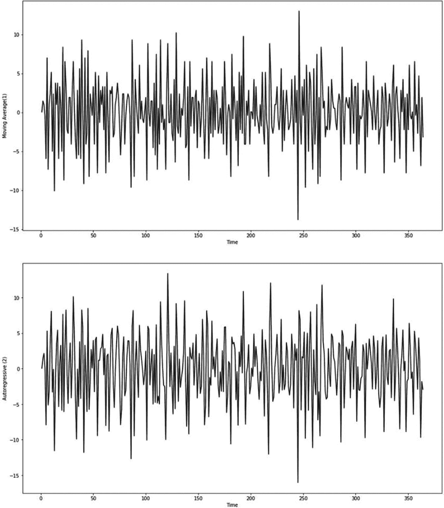

图 4-5

自回归 1 和 2 后的图

表 4-1 展示了 AR (1) 模型。

表 4-1

ϕ 和 u 值对数据的影响

| ϕ 值 | u 值 | 结果 |
| --- | --- | --- |
| 0 | - | 白噪声 |
| 1 | 0 | 等同于随机游走 |
| 1 | 非 0 | 类似于带漂移的随机游走 |
| < 0 | - | 围绕均值振荡 |

自回归模型仅限于平稳数据，并且需要一些参数，如下定义：

*   **AR (1) 模型：** -1 < ϕ[1] < 1
*   **AR (2) 模型：** -1 < ϕ[1] < 1, ϕ[1] + ϕ[2] < 1, ϕ[1] - ϕ[2] < 1

## 移动平均

*移动平均*（MA）是一种获取时间序列中所有趋势的方法。它是任何子类别数字的平均值。它用于长期趋势预测。基本上，移动平均通过使用多个过去数据点的平均值来预测未来点。

移动平均模型使用过去的预测误差：

Ŷt = μ[0]+ εt – ω[1] ε[t-2] - ω[1] ε[t-2 …] ω[q] ε[t-q]

其中 ɛ[t] 是白噪声。该模型被称为 MA(q) 模型，其中 q 是移动平均模型的阶数。MA 模型易于使用，可以处理各种时间序列模型。图 4-6 展示了 MA (1) 和 MA (2) 的行为。

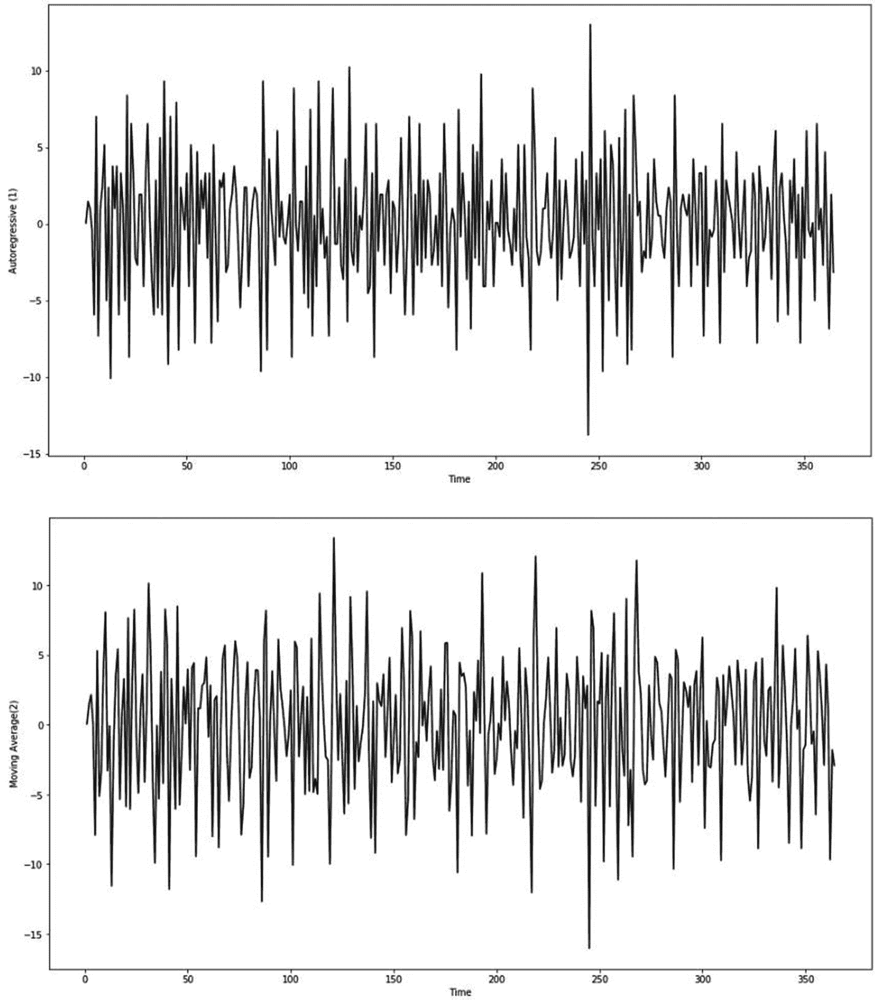

图 4-6

移动平均 1 和 2 后的图

权重值对时间序列的行为有影响。表 4-2 提供了权重的不同变化及其对模型的影响。

表 4-2

ω 值对数据的影响

| ω 值 | 结果 |
| --- | --- |
| &#124; ω &#124; > 1 | 权重随着滞后的增加而增加。数据距离越远，对当前误差的影响越大。 |
| &#124; ω &#124; = 1 | 权重大小保持不变，远期数据与近期数据具有相同的影响。 |
| &#124; ω &#124; < 1 | 最近的数据比更久远的数据具有更高的权重。 |
| < 0 | 围绕均值振荡。 |

*   以下是 MA (1) 模型： -1 < ω[1] < 1
*   以下是 MA (2) 模型： -1 < ω [1] < 1, ω [1] + ω [2] < 1, ω [1] - ω [2] < 1

    **注意** 以下是一些你应该理解的定义：

    **ACF：** 变量与其滞后值的相关性。

    **PAC：** 变量与其滞后值的相关性，但去除了中间时间滞后的影响。

    **相关图：** ACF 和 PACF 相对于滞后长度的图。这可以让你了解变量之间自相关的关系。


## 自相关函数与偏自相关函数

*自相关函数*（ACF）是一种用于确定时间 t 与 t-1 之间线性关系的方法。检查 ACF 后，有助于判断是否需要进行差分。

在回归模型中，数据是独立的，但当数据随时间收集时，这种独立性便不复存在，回归算法也无法捕捉到任何时间趋势。在这种情况下，随机误差与时间呈正相关。因此，每个随机误差都更倾向于与上一个随机误差相似。这种现象被称为*自相关*（或*序列相关*）。

如果我们使用自回归模型 AR(k)，那么我们必须确定 Y[t] 和 Y[t-1] 之间的唯一相关性，并检查时间序列中随机变量之间是否存在直接（线性）影响，这需要对时间序列进行差分和变换。变换时间序列后，我们计算相关性，这被称为*偏自相关函数*（PACF）。图 4-7 展示了每个函数的图形。

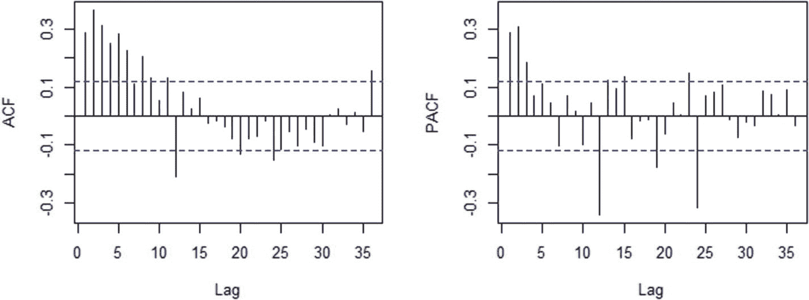

图 4-7

ACF 和 PACF 图表示

假设我们有一个时间序列 Y[t]，它表示随时间 t 变化的 Y 度量。自回归模型是指时间序列数据的值对前一个值进行回归。例如，以下是 Y[t] 对 Y[t-1] 的方程：

Y[t] = μ + ϕ[1]Y[t-1] + ɛ

时间序列数据中两个值之间的相关系数称为 ACF。例如，给定时间序列 Y[t] 的 ACF 如下：

**Corr(Y**[**t,**]**Y**[**t-1**]**), k = 1,2,…**

k 的值是考虑滞后的时间间隔。滞后 1 (k=1) 的自相关是彼此相隔一个时间周期的值之间的相关性。

## ARMA 简介

ARMA 利用从变量本身获取的信息来预测其趋势，并且该变量对其自身的过去值进行回归（表 4-3）。

表 4-3

ARMA 估计这些模式

| 模型 | ACF 模式 | PACF 模式 |
| --- | --- | --- |
| AR(p) | 指数衰减或阻尼正弦波模式或两者兼有 | 在第一个滞后处有显著尖峰 |
| MA(q) | 在第一个滞后处有显著尖峰 | 指数衰减 |
| ARMA (1,1) | 从滞后 1 开始指数衰减 | 从滞后 1 开始指数衰减 |
| ARMA (p,q) | 指数衰减 | 指数衰减 |

以下是识别数据是否显示 AR 或 MA 特征的步骤：

1.  绘制图表或使用 ADF 检验来检查序列是否平稳。

2.  如果时间序列没有平稳的差分，则检查平稳性。

3.  绘制 ACF 和 PACF 图，并使用表 4-3 确定模型的 p 和 q。

ARIMA 包含三个组成部分：自回归部分 (AR)、积分部分 (I) 和移动平均部分 (MA)。

### 自回归模型

自回归模型是一个滞后因变量，它包含一个自回归项，该项可能基于习惯解决的基础进行修正。AR 是时间序列 Y[t] 的一部分，其值取决于先前值的某个线性组合，该组合定义了最大滞后阶数（用 p 表示）。它还包含一个任意误差项 εt，如下所示：

一阶 AR：                           **Ŷ**[**t**] **= α + b**[**1**]**Y**[**t-1**]

二阶 AR：              **Ŷ**[**t**]**= α + b**[**1**]**Y**[**t-1**] **+ b**[**2**]**Y**[**t-2**]

三阶 AR：            **Ŷ**[**t**]**= α + b**[**1**]**Y**[**t-1**] **+ b**[**2**]**Y**[**t-2**] **+ b**[**3**]**Y**[**t-3**]

**y**[**t**] **= φ**[**1**]**y**[**t-1**] **+ φ**[**2**]**y**[**t-2**] **+ …… + φ**[**p**]**y**[**t-p**] **+ ε**[**t**]

其中参数 φ[t] 是常数。

### 移动平均

时间序列 Y[t] 的 MA 部分，是一个观测值，表示为随机误差和先前任意误差项的某个线性组合，直到一个描述的最大滞后阶数（用 q 表示）。

一阶 MA(1)：                        **Ŷ**[**t**] **= γ+ d**[**0**]**u**[**t**] **+ d**[**1**]**u**[**t-1**]

二阶 MA(2)：             **Ŷ**[**t**] **= γ+ d**[**0**]**u**[**t**] **+ d**[**1**]**u**[**t-1**] **+ d**[**2**]**u**[**t-2**]

三阶 MA(3)：            **Ŷ**[**t**] **= γ+ d**[**0**]**u**[**t**] **+ d**[**1**]**u**[**t-1**] **+ d**[**2**]**u**[**t-2**]**+ d**[**3**]**u**[**t-3**]

**y**[**t**] **= Z**[**t**] **+ θ**[**1**]**Z**[**t-1**] **+ θ**[**2**]**Z**[**t-2**] **+ …… + θ**[**q**]**Z**[**t-q**]

其中参数 θ[t] 是常数。

**让我们结合 AR 和 MA**

**ARMA (1,1)：               Ŷt = μ + ϕ**[**1**]**Y**[**t-1**]**+ d**[**0**]**u**[**t**]**+ d**[**1**]**u**[**t-1**]

## 自回归积分移动平均模型简介

自回归积分移动平均模型——也称为 ARIMA(p,d,q)——是一个预测方程，它可以在需要时通过差分和对数技术使时间序列变得平稳。需要进行差分才能平稳的时间序列是积分 (d) (I) 序列。平稳序列的滞后项被归类为自回归 (p)，用 (AR) 项表示。预测误差的滞后项被归类为移动平均 (q)，用 (MA) 项表示。

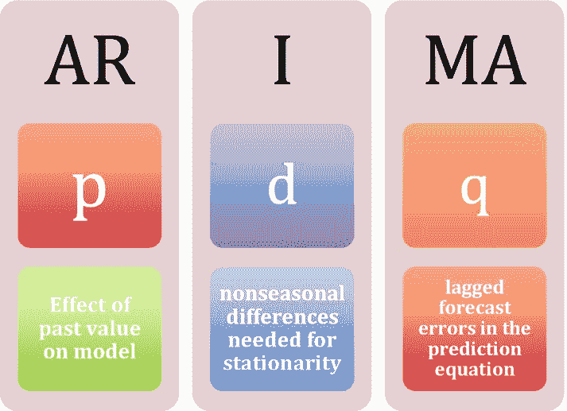

一个非季节性 ARIMA 模型被称为 ARIMA(p,d,q) 模型，其中：

*   **p** 是自回归项的个数。

*   **d** 是为实现平稳性所需的非季节性差分次数。

*   **q** 是预测方程中滞后预测误差的个数。

表 4-4 展示了不同 ARIMA 模型在 p、d 和 q 下的行为。

表 4-4

p、d、q 及其相关方法的表示

|   | p | d | q | 差分 | 方法 |
| --- | --- | --- | --- | --- | --- |
| ARIMA (0, 0, 0) | 0 | 0 | 0 | y[t] = Y[t] | 白噪声 |
| ARIMA (0, 1, 0) | 0 | 1 | 0 | y[t] = Y[t] - Y[t-1] | 随机游走 |
| ARIMA (0, 2, 0) | 0 | 2 | 0 | y[t] = Yt - 2Yt-1 + Yt-2 | 常数 |
| ARIMA (1, 0, 0) | 1 | 0 | 0 | Yˆt = μ + ϕ[1]Y[t-1] + ɛ | AR(1)：一阶回归模型 |
| ARIMA (2, 0, 0) | 2 | 0 | 0 | Yˆt = ϕ[0] + ϕ[1]Y[t-1] + ϕ[2]Y[t-2] + ɛ | AR(2)：二阶回归模型 |
| ARIMA (1, 1, 0) | 1 | 1 | 0 | Yˆt = μ + Yt-1 + ϕ1 (Yt-1 - Yt-2) | 差分一阶自回归模型 |
| ARIMA (0, 1, 1) | 0 | 1 | 1 | Yˆt = Yt-1 - ϕ1et-1 | 简单指数平滑 |
| ARIMA (0, 0, 1) | 0 | 0 | 1 | Yˆt = μ[0]+ ɛt – ω[1] ɛ[t-1] | MA(1)：一阶回归模型 |
| ARIMA (0, 0, 2) | 0 | 0 | 2 | Yˆt = μ[0]+ ɛt – ω[1] ɛ[t-1] – ω[2] ɛ[t-2] | MA(2)：二阶回归模型 |
| ARIMA (1, 0, 1) | 1 | 0 | 1 | Yˆt = ϕ[0] + ϕ[1]Y[t-1]+ ɛt – ω[1] ɛ[t-1] | ARMA 模型 |
| ARIMA (1, 1, 1) | 1 | 1 | 1 | ΔY[t] = ϕ[1]Y[t-1] + ɛt - ω[1] ɛ[t-1] | ARIMA 模型 |
| ARIMA (1, 1, 2) | 1 | 1 | 2 | Yˆ[t] = Y[t-1] + ϕ[1] (Y[t-1] - Y[t-2] ) - θ[1]e[t-1] - θ[1]e[t-1] | 阻尼趋势线性指数平滑 |
| ARIMA (0, 2, 1) 或 (0,2,2) | 0 | 2 | 1 或 2 | Yˆ[t] = 2 Y[t-1] - Y[t-2] - θ[1]e[t-1] - θ[2]e[t-2] | 线性指数平滑 |

ARIMA 是用于预测单变量变量的几种方法之一，它利用从变量本身获取的信息来预测其趋势。变量对其自身的过去值进行回归。

AR(p) 中 p 等于自相关的阶数（表示过去观测值的加权移动平均）z I(d)，其中 d 是积分（差分）的阶数，表示线性趋势或多项式趋势 z。

MA(q) 中 q 等于移动平均的阶数（表示过去误差的加权移动平均）。

ARIMA 由两个模型组成：AR 和 MA。


### 整合（I）

时间序列数据通常是非平稳的，为了使时间序列平稳，需要对序列进行差分。这个过程被称为*整合*部分（I），差分的阶数用 d 表示。差分会消除随时间变化的信号，这些信号包含趋势和季节性，因此该序列只包含噪声和不规则成分，这些成分将被单独建模。

表 4-5 展示了如何用代数方式表示 d(I)。

表 4-5

d(I) 值的解释

| 积分 d 值 | 公式(y[t]) |
| --- | --- |
| d = 0 | **Y**[**t**] |
| d = 1 | **Y**[**t**] **- Y**[**t-1**] |
| d = 2 | **Y**[**t**] **- 2Y**[**t-1**] **+ Y**[**t-2**] |

### ARIMA 实战

在上一节中，你了解了 AR 和 MA，以及 AR、I 和 MA 的解释。现在让我们在一个时间序列数据集上实现它。

导入所需的库并加载 CSV 数据，这是 2014 年至 2019 年的 Facebook 股票数据。

*   **Pmdarima**（py + arima 的组合）是一个统计库，旨在填补 Python 时间序列分析能力的空白，相当于 R 语言中的 `auto.arima`。

```
import warnings
import matplotlib.pyplot as plt
import numpy as np
import pandas as pd
import statsmodels.api as sm
from pmdarima import auto_arima
from sklearn import metrics
from statsmodels.tsa.seasonal import seasonal_decompose
from statsmodels.tsa.stattools import adfuller
warnings.filterwarnings("ignore")
df = pd.read_csv(r'\Data\FB.csv', parse_dates = True)
```

让我们先快速浏览一下 Facebook 的股票数据。

```
df.head(10)
```

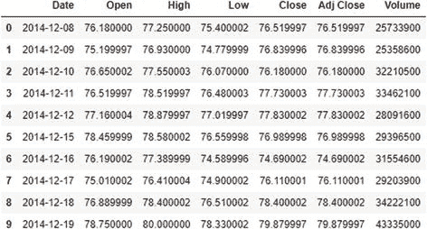

使用折线图、直方图和股票收盘价的[核密度估计](https://en.wikipedia.org/wiki/Kernel_density_estimation)进行一些基本的探索性数据分析。探索性数据分析是使用图形表示来发现和调查数据中模式的过程。

核密度估计（KDE）是一种估计随机变量概率密度函数（PDF）的非参数方法。

```
df["Close"].plot(figsize=(15, 6))
plt.xlabel("Date")
plt.ylabel("Close")
plt.title("Closing price of Facebook stocks")
plt.show()
```

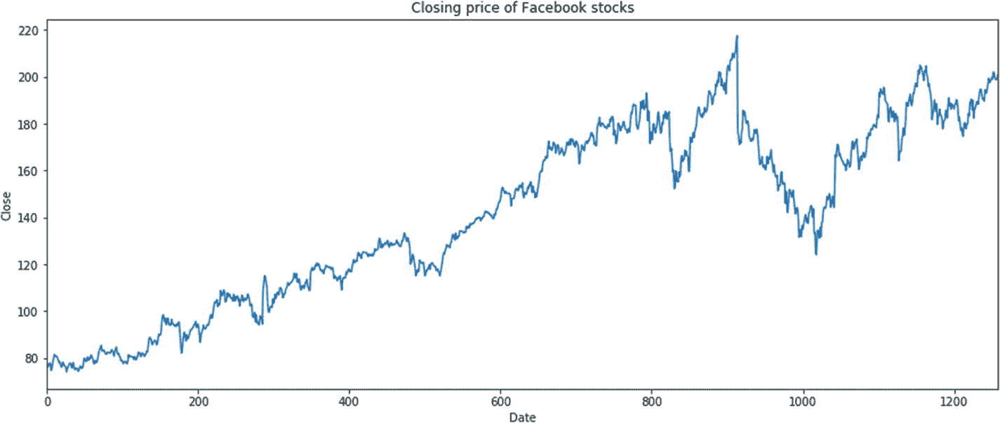

```
plt.figure(1, figsize=(15,6))
plt.subplot(211)
df["Close"].hist()
plt.subplot(212)
df["Close"].plot(kind='kde')
plt.show()
```

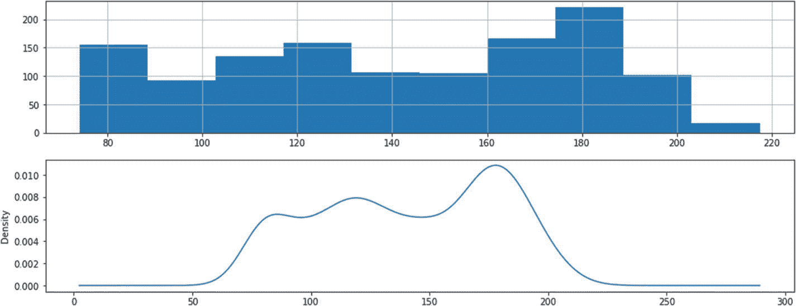

定义时间序列评估函数如下：

```
def timeseries_evaluation_metrics_func(y_true, y_pred):
def mean_absolute_percentage_error(y_true, y_pred):
y_true, y_pred = np.array(y_true), np.array(y_pred)
return np.mean(np.abs((y_true - y_pred) / y_true)) * 100
print('Evaluation metric results:-')
print(f'MSE is : {metrics.mean_squared_error(y_true, y_pred)}')
print(f'MSE is : {metrics.mean_absolute_error(y_true, y_pred)}')
print(f'RMSE is : {np.sqrt(metrics.mean_squared_error(y_true, y_pred))}')
print(f'MAPE is : {mean_absolute_percentage_error(y_true, y_pred)}')
print(f'R2 is : {metrics.r2_score(y_true, y_pred)}',end='\n\n')
```

以下是用于检查数据平稳性的 ADF 检验函数：

```
def Augmented_Dickey_Fuller_Test_func(series , column_name):
print (f'Results of Dickey-Fuller Test for column: {column_name}')
dftest = adfuller(series, autolag='AIC')
dfoutput = pd.Series(dftest[0:4], index=['Test Statistic','p-value','No Lags Used','Number of Observations Used'])
for key,value in dftest[4].items():
dfoutput['Critical Value (%s)'%key] = value
print (dfoutput)
if dftest[1] ")
print("Reject the null hypothesis")
print("Data is stationary")
else:
print("Conclusion:====>")
print("Fail to reject the null hypothesis")
print("Data is non-stationary")
```

我们可以看到 Close 列是非平稳的，auto-arima 会在内部处理这个问题。

```
Augmented_Dickey_Fuller_Test_func(df['Close' ],'Close')
```


模型训练将仅针对数据集中的 Close 列进行。复制一份数据，然后执行训练/测试集划分。

训练集将包含除最后 30 天之外的所有数据，测试集将仅包含最后 30 天，用于评估预测结果。

```
X = df[['Close' ]]
train, test = X[0:-30], X[-30:]
```

pmdarima 模块将帮助我们识别 p、d 和 q，无需费力查看图表。

```
stepwise_model = auto_arima(train,start_p=1, start_q=1,
max_p=7, max_q=7, seasonal=False,
d=None, trace=True,error_action='ignore',suppress_warnings=True, stepwise=True)
stepwise_model.summary()
```

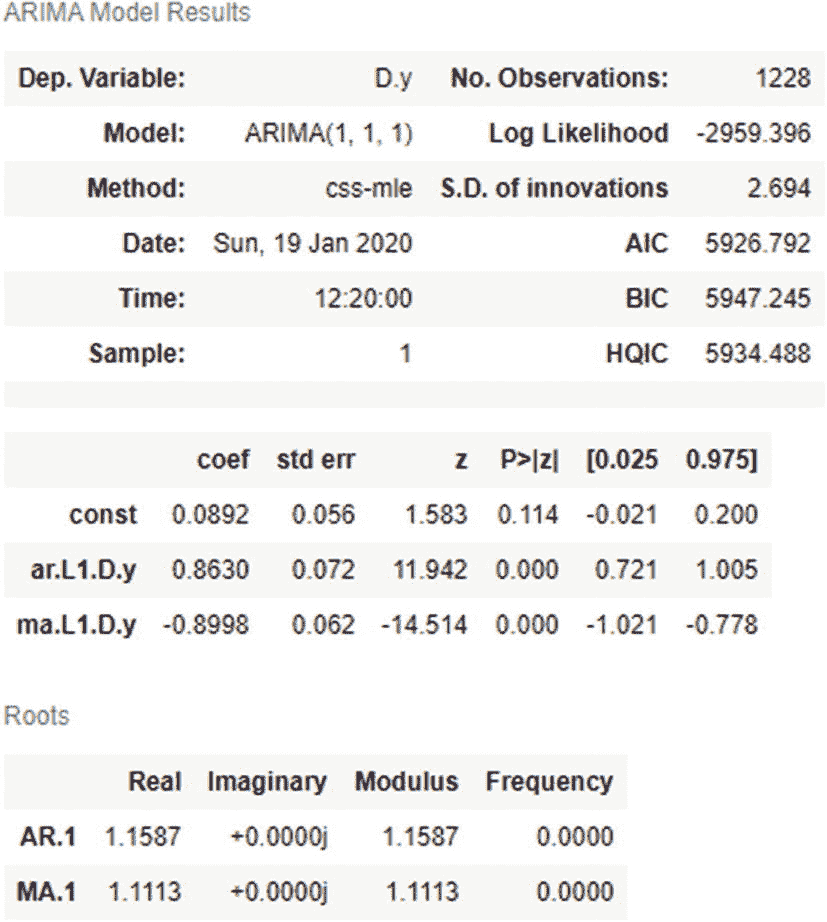

Auto-arima 表明 ARIMA(1,1,1) 是该数据集的最佳选择。

预测接下来 30 天的结果和置信区间，并将其存储在 DataFrame 中，如下所示：

```
forecast,conf_int = stepwise_model.predict(n_periods=30,return_conf_int=True)
forecast = pd.DataFrame(forecast,columns=['close_pred'])
df_conf = pd.DataFrame(conf_int,columns= ['Upper_bound','Lower_bound'])
df_conf["new_index"] = range(1229, 1259)
df_conf = df_conf.set_index("new_index")
timeseries_evaluation_metrics_func(test, forecast)
```

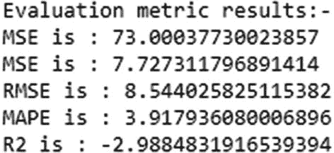

重新排列索引以使图表对齐，如下所示：

```
forecast["new_index"] = range(1229, 1259)
forecast = forecast.set_index("new_index")
```

绘制带有置信区间的结果图，如下所示：

```
import matplotlib.pyplot as plt
get_ipython().run_line_magic('matplotlib', 'inline')
plt.rcParams["figure.figsize"] = [15,7]
plt.plot( train, label='Train ')
plt.plot(test, label='Test ')
plt.plot(forecast, label='Predicted ')
plt.plot(df_conf['Upper_bound'], label='Confidence Interval Upper bound ')
plt.plot(df_conf['Lower_bound'], label='Confidence Interval Lower bound ')
plt.legend(loc='best')
plt.show()
```

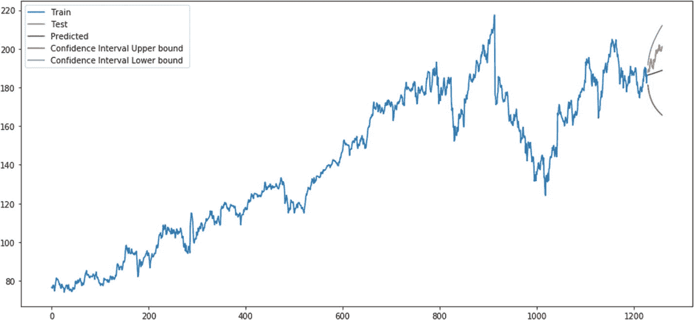

以下是诊断图：

```
stepwise_model.plot_diagnostics();
```

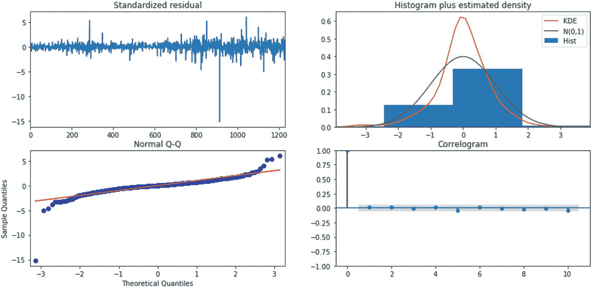


## 季节性 ARIMA 简介

季节性 ARIMA（SARIMA）是 ARIMA 的一种技术，它能够在单变量时间序列数据中处理季节性成分。它引入了三个新的超参数，用于定义时间序列季节性成分的 AR(P)、I(D) 和 MA(Q)。SARIMA 允许序列中出现季节性。

季节性 ARIMA 模型将非季节性成分和季节性成分结合在一个乘法模型中。其表示法可定义如下：

**ARIMA (p, d, q) X (P, D, Q)**[**m**]

m 是每年的观测值数量。

需要配置三个趋势元素。它们与 ARIMA 模型相同，如下所示：

(p, d, q) 是非季节性成分，如下所示：

*   **p**：趋势自回归阶数

*   **d**：趋势差分阶数

*   **q**：趋势移动平均阶数

(P, Q, D) 是季节性成分。

有四个不属于 ARIMA 模型的季节性成分是必须配置的。

*   **P**：季节性自回归阶数

*   **D**：季节性差分阶数

*   **Q**：季节性移动平均阶数

*   **m**：单季节阶数的时间戳

在不进行差分运算的情况下，该模型可以写成如下形式。

模型的季节性部分包含的项类似于模型的非季节性成分，但涉及季节性周期的后移。示例如下：

**ARIMA (1,1,1) X (1,1,1)** [**m**]

**(1−ϕ**[**1**]**B) (1−Φ**[**1**]**B**^(**m**)**) (1−B) (1−B**^(**m**)**) y**[**t**] **= (1+θ**[**1**]**B) (1+Θ**[**1**]**B**^(**m**)**) ε**[**t**].

表 4-6 说明了 AR 和 MA 的非季节性和季节性成分。

表 4-6

解读非季节性和季节性成分

| 非季节性成分 | 季节性成分 |
| --- | --- |
| AR: Φ(B) = 1- Φ[1]B^P | AR: Φ(B) = 1- Φ[1]B^(pm) |
| MA: θ(B) = 1 + θ[1]B^q | MA: Θ(B) = 1 + Θ[1]B^(qm) |

额外的项只是与非季节性项相乘。

例如，ARIMA (0,0,1) X (0,0,1)[12]。

*   非季节性 MA (1)：*θ*(B) = 1 + *θ*[1]B

*   季节性 MA (1)：Θ(B) = 1 + *θ*[1]B¹²

以下是最终模型：Θ(B) x *θ*(B) = (1 + *θ*[1]B¹²) (1 + *θ*[1]B)。

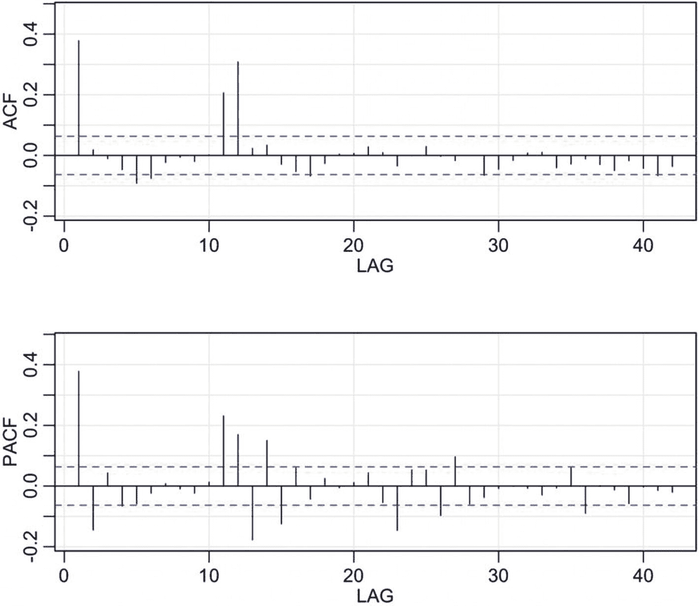

### SARIMA 实战

在上一节中，您了解了 SARIMA 背后的高级数学原理，可以对季节性成分进行数据建模。现在，让我们在一个时间序列数据集上实现它。

```
import warnings
import matplotlib.pyplot as plt
import numpy as np
import pandas as pd
import statsmodels.api as sm
from pmdarima import auto_arima
from sklearn import metrics
from statsmodels.tsa.seasonal import seasonal_decompose
from statsmodels.tsa.stattools import adfuller
warnings.filterwarnings("ignore")
df = pd.read_csv(r'\Data\FB.csv')
```

让我们快速浏览一下数据。

```
df.head(10)
```

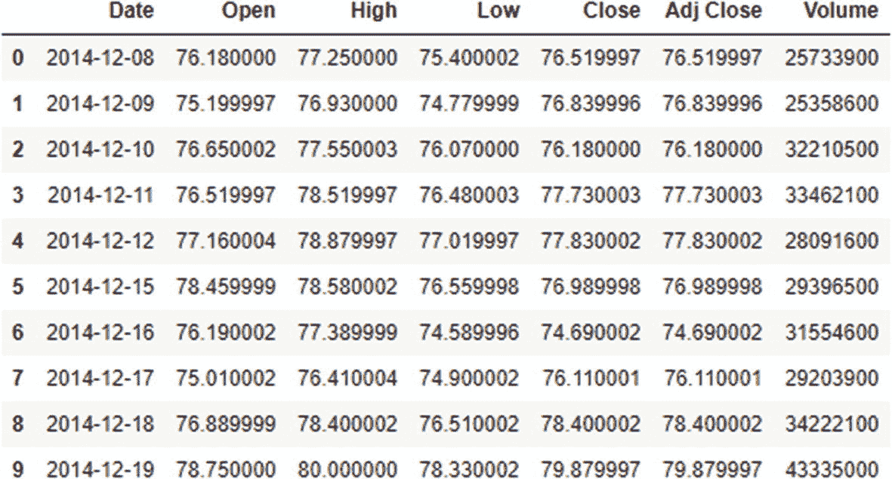

定义时间序列评估函数，如下所示：

```
def timeseries_evaluation_metrics_func(y_true, y_pred):
def mean_absolute_percentage_error(y_true, y_pred):
y_true, y_pred = np.array(y_true), np.array(y_pred)
return np.mean(np.abs((y_true - y_pred) / y_true)) * 100
print('Evaluation metric results:-')
print(f'MSE is : {metrics.mean_squared_error(y_true, y_pred)}')
print(f'MSE is : {metrics.mean_absolute_error(y_true, y_pred)}')
print(f'RMSE is : {np.sqrt(metrics.mean_squared_error(y_true, y_pred))}')
print(f'MAPE is : {mean_absolute_percentage_error(y_true, y_pred)}')
print(f'R2 is : {metrics.r2_score(y_true, y_pred)}',end='\n\n')
```

以下是用于检查数据平稳性的 ADF 检验函数：

```
def Augmented_Dickey_Fuller_Test_func(series , column_name):
print (f'Results of Dickey-Fuller Test for column: {column_name}')
dftest = adfuller(series, autolag='AIC')
dfoutput = pd.Series(dftest[0:4], index=['Test Statistic','p-value','No Lags Used','Number of Observations Used'])
for key,value in dftest[4].items():
dfoutput['Critical Value (%s)'%key] = value
print (dfoutput)
if dftest[1] ")
print("Reject the null hypothesis")
print("Data is stationary")
else:
print("Conclusion:====>")
print("Fail to reject the null hypothesis")
print("Data is non-stationary")
```

我们可以看到 Close 列是非平稳的，而 auto-arima 会在内部处理这个问题，如下所示：

```
Augmented_Dickey_Fuller_Test_func(df['Close' ],'Close')
```

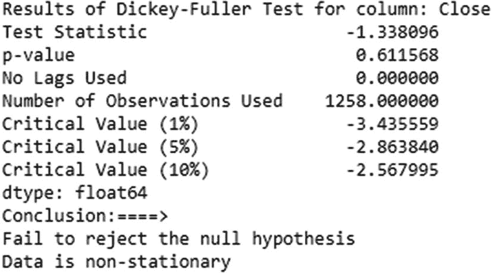

建模将仅针对数据集中的 Close 列进行。请复制一份数据，然后我们执行训练集和测试集的划分。

训练集将包含除最后 30 天之外的所有数据，测试集将仅包含最后 30 天，以便与预测结果进行评估。

```
X = df[['Close' ]]
train, test = X[0:-30], X[-30:]
```

让我们为 `for` 循环中给定的参数配置并运行季节性 ARIMA，并检查适合我们数据集的最佳每个季节周期数。

以下是搜索空间：

*   **p** → 1 到 7。

*   **q** → 1 到 7。

*   **d** → None 表示寻找最优值。

*   **P** → 1 到 7。

*   **Q** → 1 到 7。

*   **D** → None 表示寻找最优值。

m 指的是每个季节的周期数。

*   **7** → 每日

*   **12** → 每月

*   **52** → 每周

*   **4** → 每季度

*   **1** → 每年（非季节性）


```
for m in [1, 4,7,12,52]:
print("="*100)
print(f' 正在为季节性值 m = {str(m)} 拟合 SARIMA 模型')
stepwise_model = auto_arima(train, start_p=1, start_q=1,
max_p=7, max_q=7, seasonal=True, start_P=1, start_Q=1, max_P=7, max_D=7, max_Q=7, m=m,
d=None, D=None, trace=True, error_action='ignore', suppress_warnings=True, stepwise=True)
print(f' m = {str(m)} 的模型摘要')
print("-"*100)
stepwise_model.summary()
forecast ,conf_int= stepwise_model.predict(n_periods=30,return_conf_int=True)
df_conf = pd.DataFrame(conf_int,columns= ['Upper_bound','Lower_bound'])
df_conf["new_index"] = range(1229, 1259)
df_conf = df_conf.set_index("new_index")
forecast = pd.DataFrame(forecast, columns=['close_pred'])
forecast["new_index"] = range(1229, 1259)
forecast = forecast.set_index("new_index")
timeseries_evaluation_metrics_func(test, forecast)
import matplotlib.pyplot as plt
get_ipython().run_line_magic('matplotlib', 'inline')
plt.rcParams["figure.figsize"] = [15, 7]
plt.plot(train, label='训练集 ')
plt.plot(test, label='测试集 ')
plt.plot(forecast, label=f'预测值 (m={str(m)}) ')
plt.plot(df_conf['Upper_bound'], label='置信区间上界 ')
plt.plot(df_conf['Lower_bound'], label='置信区间下界 ')
plt.legend(loc='best')
plt.show()
print("-"*100)
print(f' 季节性值 m = {str(m)} 的诊断图')
display(stepwise_model.plot_diagnostics());
print("-"*100)
```

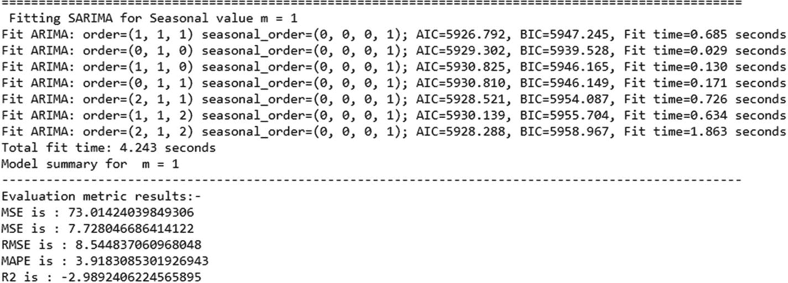


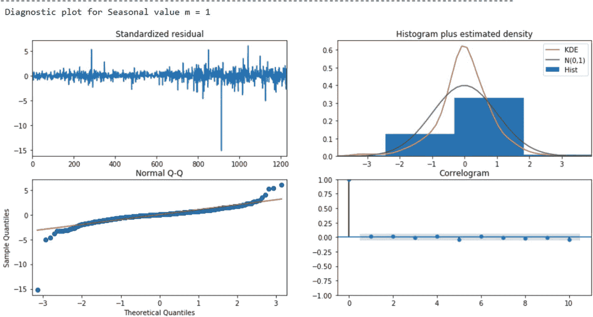


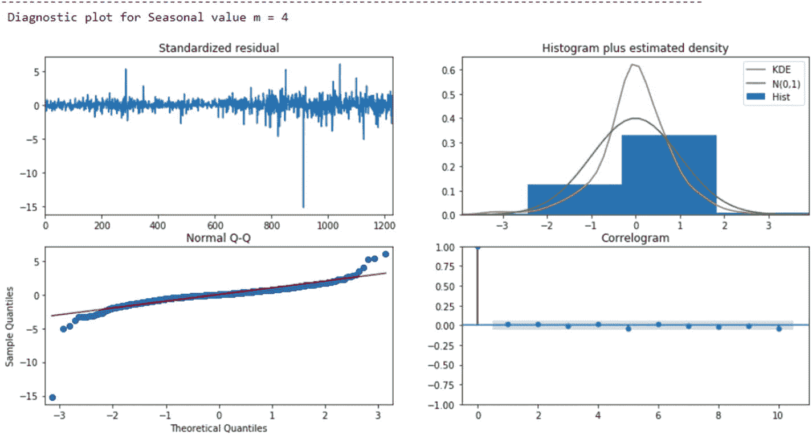

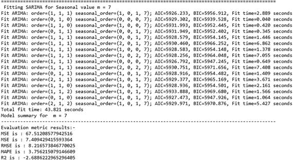


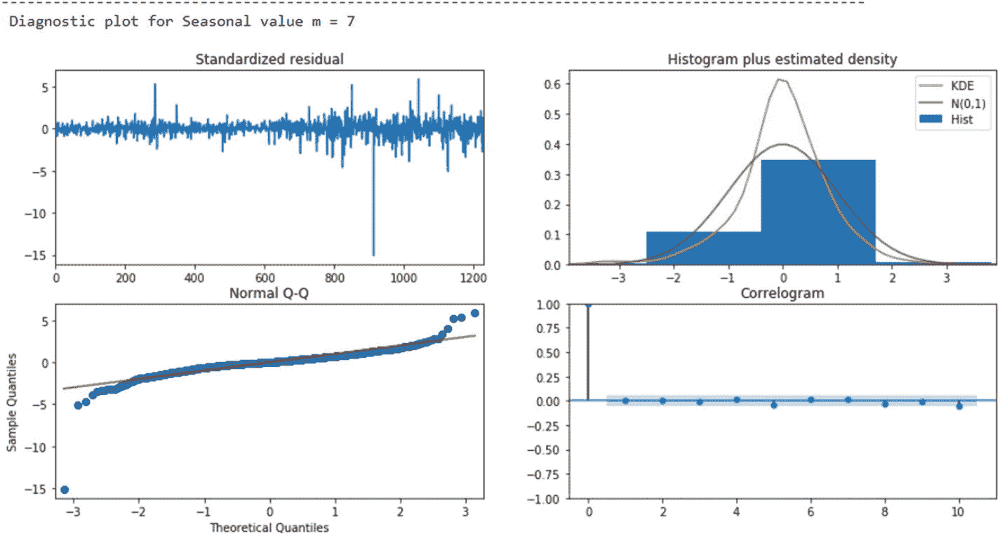

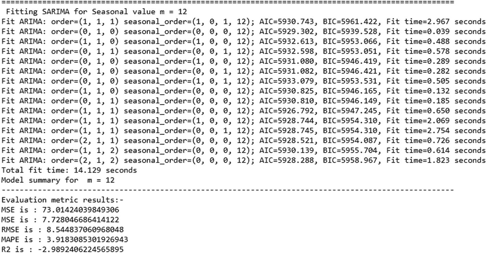

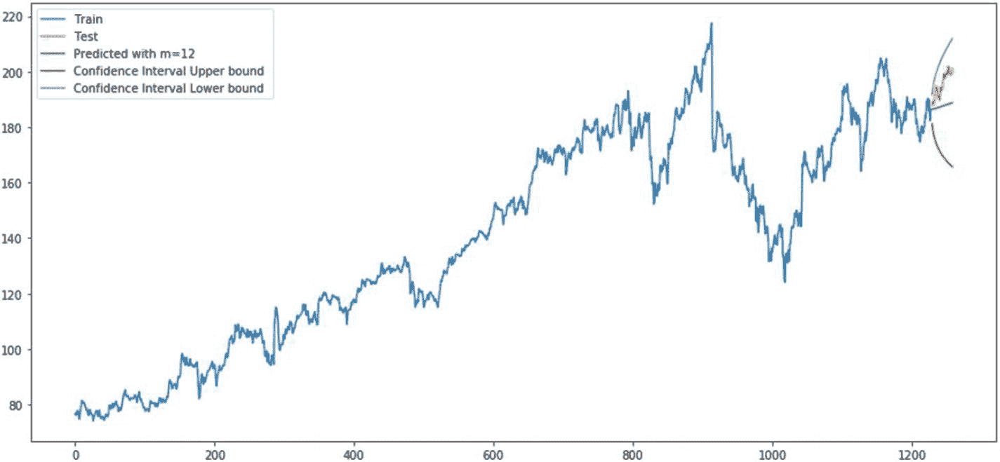


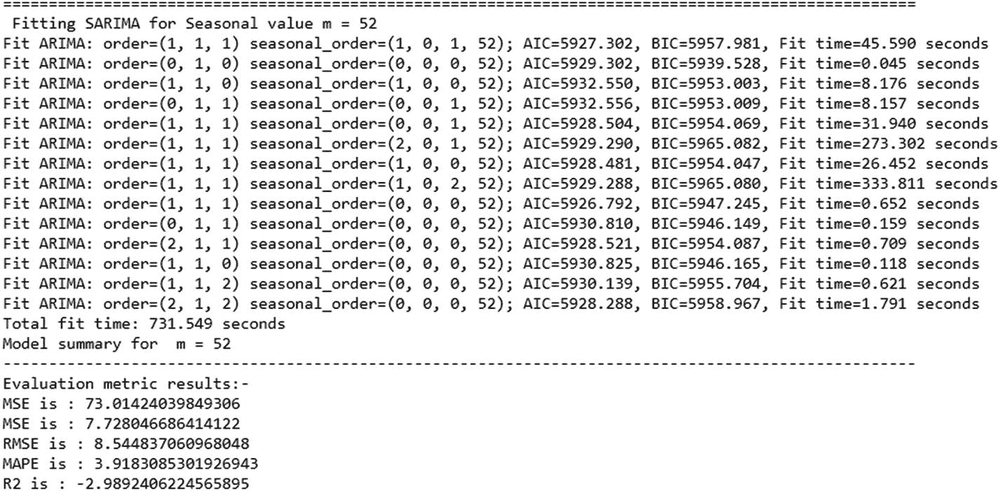

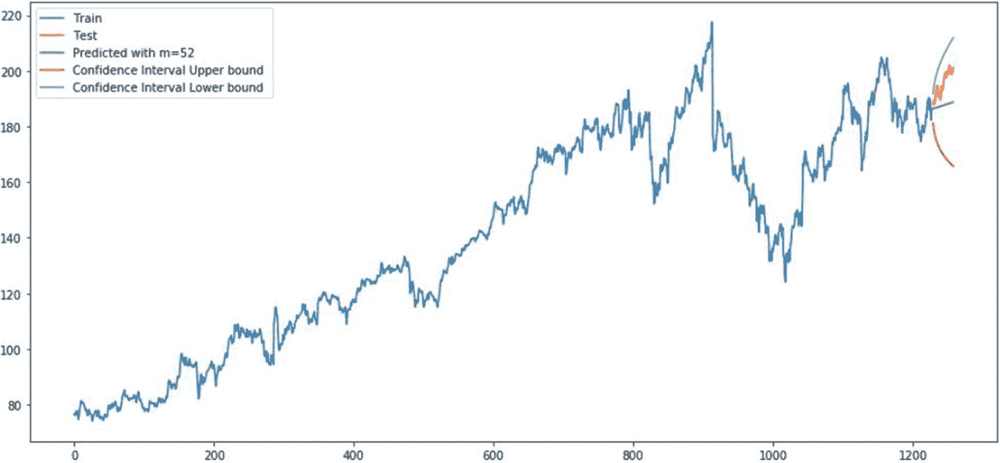

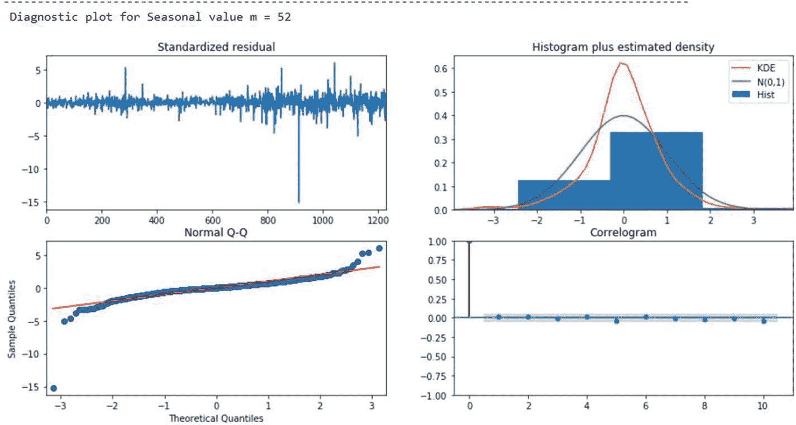

在检查了不同的 m 值后，我们可以看到 m 对结果没有任何影响。

## SARIMAX 简介

SARIMAX 模型是带有外部影响变量的 SARIMA 模型，称为 SARIMAX (p, d, q) X(P,D,Q)[m] (X)，其中 X 是外生变量的向量。可能通过多元线性回归方程建模的外生变量表示如下：

(1−ϕ[1]B) (1−Φ[1]B^m) (1−B) (1−B^m) y[t] = (1+θ[1]B) (1+Θ[1]B^m) ε[t] (X[k],[t])。

其中 X[1,], X[2,𝑡], …. X[𝑘,] 是与因变量对应的 k 个外生变量的观测值。

### SARIMAX 实战

在上一节中，您了解了 SARIMAX 背后的高级数学原理。现在让我们在一个时间序列数据集上实现它。

```
import warnings
import matplotlib.pyplot as plt
import numpy as np
import pandas as pd
import statsmodels.api as sm
from pmdarima import auto_arima
from sklearn import metrics
from statsmodels.tsa.seasonal import seasonal_decompose
from statsmodels.tsa.stattools import adfuller
warnings.filterwarnings("ignore")
df = pd.read_csv(r'\Data\FB.csv')
```

让我们先快速浏览一下数据。

```
df.head(10)
```


定义时间序列评估函数，如下所示：

```
def timeseries_evaluation_metrics_func(y_true, y_pred):
def mean_absolute_percentage_error(y_true, y_pred):
y_true, y_pred = np.array(y_true), np.array(y_pred)
return np.mean(np.abs((y_true - y_pred) / y_true)) * 100
print('评估指标结果：-')
print(f'MSE 为：{metrics.mean_squared_error(y_true, y_pred)}')
print(f'MAE 为：{metrics.mean_absolute_error(y_true, y_pred)}')
print(f'RMSE 为：{np.sqrt(metrics.mean_squared_error(y_true, y_pred))}')
print(f'MAPE 为：{mean_absolute_percentage_error(y_true, y_pred)}')
print(f'R2 为：{metrics.r2_score(y_true, y_pred)}',end='\n\n')
```

以下是用于检查数据平稳性的 ADF 检验函数：

```
def Augmented_Dickey_Fuller_Test_func(series , column_name):
print (f'列 {column_name} 的 Dickey-Fuller 检验结果：')
dftest = adfuller(series, autolag='AIC')
dfoutput = pd.Series(dftest[0:4], index=['检验统计量','p 值','使用的滞后阶数','使用的观测数'])
for key,value in dftest[4].items():
dfoutput['临界值 (%s)'%key] = value
print (dfoutput)
if dftest[1] ")
print("拒绝原假设")
print("数据是平稳的")
else:
print("结论：====>")
print("无法拒绝原假设")
print("数据是非平稳的")
```

我们可以看到收盘价是非平稳的，而 auto-arima 会在内部处理这个问题。

```
for name, column in df[['Close' ,'Open' ,'High','Low']].iteritems():
Augmented_Dickey_Fuller_Test_func(df[name],name)
print('\n')
```

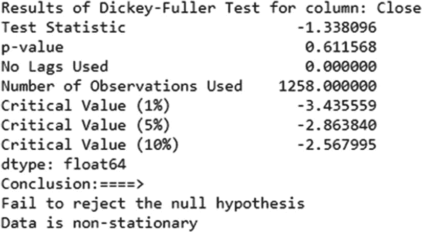


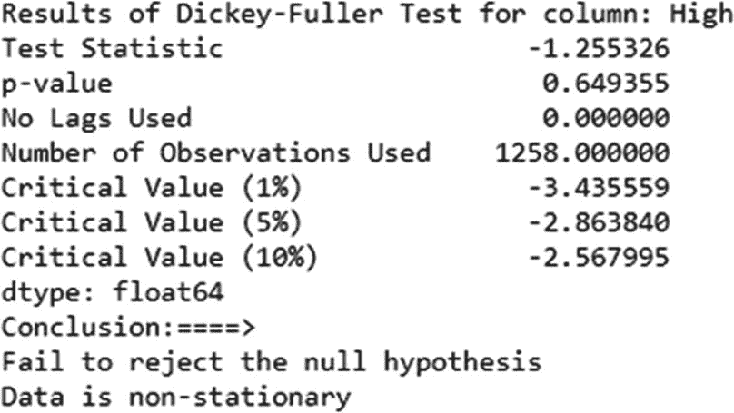

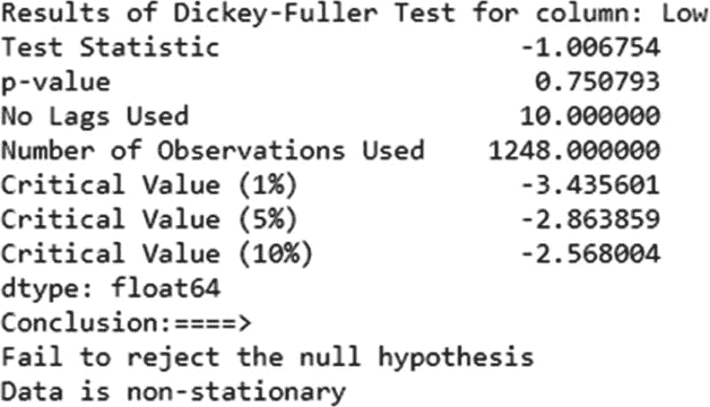

建模将仅针对数据集中的收盘价列进行，开盘价将用作外生变量。请复制一份数据，然后我们进行训练集和测试集的划分。

训练集将包含除最后 30 天之外的所有数据，测试集将仅包含最后 30 天，以便与预测结果进行评估。

```
X = df[['Close' ]]
actualtrain, actualtest = X[0:-30], X[-30:]
exoX = df[['Open' ]]
exotrain, exotest = exoX[0:-30], exoX[-30:]
```

让我们配置并运行带有外生变量的季节性 ARIMA 模型。


```
for m in [1, 4,7,12,52]:
print("="*100)
print(f' 正在为季节性值 m = {str(m)} 拟合 SARIMAX 模型')
stepwise_model = auto_arima(actualtrain,exogenous =exotrain ,start_p=1, start_q=1,max_p=7, max_q=7, seasonal=True,
start_P=1,start_Q=1,max_P=7,max_D=7,max_Q=7,m=m, d=None,D=None,
trace=True,error_action='ignore',suppress_warnings=True, stepwise=True)
print(f' m = {str(m)} 的模型摘要')
print("-"*100)
stepwise_model.summary()
forecast,conf_int = stepwise_model.predict(n_periods=30,exogenous =exotest,return_conf_int=True)
df_conf = pd.DataFrame(conf_int,columns= ['Upper_bound','Lower_bound'])
df_conf["new_index"] = range(1229, 1259)
df_conf = df_conf.set_index("new_index")
forecast = pd.DataFrame(forecast, columns=['close_pred'])
forecast["new_index"] = range(1229, 1259)
forecast = forecast.set_index("new_index")
timeseries_evaluation_metrics_func(actualtest, forecast)
import matplotlib.pyplot as plt
get_ipython().run_line_magic('matplotlib', 'inline')
plt.rcParams["figure.figsize"] = [15, 7]
plt.plot(actualtrain, label='训练集 ')
plt.plot(actualtest, label='测试集 ')
plt.plot(forecast, label=f'预测值 (m={str(m)}) ')
plt.plot(df_conf['Upper_bound'], label='置信区间上界 ')
plt.plot(df_conf['Lower_bound'], label='置信区间下界 ')
plt.legend(loc='best')
plt.show()
print("-"*100)
print(f' 季节性值 m = {str(m)} 的诊断图')
display(stepwise_model.plot_diagnostics());
print("-"*100)
```

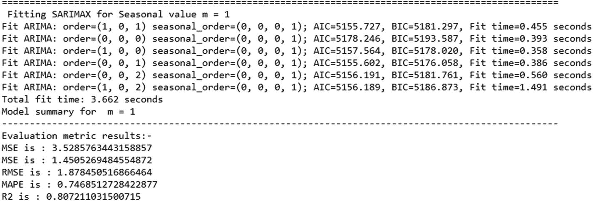


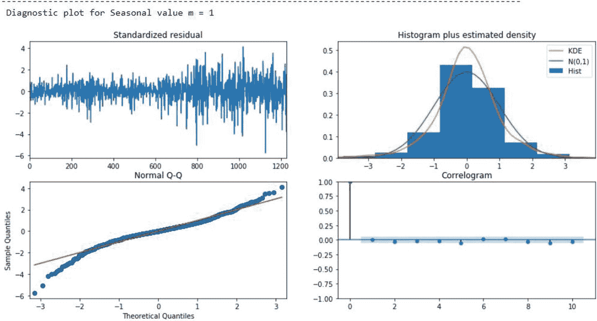

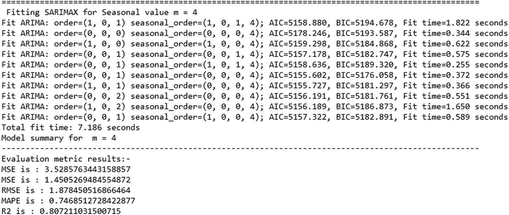

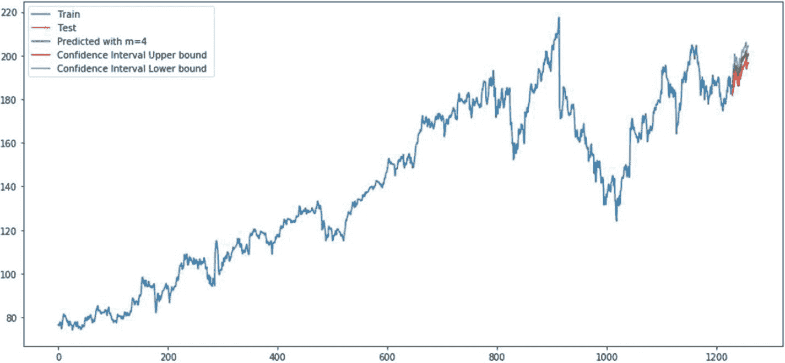


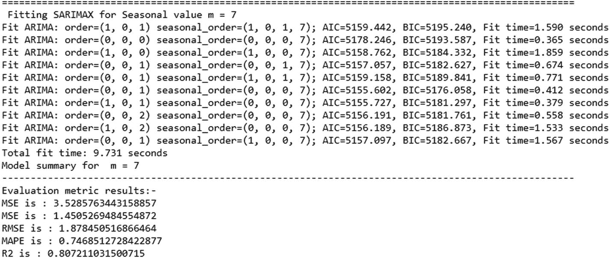

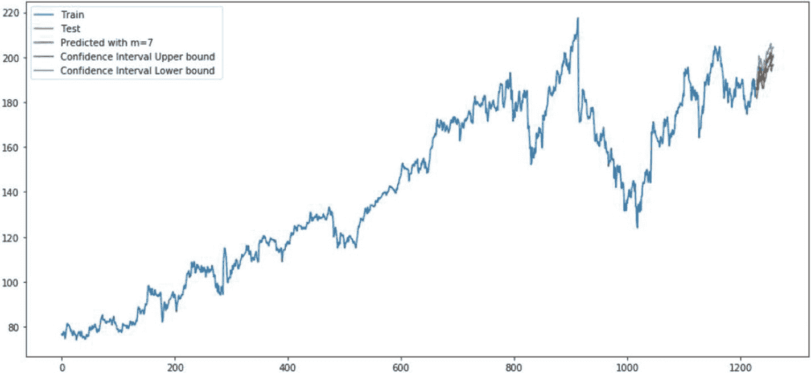


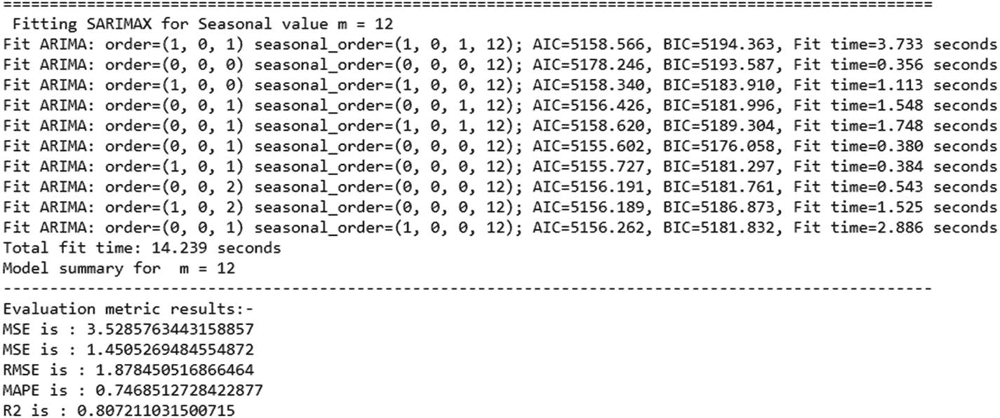

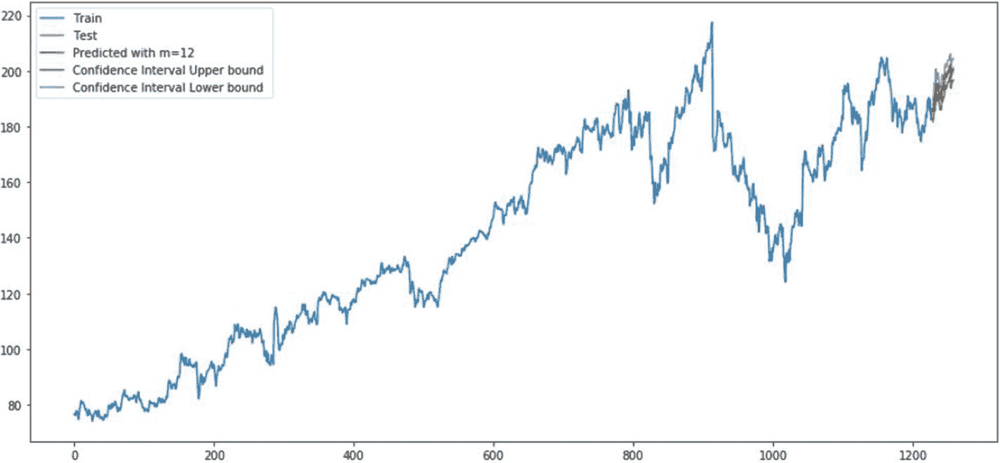


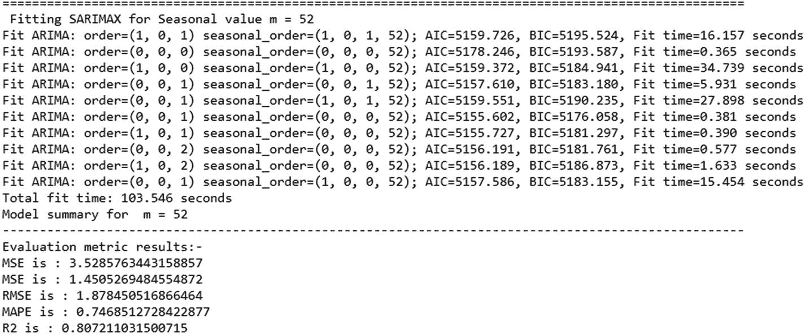


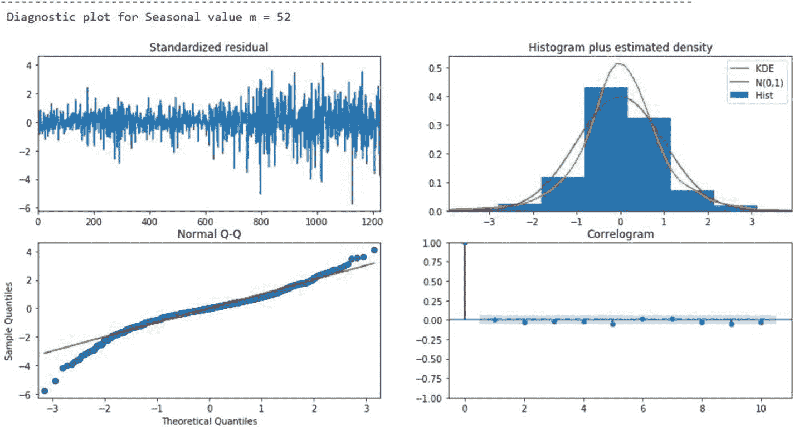

我们可以看到，外生变量 `open` 有助于提高模型精度，同时我们注意到 `m` 对预测没有任何影响。

## 向量自回归简介

*向量自回归*（VAR）是一种随机过程模型，用于捕捉时间序列数据中多个变量之间的线性关系。换句话说，它是一种当两个或多个时间序列变量彼此之间存在强内在关系时使用的多元预测方法。VAR 是一个双向模型，而其他模型是单向模型。在单向模型中，预测变量影响目标变量，但反之则不成立。在双向模型中，变量之间相互影响。

普通的 AR(p) 模型方程如下所示：

**Ŷt = μ + ϕ**[**1**]**Y**[**t-1**] **+ ϕ**[**2**]**Y**[**t-2 … +**] **ϕ**[**p**]**Y**[**t-p**] **+ ɛ**[**t**]

其中 μ 是截距项，ϕ[1,] ϕ[2….] ϕ[n] 是 Y 的滞后项的系数。在 VAR 模型中，每个变量都被建模为其自身过去值以及时间序列中其他变量过去值的线性组合。如果你有多个相互决定的时间序列，那么每个方程将设计一个变量。例如，假设我们有一个时间序列的两个变量 Y[1,] Y[2]。我们想要预测它们在时间 (t) 的值。

以下是包含两个时间序列（Y[1] 和 Y[2]）的 VAR (1) 模型：

**Ŷ**[**1,t**] **= μ**[**1**] **+ ϕ**[**11**]**Y**[**1,****t-1**] **+ ϕ**[**12**]**Y**[**1,****t-2**] **+ ɛ**[**1,****t**]

**Ŷ**[**2,t**] **= μ**[**2**] **+ ϕ**[**21**]**Y**[**2,****t-1**] **+ ϕ**[**22**]**Y**[**2,****t-2**] **+ ɛ**[**2,****t**]

其中 y[1,t-1,] y[2,t-1] 是时间序列 Y[1] 和 Y[2] 的一阶滞后项。

VAR 模型在设计模型时遵循与单变量时间序列相同的规则。它使用相应的评估矩阵，如 AIC、BIC、FPE 和 HQIC。


### VAR 实战

在前一节中，你了解了 VAR 背后高层次的数学原理。现在，让我们在一个时间序列数据集上实现它。

```
import pandas as pd
import matplotlib.pyplot as plt
from statsmodels.tsa.api import VAR
import numpy as np
from statsmodels.tsa.stattools import adfuller
from sklearn import metrics
from timeit import default_timer as timer
import warnings
warnings.filterwarnings("ignore")
```

让我们先快速浏览一下数据。

```
df = pd.read_csv(r'\Data\Dow_Jones_Industrial_Average.csv', parse_dates= True)
df = df[(df['Date'] > '2016-01-14') & (df['Date'] <= '2017-01-30')]
df.head(10)
```

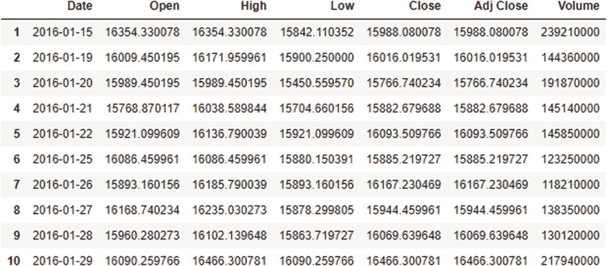

使用折线图、直方图和核密度估计图进行探索性数据分析，如下所示：

```
for c in df[['Open', 'High', 'Low', 'Close']]:
df[str(c)].plot(figsize=(15, 6))
plt.xlabel("Date")
plt.ylabel(c)
plt.title(f"{str(c)} price of Facebook stocks before stationary")
plt.show()
```


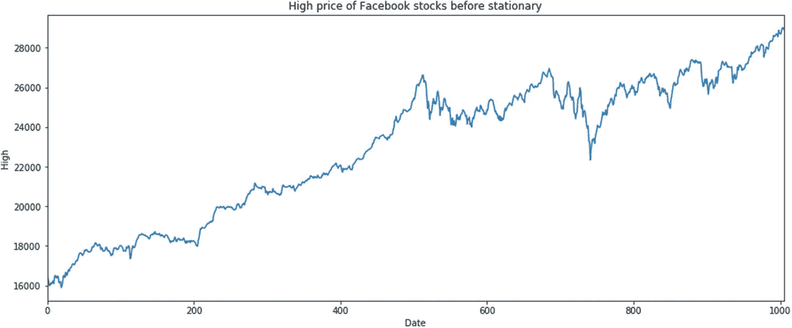

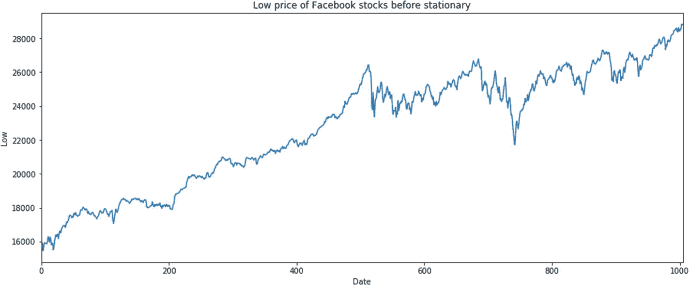


以下循环将在使数据平稳之前，为所有列绘制直方图和核密度估计图：

```
for c in df[['Open', 'High', 'Low', 'Close']]:
plt.figure(1, figsize=(15,6))
plt.subplot(211)
plt.title(f"{str(c)} Histogram before stationary")
df[str(c)].hist()
plt.subplot(212)
df[str(c)].plot(kind='kde')
plt.title(f"{str(c)} Kernal Density Estimator before stationary")
plt.show()
```

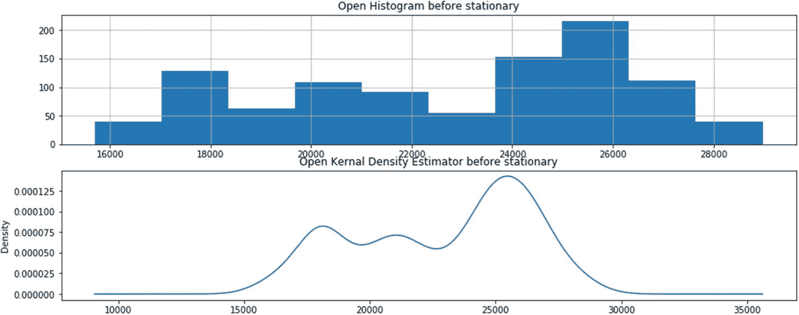

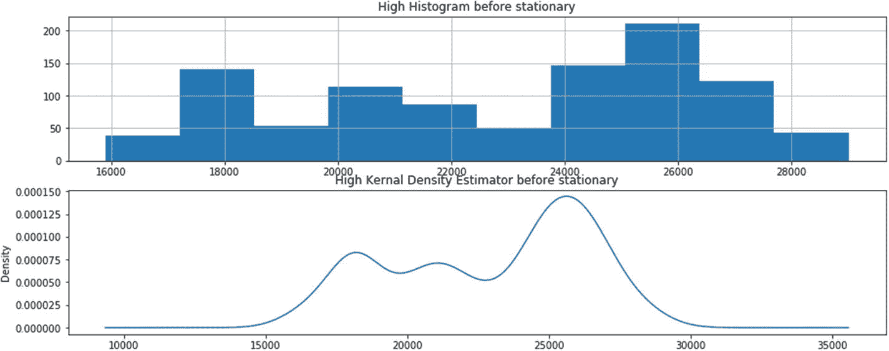


定义一个时间序列评估函数，如下所示：

```
def timeseries_evaluation_metrics_func(y_true, y_pred):
def mean_absolute_percentage_error(y_true, y_pred):
y_true, y_pred = np.array(y_true), np.array(y_pred)
return np.mean(np.abs((y_true - y_pred) / y_true)) * 100
#print('Evaluation metric results:-')
print(f'MSE is : {metrics.mean_squared_error(y_true, y_pred)}')
print(f'MAE is : {metrics.mean_absolute_error(y_true, y_pred)}')
print(f'RMSE is : {np.sqrt(metrics.mean_squared_error(y_true, y_pred))}')
print(f'MAPE is : {mean_absolute_percentage_error(y_true, y_pred)}')
print(f'R2 is : {metrics.r2_score(y_true, y_pred)}',end='\n\n')
return
```

以下是用于检查数据平稳性的 ADF 检验函数：

```
def Augmented_Dickey_Fuller_Test_func(series , column_name):
print (f'Results of Dickey-Fuller Test for column: {column_name}')
dftest = adfuller(series, autolag='AIC')
dfoutput = pd.Series(dftest[0:4], index=['Test Statistic','p-value','No Lags Used','Number of Observations Used'])
for key,value in dftest[4].items():
dfoutput['Critical Value (%s)'%key] = value
print (dfoutput)
if dftest[1] ")
print("Reject the null hypothesis")
print("Data is stationary")
else:
print("Conclusion:====>")
print("Fail to reject the null hypothesis")
print("Data is non-stationary")
```

以下是检查变量是否平稳的方法：

```
for name, column in df[['Open', 'High', 'Low', 'Close']].iteritems():
Augmented_Dickey_Fuller_Test_func(df[name],name)
print('\n')
```


复制一份数据，然后我们进行训练集和测试集的划分。

训练集将包含除最后 30 天之外的所有数据，测试集将仅包含最后 30 天，用于与预测结果进行评估。

```
X = df[['Open', 'High', 'Low', 'Close' ]]
train, test = X[0:-30], X[-30:]
```

使用 Pandas 的差分方法使数据平稳，如下所示：

```
train_diff = train.diff()
train_diff.dropna(inplace = True)
```

一阶差分后检查变量是否平稳，如下所示：

```
for name, column in train_diff[['Open', 'High', 'Low', 'Close' ]].iteritems():
Augmented_Dickey_Fuller_Test_func(train_diff[name],name)
print('\n')
```


在数据平稳后创建图表，如下所示：

```
for c in train_diff[['Open', 'High', 'Low', 'Close']]:
train_diff[str(c)].plot(figsize=(15, 6))
plt.xlabel("Date")
plt.ylabel(c)
plt.title(f"{str(c)} price of Facebook stocks after stationary")
plt.show()
```


以下循环将在数据平稳后，为所有列绘制直方图和核密度估计图：

```
for c in train_diff[['Open', 'High', 'Low', 'Close']]:
plt.figure(1, figsize=(15,6))
plt.subplot(211)
plt.title(f"{str(c)} Histogram after stationary")
train_diff[str(c)].hist()
plt.subplot(212)
train_diff[str(c)].plot(kind='kde')
plt.title(f"{str(c)} Kernal Density Estimator after stationary")
plt.show()
```


*协整检验* 衡量的是底层变量在长期内的共同运动趋势。这种长期估计特性使其区别于相关性。两个或多个变量当且仅当它们共享共同趋势时才是协整的。

*相关性* 仅仅是衡量两个或多个变量之间相互关联程度的一种度量。

我们可以看到，检验结果表明特征之间存在长期关系。


```
from statsmodels.tsa.vector_ar.vecm import coint_johansen
def cointegration_test(df):
res = coint_johansen(df,-1,5)
d = {'0.90':0, '0.95':1, '0.99':2}
traces = res.lr1
cvts = res.cvt[:, d[str(1-0.05)]]
def adjust(val, length= 6):
return str(val).ljust(length)
print('列名   >  检验统计量 > C(95%)    =>   显著性  \n', '--'*20)
for col, trace, cvt in zip(df.columns, traces, cvts):
print(adjust(col), '> ', adjust(round(trace,2), 9), ">", adjust(cvt, 8), ' =>  ' , trace > cvt)
cointegration_test(train_diff[['Open', 'High', 'Low', 'Close']])
```


对 AR 项在 1 到 9 之间拟合 VAR 模型，并选择最佳的 AR 分量，如下所示：

```
for i in [1,2,3,4,5,6,7,8,9]:
model = VAR(train_diff)
results = model.fit(i)
print(f'阶数 : {i}, AIC:  {results.aic}, BIC: { results.bic}')
```


为了使数据平稳，我们在预测结果后使用了 Pandas 差分。我们需要将结果逆变换回原始尺度。由于我们没有现成的 Pandas 函数来实现这一点，让我们定义一个自定义函数来逆变换 Pandas 差分。

```
def inverse_diff(actual_df, pred_df):
df_res = pred_df.copy()
columns = actual_df.columns
for col in columns:
df_res[str(col)+'_1st_inv_diff'] = actual_df[col].iloc[-1] + df_res[str(col)].cumsum()
return df_res
```

自回归 AR(4)似乎提供了最小的 AIC 和 BIC，因此我们进行拟合和预测。

AIC 和 BIC 是基于模型的对数似然和复杂度对模型进行评分的两种方法。

```
results = model.fit(4)
display(results.summary())
z = results.forecast(y=train_diff[['Open', 'High', 'Low', 'Close' ]].values, steps=30)
df_pred = pd.DataFrame(z, columns=['Open', 'High', 'Low', 'Close'  ])
```

如下所示，安排一个索引用于对齐图表：

```
df_pred["new_index"] = range(233, 263)
df_pred = df_pred.set_index("new_index")
```

如下所示，对差分后的预测结果进行逆变换：

```
res = inverse_diff(df[['Open', 'High', 'Low', 'Close' ]],df_pred)
```

如下所示，分别评估每个结果：

```
for i in ['Open', 'High', 'Low', 'Close' ]:
print(f'{i}的评估指标')
timeseries_evaluation_metrics_func(test[str(i)], res[str(i)+'_1st_inv_diff'])
```


如下所示，绘制结果图：

```
import matplotlib.pyplot as plt
get_ipython().run_line_magic('matplotlib', 'inline')
for i in ['Open', 'High', 'Low', 'Close' ]:
plt.rcParams["figure.figsize"] = [10,7]
plt.plot( train[str(i)], label='训练集 '+str(i))
plt.plot(test[str(i)], label='测试集 '+str(i))
plt.plot(res[str(i)+'_1st_inv_diff'], label='预测值 '+str(i))
plt.legend(loc='best')
plt.show()
```


## VARMA 简介

VARMA 模型是 ARMA 模型在多元时间序列模型上的另一个扩展，它包含向量自回归（VAR）分量和向量移动平均（VMA）分量。VARMA 是 ARMA 针对多个并行时间序列的归纳版本。该模型的 ARMA 表示法包含各自阶数的 AR(p)和 MA(q)模型，这些模型是 VARMA 模型的参数。例如，VARMA(p, q)就是一个例子。VARMA 模型能够发展出 VAR 或 VMA 模型。该方法适用于去除趋势和季节分量后的多元时间序列数据。

以下是包含两个时间序列数据集（Y[1]和 Y[2]）的 VAR(1)和 VMA(1)模型：

**Ŷ**[**1,t**] **= μ**[**1**] **+ ϕ**[**11**]**Y**[**1,****t-1**]**+ d**[**1,****0**]**u**[**1,****t**]**+ d**[**11**]**u**[**1,t-1**]

**Ŷ**[**2,t**] **= μ**[**2**] **+ ϕ**[**21**]**Y**[**2,****t-1**]**+ d**[**2,****0**]**u**[**1,****t**]**+ d**[**22**]**u**[**2,t-1**]

其中，y[1,t-1,] y[2,t-1] 是时间序列 Y[1]和 Y[2]的一阶滞后项。

VARMA 模型在设计模型时遵循与单变量时间序列相同的规则。它使用相应的评估矩阵，如 AIC、BIC、FPE 和 HQIC。


### VARMA 实战

在上一节中，你了解了 VARMA 背后的高级数学原理。现在，让我们在一个时间序列数据集上实现它。

```
import pandas as pd
import matplotlib.pyplot as plt
from statsmodels.tsa.statespace.varmax import VARMAX
import numpy as np
from statsmodels.tsa.stattools import adfuller
from sklearn import metrics
from timeit import default_timer as timer
import warnings
warnings.filterwarnings("ignore")
df = pd.read_csv(r'Data\Dow_Jones_Industrial_Average.csv', parse_dates= True)
df = df[(df['Date'] > '2016-01-14') & (df['Date'] <= '2017-01-30')]
```

让我们先快速浏览一下数据。

```
df.head(10)
```


定义一个时间序列评估函数，如下所示：

```
def timeseries_evaluation_metrics_func(y_true, y_pred):
def mean_absolute_percentage_error(y_true, y_pred):
y_true, y_pred = np.array(y_true), np.array(y_pred)
return np.mean(np.abs((y_true - y_pred) / y_true)) * 100
print('Evaluation metric results:-')
print(f'MSE is : {metrics.mean_squared_error(y_true, y_pred)}')
print(f'MAE is : {metrics.mean_absolute_error(y_true, y_pred)}')
print(f'RMSE is : {np.sqrt(metrics.mean_squared_error(y_true, y_pred))}')
print(f'MAPE is : {mean_absolute_percentage_error(y_true, y_pred)}')
print(f'R2 is : {metrics.r2_score(y_true, y_pred)}',end='\n\n')
```

以下是用于检查数据平稳性的 ADF 检验函数，如下所示：

```
def Augmented_Dickey_Fuller_Test_func(series , column_name):
print (f'Results of Dickey-Fuller Test for column: {column_name}')
dftest = adfuller(series, autolag='AIC')
dfoutput = pd.Series(dftest[0:4], index=['Test Statistic','p-value','No Lags Used','Number of Observations Used'])
for key,value in dftest[4].items():
dfoutput['Critical Value (%s)'%key] = value
print (dfoutput)
if dftest[1] ")
print("Reject the null hypothesis")
print("Data is stationary")
else:
print("Conclusion:====>")
print("Fail to reject the null hypothesis")
print("Data is non-stationary")
```

检查变量是否平稳，如下所示：

```
for name, column in df[['Open', 'High', 'Low', 'Close']].iteritems():
Augmented_Dickey_Fuller_Test_func(df[name],name)
print('\n')
```


复制一份数据，然后进行训练集和测试集的划分。

训练集将包含除最后 30 天之外的所有数据，而测试集仅包含最后 30 天，用于评估预测结果。

```
X = df[['Open', 'High', 'Low', 'Close' ]]
train, test = X[0:-30], X[-30:]
```

通过使用 Pandas 差分使数据平稳。

```
train_diff = train.diff()
train_diff.dropna(inplace = True)
```

检查一阶差分后变量是否平稳。

```
for name, column in train_diff[['Open', 'High', 'Low', 'Close' ]].iteritems():
Augmented_Dickey_Fuller_Test_func(train_diff[name],name)
print('\n')
```


协整检验用于检查两个或多个变量之间是否存在长期关系。然而，相关性并不一定意味着“长期”。

我们可以看到检验结果表明特征之间存在长期关系。

```
from statsmodels.tsa.vector_ar.vecm import coint_johansen
def cointegration_test(df):
res = coint_johansen(df,-1,5)
d = {'0.90':0, '0.95':1, '0.99':2}
traces = res.lr1
cvts = res.cvt[:, d[str(1-0.05)]]
def adjust(val, length= 6):
return str(val).ljust(length)
print('Column Name   >  Test Stat > C(95%)    =>   Signif  \n', '--'*20)
for col, trace, cvt in zip(df.columns, traces, cvts):
print(adjust(col), '> ', adjust(round(trace,2), 9), ">", adjust(cvt, 8), ' =>  ' , trace > cvt)
cointegration_test(train_diff[['Open', 'High', 'Low', 'Close']])
```


定义逆差分函数。

```
def inverse_diff(actual_df, pred_df):
df_res = pred_df.copy()
columns = actual_df.columns
for col in columns:
df_res[str(col)+'_1st_inv_diff'] = actual_df[col].iloc[-1] + df_res[str(col)].cumsum()
return df_res
```

让我们定义一个参数网格，用于选择 p、q 和趋势。

```
from sklearn.model_selection import ParameterGrid
param_grid = {'p': [1,2,3], 'q':[1,2,3], 'tr': ['n','c','t','ct']}
pg = list(ParameterGrid(param_grid))
print(pg)
```


以下逻辑评估了 p、q 和趋势的所有可能组合，并将结果存储在 `df_results_moni` DataFrame 中，以供进一步参考。网格搜索通常需要花费时间。

```
df_results_moni = pd.DataFrame(columns=['p', 'q', 'tr','RMSE open','RMSE high','RMSE low','RMSE close'])
print('starting grid search')
start = timer()
for a,b in enumerate(pg):
p = b.get('p')
q = b.get('q')
tr = b.get('tr')
model = VARMAX(train_diff, order=(p,q), trend=tr).fit()
z = model.forecast(y=train_diff[['Open', 'High', 'Low', 'Close']].values, steps=30)
df_pred = pd.DataFrame(z, columns=[ 'Open', 'High', 'Low', 'Close'])
res = inverse_diff(df[['Open', 'High', 'Low', 'Close']],df_pred)
openrmse = np.sqrt(metrics.mean_squared_error(test.Open, res.Open_1st_inv_diff))
highrmse = np.sqrt(metrics.mean_squared_error(test.High, res.High_1st_inv_diff))
lowrmse = np.sqrt(metrics.mean_squared_error(test.Low, res.Low_1st_inv_diff))
closermse = np.sqrt(metrics.mean_squared_error(test.Close, res.Close_1st_inv_diff))
df_results_moni = df_results_moni.append({'p': p, 'q': q, 'tr': tr,'RMSE open': openrmse,'RMSE high':highrmse,'RMSE low':lowrmse,'RMSE close':closermse }, ignore_index=True)
end = timer()
print(f' Total time taken to complete grid search in seconds: {(end - start)}')
按每个特征 RMSE 的排序顺序打印 DataFrame 值。
df_results_moni.sort_values(by = ['RMSE open','RMSE high','RMSE low','RMSE close'] )
```


从前面的例子中，我们可以看到 p=1, q=2, tr=n 给出了最小的 RMSE。

让我们进行拟合和预测，如下所示：

```
model = VARMAX(train_diff[[ 'Open', 'High', 'Low', 'Close' ]], order=(1,2),trends = 'n').fit( disp=False)
result = model.forecast(steps = 30)
```

现在让我们对预测结果进行逆差分，如下所示：

```
res = inverse_diff(df[['Open', 'High', 'Low', 'Close' ]],result)
res.head(5)
```


分别评估每个结果，如下所示：

```
for i in ['Open', 'High', 'Low', 'Close' ]:
print(f'Evaluation metric for {i}')
timeseries_evaluation_metrics_func(test[str(i)], res[str(i)+'_1st_inv_diff'])
```


绘制结果，如下所示：

```
import matplotlib.pyplot as plt
get_ipython().run_line_magic('matplotlib', 'inline')
for i in ['Open', 'High', 'Low', 'Close' ]:
plt.rcParams["figure.figsize"] = [10,7]
plt.plot( train[str(i)], label='Train '+str(i))
plt.plot(test[str(i)], label='Test '+str(i))
plt.plot(res[str(i)+'_1st_inv_diff'], label='Predicted '+str(i))
plt.legend(loc='best')
plt.show()
```


我们遇到了同样的问题，并使用 auto-arima 来识别 p 和 q。请查看代码笔记本 `Auto Arima.ipynb` 中的 VARMA 模型。

## 总结

在本章中，您学习了平稳数据，包括平稳数据的类型、解读 p 值以及使数据平稳的方法。我们还深入探讨了 AR、MA、ARIMA、SARIMA、SARIMAX、VAR 和 VARMA 的数学原理和实现。在下一章中，您将学习一些用于时间序列数据的前沿技术。

